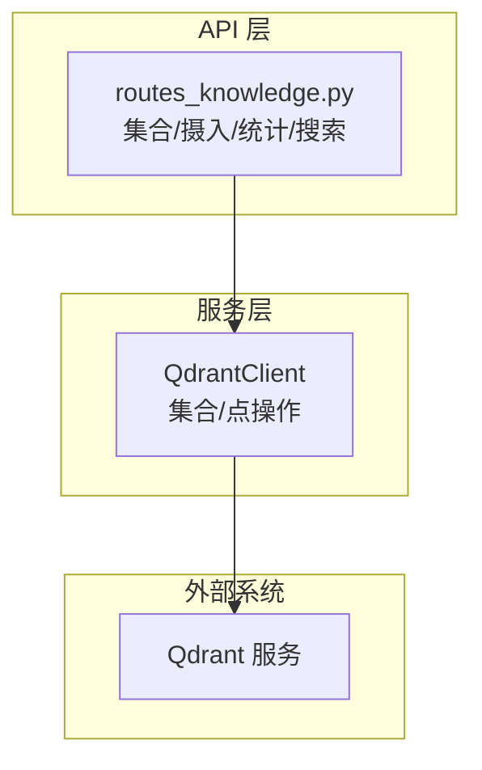
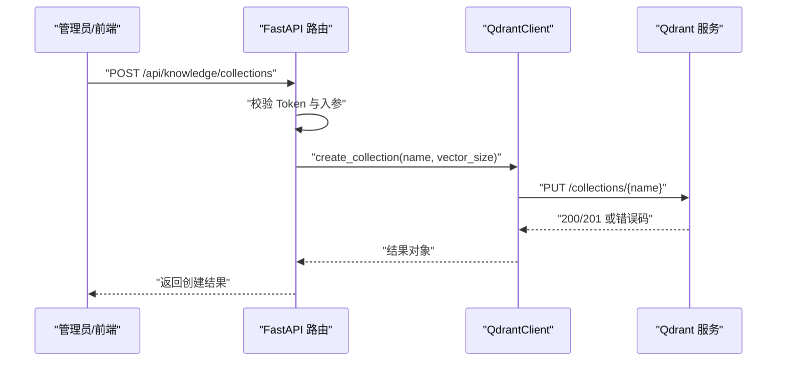
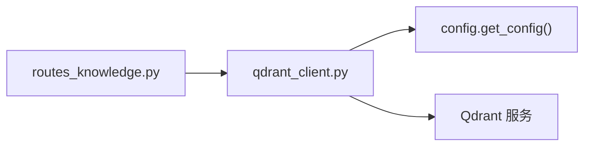

# 集合管理操作

<cite>
**本文引用的文件**
- [server/services/qdrant_client.py](file://server/services/qdrant_client.py)
- [server/api/routes_knowledge.py](file://server/api/routes_knowledge.py)
- [doc/Qdrant知识库操作指南.md](file://doc/Qdrant知识库操作指南.md)
</cite>

## 目录
1. [简介](#简介)
2. [项目结构](#项目结构)
3. [核心组件](#核心组件)
4. [架构总览](#架构总览)
5. [详细组件分析](#详细组件分析)
6. [依赖关系分析](#依赖关系分析)
7. [性能与监控](#性能与监控)
8. [幂等性、错误处理与恢复](#幂等性错误处理与恢复)
9. [业务场景与数据隔离策略](#业务场景与数据隔离策略)
10. [故障排查指南](#故障排查指南)
11. [结论](#结论)

## 简介
本文件面向 RealTimeTalk 系统中的 Qdrant 向量知识库，聚焦“集合（Collection）”的完整生命周期管理：创建、删除、列表查询与信息获取；并深入说明集合配置参数（向量维度、距离度量）、索引策略现状、版本管理与迁移策略、状态监控指标（点数统计、存储使用、性能指标），以及幂等性设计与错误恢复机制。同时给出不同业务场景下的集合划分与数据隔离方案建议。

## 项目结构
与集合管理直接相关的代码位于服务端服务层与 API 路由层：
- 服务层：Qdrant HTTP 客户端封装，提供集合 CRUD、计数、清空重建、批量写入与检索等能力
- API 层：FastAPI 路由暴露集合管理、知识摄入、统计与调试搜索接口，并对请求进行鉴权校验



图表来源
- [server/services/qdrant_client.py:26-112](file://server/services/qdrant_client.py#L26-L112)
- [server/api/routes_knowledge.py:81-128](file://server/api/routes_knowledge.py#L81-L128)

章节来源
- [server/services/qdrant_client.py:26-112](file://server/services/qdrant_client.py#L26-L112)
- [server/api/routes_knowledge.py:81-128](file://server/api/routes_knowledge.py#L81-L128)

## 核心组件
- QdrantClient：异步 HTTP 客户端，封装 Qdrant REST API，提供集合管理、点写入/删除、检索、计数、清空重建等方法
- routes_knowledge：FastAPI 路由，对外暴露集合管理、知识摄入、统计、清空与调试搜索接口，负责入参校验、鉴权与异常包装

章节来源
- [server/services/qdrant_client.py:26-235](file://server/services/qdrant_client.py#L26-L235)
- [server/api/routes_knowledge.py:1-268](file://server/api/routes_knowledge.py#L1-L268)

## 架构总览
集合管理的调用链从前端或管理端发起，经 FastAPI 路由进入服务层，再由 QdrantClient 通过 HTTP 与 Qdrant 交互。



图表来源
- [server/api/routes_knowledge.py:105-117](file://server/api/routes_knowledge.py#L105-L117)
- [server/services/qdrant_client.py:37-59](file://server/services/qdrant_client.py#L37-L59)

## 详细组件分析

### 集合生命周期方法
- 创建集合 create_collection
  - 幂等设计：先检查集合是否存在，存在则直接返回“已存在”，避免重复创建
  - 配置项：支持传入向量维度 vector_size 与距离度量 distance（默认 Cosine）
  - 错误处理：非 200/201 响应抛出统一错误类型，包含状态码便于上层区分
- 删除集合 delete_collection
  - 语义：删除集合及其全部数据
  - 错误处理：404 表示不存在，其他错误码抛出自定义错误
- 列表查询 list_collections
  - 返回所有集合名称列表
- 信息获取 collection_info
  - 返回集合名、点数、向量维度、距离度量等元信息

```mermaid
classDiagram
class QdrantClient {
+create_collection(name, vector_size, distance) dict
+delete_collection(name) void
+list_collections() str[]
+collection_info(name) dict
+count(name) int
+clear_collection(collection) void
}
class RoutesKnowledge {
+GET "/collections"
+POST "/collections"
+DELETE "/collections/{name}"
+GET "/stats"
+DELETE "/clear"
}
RoutesKnowledge --> QdrantClient : "调用"
```

图表来源
- [server/services/qdrant_client.py:37-112](file://server/services/qdrant_client.py#L37-L112)
- [server/api/routes_knowledge.py:81-128](file://server/api/routes_knowledge.py#L81-L128)

章节来源
- [server/services/qdrant_client.py:37-112](file://server/services/qdrant_client.py#L37-L112)
- [server/api/routes_knowledge.py:81-128](file://server/api/routes_knowledge.py#L81-L128)

### 集合配置参数与索引策略
- 向量维度 vector_size
  - 由创建集合时指定，默认 1024，需与嵌入模型输出维度一致
- 距离度量 distance
  - 当前实现仅设置 vectors.size 与 vectors.distance，未显式配置索引策略
  - 如需自定义索引（如 HNSW 参数），可在后续扩展中在创建 payload 中添加 index 相关字段
- 索引策略现状
  - 当前未设置索引参数，使用 Qdrant 默认索引策略
  - 建议在大规模数据场景下评估并显式配置索引参数以提升检索性能

章节来源
- [server/services/qdrant_client.py:37-59](file://server/services/qdrant_client.py#L37-L59)

### 初始化流程、版本管理与迁移策略
- 初始化流程
  - 启动时可通过 list_collections 探测现有集合，按需创建缺失集合
  - 若需要强制重建集合（例如维度变更），可使用 clear_collection 删除并重建
- 版本管理
  - 当前未在集合层面引入显式版本号字段
  - 建议在集合 payload 或元数据中记录 schema 版本，配合迁移脚本进行平滑升级
- 迁移策略
  - 当向量维度或距离度量变更时，采用“新建集合 + 数据迁移 + 切换流量”的策略
  - 利用 clear_collection 可快速清空旧集合数据以重新导入新格式数据

章节来源
- [server/services/qdrant_client.py:206-212](file://server/services/qdrant_client.py#L206-L212)
- [server/api/routes_knowledge.py:220-230](file://server/api/routes_knowledge.py#L220-L230)

### 集合状态监控
- 点数统计 count
  - 精确统计集合中的向量点数，用于健康检查与容量规划
- 集合信息 collection_info
  - 返回 points_count、vector_size、distance 等关键指标
- 存储使用情况
  - 当前未直接暴露磁盘占用指标，可通过 Qdrant 管理界面或运维工具查看
- 性能指标
  - 当前未内置延迟/吞吐指标采集，可在路由层增加耗时统计与日志埋点

章节来源
- [server/services/qdrant_client.py:104-112](file://server/services/qdrant_client.py#L104-L112)
- [server/services/qdrant_client.py:85-102](file://server/services/qdrant_client.py#L85-L102)
- [server/api/routes_knowledge.py:192-217](file://server/api/routes_knowledge.py#L192-L217)

### 集合操作的幂等性与一致性
- 幂等性
  - create_collection 具备幂等性：存在即跳过，返回“exists”
  - delete_collection 非幂等：对不存在的集合会返回 404 错误
- 一致性
  - 清空重建 clear_collection 顺序为：读取集合信息 → 删除集合 → 重建集合，保证维度等配置不变
  - 建议在关键路径增加重试与超时控制，提升网络抖动时的鲁棒性

章节来源
- [server/services/qdrant_client.py:37-59](file://server/services/qdrant_client.py#L37-L59)
- [server/services/qdrant_client.py:61-72](file://server/services/qdrant_client.py#L61-L72)
- [server/services/qdrant_client.py:206-212](file://server/services/qdrant_client.py#L206-L212)

### 错误处理与恢复机制
- 统一错误类型
  - 自定义 QdrantClientError，携带消息与 HTTP 状态码，便于上层分类处理
- 异常传播
  - 路由层捕获异常并转换为 HTTP 500 响应，附带错误详情
- 恢复建议
  - 对网络异常或临时不可用场景，建议在上层增加指数退避重试
  - 对 404 等明确“资源不存在”的错误，可直接降级或提示用户

章节来源
- [server/services/qdrant_client.py:19-24](file://server/services/qdrant_client.py#L19-L24)
- [server/api/routes_knowledge.py:105-117](file://server/api/routes_knowledge.py#L105-L117)
- [server/api/routes_knowledge.py:120-128](file://server/api/routes_knowledge.py#L120-L128)

## 依赖关系分析
- 路由层依赖服务层：routes_knowledge 通过全局注入的 _qdrant 实例调用集合管理方法
- 服务层依赖配置：QdrantClient 从配置中读取 base_url、api_key 与超时设置
- 外部依赖：Qdrant 服务作为向量数据库后端



图表来源
- [server/api/routes_knowledge.py:27-37](file://server/api/routes_knowledge.py#L27-L37)
- [server/services/qdrant_client.py:29-33](file://server/services/qdrant_client.py#L29-L33)

章节来源
- [server/api/routes_knowledge.py:27-37](file://server/api/routes_knowledge.py#L27-L37)
- [server/services/qdrant_client.py:29-33](file://server/services/qdrant_client.py#L29-L33)

## 性能与监控
- 并发检索
  - search_multi 支持多集合并发检索，合并后按分数排序取 Top K，适合跨集合聚合查询
- 统计接口
  - stats 接口汇总各集合点数与总数，便于容量与健康度监控
- 建议增强
  - 在路由层增加请求耗时统计与采样日志
  - 暴露 Qdrant 侧的存储与索引指标（如磁盘使用、索引大小、查询延迟）

章节来源
- [server/services/qdrant_client.py:164-186](file://server/services/qdrant_client.py#L164-L186)
- [server/api/routes_knowledge.py:192-217](file://server/api/routes_knowledge.py#L192-L217)

## 幂等性、错误处理与恢复
- 幂等性设计
  - 创建集合：存在即返回 exists，避免重复创建
  - 删除集合：不存在返回 404，调用方应据此判断是否需要重试或忽略
- 错误分类
  - 404：资源不存在
  - 非 2xx：网络或服务异常
- 恢复策略
  - 对临时错误（如连接超时）进行有限次重试
  - 对 404 等确定性错误不进行重试，直接返回或降级

章节来源
- [server/services/qdrant_client.py:37-59](file://server/services/qdrant_client.py#L37-L59)
- [server/services/qdrant_client.py:61-72](file://server/services/qdrant_client.py#L61-L72)

## 业务场景与数据隔离策略
- 按主题划分集合
  - 将产品手册、公司制度、技术支持、FAQ 等各自独立建集合，便于权限与检索范围控制
- 角色-集合映射
  - 通过配置限定某角色仅能访问特定集合，或在运行时动态选择集合范围
- 数据隔离方案
  - 物理隔离：不同业务域使用不同集合
  - 逻辑隔离：在 payload 中附加租户/部门标识，结合过滤条件实现细粒度隔离
- 命名规范
  - 集合名规范化为小写+下划线，避免特殊字符导致兼容性问题

章节来源
- [doc/Qdrant知识库操作指南.md:142-152](file://doc/Qdrant知识库操作指南.md#L142-L152)
- [server/api/routes_knowledge.py:108-112](file://server/api/routes_knowledge.py#L108-L112)

## 故障排查指南
- 常见问题定位
  - 集合不存在：删除或获取信息时返回 404，确认集合是否已被清理或拼写错误
  - 创建失败：检查向量维度是否与嵌入模型一致，距离度量是否合法
  - 统计为空：确认集合是否已正确创建且已有数据摄入
- 验证步骤
  - 使用列表接口确认集合存在
  - 使用信息接口核对维度与距离
  - 使用统计接口确认点数增长
- 参考文档
  - 知识库操作指南提供了界面化操作流程与最佳实践

章节来源
- [server/services/qdrant_client.py:85-112](file://server/services/qdrant_client.py#L85-L112)
- [doc/Qdrant知识库操作指南.md:196-213](file://doc/Qdrant知识库操作指南.md#L196-L213)

## 结论
RealTimeTalk 的集合管理通过清晰的服务层与 API 层分层实现，具备基础的幂等性与完善的错误处理。当前未显式配置索引策略，建议在大规模数据场景下评估并优化索引参数。通过清晰的集合划分与角色-集合映射，可实现灵活的数据隔离与检索范围控制。未来可进一步增强监控指标与迁移工具，提升系统的可观测性与演进能力。