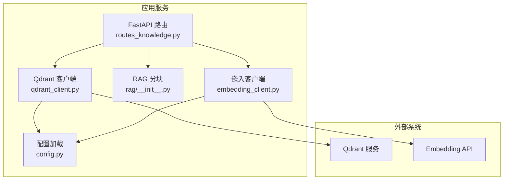
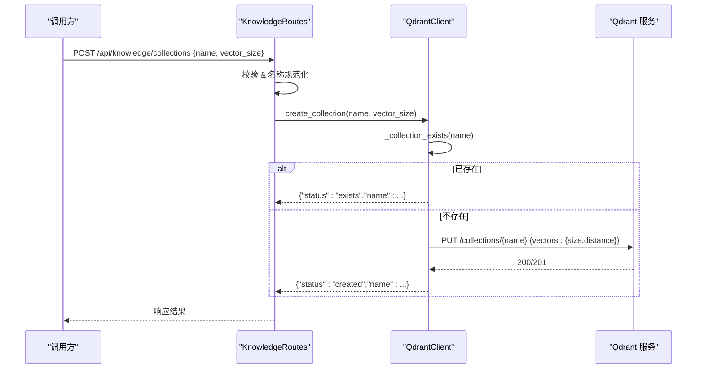
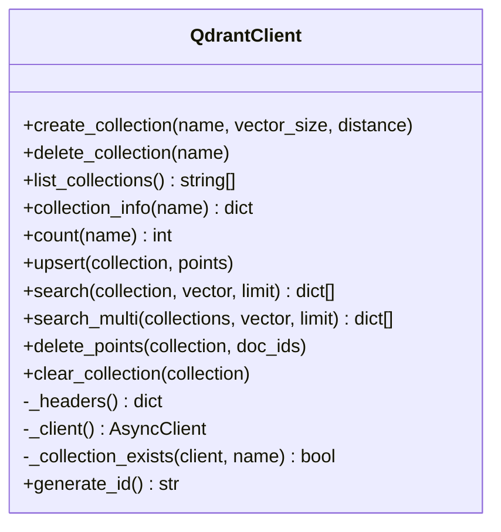
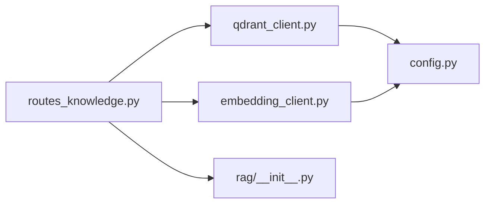

# 集合管理

<cite>
**本文引用的文件**
- [server/services/qdrant_client.py](file://server/services/qdrant_client.py)
- [server/api/routes_knowledge.py](file://server/api/routes_knowledge.py)
- [server/config.py](file://server/config.py)
- [doc/Qdrant知识库操作指南.md](file://doc/Qdrant知识库操作指南.md)
- [server/rag/__init__.py](file://server/rag/__init__.py)
- [server/services/embedding_client.py](file://server/services/embedding_client.py)
</cite>

## 目录
1. [简介](#简介)
2. [项目结构](#项目结构)
3. [核心组件](#核心组件)
4. [架构总览](#架构总览)
5. [详细组件分析](#详细组件分析)
6. [依赖关系分析](#依赖关系分析)
7. [性能与监控](#性能与监控)
8. [故障排查指南](#故障排查指南)
9. [结论](#结论)
10. [附录：API 参考与示例](#附录api-参考与示例)

## 简介
本文件面向 RealTimeTalk 系统中的 Qdrant 集合管理，围绕集合的创建、删除、列表查询与统计信息获取进行系统化说明。文档覆盖集合配置参数（向量维度 vector_size、距离度量 distance）、生命周期管理（存在性检查、自动创建逻辑、错误处理）、批量写入优化、并发安全与事务边界、命名规范与最佳实践，以及集合级监控指标（点数统计、索引状态等）。同时提供基于现有代码路径的“示例”指引，帮助读者快速上手并落地到生产环境。

## 项目结构
RealTimeTalk 中与 Qdrant 集合管理相关的核心位置如下：
- 服务层客户端：Qdrant HTTP 客户端封装了集合 CRUD、点写入、搜索、计数等能力
- API 路由层：暴露 REST 接口用于集合管理与知识摄入、统计查询
- 配置模块：集中加载 Qdrant 连接地址、鉴权 Key 等配置项
- RAG 与嵌入：文本分块与向量化流程，决定集合的向量维度与数据形态
- 用户指南：面向管理员的知识库操作说明



图示来源
- [server/api/routes_knowledge.py:1-268](file://server/api/routes_knowledge.py#L1-L268)
- [server/services/qdrant_client.py:1-235](file://server/services/qdrant_client.py#L1-L235)
- [server/config.py:1-260](file://server/config.py#L1-L260)
- [server/rag/__init__.py:1-83](file://server/rag/__init__.py#L1-L83)
- [server/services/embedding_client.py:1-139](file://server/services/embedding_client.py#L1-L139)

章节来源
- [server/api/routes_knowledge.py:1-268](file://server/api/routes_knowledge.py#L1-L268)
- [server/services/qdrant_client.py:1-235](file://server/services/qdrant_client.py#L1-L235)
- [server/config.py:1-260](file://server/config.py#L1-L260)
- [server/rag/__init__.py:1-83](file://server/rag/__init__.py#L1-L83)
- [server/services/embedding_client.py:1-139](file://server/services/embedding_client.py#L1-L139)

## 核心组件
- QdrantClient：异步 HTTP 客户端，封装集合管理、点写入、检索、计数、清空等能力；内置存在性检查与错误包装
- Knowledge Routes：REST 端点，负责校验 Admin Token、参数校验、调用 QdrantClient 完成集合与数据操作
- Config：统一配置入口，提供 Qdrant URL、API Key、Embedding 模型与端点等
- EmbeddingClient：文本转向量，固定输出维度为 1024，支持批处理与重试
- RAG 分块：长文本按段落或窗口切分，保证语义连续性与检索精度

章节来源
- [server/services/qdrant_client.py:26-235](file://server/services/qdrant_client.py#L26-L235)
- [server/api/routes_knowledge.py:1-268](file://server/api/routes_knowledge.py#L1-L268)
- [server/config.py:58-126](file://server/config.py#L58-L126)
- [server/services/embedding_client.py:26-139](file://server/services/embedding_client.py#L26-L139)
- [server/rag/__init__.py:10-53](file://server/rag/__init__.py#L10-L53)

## 架构总览
集合管理的端到端流程包括：
- 集合创建：API 接收请求 → 名称规范化 → 调用 QdrantClient.create_collection → 存在性检查 → 创建或返回已存在
- 集合删除：API 接收请求 → 调用 QdrantClient.delete_collection → 异常处理与日志
- 集合列表与详情：API 遍历集合名 → 逐个获取集合信息 → 聚合返回
- 统计信息：按集合或全局汇总点数
- 清空集合：读取集合配置 → 删除集合 → 重建集合（保留定义）



图示来源
- [server/api/routes_knowledge.py:105-117](file://server/api/routes_knowledge.py#L105-L117)
- [server/services/qdrant_client.py:37-59](file://server/services/qdrant_client.py#L37-L59)
- [server/services/qdrant_client.py:227-229](file://server/services/qdrant_client.py#L227-L229)

章节来源
- [server/api/routes_knowledge.py:81-128](file://server/api/routes_knowledge.py#L81-L128)
- [server/services/qdrant_client.py:37-112](file://server/services/qdrant_client.py#L37-L112)

## 详细组件分析

### QdrantClient 类设计
- 职责：封装 Qdrant REST API 的集合与点操作，提供幂等的集合创建、健壮的错误处理、并发搜索合并
- 关键方法：
  - create_collection：先检查是否存在，再 PUT 创建；默认 vector_size=1024，distance="Cosine"
  - delete_collection：删除集合及全部数据
  - list_collections：列出所有集合名
  - collection_info：返回 points_count、vector_size、distance
  - count：精确统计集合中点数
  - upsert：批量写入点，内部会再次检查集合存在性
  - search/search_multi：单集合与多集合并发检索，合并排序
  - clear_collection：通过“删除+重建”实现清空
- 内部辅助：
  - _headers/_client：构建带 api-key 的请求头与 httpx.AsyncClient
  - _collection_exists：GET /collections/{name} 判断存在性
  - generate_id：生成唯一文档 ID



图示来源
- [server/services/qdrant_client.py:26-235](file://server/services/qdrant_client.py#L26-L235)

章节来源
- [server/services/qdrant_client.py:26-235](file://server/services/qdrant_client.py#L26-L235)

### REST API 路由层（集合管理）
- GET /api/knowledge/collections：列出所有集合及其 points_count、vector_size、distance
- POST /api/knowledge/collections：创建集合，名称规范化（小写+下划线），透传 vector_size
- DELETE /api/knowledge/collections/{name}：删除集合
- GET /api/knowledge/stats：按集合或全局统计点数
- DELETE /api/knowledge/clear?collection=xxx：清空指定集合（保留集合定义）
- 鉴权：X-Knowledge-Admin-Token 头校验，未配置时放行

```mermaid
flowchart TD
Start(["请求进入"]) --> Auth["校验 Admin Token"]
Auth --> Route{"路由匹配"}
Route --> |GET /collections| List["list_collections()"]
Route --> |POST /collections| Create["create_collection()"]
Route --> |DELETE /collections/{name}| Delete["delete_collection()"]
Route --> |GET /stats| Stats["统计聚合"]
Route --> |DELETE /clear| Clear["clear_collection()"]
List --> End(["返回结果"])
Create --> End
Delete --> End
Stats --> End
Clear --> End
```

图示来源
- [server/api/routes_knowledge.py:81-128](file://server/api/routes_knowledge.py#L81-L128)
- [server/api/routes_knowledge.py:192-230](file://server/api/routes_knowledge.py#L192-L230)

章节来源
- [server/api/routes_knowledge.py:43-51](file://server/api/routes_knowledge.py#L43-L51)
- [server/api/routes_knowledge.py:81-128](file://server/api/routes_knowledge.py#L81-L128)
- [server/api/routes_knowledge.py:192-230](file://server/api/routes_knowledge.py#L192-L230)

### 配置与环境
- Qdrant 配置键：qdrant.url、qdrant.api_key
- Embedding 配置键：embedding.endpoint、embedding.api_key、embedding.model
- 环境变量优先级高于 config.json，支持运行时重载

章节来源
- [server/config.py:111-126](file://server/config.py#L111-L126)
- [server/config.py:148-241](file://server/config.py#L148-L241)

### RAG 与嵌入对集合的影响
- 文本分块：chunk_text 将长文本按段落或窗口切分，控制每块大小与重叠
- 嵌入维度：EmbeddingClient 固定输出维度为 1024，因此集合 vector_size 应与之匹配
- 上下文过滤：RAG 在注入 LLM 前会过滤低分结果（score < 0.3）

章节来源
- [server/rag/__init__.py:10-53](file://server/rag/__init__.py#L10-L53)
- [server/rag/__init__.py:56-83](file://server/rag/__init__.py#L56-L83)
- [server/services/embedding_client.py:29-31](file://server/services/embedding_client.py#L29-L31)

## 依赖关系分析
- routes_knowledge 依赖 qdrant_client 与 embedding_client
- qdrant_client 依赖 config 获取 Qdrant 连接信息与超时设置
- embedding_client 依赖 config 获取 Embedding 端点与模型
- rag 模块被 ingest 流程使用，影响数据形态与检索效果



图示来源
- [server/api/routes_knowledge.py:1-268](file://server/api/routes_knowledge.py#L1-L268)
- [server/services/qdrant_client.py:1-235](file://server/services/qdrant_client.py#L1-L235)
- [server/services/embedding_client.py:1-139](file://server/services/embedding_client.py#L1-L139)
- [server/config.py:1-260](file://server/config.py#L1-L260)
- [server/rag/__init__.py:1-83](file://server/rag/__init__.py#L1-L83)

章节来源
- [server/api/routes_knowledge.py:1-268](file://server/api/routes_knowledge.py#L1-L268)
- [server/services/qdrant_client.py:1-235](file://server/services/qdrant_client.py#L1-L235)
- [server/services/embedding_client.py:1-139](file://server/services/embedding_client.py#L1-L139)
- [server/config.py:1-260](file://server/config.py#L1-L260)
- [server/rag/__init__.py:1-83](file://server/rag/__init__.py#L1-L83)

## 性能与监控
- 点数统计
  - 单集合：GET /api/knowledge/stats?collection=xxx 返回 points_count
  - 全局：GET /api/knowledge/stats 返回 total_collections、total_points、各集合点数
- 集合详情
  - 包含 vector_size、distance、points_count，便于确认配置一致性
- 并发检索
  - search_multi 使用 asyncio.gather 并发检索多个集合，合并后按分数降序取 top_k
- 批量写入
  - upsert 支持批量 points 写入；嵌入侧 embed 支持分批（batch_size=10）
- 事务与一致性
  - 当前无跨集合事务；clear_collection 采用“删除+重建”，注意短暂不可用窗口
- 内存与索引
  - 服务端未直接暴露内存与索引状态字段；可通过集合 points_count 与外部 Qdrant 监控面板观察

章节来源
- [server/api/routes_knowledge.py:192-217](file://server/api/routes_knowledge.py#L192-L217)
- [server/services/qdrant_client.py:164-186](file://server/services/qdrant_client.py#L164-L186)
- [server/services/qdrant_client.py:115-134](file://server/services/qdrant_client.py#L115-L134)
- [server/services/embedding_client.py:63-70](file://server/services/embedding_client.py#L63-L70)
- [server/services/qdrant_client.py:206-212](file://server/services/qdrant_client.py#L206-L212)

## 故障排查指南
- 常见错误类型
  - 集合不存在：delete_collection 与 collection_info 会抛出特定错误码
  - 网络/鉴权失败：httpx 超时、连接错误、401/403/429/5xx 等
  - 参数不合法：空集合名、documents 为空等
- 建议排查步骤
  - 确认 Qdrant 可达与 API Key 正确
  - 确认集合存在且 vector_size 与嵌入维度一致（1024）
  - 查看日志中的错误消息与状态码
  - 使用 /api/knowledge/stats 与 /api/knowledge/collections 验证状态
- 降级策略
  - 当 Qdrant 或 Embedding 不可用时，对话流程可回退至纯 LLM 回答

章节来源
- [server/services/qdrant_client.py:61-72](file://server/services/qdrant_client.py#L61-L72)
- [server/services/qdrant_client.py:85-102](file://server/services/qdrant_client.py#L85-L102)
- [server/api/routes_knowledge.py:105-117](file://server/api/routes_knowledge.py#L105-L117)
- [doc/Qdrant知识库操作指南.md:163-172](file://doc/Qdrant知识库操作指南.md#L163-L172)

## 结论
RealTimeTalk 的 Qdrant 集合管理以 QdrantClient 为核心，结合 FastAPI 路由提供完整的集合 CRUD、统计与清空能力。通过存在性检查与幂等创建、批量写入与并发检索、严格的错误处理与日志记录，系统在易用性与稳定性之间取得平衡。配合 RAG 分块与固定维度的嵌入模型，确保检索质量与一致性。生产部署建议关注集合命名规范、维度与距离度量选择、并发与批处理调优，并结合外部监控完善资源观测。

## 附录：API 参考与示例

### 集合管理 API
- 列出集合
  - 方法：GET
  - 路径：/api/knowledge/collections
  - 鉴权：X-Knowledge-Admin-Token
  - 返回：collections 列表，含 name、points_count、vector_size、distance
- 创建集合
  - 方法：POST
  - 路径：/api/knowledge/collections
  - 请求体：{ "name": "...", "vector_size": 1024 }
  - 行为：名称规范化（小写+下划线），若已存在则返回 exists
- 删除集合
  - 方法：DELETE
  - 路径：/api/knowledge/collections/{name}
  - 行为：物理删除集合与数据
- 统计信息
  - 方法：GET
  - 路径：/api/knowledge/stats?collection=可选
  - 返回：单集合或全局统计（total_collections、total_points、collections）
- 清空集合
  - 方法：DELETE
  - 路径：/api/knowledge/clear?collection=xxx
  - 行为：删除并重建集合，保留定义

章节来源
- [server/api/routes_knowledge.py:81-128](file://server/api/routes_knowledge.py#L81-L128)
- [server/api/routes_knowledge.py:192-230](file://server/api/routes_knowledge.py#L192-L230)

### 集合配置参数
- vector_size
  - 含义：向量维度
  - 默认值：1024（与 text-embedding-v3 匹配）
  - 影响：必须与嵌入模型输出维度一致，否则写入失败
- distance
  - 含义：相似度度量方法
  - 默认值：Cosine
  - 可选值：Cosine、Euclidean、Dot（依据 Qdrant 支持）
  - 影响：不同度量对检索排序有直接影响，需与嵌入模型特性匹配

章节来源
- [server/services/qdrant_client.py:37-59](file://server/services/qdrant_client.py#L37-L59)
- [server/services/embedding_client.py:29-31](file://server/services/embedding_client.py#L29-L31)

### 集合生命周期管理
- 存在性检查
  - 创建前通过 GET /collections/{name} 判断是否已存在
- 自动创建逻辑
  - 若不存在则 PUT /collections/{name} 创建；已存在则跳过
- 错误处理
  - 非 200/201 响应抛出自定义异常，携带状态码与错误片段
  - 404 表示集合不存在，调用方可据此提示或引导创建

章节来源
- [server/services/qdrant_client.py:46-59](file://server/services/qdrant_client.py#L46-L59)
- [server/services/qdrant_client.py:227-229](file://server/services/qdrant_client.py#L227-L229)

### 批量操作与并发安全
- 批量写入
  - upsert 接受 points 列表，减少往返次数
  - 嵌入侧 embed 支持分批（每次最多 10 条），避免超限
- 并发检索
  - search_multi 并发检索多个集合，合并后排序取 top_k
- 事务处理
  - 当前无跨集合事务；clear_collection 为“删除+重建”，注意短暂不可用窗口

章节来源
- [server/services/qdrant_client.py:115-134](file://server/services/qdrant_client.py#L115-L134)
- [server/services/qdrant_client.py:164-186](file://server/services/qdrant_client.py#L164-L186)
- [server/services/embedding_client.py:63-70](file://server/services/embedding_client.py#L63-L70)
- [server/services/qdrant_client.py:206-212](file://server/services/qdrant_client.py#L206-L212)

### 命名规范与最佳实践
- 命名规范
  - 名称规范化：小写、空格与连字符替换为下划线
  - 建议使用有意义的英文或拼音组合，如 product_manual、hr_policy、tech_faq
- 组织策略
  - 按主题分类建集合，定期清理过时内容
  - 角色-集合映射可按需限定检索范围
- 验证生效
  - 先用搜索接口验证知识可被检索，再在对话中验证引用情况

章节来源
- [server/api/routes_knowledge.py:108-111](file://server/api/routes_knowledge.py#L108-L111)
- [doc/Qdrant知识库操作指南.md:182-192](file://doc/Qdrant知识库操作指南.md#L182-L192)

### 代码示例（路径指引）
- 创建集合（幂等）
  - 参考：[server/services/qdrant_client.py:37-59](file://server/services/qdrant_client.py#L37-L59)
- 删除集合
  - 参考：[server/services/qdrant_client.py:61-72](file://server/services/qdrant_client.py#L61-L72)
- 列出集合与详情
  - 参考：[server/services/qdrant_client.py:74-102](file://server/services/qdrant_client.py#L74-L102)
- 统计点数
  - 参考：[server/services/qdrant_client.py:104-111](file://server/services/qdrant_client.py#L104-L111)
- 批量写入点
  - 参考：[server/services/qdrant_client.py:115-134](file://server/services/qdrant_client.py#L115-L134)
- 单集合检索
  - 参考：[server/services/qdrant_client.py:136-162](file://server/services/qdrant_client.py#L136-L162)
- 多集合并发检索
  - 参考：[server/services/qdrant_client.py:164-186](file://server/services/qdrant_client.py#L164-L186)
- 清空集合
  - 参考：[server/services/qdrant_client.py:206-212](file://server/services/qdrant_client.py#L206-L212)
- REST 调用入口
  - 参考：[server/api/routes_knowledge.py:81-128](file://server/api/routes_knowledge.py#L81-L128)