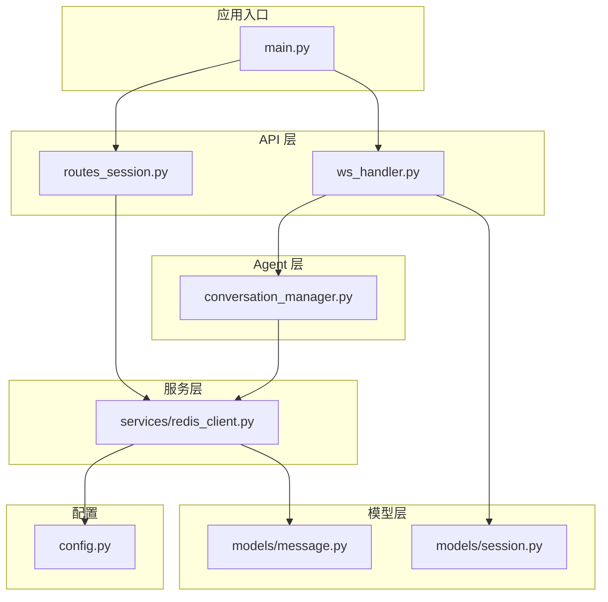
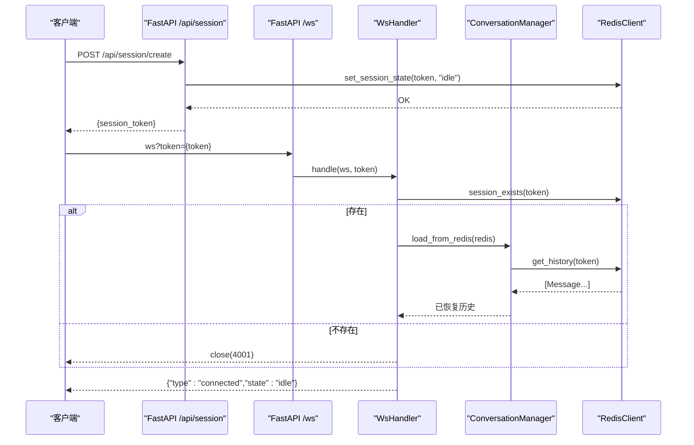
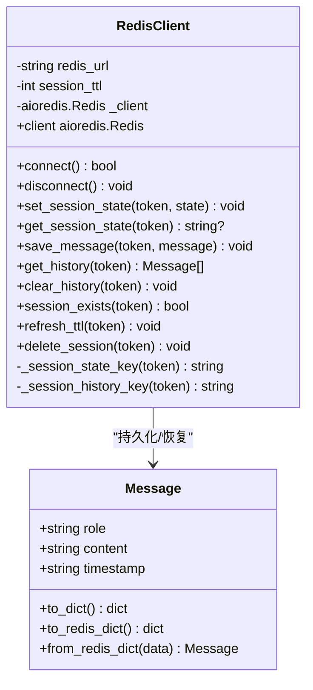
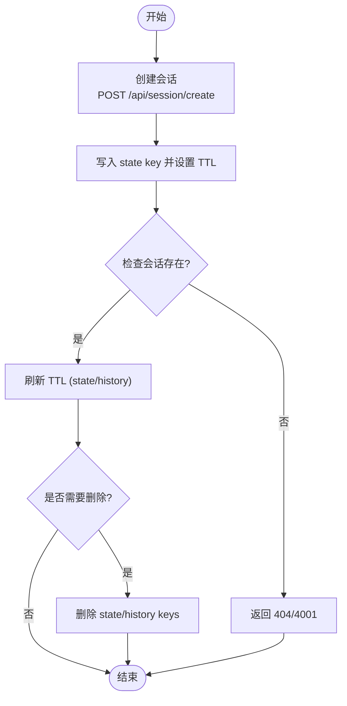
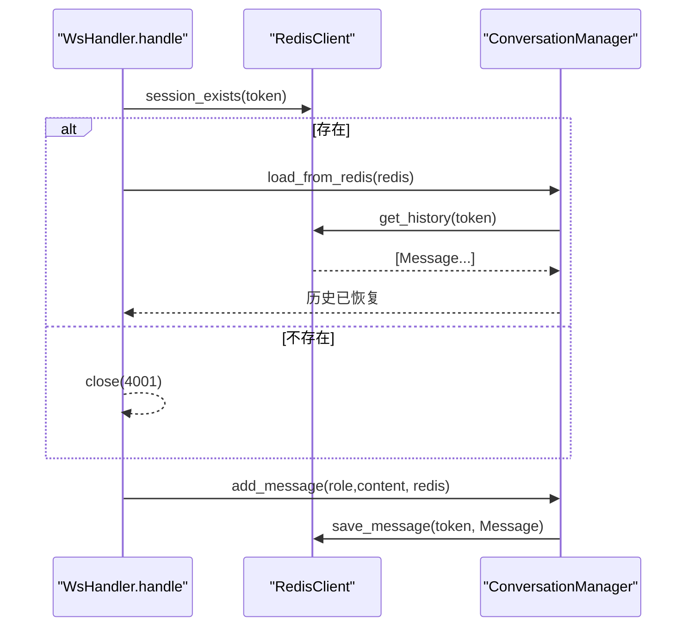
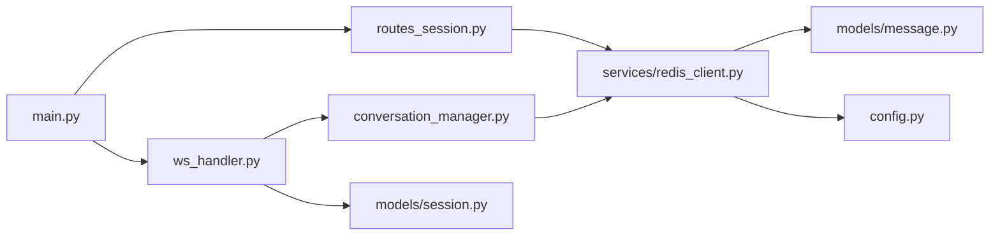

# Redis 会话管理

<cite>
**本文引用的文件**
- [server/services/redis_client.py](file://server/services/redis_client.py)
- [server/models/message.py](file://server/models/message.py)
- [server/models/session.py](file://server/models/session.py)
- [server/api/routes_session.py](file://server/api/routes_session.py)
- [server/api/ws_handler.py](file://server/api/ws_handler.py)
- [server/agent/conversation_manager.py](file://server/agent/conversation_manager.py)
- [server/config.py](file://server/config.py)
- [server/main.py](file://server/main.py)
</cite>

## 目录
1. [简介](#简介)
2. [项目结构](#项目结构)
3. [核心组件](#核心组件)
4. [架构总览](#架构总览)
5. [详细组件分析](#详细组件分析)
6. [依赖关系分析](#依赖关系分析)
7. [性能与内存优化](#性能与内存优化)
8. [故障排查指南](#故障排查指南)
9. [结论](#结论)
10. [附录：使用示例路径](#附录使用示例路径)

## 简介
本文件面向 RealTimeTalk 系统的 Redis 会话管理，聚焦于异步 Redis 客户端封装、会话状态与对话历史的持久化、键命名规范、生命周期管理（创建、刷新 TTL、检查、删除）、错误处理机制，以及配置项与性能调优建议。文档同时给出端到端调用序列图与关键流程图，帮助读者快速理解并正确使用 Redis 进行会话操作。

## 项目结构
与 Redis 会话管理直接相关的代码位于 server 目录下，主要涉及：
- 服务层：Redis 客户端封装与连接管理
- 模型层：消息与会话上下文数据模型
- API 层：REST 路由用于会话创建、历史查询与销毁
- WebSocket 处理器：会话恢复、历史加载与写入
- Agent 层：对话管理器负责从 Redis 恢复历史并在需要时持久化
- 配置与启动：统一配置加载与应用生命周期中的资源初始化与释放

图表来源
- [server/main.py:42-110](file://server/main.py#L42-L110)
- [server/api/routes_session.py:1-123](file://server/api/routes_session.py#L1-L123)
- [server/api/ws_handler.py:37-114](file://server/api/ws_handler.py#L37-L114)
- [server/agent/conversation_manager.py:21-45](file://server/agent/conversation_manager.py#L21-L45)
- [server/services/redis_client.py:22-122](file://server/services/redis_client.py#L22-L122)
- [server/models/message.py:9-33](file://server/models/message.py#L9-L33)
- [server/models/session.py:14-41](file://server/models/session.py#L14-L41)
- [server/config.py:148-241](file://server/config.py#L148-L241)

章节来源
- [server/main.py:42-110](file://server/main.py#L42-L110)
- [server/config.py:148-241](file://server/config.py#L148-L241)

## 核心组件
- RedisClient：异步 Redis 客户端封装，提供连接管理、会话状态读写、对话历史持久化、TTL 刷新与会话删除等能力。
- Message：消息数据模型，定义序列化到 Redis 的字典结构与反序列化方法。
- SessionContext：会话上下文数据类，包含 token、状态、创建时间以及与 agent/pipeline/WebSocket 的关联引用。
- ConversationManager：对话历史管理器，负责从 Redis 恢复历史、追加消息并持久化，以及基于 token 估算的智能摘要策略。
- routes_session：REST 接口，提供会话创建、历史获取与销毁。
- ws_handler：WebSocket 处理器，负责会话校验、从 Redis 恢复上下文、发送事件与处理用户消息。
- config：统一配置加载，合并 JSON 与环境变量，暴露 redis_url 与 session_ttl_hours 等参数。

章节来源
- [server/services/redis_client.py:22-122](file://server/services/redis_client.py#L22-L122)
- [server/models/message.py:9-33](file://server/models/message.py#L9-L33)
- [server/models/session.py:14-41](file://server/models/session.py#L14-L41)
- [server/agent/conversation_manager.py:21-45](file://server/agent/conversation_manager.py#L21-L45)
- [server/api/routes_session.py:28-123](file://server/api/routes_session.py#L28-L123)
- [server/api/ws_handler.py:49-114](file://server/api/ws_handler.py#L49-L114)
- [server/config.py:148-241](file://server/config.py#L148-L241)

## 架构总览
下图展示一次“创建会话 + 建立 WebSocket + 恢复历史”的关键流程，体现 Redis 在其中的角色。

图表来源
- [server/api/routes_session.py:28-47](file://server/api/routes_session.py#L28-L47)
- [server/api/ws_handler.py:49-84](file://server/api/ws_handler.py#L49-L84)
- [server/agent/conversation_manager.py:33-37](file://server/agent/conversation_manager.py#L33-L37)
- [server/services/redis_client.py:108-100](file://server/services/redis_client.py#L108-L100)

## 详细组件分析

### RedisClient 类设计
- 连接管理
  - 通过解析 redis URL 提取 host、port、username、password、db，构造 aioredis.Redis 实例，并使用 ping 验证连通性。
  - 提供 connect/disconnect 与 client 属性，确保在使用前已连接。
- 会话状态存储
  - 键名规范：session:{token}:state
  - 值类型：字符串（如 "idle"）
  - 设置时附带 TTL（秒），默认由配置 session_ttl_hours 换算而来。
- 对话历史持久化
  - 键名规范：session:{token}:history
  - 值类型：JSON 数组元素（按入队顺序保存单条消息的字典）
  - 写入采用 rpush，读取采用 lrange(0,-1)，每条记录以 Message 模型序列化/反序列化。
- 生命周期管理
  - exists：通过 state key 判断会话是否存在（新会话可能尚无历史）。
  - refresh_ttl：对 state 与 history 两个 key 分别 expire 刷新。
  - delete_session：批量删除 state 与 history 两个 key。
- 错误处理
  - 自定义异常 RedisClientError，连接失败或访问未连接实例时抛出。
  - 历史解析异常被捕获并记录警告，不影响整体返回。

图表来源
- [server/services/redis_client.py:22-122](file://server/services/redis_client.py#L22-L122)
- [server/models/message.py:9-33](file://server/models/message.py#L9-L33)

章节来源
- [server/services/redis_client.py:22-122](file://server/services/redis_client.py#L22-L122)
- [server/models/message.py:9-33](file://server/models/message.py#L9-L33)

### 会话数据结构与键命名规范
- 会话状态键：session:{token}:state
  - 用途：标识会话是否存活及当前状态（例如 idle/thinking/speaking/bridging）
  - 值：字符串
  - TTL：由 session_ttl_hours 换算为秒后设置
- 会话历史键：session:{token}:history
  - 用途：按时间顺序保存对话消息
  - 值：JSON 字符串列表，每个元素对应一条 Message 的 to_redis_dict()
  - TTL：与 state 一致，每次写入后 expire 刷新

章节来源
- [server/services/redis_client.py:66-70](file://server/services/redis_client.py#L66-L70)
- [server/services/redis_client.py:72-104](file://server/services/redis_client.py#L72-L104)
- [server/models/message.py:19-32](file://server/models/message.py#L19-L32)

### 会话生命周期管理
- 创建
  - REST 接口 POST /api/session/create 生成 UUID token，并通过 RedisClient.set_session_state 写入初始状态 "idle"，附带 TTL。
- 刷新 TTL
  - 活跃交互中可通过 refresh_ttl 对 state 与 history 两个 key 执行 expire 刷新，避免过期。
- 检查
  - session_exists 通过 state key 的存在性判断会话是否有效；若不存在且内存中亦无上下文，则拒绝后续操作。
- 删除
  - delete_session 清理 state 与 history 两个 key；配合上层逻辑取消 Pipeline、关闭 WebSocket、清理内存与对象存储。

图表来源
- [server/api/routes_session.py:28-47](file://server/api/routes_session.py#L28-L47)
- [server/services/redis_client.py:108-121](file://server/services/redis_client.py#L108-L121)

章节来源
- [server/api/routes_session.py:28-123](file://server/api/routes_session.py#L28-L123)
- [server/services/redis_client.py:108-121](file://server/services/redis_client.py#L108-L121)

### WebSocket 与 Redis 的协作
- 连接阶段
  - 服务端收到 ws?token=... 后，先检查 Redis 中是否存在该 token 的 state key。
  - 若存在，则从 Redis 恢复历史至 ConversationManager，并将 WebSocket 引用挂到 SessionContext。
  - 若不存在，直接关闭连接并提示需先创建会话。
- 运行阶段
  - 用户消息进入后，ConversationManager 将消息追加到本地列表，并通过 RedisClient.save_message 持久化到 history 队列。
  - 必要时可触发智能摘要，减少历史长度，降低 LLM 调用成本。

图表来源
- [server/api/ws_handler.py:49-84](file://server/api/ws_handler.py#L49-L84)
- [server/agent/conversation_manager.py:33-44](file://server/agent/conversation_manager.py#L33-L44)
- [server/services/redis_client.py:82-100](file://server/services/redis_client.py#L82-L100)

章节来源
- [server/api/ws_handler.py:49-114](file://server/api/ws_handler.py#L49-L114)
- [server/agent/conversation_manager.py:33-44](file://server/agent/conversation_manager.py#L33-L44)

### 配置与高级选项
- 配置来源
  - 支持环境变量与 config.json 合并，优先级：环境变量 > JSON。
  - Redis 相关字段：
    - redis.url：Redis 连接 URL（支持用户名、密码、端口、数据库编号）
    - redis.session_ttl_hours：会话 TTL（小时），内部转换为秒
- 连接细节
  - 手动解析 URL，正确处理密码中的特殊字符。
  - 指定 decode_responses=True 与 protocol=2，便于字符串处理与兼容性。
- 注意
  - 当前实现未显式配置连接池大小、超时、重试等参数，如需生产级高可用，可在构造 Redis 实例时补充相应参数。

章节来源
- [server/config.py:148-241](file://server/config.py#L148-L241)
- [server/services/redis_client.py:25-50](file://server/services/redis_client.py#L25-L50)

## 依赖关系分析
- main.py 在应用启动时初始化 RedisClient 并尝试连接，失败则终止进程；在关闭时断开连接。
- routes_session 注入 RedisClient 实例，提供 REST 接口。
- ws_handler 接收 token，借助 RedisClient 校验与会话恢复。
- conversation_manager 依赖 RedisClient 完成历史加载与持久化。
- message 模型提供序列化/反序列化方法，保证 Redis 存储格式一致性。

图表来源
- [server/main.py:42-110](file://server/main.py#L42-L110)
- [server/api/routes_session.py:1-123](file://server/api/routes_session.py#L1-L123)
- [server/api/ws_handler.py:37-114](file://server/api/ws_handler.py#L37-L114)
- [server/agent/conversation_manager.py:21-45](file://server/agent/conversation_manager.py#L21-L45)
- [server/services/redis_client.py:22-122](file://server/services/redis_client.py#L22-L122)
- [server/models/message.py:9-33](file://server/models/message.py#L9-L33)
- [server/models/session.py:14-41](file://server/models/session.py#L14-L41)
- [server/config.py:148-241](file://server/config.py#L148-L241)

章节来源
- [server/main.py:42-110](file://server/main.py#L42-L110)
- [server/api/routes_session.py:1-123](file://server/api/routes_session.py#L1-L123)
- [server/api/ws_handler.py:37-114](file://server/api/ws_handler.py#L37-L114)
- [server/agent/conversation_manager.py:21-45](file://server/agent/conversation_manager.py#L21-L45)
- [server/services/redis_client.py:22-122](file://server/services/redis_client.py#L22-L122)
- [server/models/message.py:9-33](file://server/models/message.py#L9-L33)
- [server/models/session.py:14-41](file://server/models/session.py#L14-L41)
- [server/config.py:148-241](file://server/config.py#L148-L241)

## 性能与内存优化
- 会话 TTL 策略
  - 合理设置 session_ttl_hours，平衡活跃度与内存占用。长时间不活跃的会话应尽快过期。
- 历史长度控制
  - 结合 ConversationManager 的智能摘要阈值，限制历史长度，减少 Redis 队列体积与网络传输开销。
- 批量操作
  - 当前实现为逐条 rpush 与 expire，建议在高频写入场景考虑批量化或流水线提交以降低 RTT。
- 连接池与并发
  - 当前未显式配置连接池大小与超时，生产环境建议根据并发量调整连接池参数，并设置合理的 socket 超时与重试策略。
- 键空间与分片
  - 使用统一的命名空间 session:{token}:*，便于监控与清理；在高规模部署时可考虑多 DB 或集群分片。
- 监控与告警
  - 关注 Redis 内存使用、慢查询、命中率与连接数，结合日志定位异常。

[本节为通用指导，无需具体文件引用]

## 故障排查指南
- 连接失败
  - 现象：启动时报错并退出，或健康检查显示 redis=false。
  - 排查：确认 redis.url 正确、网络可达、密码与 db 号无误；查看日志中的连接失败信息。
- 会话不存在
  - 现象：GET /api/session/{token}/history 返回 404；WebSocket 连接被 4001 关闭。
  - 排查：确认是否先调用 POST /api/session/create；检查 state key 是否存在；确认 TTL 未过期。
- 历史解析异常
  - 现象：日志中出现解析对话历史失败的警告。
  - 排查：检查历史键中的数据是否为合法 JSON；确认 Message 模型字段变更导致的兼容性问题。
- 资源未释放
  - 现象：服务关闭后仍有连接残留。
  - 排查：确认 lifespan 中 disconnect 是否执行；检查异常分支是否提前退出。

章节来源
- [server/main.py:53-60](file://server/main.py#L53-L60)
- [server/main.py:106-108](file://server/main.py#L106-L108)
- [server/api/routes_session.py:50-72](file://server/api/routes_session.py#L50-L72)
- [server/api/ws_handler.py:61-73](file://server/api/ws_handler.py#L61-L73)
- [server/services/redis_client.py:94-100](file://server/services/redis_client.py#L94-L100)

## 结论
RealTimeTalk 的 Redis 会话管理以简洁清晰的键命名与分层职责实现了可靠的会话状态与历史持久化。RedisClient 作为统一抽象，屏蔽了底层连接细节与错误处理；会话生命周期贯穿 REST 与 WebSocket 两条路径，并通过 TTL 自动回收。在生产环境中，建议进一步细化连接池与超时配置，并结合业务负载优化历史长度与 TTL 策略，以获得更稳定的性能表现。

[本节为总结，无需具体文件引用]

## 附录：使用示例路径
以下列出常用操作的代码片段路径，便于快速定位实现与参考：
- 创建会话并写入初始状态
  - [server/api/routes_session.py:28-47](file://server/api/routes_session.py#L28-L47)
  - [server/services/redis_client.py:72-74](file://server/services/redis_client.py#L72-L74)
- 检查会话是否存在
  - [server/services/redis_client.py:108-110](file://server/services/redis_client.py#L108-L110)
- 刷新会话 TTL
  - [server/services/redis_client.py:112-116](file://server/services/redis_client.py#L112-L116)
- 保存对话消息
  - [server/agent/conversation_manager.py:39-44](file://server/agent/conversation_manager.py#L39-L44)
  - [server/services/redis_client.py:82-87](file://server/services/redis_client.py#L82-87)
- 获取完整历史
  - [server/services/redis_client.py:89-100](file://server/services/redis_client.py#L89-100)
- 删除会话
  - [server/api/routes_session.py:75-122](file://server/api/routes_session.py#L75-L122)
  - [server/services/redis_client.py:118-121](file://server/services/redis_client.py#L118-L121)
- WebSocket 恢复历史
  - [server/api/ws_handler.py:61-84](file://server/api/ws_handler.py#L61-L84)
  - [server/agent/conversation_manager.py:33-37](file://server/agent/conversation_manager.py#L33-L37)
- 配置项说明
  - [server/config.py:206-209](file://server/config.py#L206-L209)
- 应用启动与连接检查
  - [server/main.py:53-60](file://server/main.py#L53-L60)
  - [server/main.py:106-108](file://server/main.py#L106-L108)