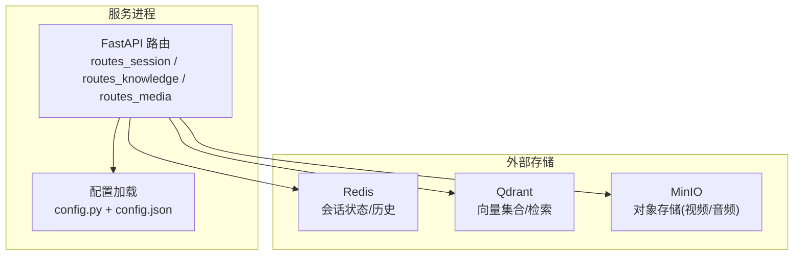
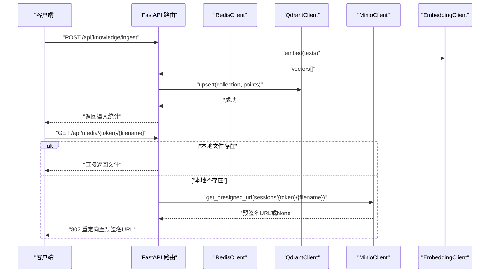
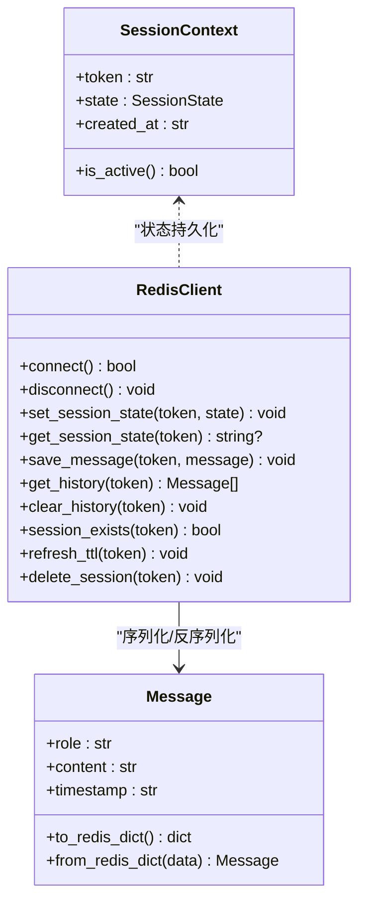
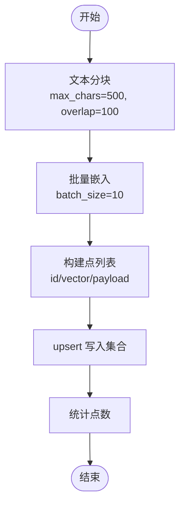
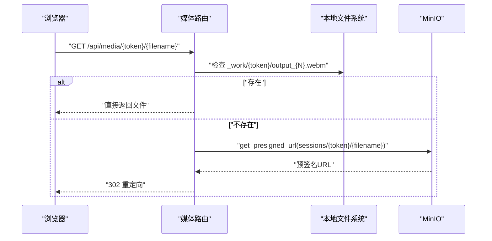
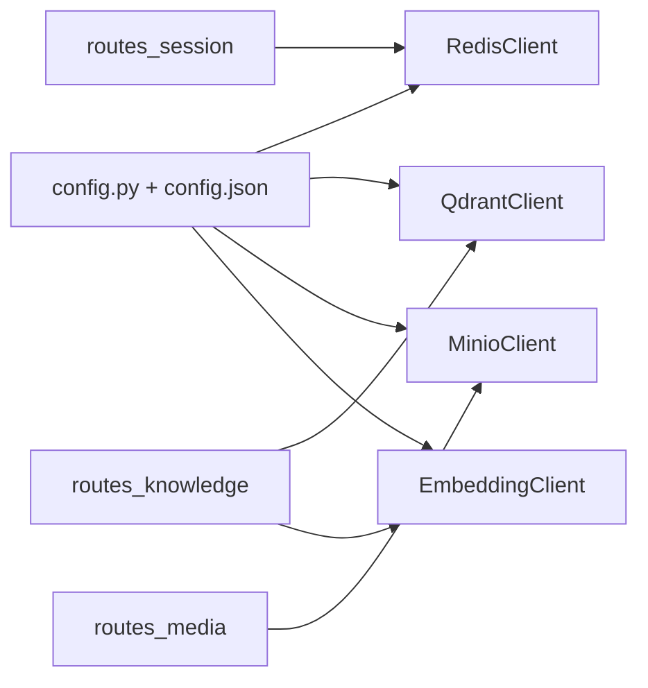

# 数据存储设计

<cite>
**本文引用的文件**   
- [server/services/redis_client.py](file://server/services/redis_client.py)
- [server/services/qdrant_client.py](file://server/services/qdrant_client.py)
- [server/services/minio_client.py](file://server/services/minio_client.py)
- [server/config.py](file://server/config.py)
- [config.json](file://config.json)
- [server/models/session.py](file://server/models/session.py)
- [server/models/message.py](file://server/models/message.py)
- [server/api/routes_session.py](file://server/api/routes_session.py)
- [server/api/routes_knowledge.py](file://server/api/routes_knowledge.py)
- [server/api/routes_media.py](file://server/api/routes_media.py)
- [server/rag/__init__.py](file://server/rag/__init__.py)
- [server/services/embedding_client.py](file://server/services/embedding_client.py)
- [docker-compose.yml](file://docker-compose.yml)
</cite>

## 目录
1. [引言](#引言)
2. [项目结构](#项目结构)
3. [核心组件](#核心组件)
4. [架构总览](#架构总览)
5. [详细组件分析](#详细组件分析)
6. [依赖关系分析](#依赖关系分析)
7. [性能与缓存策略](#性能与缓存策略)
8. [数据生命周期与保留策略](#数据生命周期与保留策略)
9. [数据安全、隐私与访问控制](#数据安全隐私与访问控制)
10. [配置示例与最佳实践](#配置示例与最佳实践)
11. [故障排查指南](#故障排查指南)
12. [结论](#结论)

## 引言
本设计文档聚焦 RealTimeTalk 系统的数据存储层，覆盖 Redis 会话管理、Qdrant 向量数据库与 MinIO 对象存储的设计与实现。文档详细说明：
- 会话数据结构、状态持久化与过期策略
- Qdrant 集合结构设计、向量索引策略与检索优化
- MinIO 文件组织、预签名 URL 机制与存储优化
- 数据访问模式、缓存策略与性能考量
- 数据生命周期、保留策略与归档规则
- 数据迁移路径与版本管理建议
- 数据安全、隐私要求与访问控制
- 具体配置示例与最佳实践

## 项目结构
RealTimeTalk 的数据存储相关代码主要分布在 services、models、api 与 rag 模块中，并通过 config 统一加载配置。关键文件包括：
- Redis 客户端与会话路由：RedisClient、routes_session
- Qdrant 客户端与知识摄入：QdrantClient、routes_knowledge、embedding_client、rag
- MinIO 客户端与媒体代理：MinioClient、routes_media
- 配置中心：config.py 与 config.json
- 数据模型：session.py、message.py

图表来源
- [server/api/routes_session.py:1-123](file://server/api/routes_session.py#L1-L123)
- [server/api/routes_knowledge.py:1-268](file://server/api/routes_knowledge.py#L1-L268)
- [server/api/routes_media.py:1-65](file://server/api/routes_media.py#L1-L65)
- [server/config.py:148-260](file://server/config.py#L148-L260)
- [config.json:1-39](file://config.json#L1-L39)

章节来源
- [server/api/routes_session.py:1-123](file://server/api/routes_session.py#L1-L123)
- [server/api/routes_knowledge.py:1-268](file://server/api/routes_knowledge.py#L1-L268)
- [server/api/routes_media.py:1-65](file://server/api/routes_media.py#L1-L65)
- [server/config.py:148-260](file://server/config.py#L148-L260)
- [config.json:1-39](file://config.json#L1-L39)

## 核心组件
- Redis 会话管理
  - 会话状态键：session:{token}:state（TTL 由配置决定）
  - 对话历史键：session:{token}:history（列表，元素为 JSON 序列化消息）
  - 会话存在性检查基于 state key；提供刷新 TTL、删除会话等能力
- Qdrant 知识库
  - 集合维度默认 1024，距离度量 Cosine
  - 支持 upsert、search、search_multi、delete_points、clear_collection
  - 通过 embedding_client 将文本切块并生成向量后入库
- MinIO 对象存储
  - Bucket 自动创建与存在性检查
  - 上传、对象存在性判断、按前缀批量删除
  - 预签名 URL 生成用于浏览器直连下载

章节来源
- [server/services/redis_client.py:22-122](file://server/services/redis_client.py#L22-L122)
- [server/services/qdrant_client.py:26-235](file://server/services/qdrant_client.py#L26-L235)
- [server/services/minio_client.py:21-139](file://server/services/minio_client.py#L21-L139)
- [server/services/embedding_client.py:26-149](file://server/services/embedding_client.py#L26-L149)
- [server/rag/__init__.py:10-83](file://server/rag/__init__.py#L10-L83)

## 架构总览
下图展示从请求到各存储的调用链路与数据流向。

图表来源
- [server/api/routes_knowledge.py:134-186](file://server/api/routes_knowledge.py#L134-L186)
- [server/services/embedding_client.py:47-70](file://server/services/embedding_client.py#L47-L70)
- [server/services/qdrant_client.py:115-134](file://server/services/qdrant_client.py#L115-L134)
- [server/api/routes_media.py:18-64](file://server/api/routes_media.py#L18-L64)
- [server/services/minio_client.py:102-124](file://server/services/minio_client.py#L102-L124)

## 详细组件分析

### Redis 会话管理
- 数据结构
  - 会话状态：键 session:{token}:state，值为一串状态标识（如 idle/thinking/speaking/bridging），设置 TTL
  - 对话历史：键 session:{token}:history，值为有序列表，每个元素为 Message 的 JSON 字典
- 状态与模型
  - SessionState 枚举定义会话播放状态
  - Message 数据类包含 role、content、timestamp，并提供 to_redis_dict/from_redis_dict 转换
- 操作语义
  - set/get/delete 会话状态
  - rpush 追加消息、lrange 读取完整历史、expire 刷新 TTL
  - session_exists 基于 state key 判定会话是否存在
  - delete_session 清理 state 与 history 两个 key

图表来源
- [server/services/redis_client.py:22-122](file://server/services/redis_client.py#L22-L122)
- [server/models/message.py:9-33](file://server/models/message.py#L9-L33)
- [server/models/session.py:14-41](file://server/models/session.py#L14-L41)

章节来源
- [server/services/redis_client.py:22-122](file://server/services/redis_client.py#L22-L122)
- [server/models/message.py:9-33](file://server/models/message.py#L9-L33)
- [server/models/session.py:14-41](file://server/models/session.py#L14-L41)

### Qdrant 向量数据库
- 集合设计
  - 向量维度：默认 1024（与 embedding_client 一致）
  - 距离度量：Cosine
  - 点结构：id（UUID）、vector（float[]）、payload（text/source）
- 索引与检索
  - 使用 REST API 进行 upsert/search/search_multi
  - search_multi 并发检索多个集合，合并结果并按分数降序取 top_k
- 知识摄入流程
  - 文本分块（chunk_text）→ 批量嵌入（embedding_client.embed）→ upsert 写入 → 统计计数

图表来源
- [server/rag/__init__.py:10-53](file://server/rag/__init__.py#L10-L53)
- [server/services/embedding_client.py:47-70](file://server/services/embedding_client.py#L47-L70)
- [server/services/qdrant_client.py:115-134](file://server/services/qdrant_client.py#L115-L134)

章节来源
- [server/services/qdrant_client.py:26-235](file://server/services/qdrant_client.py#L26-L235)
- [server/services/embedding_client.py:26-149](file://server/services/embedding_client.py#L26-L149)
- [server/rag/__init__.py:10-83](file://server/rag/__init__.py#L10-L83)
- [server/api/routes_knowledge.py:134-186](file://server/api/routes_knowledge.py#L134-L186)

### MinIO 对象存储
- 文件组织
  - 会话隔离前缀：sessions/{token}/
  - 媒体文件命名：segment_X.webm 或 output_X.webm（媒体路由会做映射）
- 预签名 URL 机制
  - 优先尝试本地文件（_work/{token}/output_X.webm 或原始文件名）
  - 若本地不存在，则生成 MinIO 预签名 URL 并重定向
- 生命周期管理
  - 销毁会话时异步删除 sessions/{token}/ 前缀下所有对象

图表来源
- [server/api/routes_media.py:18-64](file://server/api/routes_media.py#L18-L64)
- [server/services/minio_client.py:102-124](file://server/services/minio_client.py#L102-L124)
- [server/api/routes_session.py:111-120](file://server/api/routes_session.py#L111-L120)

章节来源
- [server/api/routes_media.py:18-64](file://server/api/routes_media.py#L18-L64)
- [server/services/minio_client.py:21-139](file://server/services/minio_client.py#L21-L139)
- [server/api/routes_session.py:75-123](file://server/api/routes_session.py#L75-L123)

## 依赖关系分析
- 配置依赖
  - Redis：url、session_ttl_hours
  - MinIO：endpoint、access_key、secret_key、bucket、presigned_url_ttl_seconds
  - Qdrant：url、api_key
  - Embedding：endpoint、api_key、model
- 运行时依赖
  - docker-compose 编排 Redis、Qdrant、MinIO、Server、Nginx 服务，并挂载数据卷

图表来源
- [server/config.py:148-260](file://server/config.py#L148-L260)
- [config.json:1-39](file://config.json#L1-L39)
- [server/services/redis_client.py:22-122](file://server/services/redis_client.py#L22-L122)
- [server/services/qdrant_client.py:26-235](file://server/services/qdrant_client.py#L26-L235)
- [server/services/minio_client.py:21-139](file://server/services/minio_client.py#L21-L139)
- [server/services/embedding_client.py:26-149](file://server/services/embedding_client.py#L26-L149)
- [server/api/routes_session.py:1-123](file://server/api/routes_session.py#L1-L123)
- [server/api/routes_knowledge.py:1-268](file://server/api/routes_knowledge.py#L1-L268)
- [server/api/routes_media.py:1-65](file://server/api/routes_media.py#L1-L65)

章节来源
- [docker-compose.yml:1-69](file://docker-compose.yml#L1-L69)
- [server/config.py:148-260](file://server/config.py#L148-L260)
- [config.json:1-39](file://config.json#L1-L39)

## 性能与缓存策略
- Redis
  - 会话历史采用列表追加与全量读取，适合中小规模会话；长会话可考虑分页或滚动窗口
  - 利用 TTL 自动过期，避免手动清理；活跃会话可通过 refresh_ttl 延长
- Qdrant
  - 批量 upsert 减少网络往返；search_multi 并发检索多集合提升吞吐
  - 合理设置 top_k 与过滤阈值（RAG 上下文构建时过滤低分结果）
- MinIO
  - 预签名 URL 降低服务器带宽压力；本地文件优先回退提升首屏速度
  - 按会话前缀组织便于批量清理与容量治理

[本节为通用性能讨论，不直接分析具体文件]

## 数据生命周期与保留策略
- Redis 会话
  - 会话状态与历史均受 TTL 控制，默认 24 小时（可配置）
  - 会话销毁接口主动清理 state/history 与 MinIO 前缀
- Qdrant 集合
  - 支持 clear_collection（重建集合定义）与 delete_points（按 ID 删除）
  - 建议定期统计与审计集合大小
- MinIO 对象
  - 按 sessions/{token}/ 前缀隔离；会话销毁时删除对应前缀
  - 建议结合对象生命周期策略（如按天/周归档或转冷存储）

章节来源
- [server/services/redis_client.py:72-122](file://server/services/redis_client.py#L72-L122)
- [server/api/routes_session.py:75-123](file://server/api/routes_session.py#L75-L123)
- [server/services/qdrant_client.py:206-212](file://server/services/qdrant_client.py#L206-L212)
- [server/services/minio_client.py:126-138](file://server/services/minio_client.py#L126-L138)

## 数据安全、隐私与访问控制
- 鉴权与令牌
  - 知识管理接口受 X-Knowledge-Admin-Token 保护；未配置 token 时放行（生产环境务必配置）
- 传输安全
  - 容器内部署默认非 TLS（MinIO secure=False）；对外可通过 Nginx 反向代理启用 HTTPS
- 访问控制
  - 会话隔离通过 token 前缀与独立 key 空间保证
  - 预签名 URL 具备时效性，限制泄露风险

章节来源
- [server/api/routes_knowledge.py:43-51](file://server/api/routes_knowledge.py#L43-L51)
- [server/services/minio_client.py:34-46](file://server/services/minio_client.py#L34-L46)
- [nginx-pulan.conf:18-34](file://nginx-pulan.conf#L18-L34)

## 配置示例与最佳实践
- 环境变量与配置文件
  - 优先级：环境变量 > config.json
  - 关键项：
    - REDIS_URL、REDIS_SESSION_TTL_HOURS
    - MINIO_ENDPOINT、MINIO_ACCESS_KEY、MINIO_SECRET_KEY、MINIO_BUCKET、MINIO_PRESIGNED_URL_TTL_SECONDS
    - QDRANT_URL、QDRANT_API_KEY
    - EMBEDDING_ENDPOINT、EMBEDDING_MODEL、EMBEDDING_API_KEY
- 推荐实践
  - 生产环境开启 HTTPS 与最小权限原则（MinIO 独立用户/桶策略）
  - 为 Qdrant 启用 api-key 鉴权
  - 合理设置 Redis TTL 与 MinIO 预签名有效期，平衡可用性与安全性
  - 对大体积媒体文件启用 CDN 或边缘缓存

章节来源
- [server/config.py:73-126](file://server/config.py#L73-L126)
- [server/config.py:148-260](file://server/config.py#L148-L260)
- [config.json:1-39](file://config.json#L1-L39)
- [docker-compose.yml:32-52](file://docker-compose.yml#L32-L52)

## 故障排查指南
- Redis
  - 连接失败：检查 redis_url、端口与密码解析；确认 ping 成功
  - 会话不存在：确认 state key 是否被 TTL 回收或误删
- Qdrant
  - 集合不存在：先调用 create_collection；检查 url 与 api-key
  - 搜索失败：检查集合维度与距离度量是否与嵌入模型一致
- MinIO
  - 预签名 URL 为空：确认对象存在且 endpoint/密钥正确；检查网络可达性
  - 媒体无法播放：优先检查本地 _work 输出文件是否存在

章节来源
- [server/services/redis_client.py:31-50](file://server/services/redis_client.py#L31-L50)
- [server/services/qdrant_client.py:37-59](file://server/services/qdrant_client.py#L37-L59)
- [server/services/minio_client.py:102-124](file://server/services/minio_client.py#L102-L124)
- [server/api/routes_media.py:32-64](file://server/api/routes_media.py#L32-L64)

## 结论
RealTimeTalk 的数据存储层以 Redis 承载会话状态与短期历史、Qdrant 提供高维向量检索、MinIO 负责多媒体对象存储。通过统一的配置管理与清晰的 API 封装，系统在可用性、可扩展性与安全性方面具备良好的工程基础。建议在后续迭代中引入更细粒度的索引策略、冷热分层与合规审计，以满足更大规模与更强监管场景的需求。