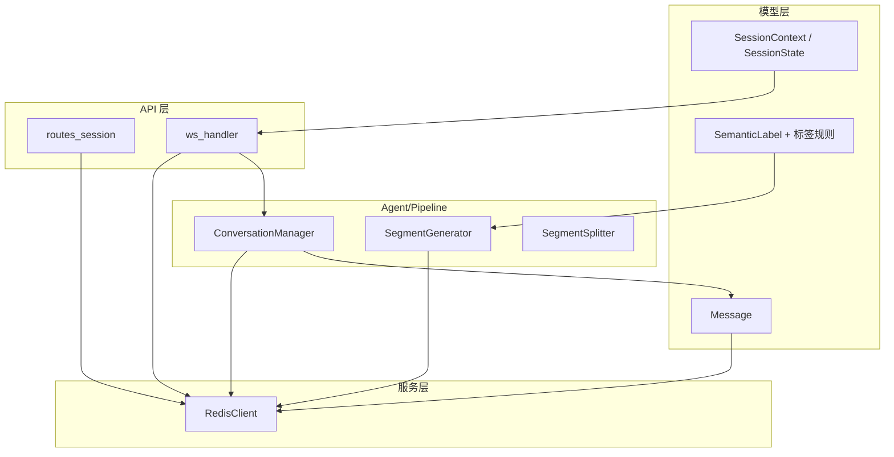
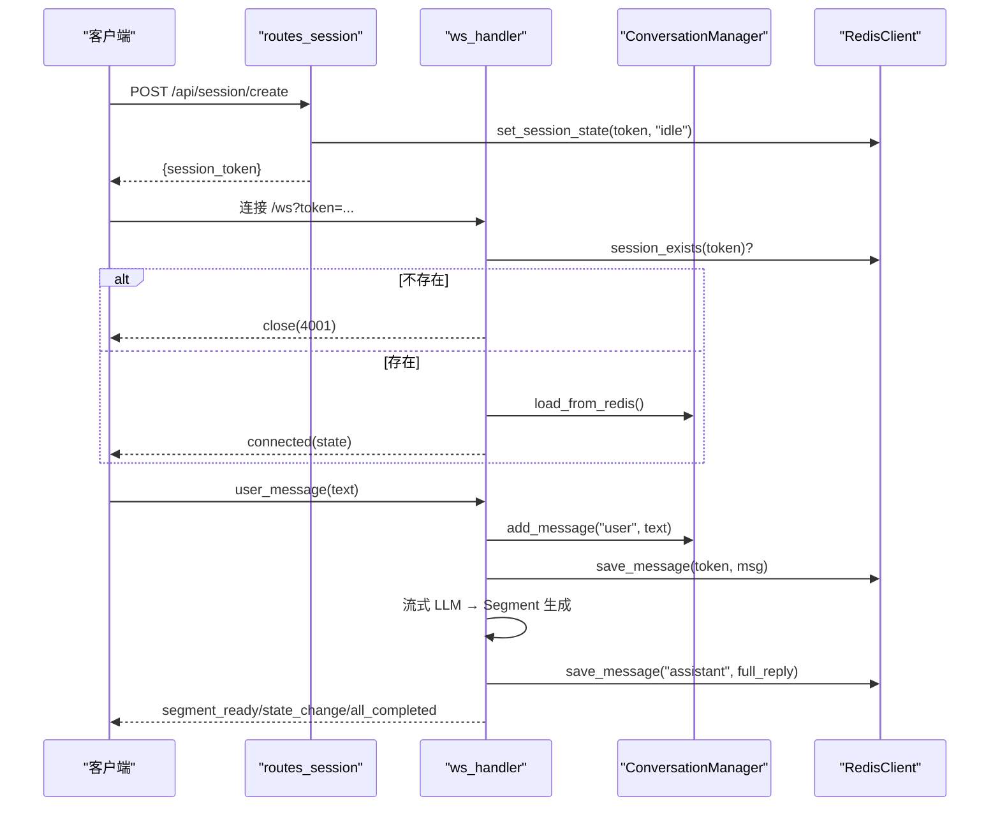
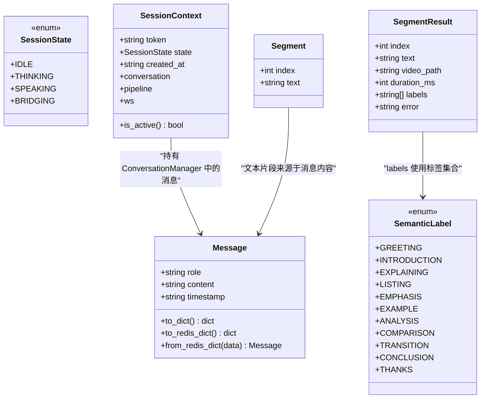
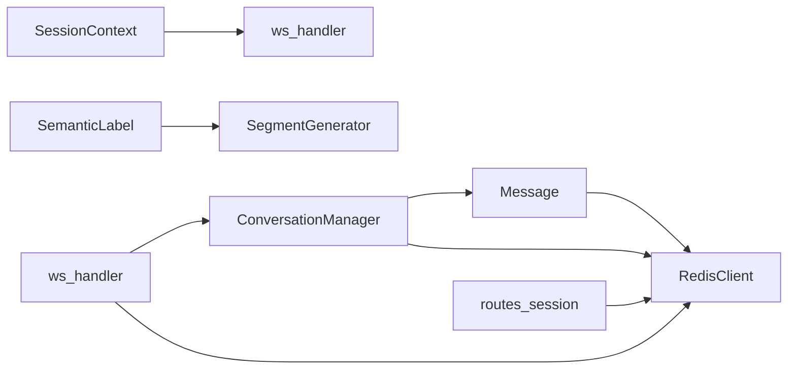

# 数据模型设计

<cite>
**本文引用的文件**
- [server/models/message.py](file://server/models/message.py)
- [server/models/session.py](file://server/models/session.py)
- [server/models/semantic_label.py](file://server/models/semantic_label.py)
- [server/models/__init__.py](file://server/models/__init__.py)
- [server/services/redis_client.py](file://server/services/redis_client.py)
- [server/api/routes_session.py](file://server/api/routes_session.py)
- [server/api/ws_handler.py](file://server/api/ws_handler.py)
- [server/agent/conversation_manager.py](file://server/agent/conversation_manager.py)
- [server/pipeline/segment_generator.py](file://server/pipeline/segment_generator.py)
- [server/pipeline/segment_splitter.py](file://server/pipeline/segment_splitter.py)
- [server/config.py](file://server/config.py)
- [config.json](file://config.json)
</cite>

## 目录
1. [引言](#引言)
2. [项目结构](#项目结构)
3. [核心组件](#核心组件)
4. [架构总览](#架构总览)
5. [详细组件分析](#详细组件分析)
6. [依赖关系分析](#依赖关系分析)
7. [性能考虑](#性能考虑)
8. [故障排查指南](#故障排查指南)
9. [结论](#结论)
10. [附录](#附录)

## 引言
本文件面向 RealTimeTalk 系统的数据模型设计与实现，聚焦以下目标：
- 定义并解释核心数据实体（Session、Message、SemanticLabel）的字段、类型与业务规则
- 描述实体间关系映射（一对多、多对多）、键约束与一致性策略
- 文档化数据验证规则（必填、格式、业务逻辑）
- 说明序列化与反序列化（JSON、Redis、API 响应）
- 给出数据迁移策略（版本兼容、向后兼容、升级脚本思路）
- 提供创建、查询、更新记录的示例路径
- 覆盖完整性保证、事务处理与并发控制
- 涵盖加密、隐私保护与合规性要求

## 项目结构
RealTimeTalk 后端采用分层组织：models 层定义数据模型；services 层封装外部存储（如 Redis）；api 层暴露 REST/WS 接口；agent 与 pipeline 层负责对话与媒体生成。

图表来源
- [server/models/message.py:1-33](file://server/models/message.py#L1-L33)
- [server/models/session.py:1-41](file://server/models/session.py#L1-L41)
- [server/models/semantic_label.py:1-80](file://server/models/semantic_label.py#L1-L80)
- [server/services/redis_client.py:1-122](file://server/services/redis_client.py#L1-L122)
- [server/api/routes_session.py:1-123](file://server/api/routes_session.py#L1-L123)
- [server/api/ws_handler.py:1-444](file://server/api/ws_handler.py#L1-L444)
- [server/agent/conversation_manager.py:1-139](file://server/agent/conversation_manager.py#L1-L139)
- [server/pipeline/segment_generator.py:1-138](file://server/pipeline/segment_generator.py#L1-L138)
- [server/pipeline/segment_splitter.py:1-95](file://server/pipeline/segment_splitter.py#L1-L95)

章节来源
- [server/models/message.py:1-33](file://server/models/message.py#L1-L33)
- [server/models/session.py:1-41](file://server/models/session.py#L1-L41)
- [server/models/semantic_label.py:1-80](file://server/models/semantic_label.py#L1-L80)
- [server/services/redis_client.py:1-122](file://server/services/redis_client.py#L1-L122)
- [server/api/routes_session.py:1-123](file://server/api/routes_session.py#L1-L123)
- [server/api/ws_handler.py:1-444](file://server/api/ws_handler.py#L1-L444)
- [server/agent/conversation_manager.py:1-139](file://server/agent/conversation_manager.py#L1-L139)
- [server/pipeline/segment_generator.py:1-138](file://server/pipeline/segment_generator.py#L1-L138)
- [server/pipeline/segment_splitter.py:1-95](file://server/pipeline/segment_splitter.py#L1-L95)

## 核心组件
本节定义并解释三大核心数据模型及其关联。

### Message（消息）
- 字段
  - role: 枚举型角色，取值 system/user/assistant
  - content: 文本内容
  - timestamp: ISO 时间戳（UTC），默认当前时间
- 行为
  - to_dict(): 输出 API 常用字段 {role, content}
  - to_redis_dict()/from_redis_dict(): 持久化到 Redis 的序列/反序列形式，包含 timestamp
- 业务规则
  - role 必须为合法值
  - content 非空（在调用方校验）
  - timestamp 用于排序与审计

章节来源
- [server/models/message.py:1-33](file://server/models/message.py#L1-L33)

### SessionContext 与 SessionState（会话上下文与状态）
- SessionState 枚举
  - idle/thinking/speaking/bridging
- SessionContext 字段
  - token: 会话标识（UUID）
  - state: 当前播放状态
  - created_at: 创建时间（ISO）
  - conversation: 对话管理器引用（由 agent 层管理）
  - pipeline: 流式管道引用（生成中时存在）
  - ws: WebSocket 引用（用于服务端主动关闭）
  - is_active(): 是否处于活跃状态（非 idle）
- 业务规则
  - token 全局唯一
  - state 变更需同步至 Redis（持久化）
  - 生命周期内可恢复（重连场景）

章节来源
- [server/models/session.py:1-41](file://server/models/session.py#L1-L41)

### SemanticLabel 与标签规则（语义标签）
- 标签集合
  - greeting/introduction/explaining/listing/emphasis/example/analysis/comparison/transition/conclusion/thanks
- 分类
  - opening: greeting, introduction
  - body: explaining, listing, emphasis, example, analysis, comparison
  - closing: transition, conclusion, thanks
- 工具函数
  - validate_labels(labels): 过滤无效标签并按 opening→body→closing 顺序重排，确保 analysis 可用
  - parse_labels_from_text(text): 从 LLM 返回文本解析标签列表，支持逗号/空格分隔

章节来源
- [server/models/semantic_label.py:1-80](file://server/models/semantic_label.py#L1-L80)

## 架构总览
下图展示数据模型在系统中的交互：REST/WS 入口通过路由和处理器操作 Redis 中的会话状态与历史，并在内存中维护 SessionContext 与 ConversationManager。

图表来源
- [server/api/routes_session.py:28-47](file://server/api/routes_session.py#L28-L47)
- [server/api/ws_handler.py:49-128](file://server/api/ws_handler.py#L49-L128)
- [server/agent/conversation_manager.py:33-44](file://server/agent/conversation_manager.py#L33-L44)
- [server/services/redis_client.py:72-100](file://server/services/redis_client.py#L72-L100)

## 详细组件分析

### 数据模型类图

图表来源
- [server/models/message.py:1-33](file://server/models/message.py#L1-L33)
- [server/models/session.py:1-41](file://server/models/session.py#L1-L41)
- [server/models/semantic_label.py:1-80](file://server/models/semantic_label.py#L1-L80)
- [server/pipeline/segment_generator.py:16-25](file://server/pipeline/segment_generator.py#L16-L25)
- [server/pipeline/segment_splitter.py:18-23](file://server/pipeline/segment_splitter.py#L18-L23)

#### 关系与约束
- 一对多
  - SessionContext ↔ Message：一个会话拥有多条消息（通过 ConversationManager 维护）
  - SessionContext ↔ SegmentResult：一次回复可能拆分为多个段落结果
- 多对多
  - Message ↔ SemanticLabel：每条消息可被标注为多个标签（在语义分析阶段产生）
- 外键与一致性
  - 无数据库外键；通过 Redis Key 命名约定与 TTL 保障一致性
  - 会话状态与历史 key 分离，便于独立过期与清理

章节来源
- [server/agent/conversation_manager.py:21-95](file://server/agent/conversation_manager.py#L21-L95)
- [server/services/redis_client.py:64-122](file://server/services/redis_client.py#L64-L122)

#### 数据验证规则
- Message
  - role ∈ {"system","user","assistant"}
  - content 非空（前端与服务端双重校验）
  - timestamp 为 ISO 字符串（UTC）
- SessionContext
  - token 为 UUID 格式（服务端生成）
  - state ∈ {idle,thinking,speaking,bridging}
  - created_at 为 ISO 字符串（UTC）
- SemanticLabel
  - 仅允许已定义的 11 个标签
  - 序列需满足 opening→body→closing 过渡规则
  - 解析失败回退为关键词匹配并再次验证

章节来源
- [server/models/message.py:1-33](file://server/models/message.py#L1-L33)
- [server/models/session.py:1-41](file://server/models/session.py#L1-L41)
- [server/models/semantic_label.py:32-80](file://server/models/semantic_label.py#L32-L80)

#### 序列化与反序列化
- JSON 转换
  - Message.to_dict(): 用于 API 响应（不含 timestamp）
  - Message.to_redis_dict()/from_redis_dict(): 用于 Redis 存储（含 timestamp）
- Redis 存储格式
  - 会话状态 key: session:{token}:state（String，带 TTL）
  - 会话历史 key: session:{token}:history（List，元素为 JSON 字符串）
- API 响应格式
  - 会话历史: {messages:[...], count:int}
  - 会话创建: {session_token:string}
  - 会话销毁: {status:"deleted", session_token:string}

章节来源
- [server/models/message.py:16-32](file://server/models/message.py#L16-L32)
- [server/services/redis_client.py:64-122](file://server/services/redis_client.py#L64-L122)
- [server/api/routes_session.py:28-123](file://server/api/routes_session.py#L28-L123)

#### 数据迁移策略
- 现状
  - 未引入显式迁移框架；数据结构变更通过代码与配置演进
- 建议方案
  - 版本化 Redis Key 前缀或添加 schema_version 字段（例如 message_v2）
  - 启动时检测旧格式并执行一次性迁移脚本（读取旧 List → 转换为新结构 → 删除旧键）
  - 保持向后兼容：新增字段使用可选默认值，旧客户端仍可工作
  - 记录变更日志与回滚策略（保留旧键一段时间）

[本节为概念性指导，不直接分析具体文件]

#### 示例：创建、查询、更新记录
- 创建会话
  - 调用 POST /api/session/create，返回 session_token
  - 参考路径：[server/api/routes_session.py:28-47](file://server/api/routes_session.py#L28-L47)
- 查询历史
  - 调用 GET /api/session/{token}/history，返回 messages 与 count
  - 参考路径：[server/api/routes_session.py:50-72](file://server/api/routes_session.py#L50-L72)
- 更新消息（追加）
  - 通过 WebSocket 发送 user_message，服务端写入 Redis 历史
  - 参考路径：[server/api/ws_handler.py:130-188](file://server/api/ws_handler.py#L130-L188), [server/services/redis_client.py:82-87](file://server/services/redis_client.py#L82-L87)
- 删除会话
  - 调用 DELETE /api/session/{token}，清理 Redis、内存与 MinIO
  - 参考路径：[server/api/routes_session.py:75-123](file://server/api/routes_session.py#L75-L123)

章节来源
- [server/api/routes_session.py:28-123](file://server/api/routes_session.py#L28-L123)
- [server/api/ws_handler.py:130-188](file://server/api/ws_handler.py#L130-L188)
- [server/services/redis_client.py:82-100](file://server/services/redis_client.py#L82-L100)

#### 数据完整性、事务与并发
- 完整性
  - 会话状态与历史通过独立 Key 管理，避免脏读
  - 会话 TTL 统一配置，防止僵尸数据
- 事务
  - Redis 单命令原子性足够；跨 Key 操作建议在应用层串行化或使用 Lua 脚本
- 并发
  - 同一 token 的写操作应串行（WebSocket 单协程处理）
  - Pipeline 取消标志用于中断并发任务，避免竞态

章节来源
- [server/services/redis_client.py:108-122](file://server/services/redis_client.py#L108-L122)
- [server/api/ws_handler.py:220-334](file://server/api/ws_handler.py#L220-L334)

#### 加密、隐私与合规
- 传输安全
  - 生产环境建议使用 HTTPS/WSS 终止于反向代理
- 静态数据
  - 敏感信息（API Key、密码）通过环境变量注入，避免落盘明文
  - 如需持久化用户输入，建议对 content 进行加密存储（对称密钥+IV）
- 合规
  - 最小化采集原则：仅保存必要对话历史
  - 数据保留策略：基于 TTL 自动过期，并提供手动清理接口

[本节为通用指导，不直接分析具体文件]

## 依赖关系分析

图表来源
- [server/models/message.py:1-33](file://server/models/message.py#L1-L33)
- [server/services/redis_client.py:1-122](file://server/services/redis_client.py#L1-L122)
- [server/models/session.py:1-41](file://server/models/session.py#L1-L41)
- [server/models/semantic_label.py:1-80](file://server/models/semantic_label.py#L1-L80)
- [server/agent/conversation_manager.py:1-139](file://server/agent/conversation_manager.py#L1-L139)
- [server/api/routes_session.py:1-123](file://server/api/routes_session.py#L1-L123)
- [server/api/ws_handler.py:1-444](file://server/api/ws_handler.py#L1-L444)
- [server/pipeline/segment_generator.py:1-138](file://server/pipeline/segment_generator.py#L1-L138)

章节来源
- [server/models/__init__.py:1-11](file://server/models/__init__.py#L1-L11)
- [server/config.py:1-260](file://server/config.py#L1-L260)
- [config.json:1-39](file://config.json#L1-L39)

## 性能考虑
- Redis 读写
  - 历史使用 List rpush/lrange，适合追加与全量读取
  - TTL 统一设置，减少人工清理成本
- 流式处理
  - 边生成边推送，降低首帧延迟
  - 段级确认机制（ack）控制推送节奏
- 资源占用
  - 大会话历史触发摘要，控制 LLM 输入长度
  - 视频上传失败回退本地，提升鲁棒性

章节来源
- [server/services/redis_client.py:82-100](file://server/services/redis_client.py#L82-L100)
- [server/api/ws_handler.py:189-334](file://server/api/ws_handler.py#L189-L334)
- [server/agent/conversation_manager.py:97-135](file://server/agent/conversation_manager.py#L97-L135)
- [server/pipeline/segment_generator.py:86-106](file://server/pipeline/segment_generator.py#L86-L106)

## 故障排查指南
- Redis 不可用
  - 现象：创建/查询/销毁会话报 503
  - 定位：检查连接 URL、TTL 配置与网络连通性
  - 参考路径：[server/services/redis_client.py:31-50](file://server/services/redis_client.py#L31-L50), [server/api/routes_session.py:38-47](file://server/api/routes_session.py#L38-L47)
- 会话不存在
  - 现象：GET/DELETE 返回 404
  - 定位：确认 token 是否有效且未被 TTL 过期
  - 参考路径：[server/api/routes_session.py:61-66](file://server/api/routes_session.py#L61-L66), [server/api/routes_session.py:86-89](file://server/api/routes_session.py#L86-L89)
- WebSocket 断开与异常
  - 现象：连接关闭或错误消息
  - 定位：检查消息格式、token 校验与异常分支
  - 参考路径：[server/api/ws_handler.py:97-128](file://server/api/ws_handler.py#L97-L128), [server/api/ws_handler.py:402-414](file://server/api/ws_handler.py#L402-L414)
- 语义分析失败
  - 现象：标签为空或异常
  - 定位：查看回退逻辑与 LLM 调用错误
  - 参考路径：[server/services/semantic_analyzer.py:81-86](file://server/services/semantic_analyzer.py#L81-L86)

章节来源
- [server/services/redis_client.py:31-50](file://server/services/redis_client.py#L31-L50)
- [server/api/routes_session.py:38-89](file://server/api/routes_session.py#L38-L89)
- [server/api/ws_handler.py:97-128](file://server/api/ws_handler.py#L97-L128)
- [server/services/semantic_analyzer.py:81-86](file://server/services/semantic_analyzer.py#L81-L86)

## 结论
RealTimeTalk 的数据模型以轻量 dataclass 为核心，结合 Redis 作为会话状态与历史的持久化载体，配合 WebSocket 实现低延迟的流式交互。通过严格的标签规则与分段策略，系统在实时性与可维护性之间取得平衡。后续可在数据迁移、加密与审计方面进一步增强，以满足更严格的合规与安全需求。

## 附录

### 配置项与数据模型的关系
- Redis 配置影响会话 TTL 与连接参数
- MinIO 配置影响视频上传与对象命名空间
- LLM/TTS 配置影响消息内容与时长

章节来源
- [server/config.py:148-241](file://server/config.py#L148-L241)
- [config.json:19-29](file://config.json#L19-L29)