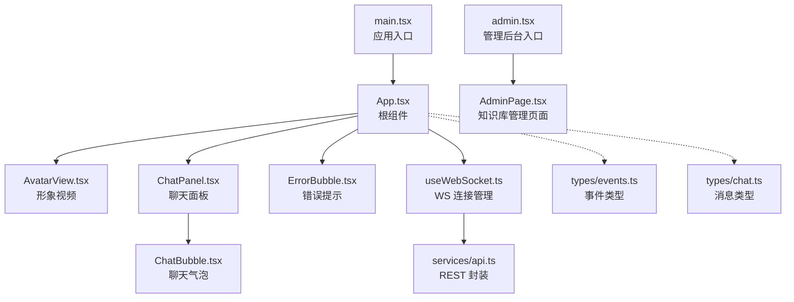
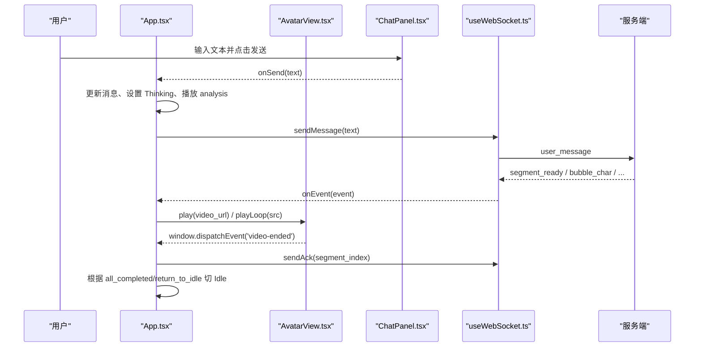
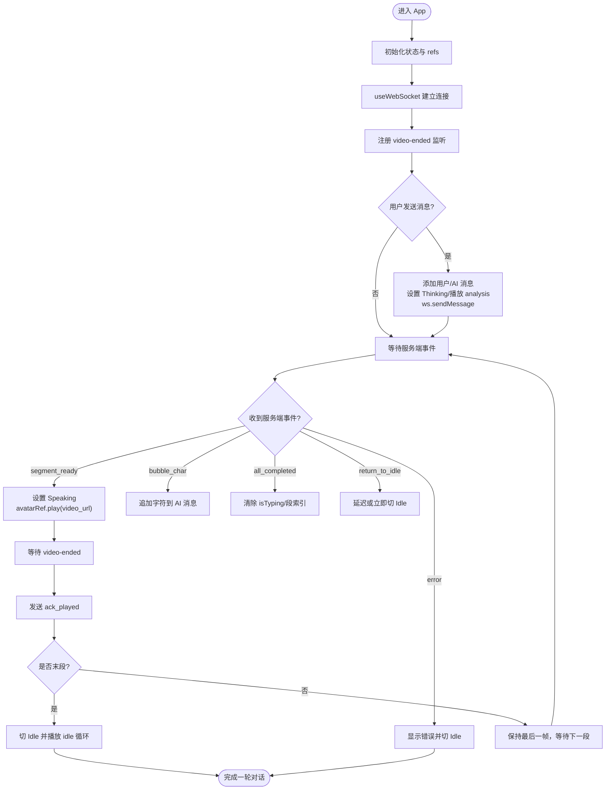
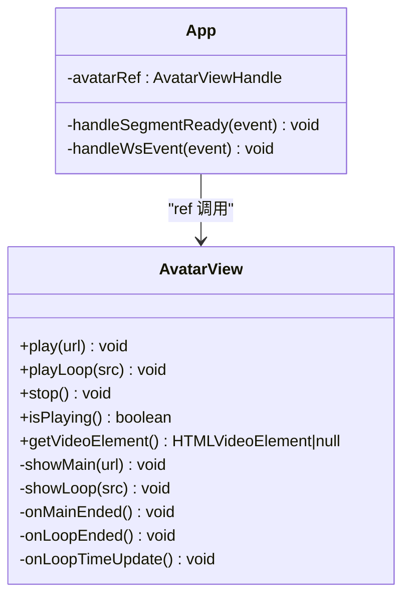
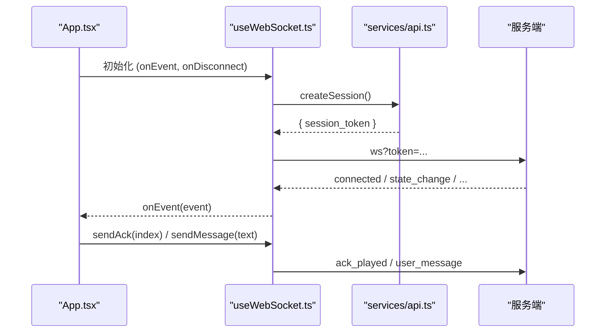
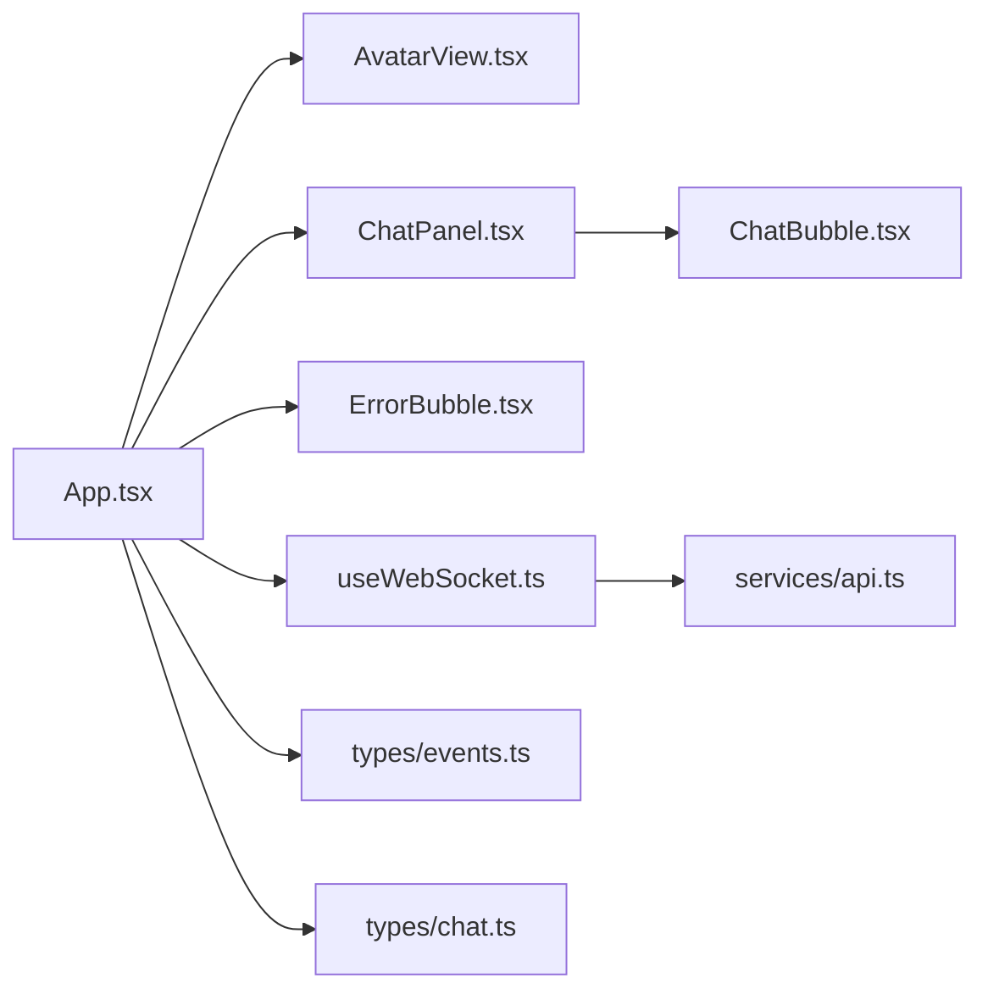

# React 组件架构

<cite>
**本文引用的文件**   
- [client/src/App.tsx](file://client/src/App.tsx)
- [client/src/main.tsx](file://client/src/main.tsx)
- [client/src/admin.tsx](file://client/src/admin.tsx)
- [client/src/components/AvatarView.tsx](file://client/src/components/AvatarView.tsx)
- [client/src/components/ChatPanel.tsx](file://client/src/components/ChatPanel.tsx)
- [client/src/components/ChatBubble.tsx](file://client/src/components/ChatBubble.tsx)
- [client/src/components/ErrorBubble.tsx](file://client/src/components/ErrorBubble.tsx)
- [client/src/hooks/useWebSocket.ts](file://client/src/hooks/useWebSocket.ts)
- [client/src/services/api.ts](file://client/src/services/api.ts)
- [client/src/types/events.ts](file://client/src/types/events.ts)
- [client/src/types/chat.ts](file://client/src/types/chat.ts)
- [client/src/hooks/useTypewriter.ts](file://client/src/hooks/useTypewriter.ts)
- [client/src/components/SpeechBubble.tsx](file://client/src/components/SpeechBubble.tsx)
- [client/src/components/InputBox.tsx](file://client/src/components/InputBox.tsx)
- [client/package.json](file://client/package.json)
</cite>

## 目录
1. [简介](#简介)
2. [项目结构](#项目结构)
3. [核心组件](#核心组件)
4. [架构总览](#架构总览)
5. [详细组件分析](#详细组件分析)
6. [依赖关系分析](#依赖关系分析)
7. [性能考量](#性能考量)
8. [故障排查指南](#故障排查指南)
9. [结论](#结论)
10. [附录](#附录)

## 简介
本文件面向 RealTimeTalk 的 React 前端，聚焦于根组件 App.tsx 的设计模式与整体组件架构。文档将系统阐述：
- 状态管理策略（AppState、消息流、段播放控制）
- 事件处理机制（WebSocket 事件分发、视频结束回调、用户交互）
- 组件间通信方式（props 传递、ref 命令式调用、自定义事件）
- 组件树结构与数据流向
- 生命周期与 Hook 使用模式（useEffect、useRef、useState、useCallback、useImperativeHandle）
- 错误边界与健壮性（当前实现为局部错误提示，未使用 ErrorBoundary）
- 性能优化策略（memo、懒加载建议、记忆化、双 video 无缝切换）

## 项目结构
RealTimeTalk 的前端采用 Vite + React 18 工程化方案，入口 main.tsx 渲染根组件 App；独立的管理后台由 admin.tsx 启动 AdminPage。聊天主流程集中在 App.tsx，子组件按职责拆分：
- AvatarView：负责形象视频的双层叠加与无缝切换
- ChatPanel：聊天面板容器，承载消息列表与输入区
- ChatBubble：单条聊天气泡（已 memo 化）
- ErrorBubble：错误提示气泡（自动淡出）
- useWebSocket：封装连接、重连、消息收发
- services/api：REST API 封装（会话创建等）
- types：事件与消息类型定义

图表来源
- [client/src/main.tsx:1-13](file://client/src/main.tsx#L1-L13)
- [client/src/App.tsx:1-326](file://client/src/App.tsx#L1-L326)
- [client/src/components/AvatarView.tsx:1-594](file://client/src/components/AvatarView.tsx#L1-L594)
- [client/src/components/ChatPanel.tsx:1-200](file://client/src/components/ChatPanel.tsx#L1-L200)
- [client/src/components/ChatBubble.tsx:1-86](file://client/src/components/ChatBubble.tsx#L1-L86)
- [client/src/components/ErrorBubble.tsx:1-70](file://client/src/components/ErrorBubble.tsx#L1-L70)
- [client/src/hooks/useWebSocket.ts:1-190](file://client/src/hooks/useWebSocket.ts#L1-L190)
- [client/src/services/api.ts:1-52](file://client/src/services/api.ts#L1-L52)
- [client/src/types/events.ts:1-113](file://client/src/types/events.ts#L1-L113)
- [client/src/types/chat.ts:1-11](file://client/src/types/chat.ts#L1-L11)
- [client/src/admin.tsx:1-13](file://client/src/admin.tsx#L1-L13)

章节来源
- [client/src/main.tsx:1-13](file://client/src/main.tsx#L1-L13)
- [client/src/admin.tsx:1-13](file://client/src/admin.tsx#L1-L13)
- [client/package.json:1-24](file://client/package.json#L1-L24)

## 核心组件
- App.tsx
  - 职责：全局状态（AppState、messages、错误信息、当前段索引）、WebSocket 事件路由、用户发送消息、视频播放协调、错误提示展示
  - 状态管理：useState 维护 UI 状态；useRef 保存瞬时值避免闭包陈旧引用（appStateRef、currentSegmentIndexRef、deferredIdleRef）
  - 事件处理：统一 handleWsEvent 分派到具体分支；window 自定义事件 'video-ended' 驱动末段 idle 回退
  - 组件通信：通过 ref 调用 AvatarView.play/playLoop；通过 props 向 ChatPanel 传递 messages/onSend/disabled
- AvatarView.tsx
  - 职责：双 <video> 叠加（主视频 segment + 循环视频 idle/analysis），实现无黑闪无缝切换
  - 暴露方法：play、playLoop、stop、isPlaying、getVideoElement（useImperativeHandle）
  - 关键逻辑：canplay 预加载、opacity 过渡、scale(1.7) 缩放适配、idle JS 接管无缝循环、segment 队列防竞态
- ChatPanel.tsx
  - 职责：消息列表滚动、输入框自适应高度、回车发送、禁用态控制
- ChatBubble.tsx
  - 职责：单条消息气泡渲染，AI 消息打字指示器，已使用 memo 减少重渲染
- ErrorBubble.tsx
  - 职责：错误提示气泡，自动淡出并通知父组件移除
- useWebSocket.ts
  - 职责：建立/断开 WS、指数退避重连、Token 持久化、消息发送封装（sendMessage/sendAck/sendCancel）
- services/api.ts
  - 职责：REST 请求封装，提供 createSession/getHistory/destroySession
- types/events.ts、types/chat.ts
  - 职责：客户端与服务端事件类型、消息模型定义

章节来源
- [client/src/App.tsx:1-326](file://client/src/App.tsx#L1-L326)
- [client/src/components/AvatarView.tsx:1-594](file://client/src/components/AvatarView.tsx#L1-L594)
- [client/src/components/ChatPanel.tsx:1-200](file://client/src/components/ChatPanel.tsx#L1-L200)
- [client/src/components/ChatBubble.tsx:1-86](file://client/src/components/ChatBubble.tsx#L1-L86)
- [client/src/components/ErrorBubble.tsx:1-70](file://client/src/components/ErrorBubble.tsx#L1-L70)
- [client/src/hooks/useWebSocket.ts:1-190](file://client/src/hooks/useWebSocket.ts#L1-L190)
- [client/src/services/api.ts:1-52](file://client/src/services/api.ts#L1-L52)
- [client/src/types/events.ts:1-113](file://client/src/types/events.ts#L1-L113)
- [client/src/types/chat.ts:1-11](file://client/src/types/chat.ts#L1-L11)

## 架构总览
下图展示了从根组件到子组件的职责边界与交互协议，以及 WebSocket 事件在 App 中的分发路径。

图表来源
- [client/src/App.tsx:78-183](file://client/src/App.tsx#L78-L183)
- [client/src/components/AvatarView.tsx:463-504](file://client/src/components/AvatarView.tsx#L463-L504)
- [client/src/hooks/useWebSocket.ts:137-157](file://client/src/hooks/useWebSocket.ts#L137-L157)

## 详细组件分析

### 根组件 App.tsx 设计模式
- 状态管理策略
  - useState 管理 appState、messages、errorMessage、currentSegmentIndex
  - useRef 持有瞬时状态（appStateRef、currentSegmentIndexRef、deferredIdleRef）以在事件回调中读取最新值，避免闭包陷阱
  - useEffect 同步 currentSegmentIndex 到 ref，确保异步回调中使用最新索引
- 事件处理机制
  - 统一 handleWsEvent 基于 event.type 分发：connected/state_change/segment_ready/bubble_char/bubble_dismiss/play_analysis/all_completed/return_to_idle/error
  - 对 segment_ready 触发 Speaking 并调用 avatarRef.play(video_url)
  - 监听 window 'video-ended' 事件，发送 ack 并在末段切换到 Idle
- 组件间通信
  - props：向 ChatPanel 传递 messages/onSend/disabled
  - ref：通过 avatarRef 调用 AvatarView 的命令式 API（play/playLoop）
  - 自定义事件：AvatarView 内部 dispatch 'video-ended'，App 侧订阅处理
- 生命周期与 Hook 最佳实践
  - useEffect 用于注册/清理 window 事件监听
  - useCallback 包裹事件处理器，避免不必要的重渲染
  - useRef 避免 stale closure，保证时序正确
  - 音频解锁：首次交互时初始化 AudioContext 并尝试恢复，规避浏览器自动播放策略

图表来源
- [client/src/App.tsx:60-183](file://client/src/App.tsx#L60-L183)
- [client/src/App.tsx:194-220](file://client/src/App.tsx#L194-L220)

章节来源
- [client/src/App.tsx:1-326](file://client/src/App.tsx#L1-L326)

### AvatarView 组件分析
- 架构要点
  - 双 video 叠加：主视频（segment，有声音）+ 循环视频（idle/analysis，静音）
  - 通过 opacity 过渡与 pointerEvents 控制可见性与交互
  - scale(1.7) 缩放适配，避免首段切换时的视觉跳变
- 关键流程
  - showMain：预加载目标元素，canplay 后同帧隐藏旧帧、显示新帧，取消静音
  - showLoop：idle 模式 JS 接管无缝循环（timeupdate seek），analysis 模式原生 loop
  - thinkingMode 与 pendingSrcRef：防止 segment_ready 竞态跳过思考动画
  - ended 回调：segment 结束派发 'video-ended'；idle 兜底 seek(0)
- 对外接口（useImperativeHandle）
  - play(url)、playLoop(src)、stop()、isPlaying()、getVideoElement()

图表来源
- [client/src/components/AvatarView.tsx:27-461](file://client/src/components/AvatarView.tsx#L27-L461)
- [client/src/App.tsx:78-101](file://client/src/App.tsx#L78-L101)

章节来源
- [client/src/components/AvatarView.tsx:1-594](file://client/src/components/AvatarView.tsx#L1-L594)

### ChatPanel 与 ChatBubble
- ChatPanel
  - 自动滚动至最新消息（useEffect 监听 messages）
  - 输入框自适应高度（onInput 计算 scrollHeight）
  - 键盘事件：Enter 发送，Shift+Enter 换行
  - disabled 控制发送按钮与输入框
- ChatBubble
  - 使用 memo 包裹，仅在 props 变化时重渲染
  - AI 消息显示打字指示器（三个跳动圆点）

章节来源
- [client/src/components/ChatPanel.tsx:1-200](file://client/src/components/ChatPanel.tsx#L1-L200)
- [client/src/components/ChatBubble.tsx:1-86](file://client/src/components/ChatBubble.tsx#L1-L86)

### 错误提示与辅助组件
- ErrorBubble
  - 自动淡出（3.5s 开始 fade，4s 后通知父组件移除）
  - 定位覆盖在画面中央偏上区域
- SpeechBubble（备用）
  - 半透明毛玻璃效果，支持打字光标与完成后的消失计时
- InputBox（备用）
  - 单行输入 + 发送按钮，回车发送，超长截断

章节来源
- [client/src/components/ErrorBubble.tsx:1-70](file://client/src/components/ErrorBubble.tsx#L1-L70)
- [client/src/components/SpeechBubble.tsx:1-119](file://client/src/components/SpeechBubble.tsx#L1-L119)
- [client/src/components/InputBox.tsx:1-113](file://client/src/components/InputBox.tsx#L1-L113)

### WebSocket 与 API 集成
- useWebSocket
  - 自动重连：指数退避（1s→2s→4s→...，上限 30s）
  - Token 持久化：sessionStorage 存储 session_token
  - 消息封装：sendMessage/sendAck/sendCancel/isConnected/getToken
- services/api
  - createSession：创建会话并返回 token
  - getHistory/destroySession：会话历史与销毁

图表来源
- [client/src/hooks/useWebSocket.ts:45-117](file://client/src/hooks/useWebSocket.ts#L45-L117)
- [client/src/services/api.ts:31-35](file://client/src/services/api.ts#L31-L35)
- [client/src/App.tsx:189-192](file://client/src/App.tsx#L189-L192)

章节来源
- [client/src/hooks/useWebSocket.ts:1-190](file://client/src/hooks/useWebSocket.ts#L1-L190)
- [client/src/services/api.ts:1-52](file://client/src/services/api.ts#L1-L52)

### 类型系统与事件协议
- AppState 枚举：Idle、Input、Thinking、Speaking、Bridging
- ClientMessage：user_message、ack_played、cancel
- ServerEvent：connected、state_change、segment_ready、bubble_char、bubble_dismiss、play_analysis、all_completed、return_to_idle、error
- ChatMessage：id、role、text、isTyping、timestamp

章节来源
- [client/src/types/events.ts:1-113](file://client/src/types/events.ts#L1-L113)
- [client/src/types/chat.ts:1-11](file://client/src/types/chat.ts#L1-L11)

## 依赖关系分析
- 组件耦合
  - App 与 AvatarView：通过 ref 强耦合（命令式 API）
  - App 与 ChatPanel：通过 props 弱耦合（单向数据流）
  - App 与 useWebSocket：通过 Hook 注入事件回调
- 外部依赖
  - React 18（StrictMode）
  - Vite 构建工具链
  - marked（依赖声明，当前聊天模式未直接使用）

图表来源
- [client/src/App.tsx:1-326](file://client/src/App.tsx#L1-L326)
- [client/src/components/AvatarView.tsx:1-594](file://client/src/components/AvatarView.tsx#L1-L594)
- [client/src/components/ChatPanel.tsx:1-200](file://client/src/components/ChatPanel.tsx#L1-L200)
- [client/src/components/ChatBubble.tsx:1-86](file://client/src/components/ChatBubble.tsx#L1-L86)
- [client/src/components/ErrorBubble.tsx:1-70](file://client/src/components/ErrorBubble.tsx#L1-L70)
- [client/src/hooks/useWebSocket.ts:1-190](file://client/src/hooks/useWebSocket.ts#L1-L190)
- [client/src/services/api.ts:1-52](file://client/src/services/api.ts#L1-L52)
- [client/src/types/events.ts:1-113](file://client/src/types/events.ts#L1-L113)
- [client/src/types/chat.ts:1-11](file://client/src/types/chat.ts#L1-L11)

章节来源
- [client/package.json:1-24](file://client/package.json#L1-L24)

## 性能考量
- 组件级优化
  - ChatBubble 使用 memo 减少不必要重渲染
  - App 内事件处理器使用 useCallback 稳定引用
- 媒体渲染优化
  - 双 video 叠加 + opacity 过渡，避免黑闪与空白帧
  - canplay 预加载 + 800ms 超时兜底，保障首帧快速呈现
  - idle 模式 JS 接管无缝循环，避免原生 loop 的首尾跳变
- 网络与状态
  - WebSocket 指数退避重连，降低抖动影响
  - Token 持久化，避免重复创建会话
- 建议的进一步优化（可选）
  - 大列表虚拟滚动（当消息量增长时）
  - 图片/视频资源按需懒加载（React.lazy + Suspense）
  - 复杂计算提取为自定义 Hook 或使用 useMemo

[本节为通用指导，不直接分析具体文件]

## 故障排查指南
- 常见问题
  - 自动播放被阻止：AudioContext 需要用户交互解锁；AvatarView 的 play() 捕获异常并降级切换
  - 首帧黑屏：AvatarView 初始 idle 等待 canplay 后再淡入，并提供 800ms 强制显示兜底
  - 段间闪烁：双 video 叠加与 opacity 过渡消除；idle↔analysis 切换比较基础路径避免重复加载
  - 重连失败：检查 sessionStorage 中的 token 与服务端可达性；查看控制台日志
- 调试技巧
  - 观察 App 右下角状态指示器（AppState）
  - 打开浏览器控制台查看 WebSocket 连接与错误日志
  - 使用 Network 面板确认 REST 与媒体资源加载情况

章节来源
- [client/src/App.tsx:32-58](file://client/src/App.tsx#L32-L58)
- [client/src/components/AvatarView.tsx:506-532](file://client/src/components/AvatarView.tsx#L506-L532)
- [client/src/hooks/useWebSocket.ts:119-135](file://client/src/hooks/useWebSocket.ts#L119-L135)

## 结论
RealTimeTalk 的 React 前端以 App.tsx 为核心，采用“状态提升 + 命令式 ref”的组合模式，结合 useWebSocket 与双 video 无缝切换，实现了低延迟、高流畅度的实时对话体验。组件职责清晰、数据流单向明确，并通过类型系统约束前后端交互契约。当前未引入全局错误边界，但通过局部错误提示与健壮的事件处理保证了用户体验。后续可在长列表渲染、资源懒加载与更细粒度的记忆化方面继续优化。

[本节为总结性内容，不直接分析具体文件]

## 附录
- 相关 Hook 与工具
  - useTypewriter：逐字追加与自动完成/消失（可用于其他场景）
  - SpeechBubble/InputBox：可复用的气泡与输入组件（当前聊天模式使用 ChatPanel/ChatBubble）

章节来源
- [client/src/hooks/useTypewriter.ts:1-77](file://client/src/hooks/useTypewriter.ts#L1-L77)
- [client/src/components/SpeechBubble.tsx:1-119](file://client/src/components/SpeechBubble.tsx#L1-L119)
- [client/src/components/InputBox.tsx:1-113](file://client/src/components/InputBox.tsx#L1-L113)