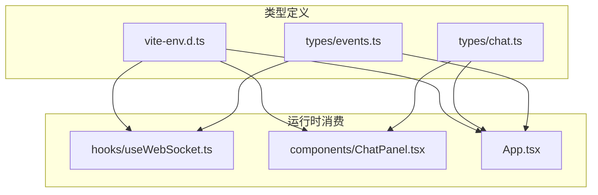
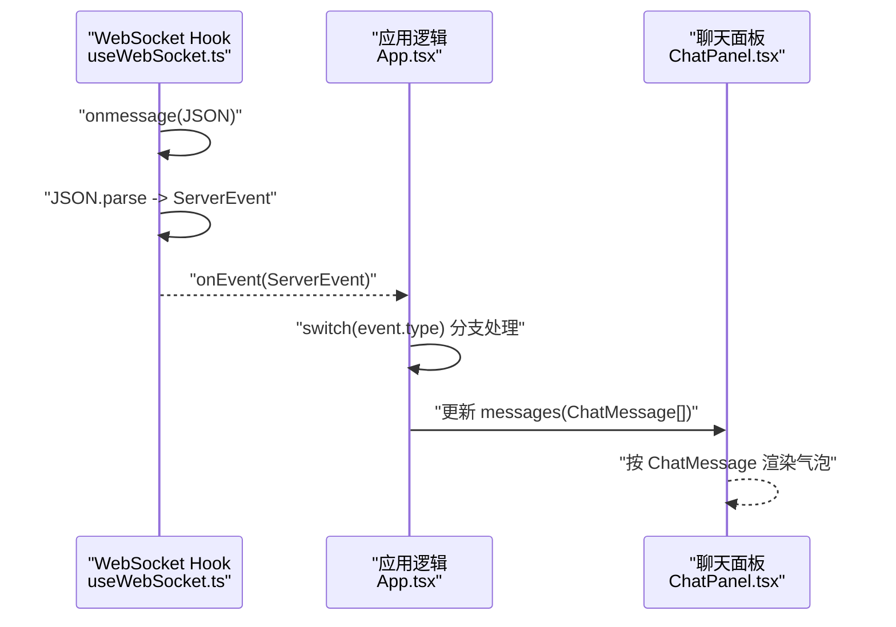
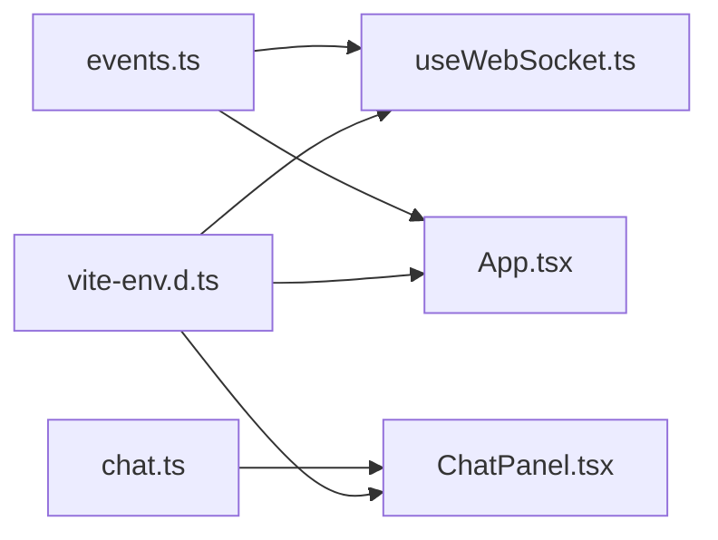

# TypeScript 类型系统

<cite>
**本文引用的文件**
- [events.ts](file://client/src/types/events.ts)
- [chat.ts](file://client/src/types/chat.ts)
- [vite-env.d.ts](file://client/src/vite-env.d.ts)
- [useWebSocket.ts](file://client/src/hooks/useWebSocket.ts)
- [ChatPanel.tsx](file://client/src/components/ChatPanel.tsx)
- [App.tsx](file://client/src/App.tsx)
</cite>

## 目录
1. [简介](#简介)
2. [项目结构](#项目结构)
3. [核心组件](#核心组件)
4. [架构总览](#架构总览)
5. [详细组件分析](#详细组件分析)
6. [依赖关系分析](#依赖关系分析)
7. [性能与健壮性考量](#性能与健壮性考量)
8. [故障排查指南](#故障排查指南)
9. [结论](#结论)
10. [附录：扩展指南](#附录扩展指南)

## 简介
本文件面向 RealTimeTalk 前端的 TypeScript 类型系统，聚焦以下目标：
- 深入解释事件类型定义 events.ts 的设计，包括 ServerEvent 联合类型和 ClientMessage 接口的结构与用途。
- 详细说明聊天消息类型 chat.ts 的定义，包括 ChatMessage 接口的字段说明与使用约束。
- 文档化全局类型声明 vite-env.d.ts 的配置，包括 Vite 客户端类型引入与环境变量类型的约定。
- 总结类型安全设计原则与实践，包括判别式联合、字面量类型、可选字段等最佳实践。
- 提供前后端类型同步策略建议，确保 API 接口类型一致性。
- 说明类型守卫与运行时验证的结合方式，提升代码健壮性。
- 给出类型定义的扩展指南，帮助新增业务类型与接口定义。

## 项目结构
前端类型相关的关键文件位于 client/src/types 下，并在 hooks 与 components 中被消费。整体组织遵循“类型集中定义、在业务层消费”的清晰分层。

图表来源
- [events.ts:1-113](file://client/src/types/events.ts#L1-L113)
- [chat.ts:1-11](file://client/src/types/chat.ts#L1-L11)
- [vite-env.d.ts:1-2](file://client/src/vite-env.d.ts#L1-L2)
- [useWebSocket.ts:1-190](file://client/src/hooks/useWebSocket.ts#L1-L190)
- [ChatPanel.tsx:1-200](file://client/src/components/ChatPanel.tsx#L1-L200)
- [App.tsx:72-197](file://client/src/App.tsx#L72-L197)

章节来源
- [events.ts:1-113](file://client/src/types/events.ts#L1-L113)
- [chat.ts:1-11](file://client/src/types/chat.ts#L1-L11)
- [vite-env.d.ts:1-2](file://client/src/vite-env.d.ts#L1-L2)

## 核心组件
本节对关键类型进行概览，并指出它们在系统中的职责边界。

- 事件协议类型（events.ts）
  - 客户端到服务端消息：ClientMessage 联合类型，包含用户消息、播放确认、取消三类。
  - 服务端到客户端事件：ServerEvent 联合类型，涵盖连接、状态变更、片段就绪、气泡逐字、气泡清除、播放分析、全部完成、返回空闲、错误等。
  - 应用状态枚举：AppState，用于 UI 状态机。
  - API 响应类型：会话创建、历史、销毁等。

- 聊天消息类型（chat.ts）
  - ChatMessage：表示一条聊天消息，包含角色、文本、打字态、时间戳等。

- 全局类型声明（vite-env.d.ts）
  - 引入 Vite 客户端类型，使 Vite 内置环境变量与资源模块具备类型支持。

章节来源
- [events.ts:1-113](file://client/src/types/events.ts#L1-L113)
- [chat.ts:1-11](file://client/src/types/chat.ts#L1-L11)
- [vite-env.d.ts:1-2](file://client/src/vite-env.d.ts#L1-L2)

## 架构总览
下图展示了类型在运行时的流转路径：WebSocket Hook 解析服务端 JSON 为 ServerEvent，再交由上层组件处理；UI 组件以 ChatMessage 驱动渲染。

图表来源
- [useWebSocket.ts:86-93](file://client/src/hooks/useWebSocket.ts#L86-L93)
- [App.tsx:87-183](file://client/src/App.tsx#L87-L183)
- [ChatPanel.tsx:129-136](file://client/src/components/ChatPanel.tsx#L129-L136)

## 详细组件分析

### 事件类型定义（events.ts）
- 设计要点
  - 判别式联合：通过 type 字面量区分不同消息/事件，配合 switch/case 或 if-else 可得到精确的类型收窄。
  - 客户端消息 ClientMessage：
    - user_message：携带用户输入文本。
    - ack_played：携带已播放片段索引，用于流式播放对齐。
    - cancel：取消当前任务。
  - 服务端事件 ServerEvent：
    - connected：建立连接后返回会话 token 与初始状态。
    - state_change：状态变化通知，state 限定为 thinking/speaking/bridging/idle。
    - segment_ready：一段视频片段准备就绪，包含 index、video_url、duration_ms、text。
    - bubble_char/bubble_dismiss：逐字推进与气泡清理，均带 segment_index。
    - play_analysis：控制是否循环播放。
    - all_completed/return_to_idle：流程结束与回到空闲。
    - error：错误信息。
  - 应用状态 AppState：与 state_change 的 state 值保持一致，便于 UI 状态机管理。
  - API 响应类型：CreateSessionResponse、SessionHistoryResponse、DestroySessionResponse 等，用于 REST 调用结果建模。

- 类型安全优势
  - 通过 type 字面量 + 联合类型，编译器可在每个分支中自动收窄属性，避免运行时访问不存在字段的风险。
  - 服务端事件覆盖完整生命周期，减少遗漏分支导致的未处理场景。

```mermaid
classDiagram
class ClientUserMessage {
+type : "user_message"
+text : string
}
class ClientAckPlayed {
+type : "ack_played"
+segment_index : number
}
class ClientCancel {
+type : "cancel"
}
class ClientMessage
ClientMessage <|-- ClientUserMessage
ClientMessage <|-- ClientAckPlayed
ClientMessage <|-- ClientCancel
class ServerConnected {
+type : "connected"
+session_token : string
+state : string
}
class ServerStateChange {
+type : "state_change"
+state : "thinking"|"speaking"|"bridging"|"idle"
}
class ServerSegmentReady {
+type : "segment_ready"
+index : number
+video_url : string
+duration_ms : number
+text : string
}
class ServerBubbleChar {
+type : "bubble_char"
+char : string
+segment_index : number
}
class ServerBubbleDismiss {
+type : "bubble_dismiss"
+segment_index : number
}
class ServerPlayAnalysis {
+type : "play_analysis"
+loop : boolean
}
class ServerAllCompleted {
+type : "all_completed"
}
class ServerReturnToIdle {
+type : "return_to_idle"
}
class ServerError {
+type : "error"
+message : string
}
class ServerEvent
ServerEvent <|-- ServerConnected
ServerEvent <|-- ServerStateChange
ServerEvent <|-- ServerSegmentReady
ServerEvent <|-- ServerBubbleChar
ServerEvent <|-- ServerBubbleDismiss
ServerEvent <|-- ServerPlayAnalysis
ServerEvent <|-- ServerAllCompleted
ServerEvent <|-- ServerReturnToIdle
ServerEvent <|-- ServerError
```

图表来源
- [events.ts:17-92](file://client/src/types/events.ts#L17-L92)

章节来源
- [events.ts:1-113](file://client/src/types/events.ts#L1-L113)

### 聊天消息类型（chat.ts）
- ChatMessage 字段说明
  - id：消息唯一标识，用于列表稳定渲染。
  - role：消息角色，限定为用户或助手。
  - text：消息正文。
  - isTyping：可选，表示是否处于“正在输入”态，常用于展示打字动画。
  - timestamp：消息时间戳，便于排序与显示。

- 使用约束与校验建议
  - 在 UI 层应保证 role 仅取 'user' | 'assistant'。
  - 当 isTyping 为 true 时，text 可为空或逐步拼接，需在上层逻辑中维护。
  - 建议在数据进入状态前做最小校验（如非空、长度限制），以避免异常渲染。

章节来源
- [chat.ts:1-11](file://client/src/types/chat.ts#L1-L11)
- [ChatPanel.tsx:129-136](file://client/src/components/ChatPanel.tsx#L129-L136)

### 全局类型声明（vite-env.d.ts）
- 作用
  - 引入 Vite 客户端类型，使得 import.meta.env 等 Vite 注入的环境变量具备类型提示与检查。
  - 同时为静态资源导入（如图片、音频、字体）提供类型支持。

- 配置要点
  - 使用三斜杠指令引用 types/vite/client，无需额外配置即可生效。
  - 若需要自定义环境变量类型，可在同一文件中扩展 ImportMetaEnv 接口。

章节来源
- [vite-env.d.ts:1-2](file://client/src/vite-env.d.ts#L1-L2)

### WebSocket Hook 中的类型消费（useWebSocket.ts）
- 类型消费点
  - 接收 onEvent 回调参数类型为 ServerEvent，确保所有事件分支可被类型系统检查。
  - 发送消息时使用 ClientMessage 联合类型，防止构造非法消息体。
  - 在 onmessage 中解析 JSON 为 ServerEvent，并通过回调转发给上层。

- 类型安全实践
  - 使用严格模式与显式类型标注，避免 any 扩散。
  - 将重连、断线、错误等边界情况纳入类型与流程控制，降低运行时风险。

章节来源
- [useWebSocket.ts:11-12](file://client/src/hooks/useWebSocket.ts#L11-L12)
- [useWebSocket.ts:86-93](file://client/src/hooks/useWebSocket.ts#L86-L93)
- [useWebSocket.ts:138-157](file://client/src/hooks/useWebSocket.ts#L138-L157)

### 应用层事件分发（App.tsx）
- 事件分发
  - 基于 event.type 进行 switch 分支处理，利用判别式联合实现类型收窄。
  - 针对 segment_ready、bubble_char、bubble_dismiss、error 等事件分别更新状态与 UI。

- 类型安全收益
  - 新增事件类型时，编译器会提示缺失分支，避免遗漏处理。
  - 各分支内可直接访问对应事件的专属字段，无需二次判断。

章节来源
- [App.tsx:87-183](file://client/src/App.tsx#L87-L183)

## 依赖关系分析
- 类型依赖
  - useWebSocket.ts 依赖 events.ts 的 ClientMessage 与 ServerEvent。
  - App.tsx 依赖 events.ts 的 ServerEvent 与 AppState。
  - ChatPanel.tsx 依赖 chat.ts 的 ChatMessage。
  - 所有模块共享 vite-env.d.ts 提供的 Vite 类型环境。

图表来源
- [events.ts:1-113](file://client/src/types/events.ts#L1-L113)
- [chat.ts:1-11](file://client/src/types/chat.ts#L1-L11)
- [vite-env.d.ts:1-2](file://client/src/vite-env.d.ts#L1-L2)
- [useWebSocket.ts:1-190](file://client/src/hooks/useWebSocket.ts#L1-L190)
- [ChatPanel.tsx:1-200](file://client/src/components/ChatPanel.tsx#L1-L200)
- [App.tsx:72-197](file://client/src/App.tsx#L72-L197)

章节来源
- [useWebSocket.ts:11-12](file://client/src/hooks/useWebSocket.ts#L11-L12)
- [App.tsx:87-183](file://client/src/App.tsx#L87-L183)
- [ChatPanel.tsx:129-136](file://client/src/components/ChatPanel.tsx#L129-L136)

## 性能与健壮性考量
- 类型层面的健壮性
  - 使用判别式联合与字面量类型，减少运行时条件判断与类型断言。
  - 通过可选字段（如 isTyping）表达可变状态，避免多余字段带来的内存与序列化开销。
- 运行时验证建议
  - 在 JSON 解析后增加轻量级运行时校验（如字段存在性与取值范围），作为类型系统的补充。
  - 对来自远端的 message 进行白名单校验，避免未知字段导致意外行为。
- 性能优化建议
  - 在事件处理中尽量使用不可变更新（如 map/filter/new Array），避免深层嵌套对象复制。
  - 对大数组（消息列表）采用虚拟滚动或分页加载，结合稳定的 key（id）减少重渲染。

[本节为通用指导，不直接分析具体文件]

## 故障排查指南
- WebSocket 消息解析失败
  - 现象：控制台出现解析失败的警告。
  - 排查：确认服务端返回的 JSON 是否符合 ServerEvent 结构；必要时在解析处增加 try/catch 与日志。
  - 参考位置：[useWebSocket.ts:86-93](file://client/src/hooks/useWebSocket.ts#L86-L93)

- 事件分支遗漏
  - 现象：新增事件类型后，某些分支未处理导致 UI 无响应。
  - 排查：TypeScript 会在 switch/default 处提示未穷尽分支；补齐处理逻辑。
  - 参考位置：[App.tsx:87-183](file://client/src/App.tsx#L87-L183)

- 消息渲染异常
  - 现象：isTyping 状态下文本为空或重复追加。
  - 排查：确保在 bubble_char 事件中正确追加文本，并在完成后关闭 isTyping。
  - 参考位置：[App.tsx:103-113](file://client/src/App.tsx#L103-L113)、[ChatPanel.tsx:129-136](file://client/src/components/ChatPanel.tsx#L129-L136)

章节来源
- [useWebSocket.ts:86-93](file://client/src/hooks/useWebSocket.ts#L86-L93)
- [App.tsx:87-183](file://client/src/App.tsx#L87-L183)
- [ChatPanel.tsx:129-136](file://client/src/components/ChatPanel.tsx#L129-L136)

## 结论
RealTimeTalk 前端的类型系统以判别式联合为核心，围绕 events.ts 与 chat.ts 构建起清晰的契约边界。通过 Vite 的全局类型支持，开发体验与类型安全性得到保障。结合运行时校验与完善的错误处理，系统在复杂交互场景下仍保持稳健。后续扩展新类型时，应遵循现有模式，确保前后端一致与类型穷尽。

[本节为总结性内容，不直接分析具体文件]

## 附录：扩展指南

### 如何添加新的业务类型与接口定义
- 新增事件类型
  - 在 events.ts 中新增一个接口，明确 type 字面量与必要字段。
  - 将该接口加入 ServerEvent 或 ClientMessage 联合类型。
  - 在 App.tsx 的事件分发处补充对应分支处理。
  - 在 useWebSocket.ts 中如需发送新消息，封装对应的 sendXxx 方法。

- 新增聊天消息字段
  - 在 chat.ts 中扩展 ChatMessage 接口，按需添加可选字段。
  - 在 App.tsx 中更新消息生成与更新逻辑，确保 isTyping 与文本追加顺序正确。
  - 在 ChatPanel.tsx 中根据新字段调整渲染逻辑。

- 前后端类型同步策略
  - 建议在后端也定义相同结构的类型（例如 Python Pydantic 模型），并与前端类型一一对应。
  - 可通过代码生成工具从后端 schema 生成前端类型，或使用共享 schema 文件（如 JSON Schema）双向生成。
  - 在 API 层增加运行时校验（如 zod、io-ts 等），与 TypeScript 类型形成双重保障。

- 类型安全最佳实践
  - 优先使用字面量类型与判别式联合，避免 any 与 unknown 滥用。
  - 对来自外部的数据进行最小化校验后再进入状态管理。
  - 使用泛型与映射类型抽象公共模式（如统一包装响应体），提高复用性与一致性。

[本节为概念性指导，不直接分析具体文件]