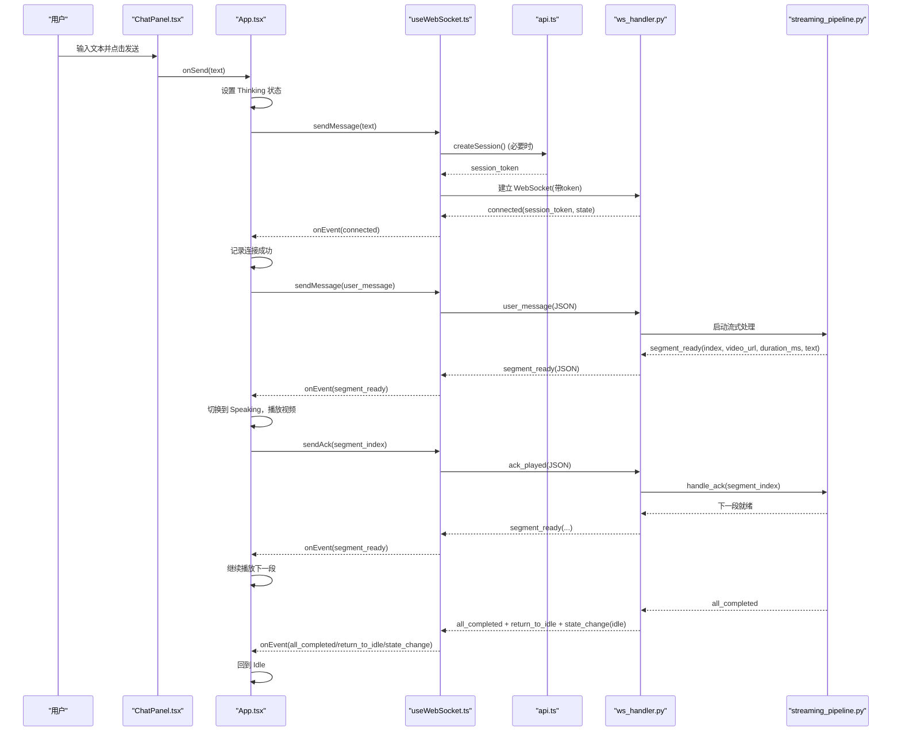
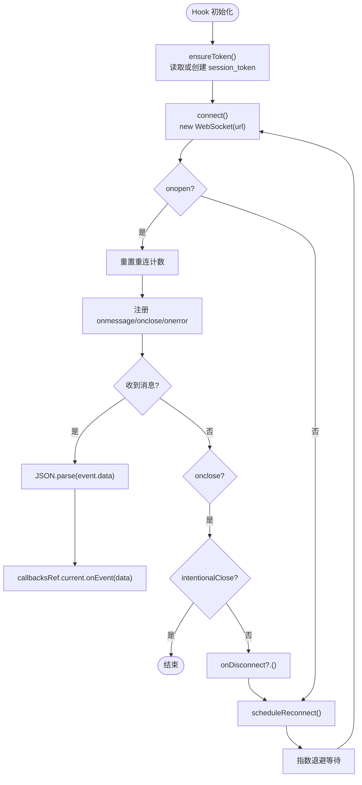
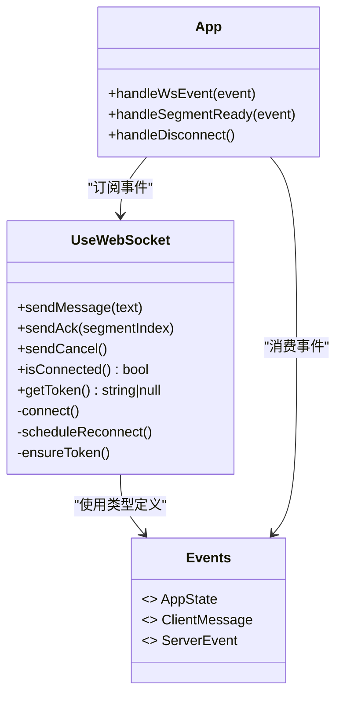
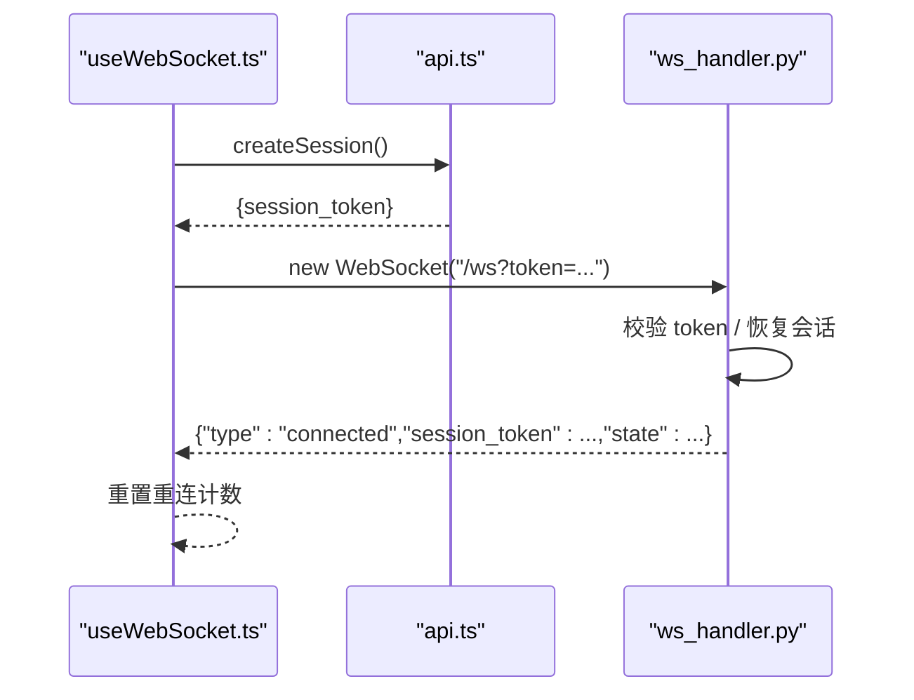
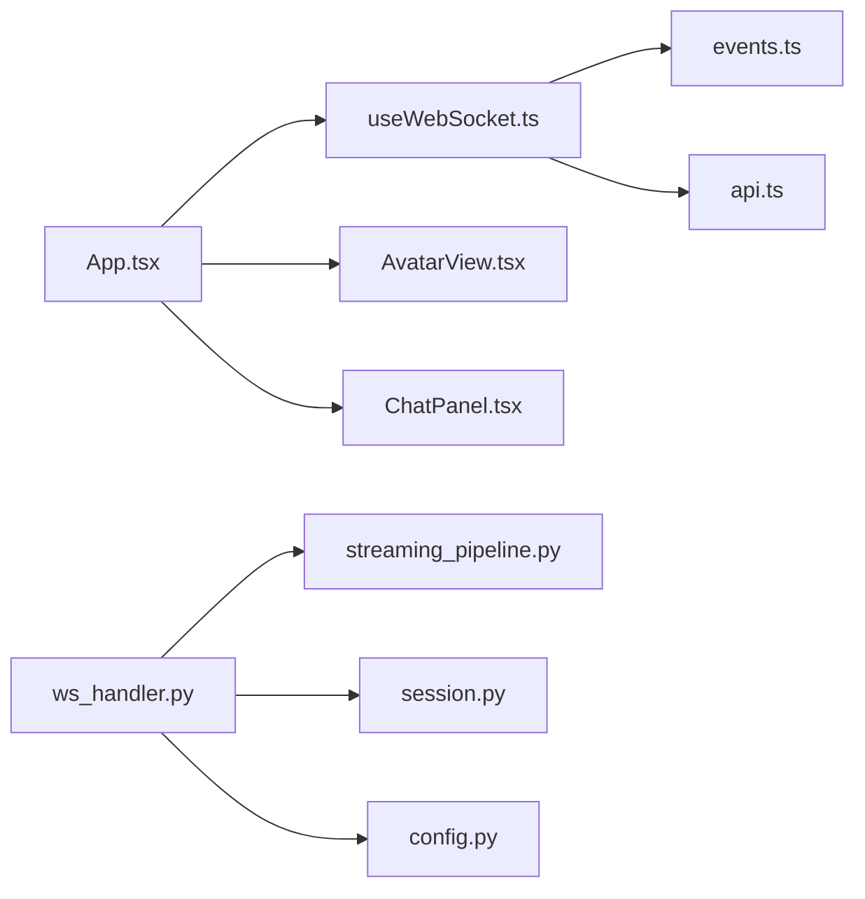

# WebSocket 客户端

<cite>
**本文引用的文件**
- [useWebSocket.ts](file://client/src/hooks/useWebSocket.ts)
- [events.ts](file://client/src/types/events.ts)
- [api.ts](file://client/src/services/api.ts)
- [App.tsx](file://client/src/App.tsx)
- [AvatarView.tsx](file://client/src/components/AvatarView.tsx)
- [ChatPanel.tsx](file://client/src/components/ChatPanel.tsx)
- [ws_handler.py](file://server/api/ws_handler.py)
- [streaming_pipeline.py](file://server/pipeline/streaming_pipeline.py)
- [session.py](file://server/models/session.py)
- [config.py](file://server/config.py)
</cite>

## 目录
1. [简介](#简介)
2. [项目结构](#项目结构)
3. [核心组件](#核心组件)
4. [架构总览](#架构总览)
5. [详细组件分析](#详细组件分析)
6. [依赖关系分析](#依赖关系分析)
7. [性能与可靠性](#性能与可靠性)
8. [故障排查指南](#故障排查指南)
9. [结论](#结论)
10. [附录：消息协议与事件定义](#附录消息协议与事件定义)

## 简介
本技术文档聚焦于 RealTimeTalk 前端的 WebSocket 客户端实现，围绕 useWebSocket Hook 的设计模式展开，系统阐述连接管理、事件监听、错误处理、重连策略、认证流程、心跳检测（当前未实现）、断线恢复、消息协议、事件驱动架构、并发与资源清理、以及调试与监控建议。同时结合服务端 ws_handler 与 streaming_pipeline 的实现，给出端到端的数据流与状态机说明，帮助开发者快速定位问题并优化体验。

## 项目结构
前端以 React Hooks 为核心组织实时通信能力，关键文件如下：
- hooks/useWebSocket.ts：封装 WebSocket 生命周期、自动重连、消息发送与回调分发
- types/events.ts：客户端与服务端的消息类型与事件枚举
- services/api.ts：REST API 封装，用于创建会话 token
- App.tsx：根组件，编排状态机、事件处理、UI 交互
- components/AvatarView.tsx：形象视频播放与切换逻辑
- components/ChatPanel.tsx：聊天面板与输入交互

后端相关：
- server/api/ws_handler.py：WebSocket 接入、鉴权与会话上下文管理、消息路由
- server/pipeline/streaming_pipeline.py：分段生成与推送、ack 控制、错误与取消
- server/models/session.py：会话状态与上下文数据模型
- server/config.py：配置加载与环境变量覆盖

```mermaid
graph TB
subgraph "前端"
A["App.tsx"]
B["hooks/useWebSocket.ts"]
C["types/events.ts"]
D["services/api.ts"]
E["components/AvatarView.tsx"]
F["components/ChatPanel.tsx"]
end
subgraph "后端"
G["server/api/ws_handler.py"]
H["server/pipeline/streaming_pipeline.py"]
I["server/models/session.py"]
J["server/config.py"]
end
A --> B
A --> E
A --> F
B --> C
B --> D
B < --> G
G --> H
G --> I
G --> J
```

图表来源
- [App.tsx:1-326](file://client/src/App.tsx#L1-L326)
- [useWebSocket.ts:1-190](file://client/src/hooks/useWebSocket.ts#L1-L190)
- [events.ts:1-113](file://client/src/types/events.ts#L1-L113)
- [api.ts:1-52](file://client/src/services/api.ts#L1-L52)
- [AvatarView.tsx:1-594](file://client/src/components/AvatarView.tsx#L1-L594)
- [ChatPanel.tsx:1-200](file://client/src/components/ChatPanel.tsx#L1-L200)
- [ws_handler.py:1-444](file://server/api/ws_handler.py#L1-L444)
- [streaming_pipeline.py:1-214](file://server/pipeline/streaming_pipeline.py#L1-L214)
- [session.py:1-41](file://server/models/session.py#L1-L41)
- [config.py:1-260](file://server/config.py#L1-L260)

章节来源
- [App.tsx:1-326](file://client/src/App.tsx#L1-L326)
- [useWebSocket.ts:1-190](file://client/src/hooks/useWebSocket.ts#L1-L190)
- [events.ts:1-113](file://client/src/types/events.ts#L1-L113)
- [api.ts:1-52](file://client/src/services/api.ts#L1-L52)
- [AvatarView.tsx:1-594](file://client/src/components/AvatarView.tsx#L1-L594)
- [ChatPanel.tsx:1-200](file://client/src/components/ChatPanel.tsx#L1-L200)
- [ws_handler.py:1-444](file://server/api/ws_handler.py#L1-L444)
- [streaming_pipeline.py:1-214](file://server/pipeline/streaming_pipeline.py#L1-L214)
- [session.py:1-41](file://server/models/session.py#L1-L41)
- [config.py:1-260](file://server/config.py#L1-L260)

## 核心组件
- useWebSocket Hook
  - 负责建立/断开连接、Token 获取与缓存、自动重连（指数退避）、消息发送、事件回调注册与转发、连接状态查询。
- App 根组件
  - 维护应用状态机（Idle/Thinking/Speaking/Bridging），处理服务端事件，驱动 Avatar 播放与聊天消息更新。
- AvatarView 组件
  - 双视频叠加架构，无缝切换主视频与循环视频，提供 play/playLoop/stop 等命令式接口。
- ChatPanel 组件
  - 用户输入与发送 UI，触发 onSend 回调进入 Thinking 状态。
- 服务端 WsHandler
  - 校验 Token、恢复会话、消息路由、流式 LLM 调用、分段生成与推送、ack 控制、错误与取消处理。
- StreamingPipeline
  - 首段优先推送、逐段确认式推进、打字机气泡、错误与取消传播。

章节来源
- [useWebSocket.ts:1-190](file://client/src/hooks/useWebSocket.ts#L1-L190)
- [App.tsx:1-326](file://client/src/App.tsx#L1-L326)
- [AvatarView.tsx:1-594](file://client/src/components/AvatarView.tsx#L1-L594)
- [ChatPanel.tsx:1-200](file://client/src/components/ChatPanel.tsx#L1-L200)
- [ws_handler.py:1-444](file://server/api/ws_handler.py#L1-L444)
- [streaming_pipeline.py:1-214](file://server/pipeline/streaming_pipeline.py#L1-L214)

## 架构总览
下图展示从用户输入到服务端流式处理、再到前端渲染的完整链路。



图表来源
- [App.tsx:1-326](file://client/src/App.tsx#L1-L326)
- [useWebSocket.ts:1-190](file://client/src/hooks/useWebSocket.ts#L1-L190)
- [api.ts:1-52](file://client/src/services/api.ts#L1-L52)
- [ws_handler.py:1-444](file://server/api/ws_handler.py#L1-L444)
- [streaming_pipeline.py:1-214](file://server/pipeline/streaming_pipeline.py#L1-L214)

## 详细组件分析

### useWebSocket Hook 设计模式
- 连接管理
  - 通过 useRef 持有 WebSocket 引用、token、重连次数与定时器，避免闭包过期导致的状态不一致。
  - connect 方法在每次重连时重新构建 URL 并实例化 WebSocket，onopen/onmessage/onclose/onerror 分别处理连接建立、消息解析、断开与异常。
- 认证与 Session
  - ensureToken 先从 sessionStorage 读取，若不存在则调用 REST API 创建新会话，并将 token 持久化到 sessionStorage，供后续连接使用。
  - 连接 URL 拼接 token 参数，服务端据此恢复或新建会话上下文。
- 自动重连
  - scheduleReconnect 采用指数退避策略，基础间隔 1s，最大 30s，按尝试次数倍增。
  - intentionalCloseRef 标记是否为主动关闭，避免主动关闭后再次重连。
- 消息收发
  - send 统一封装 JSON 序列化与发送；对外暴露 sendMessage/sendAck/sendCancel 三种业务消息。
  - isConnected/getToken 提供连接状态与 token 访问。
- 事件分发
  - callbacksRef.current.onEvent 接收服务端事件，交由上层 App 进行状态机处理。
- 生命周期
  - useEffect 中初始化连接，并在卸载时设置 intentionalCloseRef=true、清除重连定时器、关闭 WebSocket。



图表来源
- [useWebSocket.ts:1-190](file://client/src/hooks/useWebSocket.ts#L1-L190)
- [api.ts:1-52](file://client/src/services/api.ts#L1-L52)

章节来源
- [useWebSocket.ts:1-190](file://client/src/hooks/useWebSocket.ts#L1-L190)
- [api.ts:1-52](file://client/src/services/api.ts#L1-L52)

### 事件驱动架构与回调管理
- 事件类型
  - 客户端消息：user_message、ack_played、cancel
  - 服务端事件：connected、state_change、segment_ready、bubble_char、bubble_dismiss、play_analysis、all_completed、return_to_idle、error
- 事件分发机制
  - useWebSocket 将服务端事件原样转发给 App 的 handleWsEvent，App 根据 type 分支处理状态变更与 UI 更新。
- 回调函数管理
  - 使用 useRef(options) 保存最新回调引用，避免闭包捕获旧值导致的事件丢失。



图表来源
- [useWebSocket.ts:1-190](file://client/src/hooks/useWebSocket.ts#L1-L190)
- [events.ts:1-113](file://client/src/types/events.ts#L1-L113)
- [App.tsx:1-326](file://client/src/App.tsx#L1-L326)

章节来源
- [events.ts:1-113](file://client/src/types/events.ts#L1-L113)
- [App.tsx:1-326](file://client/src/App.tsx#L1-L326)
- [useWebSocket.ts:1-190](file://client/src/hooks/useWebSocket.ts#L1-L190)

### 连接生命周期与认证过程
- 连接建立
  - 首次进入页面时，useEffect 调用 connect，确保 token 存在后建立 WebSocket。
  - 服务端 ws_handler.handle 校验 token，若为全新会话且 Redis 无历史，直接关闭并提示先创建会话。
- 认证过程
  - 前端通过 createSession 获取 session_token，存入 sessionStorage，并在连接 URL 中附带。
  - 服务端根据 token 查找或恢复会话上下文，返回 connected 事件包含 session_token 与当前 state。
- 断线重连
  - 非 intentionalClose 情况下，onclose 触发 scheduleReconnect，指数退避重试。
  - 重连成功后重置重连计数，保持用户体验连贯。



图表来源
- [useWebSocket.ts:1-190](file://client/src/hooks/useWebSocket.ts#L1-L190)
- [api.ts:1-52](file://client/src/services/api.ts#L1-L52)
- [ws_handler.py:1-444](file://server/api/ws_handler.py#L1-L444)

章节来源
- [useWebSocket.ts:1-190](file://client/src/hooks/useWebSocket.ts#L1-L190)
- [ws_handler.py:1-444](file://server/api/ws_handler.py#L1-L444)

### 心跳检测与保活
- 当前实现未内置心跳检测机制。
- 建议方案
  - 客户端定时发送 ping，服务端回复 pong，超时判定断线并触发重连。
  - 或使用浏览器网络事件（如 navigator.onLine）辅助判断网络可用性。
- 注意
  - 心跳频率需与服务器负载平衡，避免频繁请求影响性能。

[本节为通用建议，不直接分析具体文件]

### 消息协议设计与事件类型
- 客户端 → 服务端
  - user_message：携带文本内容，触发流式处理
  - ack_played：携带 segment_index，通知服务端一段播放完成
  - cancel：中断当前处理流程
- 服务端 → 客户端
  - connected：连接成功，包含 session_token 与当前 state
  - state_change：状态变化（thinking/speaking/bridging/idle）
  - segment_ready：段落就绪，包含 index、video_url、duration_ms、text
  - bubble_char/bubble_dismiss：打字机效果字符追加与气泡消失
  - play_analysis：过渡动画（思考/衔接）
  - all_completed：全部段落完成
  - return_to_idle：回到待机
  - error：错误信息

章节来源
- [events.ts:1-113](file://client/src/types/events.ts#L1-L113)
- [ws_handler.py:1-444](file://server/api/ws_handler.py#L1-L444)
- [streaming_pipeline.py:1-214](file://server/pipeline/streaming_pipeline.py#L1-L214)

### 并发连接与多实例支持
- 当前 useWebSocket 为单例模式，每个组件实例仅维护一个 WebSocket 连接。
- 多实例场景
  - 若需要多标签页或多对话窗口，应基于不同的 session_token 建立独立连接。
  - 可在 Hook 中增加实例标识（如 tabId），并使用 Map 管理多个连接。
- 资源清理
  - 组件卸载时设置 intentionalCloseRef=true，清除重连定时器，关闭 WebSocket，避免内存泄漏。

章节来源
- [useWebSocket.ts:1-190](file://client/src/hooks/useWebSocket.ts#L1-L190)

### 错误处理策略
- 网络异常
  - onerror 记录日志，onclose 触发重连。
  - 连接失败时立即调度重连，提升鲁棒性。
- 服务端错误
  - 服务端发送 error 事件，App 显示错误提示并回到 Idle。
- 业务逻辑错误
  - 空消息、未知消息类型等由服务端返回 error 或忽略，前端根据提示调整行为。
- Pipeline 错误
  - 首段生成失败或后续段异常时，推送 error 并回到 idle，取消未完成的任务。

章节来源
- [useWebSocket.ts:1-190](file://client/src/hooks/useWebSocket.ts#L1-L190)
- [App.tsx:1-326](file://client/src/App.tsx#L1-L326)
- [ws_handler.py:1-444](file://server/api/ws_handler.py#L1-L444)
- [streaming_pipeline.py:1-214](file://server/pipeline/streaming_pipeline.py#L1-L214)

### 调试工具与监控指标
- 控制台日志
  - useWebSocket 打印连接、断开、重连尝试与错误信息。
  - App 打印连接成功与错误详情。
- 状态指示器
  - App 右下角显示当前应用状态（Idle/Thinking/Speaking/Bridging）。
- 建议增强
  - 添加连接质量指标（重连次数、平均延迟、错误率）。
  - 提供开关导出最近 N 条事件日志，便于问题回溯。

章节来源
- [useWebSocket.ts:1-190](file://client/src/hooks/useWebSocket.ts#L1-L190)
- [App.tsx:1-326](file://client/src/App.tsx#L1-L326)

## 依赖关系分析
- 前端依赖
  - useWebSocket 依赖 events.ts 的类型定义与 api.ts 的 REST 接口。
  - App 依赖 AvatarView 与 ChatPanel 的 UI 能力。
- 后端依赖
  - ws_handler 依赖 session 模型、配置、RAG 与媒体服务。
  - streaming_pipeline 依赖 segment 分割与生成器。



图表来源
- [useWebSocket.ts:1-190](file://client/src/hooks/useWebSocket.ts#L1-L190)
- [events.ts:1-113](file://client/src/types/events.ts#L1-L113)
- [api.ts:1-52](file://client/src/services/api.ts#L1-L52)
- [App.tsx:1-326](file://client/src/App.tsx#L1-L326)
- [AvatarView.tsx:1-594](file://client/src/components/AvatarView.tsx#L1-L594)
- [ChatPanel.tsx:1-200](file://client/src/components/ChatPanel.tsx#L1-L200)
- [ws_handler.py:1-444](file://server/api/ws_handler.py#L1-L444)
- [streaming_pipeline.py:1-214](file://server/pipeline/streaming_pipeline.py#L1-L214)
- [session.py:1-41](file://server/models/session.py#L1-L41)
- [config.py:1-260](file://server/config.py#L1-L260)

章节来源
- [useWebSocket.ts:1-190](file://client/src/hooks/useWebSocket.ts#L1-L190)
- [events.ts:1-113](file://client/src/types/events.ts#L1-L113)
- [api.ts:1-52](file://client/src/services/api.ts#L1-L52)
- [App.tsx:1-326](file://client/src/App.tsx#L1-L326)
- [AvatarView.tsx:1-594](file://client/src/components/AvatarView.tsx#L1-L594)
- [ChatPanel.tsx:1-200](file://client/src/components/ChatPanel.tsx#L1-L200)
- [ws_handler.py:1-444](file://server/api/ws_handler.py#L1-L444)
- [streaming_pipeline.py:1-214](file://server/pipeline/streaming_pipeline.py#L1-L214)
- [session.py:1-41](file://server/models/session.py#L1-L41)
- [config.py:1-260](file://server/config.py#L1-L260)

## 性能与可靠性
- 重连策略
  - 指数退避有效降低瞬时拥塞导致的连续失败，但需关注长时间重连的用户感知。
- 首段优先
  - 服务端首段完成后立即推送，显著降低首帧等待时间。
- 打字机效果
  - 按字符推送，间隔受视频时长限制，避免过长动画影响流畅度。
- 资源释放
  - 组件卸载时及时关闭连接与清理定时器，防止内存泄漏。
- 建议优化
  - 引入心跳保活，减少长连接静默断开的误判。
  - 对重连次数与失败原因做统计上报，便于容量规划与故障定位。

[本节为通用建议，不直接分析具体文件]

## 故障排查指南
- 连接失败
  - 检查 createSession 是否成功返回 token，确认 sessionStorage 是否写入。
  - 查看浏览器控制台 WebSocket 错误日志与重连尝试记录。
- 消息未到达
  - 确认 onmessage 是否正确解析 JSON，检查服务端是否发送对应事件。
  - 验证 App 的 handleWsEvent 分支是否覆盖该事件类型。
- 播放卡顿或黑屏
  - 检查 AvatarView 的双视频切换逻辑，确认 canplay 与 ended 事件是否正常触发。
  - 观察 network 面板中 segment 视频是否可正常拉取。
- 错误提示
  - 服务端 error 事件会清空 AI 消息并回到 Idle，确认错误信息是否合理。

章节来源
- [useWebSocket.ts:1-190](file://client/src/hooks/useWebSocket.ts#L1-L190)
- [App.tsx:1-326](file://client/src/App.tsx#L1-L326)
- [AvatarView.tsx:1-594](file://client/src/components/AvatarView.tsx#L1-L594)
- [ws_handler.py:1-444](file://server/api/ws_handler.py#L1-L444)

## 结论
useWebSocket Hook 以简洁而健壮的方式封装了 WebSocket 连接的生命周期与事件分发，配合 App 的状态机与 AvatarView 的视频切换，实现了低延迟、高可用的实时对话体验。服务端通过 ws_handler 与 streaming_pipeline 协同，完成流式 LLM 调用、分段生成与逐段确认式推送，整体架构清晰、可扩展性强。建议在现有基础上补充心跳保活与监控指标，进一步提升稳定性与可观测性。

[本节为总结，不直接分析具体文件]

## 附录：消息协议与事件定义
- 客户端消息
  - user_message{text}
  - ack_played{segment_index}
  - cancel{}
- 服务端事件
  - connected{session_token,state}
  - state_change{state}
  - segment_ready{index,video_url,duration_ms,text}
  - bubble_char{char,segment_index}
  - bubble_dismiss{segment_index}
  - play_analysis{loop}
  - all_completed{}
  - return_to_idle{}
  - error{message}

章节来源
- [events.ts:1-113](file://client/src/types/events.ts#L1-L113)
- [ws_handler.py:1-444](file://server/api/ws_handler.py#L1-L444)
- [streaming_pipeline.py:1-214](file://server/pipeline/streaming_pipeline.py#L1-L214)