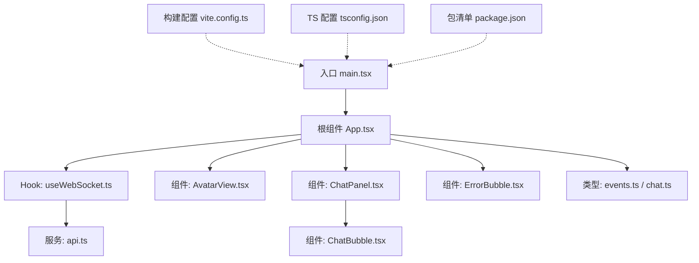
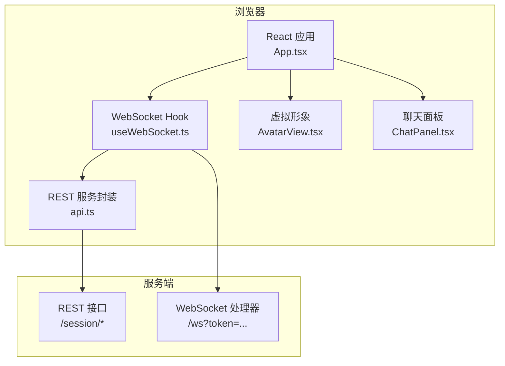
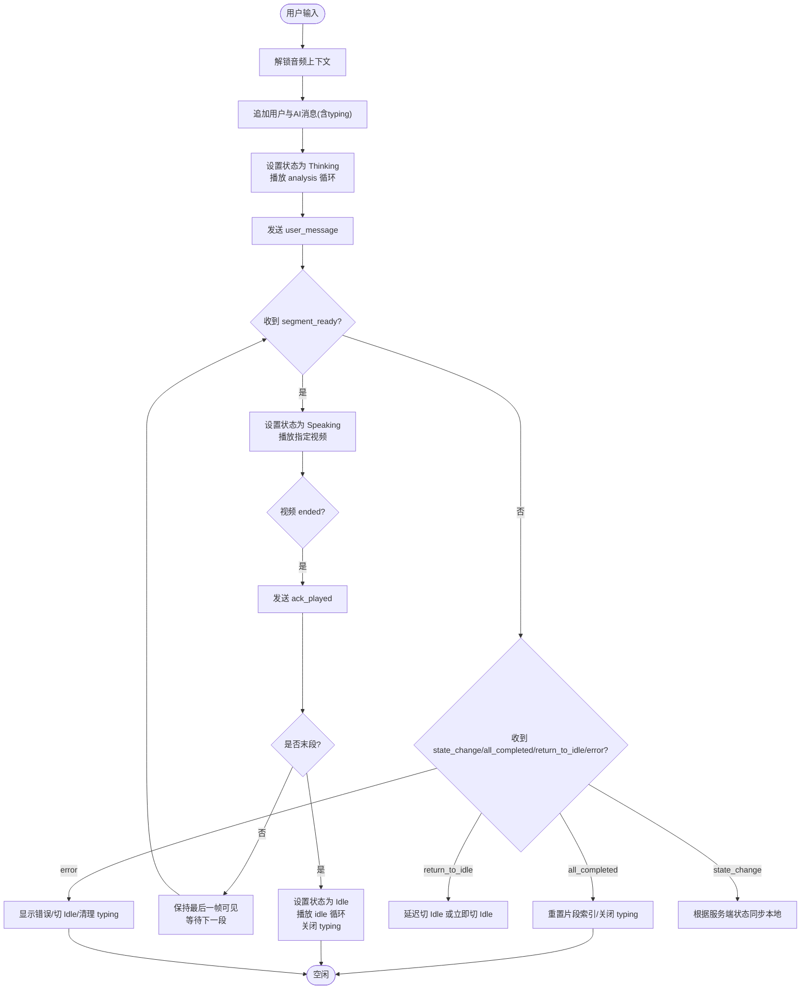
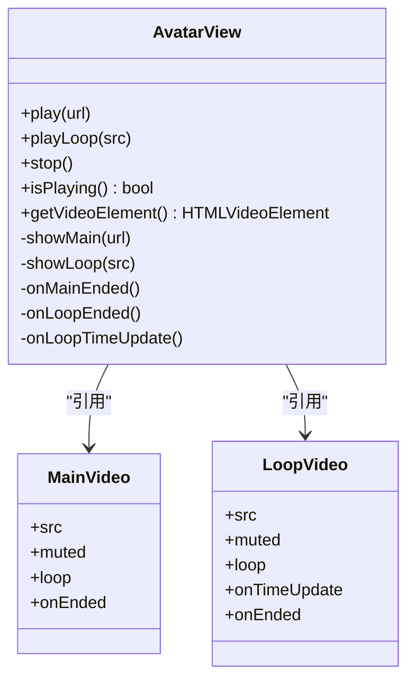
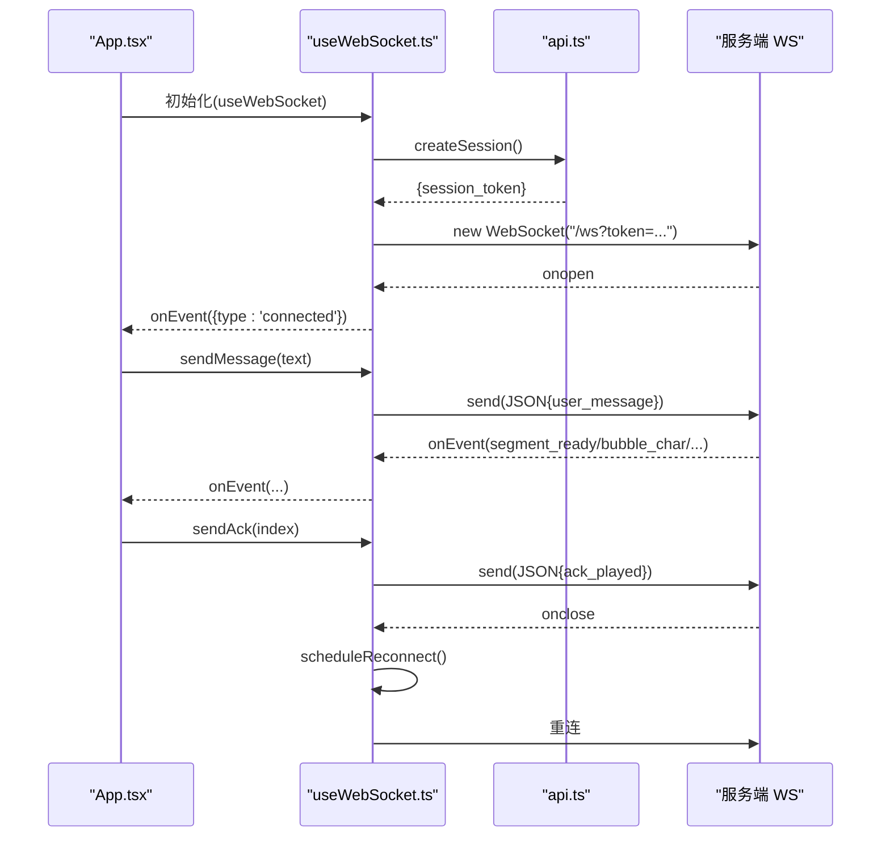
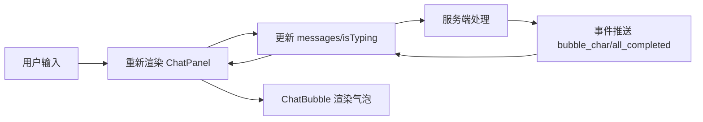
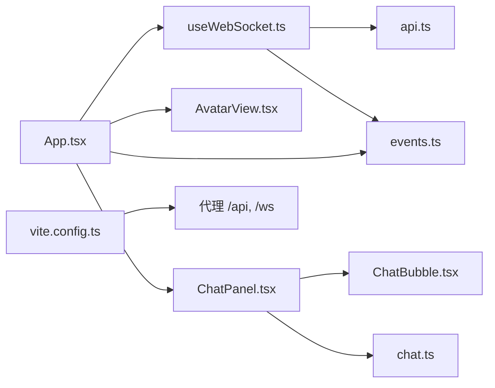

# 前端应用架构

<cite>
**本文引用的文件**   
- [client/src/main.tsx](file://client/src/main.tsx)
- [client/src/App.tsx](file://client/src/App.tsx)
- [client/src/hooks/useWebSocket.ts](file://client/src/hooks/useWebSocket.ts)
- [client/src/services/api.ts](file://client/src/services/api.ts)
- [client/src/types/events.ts](file://client/src/types/events.ts)
- [client/src/types/chat.ts](file://client/src/types/chat.ts)
- [client/src/components/AvatarView.tsx](file://client/src/components/AvatarView.tsx)
- [client/src/components/ChatPanel.tsx](file://client/src/components/ChatPanel.tsx)
- [client/src/components/ChatBubble.tsx](file://client/src/components/ChatBubble.tsx)
- [client/src/components/InputBox.tsx](file://client/src/components/InputBox.tsx)
- [client/src/components/ErrorBubble.tsx](file://client/src/components/ErrorBubble.tsx)
- [client/src/hooks/useTypewriter.ts](file://client/src/hooks/useTypewriter.ts)
- [client/package.json](file://client/package.json)
- [client/tsconfig.json](file://client/tsconfig.json)
- [client/vite.config.ts](file://client/vite.config.ts)
</cite>

## 目录
1. [简介](#简介)
2. [项目结构](#项目结构)
3. [核心组件](#核心组件)
4. [架构总览](#架构总览)
5. [详细组件分析](#详细组件分析)
6. [依赖关系分析](#依赖关系分析)
7. [性能与优化](#性能与优化)
8. [故障排查指南](#故障排查指南)
9. [结论](#结论)
10. [附录](#附录)

## 简介
本文件面向 RealTimeTalk 前端应用，系统性梳理 React 组件架构、状态管理策略、事件处理机制与前后端通信协议。重点覆盖：
- 虚拟形象系统（双视频叠加、无缝切换、动画状态机）
- WebSocket 客户端设计（连接管理、自动重连、错误处理）
- 聊天面板布局与气泡动画
- TypeScript 类型体系（事件、数据模型、接口规范）
- 架构图与交互时序图，说明前后端通信与数据同步

## 项目结构
前端采用 Vite + React + TypeScript 工程化方案，按“功能域 + 分层”组织代码：
- 入口与根组件：main.tsx → App.tsx
- 业务 Hook：useWebSocket（WS 连接）、useTypewriter（打字机效果）
- 服务层：api.ts（REST 会话管理）
- 类型定义：types/events.ts、types/chat.ts
- UI 组件：AvatarView（虚拟形象）、ChatPanel（聊天面板）、ChatBubble（消息气泡）、InputBox（输入框）、ErrorBubble（错误提示）

图表来源
- [client/src/main.tsx:1-13](file://client/src/main.tsx#L1-L13)
- [client/src/App.tsx:1-326](file://client/src/App.tsx#L1-L326)
- [client/src/hooks/useWebSocket.ts:1-190](file://client/src/hooks/useWebSocket.ts#L1-L190)
- [client/src/services/api.ts:1-52](file://client/src/services/api.ts#L1-L52)
- [client/src/types/events.ts:1-113](file://client/src/types/events.ts#L1-L113)
- [client/src/types/chat.ts:1-11](file://client/src/types/chat.ts#L1-L11)
- [client/src/components/AvatarView.tsx:1-594](file://client/src/components/AvatarView.tsx#L1-L594)
- [client/src/components/ChatPanel.tsx:1-200](file://client/src/components/ChatPanel.tsx#L1-L200)
- [client/src/components/ChatBubble.tsx:1-86](file://client/src/components/ChatBubble.tsx#L1-L86)
- [client/src/components/ErrorBubble.tsx:1-70](file://client/src/components/ErrorBubble.tsx#L1-L70)
- [client/vite.config.ts:1-28](file://client/vite.config.ts#L1-L28)
- [client/tsconfig.json:1-22](file://client/tsconfig.json#L1-L22)
- [client/package.json:1-24](file://client/package.json#L1-L24)

章节来源
- [client/src/main.tsx:1-13](file://client/src/main.tsx#L1-L13)
- [client/src/App.tsx:1-326](file://client/src/App.tsx#L1-L326)
- [client/vite.config.ts:1-28](file://client/vite.config.ts#L1-L28)
- [client/tsconfig.json:1-22](file://client/tsconfig.json#L1-L22)
- [client/package.json:1-24](file://client/package.json#L1-L24)

## 核心组件
- 根组件 App.tsx
  - 职责：编排全局状态（AppState、messages、错误信息、当前片段索引），订阅 WebSocket 事件，驱动 AvatarView 播放与 ChatPanel 渲染。
  - 关键流程：用户发送消息 → Thinking → segment_ready → Speaking → all_completed/return_to_idle → Idle。
- 虚拟形象 AvatarView.tsx
  - 职责：双 video 叠加（主视频播放片段、循环视频播放 idle/analysis），实现无黑闪切换、首段等待思考动画、idle 无缝循环。
  - 暴露方法：play、playLoop、stop、isPlaying、getVideoElement。
- 聊天面板 ChatPanel.tsx
  - 职责：消息列表滚动、输入框自适应高度、回车发送、禁用态控制。
- 聊天气泡 ChatBubble.tsx
  - 职责：用户/AI 样式区分、pre-wrap 文本、打字指示器。
- 错误提示 ErrorBubble.tsx
  - 职责：错误信息展示、自动淡出与移除。
- 输入框 InputBox.tsx
  - 职责：单行输入、长度限制、回车发送（独立于 ChatPanel 的另一种输入形态）。
- Hook：useWebSocket.ts
  - 职责：创建/恢复 session token、建立 WS 连接、自动指数退避重连、消息封装与回调分发。
- Hook：useTypewriter.ts
  - 职责：逐字追加、完成与消失状态管理（在聊天模式下由 App 直接拼接文本，该 Hook 可复用至其他场景）。
- 服务：api.ts
  - 职责：REST 调用封装（创建/获取/销毁会话）。

章节来源
- [client/src/App.tsx:1-326](file://client/src/App.tsx#L1-L326)
- [client/src/components/AvatarView.tsx:1-594](file://client/src/components/AvatarView.tsx#L1-L594)
- [client/src/components/ChatPanel.tsx:1-200](file://client/src/components/ChatPanel.tsx#L1-L200)
- [client/src/components/ChatBubble.tsx:1-86](file://client/src/components/ChatBubble.tsx#L1-L86)
- [client/src/components/ErrorBubble.tsx:1-70](file://client/src/components/ErrorBubble.tsx#L1-L70)
- [client/src/components/InputBox.tsx:1-113](file://client/src/components/InputBox.tsx#L1-L113)
- [client/src/hooks/useWebSocket.ts:1-190](file://client/src/hooks/useWebSocket.ts#L1-L190)
- [client/src/hooks/useTypewriter.ts:1-77](file://client/src/hooks/useTypewriter.ts#L1-L77)
- [client/src/services/api.ts:1-52](file://client/src/services/api.ts#L1-L52)

## 架构总览
整体采用“根组件集中状态 + 专用 Hook 管理连接 + 组件纯展示”的分层模式。前后端通过 REST 建立会话并获取 token，随后以 WebSocket 进行实时事件推送与双向通信。

图表来源
- [client/src/App.tsx:1-326](file://client/src/App.tsx#L1-L326)
- [client/src/hooks/useWebSocket.ts:1-190](file://client/src/hooks/useWebSocket.ts#L1-L190)
- [client/src/services/api.ts:1-52](file://client/src/services/api.ts#L1-L52)
- [client/src/components/AvatarView.tsx:1-594](file://client/src/components/AvatarView.tsx#L1-L594)
- [client/src/components/ChatPanel.tsx:1-200](file://client/src/components/ChatPanel.tsx#L1-L200)

## 详细组件分析

### 根组件 App.tsx 与状态机
- 状态枚举 AppState：Idle、Input、Thinking、Speaking、Bridging
- 事件处理：connected、state_change、segment_ready、bubble_char、bubble_dismiss、play_analysis、all_completed、return_to_idle、error
- 视频结束处理：监听 window 'video-ended'，发送 ack_played，末段切换到 Idle 并重置 typing 标志
- 用户交互：发送消息时解锁 AudioContext、插入用户与 AI 消息、进入 Thinking 并播放 analysis 循环

图表来源
- [client/src/App.tsx:60-326](file://client/src/App.tsx#L60-L326)
- [client/src/types/events.ts:1-113](file://client/src/types/events.ts#L1-L113)

章节来源
- [client/src/App.tsx:1-326](file://client/src/App.tsx#L1-L326)
- [client/src/types/events.ts:1-113](file://client/src/types/events.ts#L1-L113)

### 虚拟形象系统 AvatarView.tsx
- 双视频叠加架构：主视频（播放片段，有声音）+ 循环视频（idle/analysis，静音）
- 无缝切换策略：
  - 预加载目标元素，canplay 后同帧隐藏旧帧、显示新帧
  - scale(1.7) 桥接避免 speaking→idle 缩放导致的空白闪烁
  - idle 模式 JS 接管 seek(0) 实现无缝循环；analysis 使用原生 loop
- 首段保护：thinkingMode 下排队 segment_ready，待 analysis 自然结束再切换
- 资源释放：在合适时机清除 src 并 load，避免内存占用

图表来源
- [client/src/components/AvatarView.tsx:1-594](file://client/src/components/AvatarView.tsx#L1-L594)

章节来源
- [client/src/components/AvatarView.tsx:1-594](file://client/src/components/AvatarView.tsx#L1-L594)

### WebSocket 客户端 useWebSocket.ts
- 连接管理：从 sessionStorage 恢复或创建新 Session，构造 ws/wss URL，注册 onopen/onmessage/onclose/onerror
- 自动重连：指数退避（1s→2s→4s→…，上限 30s），支持显式关闭标记
- 消息封装：sendMessage(user_message)、sendAck(ack_played)、sendCancel(cancel)
- 生命周期：组件卸载时清理定时器与连接

图表来源
- [client/src/hooks/useWebSocket.ts:1-190](file://client/src/hooks/useWebSocket.ts#L1-L190)
- [client/src/services/api.ts:1-52](file://client/src/services/api.ts#L1-L52)
- [client/src/App.tsx:189-192](file://client/src/App.tsx#L189-L192)

章节来源
- [client/src/hooks/useWebSocket.ts:1-190](file://client/src/hooks/useWebSocket.ts#L1-L190)
- [client/src/services/api.ts:1-52](file://client/src/services/api.ts#L1-L52)

### 聊天面板与气泡 ChatPanel.tsx / ChatBubble.tsx
- ChatPanel：顶部头像与名称、中间消息列表（自动滚动到底部）、底部输入区（自适应高度、回车发送、禁用态）
- ChatBubble：用户/AI 样式区分、pre-wrap 保持换行一致、AI 打字指示器（三个跳动圆点）

图表来源
- [client/src/components/ChatPanel.tsx:1-200](file://client/src/components/ChatPanel.tsx#L1-L200)
- [client/src/components/ChatBubble.tsx:1-86](file://client/src/components/ChatBubble.tsx#L1-L86)
- [client/src/App.tsx:103-144](file://client/src/App.tsx#L103-L144)

章节来源
- [client/src/components/ChatPanel.tsx:1-200](file://client/src/components/ChatPanel.tsx#L1-L200)
- [client/src/components/ChatBubble.tsx:1-86](file://client/src/components/ChatBubble.tsx#L1-L86)

### 错误提示 ErrorBubble.tsx
- 自动淡出：3.5s 后开始透明度变化，4s 后通知父组件移除
- 定位：居中悬浮于屏幕中上部，模糊背景增强可读性

章节来源
- [client/src/components/ErrorBubble.tsx:1-70](file://client/src/components/ErrorBubble.tsx#L1-L70)

### 输入框 InputBox.tsx
- 单行输入、Enter 发送、空消息拦截、超长截断（2000 字符）
- 作为 ChatPanel 之外的备选输入形态，便于在不同页面复用

章节来源
- [client/src/components/InputBox.tsx:1-113](file://client/src/components/InputBox.tsx#L1-L113)

### 打字机 Hook useTypewriter.ts
- 提供 addChar/dismiss/reset 能力，内部维护 displayText、isComplete、shouldDismiss
- 当前聊天模式由 App 直接拼接文本，该 Hook 可用于需要独立气泡生命周期的场景

章节来源
- [client/src/hooks/useTypewriter.ts:1-77](file://client/src/hooks/useTypewriter.ts#L1-L77)

## 依赖关系分析
- 组件耦合
  - App 聚合所有状态与事件，向下传递 props 给 AvatarView、ChatPanel、ErrorBubble
  - ChatPanel 仅负责展示与输入交互，不持有业务状态
  - AvatarView 通过 ref 暴露播放控制，避免父组件直接操作 DOM
- 外部依赖
  - REST：/session/create、/session/{token}/history、/session/{token}
  - WebSocket：/ws?token=...
  - 媒体资源：/api/clips/idle/idle_breathing.webm（idle/analysis）
- 构建与开发
  - Vite 代理：/api 与 /ws 转发到后端 8000 端口
  - TS 严格模式开启，JSX 使用 react-jsx

图表来源
- [client/src/App.tsx:1-326](file://client/src/App.tsx#L1-L326)
- [client/src/hooks/useWebSocket.ts:1-190](file://client/src/hooks/useWebSocket.ts#L1-L190)
- [client/src/services/api.ts:1-52](file://client/src/services/api.ts#L1-L52)
- [client/src/types/events.ts:1-113](file://client/src/types/events.ts#L1-L113)
- [client/src/types/chat.ts:1-11](file://client/src/types/chat.ts#L1-L11)
- [client/src/components/AvatarView.tsx:1-594](file://client/src/components/AvatarView.tsx#L1-L594)
- [client/src/components/ChatPanel.tsx:1-200](file://client/src/components/ChatPanel.tsx#L1-L200)
- [client/src/components/ChatBubble.tsx:1-86](file://client/src/components/ChatBubble.tsx#L1-L86)
- [client/vite.config.ts:1-28](file://client/vite.config.ts#L1-L28)

章节来源
- [client/vite.config.ts:1-28](file://client/vite.config.ts#L1-L28)
- [client/src/App.tsx:1-326](file://client/src/App.tsx#L1-L326)
- [client/src/hooks/useWebSocket.ts:1-190](file://client/src/hooks/useWebSocket.ts#L1-L190)
- [client/src/services/api.ts:1-52](file://client/src/services/api.ts#L1-L52)
- [client/src/types/events.ts:1-113](file://client/src/types/events.ts#L1-L113)
- [client/src/types/chat.ts:1-11](file://client/src/types/chat.ts#L1-L11)
- [client/src/components/AvatarView.tsx:1-594](file://client/src/components/AvatarView.tsx#L1-L594)
- [client/src/components/ChatPanel.tsx:1-200](file://client/src/components/ChatPanel.tsx#L1-L200)
- [client/src/components/ChatBubble.tsx:1-86](file://client/src/components/ChatBubble.tsx#L1-L86)

## 性能与优化
- 视频播放
  - 双 video 预加载与同帧切换，避免黑闪与空白帧
  - idle 模式 JS 接管 seek(0)，消除原生 loop 的首尾跳变
  - scale(1.7) 桥接减少 speaking→idle 切换时的视觉抖动
- 网络与渲染
  - 指数退避重连，降低瞬时失败对用户体验的影响
  - 聊天消息增量更新，避免全量重绘
  - 使用 memo 包裹 ChatBubble，减少不必要的重渲染
- 音频策略
  - 首次用户交互时解锁 AudioContext，满足浏览器自动播放策略

[本节为通用指导，无需源码引用]

## 故障排查指南
- WebSocket 无法连接
  - 检查浏览器控制台 onerror 日志与 onclose code
  - 确认 /ws 代理是否正确转发到后端 8000 端口
  - 验证 sessionStorage 中的 session_token 是否存在且有效
- 视频无声或自动播放被阻止
  - 确认 unlockAudio 已在用户交互路径执行
  - 检查 muted 与 volume 设置，确保切换完成后取消静音
- 首段出现黑屏或闪烁
  - 观察 thinkingMode 与 pendingSrcRef 逻辑，确保 segment_ready 在 analysis 结束后才切换
  - 检查 canplay 与超时兜底（800ms）是否生效
- 消息未更新或重复
  - 核对 bubble_char 追加逻辑与 isTyping 标志位
  - 确认 all_completed 与 return_to_idle 分支正确关闭 typing 并重置状态

章节来源
- [client/src/hooks/useWebSocket.ts:86-117](file://client/src/hooks/useWebSocket.ts#L86-L117)
- [client/src/App.tsx:165-178](file://client/src/App.tsx#L165-L178)
- [client/src/components/AvatarView.tsx:408-461](file://client/src/components/AvatarView.tsx#L408-L461)
- [client/src/App.tsx:194-220](file://client/src/App.tsx#L194-L220)

## 结论
RealTimeTalk 前端采用清晰的分层与职责划分：根组件统筹状态与事件流，专用 Hook 抽象连接与重连，UI 组件专注展示与交互。虚拟形象系统通过双视频叠加与精细的状态控制，实现了流畅的无缝切换体验；WebSocket 客户端具备健壮的连接管理与错误恢复能力。配合严格的 TypeScript 类型定义与合理的性能优化策略，整体架构具备良好的可维护性与扩展性。

[本节为总结性内容，无需源码引用]

## 附录

### TypeScript 类型体系概览
- 事件类型（events.ts）
  - 客户端消息：user_message、ack_played、cancel
  - 服务端事件：connected、state_change、segment_ready、bubble_char、bubble_dismiss、play_analysis、all_completed、return_to_idle、error
  - 会话相关响应：CreateSessionResponse、SessionHistoryResponse、DestroySessionResponse
- 聊天数据（chat.ts）
  - ChatMessage：id、role、text、isTyping、timestamp

章节来源
- [client/src/types/events.ts:1-113](file://client/src/types/events.ts#L1-L113)
- [client/src/types/chat.ts:1-11](file://client/src/types/chat.ts#L1-L11)

### 前后端通信协议摘要
- REST
  - POST /api/session/create → 返回 session_token
  - GET /api/session/{token}/history → 返回历史消息
  - DELETE /api/session/{token} → 返回销毁结果
- WebSocket
  - 连接：/ws?token={session_token}
  - 客户端消息：user_message、ack_played、cancel
  - 服务端事件：connected、state_change、segment_ready、bubble_char、bubble_dismiss、play_analysis、all_completed、return_to_idle、error

章节来源
- [client/src/services/api.ts:1-52](file://client/src/services/api.ts#L1-L52)
- [client/src/types/events.ts:1-113](file://client/src/types/events.ts#L1-L113)

### 构建与运行
- 开发服务器：Vite 默认端口 5173，代理 /api 与 /ws 到 http://localhost:8000
- 构建产物输出目录：dist
- TypeScript 编译选项：ES2020、strict、react-jsx

章节来源
- [client/vite.config.ts:1-28](file://client/vite.config.ts#L1-L28)
- [client/tsconfig.json:1-22](file://client/tsconfig.json#L1-L22)
- [client/package.json:1-24](file://client/package.json#L1-L24)