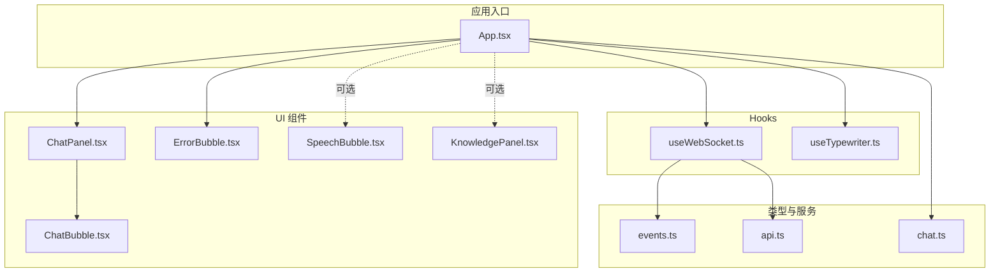
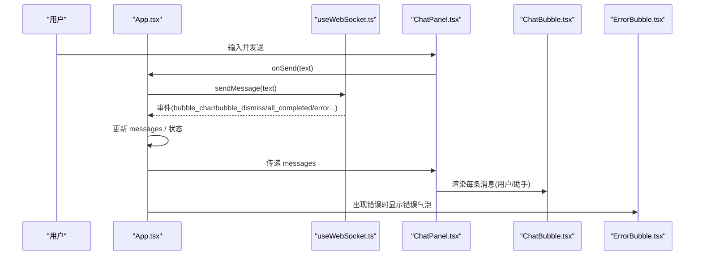
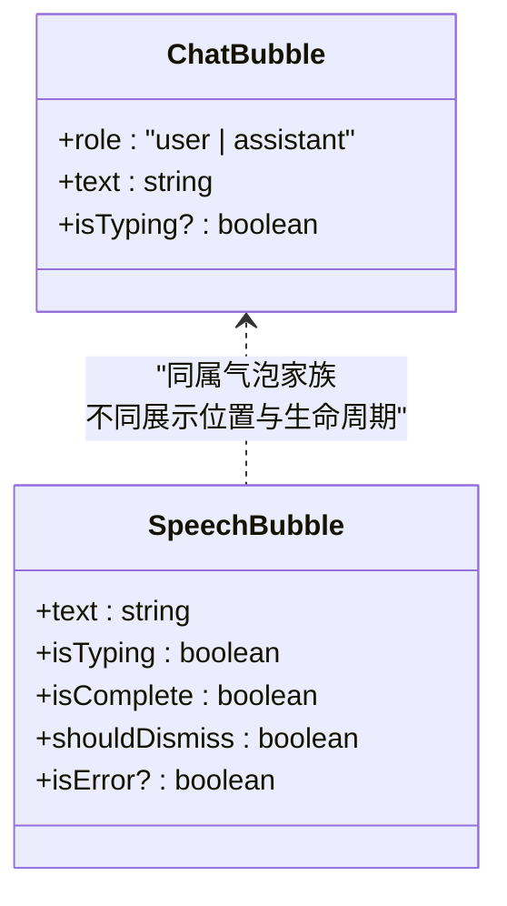
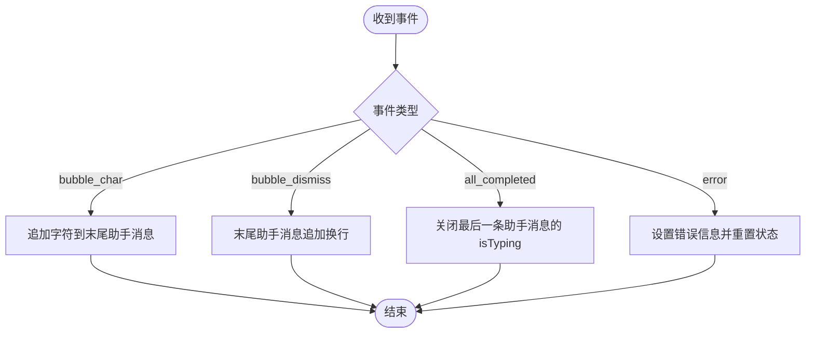
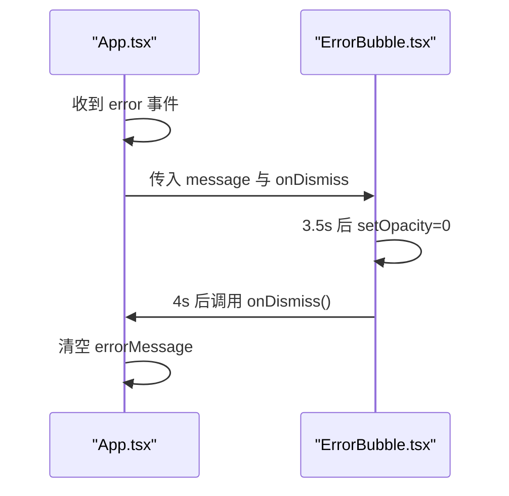
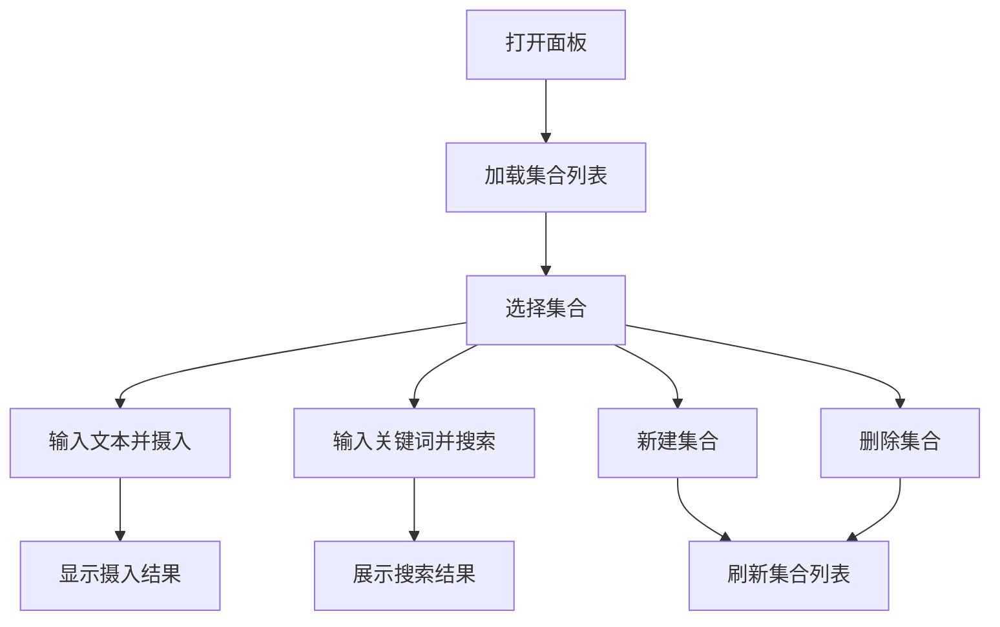
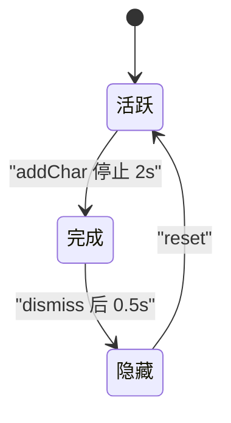
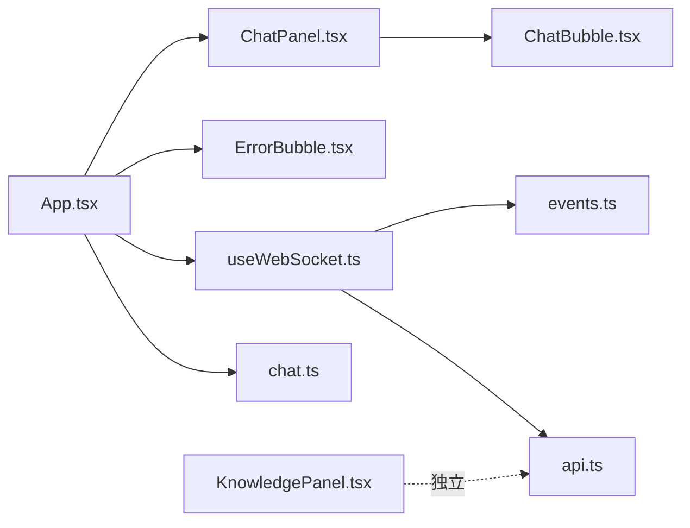

# 用户界面组件

<cite>
**本文引用的文件**   
- [App.tsx](file://client/src/App.tsx)
- [ChatPanel.tsx](file://client/src/components/ChatPanel.tsx)
- [ChatBubble.tsx](file://client/src/components/ChatBubble.tsx)
- [SpeechBubble.tsx](file://client/src/components/SpeechBubble.tsx)
- [ErrorBubble.tsx](file://client/src/components/ErrorBubble.tsx)
- [KnowledgePanel.tsx](file://client/src/components/KnowledgePanel.tsx)
- [useTypewriter.ts](file://client/src/hooks/useTypewriter.ts)
- [useWebSocket.ts](file://client/src/hooks/useWebSocket.ts)
- [chat.ts](file://client/src/types/chat.ts)
- [events.ts](file://client/src/types/events.ts)
- [api.ts](file://client/src/services/api.ts)
</cite>

## 目录
1. [简介](#简介)
2. [项目结构](#项目结构)
3. [核心组件](#核心组件)
4. [架构总览](#架构总览)
5. [详细组件分析](#详细组件分析)
6. [依赖关系分析](#依赖关系分析)
7. [性能与可访问性](#性能与可访问性)
8. [故障排查指南](#故障排查指南)
9. [结论](#结论)
10. [附录：主题与自定义](#附录：主题与自定义)

## 简介
本文件面向 RealTimeTalk 的前端用户界面，聚焦以下目标：
- 聊天气泡组件设计：ChatBubble 与 SpeechBubble 的区别、使用场景与交互差异
- 消息显示逻辑：用户消息与助手消息的样式与行为
- 错误提示组件 ErrorBubble：展示与自动消失策略
- 知识面板 KnowledgePanel：集合管理、知识摄入与检索
- 响应式设计与动画效果：打字机、淡入淡出与过渡
- 组件自定义与主题配置：如何调整样式与布局以适配品牌需求

## 项目结构
前端采用 React + TypeScript，UI 组件集中在 client/src/components，状态与通信通过 hooks 和类型定义组织。根组件 App 负责编排聊天面板、头像视频、错误气泡以及 WebSocket 事件处理。

图表来源
- [App.tsx:1-326](file://client/src/App.tsx#L1-L326)
- [ChatPanel.tsx:1-200](file://client/src/components/ChatPanel.tsx#L1-L200)
- [ChatBubble.tsx:1-86](file://client/src/components/ChatBubble.tsx#L1-L86)
- [SpeechBubble.tsx:1-119](file://client/src/components/SpeechBubble.tsx#L1-L119)
- [ErrorBubble.tsx:1-70](file://client/src/components/ErrorBubble.tsx#L1-L70)
- [KnowledgePanel.tsx:1-397](file://client/src/components/KnowledgePanel.tsx#L1-L397)
- [useWebSocket.ts:1-190](file://client/src/hooks/useWebSocket.ts#L1-L190)
- [useTypewriter.ts:1-77](file://client/src/hooks/useTypewriter.ts#L1-L77)
- [events.ts:1-113](file://client/src/types/events.ts#L1-L113)
- [chat.ts:1-11](file://client/src/types/chat.ts#L1-L11)
- [api.ts:1-52](file://client/src/services/api.ts#L1-L52)

章节来源
- [App.tsx:1-326](file://client/src/App.tsx#L1-L326)
- [ChatPanel.tsx:1-200](file://client/src/components/ChatPanel.tsx#L1-L200)
- [ChatBubble.tsx:1-86](file://client/src/components/ChatBubble.tsx#L1-L86)
- [SpeechBubble.tsx:1-119](file://client/src/components/SpeechBubble.tsx#L1-L119)
- [ErrorBubble.tsx:1-70](file://client/src/components/ErrorBubble.tsx#L1-L70)
- [KnowledgePanel.tsx:1-397](file://client/src/components/KnowledgePanel.tsx#L1-L397)
- [useWebSocket.ts:1-190](file://client/src/hooks/useWebSocket.ts#L1-L190)
- [useTypewriter.ts:1-77](file://client/src/hooks/useTypewriter.ts#L1-L77)
- [events.ts:1-113](file://client/src/types/events.ts#L1-L113)
- [chat.ts:1-11](file://client/src/types/chat.ts#L1-L11)
- [api.ts:1-52](file://client/src/services/api.ts#L1-L52)

## 核心组件
- ChatBubble：用于聊天面板中的单条消息气泡，支持用户与助手两种角色，提供“正在输入”的三点跳动动画。
- SpeechBubble：用于叠加在画面上的半透明毛玻璃对话气泡，支持逐字显示、延迟后淡出与错误模式。
- ErrorBubble：统一的错误提示气泡，红色警告风格，固定时长后自动消失。
- KnowledgePanel：知识库管理面板，支持集合创建/删除、文本摄入、向量检索调试。
- ChatPanel：聊天面板容器，承载消息列表与输入区，负责滚动与发送。
- useTypewriter：打字机 Hook，维护显示文本、完成与消失状态。
- useWebSocket：连接管理、重连、事件分发与消息发送封装。

章节来源
- [ChatBubble.tsx:1-86](file://client/src/components/ChatBubble.tsx#L1-L86)
- [SpeechBubble.tsx:1-119](file://client/src/components/SpeechBubble.tsx#L1-L119)
- [ErrorBubble.tsx:1-70](file://client/src/components/ErrorBubble.tsx#L1-L70)
- [KnowledgePanel.tsx:1-397](file://client/src/components/KnowledgePanel.tsx#L1-L397)
- [ChatPanel.tsx:1-200](file://client/src/components/ChatPanel.tsx#L1-L200)
- [useTypewriter.ts:1-77](file://client/src/hooks/useTypewriter.ts#L1-L77)
- [useWebSocket.ts:1-190](file://client/src/hooks/useWebSocket.ts#L1-L190)

## 架构总览
RealTimeTalk 的 UI 层由 App 协调，通过 WebSocket 接收服务端事件，驱动聊天消息与头像播放；同时提供独立的知识库管理面板。

图表来源
- [App.tsx:78-183](file://client/src/App.tsx#L78-L183)
- [useWebSocket.ts:137-157](file://client/src/hooks/useWebSocket.ts#L137-L157)
- [ChatPanel.tsx:129-136](file://client/src/components/ChatPanel.tsx#L129-L136)
- [ChatBubble.tsx:15-83](file://client/src/components/ChatBubble.tsx#L15-L83)
- [ErrorBubble.tsx:15-69](file://client/src/components/ErrorBubble.tsx#L15-L69)

## 详细组件分析

### 聊天气泡组件：ChatBubble 与 SpeechBubble
- 区别
  - ChatBubble：常驻于聊天面板的消息气泡，区分用户（右对齐、蓝色背景）与助手（左对齐、白底边框），内置“正在输入”三点跳动动画，适合历史消息流。
  - SpeechBubble：悬浮于画面上方的半透明毛玻璃气泡，支持逐字显示、完成后延迟淡出，适合实时语音/字幕叠加。
- 使用场景
  - 聊天模式：使用 ChatBubble 展示持久化消息流。
  - 形象播报模式：使用 SpeechBubble 作为临时字幕提示。
- 关键实现要点
  - ChatBubble 根据 role 切换对齐方式、颜色与圆角，使用 pre-wrap 保持换行一致性。
  - SpeechBubble 通过 opacity 与 transition 控制淡入淡出，isTyping 时显示光标闪烁。

图表来源
- [ChatBubble.tsx:9-83](file://client/src/components/ChatBubble.tsx#L9-L83)
- [SpeechBubble.tsx:10-118](file://client/src/components/SpeechBubble.tsx#L10-L118)

章节来源
- [ChatBubble.tsx:1-86](file://client/src/components/ChatBubble.tsx#L1-L86)
- [SpeechBubble.tsx:1-119](file://client/src/components/SpeechBubble.tsx#L1-L119)

### 消息显示逻辑：用户消息 vs 助手消息
- 用户消息
  - 右对齐、蓝色背景、白色文字、无外边框，阴影轻微突出。
- 助手消息
  - 左对齐、白色背景、灰色边框、深色文字，带头像占位。
  - isTyping 为真时显示三点跳动动画；all_completed 或 return_to_idle 时关闭动画。
- 实时更新
  - bubble_char 事件追加字符到最后一条助手消息文本。
  - bubble_dismiss 事件在段间插入换行分隔。
  - all_completed 将最后一条助手消息的 isTyping 置为 false。

图表来源
- [App.tsx:103-178](file://client/src/App.tsx#L103-L178)
- [ChatBubble.tsx:64-79](file://client/src/components/ChatBubble.tsx#L64-L79)

章节来源
- [App.tsx:78-183](file://client/src/App.tsx#L78-L183)
- [ChatBubble.tsx:15-83](file://client/src/components/ChatBubble.tsx#L15-L83)
- [chat.ts:4-10](file://client/src/types/chat.ts#L4-L10)

### 错误提示组件：ErrorBubble
- 功能
  - 统一错误提示，红色警告色调，半透明毛玻璃背景。
  - 进入即显示，约 3.5s 后开始淡出，再约 0.5s 后通知父组件移除。
- 交互
  - 无需手动关闭，自动消失；也可由父组件主动清除。
- 集成
  - App 在 error 事件时设置 errorMessage，条件渲染 ErrorBubble。

图表来源
- [App.tsx:165-178](file://client/src/App.tsx#L165-L178)
- [ErrorBubble.tsx:15-69](file://client/src/components/ErrorBubble.tsx#L15-L69)

章节来源
- [ErrorBubble.tsx:1-70](file://client/src/components/ErrorBubble.tsx#L1-L70)
- [App.tsx:165-178](file://client/src/App.tsx#L165-L178)

### 知识面板组件：KnowledgePanel
- 能力
  - 集合管理：创建、删除、选择当前集合。
  - 知识摄入：向当前集合添加文本文档。
  - 搜索调试：按关键词检索相似片段，返回分数与来源。
- 数据流
  - 展开时加载集合列表；操作成功后刷新列表与状态。
  - 搜索请求携带 k 参数限制结果数量。
- 接口约定
  - 集合列表：GET /api/knowledge/collections
  - 创建集合：POST /api/knowledge/collections
  - 删除集合：DELETE /api/knowledge/collections/{name}
  - 知识摄入：POST /api/knowledge/ingest
  - 搜索：GET /api/knowledge/search?q=&k=5&collection=...

图表来源
- [KnowledgePanel.tsx:37-141](file://client/src/components/KnowledgePanel.tsx#L37-L141)

章节来源
- [KnowledgePanel.tsx:1-397](file://client/src/components/KnowledgePanel.tsx#L1-L397)

### 打字机效果与动画
- useTypewriter Hook
  - 维护 displayText、isComplete、shouldDismiss。
  - addChar 追加字符并重置完成/消失状态，2s 后标记完成。
  - dismiss 触发完成并在 0.5s 后真正隐藏。
  - reset 清理所有状态与定时器。
- 动画细节
  - ChatBubble 的三点跳动动画由 CSS keyframes 驱动。
  - SpeechBubble 的淡入淡出通过 opacity 与 transition 实现，isTyping 时显示闪烁光标。
  - KnowledgePanel 的展开/收起通过 width/minWidth 与 transition 平滑过渡。

图表来源
- [useTypewriter.ts:29-76](file://client/src/hooks/useTypewriter.ts#L29-L76)
- [ChatBubble.tsx:64-79](file://client/src/components/ChatBubble.tsx#L64-L79)
- [SpeechBubble.tsx:33-57](file://client/src/components/SpeechBubble.tsx#L33-L57)
- [KnowledgePanel.tsx:144-183](file://client/src/components/KnowledgePanel.tsx#L144-L183)

章节来源
- [useTypewriter.ts:1-77](file://client/src/hooks/useTypewriter.ts#L1-L77)
- [ChatBubble.tsx:1-86](file://client/src/components/ChatBubble.tsx#L1-L86)
- [SpeechBubble.tsx:1-119](file://client/src/components/SpeechBubble.tsx#L1-L119)
- [KnowledgePanel.tsx:1-397](file://client/src/components/KnowledgePanel.tsx#L1-L397)

### 响应式设计原则
- 聊天面板
  - 最小宽度约束，确保在小屏下仍可阅读；输入框高度自适应，最大高度限制避免遮挡。
- 气泡组件
  - 最大宽度百分比限制，长文本自动换行；移动端建议增大点击区域与字号。
- 知识面板
  - 折叠态仅保留窄条标签，展开态提供完整操作区；内部内容纵向滚动。
- 通用建议
  - 使用相对单位与媒体查询优化小屏体验；避免绝对定位覆盖重要交互元素。

[本节为通用指导，不直接分析具体文件]

## 依赖关系分析
- 组件耦合
  - App 组合 ChatPanel、ErrorBubble，并通过 WebSocket 事件驱动消息状态。
  - ChatPanel 依赖 ChatBubble 渲染消息。
  - KnowledgePanel 独立，通过 REST API 与后端交互。
- 外部依赖
  - WebSocket 事件类型来自 events.ts。
  - 会话 Token 与历史记录通过 api.ts 封装。
  - 聊天消息模型来自 chat.ts。

图表来源
- [App.tsx:1-326](file://client/src/App.tsx#L1-L326)
- [ChatPanel.tsx:1-200](file://client/src/components/ChatPanel.tsx#L1-L200)
- [ChatBubble.tsx:1-86](file://client/src/components/ChatBubble.tsx#L1-L86)
- [ErrorBubble.tsx:1-70](file://client/src/components/ErrorBubble.tsx#L1-L70)
- [useWebSocket.ts:1-190](file://client/src/hooks/useWebSocket.ts#L1-L190)
- [events.ts:1-113](file://client/src/types/events.ts#L1-L113)
- [chat.ts:1-11](file://client/src/types/chat.ts#L1-L11)
- [api.ts:1-52](file://client/src/services/api.ts#L1-L52)
- [KnowledgePanel.tsx:1-397](file://client/src/components/KnowledgePanel.tsx#L1-L397)

章节来源
- [App.tsx:1-326](file://client/src/App.tsx#L1-L326)
- [useWebSocket.ts:1-190](file://client/src/hooks/useWebSocket.ts#L1-L190)
- [api.ts:1-52](file://client/src/services/api.ts#L1-L52)
- [events.ts:1-113](file://client/src/types/events.ts#L1-L113)
- [chat.ts:1-11](file://client/src/types/chat.ts#L1-L11)
- [KnowledgePanel.tsx:1-397](file://client/src/components/KnowledgePanel.tsx#L1-L397)

## 性能与可访问性
- 性能
  - ChatBubble 使用 memo 包裹，减少不必要的重渲染。
  - 消息追加采用不可变更新，避免整表重绘。
  - 打字机 Hook 使用 ref 保存定时器，防止泄漏。
- 可访问性
  - 按钮具备禁用态与焦点样式；输入框支持键盘回车发送。
  - 错误提示具有对比度良好的配色，便于识别。
- 建议
  - 对长列表考虑虚拟滚动。
  - 为图片与图标提供 alt 文本。
  - 增加 aria-label 提升屏幕阅读器体验。

[本节为通用指导，不直接分析具体文件]

## 故障排查指南
- WebSocket 连接问题
  - 检查 ensureToken 是否成功获取 session_token。
  - 观察 onclose/onerror 日志与重连调度。
- 消息未更新
  - 确认 bubble_char 事件是否到达，messages 是否被正确追加。
  - 检查 isTyping 是否在 all_completed 或 return_to_idle 时被重置。
- 错误气泡不消失
  - 检查 ErrorBubble 的计时器是否被清理，onDismiss 回调是否执行。
- 知识库操作失败
  - 查看网络请求状态码与返回体；确认集合名称与权限。

章节来源
- [useWebSocket.ts:67-135](file://client/src/hooks/useWebSocket.ts#L67-L135)
- [App.tsx:165-178](file://client/src/App.tsx#L165-L178)
- [ErrorBubble.tsx:18-35](file://client/src/components/ErrorBubble.tsx#L18-L35)
- [KnowledgePanel.tsx:57-141](file://client/src/components/KnowledgePanel.tsx#L57-L141)

## 结论
RealTimeTalk 的 UI 组件围绕“聊天面板 + 实时气泡 + 错误提示 + 知识库管理”构建，采用清晰的职责划分与事件驱动的数据流。ChatBubble 与 SpeechBubble 分别满足持久化消息与临时字幕的需求；ErrorBubble 提供一致的错误反馈；KnowledgePanel 则扩展了系统的知识管理能力。通过合理的动画与响应式策略，整体体验流畅且可扩展。

[本节为总结，不直接分析具体文件]

## 附录：主题与自定义
- 主题变量建议
  - 主色、辅助色、背景色、文本色、边框色、阴影等集中定义，便于一键替换。
- 布局定制
  - 通过 props 或 CSS 变量调整气泡圆角、内边距、字体大小与行高。
  - 知识面板宽度、折叠态宽度可通过样式变量控制。
- 动画时长
  - 打字机间隔、淡入淡出时长、面板展开时长均可配置，以满足不同品牌节奏。
- 接入方式
  - 将样式抽离为 CSS 模块或主题对象，在 App 顶层注入，组件读取变量而非硬编码值。

[本节为通用指导，不直接分析具体文件]