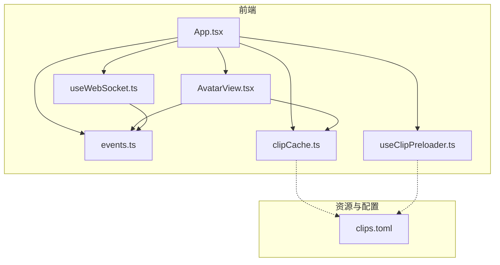
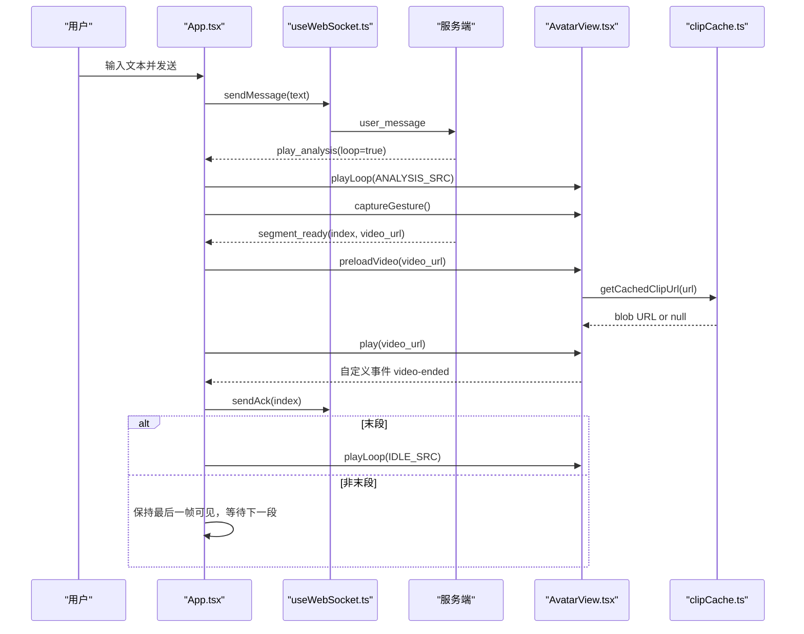
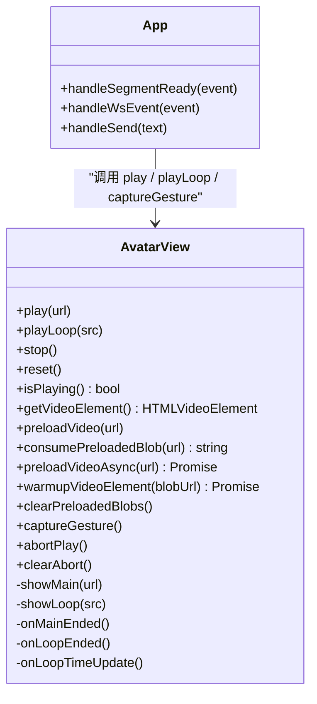
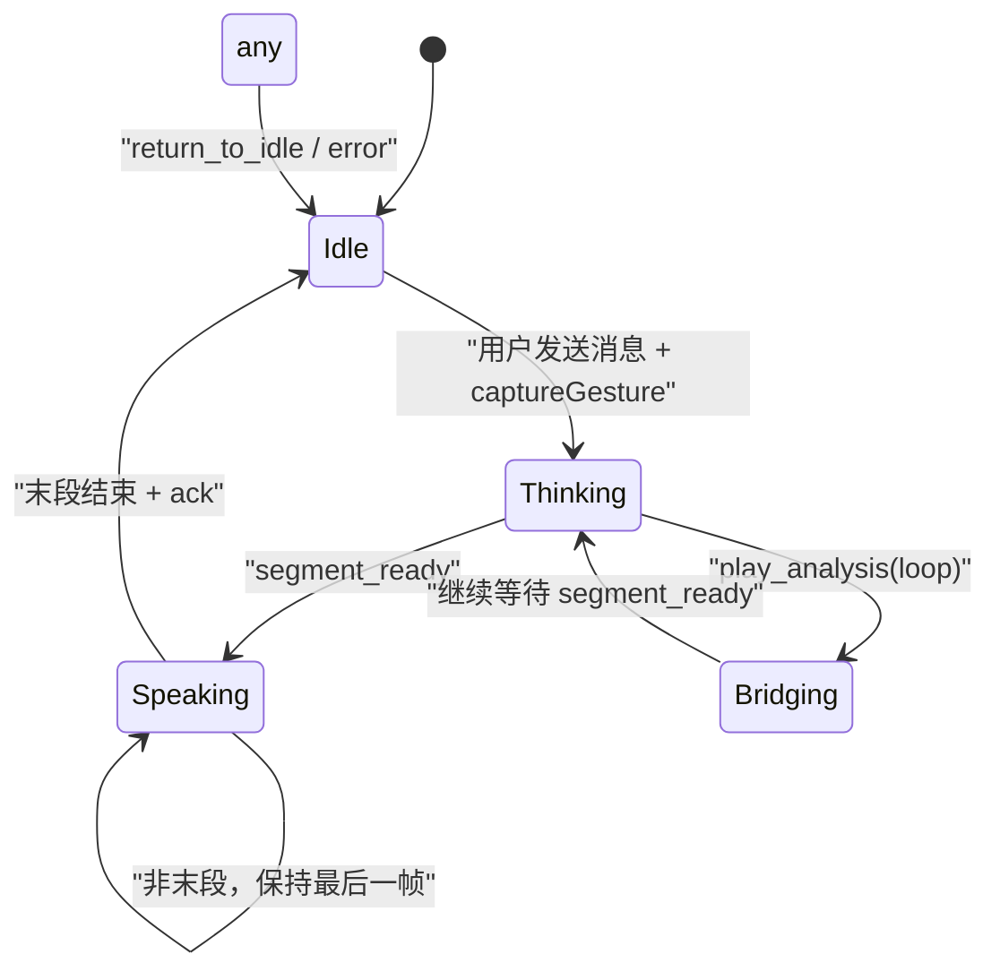
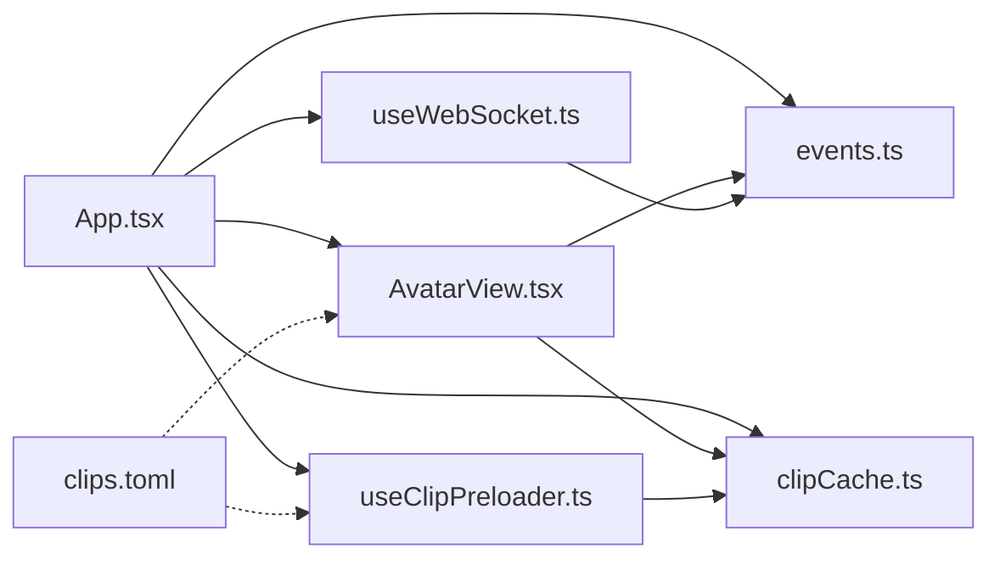

# 虚拟形象系统

<cite>
**本文引用的文件**   
- [AvatarView.tsx](file://client/src/components/AvatarView.tsx)
- [App.tsx](file://client/src/App.tsx)
- [events.ts](file://client/src/types/events.ts)
- [useWebSocket.ts](file://client/src/hooks/useWebSocket.ts)
- [clipCache.ts](file://client/src/services/clipCache.ts)
- [useClipPreloader.ts](file://client/src/hooks/useClipPreloader.ts)
- [clips.toml](file://clips/short-hair-teacher-girl/clips.toml)
</cite>

## 更新摘要
**变更内容**   
- 修复 captureGesture 中 pause 调用导致的卡顿问题，移除对 loopVideo 的暂停操作
- 优化 scale 变换参数从 1.7 调整为 0.589 以保持视觉一致性
- 增强桥接帧处理逻辑，防止黑屏和闪烁
- 改进视频播放竞态条件防护机制，防止重复播放循环
- 优化 opacity 过渡处理，避免冗余循环播放时的视觉伪影
- 完善状态管理，确保 idle 状态切换的流畅性

## 目录
1. [简介](#简介)
2. [项目结构](#项目结构)
3. [核心组件](#核心组件)
4. [架构总览](#架构总览)
5. [详细组件分析](#详细组件分析)
6. [依赖关系分析](#依赖关系分析)
7. [性能与优化](#性能与优化)
8. [故障排查指南](#故障排查指南)
9. [结论](#结论)
10. [附录：扩展指南](#附录扩展指南)

## 简介
本技术文档面向 RealTimeTalk 的虚拟形象系统，聚焦 AvatarView 组件的实现原理、状态机流转、视频片段管理与播放器封装、WebM 兼容性处理、动画过渡与帧同步策略，以及后续扩展新角色与素材的方法。目标是帮助开发者快速理解并高效维护该子系统。

## 项目结构
虚拟形象系统位于前端客户端中，核心由以下模块组成：
- 组件层：AvatarView 负责双 video 叠加渲染、状态切换与播放控制
- 应用层：App 管理会话状态（Idle/Thinking/Speaking/Bridging）与 WebSocket 事件分发
- 类型定义：events.ts 定义前后端交互事件与状态枚举
- 网络层：useWebSocket.ts 提供连接、重连、消息发送与回调
- 缓存服务：clipCache.ts 实现 IndexedDB Blob 缓存与内存缓存
- 预加载器：useClipPreloader.ts 管理视频片段的预取策略
- 资源清单：clips.toml 描述语义化切片库、标签与过渡规则

**图表来源**
- [App.tsx:1-985](file://client/src/App.tsx#L1-L985)
- [AvatarView.tsx:1-1483](file://client/src/components/AvatarView.tsx#L1-L1483)
- [events.ts:1-113](file://client/src/types/events.ts#L1-L113)
- [useWebSocket.ts:1-190](file://client/src/hooks/useWebSocket.ts#L1-L190)
- [clipCache.ts:1-307](file://client/src/services/clipCache.ts#L1-L307)
- [useClipPreloader.ts:1-126](file://client/src/hooks/useClipPreloader.ts#L1-L126)
- [clips.toml:1-148](file://clips/short-hair-teacher-girl/clips.toml#L1-L148)

## 核心组件
- **AvatarView**：实现"主视频 + 循环视频"的双层叠加架构，通过 opacity 过渡与双缓冲预加载消除段间空白帧；暴露 play/playLoop/stop/isPlaying/getVideoElement 方法供父组件调用。
- **App**：维护 AppState（Idle/Thinking/Speaking/Bridging），根据 WebSocket 事件驱动 AvatarView 的状态切换与播放控制。
- **useWebSocket**：封装连接、自动重连、消息收发与回调注册。
- **clipCache**：提供 IndexedDB Blob 缓存服务，支持内存级 objectURL 缓存，避免重复下载。
- **useClipPreloader**：管理视频片段的预取策略，支持并发下载与进度监控。
- **events.ts**：定义前后端事件结构与状态枚举。
- **clips.toml**：定义角色元数据、切片清单、标签与过渡规则。

**章节来源**
- [AvatarView.tsx:12-42](file://client/src/components/AvatarView.tsx#L12-L42)
- [AvatarView.tsx:59-70](file://client/src/components/AvatarView.tsx#L59-L70)
- [App.tsx:177-186](file://client/src/App.tsx#L177-L186)
- [clipCache.ts:1-14](file://client/src/services/clipCache.ts#L1-L14)
- [useClipPreloader.ts:1-20](file://client/src/hooks/useClipPreloader.ts#L1-L20)

## 架构总览
虚拟形象系统采用"事件驱动 + 双缓冲视频 + 多级缓存"的架构：
- 应用层监听服务端事件（segment_ready、play_analysis、all_completed、return_to_idle、error 等），更新本地状态并驱动 AvatarView 切换。
- AvatarView 内部维护两个 <video> 元素，交替作为"当前可见"和"预加载目标"，在 canplay 后于同一帧内完成隐藏旧帧/显示新帧，避免黑闪与空白帧。
- Idle 与 Thinking 使用静音循环视频；Speaking 使用带声音的主视频单播片段。
- 多级缓存机制：IndexedDB → 内存 Map → HTTP 缓存，确保视频片段快速加载。

**图表来源**
- [App.tsx:576-589](file://client/src/App.tsx#L576-L589)
- [useWebSocket.ts:137-157](file://client/src/hooks/useWebSocket.ts#L137-L157)
- [AvatarView.tsx:353-594](file://client/src/components/AvatarView.tsx#L353-L594)
- [clipCache.ts:91-108](file://client/src/services/clipCache.ts#L91-L108)

## 详细组件分析

### AvatarView 组件
- **双 video 叠加**：主视频用于播放有声音的语义片段；循环视频用于 idle/analysis 静音循环。
- **预加载与切换**：
  - showMain：将新片段预加载到"非当前可见"的元素，canplay 后立即播放并在同帧内切换透明度与 pointerEvents，确保无空白帧。
  - showLoop：支持 idle 与 analysis 两种循环模式；idle 使用 JS 接管无缝循环（timeupdate 接近末尾时 seek(0)），analysis 使用原生 loop。
- **思考模式保护**：thinkingModeRef 防止 segment_ready 竞态跳过思考动画；pendingSrcRef 队列在 analysis 循环末尾触发切回 speaking。
- **桥接策略**：当从 speaking 回到 idle 或 idle↔analysis 切换时，利用 scale(0.589) 与"桥接元素"保持上一帧可见，避免闪烁。
- **手势预捕获**：captureGesture 方法在用户手势同步栈中执行 muted play()→pause() 以解锁 X5 自动播放策略，但不再对 loopVideo 执行 pause 避免卡顿。
- **事件与对外接口**：
  - 内部派发 window 'video-ended' 事件给父组件。
  - 暴露 play/playLoop/stop/isPlaying/getVideoElement/captureGesture 等方法。

**更新** 移除了 captureGesture 中对 loopVideo 的 pause 调用，避免 idle 动画短暂停止造成的"卡住"感知。同时优化了 scale 变换参数从 1.7 调整为 0.589，使 idle 状态普兰占帧比例与 speaking 状态保持一致。

**图表来源**
- [AvatarView.tsx:12-42](file://client/src/components/AvatarView.tsx#L12-L42)
- [AvatarView.tsx:353-594](file://client/src/components/AvatarView.tsx#L353-L594)
- [AvatarView.tsx:1237-1253](file://client/src/components/AvatarView.tsx#L1237-L1253)
- [App.tsx:576-589](file://client/src/App.tsx#L576-L589)

**章节来源**
- [AvatarView.tsx:1-1483](file://client/src/components/AvatarView.tsx#L1-L1483)

### 状态机与转换逻辑
- **状态定义**：Idle、Input、Thinking、Speaking、Bridging。
- **关键转换**：
  - Idle → Thinking：用户发送消息后，立即播放 analysis 循环并调用 captureGesture 解锁自动播放。
  - Thinking → Speaking：收到 segment_ready 后，切换到主视频播放片段。
  - Speaking → Bridging/Idle：每段结束派发 video-ended，若为末段则返回 Idle 并播放 idle 循环；否则保持最后一帧等待下一段。
  - 任意非 Idle → Idle：收到 return_to_idle 或在错误时强制返回 Idle。

**图表来源**
- [events.ts:7-13](file://client/src/types/events.ts#L7-L13)
- [App.tsx:555-562](file://client/src/App.tsx#L555-L562)
- [App.tsx:614-632](file://client/src/App.tsx#L614-L632)

**章节来源**
- [events.ts:7-13](file://client/src/types/events.ts#L7-L13)
- [App.tsx:576-589](file://client/src/App.tsx#L576-L589)

### 视频片段管理机制
- **资源清单**：clips.toml 定义了角色名、基础图、语音、切片时长、每个切片的文件、标签、优先级、提示词与 speech_hint，以及过渡规则（neutral/opening/body/closing 标签分组与默认序列）。
- **预加载策略**：
  - 双 video 交替预加载，目标元素在 canplay 后才进行切换，避免空白帧。
  - 对相同基础路径的 idle↔analysis 切换，直接设置新 src 而不清除旧数据，利用浏览器缓存减少闪烁。
  - 多级缓存：IndexedDB → 内存 Map → HTTP 缓存，确保快速访问。
- **缓存机制**：
  - clipCache.ts 提供完整的缓存服务，包括 L1 内存缓存和 L2 IndexedDB 存储。
  - useClipPreloader.ts 管理并发预取，最多 4 路并行下载。
  - 在合适时机移除 src 并 load() 释放内存（淡出完成后延迟清理）。
- **内存管理**：
  - 非桥接场景下，延迟清理主视频 src，避免过渡期间出现空白。
  - 桥接场景下，先交叉淡化再释放旧资源。
  - 限制预加载数量（最多 5 段），避免内存爆炸。

**更新** 优化了 scale 变换参数从 1.7 调整为 0.589，使 idle 状态普兰占帧比例与 speaking 状态保持一致，避免视觉不一致。同时增强了桥接帧处理逻辑，防止黑屏和闪烁。

**章节来源**
- [clips.toml:1-148](file://clips/short-hair-teacher-girl/clips.toml#L1-L148)
- [clipCache.ts:1-307](file://client/src/services/clipCache.ts#L1-L307)
- [useClipPreloader.ts:1-126](file://client/src/hooks/useClipPreloader.ts#L1-L126)
- [AvatarView.tsx:612-869](file://client/src/components/AvatarView.tsx#L612-L869)

### 播放器封装与事件/错误处理
- **播放控制接口**：
  - play(url)：播放指定 URL 的片段，考虑 thinking 模式与 pending 队列。
  - playLoop(src)：切换到 idle 或 analysis 循环。
  - stop()：停止所有视频并隐藏主视频。
  - isPlaying()/getVideoElement()：查询与访问底层元素。
  - captureGesture()：在用户手势同步栈中预捕获播放权限，解锁 X5 自动播放策略。
  - abortPlay()/clearAbort()：中止正在进行的播放操作，防止状态覆盖。
- **事件监听**：
  - onMainEnded/onLoopEnded：派发 video-ended 事件，驱动父组件发送 ack 与状态回退。
  - onLoopTimeUpdate：JS 接管 idle 无缝循环与 pending 段切换。
- **错误处理**：
  - play() 被阻止时的降级切换（同帧切换）。
  - 自动播放策略：首次解锁 AudioContext，必要时提示等待用户交互。
  - 兜底定时器：800ms 超时保证可观测性与健壮性。
  - 竞态条件防护：防止 segment_ready 事件在思考模式下被错误处理。

**更新** 改进了竞态条件防护，确保在思考模式下不会错误地跳过思考动画。新增了 abortPlay/clearAbort 机制，防止错误状态下重复播放循环。

**章节来源**
- [AvatarView.tsx:353-594](file://client/src/components/AvatarView.tsx#L353-L594)
- [AvatarView.tsx:1237-1272](file://client/src/components/AvatarView.tsx#L1237-L1272)
- [App.tsx:32-58](file://client/src/App.tsx#L32-L58)

### WebM 格式兼容性与循环帧校验
- **浏览器支持**：
  - 使用 WebM 编码，结合 playsInline 与 muted 属性提升移动端与自动播放成功率。
  - 针对 Firefox 在无帧数据时可能显示黑底的场景，等待 canplay 后再淡入。
  - iOS Safari 和微信内置浏览器优先使用 MP4 格式以保证解码稳定性。
- **循环帧一致性**：
  - 要求循环视频首尾帧像素一致，确保无缝衔接。
  - 工具脚本 extract_frames.ps1 提取首尾帧；find_loop.py 计算 MSE 寻找最佳循环点。

**章节来源**
- [AvatarView.tsx:506-532](file://client/src/components/AvatarView.tsx#L506-L532)

### 动画过渡与帧同步
- **平滑过渡**：
  - 使用 CSS transition 的 opacity 与 pointerEvents 组合，在 canplay 后于同一帧内完成旧帧隐藏与新帧显示。
  - 特殊场景（scale(0.589) 重置）采用交叉淡入淡出与桥接元素，避免空白帧。
  - 增强的桥接帧处理逻辑，防止黑屏和闪烁。
- **帧同步**：
  - idle 模式：timeupdate 检测距末尾小于阈值时立即 seek(0)，配合首尾帧一致实现零跳变。
  - analysis 模式：原生 loop，同时检查 pending 段在临近末尾时触发切换。
  - 请求视频帧回调（requestVideoFrameCallback）确保精确的首帧检测。

**更新** 增强了桥接帧处理逻辑，改进了 scale(0.589) 变换的处理，确保在不同状态切换时不会出现黑屏或闪烁。优化了 opacity 过渡处理，防止冗余循环播放时的视觉伪影。

**章节来源**
- [AvatarView.tsx:94-128](file://client/src/components/AvatarView.tsx#L94-L128)
- [AvatarView.tsx:612-869](file://client/src/components/AvatarView.tsx#L612-L869)
- [AvatarView.tsx:483-504](file://client/src/components/AvatarView.tsx#L483-L504)

## 依赖关系分析
- **App** 依赖 AvatarView 与 useWebSocket，并通过 events.ts 的类型约束前后端契约。
- **AvatarView** 仅依赖 React API 与浏览器原生 <video> 能力，不直接依赖网络层。
- **clipCache** 提供独立的缓存服务，被 AvatarView 和 useClipPreloader 共同使用。
- **useClipPreloader** 管理视频片段的预取策略，与 clipCache 协作实现多级缓存。
- clips.toml 作为资源清单，指导内容生产与过渡规则，间接影响前端展示。

**图表来源**
- [App.tsx:1-985](file://client/src/App.tsx#L1-L985)
- [AvatarView.tsx:1-1483](file://client/src/components/AvatarView.tsx#L1-L1483)
- [useWebSocket.ts:1-190](file://client/src/hooks/useWebSocket.ts#L1-L190)
- [events.ts:1-113](file://client/src/types/events.ts#L1-L113)
- [clipCache.ts:1-307](file://client/src/services/clipCache.ts#L1-L307)
- [useClipPreloader.ts:1-126](file://client/src/hooks/useClipPreloader.ts#L1-L126)
- [clips.toml:1-148](file://clips/short-hair-teacher-girl/clips.toml#L1-L148)

## 性能与优化
- **双缓冲与同帧切换**：显著降低段间空白帧概率，提升观感流畅度。
- **多级缓存机制**：
  - IndexedDB 持久化缓存，支持页面刷新后继续使用。
  - 内存级 objectURL 缓存，避免每次段间切换都查 IDB（5-15ms 开销）。
  - 预取完成后预热内存缓存，首段切换 0 延迟。
- **并发预取**：最多 4 路并行下载，不阻塞首屏。
- **资源释放**：在淡出完成后延迟清理 src 并 load()，平衡过渡质量与内存占用。
- **自动播放策略**：通过 AudioContext 解锁与 muted 初始播放，提高移动端可用性。
- **手势预捕获**：captureGesture 在用户交互时预解锁播放权限，避免后续自动播放被阻止。
- **过渡参数调优**：opacity 过渡时间较短（约 0.1~0.15s），兼顾速度与视觉连续性。
- **scale 变换优化**：从 1.7 调整为 0.589，保持 idle 与 speaking 状态的视觉一致性。
- **竞态条件防护**：新增 abortPlay/clearAbort 机制，防止错误状态下重复播放循环。

## 故障排查指南
- **自动播放被阻止**：
  - 现象：控制台警告 play() 被阻止，已降级为同帧切换。
  - 处理：确保首次用户交互后解锁 AudioContext；必要时引导用户点击页面。
  - 新增：captureGesture 方法在 handleSend 中调用，预捕获播放权限。
- **黑屏或黑底**：
  - 现象：Firefox 下无帧数据时短暂黑底。
  - 处理：等待 canplay 后再淡入；确保 idle 视频首帧有效。
  - 新增：增强的桥接帧处理逻辑，防止状态切换时的黑屏。
- **循环跳变**：
  - 现象：idle/analysis 循环出现跳变。
  - 处理：使用 find_loop.py 验证首尾帧一致性；调整生成参数使首尾帧像素一致。
- **卡顿或空白帧**：
  - 现象：段间出现空白帧或卡通形象卡住。
  - 处理：检查 showMain/showLoop 的 canplay 与 readyState 分支；确认桥接逻辑与淡出顺序。
  - 新增：移除 captureGesture 中对 loopVideo 的 pause 调用，避免 idle 动画停顿。
- **视觉不一致**：
  - 现象：idle 与 speaking 状态下普兰大小不一致。
  - 处理：检查 scale 变换参数，确保使用 0.589 而非 1.7。
- **竞态条件问题**：
  - 现象：segment_ready 事件在思考模式下被错误处理。
  - 处理：检查 thinkingModeRef 的使用，确保正确的状态保护。
  - 新增：使用 abortPlay/clearAbort 机制防止重复播放循环。

**章节来源**
- [AvatarView.tsx:1237-1272](file://client/src/components/AvatarView.tsx#L1237-L1272)
- [AvatarView.tsx:612-869](file://client/src/components/AvatarView.tsx#L612-L869)
- [AvatarView.tsx:506-532](file://client/src/components/AvatarView.tsx#L506-L532)

## 结论
虚拟形象系统通过双缓冲视频、事件驱动状态机、多级缓存机制与严格的循环帧一致性保障，实现了低延迟、高流畅度的实时对话体验。最新的优化包括移除导致卡顿的 pause 调用、优化 scale 变换参数、增强桥接帧处理和改进竞态条件防护，进一步提升了用户体验和系统稳定性。其模块化设计与清晰的接口边界便于扩展新角色与素材，同时提供了完善的错误处理与性能优化策略。

## 附录：扩展指南
- **新增角色与切片**：
  - 在 clips.toml 中添加新的 speaker 与 clips 条目，定义 file、tags、priority、prompt 与 speech_hint。
  - 遵循过渡规则（neutral/opening/body/closing）与 default_sequence 组织自然过渡序列。
- **生成与校验**：
  - 使用 HappyHorse 生成 5 秒 720P 切片，确保固定机位、动作幅度小、首尾帧一致。
  - 使用 extract_frames.ps1 与 find_loop.py 校验首尾帧一致性与循环点。
- **前端集成**：
  - 在 App.tsx 中配置 IDLE_SRC 与 ANALYSIS_SRC（可通过版本参数区分不同 idle 动画）。
  - 如需新增 idle/analysis 动画，确保满足循环帧一致性与静音播放要求。
  - 注意 scale 变换参数的统一，确保视觉一致性。
- **测试与回归**：
  - 覆盖多段连续播放、快速切换、网络抖动与自动播放策略等场景。
  - 关注 video-ended 事件与 ack 发送时序，确保末段正确返回 Idle。
  - 测试 captureGesture 的正确性，确保自动播放权限预捕获有效。
  - 验证桥接帧处理的稳定性，确保状态切换时无黑屏或闪烁。
  - 检查 abortPlay/clearAbort 机制，确保错误状态下不会重复播放循环。

**章节来源**
- [clips.toml:1-148](file://clips/short-hair-teacher-girl/clips.toml#L1-L148)
- [App.tsx:28-45](file://client/src/App.tsx#L28-L45)
- [AvatarView.tsx:612-869](file://client/src/components/AvatarView.tsx#L612-L869)
- [AvatarView.tsx:1237-1272](file://client/src/components/AvatarView.tsx#L1237-L1272)