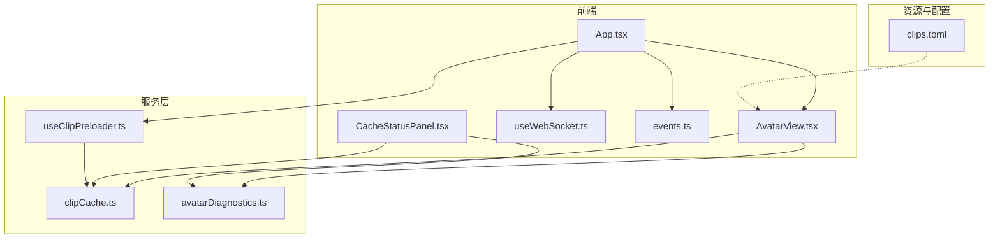
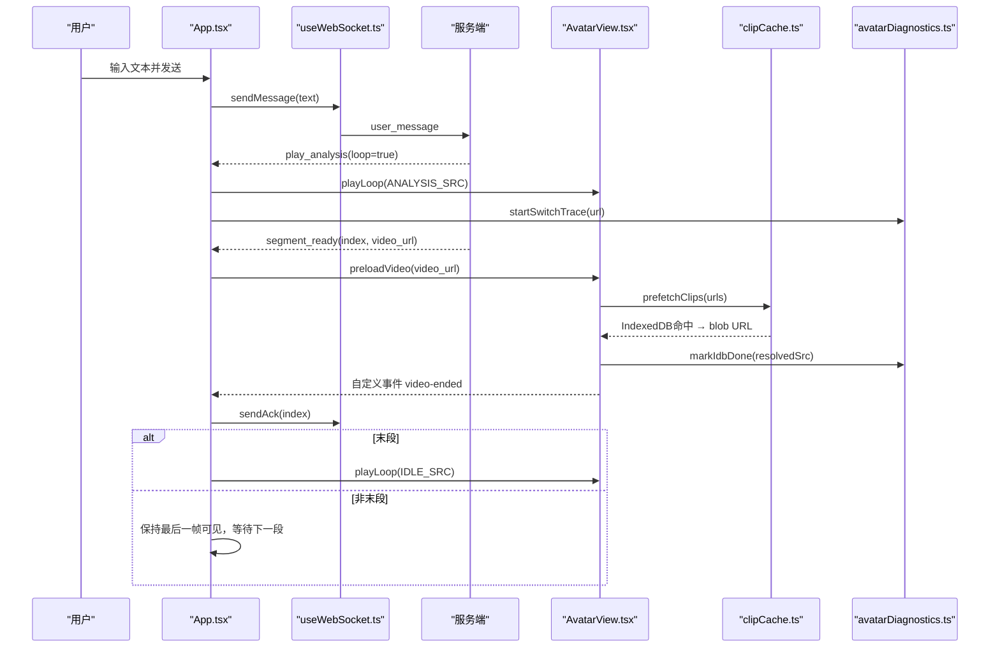
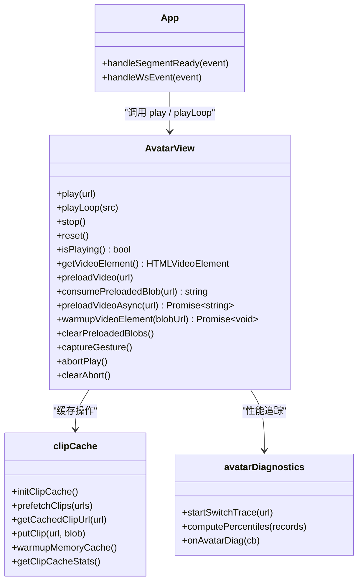
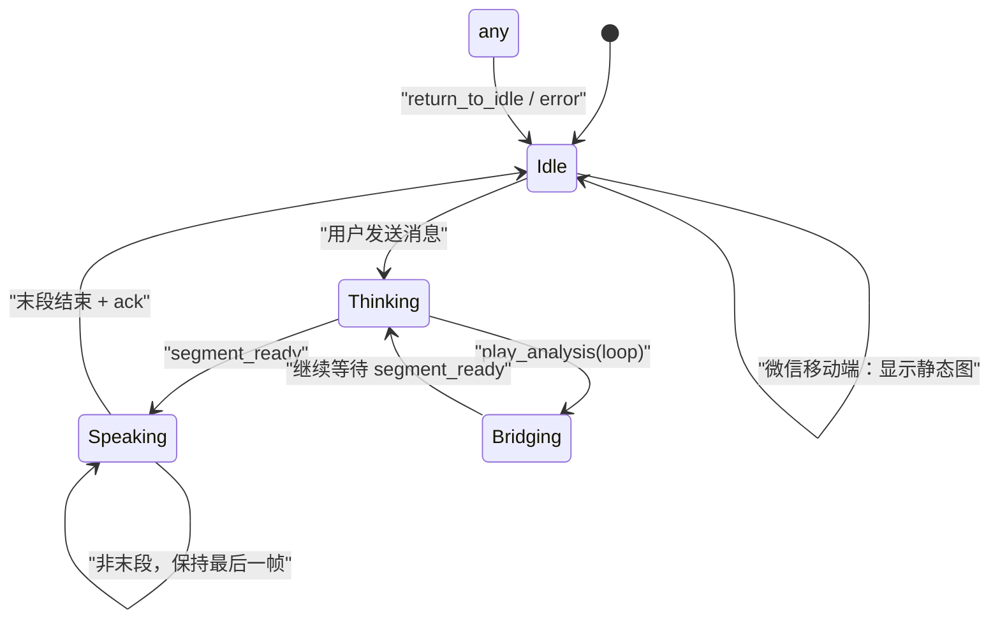
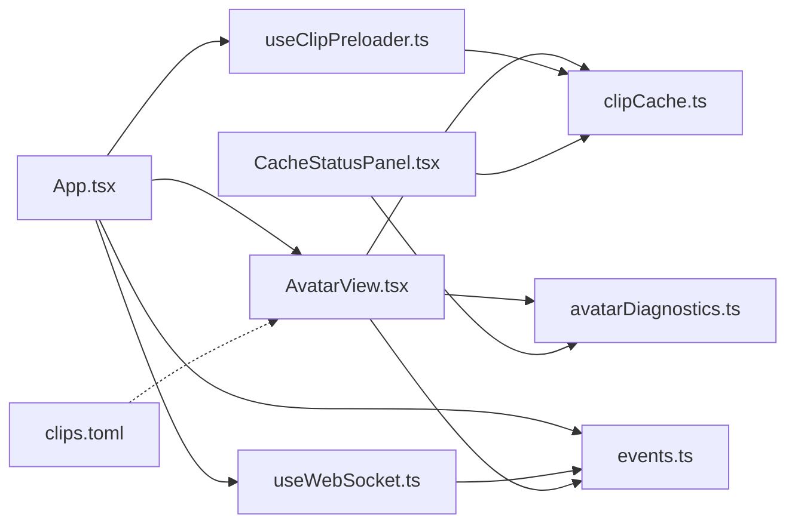

# 虚拟形象系统

<cite>
**本文引用的文件**   
- [AvatarView.tsx](file://client/src/components/AvatarView.tsx)
- [App.tsx](file://client/src/App.tsx)
- [events.ts](file://client/src/types/events.ts)
- [useWebSocket.ts](file://client/src/hooks/useWebSocket.ts)
- [clipCache.ts](file://client/src/services/clipCache.ts)
- [avatarDiagnostics.ts](file://client/src/services/avatarDiagnostics.ts)
- [useClipPreloader.ts](file://client/src/hooks/useClipPreloader.ts)
- [CacheStatusPanel.tsx](file://client/src/components/CacheStatusPanel.tsx)
- [clips.toml](file://clips/short-hair-teacher-girl/clips.toml)
</cite>

## 更新摘要
**变更内容**   
- 新增高级视频缓存系统（IndexedDB + memory objectURL）
- 集成跨浏览器兼容性改进（特别是WeChat移动端静态图像渲染）
- 实现Segment预加载机制和blob URL管理
- 添加完整的诊断工具集和性能监控
- 增强错误处理和自动播放策略支持

## 目录
1. [简介](#简介)
2. [项目结构](#项目结构)
3. [核心组件](#核心组件)
4. [架构总览](#架构总览)
5. [详细组件分析](#详细组件分析)
6. [依赖关系分析](#依赖关系分析)
7. [性能与优化](#性能与优化)
8. [故障排查指南](#故障排查指南)
9. [结论](#结论)
10. [附录：扩展指南](#附录扩展指南)

## 简介
本技术文档面向 RealTimeTalk 的虚拟形象系统，聚焦 AvatarView 组件的实现原理、状态机流转、视频片段管理与播放器封装、WebM 兼容性处理、动画过渡与帧同步策略，以及后续扩展新角色与素材的方法。目标是帮助开发者快速理解并高效维护该子系统。

**更新** 系统现已集成高级视频缓存、跨浏览器兼容性优化、Segment预加载和完整诊断工具，显著提升性能和用户体验。

## 项目结构
虚拟形象系统位于前端客户端中，核心由以下模块组成：
- 组件层：AvatarView 负责双 video 叠加渲染、状态切换与播放控制
- 应用层：App 管理会话状态（Idle/Thinking/Speaking/Bridging）与 WebSocket 事件分发
- 类型定义：events.ts 定义前后端交互事件与状态枚举
- 网络层：useWebSocket.ts 提供连接、重连、消息发送与回调
- **新增服务层**：clipCache.ts 提供 IndexedDB + 内存双层缓存，avatarDiagnostics.ts 提供性能诊断
- **新增Hook层**：useClipPreloader.ts 提供切片预加载功能
- **新增UI层**：CacheStatusPanel.tsx 提供缓存状态监控面板
- 资源清单：clips.toml 描述语义化切片库、标签与过渡规则

**图表来源**
- [App.tsx:1-985](file://client/src/App.tsx#L1-L985)
- [AvatarView.tsx:1-1515](file://client/src/components/AvatarView.tsx#L1-L1515)
- [clipCache.ts:1-307](file://client/src/services/clipCache.ts#L1-L307)
- [avatarDiagnostics.ts:1-187](file://client/src/services/avatarDiagnostics.ts#L1-L187)
- [useClipPreloader.ts:1-126](file://client/src/hooks/useClipPreloader.ts#L1-L126)
- [CacheStatusPanel.tsx:1-329](file://client/src/components/CacheStatusPanel.tsx#L1-L329)

## 核心组件
- **AvatarView**：实现"主视频 + 循环视频"的双层叠加架构，通过 opacity 过渡与双缓冲预加载消除段间空白帧；暴露 play/playLoop/stop/isPlaying/getVideoElement 方法供父组件调用。
- **App**：维护 AppState（Idle/Thinking/Speaking/Bridging），根据 WebSocket 事件驱动 AvatarView 的状态切换与播放控制。
- **useWebSocket**：封装连接、自动重连、消息收发与回调注册。
- **clipCache**：提供 IndexedDB + 内存双层缓存，支持并行预取、对象URL管理和统计查询。
- **avatarDiagnostics**：提供段间切换耗时追踪、延迟分布计算和性能监控。
- **useClipPreloader**：在用户首次交互后并行预取所有切片到 IndexedDB。
- **CacheStatusPanel**：显示缓存状态、Service Worker 状态和性能指标。
- events.ts：定义前后端事件结构与状态枚举。
- clips.toml：定义角色元数据、切片清单、标签与过渡规则。

**章节来源**
- [AvatarView.tsx:10-42](file://client/src/components/AvatarView.tsx#L10-L42)
- [clipCache.ts:1-307](file://client/src/services/clipCache.ts#L1-L307)
- [avatarDiagnostics.ts:1-187](file://client/src/services/avatarDiagnostics.ts#L1-L187)
- [useClipPreloader.ts:1-126](file://client/src/hooks/useClipPreloader.ts#L1-L126)
- [CacheStatusPanel.tsx:1-329](file://client/src/components/CacheStatusPanel.tsx#L1-L329)

## 架构总览
虚拟形象系统采用"事件驱动 + 双缓冲视频 + 多层缓存"的架构：
- 应用层监听服务端事件（segment_ready、play_analysis、all_completed、return_to_idle、error 等），更新本地状态并驱动 AvatarView 切换。
- AvatarView 内部维护两个 <video> 元素，交替作为"当前可见"和"预加载目标"，在 canplay 后于同一帧内完成隐藏旧帧/显示新帧，避免黑闪与空白帧。
- **新增缓存层**：clipCache 提供 IndexedDB + 内存双层缓存，显著减少网络请求和IDB查询开销。
- **新增诊断层**：avatarDiagnostics 实时追踪段间切换耗时，提供性能监控和故障定位。
- Idle 与 Thinking 使用静音循环视频；Speaking 使用带声音的主视频单播片段。

**图表来源**
- [App.tsx:79-220](file://client/src/App.tsx#L79-L220)
- [clipCache.ts:182-227](file://client/src/services/clipCache.ts#L182-L227)
- [avatarDiagnostics.ts:158-160](file://client/src/services/avatarDiagnostics.ts#L158-L160)
- [AvatarView.tsx:463-504](file://client/src/components/AvatarView.tsx#L463-L504)

## 详细组件分析

### AvatarView 组件（增强版）
- **双 video 叠加**：主视频用于播放有声音的语义片段；循环视频用于 idle/analysis 静音循环。
- **高级预加载与切换**：
  - showMain：将新片段预加载到"非当前可见"的元素，canplay 后立即播放并在同帧内切换透明度与 pointerEvents，确保无空白帧。
  - showLoop：支持 idle 与 analysis 两种循环模式；idle 使用 JS 接管无缝循环（timeupdate 接近末尾时 seek(0)），analysis 使用原生 loop。
- **思考模式保护**：thinkingModeRef 防止 segment_ready 竞态跳过思考动画；pendingSrcRef 队列在 analysis 循环末尾触发切回 speaking。
- **桥接策略**：当从 speaking 回到 idle 或 idle↔analysis 切换时，利用 scale(1.7) 与"桥接元素"保持上一帧可见，避免闪烁。
- **微信移动端优化**：isWeChatMobile 模式下直接显示静态图片，不播放任何动画或语音。
- **事件与对外接口**：
  - 内部派发 window 'video-ended' 事件给父组件。
  - 暴露 play/playLoop/stop/isPlaying/getVideoElement/reset/preloadVideo/consumePreloadedBlob/preloadVideoAsync/warmupVideoElement/clearPreloadedBlobs/captureGesture/abortPlay/clearAbort 等方法。

**图表来源**
- [AvatarView.tsx:10-42](file://client/src/components/AvatarView.tsx#L10-L42)
- [clipCache.ts:1-307](file://client/src/services/clipCache.ts#L1-L307)
- [avatarDiagnostics.ts:1-187](file://client/src/services/avatarDiagnostics.ts#L1-L187)

**章节来源**
- [AvatarView.tsx:1-1515](file://client/src/components/AvatarView.tsx#L1-L1515)

### 高级视频缓存系统（clipCache）
- **双层缓存架构**：
  - L1 内存缓存：Map<string, string> 存储 objectURL，同步访问 <1ms
  - L2 IndexedDB 缓存：持久化存储 Blob 数据，异步访问
- **核心功能**：
  - initClipCache()：初始化 IndexedDB 数据库
  - getCachedClipUrl(url)：查询缓存，优先返回内存缓存
  - putClip(url, blob)：写入缓存，同时更新内存映射
  - prefetchClips(urls, onProgress, signal)：并行预取多个URL到IndexedDB
  - warmupMemoryCache()：预热内存缓存，消除首次切换延迟
  - getClipCacheStats()：获取缓存统计信息
  - clearClipCache()：清空所有缓存
- **并发控制**：最多4路并发下载，支持 AbortSignal 取消
- **错误容忍**：单条URL失败不影响整体进度，记录警告日志

**章节来源**
- [clipCache.ts:1-307](file://client/src/services/clipCache.ts#L1-L307)

### 诊断工具系统（avatarDiagnostics）
- **段间切换追踪**：
  - startSwitchTrace(url)：创建追踪实例，记录切换开始时间
  - markIdbDone(resolvedSrc)：标记IDB查询完成
  - markSrcSet()：标记src设置时间
  - markCanplay()：标记canplay事件，自动提交记录
  - markError()：标记错误情况
- **性能指标**：
  - loadingDurationMs：从src设置到canplay的耗时
  - totalSwitchDurationMs：从开始到canplay的总耗时
  - cacheHit：是否命中缓存
  - resolvedSrcKind：解析后的URL类型（blob:/http:/unknown）
- **数据统计**：
  - computePercentiles(records)：计算P50/P95延迟分布
  - getRecentRecords()：获取最近200条记录
  - onAvatarDiag(cb)：订阅诊断事件
- **自动上报**：10%抽样率上报到服务端 /api/diag/avatar

**章节来源**
- [avatarDiagnostics.ts:1-187](file://client/src/services/avatarDiagnostics.ts#L1-L187)

### 切片预加载 Hook（useClipPreloader）
- **预加载流程**：
  1. 页面加载后延迟100ms启动预加载
  2. 初始化 IndexedDB 缓存
  3. 拉取 /api/clips/manifest 获取切片清单
  4. 并行预取所有切片到 IndexedDB
  5. 预热内存缓存，消除首段切换延迟
- **状态管理**：
  - count：已缓存切片数量
  - bytes：缓存占用字节数
  - memoryCached：内存缓存条目数
  - prefetching：是否正在预加载
  - progress：预加载进度（0~1）
  - durationMs：预加载总耗时
- **错误处理**：预加载失败可重试，不影响主流程

**章节来源**
- [useClipPreloader.ts:1-126](file://client/src/hooks/useClipPreloader.ts#L1-L126)

### 缓存状态面板（CacheStatusPanel）
- **实时监控**：
  - IndexedDB 记录数和占用空间
  - 内存 objectURL 缓存条目数
  - Service Worker 状态检测
  - 段间切换延迟分布（P50/P95）
  - 缓存命中率统计
- **服务端聚合**：展示所有用户的平均性能指标
- **调试功能**：查看内存缓存URL列表，支持手动刷新

**章节来源**
- [CacheStatusPanel.tsx:1-329](file://client/src/components/CacheStatusPanel.tsx#L1-L329)

### 状态机与转换逻辑
- **状态定义**：Idle、Input、Thinking、Speaking、Bridging。
- **关键转换**：
  - Idle → Thinking：用户发送消息后，立即播放 analysis 循环。
  - Thinking → Speaking：收到 segment_ready 后，切换到主视频播放片段。
  - Speaking → Bridging/Idle：每段结束派发 video-ended，若为末段则返回 Idle 并播放 idle 循环；否则保持最后一帧等待下一段。
  - 任意非 Idle → Idle：收到 return_to_idle 或在错误时强制返回 Idle。
- **微信移动端特殊处理**：isWeChatMobile 模式下跳过视频播放，直接显示静态图片。

**图表来源**
- [events.ts:7-13](file://client/src/types/events.ts#L7-L13)
- [App.tsx:127-163](file://client/src/App.tsx#L127-L163)
- [App.tsx:195-220](file://client/src/App.tsx#L195-L220)

**章节来源**
- [events.ts:7-13](file://client/src/types/events.ts#L7-L13)
- [App.tsx:79-220](file://client/src/App.tsx#L79-L220)

### 视频片段管理机制（增强版）
- **资源清单**：clips.toml 定义了角色名、基础图、语音、切片时长、每个切片的文件、标签、优先级、提示词与 speech_hint，以及过渡规则（neutral/opening/body/closing 标签分组与默认序列）。
- **多级预加载策略**：
  - 一级：IndexedDB 缓存（持久化，跨会话）
  - 二级：内存 objectURL 缓存（快速访问，<1ms）
  - 三级：浏览器 HTTP 缓存（标准缓存机制）
  - 四级：网络直连（降级方案）
- **智能缓存管理**：
  - 预取完成后自动预热内存缓存
  - 动态清理过期 objectURL 防止内存泄漏
  - 支持并发预取和错误重试
- **内存优化**：
  - 限制预加载缓存数量为5个
  - 及时释放不再使用的 blob URL
  - 桥接场景下延迟清理，避免过渡期间出现空白

**章节来源**
- [clips.toml:1-148](file://clips/short-hair-teacher-girl/clips.toml#L1-L148)
- [clipCache.ts:182-227](file://client/src/services/clipCache.ts#L182-L227)
- [AvatarView.tsx:946-1035](file://client/src/components/AvatarView.tsx#L946-L1035)

### 播放器封装与事件/错误处理（增强版）
- **播放控制接口**：
  - play(url)：播放指定 URL 的片段，考虑 thinking 模式与 pending 队列。
  - playLoop(src)：切换到 idle 或 analysis 循环。
  - stop()：停止所有视频并隐藏主视频。
  - isPlaying()/getVideoElement()：查询与访问底层元素。
  - preloadVideo(url)：后台预下载下一段视频。
  - warmupVideoElement(blobUrl)：提前解码视频，消除播放延迟。
- **事件监听**：
  - onMainEnded/onLoopEnded：派发 video-ended 事件，驱动父组件发送 ack 与状态回退。
  - onLoopTimeUpdate：JS 接管 idle 无缝循环与 pending 段切换。
- **错误处理**：
  - play() 被阻止时的降级切换（同帧切换）。
  - 自动播放策略：首次解锁 AudioContext，必要时提示等待用户交互。
  - 兜底定时器：800ms 超时保证可观测性与健壮性。
  - **新增**：X5 内核自动播放策略支持，显示轻触继续覆盖层。

**章节来源**
- [AvatarView.tsx:408-461](file://client/src/components/AvatarView.tsx#L408-L461)
- [AvatarView.tsx:463-504](file://client/src/components/AvatarView.tsx#L463-L504)
- [AvatarView.tsx:1234-1272](file://client/src/components/AvatarView.tsx#L1234-L1272)

### WebM 格式兼容性与循环帧校验（增强版）
- **浏览器支持**：
  - 使用 WebM 编码，结合 playsInline 与 muted 属性提升移动端与自动播放成功率。
  - 针对 Firefox 在无帧数据时可能显示黑底的场景，等待 canplay 后再淡入。
  - **新增**：iOS Safari 和微信内置浏览器自动降级到 MP4 格式。
- **循环帧一致性**：
  - 要求循环视频首尾帧像素一致，确保无缝衔接。
  - 工具脚本 extract_frames.ps1 提取首尾帧；find_loop.py 计算 MSE 寻找最佳循环点。
- **微信移动端优化**：
  - 直接显示静态图片，避免视频播放问题。
  - 调整容器高度和位置，确保头像完整显示。

**章节来源**
- [AvatarView.tsx:506-532](file://client/src/components/AvatarView.tsx#L506-L532)
- [App.tsx:47-54](file://client/src/App.tsx#L47-L54)
- [AvatarView.tsx:1394-1416](file://client/src/components/AvatarView.tsx#L1394-L1416)

### 动画过渡与帧同步（增强版）
- **平滑过渡**：
  - 使用 CSS transition 的 opacity 与 pointerEvents 组合，在 canplay 后于同一帧内完成旧帧隐藏与新帧显示。
  - 特殊场景（scale(1.7) 重置）采用交叉淡入淡出与桥接元素，避免空白帧。
  - **新增**：requestVideoFrameCallback 精确等待首帧渲染。
- **帧同步**：
  - idle 模式：timeupdate 检测距末尾小于阈值时立即 seek(0)，配合首尾帧一致实现零跳变。
  - analysis 模式：原生 loop，同时检查 pending 段在临近末尾时触发切换。
  - **新增**：warmupVideoElement 提前解码，消除 X5 内核 1-3s 解码停顿。

**章节来源**
- [AvatarView.tsx:94-128](file://client/src/components/AvatarView.tsx#L94-L128)
- [AvatarView.tsx:483-504](file://client/src/components/AvatarView.tsx#L483-L504)
- [AvatarView.tsx:1056-1118](file://client/src/components/AvatarView.tsx#L1056-L1118)

## 依赖关系分析
- App 依赖 AvatarView 与 useWebSocket，并通过 events.ts 的类型约束前后端契约。
- AvatarView 仅依赖 React API 与浏览器原生 <video> 能力，不直接依赖网络层。
- **新增依赖**：
  - AvatarView 依赖 clipCache 进行视频缓存管理
  - AvatarView 依赖 avatarDiagnostics 进行性能追踪
  - App 依赖 useClipPreloader 进行切片预加载
  - CacheStatusPanel 依赖 clipCache 和 avatarDiagnostics 进行状态监控
- clips.toml 作为资源清单，指导内容生产与过渡规则，间接影响前端展示。

**图表来源**
- [App.tsx:1-985](file://client/src/App.tsx#L1-L985)
- [AvatarView.tsx:1-1515](file://client/src/components/AvatarView.tsx#L1-L1515)
- [clipCache.ts:1-307](file://client/src/services/clipCache.ts#L1-L307)
- [avatarDiagnostics.ts:1-187](file://client/src/services/avatarDiagnostics.ts#L1-L187)
- [useClipPreloader.ts:1-126](file://client/src/hooks/useClipPreloader.ts#L1-L126)
- [CacheStatusPanel.tsx:1-329](file://client/src/components/CacheStatusPanel.tsx#L1-L329)

## 性能与优化（增强版）
- **多层缓存架构**：
  - IndexedDB 持久化缓存：跨会话保留，减少重复下载
  - 内存 objectURL 缓存：同步访问 <1ms，消除 IDB 查询开销
  - 浏览器 HTTP 缓存：标准缓存机制，支持断点续传
- **预加载优化**：
  - 并行预取：最多4路并发下载，充分利用带宽
  - 智能预热：预取完成后自动预热内存缓存
  - 按需预加载：只预加载下一段，避免内存浪费
- **播放优化**：
  - 双缓冲与同帧切换：显著降低段间空白帧概率
  - 视频预热：提前解码下一段视频，消除播放延迟
  - 自动播放策略：X5 内核支持，显示轻触继续覆盖层
- **内存管理**：
  - 及时释放 objectURL，防止内存泄漏
  - 限制预加载缓存数量为5个
  - 桥接场景下延迟清理，避免过渡期间出现空白
- **诊断监控**：
  - 实时追踪段间切换耗时
  - P50/P95 延迟分布统计
  - 缓存命中率监控
  - 自动上报到服务端

**章节来源**
- [clipCache.ts:182-227](file://client/src/services/clipCache.ts#L182-L227)
- [avatarDiagnostics.ts:162-187](file://client/src/services/avatarDiagnostics.ts#L162-L187)
- [AvatarView.tsx:1056-1118](file://client/src/components/AvatarView.tsx#L1056-L1118)

## 故障排查指南（增强版）
- **自动播放被阻止**：
  - 现象：控制台警告 play() 被阻止，已降级为同帧切换。
  - 处理：确保首次用户交互后解锁 AudioContext；必要时引导用户点击页面。
  - **新增**：X5 内核显示轻触继续覆盖层，用户轻触后解锁播放。
- **黑屏或黑底**：
  - 现象：Firefox 下无帧数据时短暂黑底。
  - 处理：等待 canplay 后再淡入；确保 idle 视频首帧有效。
  - **新增**：微信移动端直接显示静态图片，避免视频播放问题。
- **循环跳变**：
  - 现象：idle/analysis 循环出现跳变。
  - 处理：使用 find_loop.py 验证首尾帧一致性；调整生成参数使首尾帧像素一致。
- **卡顿或空白帧**：
  - 现象：段间出现空白帧。
  - 处理：检查 showMain/showLoop 的 canplay 与 readyState 分支；确认桥接逻辑与淡出顺序。
  - **新增**：使用 warmupVideoElement 提前解码，消除 X5 内核解码延迟。
- **缓存相关问题**：
  - 现象：视频加载缓慢或重复下载。
  - 处理：检查 clipCache 初始化状态；查看缓存统计信息；清理过期缓存。
  - **新增**：使用 CacheStatusPanel 监控缓存状态和性能指标。
- **性能问题**：
  - 现象：段间切换延迟高。
  - 处理：查看 avatarDiagnostics 记录；分析 P50/P95 延迟分布；检查缓存命中率。

**章节来源**
- [AvatarView.tsx:113-127](file://client/src/components/AvatarView.tsx#L113-L127)
- [CacheStatusPanel.tsx:109-122](file://client/src/components/CacheStatusPanel.tsx#L109-L122)
- [avatarDiagnostics.ts:162-187](file://client/src/services/avatarDiagnostics.ts#L162-L187)

## 结论
虚拟形象系统通过双缓冲视频、事件驱动状态机、多层缓存系统和完整诊断工具，实现了低延迟、高流畅度的实时对话体验。新增的 clipCache 服务提供 IndexedDB + 内存双层缓存，显著提升视频加载速度；avatarDiagnostics 提供全面的性能监控和故障定位能力；useClipPreloader 实现智能预加载，消除首段切换延迟。其模块化设计与清晰的接口边界便于扩展新角色与素材，同时提供了完善的错误处理与性能优化策略。

## 附录：扩展指南（增强版）
- **新增角色与切片**：
  - 在 clips.toml 中添加新的 speaker 与 clips 条目，定义 file、tags、priority、prompt 与 speech_hint。
  - 遵循过渡规则（neutral/opening/body/closing）与 default_sequence 组织自然过渡序列。
- **生成与校验**：
  - 使用 HappyHorse 生成 5 秒 720P 切片，确保固定机位、动作幅度小、首尾帧一致。
  - 使用 extract_frames.ps1 与 find_loop.py 校验首尾帧一致性与循环点。
- **前端集成**：
  - 在 App.tsx 中配置 IDLE_SRC 与 ANALYSIS_SRC（可通过版本参数区分不同 idle 动画）。
  - 如需新增 idle/analysis 动画，确保满足循环帧一致性与静音播放要求。
  - **新增**：集成 clipCache 和 avatarDiagnostics，启用缓存和诊断功能。
- **缓存优化**：
  - 调整 prefetchClips 的并发数量和超时时间。
  - 监控缓存命中率，优化预加载策略。
  - 定期清理过期缓存，防止内存泄漏。
- **性能监控**：
  - 使用 CacheStatusPanel 监控缓存状态和性能指标。
  - 分析 avatarDiagnostics 记录，定位性能瓶颈。
  - 关注 P50/P95 延迟分布，优化用户体验。
- **测试与回归**：
  - 覆盖多段连续播放、快速切换、网络抖动与自动播放策略等场景。
  - 关注 video-ended 事件与 ack 发送时序，确保末段正确返回 Idle。
  - **新增**：测试缓存命中率、预加载效果和诊断数据准确性。

**章节来源**
- [clips.toml:1-148](file://clips/short-hair-teacher-girl/clips.toml#L1-L148)
- [useClipPreloader.ts:1-126](file://client/src/hooks/useClipPreloader.ts#L1-L126)
- [CacheStatusPanel.tsx:1-329](file://client/src/components/CacheStatusPanel.tsx#L1-L329)
- [App.tsx:21-24](file://client/src/App.tsx#L21-L24)