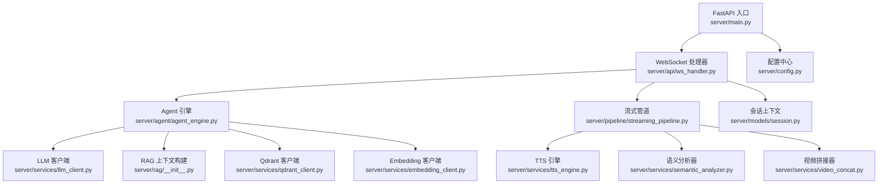
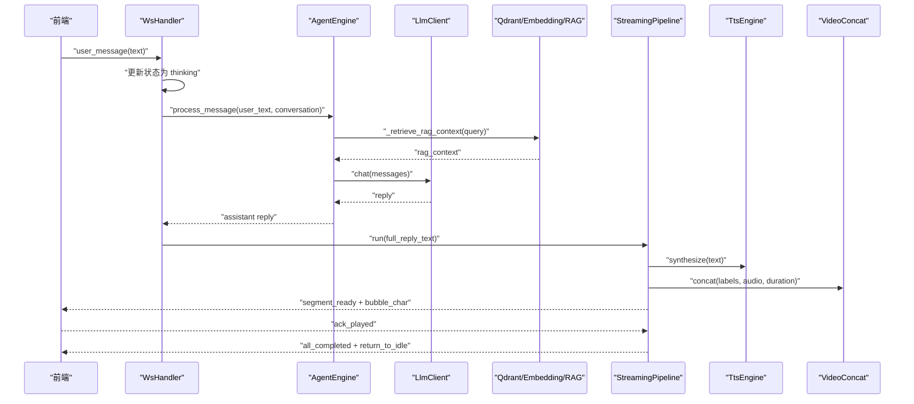
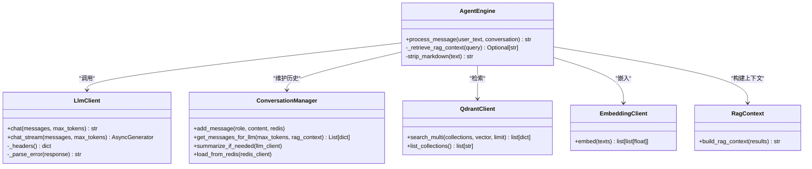
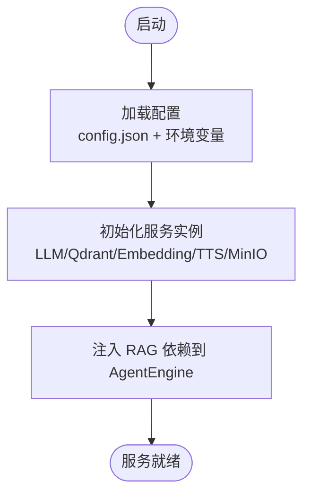
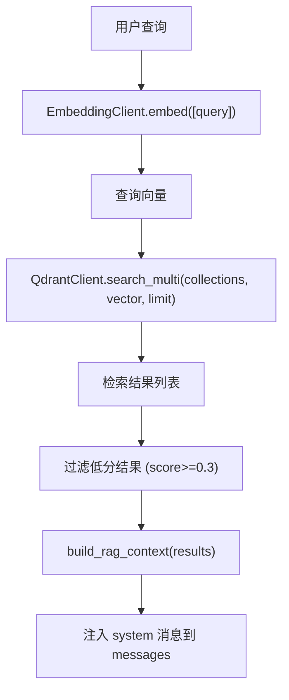
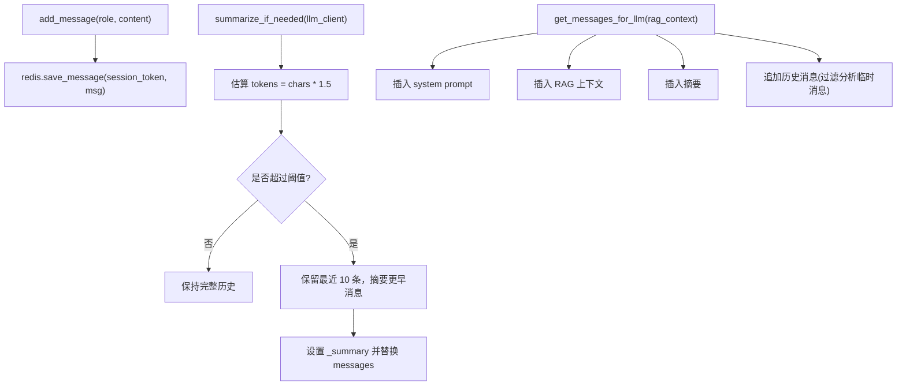
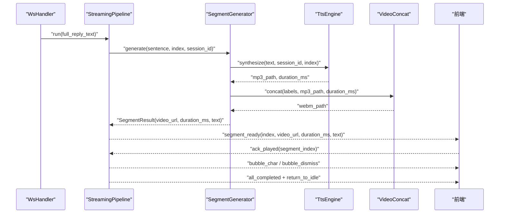
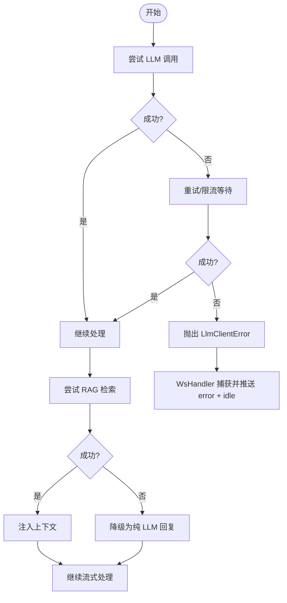
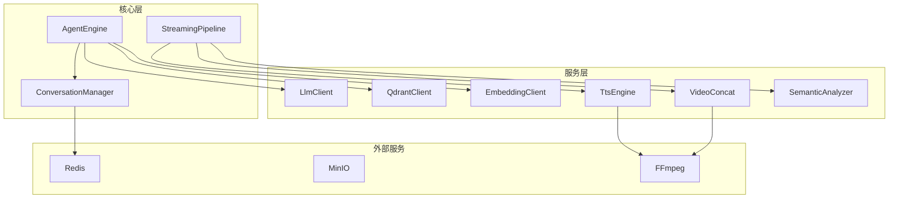

# Agent 引擎设计

<cite>
**本文引用的文件**   
- [server/main.py](file://server/main.py)
- [server/config.py](file://server/config.py)
- [server/agent/agent_engine.py](file://server/agent/agent_engine.py)
- [server/agent/conversation_manager.py](file://server/agent/conversation_manager.py)
- [server/api/ws_handler.py](file://server/api/ws_handler.py)
- [server/services/llm_client.py](file://server/services/llm_client.py)
- [server/services/qdrant_client.py](file://server/services/qdrant_client.py)
- [server/services/embedding_client.py](file://server/services/embedding_client.py)
- [server/rag/__init__.py](file://server/rag/__init__.py)
- [server/pipeline/streaming_pipeline.py](file://server/pipeline/streaming_pipeline.py)
- [server/services/tts_engine.py](file://server/services/tts_engine.py)
- [server/services/video_concat.py](file://server/services/video_concat.py)
- [server/services/semantic_analyzer.py](file://server/services/semantic_analyzer.py)
- [server/models/session.py](file://server/models/session.py)
- [server/resources/default_system_prompt.txt](file://server/resources/default_system_prompt.txt)
</cite>

## 目录
1. [简介](#简介)
2. [项目结构](#项目结构)
3. [核心组件](#核心组件)
4. [架构总览](#架构总览)
5. [详细组件分析](#详细组件分析)
6. [依赖关系分析](#依赖关系分析)
7. [性能考量](#性能考量)
8. [故障排查指南](#故障排查指南)
9. [结论](#结论)
10. [附录](#附录)

## 简介
本文件面向 Agent 引擎的架构设计与实现，重点覆盖以下方面：
- 对话引擎的核心设计模式：策略模式在 LLM 调用中的应用、工厂模式在角色创建中的使用。
- RAG（检索增强生成）集成机制：向量检索、上下文组装与提示词优化。
- 会话管理器的工作流程：对话历史维护、上下文窗口管理与记忆持久化。
- 多模态输出协调机制：文本生成、语音合成与视频播放的同步控制。
- 错误处理与降级策略：LLM 服务故障、网络异常与用户中断的处理。
- 组件交互图与数据处理流程图：从用户输入到多模态输出的完整链路。

## 项目结构
后端采用 FastAPI 作为应用入口，按“服务层 + 管道 + 代理”分层组织：
- 入口与生命周期管理：main.py 负责初始化配置、外部服务连接、路由注册与 WebSocket 端点。
- 配置中心：config.py 提供统一配置加载与环境变量覆盖。
- 代理与对话：agent_engine.py 封装 LLM 调用与 RAG 注入；conversation_manager.py 维护对话历史与摘要。
- 流式管道：streaming_pipeline.py 负责分段生成、首段优先推送与确认式推进。
- 服务层：llm_client.py、qdrant_client.py、embedding_client.py、tts_engine.py、video_concat.py、semantic_analyzer.py。
- 模型与会话状态：models/session.py 定义会话上下文与状态枚举。
- 知识库工具：rag/__init__.py 提供分块与上下文构建。

图表来源
- [server/main.py:114-170](file://server/main.py#L114-L170)
- [server/api/ws_handler.py:31-170](file://server/api/ws_handler.py#L31-L170)
- [server/agent/agent_engine.py:59-121](file://server/agent/agent_engine.py#L59-L121)
- [server/services/llm_client.py:23-113](file://server/services/llm_client.py#L23-L113)
- [server/services/qdrant_client.py:26-186](file://server/services/qdrant_client.py#L26-L186)
- [server/services/embedding_client.py:26-135](file://server/services/embedding_client.py#L26-L135)
- [server/rag/__init__.py:56-83](file://server/rag/__init__.py#L56-L83)
- [server/pipeline/streaming_pipeline.py:16-131](file://server/pipeline/streaming_pipeline.py#L16-L131)
- [server/services/tts_engine.py:38-226](file://server/services/tts_engine.py#L38-L226)
- [server/services/semantic_analyzer.py:35-126](file://server/services/semantic_analyzer.py#L35-L126)
- [server/services/video_concat.py:20-149](file://server/services/video_concat.py#L20-L149)
- [server/models/session.py:14-41](file://server/models/session.py#L14-L41)

章节来源
- [server/main.py:42-110](file://server/main.py#L42-L110)
- [server/config.py:148-241](file://server/config.py#L148-L241)

## 核心组件
- 配置中心：集中管理 LLM、TTS、Redis、MinIO、Qdrant、Embedding、FFmpeg 等配置，支持环境变量覆盖与默认值回退。
- 会话上下文：维护 token、状态、对话管理器、当前 Pipeline 与 WebSocket 引用。
- Agent 引擎：接收用户消息，执行 RAG 检索、组装 messages、调用 LLM、保存回复并持久化。
- 对话管理器：维护消息列表、Redis 持久化、Token 溢出智能摘要与过滤内部分析消息。
- 流式管道：将完整回复切分为段落，并行生成 TTS+视频片段，首段立即推送，后续按 ack 推进。
- 服务层：
  - LLM 客户端：OpenAI 兼容接口，支持非流式与流式，内置重试与限流处理。
  - Qdrant 客户端：集合管理与向量检索，支持多集合并发搜索与结果合并排序。
  - Embedding 客户端：DashScope 文本嵌入，批量请求与重试。
  - TTS 引擎：DashScope 多模态生成接口，长文本拆分与 FFmpeg 拼接。
  - 语义分析器：LLM 或关键词回退，输出标签序列用于视频切片选择。
  - 视频拼接器：根据标签选择切片、循环填充时长、混入音频输出 WebM。

章节来源
- [server/config.py:148-241](file://server/config.py#L148-L241)
- [server/models/session.py:14-41](file://server/models/session.py#L14-L41)
- [server/agent/agent_engine.py:59-121](file://server/agent/agent_engine.py#L59-L121)
- [server/agent/conversation_manager.py:21-139](file://server/agent/conversation_manager.py#L21-L139)
- [server/pipeline/streaming_pipeline.py:16-131](file://server/pipeline/streaming_pipeline.py#L16-L131)
- [server/services/llm_client.py:23-113](file://server/services/llm_client.py#L23-L113)
- [server/services/qdrant_client.py:26-186](file://server/services/qdrant_client.py#L26-L186)
- [server/services/embedding_client.py:26-135](file://server/services/embedding_client.py#L26-L135)
- [server/services/tts_engine.py:38-226](file://server/services/tts_engine.py#L38-L226)
- [server/services/semantic_analyzer.py:35-126](file://server/services/semantic_analyzer.py#L35-L126)
- [server/services/video_concat.py:20-149](file://server/services/video_concat.py#L20-L149)

## 架构总览
整体数据流从 WebSocket 进入，经 WsHandler 解析消息类型，触发流式处理流程；AgentEngine 负责 RAG 检索与 LLM 调用；StreamingPipeline 负责分段生成与推送；TTS 与视频拼接完成多模态输出。

图表来源
- [server/api/ws_handler.py:130-341](file://server/api/ws_handler.py#L130-L341)
- [server/agent/agent_engine.py:74-121](file://server/agent/agent_engine.py#L74-L121)
- [server/services/llm_client.py:40-113](file://server/services/llm_client.py#L40-L113)
- [server/services/qdrant_client.py:164-186](file://server/services/qdrant_client.py#L164-L186)
- [server/services/embedding_client.py:47-135](file://server/services/embedding_client.py#L47-L135)
- [server/rag/__init__.py:56-83](file://server/rag/__init__.py#L56-L83)
- [server/pipeline/streaming_pipeline.py:44-131](file://server/pipeline/streaming_pipeline.py#L44-L131)
- [server/services/tts_engine.py:49-226](file://server/services/tts_engine.py#L49-L226)
- [server/services/video_concat.py:30-149](file://server/services/video_concat.py#L30-L149)

## 详细组件分析

### 对话引擎与策略模式（LLM 调用）
- 策略模式体现在 LLM 客户端对 OpenAI 兼容接口的抽象：统一 chat/chat_stream 接口，屏蔽不同提供商差异；同时通过重试与限流策略提升鲁棒性。
- AgentEngine 将 RAG 检索作为可选策略注入，若未配置则直接走纯 LLM 路径，体现“可插拔”的策略组合。

图表来源
- [server/agent/agent_engine.py:59-181](file://server/agent/agent_engine.py#L59-L181)
- [server/services/llm_client.py:23-113](file://server/services/llm_client.py#L23-L113)
- [server/agent/conversation_manager.py:21-139](file://server/agent/conversation_manager.py#L21-L139)
- [server/services/qdrant_client.py:164-186](file://server/services/qdrant_client.py#L164-L186)
- [server/services/embedding_client.py:47-135](file://server/services/embedding_client.py#L47-L135)
- [server/rag/__init__.py:56-83](file://server/rag/__init__.py#L56-L83)

章节来源
- [server/agent/agent_engine.py:74-121](file://server/agent/agent_engine.py#L74-L121)
- [server/services/llm_client.py:40-113](file://server/services/llm_client.py#L40-L113)
- [server/agent/conversation_manager.py:46-95](file://server/agent/conversation_manager.py#L46-L95)

### 工厂模式（角色创建）
- 角色创建可通过配置驱动：system prompt 由配置文件或资源文件加载，结合 avatar 配置决定音色与动画素材目录。
- 在 main.py 中，根据配置初始化各服务实例（如 LlmClient、QdrantClient、EmbeddingClient），并在 lifespan 中注入到 AgentEngine，体现“按配置创建对象”的工厂思想。

图表来源
- [server/main.py:42-110](file://server/main.py#L42-L110)
- [server/config.py:148-241](file://server/config.py#L148-L241)
- [server/resources/default_system_prompt.txt:1-29](file://server/resources/default_system_prompt.txt#L1-L29)

章节来源
- [server/main.py:42-110](file://server/main.py#L42-L110)
- [server/config.py:148-241](file://server/config.py#L148-L241)

### RAG 集成机制（向量检索、上下文组装、提示词优化）
- 向量检索：EmbeddingClient 将查询文本转为向量，QdrantClient 在多集合上并发检索并按分数排序取 top_k。
- 上下文组装：RAG 模块过滤低分结果，构建 system 消息注入到对话历史之前，形成“系统指令 + 知识库参考 + 对话历史”的结构。
- 提示词优化：默认 system prompt 强调纯文本输出与知识库优先规则，避免 Markdown 格式干扰下游渲染。

图表来源
- [server/services/embedding_client.py:47-135](file://server/services/embedding_client.py#L47-L135)
- [server/services/qdrant_client.py:164-186](file://server/services/qdrant_client.py#L164-L186)
- [server/rag/__init__.py:56-83](file://server/rag/__init__.py#L56-L83)
- [server/agent/agent_engine.py:123-181](file://server/agent/agent_engine.py#L123-L181)
- [server/resources/default_system_prompt.txt:16-29](file://server/resources/default_system_prompt.txt#L16-L29)

章节来源
- [server/rag/__init__.py:10-53](file://server/rag/__init__.py#L10-53)
- [server/rag/__init__.py:56-83](file://server/rag/__init__.py#L56-L83)
- [server/agent/agent_engine.py:123-181](file://server/agent/agent_engine.py#L123-L181)

### 会话管理器（历史维护、上下文窗口、记忆持久化）
- 历史维护：ConversationManager 维护 Message 列表，添加消息时写入 Redis，保证跨进程/重启恢复。
- 上下文窗口：当估算 token 超过阈值时，对早期消息进行摘要，保留最近 N 条消息，减少上下文长度。
- 记忆持久化：所有消息以结构化形式存入 Redis，支持重连后恢复。

图表来源
- [server/agent/conversation_manager.py:39-95](file://server/agent/conversation_manager.py#L39-L95)
- [server/agent/conversation_manager.py:97-135](file://server/agent/conversation_manager.py#L97-L135)

章节来源
- [server/agent/conversation_manager.py:21-139](file://server/agent/conversation_manager.py#L21-L139)

### 多模态输出协调（文本生成、语音合成、视频播放同步）
- 文本生成：LLM 流式返回，WsHandler 边接收边按句子边界切段。
- 语音合成：TtsEngine 支持短文本单次合成与长文本拆分拼接，限制并发避免限流。
- 视频播放：VideoConcat 根据语义标签选择切片，循环填充时长并与音频混音输出 WebM。
- 同步控制：StreamingPipeline 首段完成后立即推送 segment_ready，随后等待前端 ack_played 再推送下一段，确保音视频同步与流畅体验。

图表来源
- [server/api/ws_handler.py:189-341](file://server/api/ws_handler.py#L189-L341)
- [server/pipeline/streaming_pipeline.py:44-131](file://server/pipeline/streaming_pipeline.py#L44-L131)
- [server/services/tts_engine.py:49-226](file://server/services/tts_engine.py#L49-L226)
- [server/services/video_concat.py:30-149](file://server/services/video_concat.py#L30-L149)

章节来源
- [server/pipeline/streaming_pipeline.py:132-171](file://server/pipeline/streaming_pipeline.py#L132-L171)
- [server/services/tts_engine.py:78-226](file://server/services/tts_engine.py#L78-L226)
- [server/services/video_concat.py:85-149](file://server/services/video_concat.py#L85-L149)

### 错误处理与降级策略
- LLM 服务故障：LlmClient 对 401/403/429/5xx 与超时、连接错误进行重试与限流等待；失败时抛出 LlmClientError，WsHandler 捕获并推送 error 事件，重置状态为 idle。
- RAG 检索失败：AgentEngine 与 WsHandler 均捕获异常并降级为纯 LLM 回复，记录警告日志。
- 用户中断：WsHandler 处理 cancel 消息，取消 Pipeline 并推送 state_change=idle。
- TTS/视频拼接异常：TtsEngine 与 VideoConcat 抛出特定错误，Pipeline 捕获并推送错误事件，终止后续段推送。

图表来源
- [server/services/llm_client.py:64-113](file://server/services/llm_client.py#L64-L113)
- [server/api/ws_handler.py:335-341](file://server/api/ws_handler.py#L335-L341)
- [server/agent/agent_engine.py:178-181](file://server/agent/agent_engine.py#L178-L181)
- [server/api/ws_handler.py:426-444](file://server/api/ws_handler.py#L426-L444)
- [server/services/tts_engine.py:100-167](file://server/services/tts_engine.py#L100-L167)
- [server/services/video_concat.py:133-149](file://server/services/video_concat.py#L133-L149)

章节来源
- [server/services/llm_client.py:64-113](file://server/services/llm_client.py#L64-L113)
- [server/api/ws_handler.py:335-341](file://server/api/ws_handler.py#L335-L341)
- [server/agent/agent_engine.py:178-181](file://server/agent/agent_engine.py#L178-L181)
- [server/api/ws_handler.py:426-444](file://server/api/ws_handler.py#L426-L444)

## 依赖关系分析
- 耦合与内聚：
  - AgentEngine 与 ConversationManager 高内聚于对话逻辑；与 LlmClient、QdrantClient、EmbeddingClient 松耦合，便于替换与扩展。
  - StreamingPipeline 聚合 SegmentGenerator、SegmentSplitter，职责清晰，易于测试与维护。
- 外部依赖：
  - httpx 用于 HTTP 异步通信（LLM、Qdrant、Embedding、TTS）。
  - FFmpeg 用于视频拼接与音频编码。
  - Redis 用于会话状态与历史持久化。
- 潜在循环依赖：
  - 无直接循环导入；ws_handler 与 agent_engine 通过接口解耦。

图表来源
- [server/agent/agent_engine.py:59-121](file://server/agent/agent_engine.py#L59-L121)
- [server/agent/conversation_manager.py:21-139](file://server/agent/conversation_manager.py#L21-L139)
- [server/pipeline/streaming_pipeline.py:16-131](file://server/pipeline/streaming_pipeline.py#L16-L131)
- [server/services/llm_client.py:23-113](file://server/services/llm_client.py#L23-L113)
- [server/services/qdrant_client.py:26-186](file://server/services/qdrant_client.py#L26-L186)
- [server/services/embedding_client.py:26-135](file://server/services/embedding_client.py#L26-L135)
- [server/services/tts_engine.py:38-226](file://server/services/tts_engine.py#L38-L226)
- [server/services/video_concat.py:20-149](file://server/services/video_concat.py#L20-L149)
- [server/services/semantic_analyzer.py:35-126](file://server/services/semantic_analyzer.py#L35-L126)

章节来源
- [server/main.py:114-170](file://server/main.py#L114-L170)
- [server/config.py:148-241](file://server/config.py#L148-L241)

## 性能考量
- 并发控制：TTS 使用全局信号量限制并发，避免 API 限流；Qdrant 多集合检索使用 asyncio.gather 并发执行。
- 首段优先：StreamingPipeline 首段完成后立即推送，降低端到端延迟。
- 流式处理：LLM 流式返回，边接收边切段，尽早启动 TTS 与视频拼接，缩短首帧时间。
- 上下文压缩：对话摘要减少 tokens 占用，提高响应速度与成本效率。
- 资源清理：生命周期结束时取消活跃 Pipeline 与关闭连接，防止资源泄漏。

## 故障排查指南
- LLM 调用失败：检查 API Key、网络连通性与限流策略；查看 LlmClient 的错误码与重试日志。
- RAG 检索失败：确认 Qdrant 集合存在与 Embedding 模型可用；检查 role_collections 配置与 top_k 参数。
- TTS 合成失败：验证 DashScope 多模态接口权限与任务轮询逻辑；检查 MP3 下载与 FFmpeg 环境。
- 视频拼接失败：确认切片文件存在与 FFmpeg 命令参数正确；检查 concat 列表路径与权限。
- 用户中断：确认 cancel 消息被正确处理，Pipeline 已取消且状态回到 idle。

章节来源
- [server/services/llm_client.py:64-113](file://server/services/llm_client.py#L64-L113)
- [server/services/qdrant_client.py:164-186](file://server/services/qdrant_client.py#L164-L186)
- [server/services/tts_engine.py:100-167](file://server/services/tts_engine.py#L100-L167)
- [server/services/video_concat.py:133-149](file://server/services/video_concat.py#L133-L149)
- [server/api/ws_handler.py:426-444](file://server/api/ws_handler.py#L426-L444)

## 结论
本架构通过策略模式与工厂模式实现了可扩展的 LLM 调用与角色创建，结合 RAG 增强了回答质量与一致性；会话管理器保障了对话历史的持久化与上下文窗口的可控；流式管道与多模态服务协同，提供了低延迟、高可用的实时多模态输出体验。完善的错误处理与降级策略确保了系统在异常场景下的稳定性。

## 附录
- 默认系统提示词：强调纯文本输出与知识库优先规则，避免 Markdown 格式影响下游渲染。
- 配置项说明：涵盖 LLM、TTS、Redis、MinIO、Qdrant、Embedding、FFmpeg 等关键配置，支持环境变量覆盖。

章节来源
- [server/resources/default_system_prompt.txt:1-29](file://server/resources/default_system_prompt.txt#L1-L29)
- [server/config.py:148-241](file://server/config.py#L148-L241)