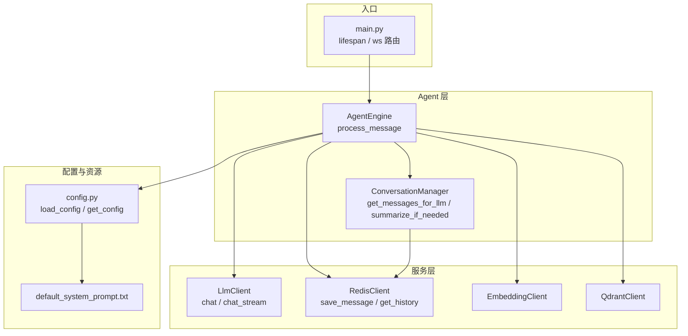
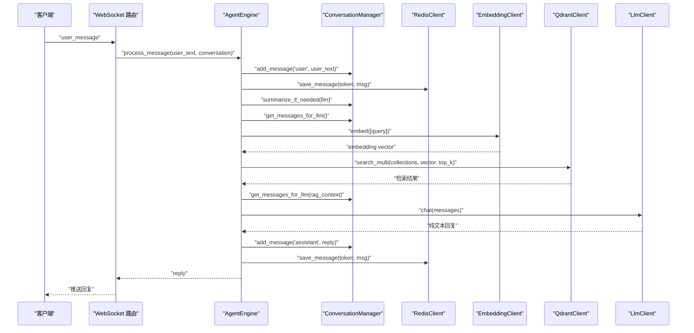
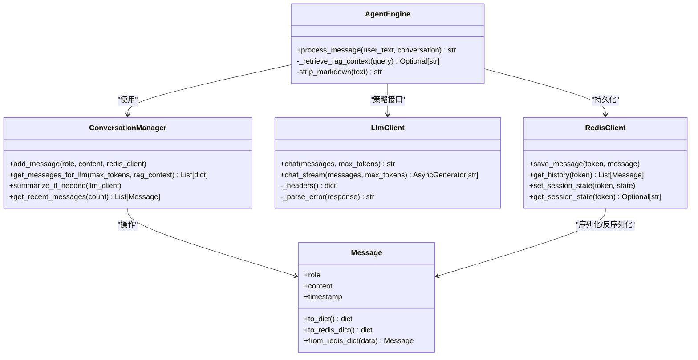
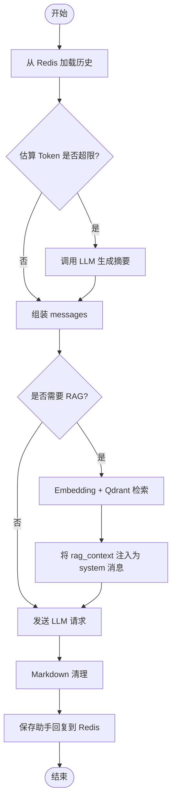
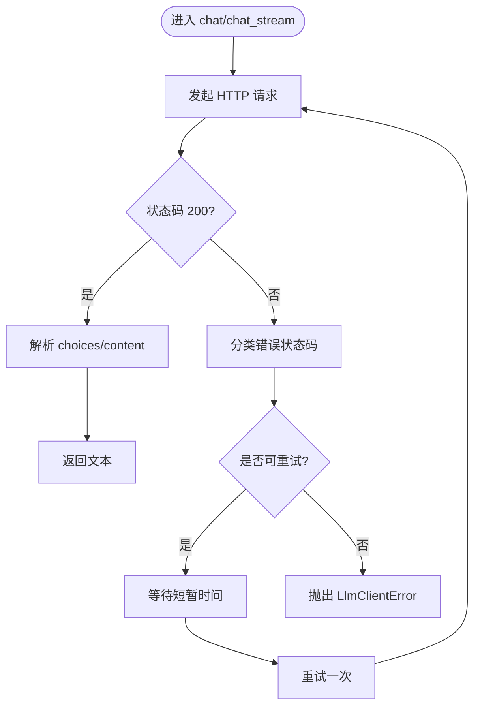
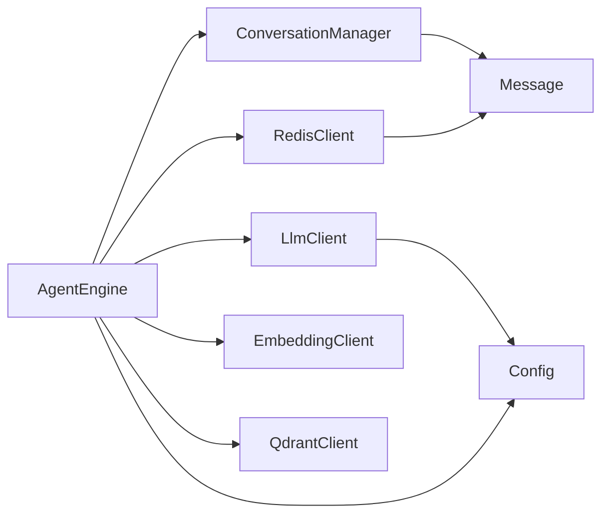
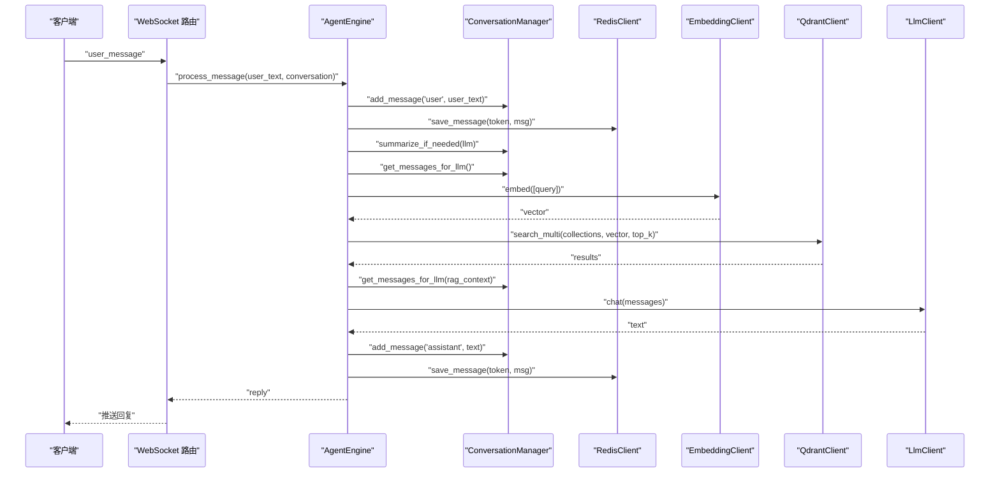

# LLM 协调层

<cite>
**本文引用的文件**   
- [server/agent/agent_engine.py](file://server/agent/agent_engine.py)
- [server/agent/conversation_manager.py](file://server/agent/conversation_manager.py)
- [server/services/llm_client.py](file://server/services/llm_client.py)
- [server/models/message.py](file://server/models/message.py)
- [server/resources/default_system_prompt.txt](file://server/resources/default_system_prompt.txt)
- [server/config.py](file://server/config.py)
- [server/main.py](file://server/main.py)
- [server/services/redis_client.py](file://server/services/redis_client.py)
</cite>

## 目录
1. [简介](#简介)
2. [项目结构](#项目结构)
3. [核心组件](#核心组件)
4. [架构总览](#架构总览)
5. [详细组件分析](#详细组件分析)
6. [依赖关系分析](#依赖关系分析)
7. [性能考量](#性能考量)
8. [故障排查指南](#故障排查指南)
9. [结论](#结论)
10. [附录](#附录)

## 简介
本技术文档聚焦于“LLM 协调层”，围绕 AgentEngine 类的设计与实现，系统阐述：
- 策略模式在 LLM 调用中的应用（统一接口、可扩展的客户端）
- 工厂模式在角色创建中的实现（会话级 ConversationManager 的实例化与注入）
- 消息组装机制（system prompt 管理、历史消息整合、RAG 上下文注入）
- Markdown 文本清理算法（格式剥离、内容提取、输出标准化）
- 错误处理与重试机制（网络异常、API 限流、服务端错误）
- 性能优化（请求批处理、连接池、响应缓存等建议）
- 外部 LLM 服务通信协议（认证、参数、版本兼容）
并提供架构图与端到端流程时序图，帮助读者从用户输入到 LLM 响应的全链路理解。

## 项目结构
与 LLM 协调层直接相关的代码位于 server 子目录中，关键模块如下：
- agent：对话引擎与对话历史管理
- services：对外部服务的封装（LLM、Redis、Embedding、Qdrant 等）
- models：数据模型（Message）
- resources：默认 system prompt 资源
- config：配置加载与合并
- main：应用生命周期与 WebSocket 入口

图表来源
- [server/main.py:146-170](file://server/main.py#L146-L170)
- [server/agent/agent_engine.py:59-121](file://server/agent/agent_engine.py#L59-L121)
- [server/agent/conversation_manager.py:21-95](file://server/agent/conversation_manager.py#L21-L95)
- [server/services/llm_client.py:23-113](file://server/services/llm_client.py#L23-L113)
- [server/services/redis_client.py:22-122](file://server/services/redis_client.py#L22-L122)
- [server/config.py:148-241](file://server/config.py#L148-L241)

章节来源
- [server/main.py:146-170](file://server/main.py#L146-L170)
- [server/agent/agent_engine.py:59-121](file://server/agent/agent_engine.py#L59-L121)
- [server/agent/conversation_manager.py:21-95](file://server/agent/conversation_manager.py#L21-L95)
- [server/services/llm_client.py:23-113](file://server/services/llm_client.py#L23-L113)
- [server/services/redis_client.py:22-122](file://server/services/redis_client.py#L22-L122)
- [server/config.py:148-241](file://server/config.py#L148-L241)

## 核心组件
- AgentEngine：协调用户输入、对话历史、RAG 检索、LLM 调用与结果后处理的核心编排器。
- ConversationManager：维护单会话的消息列表、持久化、摘要压缩与 messages 组装。
- LlmClient：OpenAI 兼容 Chat Completions API 客户端，提供同步与流式两种调用方式，内置重试与错误分类。
- RedisClient：会话状态与对话历史的异步存取。
- Message：消息数据模型，支持序列化/反序列化。
- Config：统一配置加载，环境变量覆盖 JSON 配置，并加载默认 system prompt。

章节来源
- [server/agent/agent_engine.py:59-121](file://server/agent/agent_engine.py#L59-L121)
- [server/agent/conversation_manager.py:21-95](file://server/agent/conversation_manager.py#L21-L95)
- [server/services/llm_client.py:23-113](file://server/services/llm_client.py#L23-L113)
- [server/services/redis_client.py:22-122](file://server/services/redis_client.py#L22-L122)
- [server/models/message.py:9-33](file://server/models/message.py#L9-L33)
- [server/config.py:148-241](file://server/config.py#L148-L241)

## 架构总览
下图展示了从 WebSocket 接收到 LLM 返回的完整处理路径，包括 RAG 检索与消息组装。

图表来源
- [server/main.py:146-170](file://server/main.py#L146-L170)
- [server/agent/agent_engine.py:74-121](file://server/agent/agent_engine.py#L74-L121)
- [server/agent/conversation_manager.py:39-95](file://server/agent/conversation_manager.py#L39-L95)
- [server/services/redis_client.py:82-100](file://server/services/redis_client.py#L82-L100)
- [server/services/llm_client.py:40-113](file://server/services/llm_client.py#L40-L113)

## 详细组件分析

### AgentEngine 设计架构
- 职责边界
  - 编排：接收用户输入，驱动对话历史管理、RAG 检索、LLM 调用与结果后处理。
  - 容错：捕获 LLM 调用异常，向上抛出由上层统一处理为 error 事件。
  - 标准化：对 LLM 返回进行 Markdown 清理，确保纯文本输出。
- 策略模式（LLM 调用）
  - 通过 LlmClient 抽象出统一的 chat/chat_stream 接口，便于替换不同后端或扩展新能力（如多模型路由）。
  - 当前实现为 OpenAI 兼容 REST 接口；未来可新增其他策略（如本地推理服务），只需实现相同接口即可无缝替换。
- 工厂模式（角色创建）
  - 在 WebSocket 路由中，每次连接时构造新的 AgentEngine 与 LlmClient，并将 Redis、Qdrant、Embedding 等依赖注入，形成“按会话”的工厂式装配。
  - ConversationManager 以 session_token 和 system_prompt 作为构造参数，体现“按角色/会话”的创建策略。

图表来源
- [server/agent/agent_engine.py:59-121](file://server/agent/agent_engine.py#L59-L121)
- [server/agent/conversation_manager.py:21-95](file://server/agent/conversation_manager.py#L21-L95)
- [server/services/llm_client.py:23-113](file://server/services/llm_client.py#L23-L113)
- [server/services/redis_client.py:22-122](file://server/services/redis_client.py#L22-L122)
- [server/models/message.py:9-33](file://server/models/message.py#L9-L33)

章节来源
- [server/agent/agent_engine.py:59-121](file://server/agent/agent_engine.py#L59-L121)
- [server/main.py:146-170](file://server/main.py#L146-L170)
- [server/agent/conversation_manager.py:21-95](file://server/agent/conversation_manager.py#L21-L95)

### 消息组装机制
- System Prompt 管理
  - 优先从配置中读取 system_prompt；若为空则回退至默认文件 default_system_prompt.txt。
  - 在 ConversationManager.get_messages_for_llm 中，system 消息始终置于首位。
- 历史消息整合
  - 从 Redis 恢复历史，过滤语义分析临时消息，保留最近 N 条消息用于对话。
  - 当估算 token 超过阈值时，触发智能摘要，将早期对话压缩为一段 system 摘要，降低上下文长度。
- 上下文注入（RAG）
  - 根据 role_collections 配置决定搜索范围，使用 EmbeddingClient 生成查询向量，再经 QdrantClient 检索 top_k 结果，构建 rag_context。
  - rag_context 作为额外的 system 消息插入到 system prompt 之后、历史之前，增强回答相关性。

图表来源
- [server/agent/conversation_manager.py:46-95](file://server/agent/conversation_manager.py#L46-L95)
- [server/agent/conversation_manager.py:97-135](file://server/agent/conversation_manager.py#L97-L135)
- [server/agent/agent_engine.py:123-181](file://server/agent/agent_engine.py#L123-L181)
- [server/config.py:137-145](file://server/config.py#L137-L145)

章节来源
- [server/agent/conversation_manager.py:46-95](file://server/agent/conversation_manager.py#L46-L95)
- [server/agent/conversation_manager.py:97-135](file://server/agent/conversation_manager.py#L97-L135)
- [server/agent/agent_engine.py:123-181](file://server/agent/agent_engine.py#L123-L181)
- [server/config.py:137-145](file://server/config.py#L137-L145)

### Markdown 文本清理算法
- 目标：将 LLM 返回的 Markdown 文本转换为纯文本，避免前端渲染异常。
- 规则要点
  - 去除标题标记、加粗、斜体、行内代码、引用、无序/有序列表、链接、图片、水平线、下划线加粗等。
  - 清理多余空行，最多保留一个空行，最后 strip 首尾空白。
- 复杂度
  - 时间复杂度 O(n)，n 为文本长度；正则替换顺序执行，整体线性。
  - 空间复杂度 O(n)，主要为中间字符串副本。
- 适用性
  - 适用于大多数常见 Markdown 语法；对于复杂嵌套或表格等未覆盖场景，可在后续迭代中扩展正则规则。

章节来源
- [server/agent/agent_engine.py:30-56](file://server/agent/agent_engine.py#L30-L56)

### 错误处理与重试机制
- LLM 客户端
  - 统一异常类型 LlmClientError，携带 status_code 以便上层区分处理。
  - 重试策略：对 429（限流）、>=500（服务端错误）、超时、连接失败等场景，最多重试一次；非重试错误（如 401/403）立即抛出。
  - 流式与非流式均具备相同的错误分类与重试逻辑。
- 上层处理
  - AgentEngine 捕获 LlmClientError 并记录日志，重新抛出由 WebSocket 处理器转为 error 事件推送给前端。
- 健壮性
  - 解析错误信息时做容错，防止 JSON 解析异常导致二次错误。

图表来源
- [server/services/llm_client.py:40-113](file://server/services/llm_client.py#L40-L113)
- [server/services/llm_client.py:115-190](file://server/services/llm_client.py#L115-L190)
- [server/agent/agent_engine.py:105-112](file://server/agent/agent_engine.py#L105-L112)

章节来源
- [server/services/llm_client.py:40-113](file://server/services/llm_client.py#L40-L113)
- [server/services/llm_client.py:115-190](file://server/services/llm_client.py#L115-L190)
- [server/agent/agent_engine.py:105-112](file://server/agent/agent_engine.py#L105-L112)

### 与外部 LLM 服务的通信协议
- 协议与端点
  - 基于 OpenAI 兼容的 Chat Completions 接口，URL 为 {endpoint}/chat/completions。
- 认证机制
  - 通过 Authorization: Bearer {api_key} 头传递密钥。
- 参数配置
  - model、messages、max_tokens、stream（False 表示非流式）。
- 版本兼容性
  - 通过 endpoint 配置灵活指向不同厂商或自托管服务；只要遵循 OpenAI 兼容协议即可互通。
- 超时与连接
  - 设置全局超时（connect 与 read），并对 TimeoutException 与 ConnectError 进行专门处理与重试。

章节来源
- [server/services/llm_client.py:23-38](file://server/services/llm_client.py#L23-L38)
- [server/services/llm_client.py:40-60](file://server/services/llm_client.py#L40-L60)
- [server/config.py:188-194](file://server/config.py#L188-L194)

## 依赖关系分析
- 耦合与内聚
  - AgentEngine 与 ConversationManager、LlmClient、RedisClient 存在明确依赖，职责清晰，内聚度高。
  - LlmClient 仅依赖配置与 httpx，无业务耦合，易于替换。
- 外部依赖
  - Redis：会话状态与历史持久化。
  - Qdrant/Embedding：RAG 检索与向量化。
  - FastAPI/WebSocket：实时通信入口。
- 潜在循环依赖
  - 当前未见循环导入；AgentEngine 通过 set_rag_clients 注入 RAG 客户端，避免硬编码耦合。

图表来源
- [server/agent/agent_engine.py:59-121](file://server/agent/agent_engine.py#L59-L121)
- [server/agent/conversation_manager.py:21-95](file://server/agent/conversation_manager.py#L21-L95)
- [server/services/llm_client.py:23-113](file://server/services/llm_client.py#L23-L113)
- [server/services/redis_client.py:22-122](file://server/services/redis_client.py#L22-L122)
- [server/models/message.py:9-33](file://server/models/message.py#L9-L33)
- [server/config.py:148-241](file://server/config.py#L148-L241)

章节来源
- [server/agent/agent_engine.py:59-121](file://server/agent/agent_engine.py#L59-L121)
- [server/agent/conversation_manager.py:21-95](file://server/agent/conversation_manager.py#L21-L95)
- [server/services/llm_client.py:23-113](file://server/services/llm_client.py#L23-L113)
- [server/services/redis_client.py:22-122](file://server/services/redis_client.py#L22-L122)
- [server/models/message.py:9-33](file://server/models/message.py#L9-L33)
- [server/config.py:148-241](file://server/config.py#L148-L241)

## 性能考量
- 请求批处理
  - 当前为逐条请求；可在高并发场景引入请求队列与批量聚合（例如将多条用户输入合并为一次 LLM 调用，但需权衡交互实时性与一致性）。
- 连接池管理
  - 当前 LlmClient 使用 httpx.AsyncClient 并在请求结束后关闭；生产环境建议复用连接池（如进程级共享 AsyncClient 或使用连接池管理器），减少握手开销。
- 响应缓存
  - 针对相同或相似问题，可在 Redis 中缓存 LLM 回复（key 可由 query 指纹生成），命中时直接返回，显著降低延迟与成本。
- 流式输出
  - 已提供 chat_stream 接口，可用于前端打字机效果；结合分段流水线可减少首字节延迟。
- 摘要压缩
  - 智能摘要有效降低长对话的 token 消耗，提升稳定性与吞吐。

[本节为通用性能建议，不直接分析具体文件]

## 故障排查指南
- LLM 调用失败
  - 现象：WebSocket 推送 error 事件，前端气泡提示。
  - 排查：检查 LlmClientError 的 status_code 与日志；确认 API Key、endpoint、模型名称与配额。
- 鉴权失败（401/403）
  - 现象：立即抛出错误，不进行重试。
  - 排查：核对 LLM_API_KEY 与 endpoint 是否正确。
- 限流（429）
  - 现象：首次失败后等待并重试一次；仍失败则上报错误。
  - 排查：降低请求频率或提高配额；观察服务端限流策略。
- 服务端错误（>=500）
  - 现象：重试一次；仍失败则上报错误。
  - 排查：关注上游服务健康与日志。
- 网络超时/连接失败
  - 现象：TimeoutException/ConnectError 触发重试。
  - 排查：检查网络连通性、DNS、代理与防火墙策略。
- Redis 不可用
  - 现象：启动阶段拒绝启动。
  - 排查：确认 Redis URL、密码、端口与权限。

章节来源
- [server/services/llm_client.py:78-113](file://server/services/llm_client.py#L78-L113)
- [server/services/llm_client.py:142-190](file://server/services/llm_client.py#L142-L190)
- [server/agent/agent_engine.py:105-112](file://server/agent/agent_engine.py#L105-L112)
- [server/main.py:53-60](file://server/main.py#L53-L60)

## 结论
LLM 协调层以 AgentEngine 为核心，采用策略模式抽象 LLM 调用、工厂模式组织会话级对象，配合 ConversationManager 完成消息组装、历史管理与摘要压缩，并通过 Redis 实现会话持久化。RAG 检索增强了回答的相关性与准确性。错误处理与重试机制提升了鲁棒性，Markdown 清理确保了输出标准化。建议在后续迭代中引入连接池、请求批处理与响应缓存，进一步提升性能与成本效率。

[本节为总结性内容，不直接分析具体文件]

## 附录

### 端到端处理流程（从用户输入到 LLM 响应）

图表来源
- [server/main.py:146-170](file://server/main.py#L146-L170)
- [server/agent/agent_engine.py:74-121](file://server/agent/agent_engine.py#L74-L121)
- [server/agent/conversation_manager.py:39-95](file://server/agent/conversation_manager.py#L39-L95)
- [server/services/redis_client.py:82-100](file://server/services/redis_client.py#L82-L100)
- [server/services/llm_client.py:40-113](file://server/services/llm_client.py#L40-L113)