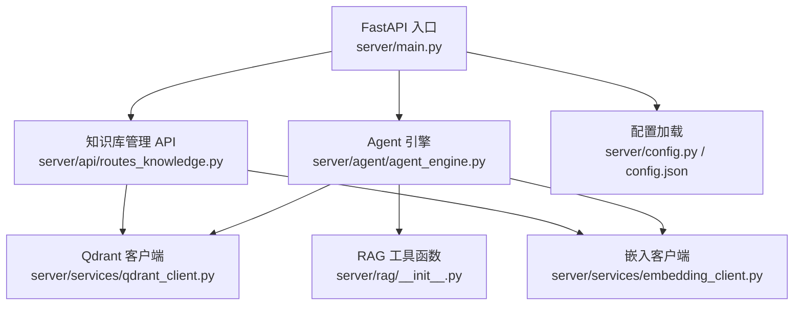
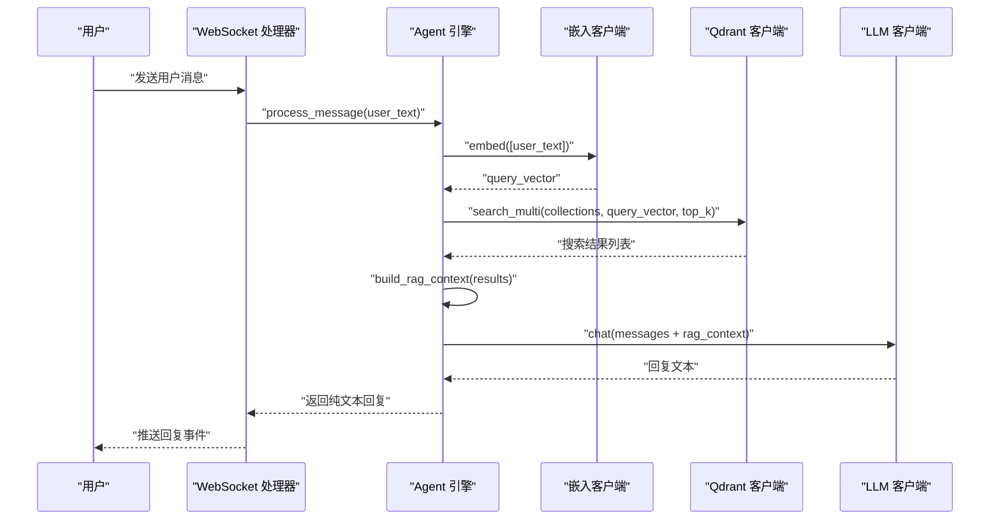
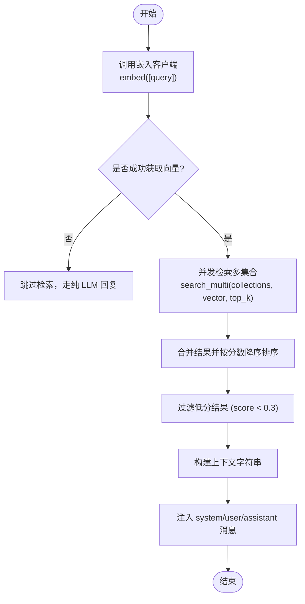
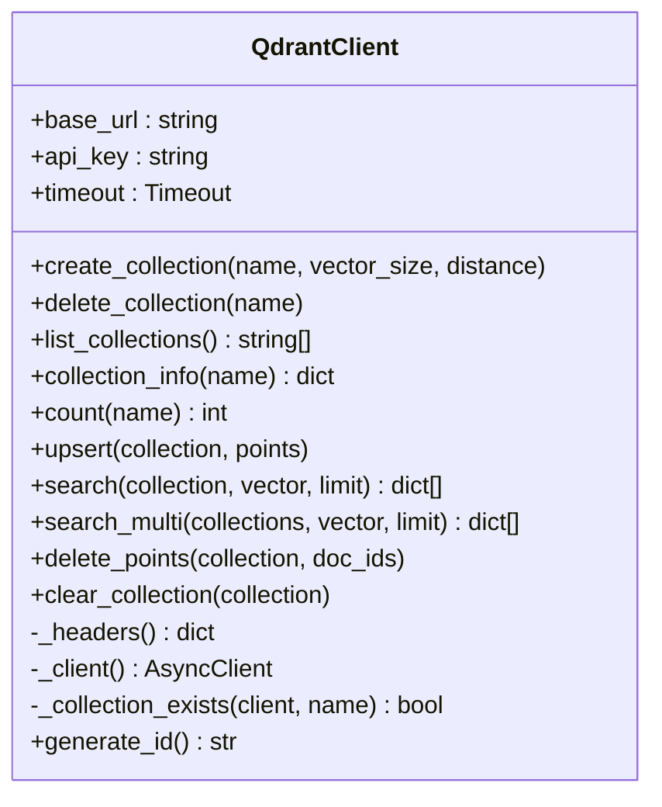
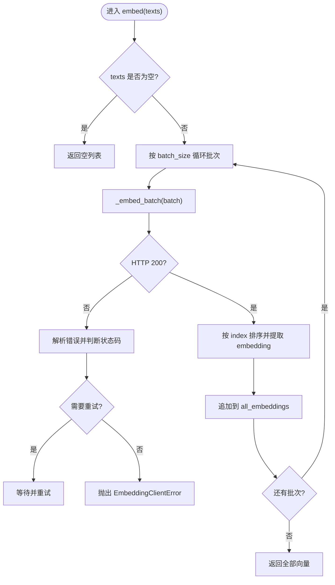
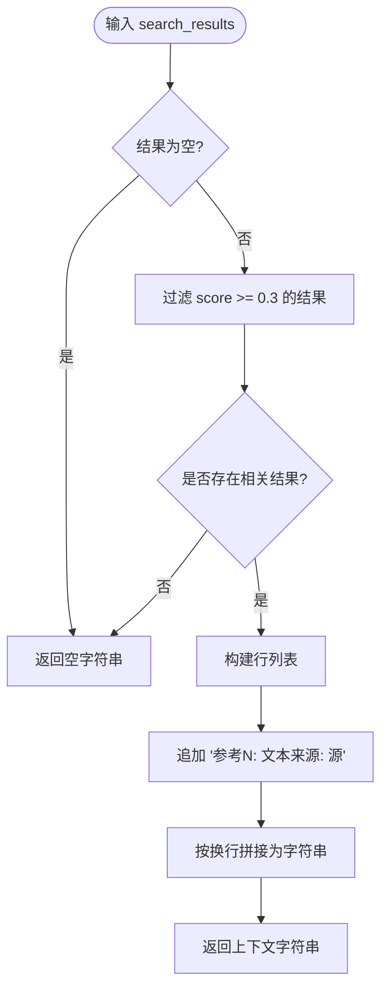
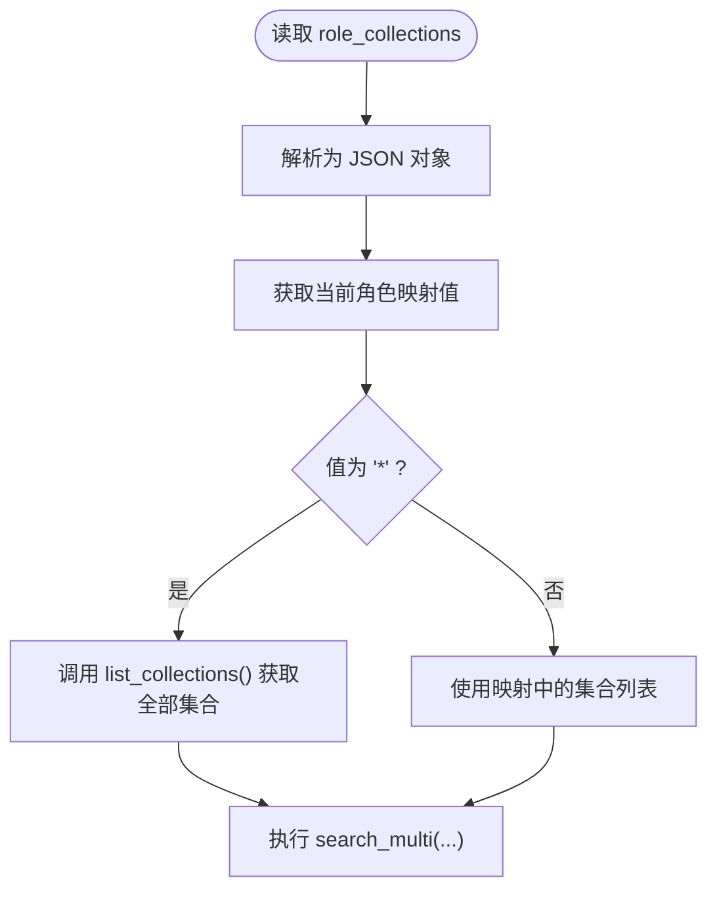
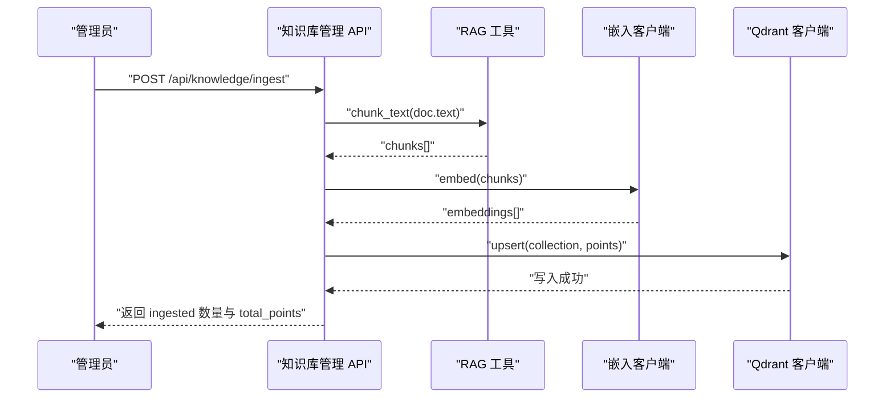
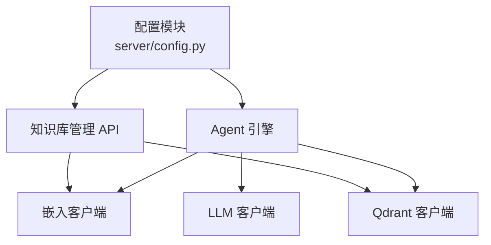

# RAG 检索增强

<cite>
**本文引用的文件**   
- [server/main.py](file://server/main.py)
- [server/config.py](file://server/config.py)
- [config.json](file://config.json)
- [server/agent/agent_engine.py](file://server/agent/agent_engine.py)
- [server/api/routes_knowledge.py](file://server/api/routes_knowledge.py)
- [server/services/qdrant_client.py](file://server/services/qdrant_client.py)
- [server/services/embedding_client.py](file://server/services/embedding_client.py)
- [server/rag/__init__.py](file://server/rag/__init__.py)
- [doc/Qdrant知识库操作指南.md](file://doc/Qdrant知识库操作指南.md)
</cite>

## 目录
1. [简介](#简介)
2. [项目结构](#项目结构)
3. [核心组件](#核心组件)
4. [架构总览](#架构总览)
5. [详细组件分析](#详细组件分析)
6. [依赖关系分析](#依赖关系分析)
7. [性能与优化](#性能与优化)
8. [故障排查与降级策略](#故障排查与降级策略)
9. [结论](#结论)
10. [附录：配置示例](#附录配置示例)

## 简介
本技术文档聚焦于 RAG（检索增强生成）集成系统，围绕“从用户查询到知识增强”的完整链路展开，覆盖以下关键主题：
- 向量检索全流程：查询文本嵌入、相似度计算与结果排序
- Qdrant 向量数据库集成：集合管理、索引策略与查询优化
- 嵌入客户端工作机制：文本向量化、批量处理与错误重试
- 上下文构建算法：相关度评分、片段拼接与提示词注入
- 角色-集合映射配置：动态集合选择与权限控制
- 错误处理与降级策略：检索失败、服务不可用与性能优化
- 数据流图与配置示例：端到端可视化说明

## 项目结构
RAG 相关代码主要分布在 server 目录下，包含 Agent 引擎、Qdrant 客户端、Embedding 客户端、RAG 工具函数以及知识库管理 API。启动入口在 main.py，负责初始化各服务并注入依赖。

图示来源
- [server/main.py:42-90](file://server/main.py#L42-L90)
- [server/agent/agent_engine.py:1-181](file://server/agent/agent_engine.py#L1-L181)
- [server/api/routes_knowledge.py:1-268](file://server/api/routes_knowledge.py#L1-L268)
- [server/services/qdrant_client.py:1-235](file://server/services/qdrant_client.py#L1-L235)
- [server/services/embedding_client.py:1-149](file://server/services/embedding_client.py#L1-L149)
- [server/rag/__init__.py:1-83](file://server/rag/__init__.py#L1-L83)
- [server/config.py:148-260](file://server/config.py#L148-L260)
- [config.json:1-39](file://config.json#L1-L39)

章节来源
- [server/main.py:42-90](file://server/main.py#L42-L90)
- [server/config.py:148-260](file://server/config.py#L148-L260)
- [config.json:1-39](file://config.json#L1-L39)

## 核心组件
- 配置模块：统一加载 JSON 与环境变量，提供扁平化配置字典，包括 embedding、qdrant、rag 等子项。
- 嵌入客户端：调用 DashScope Embedding API，支持批量请求、重试与错误解析。
- Qdrant 客户端：异步 HTTP 封装，提供集合 CRUD、upsert、search、search_multi 等操作。
- Agent 引擎：对话流程编排，含 RAG 检索、上下文注入与纯 LLM 降级。
- RAG 工具函数：文本分块与检索结果上下文构建。
- 知识库管理 API：集合管理、知识摄入、统计与调试搜索，受 Admin Token 保护。

章节来源
- [server/config.py:148-260](file://server/config.py#L148-L260)
- [server/services/embedding_client.py:1-149](file://server/services/embedding_client.py#L1-L149)
- [server/services/qdrant_client.py:1-235](file://server/services/qdrant_client.py#L1-L235)
- [server/agent/agent_engine.py:1-181](file://server/agent/agent_engine.py#L1-L181)
- [server/rag/__init__.py:1-83](file://server/rag/__init__.py#L1-L83)
- [server/api/routes_knowledge.py:1-268](file://server/api/routes_knowledge.py#L1-L268)

## 架构总览
下图展示从用户输入到知识增强的端到端数据流，涵盖嵌入、检索、上下文构建与 LLM 生成。

图示来源
- [server/main.py:146-170](file://server/main.py#L146-L170)
- [server/agent/agent_engine.py:74-121](file://server/agent/agent_engine.py#L74-L121)
- [server/services/embedding_client.py:47-70](file://server/services/embedding_client.py#L47-L70)
- [server/services/qdrant_client.py:164-186](file://server/services/qdrant_client.py#L164-L186)
- [server/rag/__init__.py:56-83](file://server/rag/__init__.py#L56-L83)

## 详细组件分析

### 向量检索全流程
- 查询文本嵌入：通过 EmbeddingClient.embed 将用户问题转换为 1024 维向量，内部按批大小（默认 10）分批调用 DashScope API，并对响应按 index 排序保证顺序一致。
- 相似度计算与结果排序：Qdrant 使用 Cosine 距离进行相似度计算；search_multi 并发检索多个集合，合并后按 score 降序取 top_k。
- 结果过滤与上下文构建：RAG 工具函数对低分结果进行阈值过滤（score >= 0.3），并将 payload.text 与 source 拼接为可注入 LLM 的上下文字符串。

图示来源
- [server/services/embedding_client.py:47-70](file://server/services/embedding_client.py#L47-L70)
- [server/services/qdrant_client.py:164-186](file://server/services/qdrant_client.py#L164-L186)
- [server/rag/__init__.py:56-83](file://server/rag/__init__.py#L56-L83)

章节来源
- [server/services/embedding_client.py:47-70](file://server/services/embedding_client.py#L47-L70)
- [server/services/qdrant_client.py:164-186](file://server/services/qdrant_client.py#L164-L186)
- [server/rag/__init__.py:56-83](file://server/rag/__init__.py#L56-L83)

### Qdrant 向量数据库集成
- 集合管理：create_collection 检查存在性后创建，delete_collection 删除集合，list_collections 列出所有集合，collection_info 获取维度与点数等元信息。
- 索引策略：集合定义中指定向量维度与距离度量（默认 Cosine）。
- 查询优化：search_multi 使用 asyncio.gather 并发检索，合并后统一排序，减少网络往返与提升吞吐。
- 写入与清理：upsert 批量写入点，clear_collection 通过删除重建实现清空。

图示来源
- [server/services/qdrant_client.py:26-235](file://server/services/qdrant_client.py#L26-L235)

章节来源
- [server/services/qdrant_client.py:37-112](file://server/services/qdrant_client.py#L37-L112)
- [server/services/qdrant_client.py:115-186](file://server/services/qdrant_client.py#L115-L186)
- [server/services/qdrant_client.py:206-212](file://server/services/qdrant_client.py#L206-L212)

### 嵌入客户端工作机制
- 文本向量化：EmbeddingClient.embed 接收文本列表，内部按 batch_size 分批调用 DashScope embeddings 接口。
- 批量处理：若输入超过批大小则自动切分，逐批调用并聚合结果。
- 错误处理与重试：针对 429、5xx、超时与连接异常进行最多两次重试，并解析错误消息。
- 缓存策略：当前未实现本地缓存；如需优化可引入 Redis 或内存缓存以复用相同文本的向量。

图示来源
- [server/services/embedding_client.py:47-135](file://server/services/embedding_client.py#L47-L135)

章节来源
- [server/services/embedding_client.py:26-149](file://server/services/embedding_client.py#L26-L149)

### 上下文构建算法
- 相关度评分：基于 Qdrant 返回的 score 字段，默认阈值 0.3 过滤不相关内容。
- 片段拼接：遍历 relevant 结果，提取 payload.text 与 payload.source，拼接为“参考N: 文本（来源: 源）”格式。
- 提示词注入：若无相关结果则返回空字符串，否则将构建好的上下文作为 system 消息的一部分注入到对话历史中。

图示来源
- [server/rag/__init__.py:56-83](file://server/rag/__init__.py#L56-L83)

章节来源
- [server/rag/__init__.py:56-83](file://server/rag/__init__.py#L56-L83)

### 角色-集合映射配置与权限控制
- 角色-集合映射：通过配置项 rag.role_collections 指定角色对应的集合范围，支持 "*"（全量）、列表或单个集合名。
- 动态集合选择：当映射为 "*" 时，运行时从 Qdrant 动态获取所有集合名称；否则直接使用映射中的集合列表。
- 权限控制：知识库管理 API 通过 X-Knowledge-Admin-Token 头进行鉴权，未配置 token 时放行所有请求。

图示来源
- [server/agent/agent_engine.py:136-156](file://server/agent/agent_engine.py#L136-L156)
- [server/api/routes_knowledge.py:43-51](file://server/api/routes_knowledge.py#L43-L51)

章节来源
- [server/agent/agent_engine.py:136-156](file://server/agent/agent_engine.py#L136-L156)
- [server/api/routes_knowledge.py:43-51](file://server/api/routes_knowledge.py#L43-L51)

### 知识库管理 API 工作流
- 集合管理：GET/POST/DELETE /api/knowledge/collections
- 知识摄入：POST /api/knowledge/ingest，自动分块、批量嵌入、upsert 写入 Qdrant
- 统计查询：GET /api/knowledge/stats
- 清空：DELETE /api/knowledge/clear
- 调试搜索：GET /api/knowledge/search，支持单集合或跨集合语义检索

图示来源
- [server/api/routes_knowledge.py:134-186](file://server/api/routes_knowledge.py#L134-L186)
- [server/rag/__init__.py:10-53](file://server/rag/__init__.py#L10-L53)
- [server/services/embedding_client.py:47-70](file://server/services/embedding_client.py#L47-L70)
- [server/services/qdrant_client.py:115-134](file://server/services/qdrant_client.py#L115-L134)

章节来源
- [server/api/routes_knowledge.py:134-186](file://server/api/routes_knowledge.py#L134-L186)

## 依赖关系分析
- 组件耦合：
  - Agent 引擎依赖 Qdrant 与 Embedding 客户端进行检索，依赖 LLM 客户端生成回复。
  - 知识库管理 API 直接依赖 Qdrant 与 Embedding 客户端完成摄入与搜索。
  - 配置模块被各组件共享，提供统一的 embedding、qdrant、rag 配置。
- 外部依赖：
  - DashScope Embedding API（text-embedding-v3）
  - Qdrant REST API
  - OpenAI 兼容 LLM API（DashScope 兼容模式）

图示来源
- [server/config.py:148-260](file://server/config.py#L148-L260)
- [server/agent/agent_engine.py:1-181](file://server/agent/agent_engine.py#L1-L181)
- [server/api/routes_knowledge.py:1-268](file://server/api/routes_knowledge.py#L1-L268)

章节来源
- [server/config.py:148-260](file://server/config.py#L148-L260)
- [server/agent/agent_engine.py:1-181](file://server/agent/agent_engine.py#L1-L181)
- [server/api/routes_knowledge.py:1-268](file://server/api/routes_knowledge.py#L1-L268)

## 性能与优化
- 批量嵌入：EmbeddingClient 按批大小（默认 10）调用 API，降低请求次数与网络开销。
- 并发检索：QdrantClient.search_multi 使用 asyncio.gather 并行检索多个集合，合并后排序，提高吞吐。
- 低分过滤：RAG 上下文构建阶段过滤低分结果，减少无效上下文注入，提升 LLM 生成质量与效率。
- 建议优化：
  - 引入嵌入向量缓存（Redis/内存）以减少重复文本的向量化成本。
  - 调整 top_k 与阈值以平衡召回率与延迟。
  - 对长文本摄入采用更细粒度的分块策略以提升检索精度。

[本节为通用指导，无需具体文件引用]

## 故障排查与降级策略
- 检索失败：
  - 无可用集合：Agent 引擎记录警告并跳过检索，走纯 LLM 回复。
  - 检索为空或最高分低于阈值：同样降级为纯 LLM 回复。
- 服务不可用：
  - Qdrant 连接失败：main.py 启动时记录警告但允许服务继续运行，RAG 功能暂不可用。
  - Embedding API 错误：客户端抛出 EmbeddingClientError，上层捕获后降级。
- 错误处理：
  - 嵌入客户端：对 429、5xx、超时与连接异常进行重试与错误解析。
  - Qdrant 客户端：对集合不存在、upsert 失败等情况抛出 QdrantClientError。
  - 知识库管理 API：统一捕获异常并返回 500 错误，便于前端提示。

章节来源
- [server/main.py:70-87](file://server/main.py#L70-L87)
- [server/agent/agent_engine.py:178-180](file://server/agent/agent_engine.py#L178-L180)
- [server/services/embedding_client.py:82-135](file://server/services/embedding_client.py#L82-L135)
- [server/services/qdrant_client.py:115-134](file://server/services/qdrant_client.py#L115-L134)
- [server/api/routes_knowledge.py:184-186](file://server/api/routes_knowledge.py#L184-L186)

## 结论
本 RAG 集成系统通过模块化设计实现了从用户查询到知识增强的完整链路：嵌入客户端负责文本向量化，Qdrant 客户端提供高效的向量检索，Agent 引擎负责上下文构建与 LLM 调用，知识库管理 API 提供集合管理与知识摄入能力。系统在检索失败或服务不可用时具备完善的降级策略，确保对话体验的稳定性。通过合理的批量处理、并发检索与低分过滤，整体性能与可用性得到保障。

[本节为总结性内容，无需具体文件引用]

## 附录：配置示例
- 配置文件位置：config.json（JSON 配置）与 .env（环境变量）
- 关键配置项：
  - embedding.endpoint、embedding.api_key、embedding.model
  - qdrant.url、qdrant.api_key
  - rag.top_k、rag.role_collections
  - knowledge_admin_token（知识库管理 Token）

章节来源
- [server/config.py:148-260](file://server/config.py#L148-L260)
- [config.json:1-39](file://config.json#L1-L39)
- [doc/Qdrant知识库操作指南.md:142-172](file://doc/Qdrant知识库操作指南.md#L142-L172)