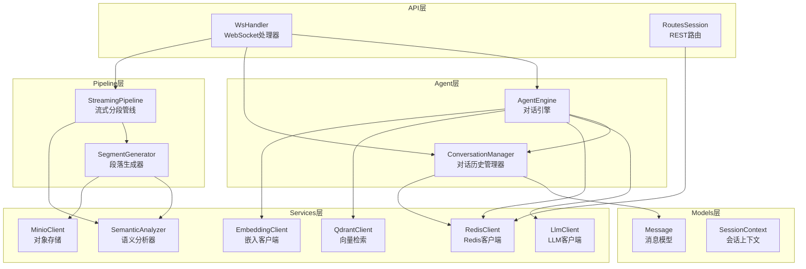
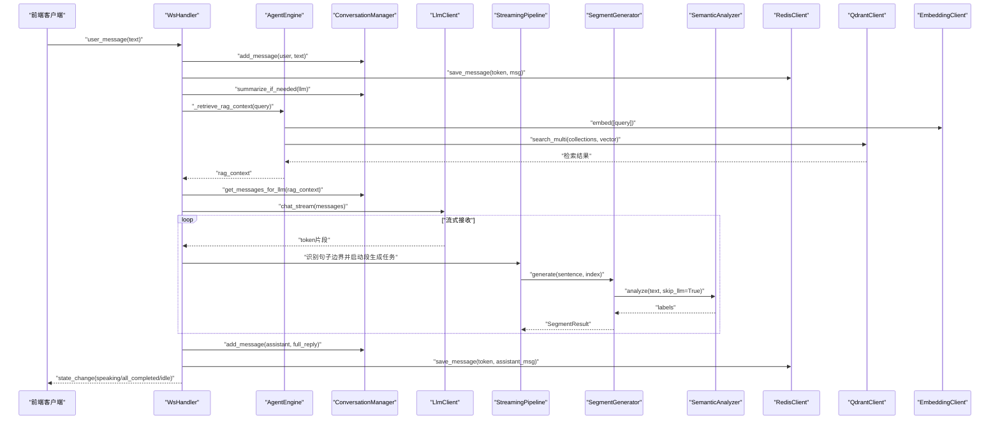
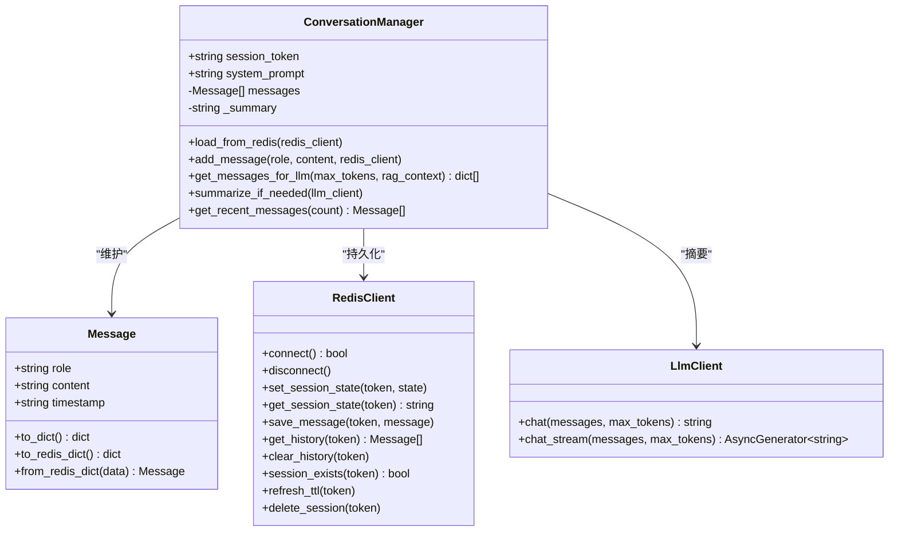
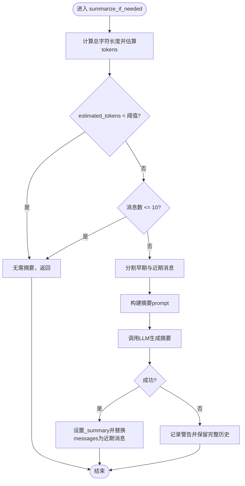
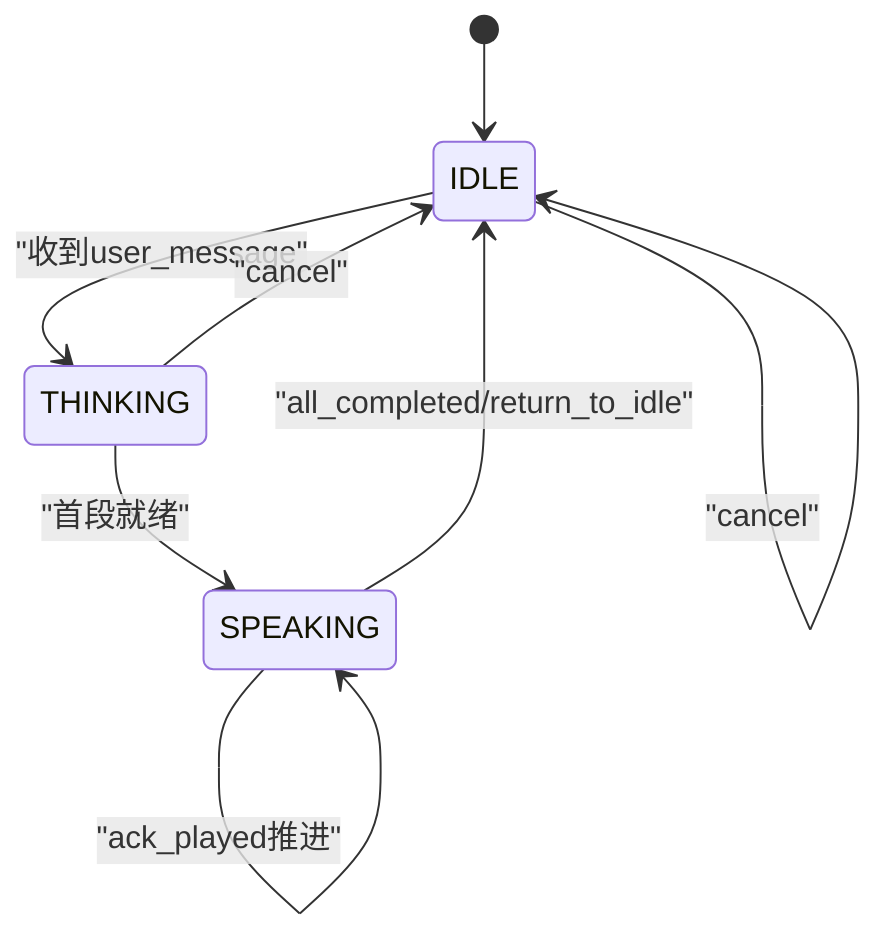
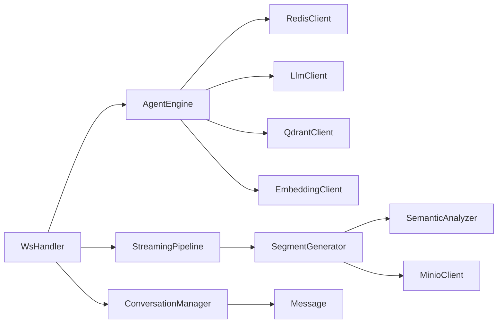

# 对话管理

<cite>
**本文引用的文件**   
- [conversation_manager.py](file://server/agent/conversation_manager.py)
- [message.py](file://server/models/message.py)
- [session.py](file://server/models/session.py)
- [redis_client.py](file://server/services/redis_client.py)
- [ws_handler.py](file://server/api/ws_handler.py)
- [agent_engine.py](file://server/agent/agent_engine.py)
- [llm_client.py](file://server/services/llm_client.py)
- [streaming_pipeline.py](file://server/pipeline/streaming_pipeline.py)
- [segment_generator.py](file://server/pipeline/segment_generator.py)
- [semantic_analyzer.py](file://server/services/semantic_analyzer.py)
- [routes_session.py](file://server/api/routes_session.py)
- [config.py](file://server/config.py)
</cite>

## 目录
1. [简介](#简介)
2. [项目结构](#项目结构)
3. [核心组件](#核心组件)
4. [架构总览](#架构总览)
5. [详细组件分析](#详细组件分析)
6. [依赖关系分析](#依赖关系分析)
7. [性能考量](#性能考量)
8. [故障排查指南](#故障排查指南)
9. [结论](#结论)
10. [附录](#附录)

## 简介
本技术文档聚焦于对话管理系统，围绕 ConversationManager 类的设计模式与实现原理展开，系统阐述：
- 对话历史维护机制、消息序列管理与上下文窗口控制
- 智能摘要算法（token 估算、触发条件、压缩策略）
- 消息持久化机制（Redis 存储结构、会话状态同步、断线恢复）
- 多轮对话的状态机设计（角色切换、上下文传递、记忆保持）
- 错误处理与异常恢复（网络中断、数据损坏、服务降级）
- 从用户输入到响应生成的完整处理链路（流程图与数据结构示例）

## 项目结构
本项目采用分层与按功能域组织相结合的结构：
- agent：对话引擎与对话历史管理器
- models：数据模型（消息、会话上下文）
- services：外部服务客户端封装（LLM、Redis、MinIO、Qdrant、TTS、语义分析等）
- pipeline：流式分段生成与推送管线
- api：WebSocket 处理器与 REST 路由
- config：配置加载与合并

图表来源
- [ws_handler.py:1-444](file://server/api/ws_handler.py#L1-L444)
- [agent_engine.py:1-181](file://server/agent/agent_engine.py#L1-L181)
- [conversation_manager.py:1-139](file://server/agent/conversation_manager.py#L1-L139)
- [streaming_pipeline.py:1-214](file://server/pipeline/streaming_pipeline.py#L1-L214)
- [segment_generator.py:1-138](file://server/pipeline/segment_generator.py#L1-L138)
- [semantic_analyzer.py:1-126](file://server/services/semantic_analyzer.py#L1-L126)
- [redis_client.py:1-122](file://server/services/redis_client.py#L1-L122)
- [llm_client.py:1-204](file://server/services/llm_client.py#L1-L204)
- [message.py:1-33](file://server/models/message.py#L1-L33)
- [session.py:1-41](file://server/models/session.py#L1-L41)
- [routes_session.py:1-123](file://server/api/routes_session.py#L1-L123)

章节来源
- [ws_handler.py:1-444](file://server/api/ws_handler.py#L1-L444)
- [agent_engine.py:1-181](file://server/agent/agent_engine.py#L1-L181)
- [conversation_manager.py:1-139](file://server/agent/conversation_manager.py#L1-L139)
- [streaming_pipeline.py:1-214](file://server/pipeline/streaming_pipeline.py#L1-L214)
- [segment_generator.py:1-138](file://server/pipeline/segment_generator.py#L1-L138)
- [semantic_analyzer.py:1-126](file://server/services/semantic_analyzer.py#L1-L126)
- [redis_client.py:1-122](file://server/services/redis_client.py#L1-L122)
- [llm_client.py:1-204](file://server/services/llm_client.py#L1-L204)
- [message.py:1-33](file://server/models/message.py#L1-L33)
- [session.py:1-41](file://server/models/session.py#L1-L41)
- [routes_session.py:1-123](file://server/api/routes_session.py#L1-L123)

## 核心组件
- ConversationManager：负责单会话的对话历史维护、消息过滤、上下文组装、智能摘要与最近消息访问。
- Message：消息数据模型，提供序列化/反序列化为 Redis 字典的方法。
- SessionContext：会话上下文，包含 token、状态、关联的 ConversationManager、当前 Pipeline 和 WebSocket 引用。
- RedisClient：封装 Redis 操作，包括会话状态、历史消息的存取、TTL 管理与会话生命周期。
- WsHandler：WebSocket 连接处理器，协调会话恢复、消息分发、流式处理流程与错误处理。
- AgentEngine：纯文本对话引擎，封装 RAG 检索增强与 Markdown 清理逻辑。
- StreamingPipeline：流式分段生成与推送管线，支持首段优先、确认式推进与取消。
- SegmentGenerator：单段生成器，串联 TTS、语义分析、视频拼接与 MinIO 上传。
- SemanticAnalyzer：语义分析器，基于 LLM 或关键词回退输出标签序列。
- LlmClient：OpenAI 兼容 Chat Completions 客户端，支持非流式与流式调用，内置重试与限流处理。
- RoutesSession：REST 路由，提供会话创建、历史查询与销毁接口。

章节来源
- [conversation_manager.py:1-139](file://server/agent/conversation_manager.py#L1-L139)
- [message.py:1-33](file://server/models/message.py#L1-L33)
- [session.py:1-41](file://server/models/session.py#L1-L41)
- [redis_client.py:1-122](file://server/services/redis_client.py#L1-L122)
- [ws_handler.py:1-444](file://server/api/ws_handler.py#L1-L444)
- [agent_engine.py:1-181](file://server/agent/agent_engine.py#L1-L181)
- [streaming_pipeline.py:1-214](file://server/pipeline/streaming_pipeline.py#L1-L214)
- [segment_generator.py:1-138](file://server/pipeline/segment_generator.py#L1-L138)
- [semantic_analyzer.py:1-126](file://server/services/semantic_analyzer.py#L1-L126)
- [llm_client.py:1-204](file://server/services/llm_client.py#L1-L204)
- [routes_session.py:1-123](file://server/api/routes_session.py#L1-L123)

## 架构总览
下图展示了从用户输入到响应生成的端到端流程，涵盖 WebSocket 接入、会话恢复、RAG 检索、LLM 流式生成、分段生成与推送、以及 Redis 持久化与状态同步。

图表来源
- [ws_handler.py:189-341](file://server/api/ws_handler.py#L189-L341)
- [agent_engine.py:74-121](file://server/agent/agent_engine.py#L74-L121)
- [conversation_manager.py:39-95](file://server/agent/conversation_manager.py#L39-L95)
- [streaming_pipeline.py:44-131](file://server/pipeline/streaming_pipeline.py#L44-L131)
- [segment_generator.py:42-138](file://server/pipeline/segment_generator.py#L42-L138)
- [semantic_analyzer.py:41-86](file://server/services/semantic_analyzer.py#L41-L86)
- [redis_client.py:82-100](file://server/services/redis_client.py#L82-L100)

## 详细组件分析

### ConversationManager 设计与实现
- 设计模式
  - 单例会话级实例：每个 Session 拥有独立的 ConversationManager 实例，隔离历史与摘要。
  - 组合与依赖注入：通过构造函数注入 system_prompt，方法中注入 Redis/LlmClient 进行持久化与摘要。
  - 责任分离：消息添加、历史过滤、上下文组装、摘要触发各自独立，便于测试与维护。
- 对话历史维护机制
  - 内存列表维护 messages，顺序追加；提供 get_recent_messages 获取最近 N 条。
  - 消息过滤：在构建发送给 LLM 的 messages 时，跳过语义分析的临时 user/assistant 消息，避免污染上下文。
- 消息序列管理与上下文窗口控制
  - 组装顺序：system prompt → RAG 上下文（可选）→ 历史摘要（可选）→ 过滤后的历史消息。
  - 上下文窗口控制：通过智能摘要将早期对话压缩为摘要，保留最近若干条消息，确保总 token 不超过阈值。
- 智能摘要算法
  - Token 使用量监控：以字符长度乘以系数估算 tokens，超过阈值且消息数大于阈值时触发。
  - 触发条件：estimated_tokens >= SUMMARY_THRESHOLD_TOKENS 且 len(messages) > 10。
  - 历史压缩策略：保留最近 10 条消息，对更早消息构建摘要 prompt，调用 LLM 生成摘要后替换历史为近期消息。
  - 异常处理：摘要失败记录警告并保留完整历史，保证可用性。
- 代码片段路径
  - 消息添加与持久化：[conversation_manager.py:39-44](file://server/agent/conversation_manager.py#L39-L44)
  - 上下文组装与过滤：[conversation_manager.py:46-95](file://server/agent/conversation_manager.py#L46-L95)
  - 智能摘要触发与执行：[conversation_manager.py:97-135](file://server/agent/conversation_manager.py#L97-L135)

章节来源
- [conversation_manager.py:1-139](file://server/agent/conversation_manager.py#L1-L139)

#### 类图（ConversationManager 及其依赖）

图表来源
- [conversation_manager.py:21-139](file://server/agent/conversation_manager.py#L21-L139)
- [message.py:9-33](file://server/models/message.py#L9-L33)
- [redis_client.py:22-122](file://server/services/redis_client.py#L22-L122)
- [llm_client.py:23-204](file://server/services/llm_client.py#L23-L204)

### 智能摘要算法工作原理
- Token 估算与监控
  - 估算公式：estimated_tokens = int(sum(len(m.content)) * 1.5)，CHARS_PER_TOKEN 常量用于换算。
  - 阈值：SUMMARY_THRESHOLD_TOKENS = 3500，预留约 1500 tokens 给近期对话与回答。
- 触发条件
  - estimated_tokens < 阈值：不触发摘要。
  - 消息数 <= 10：不触发摘要，避免过度压缩。
- 历史压缩策略
  - 分割：early_messages = messages[:-10]，recent_messages = messages[-10:]。
  - 构建摘要 prompt：将 early_messages 拼接为“role: content”形式，要求不超过 500 字。
  - 调用 LLM 生成摘要，成功后设置 _summary 并将 messages 替换为 recent_messages。
  - 异常处理：捕获异常并记录警告，保留完整历史。
- 流程图（摘要算法）

图表来源
- [conversation_manager.py:97-135](file://server/agent/conversation_manager.py#L97-L135)

章节来源
- [conversation_manager.py:15-18](file://server/agent/conversation_manager.py#L15-L18)
- [conversation_manager.py:97-135](file://server/agent/conversation_manager.py#L97-L135)

### 消息持久化机制（Redis）
- 存储结构
  - 会话状态键：session:{token}:state，值为 idle/thinking/speaking/bridging，带 TTL。
  - 对话历史键：session:{token}:history，值为 JSON 数组，元素为 Message.to_redis_dict()。
- 会话状态同步
  - 写入：set_session_state(token, state) 自动设置 TTL。
  - 读取：get_session_state(token) 获取当前状态。
  - 刷新：refresh_ttl(token) 同时刷新 state/history 的 TTL。
- 断线恢复
  - 新连接时检查 Redis 是否存在该 token 的 state key，若存在则从 Redis 恢复 conversation 历史。
  - 恢复后更新内存中的 sessions[token].conversation.messages 与 ws 引用。
- 代码片段路径
  - 保存消息：[redis_client.py:82-87](file://server/services/redis_client.py#L82-L87)
  - 获取历史：[redis_client.py:89-100](file://server/services/redis_client.py#L89-L100)
  - 会话恢复：[ws_handler.py:62-84](file://server/api/ws_handler.py#L62-L84)

章节来源
- [redis_client.py:64-122](file://server/services/redis_client.py#L64-L122)
- [ws_handler.py:49-84](file://server/api/ws_handler.py#L49-L84)

### 多轮对话状态机设计
- 状态定义
  - IDLE：待机
  - THINKING：思考（LLM 调用前）
  - SPEAKING：说话（分段播放中）
  - BRIDGING：衔接（概念性状态，当前未直接使用）
- 状态转换
  - 收到 user_message → THINKING → 发送 play_analysis/state_change(thinking)
  - 首段就绪 → SPEAKING → 逐段 ack_played 推进
  - 全部完成 → all_completed/return_to_idle → IDLE
  - 用户 cancel → 立即 IDLE
- 上下文传递与记忆保持
  - 通过 ConversationManager 的 messages 列表与 _summary 维持上下文。
  - RAG 上下文作为 system 消息注入，增强回复相关性。
- 代码片段路径
  - 状态枚举与上下文：[session.py:14-41](file://server/models/session.py#L14-L41)
  - THINKING/SPEAKING/IDLE 转换：[ws_handler.py:147-159](file://server/api/ws_handler.py#L147-L159), [ws_handler.py:302-333](file://server/api/ws_handler.py#L302-L333)

章节来源
- [session.py:14-41](file://server/models/session.py#L14-L41)
- [ws_handler.py:147-159](file://server/api/ws_handler.py#L147-L159)
- [ws_handler.py:302-333](file://server/api/ws_handler.py#L302-L333)

#### 状态机图（会话状态）

图表来源
- [session.py:14-20](file://server/models/session.py#L14-L20)
- [ws_handler.py:147-159](file://server/api/ws_handler.py#L147-L159)
- [ws_handler.py:302-333](file://server/api/ws_handler.py#L302-L333)

### 错误处理与异常恢复
- LLM 客户端
  - 非流式 chat：针对 401/403、429、5xx、超时、连接错误进行重试与错误分类。
  - 流式 chat_stream：同样具备重试与错误处理，解析 SSE data 行并 yield 内容片段。
- 流式管线
  - 首段错误：推送 error 事件并回到 idle，取消后续任务。
  - 段间错误：推送 error 并终止推送。
  - 取消机制：_cancel Event 与 ack_queue 的 "cancel" 信号。
- 会话与持久化
  - Redis 不可用：创建会话时返回 503；会话恢复时忽略异常继续运行。
  - 数据损坏：解析历史时捕获 JSONDecodeError/KeyError 并记录警告。
- 代码片段路径
  - LLM 错误处理：[llm_client.py:64-113](file://server/services/llm_client.py#L64-L113), [llm_client.py:139-190](file://server/services/llm_client.py#L139-L190)
  - 管线错误与取消：[streaming_pipeline.py:86-131](file://server/pipeline/streaming_pipeline.py#L86-L131), [streaming_pipeline.py:206-214](file://server/pipeline/streaming_pipeline.py#L206-L214)
  - 会话恢复与异常：[ws_handler.py:62-84](file://server/api/ws_handler.py#L62-84)
  - Redis 解析容错：[redis_client.py:94-100](file://server/services/redis_client.py#L94-L100)

章节来源
- [llm_client.py:64-113](file://server/services/llm_client.py#L64-L113)
- [llm_client.py:139-190](file://server/services/llm_client.py#L139-L190)
- [streaming_pipeline.py:86-131](file://server/pipeline/streaming_pipeline.py#L86-L131)
- [streaming_pipeline.py:206-214](file://server/pipeline/streaming_pipeline.py#L206-L214)
- [ws_handler.py:62-84](file://server/api/ws_handler.py#L62-84)
- [redis_client.py:94-100](file://server/services/redis_client.py#L94-L100)

### 从用户输入到响应生成的完整处理链路
- 关键步骤
  - 校验 token 并恢复会话（如存在）。
  - 保存用户消息到 Redis。
  - 检查 token 溢出并触发摘要。
  - 检索 RAG 上下文并组装 messages。
  - 流式 LLM 调用，边接收边切分句子并启动段生成任务。
  - 保存助手回复到 Redis。
  - 首段就绪后立即推送，随后逐段确认式推进。
  - 全部完成后回到 idle。
- 代码片段路径
  - 用户消息处理入口：[ws_handler.py:130-187](file://server/api/ws_handler.py#L130-L187)
  - 流式处理主循环：[ws_handler.py:189-341](file://server/api/ws_handler.py#L189-L341)
  - RAG 检索：[ws_handler.py:342-400](file://server/api/ws_handler.py#L342-L400)
  - 段落生成与推送：[streaming_pipeline.py:44-131](file://server/pipeline/streaming_pipeline.py#L44-L131)

章节来源
- [ws_handler.py:130-187](file://server/api/ws_handler.py#L130-L187)
- [ws_handler.py:189-341](file://server/api/ws_handler.py#L189-L341)
- [ws_handler.py:342-400](file://server/api/ws_handler.py#L342-L400)
- [streaming_pipeline.py:44-131](file://server/pipeline/streaming_pipeline.py#L44-L131)

## 依赖关系分析
- 组件耦合与内聚
  - ConversationManager 与 Message/RedisClient/LlmClient 低耦合，职责清晰。
  - WsHandler 聚合多个服务，承担编排与错误处理，内聚于 WebSocket 流程。
  - StreamingPipeline 与 SegmentGenerator/SemanticAnalyzer 协作，形成高内聚的媒体生成链。
- 直接/间接依赖
  - WsHandler → AgentEngine → ConversationManager → RedisClient/LlmClient
  - WsHandler → StreamingPipeline → SegmentGenerator → SemanticAnalyzer/MinioClient
  - AgentEngine → QdrantClient/EmbeddingClient（RAG）
- 潜在循环依赖
  - 无直接循环依赖；类型提示中使用 TYPE_CHECKING 避免运行时导入循环。
- 外部依赖与集成点
  - LLM API（OpenAI 兼容）、Redis、MinIO、Qdrant、TTS、FFmpeg。
- 接口契约与实现细节
  - RedisClient 提供统一的异步接口，内部处理 URL 解析与协议版本。
  - LlmClient 统一错误类型 LlmClientError，携带 status_code。
  - StreamingPipeline 通过 WebSocket 事件与前端约定交互。

图表来源
- [ws_handler.py:1-444](file://server/api/ws_handler.py#L1-L444)
- [agent_engine.py:1-181](file://server/agent/agent_engine.py#L1-L181)
- [conversation_manager.py:1-139](file://server/agent/conversation_manager.py#L1-L139)
- [streaming_pipeline.py:1-214](file://server/pipeline/streaming_pipeline.py#L1-L214)
- [segment_generator.py:1-138](file://server/pipeline/segment_generator.py#L1-L138)
- [semantic_analyzer.py:1-126](file://server/services/semantic_analyzer.py#L1-L126)
- [redis_client.py:1-122](file://server/services/redis_client.py#L1-L122)
- [llm_client.py:1-204](file://server/services/llm_client.py#L1-L204)
- [message.py:1-33](file://server/models/message.py#L1-L33)

章节来源
- [ws_handler.py:1-444](file://server/api/ws_handler.py#L1-L444)
- [agent_engine.py:1-181](file://server/agent/agent_engine.py#L1-L181)
- [conversation_manager.py:1-139](file://server/agent/conversation_manager.py#L1-L139)
- [streaming_pipeline.py:1-214](file://server/pipeline/streaming_pipeline.py#L1-L214)
- [segment_generator.py:1-138](file://server/pipeline/segment_generator.py#L1-L138)
- [semantic_analyzer.py:1-126](file://server/services/semantic_analyzer.py#L1-L126)
- [redis_client.py:1-122](file://server/services/redis_client.py#L1-L122)
- [llm_client.py:1-204](file://server/services/llm_client.py#L1-L204)
- [message.py:1-33](file://server/models/message.py#L1-L33)

## 性能考量
- 流式优化
  - 首段优先：首段跳过 LLM 语义分析，使用关键词回退，显著降低首帧延迟。
  - 并行生成：所有段并行启动生成任务，减少整体等待时间。
  - 确认式推进：根据前端 ack 推进下一段，避免拥塞。
- Token 估算与摘要
  - 粗略估算节省计算开销，阈值与保留条数平衡上下文质量与成本。
- 网络与 I/O
  - LLM 客户端内置重试与限流等待，提升稳定性。
  - Redis 使用 rpush/lrange 高效存取历史，TTL 自动过期。
- 建议
  - 调整 SUMMARY_THRESHOLD_TOKENS 与保留条数以适配不同模型与业务需求。
  - 监控 LLM 响应时间与错误率，必要时增加重试次数或退避策略。
  - 评估 RAG top_k 与集合数量对检索延迟的影响。

## 故障排查指南
- 常见问题
  - 会话不存在：检查 /api/session/create 是否调用成功，确认 Redis 中 state key 存在。
  - 消息格式错误：前端需发送 JSON，type=user_message 且包含 text 字段。
  - LLM 调用失败：查看 LlmClientError 的 status_code，区分鉴权、限流与服务端错误。
  - Redis 不可用：创建会话返回 503，检查 Redis 连接与密码特殊字符处理。
  - 数据损坏：解析历史时出现 JSONDecodeError/KeyError，检查写入一致性。
- 定位方法
  - 日志关键字：Redis 连接失败、LLM 调用失败、流式处理异常、Pipeline 异常。
  - 状态检查：通过 /api/session/{token}/history 获取历史，确认消息完整性。
- 代码片段路径
  - 会话创建与错误：[routes_session.py:28-47](file://server/api/routes_session.py#L28-L47)
  - 历史查询：[routes_session.py:50-72](file://server/api/routes_session.py#L50-L72)
  - 会话销毁与清理：[routes_session.py:75-123](file://server/api/routes_session.py#L75-L123)
  - 错误推送与重置：[ws_handler.py:402-414](file://server/api/ws_handler.py#L402-L414)

章节来源
- [routes_session.py:28-47](file://server/api/routes_session.py#L28-L47)
- [routes_session.py:50-72](file://server/api/routes_session.py#L50-L72)
- [routes_session.py:75-123](file://server/api/routes_session.py#L75-L123)
- [ws_handler.py:402-414](file://server/api/ws_handler.py#L402-L414)

## 结论
本对话管理系统通过 ConversationManager 实现了健壮的对话历史维护与智能摘要，结合 Redis 持久化与断线恢复，保障了多轮对话的连续性与可靠性。流式管线与段落生成器协同工作，显著降低了首帧延迟并提升了用户体验。完善的错误处理与降级策略确保了系统在异常场景下的稳定性。未来可进一步优化 Token 估算精度、RAG 检索效率与媒体生成流水线性能。

## 附录
- 配置项说明
  - LLM：endpoint、api_key、model、max_tokens
  - Redis：url、session_ttl_hours
  - MinIO：endpoint、access_key、secret_key、bucket、presigned_url_ttl_seconds
  - RAG：top_k、role_collections
- 代码片段路径
  - 配置加载与合并：[config.py:148-241](file://server/config.py#L148-L241)
  - 全局配置获取：[config.py:248-260](file://server/config.py#L248-L260)

章节来源
- [config.py:148-241](file://server/config.py#L148-L241)
- [config.py:248-260](file://server/config.py#L248-L260)