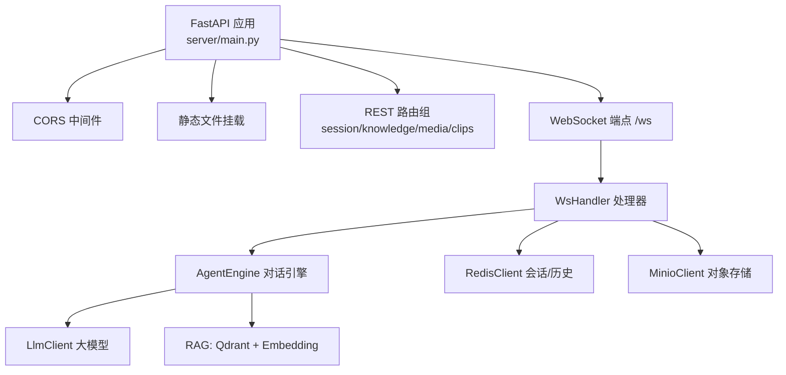
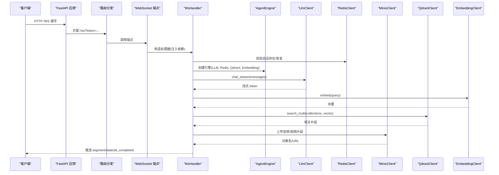
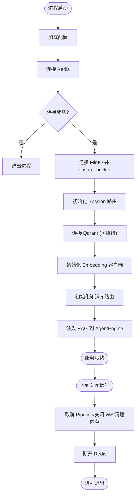
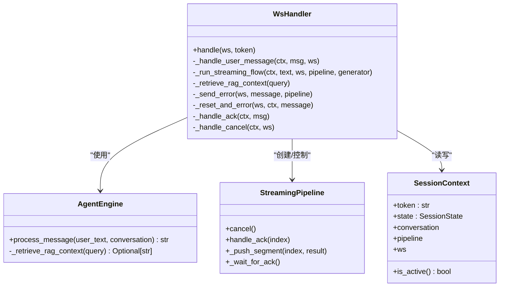
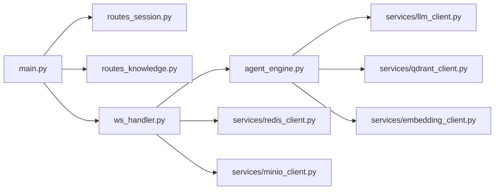

# FastAPI 应用架构

<cite>
**本文引用的文件**   
- [server/main.py](file://server/main.py)
- [server/config.py](file://server/config.py)
- [server/api/routes_session.py](file://server/api/routes_session.py)
- [server/api/ws_handler.py](file://server/api/ws_handler.py)
- [server/models/session.py](file://server/models/session.py)
- [server/services/redis_client.py](file://server/services/redis_client.py)
- [server/services/minio_client.py](file://server/services/minio_client.py)
- [server/agent/agent_engine.py](file://server/agent/agent_engine.py)
- [server/api/routes_knowledge.py](file://server/api/routes_knowledge.py)
</cite>

## 目录
1. [简介](#简介)
2. [项目结构](#项目结构)
3. [核心组件](#核心组件)
4. [架构总览](#架构总览)
5. [详细组件分析](#详细组件分析)
6. [依赖关系分析](#依赖关系分析)
7. [性能与可扩展性](#性能与可扩展性)
8. [故障排查指南](#故障排查指南)
9. [结论](#结论)
10. [附录](#附录)

## 简介
本文件面向 FastAPI 后端服务，系统化阐述应用生命周期管理、中间件配置、依赖注入模式、路由注册机制、健康检查与监控指标设计，并提供启动流程与组件依赖图。该服务以 WebSocket 驱动实时对话流式处理，结合 Redis 会话持久化、MinIO 对象存储、Qdrant 向量检索与 Embedding 模型，形成“LLM → TTS → 视频拼接”的端到端媒体生成链路。

## 项目结构
后端采用分层与模块化组织：
- 入口与应用装配：FastAPI 应用实例、生命周期、中间件、静态资源挂载、路由聚合
- 配置中心：集中加载 JSON 与环境变量，提供扁平化配置字典
- API 层：REST 路由分组（会话、知识库等）与 WebSocket 处理器
- 领域模型：会话上下文与状态枚举
- 服务层：Redis、MinIO、Embedding、Qdrant、LLM、TTS、语义分析、视频拼接等外部能力封装
- Agent 引擎：对话编排与 RAG 增强

图表来源
- [server/main.py:114-177](file://server/main.py#L114-L177)
- [server/api/ws_handler.py:31-48](file://server/api/ws_handler.py#L31-L48)
- [server/agent/agent_engine.py:59-73](file://server/agent/agent_engine.py#L59-L73)

章节来源
- [server/main.py:114-177](file://server/main.py#L114-L177)
- [server/config.py:148-241](file://server/config.py#L148-L241)

## 核心组件
- 应用生命周期（lifespan）
  - 启动阶段：加载配置、初始化 Redis/MinIO/Qdrant/Embedding、注入路由与 Agent 依赖、记录日志
  - 关闭阶段：取消活跃 Pipeline、关闭 WebSocket、清理内存会话、断开 Redis
- 中间件与静态资源
  - CORS 允许跨域（开发阶段宽策略）
  - 静态文件挂载在 API 路由之后，避免拦截
- 依赖注入与全局状态
  - 通过 lifespan 初始化并注入到路由与处理器
  - 使用模块级全局引用进行“轻量 DI”，避免复杂容器
- 路由注册
  - REST 路由按功能分组，统一前缀与标签
  - 知识库路由具备 Admin Token 鉴权
- 健康检查与监控
  - /api/health 返回运行态、Redis 可用性与活跃会话数
  - 日志输出关键事件，便于采集指标

章节来源
- [server/main.py:42-110](file://server/main.py#L42-L110)
- [server/main.py:120-177](file://server/main.py#L120-L177)
- [server/main.py:136-143](file://server/main.py#L136-L143)
- [server/api/routes_knowledge.py:43-51](file://server/api/routes_knowledge.py#L43-51)

## 架构总览
下图展示从请求进入、中间件处理、路由分发到业务处理的完整路径，以及关键外部依赖。

图表来源
- [server/main.py:146-170](file://server/main.py#L146-L170)
- [server/api/ws_handler.py:130-187](file://server/api/ws_handler.py#L130-187)
- [server/api/ws_handler.py:342-400](file://server/api/ws_handler.py#L342-L400)
- [server/agent/agent_engine.py:74-121](file://server/agent/agent_engine.py#L74-L121)

## 详细组件分析

### 应用生命周期与启动流程
- 启动顺序
  1) 读取配置（JSON + 环境变量）
  2) 连接 Redis（失败则拒绝启动）
  3) 连接 MinIO 并确保 Bucket 存在
  4) 初始化 Session 路由（注入 sessions 与 redis）
  5) 连接 Qdrant（失败仅告警，不影响启动）
  6) 初始化 Embedding 客户端
  7) 初始化知识库路由（注入 qdrant/embedding）
  8) 将 RAG 客户端注入 AgentEngine
  9) 完成启动
- 关闭顺序
  1) 遍历所有会话，取消 Pipeline、关闭 WebSocket
  2) 清空内存会话
  3) 断开 Redis 连接

图表来源
- [server/main.py:42-110](file://server/main.py#L42-L110)

章节来源
- [server/main.py:42-110](file://server/main.py#L42-L110)
- [server/config.py:148-241](file://server/config.py#L148-L241)

### 中间件与错误处理
- CORS 中间件：开发环境允许任意来源与方法，生产建议收紧
- 静态文件：放在所有 API 路由之后，避免误拦截
- 错误处理：
  - 启动期：Redis 不可用直接终止；Qdrant 不可用仅告警
  - 运行时：各服务异常抛出或降级，上层捕获后推送 error 事件并回退状态

章节来源
- [server/main.py:120-177](file://server/main.py#L120-L177)
- [server/main.py:54-77](file://server/main.py#L54-L77)

### 依赖注入与全局状态
- 全局状态
  - 进程内会话表 sessions: Dict[token, SessionContext]
  - 客户端单例：Redis/MinIO/Qdrant/Embedding
- 注入方式
  - lifespan 中初始化并设置模块级全局引用
  - 路由通过 init_xxx_routes 注入所需依赖
  - WsHandler 构造函数接收依赖实例
- 优点与风险
  - 优点：简单直观、低耦合
  - 风险：全局可变状态不利于测试与并发隔离；建议在大型项目中迁移至 FastAPI Depends 或显式容器

章节来源
- [server/main.py:34-40](file://server/main.py#L34-L40)
- [server/api/routes_session.py:16-25](file://server/api/routes_session.py#L16-25)
- [server/api/ws_handler.py:34-47](file://server/api/ws_handler.py#L34-L47)

### 路由注册与模块化设计
- REST 路由分组
  - session：会话创建、历史查询、销毁
  - knowledge：集合管理、知识摄入、统计、搜索（受 Admin Token 保护）
  - media/clips：媒体与片段相关接口（由 main 聚合）
- 路由初始化
  - 在 lifespan 中调用 init_session_routes/init_knowledge_routes 注入依赖
- 鉴权
  - 知识库路由通过 Header X-Knowledge-Admin-Token 校验，未配置时放行

章节来源
- [server/main.py:129-133](file://server/main.py#L129-L133)
- [server/api/routes_session.py:14-25](file://server/api/routes_session.py#L14-25)
- [server/api/routes_knowledge.py:24-51](file://server/api/routes_knowledge.py#L24-51)

### WebSocket 实时通信与流式处理
- 连接建立
  - 校验 token 是否存在于 Redis 或内存
  - 若为历史会话，从 Redis 恢复 ConversationManager
- 消息处理
  - user_message：更新状态为 thinking，构建 SegmentGenerator/StreamingPipeline，后台执行流式处理
  - ack_played：前端播放确认，推进 pipeline 分段推送
  - cancel：中断当前处理，重置状态
- 流式流水线
  - LLM 边生成边切分句子，立即并行生成段（TTS+语义+拼接+上传）
  - 首段完成后立即推送，后续按 ack 逐段推送
  - 全部完成后推送 all_completed 并回到 idle

图表来源
- [server/api/ws_handler.py:31-48](file://server/api/ws_handler.py#L31-L48)
- [server/models/session.py:14-41](file://server/models/session.py#L14-L41)
- [server/agent/agent_engine.py:59-73](file://server/agent/agent_engine.py#L59-L73)

章节来源
- [server/api/ws_handler.py:49-129](file://server/api/ws_handler.py#L49-L129)
- [server/api/ws_handler.py:130-187](file://server/api/ws_handler.py#L130-187)
- [server/api/ws_handler.py:189-340](file://server/api/ws_handler.py#L189-L340)
- [server/models/session.py:14-41](file://server/models/session.py#L14-L41)

### 健康检查与监控指标
- 健康检查端点
  - GET /api/health：返回 status、redis 可用性、sessions 数量
- 监控指标建议
  - 基于日志关键字（如“已创建/已销毁/错误/异常”）采集计数
  - 暴露 Prometheus 指标（可选扩展）：活跃会话数、LLM/TTS/Embedding 调用耗时、错误率、Qdrant 检索延迟等

章节来源
- [server/main.py:136-143](file://server/main.py#L136-L143)

## 依赖关系分析
- 组件耦合
  - main 负责装配与生命周期，低耦合地引入各服务
  - 路由与处理器通过“初始化函数/构造函数”获取依赖，避免循环导入
- 外部依赖
  - Redis：会话状态与历史持久化
  - MinIO：音频/视频片段对象存储
  - Qdrant：向量检索（RAG）
  - Embedding：文本向量化
  - LLM：对话生成（支持流式）
- 潜在循环依赖
  - 通过延迟导入与模块级注入规避

图表来源
- [server/main.py:129-133](file://server/main.py#L129-L133)
- [server/api/ws_handler.py:31-48](file://server/api/ws_handler.py#L31-L48)
- [server/agent/agent_engine.py:59-73](file://server/agent/agent_engine.py#L59-L73)

章节来源
- [server/main.py:129-133](file://server/main.py#L129-L133)
- [server/api/ws_handler.py:31-48](file://server/api/ws_handler.py#L31-L48)
- [server/agent/agent_engine.py:59-73](file://server/agent/agent_engine.py#L59-L73)

## 性能与可扩展性
- 流式与并行
  - LLM 流式响应，边生成边切分段落，降低首字节延迟
  - 多段并行生成（TTS/语义/拼接/上传），提升吞吐
- 资源管理
  - Pipeline 取消与 ack 机制防止堆积
  - 会话 TTL 与自动清理减少内存占用
- 可扩展点
  - 将全局状态迁移为 Depends 注入，便于单元测试与水平扩展
  - 增加限流与熔断（对 LLM/TTS/Embedding）
  - 指标与追踪集成（Prometheus/OpenTelemetry）

[本节为通用指导，不直接分析具体文件]

## 故障排查指南
- 启动失败
  - Redis 不可用：检查连接 URL、网络连通与认证信息
  - Qdrant 不可用：仅告警，RAG 功能降级
- 运行时异常
  - LLM/TTS/Embedding 调用失败：查看日志中的错误码与消息，必要时重试或降级
  - MinIO 上传失败：检查 endpoint、bucket 权限与对象命名
  - WebSocket 断开：前端指数退避重连，服务端保留会话上下文供恢复
- 常见定位手段
  - 观察 /api/health 返回值
  - 检查日志关键字：连接、错误、异常、取消、清理

章节来源
- [server/main.py:54-77](file://server/main.py#L54-L77)
- [server/api/ws_handler.py:335-340](file://server/api/ws_handler.py#L335-L340)
- [server/services/minio_client.py:69-90](file://server/services/minio_client.py#L69-L90)

## 结论
该 FastAPI 应用以清晰的生命周期管理为核心，结合模块化路由与轻量依赖注入，实现了高可用的实时对话与媒体生成链路。通过流式处理与 ack 机制，显著优化了端到端延迟与用户体验。建议在生产环境中收紧 CORS、完善错误与指标体系，并将全局状态逐步迁移为显式依赖注入以提升可测试性与可维护性。

[本节为总结性内容，不直接分析具体文件]

## 附录

### 配置优先级与覆盖
- 优先级：环境变量 > config.json > 默认值
- 典型字段：LLM/TTS/Redis/MinIO/Qdrant/Embedding/RAG/Server 等

章节来源
- [server/config.py:148-241](file://server/config.py#L148-L241)

### 会话状态与上下文
- 状态枚举：idle/thinking/speaking/bridging
- 上下文包含：token、state、conversation、pipeline、ws 引用

章节来源
- [server/models/session.py:14-41](file://server/models/session.py#L14-L41)

### 知识库管理端点概览
- 集合管理：列表/创建/删除
- 知识摄入：批量文档分块→嵌入→写入 Qdrant
- 统计与搜索：按集合或全库检索
- 鉴权：X-Knowledge-Admin-Token

章节来源
- [server/api/routes_knowledge.py:81-128](file://server/api/routes_knowledge.py#L81-L128)
- [server/api/routes_knowledge.py:134-186](file://server/api/routes_knowledge.py#L134-L186)
- [server/api/routes_knowledge.py:192-267](file://server/api/routes_knowledge.py#L192-L267)