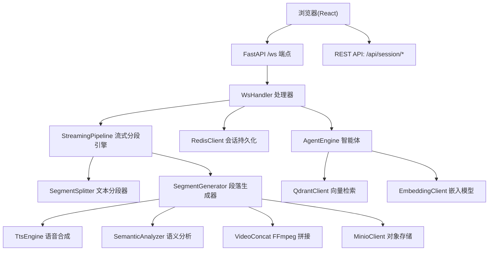
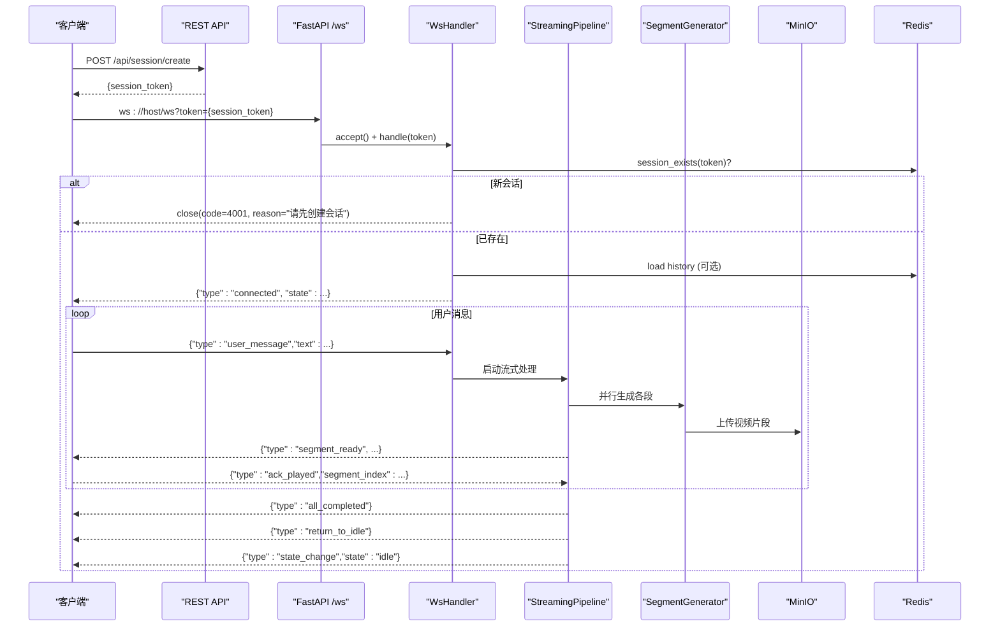
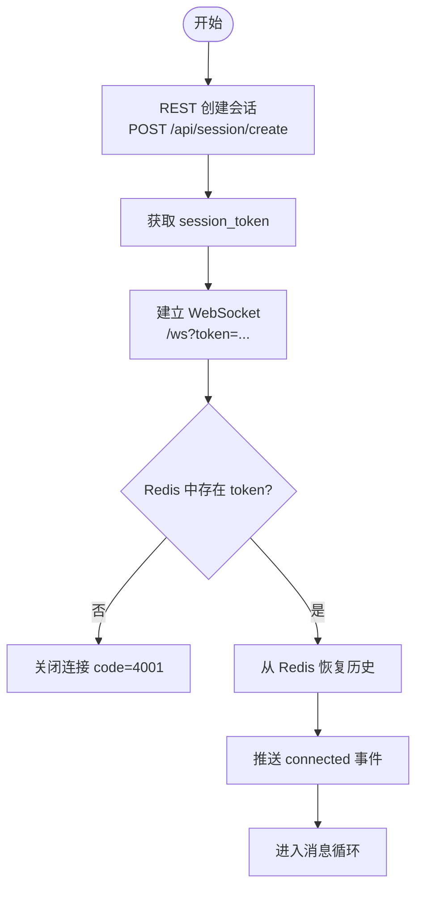
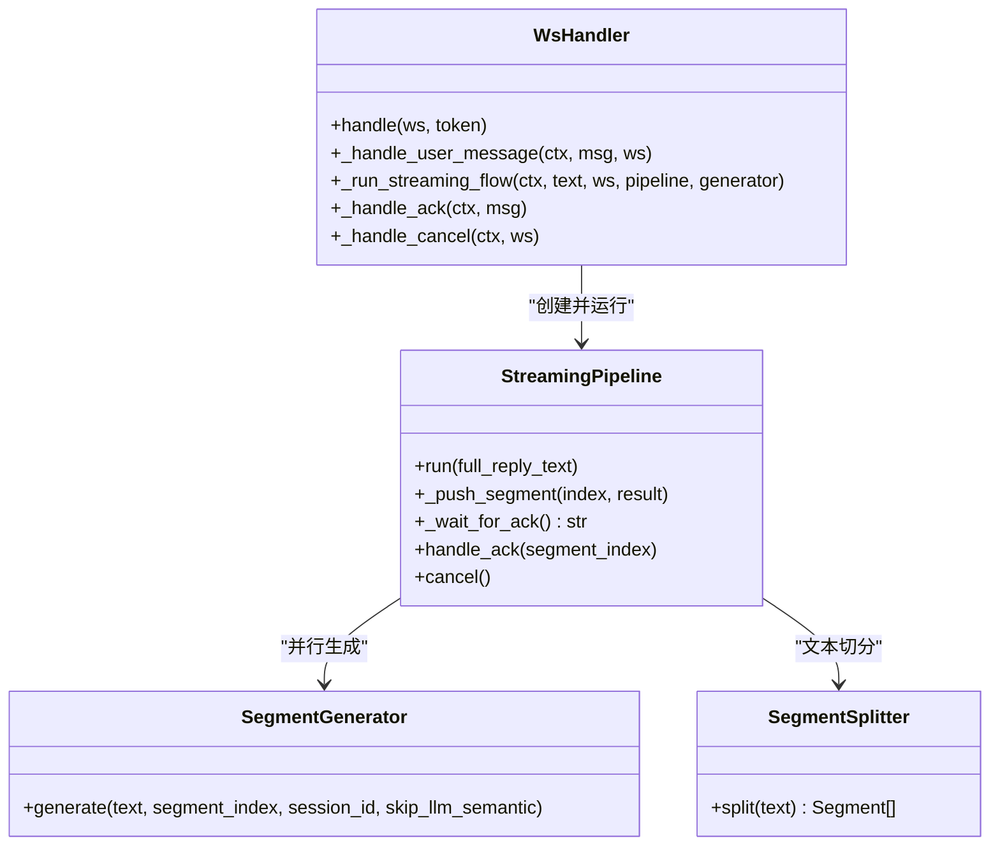
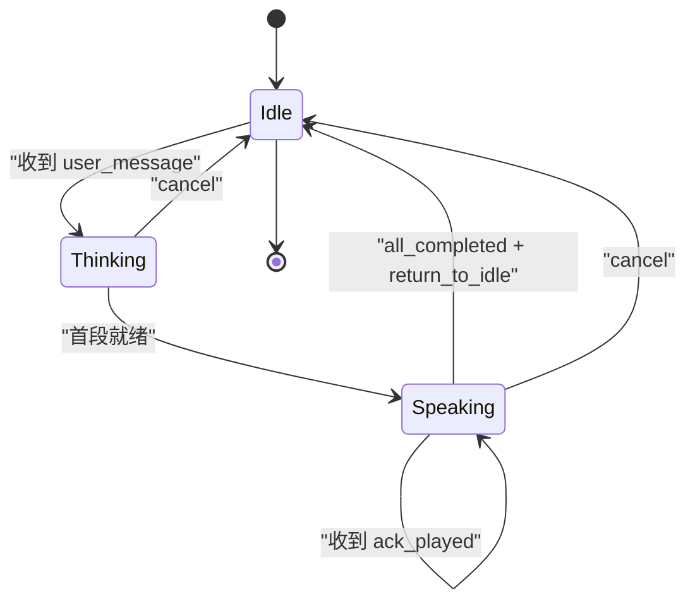
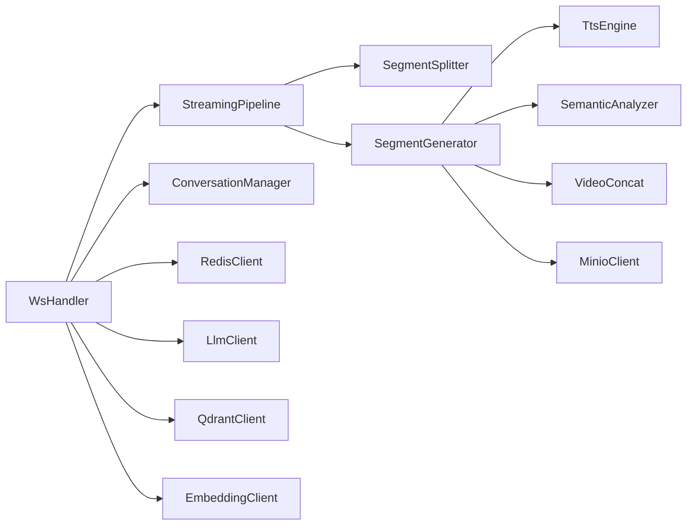
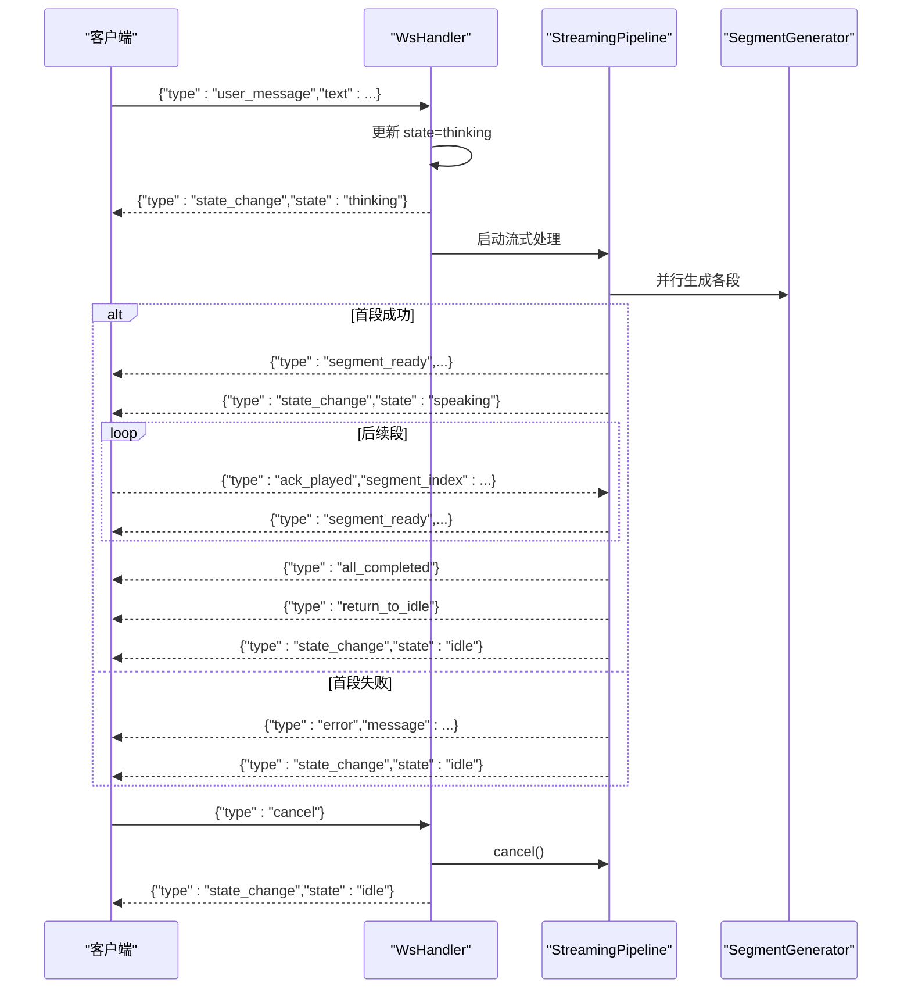

# WebSocket 通信协议

<cite>
**本文引用的文件列表**
- [server/main.py](file://server/main.py)
- [server/api/ws_handler.py](file://server/api/ws_handler.py)
- [server/pipeline/streaming_pipeline.py](file://server/pipeline/streaming_pipeline.py)
- [server/pipeline/segment_generator.py](file://server/pipeline/segment_generator.py)
- [server/pipeline/segment_splitter.py](file://server/pipeline/segment_splitter.py)
- [server/models/session.py](file://server/models/session.py)
- [server/services/redis_client.py](file://server/services/redis_client.py)
- [server/api/routes_session.py](file://server/api/routes_session.py)
- [client/src/hooks/useWebSocket.ts](file://client/src/hooks/useWebSocket.ts)
- [client/src/types/events.ts](file://client/src/types/events.ts)
- [client/src/services/api.ts](file://client/src/services/api.ts)
- [config.json](file://config.json)
</cite>

## 目录
1. [简介](#简介)
2. [项目结构](#项目结构)
3. [核心组件](#核心组件)
4. [架构总览](#架构总览)
5. [详细组件分析](#详细组件分析)
6. [依赖关系分析](#依赖关系分析)
7. [性能与并发特性](#性能与并发特性)
8. [故障排查指南](#故障排查指南)
9. [结论](#结论)
10. [附录：消息格式与状态机](#附录消息格式与状态机)

## 简介
本技术文档围绕实时对话系统的 WebSocket 通信协议，系统化阐述连接建立与认证、会话上下文管理、消息格式定义、事件处理机制、会话生命周期、错误重试策略、断线重连与心跳检测等关键主题。文档同时提供代码级架构图、时序图与状态机，帮助前后端开发者快速理解并正确实现协议。

## 项目结构
后端基于 FastAPI，前端基于 React + TypeScript。WebSocket 入口位于后端主应用，客户端通过 REST API 创建会话 token，再携带该 token 建立 WebSocket 连接。服务端维护会话上下文（内存 + Redis），并通过流式分段引擎将 LLM 文本流转换为音视频片段，逐段推送给前端播放。

图表来源
- [server/main.py:146-170](file://server/main.py#L146-L170)
- [server/api/ws_handler.py:31-129](file://server/api/ws_handler.py#L31-L129)
- [server/pipeline/streaming_pipeline.py:16-131](file://server/pipeline/streaming_pipeline.py#L16-L131)
- [server/pipeline/segment_generator.py:27-138](file://server/pipeline/segment_generator.py#L27-L138)
- [server/services/redis_client.py:22-122](file://server/services/redis_client.py#L22-L122)
- [server/api/routes_session.py:28-47](file://server/api/routes_session.py#L28-L47)

章节来源
- [server/main.py:1-191](file://server/main.py#L1-L191)
- [server/api/ws_handler.py:1-444](file://server/api/ws_handler.py#L1-L444)
- [server/pipeline/streaming_pipeline.py:1-214](file://server/pipeline/streaming_pipeline.py#L1-L214)
- [server/pipeline/segment_generator.py:1-138](file://server/pipeline/segment_generator.py#L1-L138)
- [server/pipeline/segment_splitter.py:1-95](file://server/pipeline/segment_splitter.py#L1-L95)
- [server/models/session.py:1-41](file://server/models/session.py#L1-L41)
- [server/services/redis_client.py:1-122](file://server/services/redis_client.py#L1-L122)
- [server/api/routes_session.py:1-123](file://server/api/routes_session.py#L1-L123)
- [client/src/hooks/useWebSocket.ts:1-190](file://client/src/hooks/useWebSocket.ts#L1-L190)
- [client/src/types/events.ts:1-113](file://client/src/types/events.ts#L1-L113)
- [client/src/services/api.ts:1-52](file://client/src/services/api.ts#L1-L52)
- [config.json:1-39](file://config.json#L1-L39)

## 核心组件
- WsHandler：负责 WebSocket 连接生命周期、Token 校验、会话恢复、消息路由、错误处理与优雅关闭。
- StreamingPipeline：流式分段与推送引擎，协调首段即时推送、后续段确认式推进、取消与错误传播。
- SegmentSplitter：中文标点驱动的分句与段落切分。
- SegmentGenerator：单段生成管线（TTS → 语义分析 → FFmpeg 拼接 → MinIO 上传）。
- ConversationManager：对话历史管理与 Token 溢出摘要。
- RedisClient：会话状态与历史持久化、TTL 管理。
- 前端 useWebSocket Hook：自动重连、消息发送与回调分发。

章节来源
- [server/api/ws_handler.py:31-129](file://server/api/ws_handler.py#L31-L129)
- [server/pipeline/streaming_pipeline.py:16-131](file://server/pipeline/streaming_pipeline.py#L16-L131)
- [server/pipeline/segment_splitter.py:25-76](file://server/pipeline/segment_splitter.py#L25-L76)
- [server/pipeline/segment_generator.py:27-138](file://server/pipeline/segment_generator.py#L27-L138)
- [server/models/session.py:14-41](file://server/models/session.py#L14-L41)
- [server/services/redis_client.py:22-122](file://server/services/redis_client.py#L22-L122)
- [client/src/hooks/useWebSocket.ts:34-190](file://client/src/hooks/useWebSocket.ts#L34-L190)

## 架构总览
下图展示了从客户端到后端的端到端交互路径，包括 REST 创建会话、WebSocket 连接、流式处理与媒体回放。

图表来源
- [server/api/routes_session.py:28-47](file://server/api/routes_session.py#L28-L47)
- [server/main.py:146-170](file://server/main.py#L146-L170)
- [server/api/ws_handler.py:49-129](file://server/api/ws_handler.py#L49-L129)
- [server/pipeline/streaming_pipeline.py:44-131](file://server/pipeline/streaming_pipeline.py#L44-L131)
- [server/pipeline/segment_generator.py:42-138](file://server/pipeline/segment_generator.py#L42-L138)
- [server/services/redis_client.py:108-122](file://server/services/redis_client.py#L108-L122)

## 详细组件分析

### 连接建立与认证机制
- 会话创建：客户端调用 REST 接口创建会话，返回 session_token；服务端在 Redis 中写入会话状态 key，设置 TTL。
- WebSocket 连接：客户端以 GET 参数 token 发起 ws://host/ws?token=...；服务端接受连接后校验 token 是否存在于 Redis。
- 会话恢复：若为旧 token，尝试从 Redis 加载历史并恢复 ConversationManager 到内存会话上下文。
- 首次握手：服务端向客户端推送 connected 事件，包含当前 state。

图表来源
- [server/api/routes_session.py:28-47](file://server/api/routes_session.py#L28-L47)
- [server/api/ws_handler.py:49-95](file://server/api/ws_handler.py#L49-L95)
- [server/services/redis_client.py:72-78](file://server/services/redis_client.py#L72-L78)

章节来源
- [server/api/routes_session.py:28-47](file://server/api/routes_session.py#L28-L47)
- [server/api/ws_handler.py:49-95](file://server/api/ws_handler.py#L49-L95)
- [server/services/redis_client.py:72-78](file://server/services/redis_client.py#L72-L78)

### 消息格式定义
- 客户端 → 服务端
  - user_message：用户输入文本
  - ack_played：前端播放某段完成确认
  - cancel：用户中断当前生成流程
- 服务端 → 客户端
  - connected：连接成功，附带 session_token 与 state
  - state_change：状态变更（thinking/speaking/bridging/idle）
  - segment_ready：一段视频就绪，含 index、video_url、duration_ms、text
  - bubble_char/bubble_dismiss：打字机气泡字符与消失
  - play_analysis：衔接动画提示
  - all_completed：全部段落完成
  - return_to_idle：回到待机
  - error：错误信息

章节来源
- [client/src/types/events.ts:15-92](file://client/src/types/events.ts#L15-L92)
- [server/api/ws_handler.py:112-120](file://server/api/ws_handler.py#L112-L120)
- [server/pipeline/streaming_pipeline.py:132-168](file://server/pipeline/streaming_pipeline.py#L132-L168)

### 事件处理机制与异步队列
- 消息路由：WsHandler 根据 type 分发至 _handle_user_message/_handle_ack/_handle_cancel。
- 异步任务：_run_streaming_flow 使用 asyncio.ensure_future 并行启动各段生成任务，并在 LLM 流式接收时按句子边界触发段生成。
- 确认式推进：StreamingPipeline 内部使用 asyncio.Queue 等待前端的 ack_played，确保“边生成边播放”的流畅体验。
- 取消控制：通过 asyncio.Event 统一标记取消，所有子任务检查标志位及时退出。

图表来源
- [server/api/ws_handler.py:130-341](file://server/api/ws_handler.py#L130-L341)
- [server/pipeline/streaming_pipeline.py:16-131](file://server/pipeline/streaming_pipeline.py#L16-L131)
- [server/pipeline/segment_generator.py:27-138](file://server/pipeline/segment_generator.py#L27-L138)
- [server/pipeline/segment_splitter.py:25-76](file://server/pipeline/segment_splitter.py#L25-L76)

章节来源
- [server/api/ws_handler.py:130-341](file://server/api/ws_handler.py#L130-L341)
- [server/pipeline/streaming_pipeline.py:16-131](file://server/pipeline/streaming_pipeline.py#L16-L131)

### 会话生命周期管理
- 连接建立：REST 创建会话 → WebSocket 连接 → connected 事件。
- 消息路由：user_message 触发流式处理；ack_played 推进下一段；cancel 终止流程。
- 状态同步：thinking/speaking/idle 等状态通过 state_change 事件同步到前端；Redis 持久化 state 用于跨进程/重启恢复。
- 优雅关闭：服务关闭时遍历 sessions 取消活跃 Pipeline 并关闭关联 WebSocket；销毁会话时清理 Redis、内存与 MinIO 数据。

图表来源
- [server/models/session.py:14-41](file://server/models/session.py#L14-L41)
- [server/api/ws_handler.py:147-159](file://server/api/ws_handler.py#L147-L159)
- [server/pipeline/streaming_pipeline.py:121-131](file://server/pipeline/streaming_pipeline.py#L121-L131)
- [server/main.py:95-110](file://server/main.py#L95-L110)

章节来源
- [server/models/session.py:14-41](file://server/models/session.py#L14-L41)
- [server/api/ws_handler.py:147-159](file://server/api/ws_handler.py#L147-L159)
- [server/pipeline/streaming_pipeline.py:121-131](file://server/pipeline/streaming_pipeline.py#L121-L131)
- [server/main.py:95-110](file://server/main.py#L95-L110)

### 错误处理与重试策略
- 客户端侧：
  - 指数退避重连：1s→2s→4s→8s…上限 30s；显式关闭不触发重连。
  - 错误日志输出，便于调试。
- 服务端侧：
  - JSON 解析失败返回 error 事件。
  - LLM 调用异常或生成异常统一重置状态并推送 error + idle。
  - Pipeline 内错误推送 error 并置 cancel，避免继续推进。
- 重试建议：
  - 网络抖动导致的 LLM/TTS 失败可在上层封装重试（指数退避 + 最大次数）。
  - 对 MinIO 上传失败回退本地路径，保证播放可用。

章节来源
- [client/src/hooks/useWebSocket.ts:119-135](file://client/src/hooks/useWebSocket.ts#L119-L135)
- [server/api/ws_handler.py:101-108](file://server/api/ws_handler.py#L101-L108)
- [server/api/ws_handler.py:335-341](file://server/api/ws_handler.py#L335-L341)
- [server/pipeline/streaming_pipeline.py:127-131](file://server/pipeline/streaming_pipeline.py#L127-L131)
- [server/pipeline/segment_generator.py:98-106](file://server/pipeline/segment_generator.py#L98-L106)

### 连接池管理、心跳检测与断线重连
- 连接池：当前实现未使用显式连接池，每个 WebSocket 请求由 FastAPI 独立处理；会话上下文保存在内存字典中，配合 Redis 持久化。
- 心跳检测：当前实现未内置心跳；建议在网关层或客户端侧增加 ping/pong 机制，超时判定断开。
- 断线重连：客户端已实现指数退避重连；服务端在 onclose 时保留会话上下文供重连恢复。

章节来源
- [server/main.py:34-36](file://server/main.py#L34-L36)
- [server/api/ws_handler.py:121-129](file://server/api/ws_handler.py#L121-L129)
- [client/src/hooks/useWebSocket.ts:119-135](file://client/src/hooks/useWebSocket.ts#L119-L135)

## 依赖关系分析
- 模块耦合：
  - WsHandler 强依赖 StreamingPipeline、ConversationManager、RedisClient、LLM 与外部服务（MinIO/Qdrant/Embedding）。
  - StreamingPipeline 依赖 SegmentSplitter 与 SegmentGenerator，后者组合 TTS、语义分析、FFmpeg 与 MinIO。
- 外部依赖：
  - Redis：会话状态与历史持久化。
  - MinIO：视频片段对象存储。
  - Qdrant/Embedding：RAG 知识检索（可选）。
  - LLM/TTS：文本生成与语音合成。

图表来源
- [server/api/ws_handler.py:31-47](file://server/api/ws_handler.py#L31-L47)
- [server/pipeline/streaming_pipeline.py:16-43](file://server/pipeline/streaming_pipeline.py#L16-L43)
- [server/pipeline/segment_generator.py:27-41](file://server/pipeline/segment_generator.py#L27-L41)

章节来源
- [server/api/ws_handler.py:31-47](file://server/api/ws_handler.py#L31-L47)
- [server/pipeline/streaming_pipeline.py:16-43](file://server/pipeline/streaming_pipeline.py#L16-L43)
- [server/pipeline/segment_generator.py:27-41](file://server/pipeline/segment_generator.py#L27-L41)

## 性能与并发特性
- 首段即时推送：StreamingPipeline 等待首个任务完成后立即推送，降低首帧延迟。
- 并行生成：各段生成任务并行启动，充分利用 CPU/GPU 资源。
- 确认式推进：通过 ack_played 控制推送节奏，避免前端缓冲堆积。
- 文本切分阈值：默认每段 ≥50 字，平衡首帧延迟与整体时长。
- 优化建议：
  - 限制并发段数上限，防止资源争用。
  - 对长回复采用更细粒度切分，提升首帧速度。
  - 对 MinIO 上传失败进行重试与降级策略。

章节来源
- [server/pipeline/streaming_pipeline.py:78-95](file://server/pipeline/streaming_pipeline.py#L78-L95)
- [server/pipeline/segment_splitter.py:11-12](file://server/pipeline/segment_splitter.py#L11-L12)

## 故障排查指南
- 连接失败（code=4000/4001）：
  - 4000：服务未就绪（Redis/MinIO 未初始化）。
  - 4001：token 不存在，需先调用 REST 创建会话。
- 消息格式错误：JSON 解析失败会返回 error 事件，检查客户端序列化逻辑。
- LLM/TTS 失败：查看服务端日志，必要时启用重试；注意限流与配额。
- MinIO 上传失败：回退本地路径，检查网络与权限；确认 bucket 存在。
- 会话丢失：检查 Redis 是否可达、TTL 配置是否合理。

章节来源
- [server/main.py:153-155](file://server/main.py#L153-L155)
- [server/api/ws_handler.py:69-73](file://server/api/ws_handler.py#L69-L73)
- [server/api/ws_handler.py:101-108](file://server/api/ws_handler.py#L101-L108)
- [server/pipeline/segment_generator.py:98-106](file://server/pipeline/segment_generator.py#L98-L106)

## 结论
本 WebSocket 协议通过 REST 创建会话与 token 校验保障安全，结合 Redis 持久化与会话恢复实现高可用；流式分段与确认式推进显著提升用户体验；完善的错误处理与客户端重连策略增强了鲁棒性。建议在生产环境引入心跳检测、连接池与更严格的并发控制，进一步提升稳定性与吞吐能力。

## 附录：消息格式与状态机

### 客户端消息类型
- user_message：{type:"user_message", text:string}
- ack_played：{type:"ack_played", segment_index:number}
- cancel：{type:"cancel"}

章节来源
- [client/src/types/events.ts:17-31](file://client/src/types/events.ts#L17-L31)

### 服务端事件类型
- connected：{type:"connected", session_token:string, state:string}
- state_change：{type:"state_change", state:"thinking"|"speaking"|"bridging"|"idle"}
- segment_ready：{type:"segment_ready", index:number, video_url:string, duration_ms:number, text:string}
- bubble_char：{type:"bubble_char", char:string, segment_index:number}
- bubble_dismiss：{type:"bubble_dismiss", segment_index:number}
- play_analysis：{type:"play_analysis", loop:boolean}
- all_completed：{type:"all_completed"}
- return_to_idle：{type:"return_to_idle"}
- error：{type:"error", message:string}

章节来源
- [client/src/types/events.ts:35-92](file://client/src/types/events.ts#L35-L92)
- [server/api/ws_handler.py:90-94](file://server/api/ws_handler.py#L90-L94)
- [server/pipeline/streaming_pipeline.py:132-168](file://server/pipeline/streaming_pipeline.py#L132-L168)

### 完整交互时序（含异常分支）

图表来源
- [server/api/ws_handler.py:130-341](file://server/api/ws_handler.py#L130-L341)
- [server/pipeline/streaming_pipeline.py:78-131](file://server/pipeline/streaming_pipeline.py#L78-L131)