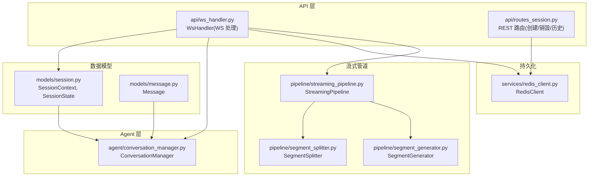
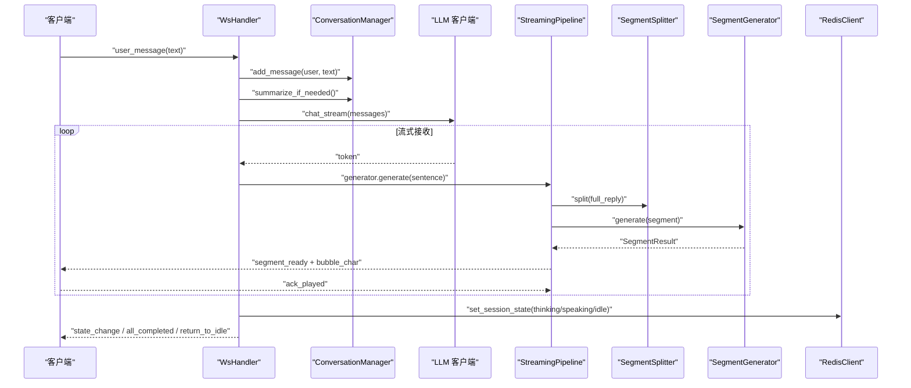
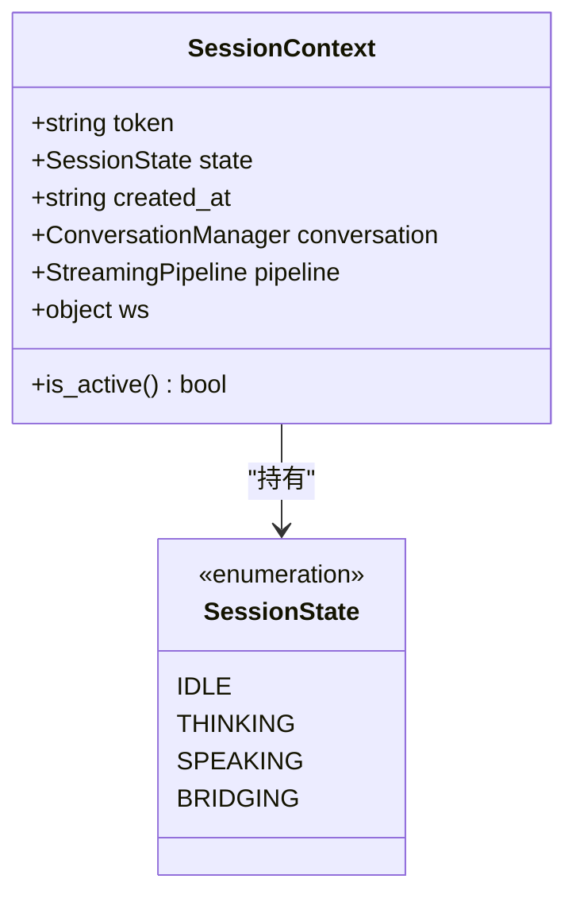
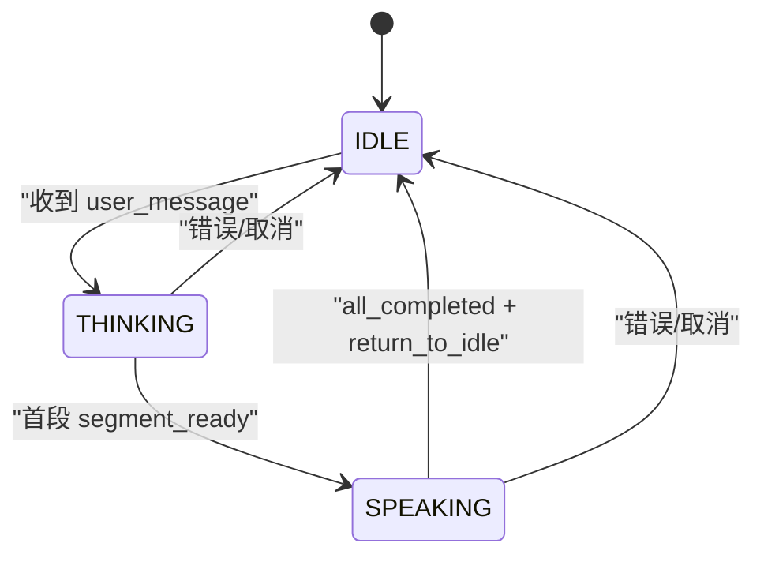
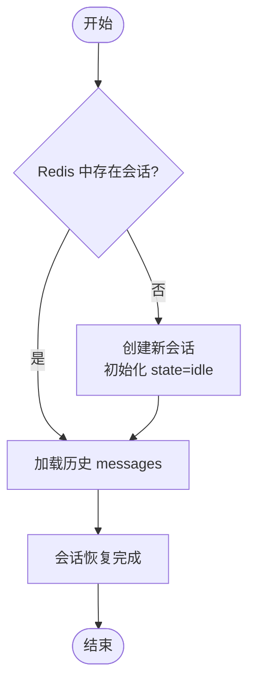
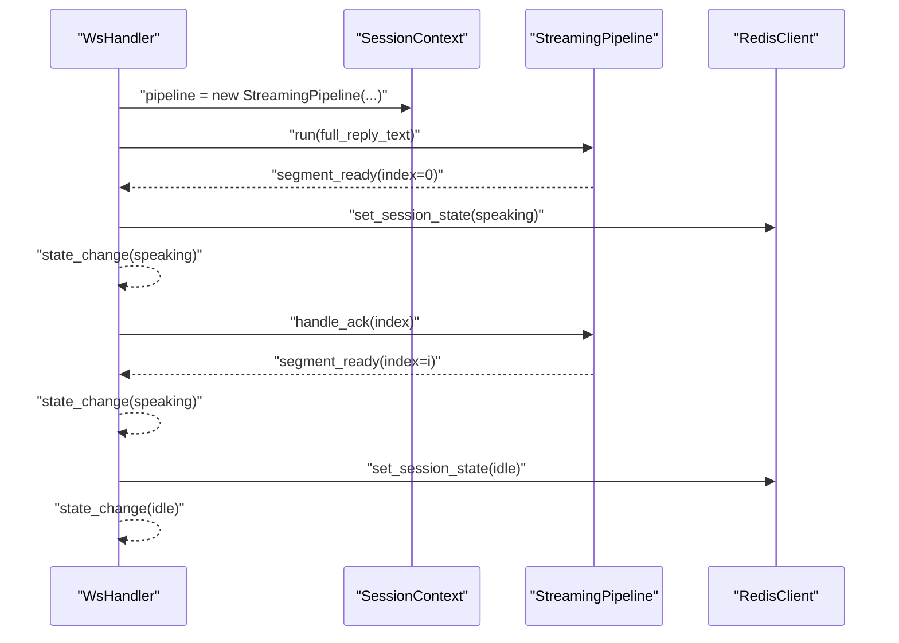
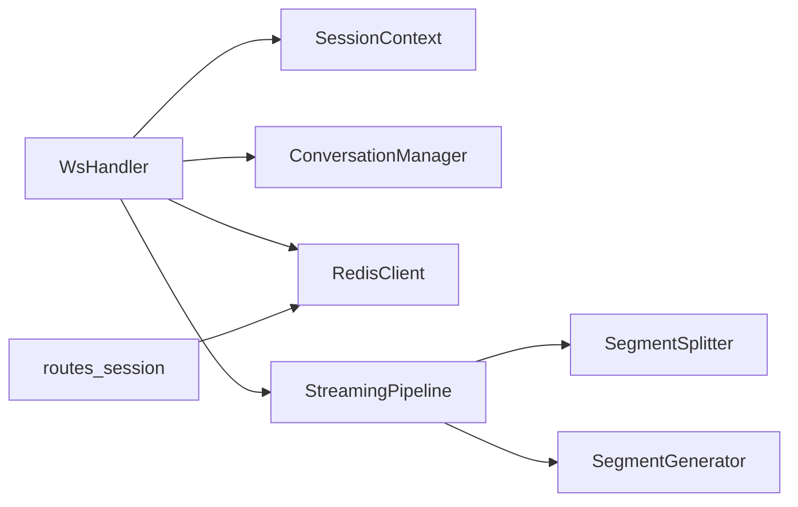

# 会话状态管理

<cite>
**本文引用的文件**
- [server/models/session.py](file://server/models/session.py)
- [server/agent/conversation_manager.py](file://server/agent/conversation_manager.py)
- [server/api/ws_handler.py](file://server/api/ws_handler.py)
- [server/services/redis_client.py](file://server/services/redis_client.py)
- [server/pipeline/streaming_pipeline.py](file://server/pipeline/streaming_pipeline.py)
- [server/pipeline/segment_splitter.py](file://server/pipeline/segment_splitter.py)
- [server/pipeline/segment_generator.py](file://server/pipeline/segment_generator.py)
- [server/models/message.py](file://server/models/message.py)
- [server/api/routes_session.py](file://server/api/routes_session.py)
</cite>

## 目录
1. [简介](#简介)
2. [项目结构](#项目结构)
3. [核心组件](#核心组件)
4. [架构总览](#架构总览)
5. [详细组件分析](#详细组件分析)
6. [依赖关系分析](#依赖关系分析)
7. [性能与并发](#性能与并发)
8. [故障排查指南](#故障排查指南)
9. [结论](#结论)
10. [附录：API 定义](#附录api-定义)

## 简介
本技术文档围绕“会话状态管理”展开，聚焦以下目标：
- 深入解释 SessionContext 数据结构设计（会话标识、WebSocket 引用、对话历史、Pipeline 引用、状态字段）
- 详细说明 SessionState 状态机设计（IDLE、THINKING、SPEAKING、BRIDGING）的转换条件与触发时机
- 文档化会话持久化机制（Redis 存储格式、会话恢复流程、状态同步策略）
- 解释会话与 Pipeline 的生命周期绑定关系（创建、管理与清理）
- 提供会话状态监控与调试方法（状态查询接口、日志记录规范）
- 说明并发访问控制与线程安全考虑

## 项目结构
与会话状态管理直接相关的代码分布在模型、Agent、API、服务与管道等模块中。下图给出与“会话状态管理”相关的关键文件与职责概览。

图表来源
- [server/models/session.py:1-41](file://server/models/session.py#L1-L41)
- [server/agent/conversation_manager.py:1-139](file://server/agent/conversation_manager.py#L1-L139)
- [server/api/ws_handler.py:1-444](file://server/api/ws_handler.py#L1-L444)
- [server/services/redis_client.py:1-122](file://server/services/redis_client.py#L1-L122)
- [server/pipeline/streaming_pipeline.py:1-214](file://server/pipeline/streaming_pipeline.py#L1-L214)
- [server/pipeline/segment_splitter.py:1-95](file://server/pipeline/segment_splitter.py#L1-L95)
- [server/pipeline/segment_generator.py:1-138](file://server/pipeline/segment_generator.py#L1-L138)
- [server/models/message.py:1-33](file://server/models/message.py#L1-L33)
- [server/api/routes_session.py:1-123](file://server/api/routes_session.py#L1-L123)

章节来源
- [server/models/session.py:1-41](file://server/models/session.py#L1-L41)
- [server/api/ws_handler.py:1-444](file://server/api/ws_handler.py#L1-L444)
- [server/services/redis_client.py:1-122](file://server/services/redis_client.py#L1-L122)
- [server/pipeline/streaming_pipeline.py:1-214](file://server/pipeline/streaming_pipeline.py#L1-L214)
- [server/api/routes_session.py:1-123](file://server/api/routes_session.py#L1-L123)

## 核心组件
- SessionContext：封装单个会话的上下文，包含 token、state、created_at、conversation、pipeline、ws 等字段，并提供 is_active() 判断是否处于活跃态。
- SessionState：枚举类型，表示会话播放状态（idle、thinking、speaking、bridging）。
- ConversationManager：维护单会话的消息历史、RAG 上下文注入、Token 溢出智能摘要、Redis 持久化加载与保存。
- RedisClient：封装 Redis 连接与会话状态、历史消息的存取、TTL 管理、会话存在性检查与删除。
- StreamingPipeline：负责将完整回复文本切分为段落，并行生成各段视频并基于 ack 确认逐段推送，同时驱动前端状态切换。
- SegmentSplitter：按中文标点分段，保证每段以完整句子结尾，满足最小阈值。
- SegmentGenerator：对单段执行 TTS → 语义分析 → FFmpeg 拼接 → MinIO 上传（失败回退本地），返回 SegmentResult。
- Message：消息数据模型，支持序列化到 Redis 与反序列化。

章节来源
- [server/models/session.py:14-41](file://server/models/session.py#L14-L41)
- [server/agent/conversation_manager.py:21-139](file://server/agent/conversation_manager.py#L21-L139)
- [server/services/redis_client.py:22-122](file://server/services/redis_client.py#L22-L122)
- [server/pipeline/streaming_pipeline.py:16-214](file://server/pipeline/streaming_pipeline.py#L16-L214)
- [server/pipeline/segment_splitter.py:18-95](file://server/pipeline/segment_splitter.py#L18-L95)
- [server/pipeline/segment_generator.py:16-138](file://server/pipeline/segment_generator.py#L16-L138)
- [server/models/message.py:9-33](file://server/models/message.py#L9-L33)

## 架构总览
下图展示 WebSocket 接入后，从用户消息到流式生成、逐段推送与状态同步的整体流程。

图表来源
- [server/api/ws_handler.py:130-341](file://server/api/ws_handler.py#L130-L341)
- [server/pipeline/streaming_pipeline.py:44-131](file://server/pipeline/streaming_pipeline.py#L44-L131)
- [server/pipeline/segment_splitter.py:31-76](file://server/pipeline/segment_splitter.py#L31-L76)
- [server/pipeline/segment_generator.py:42-138](file://server/pipeline/segment_generator.py#L42-L138)
- [server/services/redis_client.py:72-78](file://server/services/redis_client.py#L72-L78)

## 详细组件分析

### SessionContext 与 SessionState 设计
- SessionContext 字段说明
  - token：会话唯一标识（UUID）
  - state：当前会话状态（SessionState 枚举）
  - created_at：会话创建时间（UTC ISO 字符串）
  - conversation：ConversationManager 实例，管理该会话的对话历史与摘要
  - pipeline：当前活跃的 StreamingPipeline 实例（生成中时存在）
  - ws：当前连接的 WebSocket 引用（用于服务端主动关闭或事件推送）
  - is_active()：当 state != IDLE 时返回 True
- SessionState 枚举值
  - idle：空闲
  - thinking：思考（等待 LLM 响应）
  - speaking：说话（正在逐段推送音视频）
  - bridging：衔接（预留状态，当前实现未使用）

图表来源
- [server/models/session.py:14-41](file://server/models/session.py#L14-L41)

章节来源
- [server/models/session.py:14-41](file://server/models/session.py#L14-L41)

### 状态机设计与转换时序
- 初始状态：IDLE
- 进入 THINKING：收到 user_message 且校验通过，立即设置 state=thinking 并持久化到 Redis，推送 state_change(thinking)
- 进入 SPEAKING：首段 segment_ready 就绪后，推送 state_change(speaking)
- 回到 IDLE：全部完成(all_completed + return_to_idle)后，推送 state_change(idle)；或在错误/取消路径重置为 idle
- BRIDGING：当前实现未使用，可视为预留扩展点

图表来源
- [server/api/ws_handler.py:147-159](file://server/api/ws_handler.py#L147-L159)
- [server/api/ws_handler.py:302-333](file://server/api/ws_handler.py#L302-L333)
- [server/api/ws_handler.py:408-413](file://server/api/ws_handler.py#L408-L413)
- [server/api/ws_handler.py:426-443](file://server/api/ws_handler.py#L426-L443)

章节来源
- [server/api/ws_handler.py:147-159](file://server/api/ws_handler.py#L147-L159)
- [server/api/ws_handler.py:302-333](file://server/api/ws_handler.py#L302-L333)
- [server/api/ws_handler.py:408-413](file://server/api/ws_handler.py#L408-L413)
- [server/api/ws_handler.py:426-443](file://server/api/ws_handler.py#L426-L443)

### 会话持久化机制（Redis）
- 存储键约定
  - 会话状态：session:{token}:state
  - 对话历史：session:{token}:history
- 会话状态
  - set/get：写入/读取当前状态，带 TTL（由配置 session_ttl_hours 决定）
  - exists：判断会话是否存在（优先通过 state key 判定）
- 对话历史
  - save_message：追加一条消息到列表（JSON 序列化），并刷新 TTL
  - get_history：拉取完整历史，反序列化为 Message 列表
  - clear_history：清空历史
- 会话生命周期
  - refresh_ttl：刷新 state/history 两个 key 的过期时间
  - delete_session：删除 state/history 两个 key

图表来源
- [server/api/ws_handler.py:57-84](file://server/api/ws_handler.py#L57-L84)
- [server/services/redis_client.py:66-122](file://server/services/redis_client.py#L66-L122)

章节来源
- [server/services/redis_client.py:66-122](file://server/services/redis_client.py#L66-L122)
- [server/api/ws_handler.py:57-84](file://server/api/ws_handler.py#L57-L84)

### 会话与 Pipeline 的生命周期绑定
- 创建
  - 收到 user_message 时，若已有活跃 pipeline 则先 cancel 并置空
  - 新建 SegmentSplitter、SegmentGenerator、StreamingPipeline，并赋值给 session_ctx.pipeline
- 运行
  - 后台任务 _run_streaming_flow 启动流式 LLM 调用，边生成边创建段任务
  - 首段完成后立即推送 segment_ready，并将状态切换到 speaking
  - 后续段采用 ack 确认式推送，避免拥塞
- 清理
  - 用户 cancel 或异常路径：cancel pipeline，重置 state=idle，推送相应事件
  - REST 销毁接口：取消 pipeline、关闭 ws、清理 Redis、清理内存引用、异步清理 MinIO

图表来源
- [server/api/ws_handler.py:174-187](file://server/api/ws_handler.py#L174-L187)
- [server/api/ws_handler.py:302-333](file://server/api/ws_handler.py#L302-L333)
- [server/api/ws_handler.py:426-443](file://server/api/ws_handler.py#L426-L443)
- [server/pipeline/streaming_pipeline.py:44-131](file://server/pipeline/streaming_pipeline.py#L44-L131)

章节来源
- [server/api/ws_handler.py:174-187](file://server/api/ws_handler.py#L174-L187)
- [server/api/ws_handler.py:302-333](file://server/api/ws_handler.py#L302-L333)
- [server/api/ws_handler.py:426-443](file://server/api/ws_handler.py#L426-L443)
- [server/pipeline/streaming_pipeline.py:44-131](file://server/pipeline/streaming_pipeline.py#L44-L131)

### 对话历史与 Token 溢出摘要
- 每条消息添加后立即持久化到 Redis
- 估算 tokens（字符数 × 1.5），超过阈值时触发摘要：保留最近 N 条，早期内容压缩为 system 摘要
- 获取 messages_for_llm 时注入 system prompt、RAG 上下文、摘要与过滤后的历史

章节来源
- [server/agent/conversation_manager.py:39-95](file://server/agent/conversation_manager.py#L39-L95)
- [server/agent/conversation_manager.py:97-135](file://server/agent/conversation_manager.py#L97-L135)

### 分段与生成流水线
- SegmentSplitter：按中文标点拆分句子，累积至阈值形成段落，确保每段以完整句子结尾
- SegmentGenerator：单段生成流程（TTS → 语义分析 → FFmpeg 拼接 → MinIO 上传），支持 skip_llm_semantic 优化首段
- StreamingPipeline：统一调度分片与生成，首段就绪即推送，后续段按 ack 推进

章节来源
- [server/pipeline/segment_splitter.py:31-76](file://server/pipeline/segment_splitter.py#L31-L76)
- [server/pipeline/segment_generator.py:42-138](file://server/pipeline/segment_generator.py#L42-L138)
- [server/pipeline/streaming_pipeline.py:44-131](file://server/pipeline/streaming_pipeline.py#L44-L131)

## 依赖关系分析
- WsHandler 依赖：
  - SessionContext、SessionState（状态与上下文）
  - ConversationManager（对话历史与摘要）
  - RedisClient（状态与历史持久化）
  - StreamingPipeline（分段与推送）
  - SegmentSplitter、SegmentGenerator（分段与生成）
- REST 路由依赖：
  - RedisClient（会话创建/销毁/历史查询）
  - 全局 sessions 字典（内存上下文）

图表来源
- [server/api/ws_handler.py:1-444](file://server/api/ws_handler.py#L1-L444)
- [server/api/routes_session.py:1-123](file://server/api/routes_session.py#L1-L123)

章节来源
- [server/api/ws_handler.py:1-444](file://server/api/ws_handler.py#L1-L444)
- [server/api/routes_session.py:1-123](file://server/api/routes_session.py#L1-L123)

## 性能与并发
- 并发模型
  - 基于 asyncio 的事件循环，所有 I/O 均为异步
  - 流式 LLM 调用与段生成并行进行，首段优先推送以降低端到端延迟
- 资源占用
  - 每个会话一个 ConversationManager 与可能的 StreamingPipeline 实例
  - 段生成任务在后台并发执行，注意系统 CPU/磁盘/网络瓶颈
- 限流与背压
  - 通过 ack 机制控制推送节奏，避免前端过载
  - 首段跳过 LLM 语义分析，减少首帧等待时间
- 建议
  - 合理设置分段阈值与最大并发任务数
  - 监控 Redis/TTS/MinIO 的延迟与错误率
  - 对长对话启用摘要，降低 LLM 输入长度

[本节为通用指导，不直接分析具体文件]

## 故障排查指南
- 常见问题定位
  - 会话不存在：检查 Redis 中是否存在 state key，或 REST 创建是否成功
  - 状态不同步：核对 Redis 中的 state 与内存 state 是否一致
  - 段推送失败：查看 WebSocket 推送日志与前端 ack 是否到达
  - MinIO 上传失败：确认上传失败回退逻辑与本地路径可用性
- 关键日志位置
  - WsHandler：用户消息处理、状态变更、错误与取消
  - StreamingPipeline：分段数量、首段就绪、错误与取消
  - SegmentGenerator：TTS、语义分析、拼接、上传结果
  - RedisClient：连接、读写、TTL 刷新
- 诊断步骤
  - 通过 REST 查询历史与状态
  - 观察 WebSocket 事件序列（connected → thinking → segment_ready → speaking → all_completed → idle）
  - 检查 Redis 键空间（session:*:state、session:*:history）

章节来源
- [server/api/ws_handler.py:130-341](file://server/api/ws_handler.py#L130-L341)
- [server/pipeline/streaming_pipeline.py:127-131](file://server/pipeline/streaming_pipeline.py#L127-L131)
- [server/pipeline/segment_generator.py:108-138](file://server/pipeline/segment_generator.py#L108-L138)
- [server/services/redis_client.py:31-50](file://server/services/redis_client.py#L31-L50)

## 结论
本方案通过 SessionContext 与 SessionState 明确表达会话上下文与状态，结合 ConversationManager 与 Redis 实现会话历史与状态的持久化与恢复。StreamingPipeline 与分段器/生成器协同，实现了低延迟的首段推送与稳定的 ack 背压机制。整体架构清晰、可扩展性强，适合实时语音/视频交互场景。

[本节为总结，不直接分析具体文件]

## 附录：API 定义
- 创建会话
  - POST /api/session/create
  - 返回：{ "session_token": "uuid-string" }
  - 行为：在 Redis 中初始化 state=idle
- 获取历史
  - GET /api/session/{token}/history
  - 返回：{ "messages": [...], "count": int }
  - 行为：从 Redis 拉取历史消息
- 销毁会话
  - DELETE /api/session/{token}
  - 返回：{ "status": "deleted", "session_token": "uuid-string" }
  - 行为：取消 pipeline、关闭 ws、清理 Redis、清理内存、异步清理 MinIO

章节来源
- [server/api/routes_session.py:28-47](file://server/api/routes_session.py#L28-L47)
- [server/api/routes_session.py:50-72](file://server/api/routes_session.py#L50-L72)
- [server/api/routes_session.py:75-123](file://server/api/routes_session.py#L75-L123)