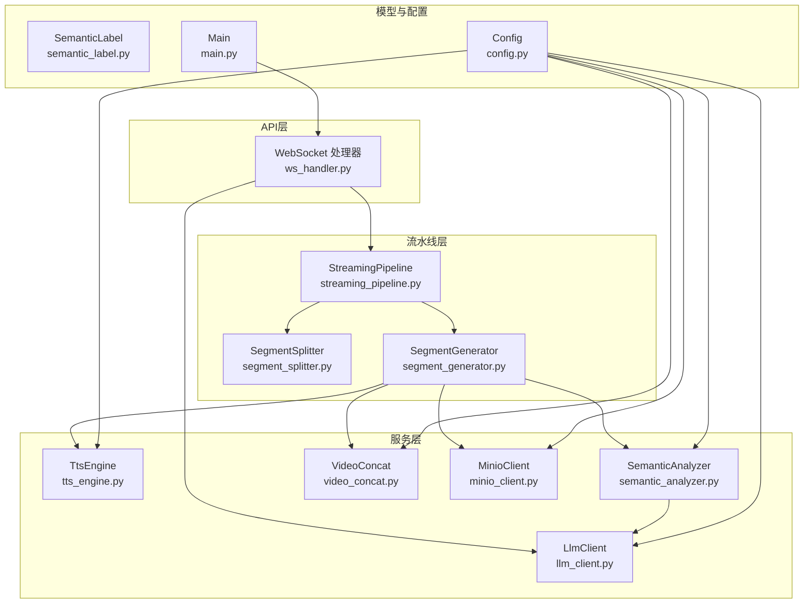
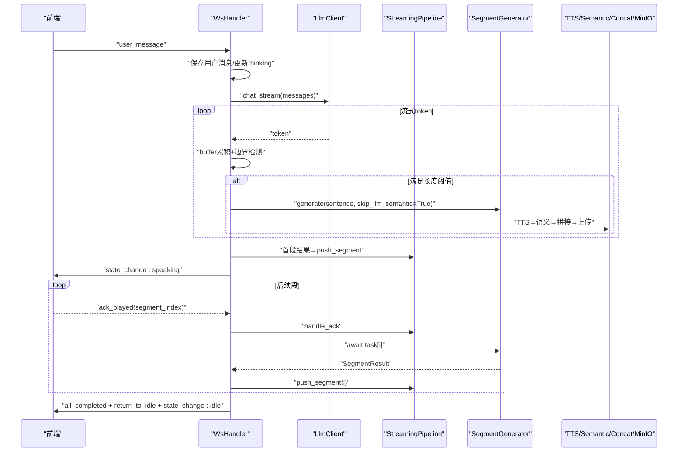
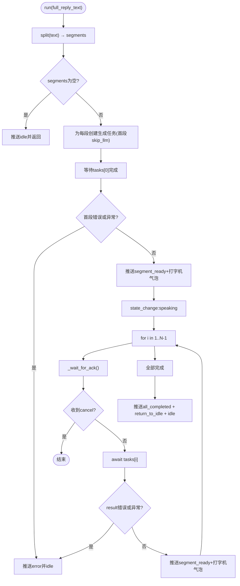
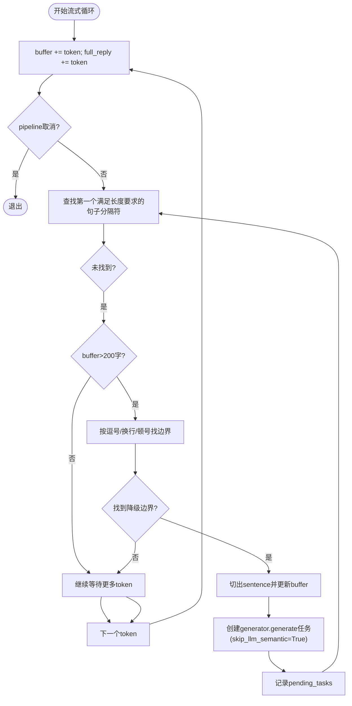
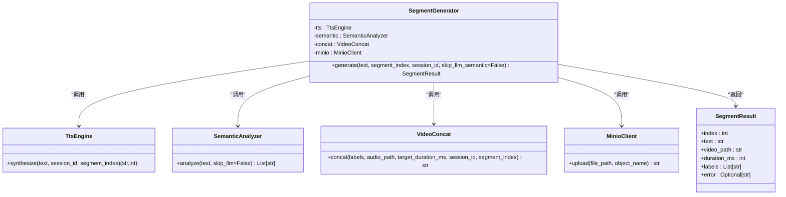
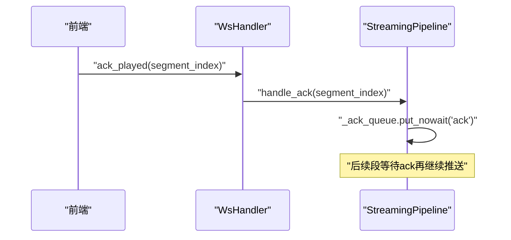
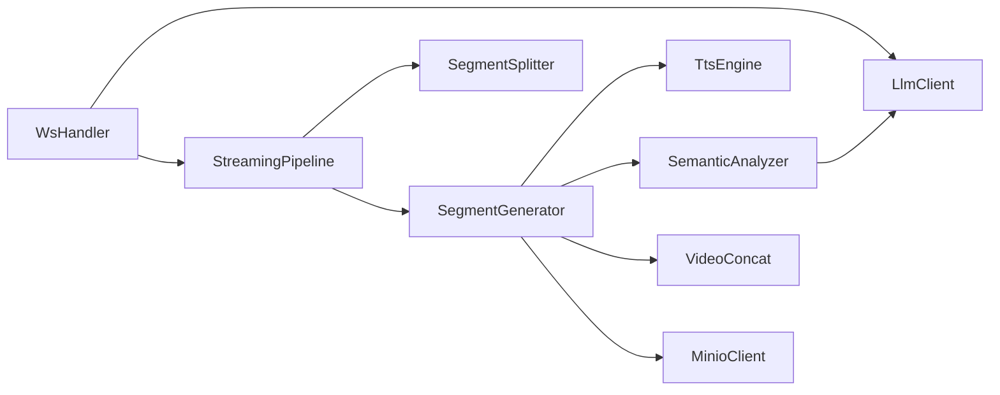

# 流式处理机制

<cite>
**本文引用的文件**   
- [server/pipeline/streaming_pipeline.py](file://server/pipeline/streaming_pipeline.py)
- [server/pipeline/segment_generator.py](file://server/pipeline/segment_generator.py)
- [server/pipeline/segment_splitter.py](file://server/pipeline/segment_splitter.py)
- [server/api/ws_handler.py](file://server/api/ws_handler.py)
- [server/services/tts_engine.py](file://server/services/tts_engine.py)
- [server/services/semantic_analyzer.py](file://server/services/semantic_analyzer.py)
- [server/services/video_concat.py](file://server/services/video_concat.py)
- [server/services/minio_client.py](file://server/services/minio_client.py)
- [server/models/semantic_label.py](file://server/models/semantic_label.py)
- [server/services/llm_client.py](file://server/services/llm_client.py)
- [server/config.py](file://server/config.py)
- [server/main.py](file://server/main.py)
</cite>

## 目录
1. [简介](#简介)
2. [项目结构](#项目结构)
3. [核心组件](#核心组件)
4. [架构总览](#架构总览)
5. [详细组件分析](#详细组件分析)
6. [依赖关系分析](#依赖关系分析)
7. [性能考虑](#性能考虑)
8. [故障诊断与监控](#故障诊断与监控)
9. [结论](#结论)

## 简介
本技术文档围绕实时对话系统中的“流式处理机制”展开，重点解析 StreamingPipeline 的分段生成、并行任务调度与确认式推送；深入说明流式 LLM 响应处理中的文本缓冲、句子边界检测与动态分段算法；文档化 SegmentGenerator 的异步执行流程（TTS 合成、语义分析、视频拼接、MinIO 上传）；解释确认式推送的实现细节（ack 等待、段索引管理、错误重试策略）；并提供性能优化技巧（任务优先级、内存管理与资源回收）以及监控指标与故障诊断方法。

## 项目结构
与流式处理相关的核心代码位于 server/pipeline、server/api、server/services 等目录：
- pipeline：流式分段引擎、分段器、单段生成器
- api：WebSocket 处理器，负责消息路由、状态同步与 ack 转发
- services：TTS、语义分析、视频拼接、对象存储客户端、LLM 客户端
- models：语义标签定义与校验规则
- config：配置加载与合并
- main：应用启动、生命周期管理、WS 端点注册

图表来源
- [server/api/ws_handler.py:1-444](file://server/api/ws_handler.py#L1-L444)
- [server/pipeline/streaming_pipeline.py:1-214](file://server/pipeline/streaming_pipeline.py#L1-L214)
- [server/pipeline/segment_splitter.py:1-95](file://server/pipeline/segment_splitter.py#L1-L95)
- [server/pipeline/segment_generator.py:1-138](file://server/pipeline/segment_generator.py#L1-L138)
- [server/services/tts_engine.py:1-234](file://server/services/tts_engine.py#L1-L234)
- [server/services/semantic_analyzer.py:1-126](file://server/services/semantic_analyzer.py#L1-L126)
- [server/services/video_concat.py:1-174](file://server/services/video_concat.py#L1-L174)
- [server/services/minio_client.py:1-139](file://server/services/minio_client.py#L1-L139)
- [server/services/llm_client.py:1-204](file://server/services/llm_client.py#L1-L204)
- [server/models/semantic_label.py:1-80](file://server/models/semantic_label.py#L1-L80)
- [server/config.py:1-260](file://server/config.py#L1-L260)
- [server/main.py:1-191](file://server/main.py#L1-L191)

章节来源
- [server/main.py:146-170](file://server/main.py#L146-L170)
- [server/api/ws_handler.py:31-128](file://server/api/ws_handler.py#L31-L128)

## 核心组件
- StreamingPipeline：接收完整回复文本或流式片段，分句切段，并行生成所有段，首段就绪立即推送，后续按 ack 逐段推送，完成后回到 idle。
- SegmentSplitter：按中文标点将文本切分为段落，支持阈值控制与尾段处理。
- SegmentGenerator：单段生成器，顺序执行 TTS → 语义分析 → FFmpeg 拼接 → MinIO 上传，异常统一封装为 SegmentResult.error。
- WsHandler：WebSocket 消息路由，维护会话上下文，处理用户消息、ack_played、cancel，并驱动流式 LLM 与 Pipeline。
- TtsEngine：DashScope TTS 客户端，支持并发限制、长文本拆分与拼接。
- SemanticAnalyzer：基于 LLM 或关键词回退的语义分析，输出标签序列。
- VideoConcat：根据标签选择切片，构建 concat 列表，调用 FFmpeg 混音输出 webm。
- MinioClient：对象存储上传、存在性检查、预签名 URL 生成。
- LlmClient：OpenAI 兼容 Chat Completions 接口，提供 chat 与 chat_stream。
- SemanticLabel：标签枚举与过渡规则验证。
- Config：配置加载与合并，环境变量覆盖 JSON 配置。

章节来源
- [server/pipeline/streaming_pipeline.py:16-131](file://server/pipeline/streaming_pipeline.py#L16-L131)
- [server/pipeline/segment_splitter.py:25-76](file://server/pipeline/segment_splitter.py#L25-L76)
- [server/pipeline/segment_generator.py:27-138](file://server/pipeline/segment_generator.py#L27-L138)
- [server/api/ws_handler.py:130-341](file://server/api/ws_handler.py#L130-L341)
- [server/services/tts_engine.py:38-226](file://server/services/tts_engine.py#L38-L226)
- [server/services/semantic_analyzer.py:35-126](file://server/services/semantic_analyzer.py#L35-L126)
- [server/services/video_concat.py:20-149](file://server/services/video_concat.py#L20-L149)
- [server/services/minio_client.py:21-139](file://server/services/minio_client.py#L21-L139)
- [server/services/llm_client.py:23-204](file://server/services/llm_client.py#L23-L204)
- [server/models/semantic_label.py:8-80](file://server/models/semantic_label.py#L8-L80)
- [server/config.py:148-260](file://server/config.py#L148-L260)

## 架构总览
整体数据与控制流如下：
- 前端通过 WebSocket 发送 user_message，WsHandler 保存用户消息、更新状态为 thinking，并启动后台流式处理。
- LLM 以流式返回 token，WsHandler 在收到足够长度的句子时创建 SegmentGenerator.generate 任务（skip_llm_semantic=True）。
- 首段完成即推送 segment_ready 与打字机气泡，随后进入 speaking 状态。
- 后续段等待前端 ack_played 后再推送，避免播放卡顿或重复。
- 全部完成后推送 all_completed 与 return_to_idle，最终 state_change 到 idle。

图表来源
- [server/api/ws_handler.py:189-341](file://server/api/ws_handler.py#L189-L341)
- [server/pipeline/streaming_pipeline.py:44-131](file://server/pipeline/streaming_pipeline.py#L44-L131)
- [server/pipeline/segment_generator.py:42-138](file://server/pipeline/segment_generator.py#L42-L138)
- [server/services/tts_engine.py:49-226](file://server/services/tts_engine.py#L49-L226)
- [server/services/semantic_analyzer.py:41-126](file://server/services/semantic_analyzer.py#L41-L126)
- [server/services/video_concat.py:30-149](file://server/services/video_concat.py#L30-L149)
- [server/services/minio_client.py:69-139](file://server/services/minio_client.py#L69-L139)

## 详细组件分析

### StreamingPipeline 设计与实现
- 输入：完整回复文本或流式聚合后的文本。
- 分段：使用 SegmentSplitter.split 按中文标点切分，阈值默认 50 字。
- 并行生成：为每个段创建 asyncio.ensure_future(generator.generate(...))，首段跳过 LLM 语义分析以提升首帧速度。
- 首段优先：等待 tasks[0] 完成后立即推送 segment_ready 与打字机气泡，同时设置 state=speaking。
- 确认式推送：对 i=1..N-1，先 await _wait_for_ack()，再获取 result 并推送；若收到 cancel 则中断。
- 完成收尾：推送 all_completed、return_to_idle、state_change=idle。
- 错误处理：任何阶段异常均推送 error 事件并回到 idle。

图表来源
- [server/pipeline/streaming_pipeline.py:44-131](file://server/pipeline/streaming_pipeline.py#L44-L131)
- [server/pipeline/segment_splitter.py:31-76](file://server/pipeline/segment_splitter.py#L31-L76)

章节来源
- [server/pipeline/streaming_pipeline.py:16-214](file://server/pipeline/streaming_pipeline.py#L16-L214)

### 流式 LLM 响应处理：文本缓冲、句子边界检测与动态分段
- 文本缓冲：WsHandler._run_streaming_flow 维护 buffer 与 full_reply，逐 token 追加。
- 句子边界检测：优先查找句号、问号、感叹号、分号；当 buffer 过长（>200 字）且无强标点时，降级按逗号、换行、顿号分割，确保最小长度≥25 字。
- 动态分段：一旦检测到边界，立即从 buffer 中切出句子，创建 generator.generate 任务（skip_llm_semantic=True），并记录 pending_tasks。
- 剩余处理：LLM 结束后，若仍有 buffer，作为末段生成任务。
- 首段优先与确认式推送：与 StreamingPipeline 一致，首段完成后立即推送，后续按 ack 推进。

图表来源
- [server/api/ws_handler.py:214-277](file://server/api/ws_handler.py#L214-L277)

章节来源
- [server/api/ws_handler.py:189-341](file://server/api/ws_handler.py#L189-L341)

### SegmentGenerator 工作流程：TTS → 语义分析 → 视频拼接 → MinIO 上传
- TTS 合成：调用 TtsEngine.synthesize，内部包含并发信号量限制、长文本拆分与 FFmpeg 拼接逻辑，返回音频路径与时长估算。
- 语义分析：调用 SemanticAnalyzer.analyze，首段优化 skip_llm_semantic=True 走关键词回退，否则调用 LLM 并解析标签序列。
- 视频拼接：调用 VideoConcat.concat，根据 labels 选择切片，构建 concat 列表，调用 FFmpeg 混音输出 webm。
- MinIO 上传：尝试上传至对象存储，失败则回退本地路径，保证可用性。
- 异常处理：捕获 TTS、拼接、通用异常，返回 SegmentResult.error 供上层统一处理。

图表来源
- [server/pipeline/segment_generator.py:16-138](file://server/pipeline/segment_generator.py#L16-L138)
- [server/services/tts_engine.py:38-226](file://server/services/tts_engine.py#L38-L226)
- [server/services/semantic_analyzer.py:35-126](file://server/services/semantic_analyzer.py#L35-L126)
- [server/services/video_concat.py:20-149](file://server/services/video_concat.py#L20-L149)
- [server/services/minio_client.py:21-139](file://server/services/minio_client.py#L21-L139)

章节来源
- [server/pipeline/segment_generator.py:27-138](file://server/pipeline/segment_generator.py#L27-L138)

### 确认式推送机制：ack 等待、段索引管理与错误重试策略
- ack 队列：StreamingPipeline 维护 _ack_queue，前端发送 ack_played 后由 WsHandler.handle_ack 入队。
- 等待逻辑：_wait_for_ack 先尝试非阻塞超时 0.5s，若无 ack 则阻塞等待，期间不推送 play_analysis，避免打断说话形象。
- 段索引管理：WsHandler 在 pending_tasks 中记录 (segment_index, task)，推送时使用对应 index。
- 错误重试策略：当前实现未在段级别进行自动重试，遇到错误直接推送 error 并终止后续推送；可在未来扩展为指数退避重试与熔断。

图表来源
- [server/pipeline/streaming_pipeline.py:199-214](file://server/pipeline/streaming_pipeline.py#L199-L214)
- [server/api/ws_handler.py:415-425](file://server/api/ws_handler.py#L415-L425)

章节来源
- [server/pipeline/streaming_pipeline.py:172-214](file://server/pipeline/streaming_pipeline.py#L172-L214)
- [server/api/ws_handler.py:415-425](file://server/api/ws_handler.py#L415-L425)

### 语义分析与标签过渡规则
- 标签集合：greeting、introduction、explaining、listing、emphasis、example、analysis、comparison、transition、conclusion、thanks。
- 过渡规则：opening → body → closing，validate_labels 会过滤无效标签并按顺序重排，确保 analysis 可用。
- 回退策略：当 LLM 调用失败或解析失败时，使用关键词匹配快速生成标签序列。

章节来源
- [server/models/semantic_label.py:8-80](file://server/models/semantic_label.py#L8-L80)
- [server/services/semantic_analyzer.py:41-126](file://server/services/semantic_analyzer.py#L41-L126)

## 依赖关系分析
- 模块耦合：
  - WsHandler 依赖 LlmClient、AgentEngine、Redis、MinioClient、Pipeline 相关组件。
  - StreamingPipeline 依赖 SegmentSplitter 与 SegmentGenerator。
  - SegmentGenerator 依赖 TTS、语义分析、视频拼接、MinIO。
- 外部依赖：
  - LLM API（OpenAI 兼容）、DashScope TTS、FFmpeg、MinIO、Qdrant（RAG）、Embedding 服务。
- 潜在环依赖：未发现直接循环导入；各服务通过构造函数注入，降低耦合度。

图表来源
- [server/api/ws_handler.py:1-444](file://server/api/ws_handler.py#L1-L444)
- [server/pipeline/streaming_pipeline.py:1-214](file://server/pipeline/streaming_pipeline.py#L1-L214)
- [server/pipeline/segment_generator.py:1-138](file://server/pipeline/segment_generator.py#L1-L138)
- [server/services/semantic_analyzer.py:1-126](file://server/services/semantic_analyzer.py#L1-L126)
- [server/services/tts_engine.py:1-234](file://server/services/tts_engine.py#L1-L234)
- [server/services/video_concat.py:1-174](file://server/services/video_concat.py#L1-L174)
- [server/services/minio_client.py:1-139](file://server/services/minio_client.py#L1-L139)
- [server/services/llm_client.py:1-204](file://server/services/llm_client.py#L1-L204)

章节来源
- [server/main.py:146-170](file://server/main.py#L146-L170)
- [server/api/ws_handler.py:31-128](file://server/api/ws_handler.py#L31-L128)

## 性能考虑
- 任务优先级与首段优化：
  - 首段跳过 LLM 语义分析，显著减少首帧延迟（节省数秒）。
  - 首段完成后立即推送，提升用户体验。
- 并发控制：
  - TTS 全局信号量限制并发请求，避免 429 限流。
  - 多段生成任务并行启动，充分利用 I/O 并发。
- 内存与资源管理：
  - 工作目录 _work/{session_id} 用于临时文件，建议定期清理。
  - FFmpeg concat 列表与临时 MP3 文件在成功后删除。
  - 长文本 TTS 拆分后拼接，避免单次过大请求。
- 网络与超时：
  - LLM/TTS/MinIO 均设置合理超时与重试策略（部分场景）。
  - 流式 LLM 使用 SSE 逐 token 产出，降低端到端延迟。
- 可扩展优化：
  - 引入任务优先级队列，优先处理短段或高价值段。
  - 增加段级重试与熔断，提高鲁棒性。
  - 缓存常用标签映射，减少重复计算。

[本节为通用指导，无需具体文件引用]

## 故障诊断与监控
- 关键日志位置：
  - Pipeline 运行日志：分段数量、首段就绪、错误信息。
  - Generator 步骤日志：TTS 开始/完成、语义分析、拼接、上传。
  - TTS 错误：提交失败、轮询失败、下载失败、超时。
  - 视频拼接错误：FFmpeg 执行失败、找不到可执行文件、超时。
  - MinIO 错误：不可用、上传失败、对象不存在。
  - LLM 错误：流式请求失败、超时、连接错误、限流。
- 常见错误与定位：
  - TTS 429 限流：检查并发信号量与重试间隔。
  - FFmpeg 缺失或路径错误：确认 ffmpeg 安装与配置。
  - MinIO 不可用：检查 endpoint、access_key、secret_key、bucket 权限。
  - LLM 流式断开：检查网络与 API Key，关注超时与重试。
- 监控指标建议：
  - 首段延迟（从首 token 到 segment_ready）。
  - 平均段生成耗时（TTS、语义、拼接、上传）。
  - 端到端延迟（用户消息到 state_change:idle）。
  - 错误率（按模块统计：TTS、Concat、MinIO、LLM）。
  - 并发度（TTS 并发、段生成任务数）。
  - 资源占用（CPU、内存、磁盘 IO）。
- 健康检查：
  - /api/health 返回 Redis 连接状态与会话数量。
  - 服务关闭时清理活跃 Pipeline 与 WebSocket。

章节来源
- [server/main.py:136-143](file://server/main.py#L136-L143)
- [server/services/tts_engine.py:100-167](file://server/services/tts_engine.py#L100-L167)
- [server/services/video_concat.py:116-149](file://server/services/video_concat.py#L116-L149)
- [server/services/minio_client.py:69-139](file://server/services/minio_client.py#L69-L139)
- [server/services/llm_client.py:115-190](file://server/services/llm_client.py#L115-L190)

## 结论
该流式处理机制通过“流式 LLM + 动态分段 + 并行生成 + 确认式推送”的组合，实现了低延迟、高吞吐的实时对话体验。首段优化与 ack 机制有效平衡了速度与稳定性；TTS 并发控制与长文本拆分提升了鲁棒性；MinIO 回退与 FFmpeg 拼接保障了可用性。建议在后续迭代中引入段级重试、任务优先级与更完善的监控指标，进一步提升系统可靠性与可观测性。