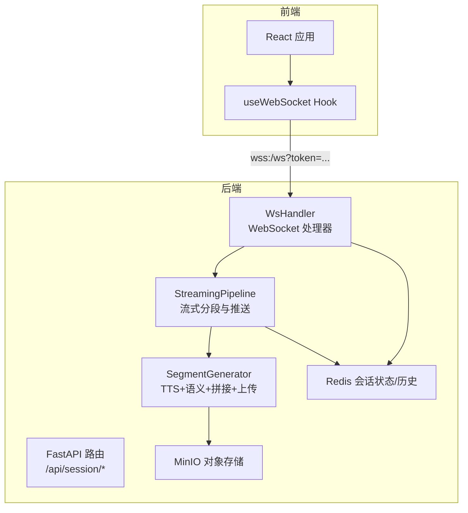
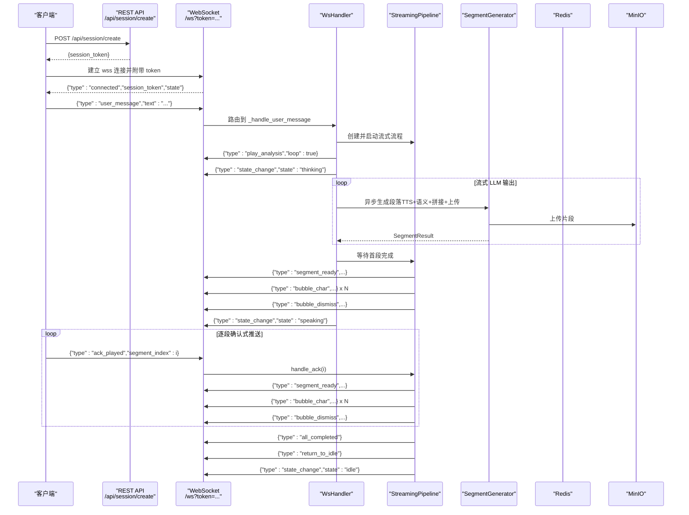
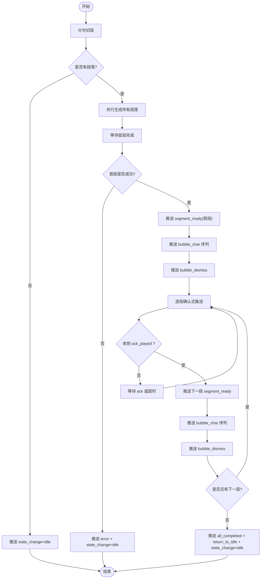
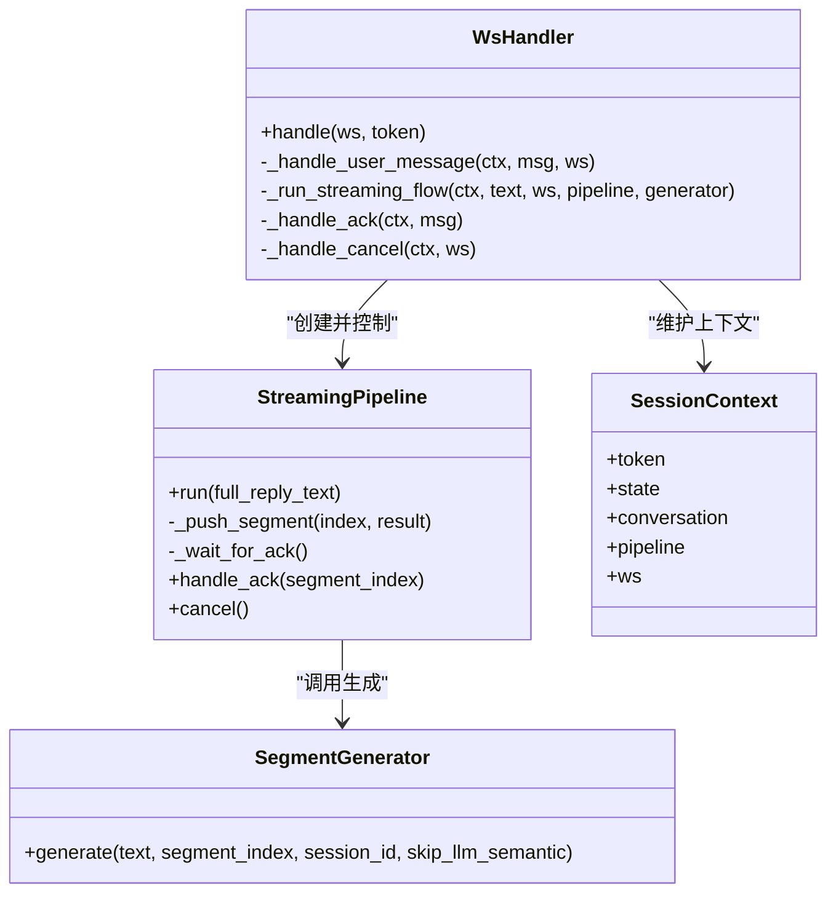

# 消息协议

<cite>
**本文引用的文件**   
- [ws_handler.py](file://server/api/ws_handler.py)
- [streaming_pipeline.py](file://server/pipeline/streaming_pipeline.py)
- [segment_generator.py](file://server/pipeline/segment_generator.py)
- [session.py](file://server/models/session.py)
- [useWebSocket.ts](file://client/src/hooks/useWebSocket.ts)
- [events.ts](file://client/src/types/events.ts)
- [routes_session.py](file://server/api/routes_session.py)
- [test_ws.py](file://deploy/test_ws.py)
</cite>

## 目录
1. [简介](#简介)
2. [项目结构](#项目结构)
3. [核心组件](#核心组件)
4. [架构总览](#架构总览)
5. [详细组件分析](#详细组件分析)
6. [依赖关系分析](#依赖关系分析)
7. [性能考虑](#性能考虑)
8. [故障排查指南](#故障排查指南)
9. [结论](#结论)
10. [附录：消息规范与示例](#附录消息规范与示例)

## 简介
本文件为实时对话系统的 WebSocket 消息协议技术文档，覆盖客户端到服务端、服务端到客户端的消息格式、字段说明、使用场景、交互时序、验证规则、错误处理机制与兼容性建议。文档同时提供完整消息示例与客户端实现参考路径，帮助前后端开发者快速集成与联调。

## 项目结构
本项目采用前后端分离架构：
- 前端（React + TypeScript）通过 useWebSocket Hook 管理连接、自动重连、发送消息与接收事件。
- 后端（FastAPI）通过 WsHandler 处理连接生命周期、鉴权与会话恢复、消息路由与流式生成流程。
- 流式分段引擎 StreamingPipeline 负责将 LLM 输出切分为段落，按“首段就绪即推、后续逐段确认”的模式推送视频片段与打字机气泡。

图表来源
- [ws_handler.py:1-444](file://server/api/ws_handler.py#L1-L444)
- [streaming_pipeline.py:1-214](file://server/pipeline/streaming_pipeline.py#L1-L214)
- [segment_generator.py:1-138](file://server/pipeline/segment_generator.py#L1-L138)
- [routes_session.py:1-123](file://server/api/routes_session.py#L1-L123)

章节来源
- [ws_handler.py:1-444](file://server/api/ws_handler.py#L1-L444)
- [useWebSocket.ts:1-190](file://client/src/hooks/useWebSocket.ts#L1-L190)
- [events.ts:1-113](file://client/src/types/events.ts#L1-L113)
- [routes_session.py:1-123](file://server/api/routes_session.py#L1-L123)

## 核心组件
- 客户端消息类型
  - user_message：用户输入文本，触发一次完整的流式回复流程。
  - ack_played：播放确认，通知服务端当前片段已播放完成，允许继续推送下一段。
  - cancel：取消命令，中断正在进行的流式生成与播放。
- 服务端事件类型
  - connected：连接成功，携带 session_token 与当前 state。
  - state_change：状态变更，如 thinking/speaking/idle/bridging。
  - segment_ready：片段就绪，包含 video_url、duration_ms、text 等。
  - bubble_char / bubble_dismiss：打字机气泡字符与消失事件。
  - play_analysis：衔接动画提示（例如循环手势），用于段间过渡。
  - all_completed：全部片段完成。
  - return_to_idle：回到待机状态的指令。
  - error：错误信息，包含 message 字段。

章节来源
- [events.ts:15-92](file://client/src/types/events.ts#L15-L92)
- [ws_handler.py:89-120](file://server/api/ws_handler.py#L89-L120)
- [streaming_pipeline.py:132-171](file://server/pipeline/streaming_pipeline.py#L132-L171)

## 架构总览
下图展示从创建会话到流式播放的端到端时序。

图表来源
- [routes_session.py:28-47](file://server/api/routes_session.py#L28-L47)
- [ws_handler.py:49-120](file://server/api/ws_handler.py#L49-L120)
- [ws_handler.py:130-188](file://server/api/ws_handler.py#L130-L188)
- [streaming_pipeline.py:44-131](file://server/pipeline/streaming_pipeline.py#L44-L131)
- [segment_generator.py:42-106](file://server/pipeline/segment_generator.py#L42-L106)

## 详细组件分析

### 客户端消息定义与校验
- user_message
  - 字段：type="user_message"；text 为非空字符串。
  - 行为：若 text 为空，服务端返回 error 并拒绝处理。
  - 场景：用户输入后进入思考→说话→完成的完整流程。
- ack_played
  - 字段：type="ack_played"；segment_index 为整数。
  - 行为：服务端收到后推进 pipeline 的确认队列，允许推送下一段。
  - 场景：前端每播放完一个片段后发送一次。
- cancel
  - 字段：type="cancel"。
  - 行为：服务端取消当前 pipeline，重置状态为 idle，并推送相应事件。
  - 场景：用户主动中断或切换对话时。

校验规则
- JSON 格式必须合法，否则服务端返回 error 且 message 指出格式错误。
- type 字段必须匹配已知类型，未知类型将被忽略并记录警告日志。
- user_message.text 不能为空。

章节来源
- [events.ts:15-31](file://client/src/types/events.ts#L15-L31)
- [ws_handler.py:97-120](file://server/api/ws_handler.py#L97-L120)
- [ws_handler.py:130-146](file://server/api/ws_handler.py#L130-L146)

### 服务端事件定义与校验
- connected
  - 字段：type="connected"；session_token 为字符串；state 为当前会话状态。
  - 行为：连接成功后立即推送，供前端初始化 UI 状态。
- state_change
  - 字段：type="state_change"；state ∈ {"thinking","speaking","bridging","idle"}。
  - 行为：在关键阶段切换时推送，驱动前端状态机。
- segment_ready
  - 字段：type="segment_ready"；index 为段落序号；video_url 为可访问地址；duration_ms 为时长毫秒；text 为对应文本。
  - 行为：表示该段落已就绪，前端应开始播放。
- bubble_char / bubble_dismiss
  - 字段：type="bubble_char"；char 为单字；segment_index 为段落序号。
  - 字段：type="bubble_dismiss"；segment_index 为段落序号。
  - 行为：实现打字机效果，先逐字推送，最后推送消失。
- play_analysis
  - 字段：type="play_analysis"；loop 为布尔值。
  - 行为：用于段间衔接动画提示（如循环手势）。
- all_completed
  - 字段：type="all_completed"。
  - 行为：所有段落均已推送完毕。
- return_to_idle
  - 字段：type="return_to_idle"。
  - 行为：指示前端回到待机态。
- error
  - 字段：type="error"；message 为错误描述。
  - 行为：发生异常或业务错误时推送，通常伴随 state_change→idle。

校验规则
- 所有事件均为 JSON 对象，必须包含 type 字段。
- 各事件需包含其必需字段，缺失时应视为非法事件，前端应忽略并记录日志。
- state 取值严格遵循枚举，避免未知状态导致 UI 异常。

章节来源
- [events.ts:33-92](file://client/src/types/events.ts#L33-L92)
- [ws_handler.py:89-95](file://server/api/ws_handler.py#L89-L95)
- [ws_handler.py:152-159](file://server/api/ws_handler.py#L152-L159)
- [streaming_pipeline.py:132-171](file://server/pipeline/streaming_pipeline.py#L132-L171)
- [streaming_pipeline.py:185-197](file://server/pipeline/streaming_pipeline.py#L185-L197)

### 流式分段与确认式推送流程
- 首段优化：首段跳过 LLM 语义分析，直接基于关键词回退，减少延迟。
- 并行生成：后台并发生成多个段落，但推送采用“首段就绪即推，后续逐段确认”。
- 打字机效果：根据 duration_ms 计算字符间隔，限制最大间隔与总时长比例。
- 取消机制：支持随时取消，取消后会清理任务并返回 idle。

图表来源
- [streaming_pipeline.py:44-131](file://server/pipeline/streaming_pipeline.py#L44-L131)
- [streaming_pipeline.py:132-171](file://server/pipeline/streaming_pipeline.py#L132-L171)
- [streaming_pipeline.py:172-214](file://server/pipeline/streaming_pipeline.py#L172-L214)

章节来源
- [streaming_pipeline.py:44-131](file://server/pipeline/streaming_pipeline.py#L44-L131)
- [streaming_pipeline.py:132-171](file://server/pipeline/streaming_pipeline.py#L132-L171)
- [streaming_pipeline.py:172-214](file://server/pipeline/streaming_pipeline.py#L172-L214)

### 错误处理与状态复位
- 连接层错误：JSON 解析失败、未知消息类型、无效 token 等，均会返回 error 或关闭连接。
- 业务层错误：LLM 调用失败、TTS/拼接/上传异常等，统一推送 error 并将状态置为 idle。
- 取消流程：用户发送 cancel 或服务端内部取消，均会终止 pipeline 并复位状态。

章节来源
- [ws_handler.py:97-120](file://server/api/ws_handler.py#L97-L120)
- [ws_handler.py:335-341](file://server/api/ws_handler.py#L335-L341)
- [ws_handler.py:402-414](file://server/api/ws_handler.py#L402-L414)
- [ws_handler.py:426-444](file://server/api/ws_handler.py#L426-L444)

### 客户端实现参考
- 连接管理：useWebSocket Hook 负责创建/恢复 token、建立 wss 连接、自动重连（指数退避）、消息收发与事件回调注册。
- 发送消息：封装 sendMessage、sendAck、sendCancel 方法，分别对应 user_message、ack_played、cancel。
- 事件处理：onEvent 回调统一处理服务端事件，驱动 UI 状态机与播放器。

章节来源
- [useWebSocket.ts:34-190](file://client/src/hooks/useWebSocket.ts#L34-L190)
- [events.ts:15-92](file://client/src/types/events.ts#L15-L92)

## 依赖关系分析
- 模块耦合
  - WsHandler 依赖 SessionContext、ConversationManager、StreamingPipeline、SegmentGenerator、Redis、MinIO、LLM 客户端等。
  - StreamingPipeline 依赖 SegmentSplitter、SegmentGenerator，并通过 WebSocket 推送事件。
  - SegmentGenerator 依赖 TTS、语义分析、视频拼接、MinIO 上传。
- 外部依赖
  - Redis：会话状态与历史持久化。
  - MinIO：片段对象存储与访问。
  - LLM/TTS/语义分析：内容生成与标签识别。

图表来源
- [ws_handler.py:31-120](file://server/api/ws_handler.py#L31-L120)
- [streaming_pipeline.py:16-131](file://server/pipeline/streaming_pipeline.py#L16-L131)
- [segment_generator.py:27-106](file://server/pipeline/segment_generator.py#L27-L106)
- [session.py:14-41](file://server/models/session.py#L14-L41)

章节来源
- [ws_handler.py:31-120](file://server/api/ws_handler.py#L31-L120)
- [streaming_pipeline.py:16-131](file://server/pipeline/streaming_pipeline.py#L16-L131)
- [segment_generator.py:27-106](file://server/pipeline/segment_generator.py#L27-L106)
- [session.py:14-41](file://server/models/session.py#L14-L41)

## 性能考虑
- 首段优先：首段跳过 LLM 语义分析，显著降低首帧延迟。
- 并行生成：后台并发生成多段，提升整体吞吐。
- 确认式推送：避免前端缓冲区堆积，保证播放流畅。
- 打字机节奏：依据 duration_ms 动态调整字符间隔，限制最大间隔，提升观感一致性。
- 资源回退：MinIO 上传失败回退本地路径，保障可用性。

[本节为通用指导，不直接分析具体文件]

## 故障排查指南
- 连接失败或断开
  - 检查 token 是否有效，无效 token 会被服务端以 close code 4001 拒绝。
  - 客户端自动重连策略：指数退避，最大间隔 30s。
- 消息未响应
  - 确认 JSON 格式正确，type 字段存在且合法。
  - 检查 user_message.text 是否为空。
- 播放卡顿或无下一段
  - 确认前端是否正确发送 ack_played。
  - 观察服务端是否推送 segment_ready 与 bubble 事件。
- 错误信息
  - 关注 error 事件的 message 字段，结合服务端日志定位问题。
  - 常见错误包括 LLM 调用失败、TTS 失败、视频拼接失败、MinIO 上传失败等。

章节来源
- [test_ws.py:85-122](file://deploy/test_ws.py#L85-L122)
- [useWebSocket.ts:119-135](file://client/src/hooks/useWebSocket.ts#L119-L135)
- [ws_handler.py:402-414](file://server/api/ws_handler.py#L402-L414)

## 结论
本协议围绕“流式生成 + 确认式推送”的核心思想，实现了低延迟的首段播放与稳定的后续段落推进。通过明确的消息类型、严格的字段校验与完善的错误处理，确保前后端交互的一致性与健壮性。配合自动重连与状态复位机制，可在复杂网络环境下保持良好用户体验。

[本节为总结，不直接分析具体文件]

## 附录：消息规范与示例

### 客户端 → 服务端消息
- user_message
  - 字段：type="user_message"；text 为非空字符串。
  - 示例路径：[useWebSocket.ts:147-149](file://client/src/hooks/useWebSocket.ts#L147-L149)
- ack_played
  - 字段：type="ack_played"；segment_index 为整数。
  - 示例路径：[useWebSocket.ts:151-153](file://client/src/hooks/useWebSocket.ts#L151-L153)
- cancel
  - 字段：type="cancel"。
  - 示例路径：[useWebSocket.ts:155-157](file://client/src/hooks/useWebSocket.ts#L155-L157)

章节来源
- [events.ts:15-31](file://client/src/types/events.ts#L15-L31)
- [useWebSocket.ts:147-157](file://client/src/hooks/useWebSocket.ts#L147-L157)

### 服务端 → 客户端事件
- connected
  - 字段：type="connected"；session_token 为字符串；state 为当前状态。
  - 示例路径：[ws_handler.py:89-95](file://server/api/ws_handler.py#L89-L95)
- state_change
  - 字段：type="state_change"；state ∈ {"thinking","speaking","bridging","idle"}。
  - 示例路径：[ws_handler.py:152-159](file://server/api/ws_handler.py#L152-L159)
- segment_ready
  - 字段：type="segment_ready"；index 为段落序号；video_url 为可访问地址；duration_ms 为时长毫秒；text 为对应文本。
  - 示例路径：[streaming_pipeline.py:132-145](file://server/pipeline/streaming_pipeline.py#L132-L145)
- bubble_char / bubble_dismiss
  - 字段：type="bubble_char"；char 为单字；segment_index 为段落序号。
  - 字段：type="bubble_dismiss"；segment_index 为段落序号。
  - 示例路径：[streaming_pipeline.py:146-167](file://server/pipeline/streaming_pipeline.py#L146-L167)
- play_analysis
  - 字段：type="play_analysis"；loop 为布尔值。
  - 示例路径：[ws_handler.py:152-155](file://server/api/ws_handler.py#L152-L155)
- all_completed
  - 字段：type="all_completed"。
  - 示例路径：[streaming_pipeline.py:122-125](file://server/pipeline/streaming_pipeline.py#L122-L125)
- return_to_idle
  - 字段：type="return_to_idle"。
  - 示例路径：[streaming_pipeline.py:122-125](file://server/pipeline/streaming_pipeline.py#L122-L125)
- error
  - 字段：type="error"；message 为错误描述。
  - 示例路径：[streaming_pipeline.py:192-197](file://server/pipeline/streaming_pipeline.py#L192-L197)

章节来源
- [events.ts:33-92](file://client/src/types/events.ts#L33-L92)
- [ws_handler.py:89-95](file://server/api/ws_handler.py#L89-L95)
- [ws_handler.py:152-159](file://server/api/ws_handler.py#L152-L159)
- [streaming_pipeline.py:132-171](file://server/pipeline/streaming_pipeline.py#L132-L171)
- [streaming_pipeline.py:185-197](file://server/pipeline/streaming_pipeline.py#L185-L197)

### 交互时序与测试用例
- 正常连接与消息收发
  - 参考测试脚本对 connected、user_message、segment_ready、all_completed/return_to_idle 的断言。
  - 示例路径：[test_ws.py:76-171](file://deploy/test_ws.py#L76-L171)
- 无效 token 拒绝
  - 服务端以 close code 4001 拒绝，客户端捕获并处理。
  - 示例路径：[test_ws.py:85-104](file://deploy/test_ws.py#L85-L104)

章节来源
- [test_ws.py:76-171](file://deploy/test_ws.py#L76-L171)

### 客户端实现参考代码
- 连接与重连：useWebSocket Hook 提供 connect、scheduleReconnect、send、sendMessage、sendAck、sendCancel 等方法。
- 事件分发：onEvent 回调统一处理服务端事件，驱动 UI 状态机与播放器。
- 参考路径：
  - [useWebSocket.ts:34-190](file://client/src/hooks/useWebSocket.ts#L34-L190)
  - [events.ts:15-92](file://client/src/types/events.ts#L15-L92)

章节来源
- [useWebSocket.ts:34-190](file://client/src/hooks/useWebSocket.ts#L34-L190)
- [events.ts:15-92](file://client/src/types/events.ts#L15-L92)