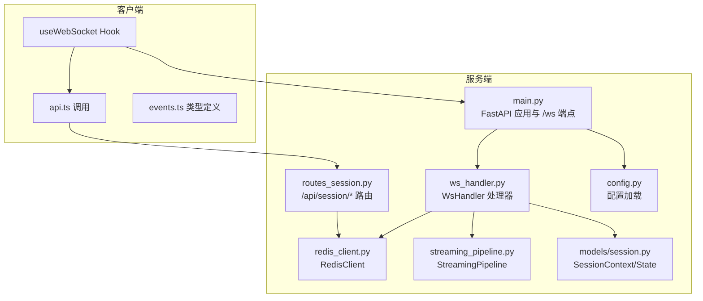
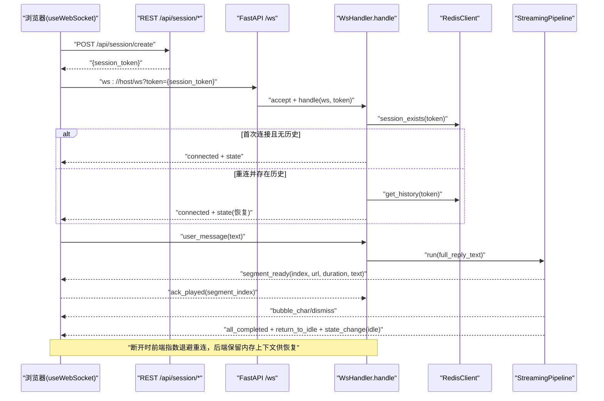
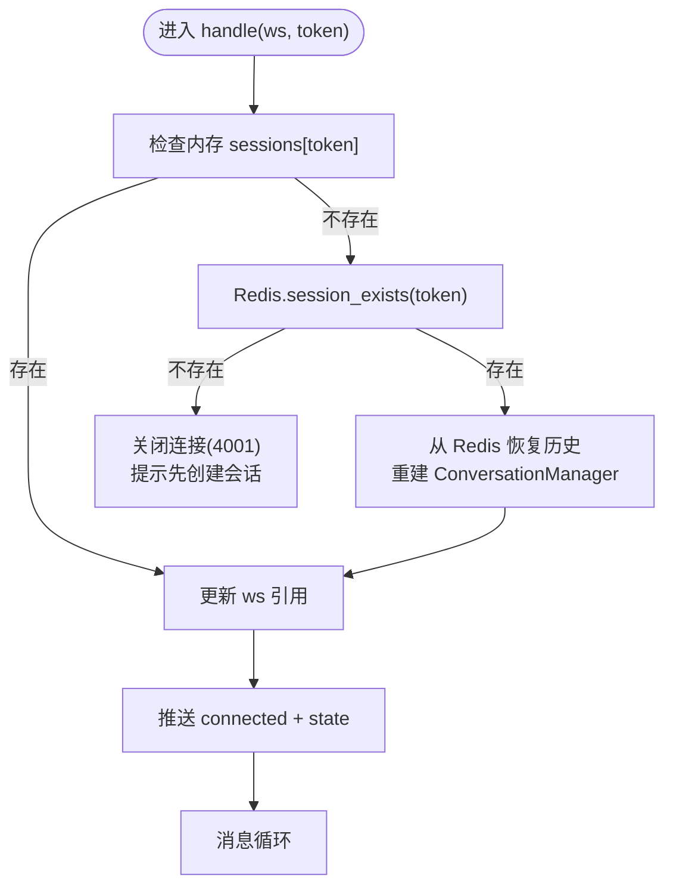
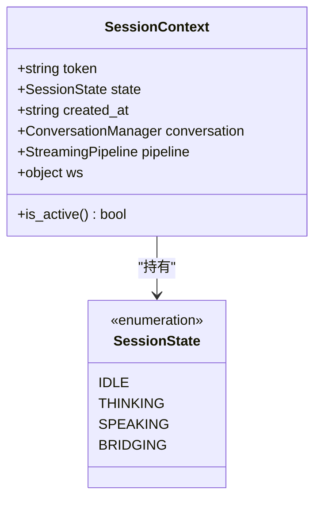
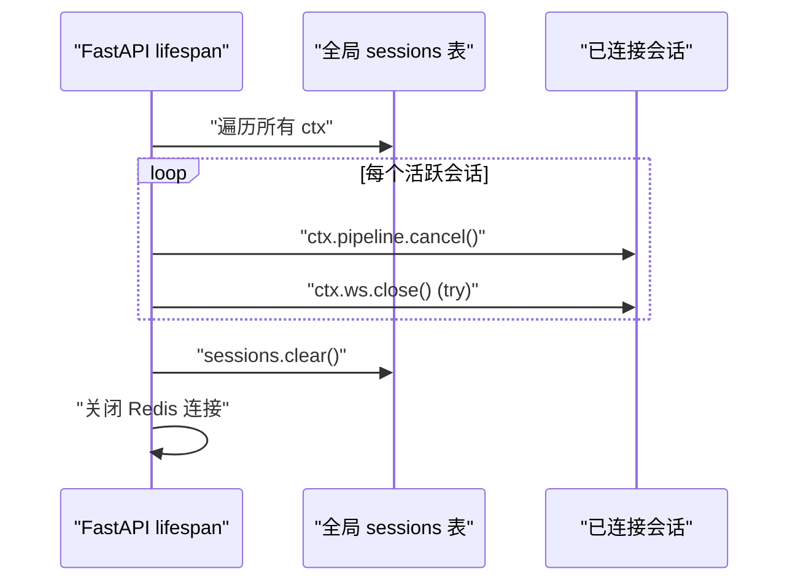
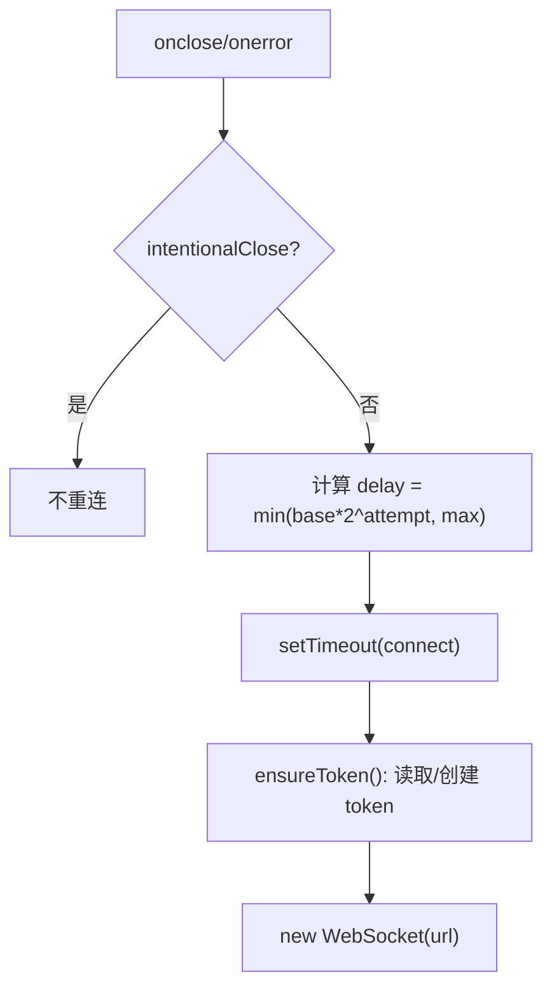
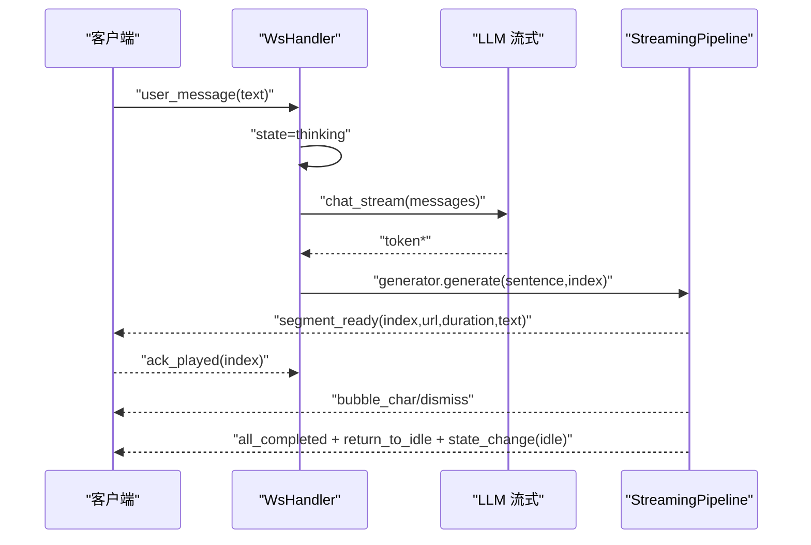
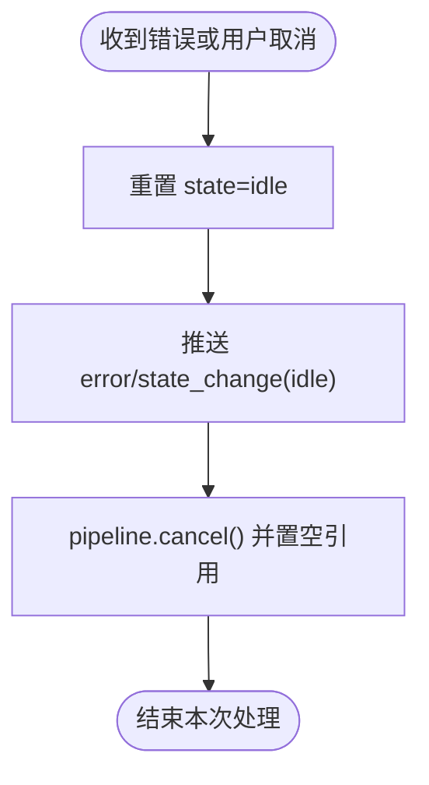
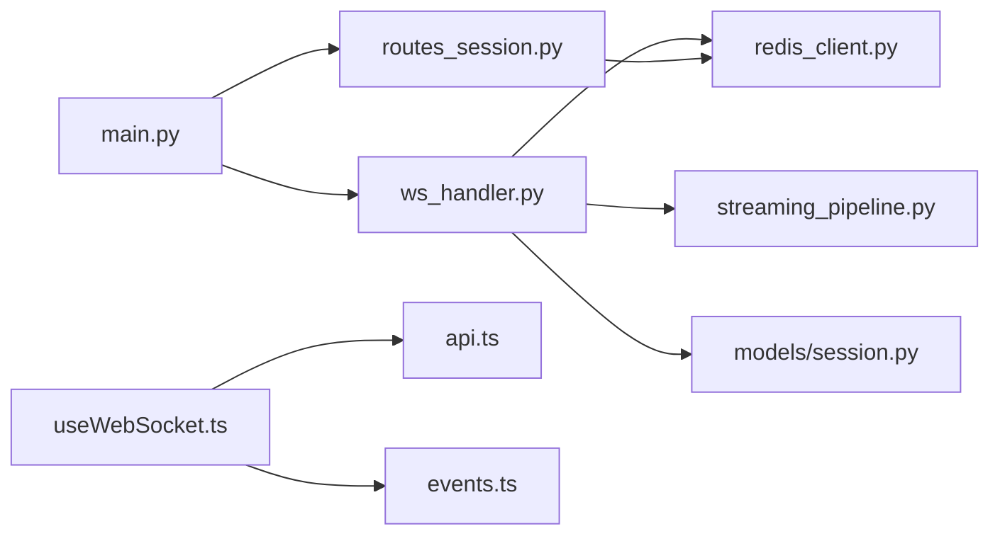

# 连接管理

<cite>
**本文引用的文件**
- [server/main.py](file://server/main.py)
- [server/api/ws_handler.py](file://server/api/ws_handler.py)
- [server/api/routes_session.py](file://server/api/routes_session.py)
- [server/services/redis_client.py](file://server/services/redis_client.py)
- [server/models/session.py](file://server/models/session.py)
- [server/pipeline/streaming_pipeline.py](file://server/pipeline/streaming_pipeline.py)
- [client/src/hooks/useWebSocket.ts](file://client/src/hooks/useWebSocket.ts)
- [client/src/types/events.ts](file://client/src/types/events.ts)
- [client/src/services/api.ts](file://client/src/services/api.ts)
- [server/config.py](file://server/config.py)
</cite>

## 目录
1. [简介](#简介)
2. [项目结构](#项目结构)
3. [核心组件](#核心组件)
4. [架构总览](#架构总览)
5. [详细组件分析](#详细组件分析)
6. [依赖关系分析](#依赖关系分析)
7. [性能与并发特性](#性能与并发特性)
8. [故障排查指南](#故障排查指南)
9. [结论](#结论)
10. [附录：最佳实践与安全建议](#附录最佳实践与安全建议)

## 简介
本文件围绕 WebSocket 连接管理，系统性阐述连接建立、认证与会话恢复、生命周期管理（连接池、并发控制、资源清理）、重连机制（Redis 会话恢复、断线检测、自动重连）、安全考量（token 生成与验证策略），以及监控指标与排障要点。文档面向开发者与运维人员，既提供代码级细节，也给出可操作的最佳实践。

## 项目结构
后端基于 FastAPI，WebSocket 端点位于入口模块中，具体处理逻辑在 ws_handler；会话创建与销毁通过 REST API 路由完成；Redis 用于会话状态与历史持久化；前端使用 React Hook 封装连接、重连与消息收发。

图表来源
- [server/main.py:146-170](file://server/main.py#L146-L170)
- [server/api/ws_handler.py:31-129](file://server/api/ws_handler.py#L31-L129)
- [server/api/routes_session.py:28-47](file://server/api/routes_session.py#L28-L47)
- [server/services/redis_client.py:22-122](file://server/services/redis_client.py#L22-L122)
- [server/pipeline/streaming_pipeline.py:16-131](file://server/pipeline/streaming_pipeline.py#L16-L131)
- [server/models/session.py:14-41](file://server/models/session.py#L14-L41)
- [client/src/hooks/useWebSocket.ts:34-117](file://client/src/hooks/useWebSocket.ts#L34-L117)
- [client/src/services/api.ts:31-51](file://client/src/services/api.ts#L31-L51)
- [client/src/types/events.ts:15-92](file://client/src/types/events.ts#L15-L92)
- [server/config.py:148-241](file://server/config.py#L148-L241)

章节来源
- [server/main.py:146-170](file://server/main.py#L146-L170)
- [server/api/ws_handler.py:31-129](file://server/api/ws_handler.py#L31-L129)
- [server/api/routes_session.py:28-47](file://server/api/routes_session.py#L28-L47)
- [server/services/redis_client.py:22-122](file://server/services/redis_client.py#L22-L122)
- [server/models/session.py:14-41](file://server/models/session.py#L14-L41)
- [server/pipeline/streaming_pipeline.py:16-131](file://server/pipeline/streaming_pipeline.py#L16-L131)
- [client/src/hooks/useWebSocket.ts:34-117](file://client/src/hooks/useWebSocket.ts#L34-L117)
- [client/src/services/api.ts:31-51](file://client/src/services/api.ts#L31-L51)
- [client/src/types/events.ts:15-92](file://client/src/types/events.ts#L15-L92)
- [server/config.py:148-241](file://server/config.py#L148-L241)

## 核心组件
- WsHandler：负责单个 WebSocket 连接的完整生命周期，包括 token 校验、会话上下文恢复、消息分发、错误处理与资源清理。
- StreamingPipeline：流式分段生成与推送引擎，实现首段快速响应、逐段确认式推送、取消与错误传播。
- RedisClient：会话状态与对话历史的持久化，支持 TTL 与键空间管理。
- SessionContext/SessionState：内存中的会话上下文与状态机。
- useWebSocket Hook：前端连接管理，包含 token 获取、自动重连、事件回调与发送接口。
- routes_session：REST 接口，负责创建/查询/销毁会话，维护 token 与 Redis 的映射。

章节来源
- [server/api/ws_handler.py:31-129](file://server/api/ws_handler.py#L31-L129)
- [server/pipeline/streaming_pipeline.py:16-131](file://server/pipeline/streaming_pipeline.py#L16-L131)
- [server/services/redis_client.py:22-122](file://server/services/redis_client.py#L22-L122)
- [server/models/session.py:14-41](file://server/models/session.py#L14-L41)
- [client/src/hooks/useWebSocket.ts:34-117](file://client/src/hooks/useWebSocket.ts#L34-L117)
- [server/api/routes_session.py:28-47](file://server/api/routes_session.py#L28-L47)

## 架构总览
下图展示了从客户端到服务端的端到端交互流程，涵盖连接建立、认证与会话恢复、消息处理与流式推送、重连与清理。

图表来源
- [server/main.py:146-170](file://server/main.py#L146-L170)
- [server/api/ws_handler.py:49-129](file://server/api/ws_handler.py#L49-L129)
- [server/api/routes_session.py:28-47](file://server/api/routes_session.py#L28-L47)
- [server/services/redis_client.py:108-122](file://server/services/redis_client.py#L108-L122)
- [server/pipeline/streaming_pipeline.py:44-131](file://server/pipeline/streaming_pipeline.py#L44-L131)
- [client/src/hooks/useWebSocket.ts:67-117](file://client/src/hooks/useWebSocket.ts#L67-L117)

## 详细组件分析

### 连接建立与认证流程
- 前端先通过 REST 创建会话，获得 session_token，随后以该 token 作为查询参数发起 WebSocket 连接。
- 服务端接受连接后，WsHandler 首先检查内存 sessions 表是否已有该 token；若无，则查询 Redis 是否存在该会话的历史或状态。若均不存在，直接关闭连接并提示需先创建会话。
- 若 Redis 中存在历史，则从 Redis 恢复对话历史并重建 ConversationManager，同时更新内存 sessions 表，完成“重连恢复”。
- 完成后向客户端推送 connected 事件，携带当前会话状态。

图表来源
- [server/api/ws_handler.py:49-94](file://server/api/ws_handler.py#L49-L94)
- [server/api/routes_session.py:28-47](file://server/api/routes_session.py#L28-L47)
- [server/services/redis_client.py:108-122](file://server/services/redis_client.py#L108-L122)

章节来源
- [server/api/ws_handler.py:49-94](file://server/api/ws_handler.py#L49-L94)
- [server/api/routes_session.py:28-47](file://server/api/routes_session.py#L28-L47)
- [server/services/redis_client.py:108-122](file://server/services/redis_client.py#L108-L122)

### 会话上下文与状态初始化
- SessionContext 保存 token、state、created_at、conversation、pipeline、ws 引用等。
- SessionState 枚举定义了 idle/thinking/speaking/bridging 四种状态，并在连接建立、消息处理、错误恢复等关键路径进行同步更新。
- 连接建立后，WsHandler 将 ws 引用写入 SessionContext，并推送初始 state。

图表来源
- [server/models/session.py:14-41](file://server/models/session.py#L14-L41)

章节来源
- [server/models/session.py:14-41](file://server/models/session.py#L14-L41)
- [server/api/ws_handler.py:86-94](file://server/api/ws_handler.py#L86-L94)

### 连接生命周期管理与资源清理
- 主进程启动时初始化 Redis、MinIO、Qdrant、Embedding 等依赖，注册路由与中间件。
- 健康检查返回 Redis 可用性与会话数量，便于外部监控。
- 优雅关闭：遍历所有活跃会话，取消正在运行的 Pipeline，尝试关闭关联的 WebSocket，最后清空内存 sessions 并关闭 Redis。
- 单连接退出：WsHandler 在 finally 中将 ws 引用置空，但不清除内存中的会话上下文，以便后续重连恢复。

图表来源
- [server/main.py:92-110](file://server/main.py#L92-L110)
- [server/api/ws_handler.py:121-129](file://server/api/ws_handler.py#L121-L129)

章节来源
- [server/main.py:92-110](file://server/main.py#L92-L110)
- [server/api/ws_handler.py:121-129](file://server/api/ws_handler.py#L121-L129)

### 重连机制与断线检测
- 前端 useWebSocket Hook 在 onclose/onerror 时触发 scheduleReconnect，采用指数退避（1s→2s→4s→...，上限 30s）。
- 重连时优先复用本地 sessionStorage 中的 token；若不存在则重新调用 REST 创建新会话。
- 后端在 handle 中根据 Redis 是否存在该 token 的历史决定是全新会话还是恢复旧会话。

图表来源
- [client/src/hooks/useWebSocket.ts:119-135](file://client/src/hooks/useWebSocket.ts#L119-135)
- [client/src/hooks/useWebSocket.ts:45-65](file://client/src/hooks/useWebSocket.ts#L45-L65)
- [server/api/ws_handler.py:57-84](file://server/api/ws_handler.py#L57-84)

章节来源
- [client/src/hooks/useWebSocket.ts:119-135](file://client/src/hooks/useWebSocket.ts#L119-135)
- [client/src/hooks/useWebSocket.ts:45-65](file://client/src/hooks/useWebSocket.ts#L45-L65)
- [server/api/ws_handler.py:57-84](file://server/api/ws_handler.py#L57-84)

### 流式处理与分段推送
- 用户发送 user_message 后，WsHandler 更新状态为 thinking，立即通知前端进入思考态。
- 后台任务执行流式 LLM 调用，边接收边按句子边界切分段落，并行启动 SegmentGenerator 生成视频片段。
- 首段就绪后立即推送 segment_ready 并切换 speaking；后续段落等待前端 ack_played 确认后依次推送，避免拥塞。
- 全部完成后推送 all_completed、return_to_idle 与 state_change(idle)。

图表来源
- [server/api/ws_handler.py:130-341](file://server/api/ws_handler.py#L130-341)
- [server/pipeline/streaming_pipeline.py:44-131](file://server/pipeline/streaming_pipeline.py#L44-L131)

章节来源
- [server/api/ws_handler.py:130-341](file://server/api/ws_handler.py#L130-341)
- [server/pipeline/streaming_pipeline.py:44-131](file://server/pipeline/streaming_pipeline.py#L44-L131)

### 错误处理与中断
- 当 LLM 调用失败或异常时，WsHandler 重置状态为 idle，推送 error 与 state_change(idle)，并清理 pipeline。
- 用户发送 cancel 时，WsHandler 取消当前 pipeline，更新状态为 idle，并推送相应事件。
- Pipeline 内部对推送失败进行容错记录，确保整体流程健壮。

图表来源
- [server/api/ws_handler.py:402-443](file://server/api/ws_handler.py#L402-L443)
- [server/pipeline/streaming_pipeline.py:192-214](file://server/pipeline/streaming_pipeline.py#L192-L214)

章节来源
- [server/api/ws_handler.py:402-443](file://server/api/ws_handler.py#L402-L443)
- [server/pipeline/streaming_pipeline.py:192-214](file://server/pipeline/streaming_pipeline.py#L192-L214)

## 依赖关系分析
- main.py 暴露 /ws 端点，注入 WsHandler 与全局 sessions 表；lifespan 负责资源初始化与优雅关闭。
- ws_handler.py 依赖 RedisClient、AgentEngine、StreamingPipeline、TtsEngine、SemanticAnalyzer、VideoConcat 等。
- routes_session.py 提供会话创建/查询/销毁，与 RedisClient 交互。
- streaming_pipeline.py 依赖 SegmentSplitter 与 SegmentGenerator，并通过 WebSocket 推送事件。
- client 侧 useWebSocket Hook 依赖 api.ts 的 createSession/getHistory/destroySession 与 events.ts 的类型定义。

图表来源
- [server/main.py:146-170](file://server/main.py#L146-L170)
- [server/api/ws_handler.py:31-129](file://server/api/ws_handler.py#L31-L129)
- [server/api/routes_session.py:28-47](file://server/api/routes_session.py#L28-L47)
- [server/services/redis_client.py:22-122](file://server/services/redis_client.py#L22-L122)
- [server/pipeline/streaming_pipeline.py:16-131](file://server/pipeline/streaming_pipeline.py#L16-L131)
- [client/src/hooks/useWebSocket.ts:34-117](file://client/src/hooks/useWebSocket.ts#L34-L117)
- [client/src/services/api.ts:31-51](file://client/src/services/api.ts#L31-L51)
- [client/src/types/events.ts:15-92](file://client/src/types/events.ts#L15-L92)

章节来源
- [server/main.py:146-170](file://server/main.py#L146-L170)
- [server/api/ws_handler.py:31-129](file://server/api/ws_handler.py#L31-L129)
- [server/api/routes_session.py:28-47](file://server/api/routes_session.py#L28-L47)
- [server/services/redis_client.py:22-122](file://server/services/redis_client.py#L22-L122)
- [server/pipeline/streaming_pipeline.py:16-131](file://server/pipeline/streaming_pipeline.py#L16-L131)
- [client/src/hooks/useWebSocket.ts:34-117](file://client/src/hooks/useWebSocket.ts#L34-L117)
- [client/src/services/api.ts:31-51](file://client/src/services/api.ts#L31-L51)
- [client/src/types/events.ts:15-92](file://client/src/types/events.ts#L15-L92)

## 性能与并发特性
- 首段快速响应：Pipeline 在首个段生成完成后立即推送，减少首帧延迟。
- 并行生成：所有段的任务并行启动，充分利用 I/O 与 CPU 资源。
- 确认式推送：后续段等待前端 ack_played，避免网络拥塞与播放卡顿。
- 打字机动画速率受视频时长限制，单字间隔有上下限，保证视觉体验与性能平衡。
- 流式 LLM 边收边切分，降低长文本处理的峰值内存占用。

[本节为通用性能讨论，无需特定文件引用]

## 故障排查指南
- 连接无法建立
  - 检查健康检查端点返回的 redis 与 sessions 计数是否正常。
  - 确认前端是否正确调用 /api/session/create 并拿到 token。
  - 查看后端日志中是否有 Redis 不可用或服务未就绪的错误。
- 重连频繁
  - 检查前端指数退避配置与 intentionalClose 标志位是否正确设置。
  - 观察后端是否在 finally 中正确置空 ws 引用，避免重复推送。
- 流式输出卡顿
  - 确认前端是否及时发送 ack_played。
  - 检查 Pipeline 的 _ack_queue 是否积压，必要时调整推送节奏。
- 会话丢失
  - 确认 Redis 的 session_ttl_hours 配置是否合理，避免会话过早过期。
  - 检查 destroy_session 是否误删了仍在使用的会话。

章节来源
- [server/main.py:136-143](file://server/main.py#L136-L143)
- [server/api/ws_handler.py:121-129](file://server/api/ws_handler.py#L121-L129)
- [server/services/redis_client.py:25-50](file://server/services/redis_client.py#L25-50)
- [client/src/hooks/useWebSocket.ts:119-135](file://client/src/hooks/useWebSocket.ts#L119-135)

## 结论
本系统通过 REST 创建会话与 token、WebSocket 承载实时流式交互、Redis 持久化会话历史与状态、Pipeline 实现高效分段生成与确认式推送，形成完整的连接管理与重连恢复闭环。结合优雅关闭与健康检查，系统在稳定性与用户体验方面具备良好基础。

[本节为总结性内容，无需特定文件引用]

## 附录：最佳实践与安全建议

- 内存泄漏防护
  - 确保在连接关闭或异常分支中置空 ws 引用，避免强引用导致 GC 无法回收。
  - 在销毁会话时，务必取消 Pipeline、关闭 ws、清理 Redis 与 MinIO 数据。
- 连接超时处理
  - 前端应设置合理的重连上限与最大延迟，避免无限重试。
  - 后端可在 Pipeline 中增加整体超时保护，防止长时间挂起。
- 优雅关闭流程
  - 应用退出时统一取消所有活跃 Pipeline，关闭所有 ws，再释放外部依赖。
- Token 生成与验证策略
  - 当前实现使用 UUID 作为 token，并在创建会话时在 Redis 写入状态键，连接时通过 exists 判断有效性。
  - 生产环境建议引入签名与有效期校验，例如 HMAC 签名、短期有效 token、绑定 IP/UA 等，防止伪造与重放攻击。
- 监控指标
  - 暴露健康检查端点，统计活跃会话数、Redis 连通性、Pipeline 平均耗时、错误率等。
  - 在前端记录重连次数与失败原因，辅助定位网络问题。

章节来源
- [server/main.py:92-110](file://server/main.py#L92-L110)
- [server/api/routes_session.py:75-122](file://server/api/routes_session.py#L75-L122)
- [server/api/ws_handler.py:121-129](file://server/api/ws_handler.py#L121-L129)
- [server/api/routes_session.py:28-47](file://server/api/routes_session.py#L28-L47)
- [server/services/redis_client.py:108-122](file://server/services/redis_client.py#L108-L122)
- [server/main.py:136-143](file://server/main.py#L136-L143)