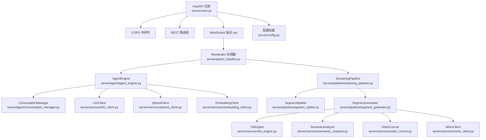
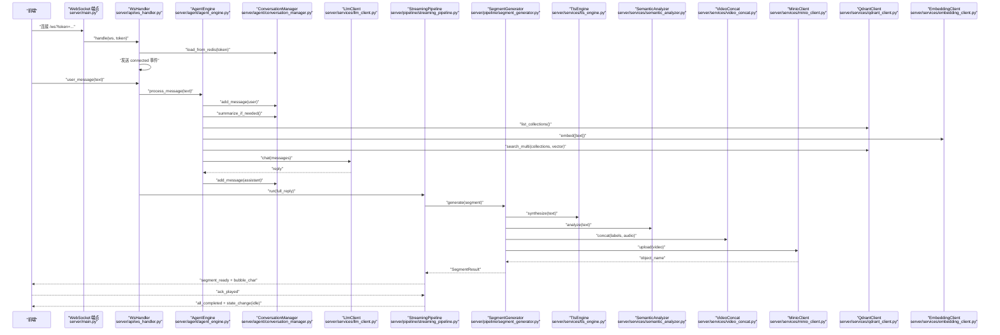
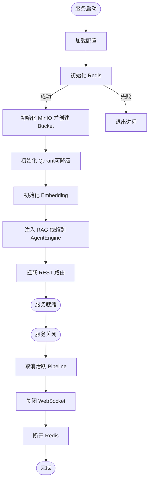
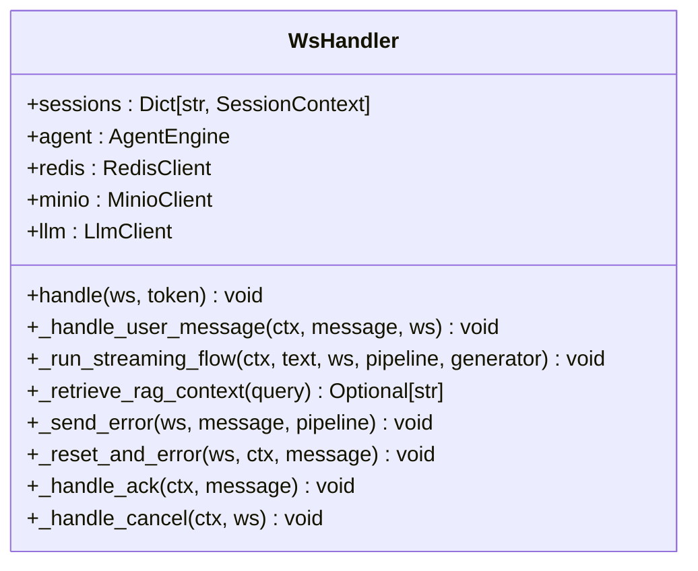
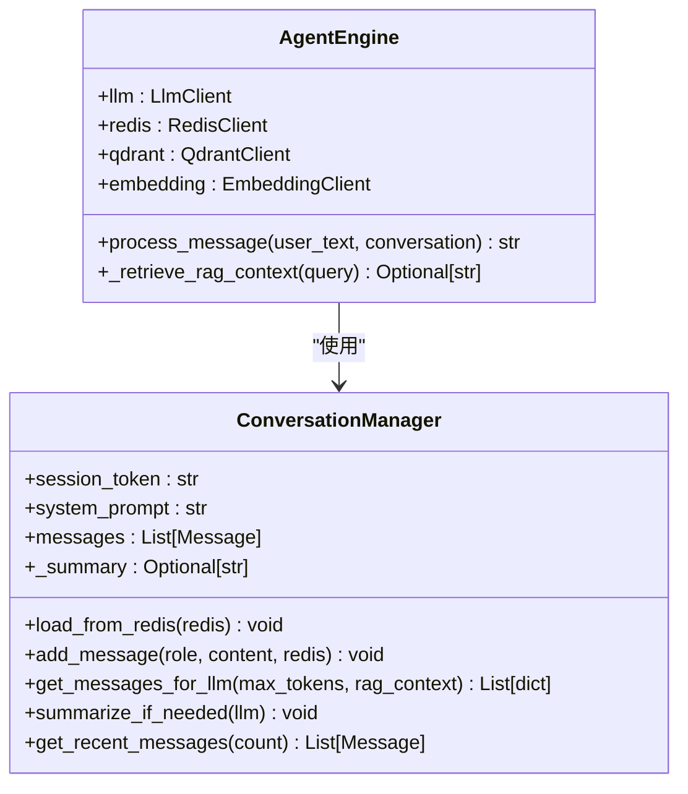
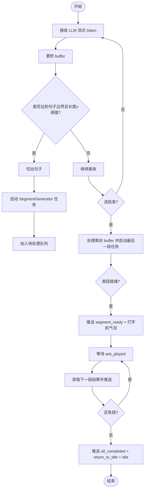
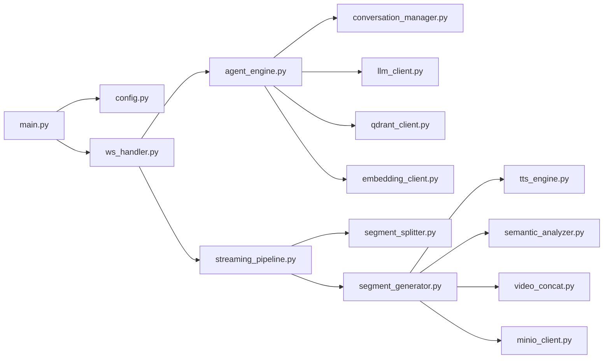

# 后端服务架构

<cite>
**本文引用的文件**   
- [server/main.py](file://server/main.py)
- [server/config.py](file://server/config.py)
- [server/api/ws_handler.py](file://server/api/ws_handler.py)
- [server/agent/agent_engine.py](file://server/agent/agent_engine.py)
- [server/agent/conversation_manager.py](file://server/agent/conversation_manager.py)
- [server/pipeline/streaming_pipeline.py](file://server/pipeline/streaming_pipeline.py)
- [server/pipeline/segment_generator.py](file://server/pipeline/segment_generator.py)
- [server/pipeline/segment_splitter.py](file://server/pipeline/segment_splitter.py)
- [server/services/llm_client.py](file://server/services/llm_client.py)
- [server/services/tts_engine.py](file://server/services/tts_engine.py)
- [server/services/semantic_analyzer.py](file://server/services/semantic_analyzer.py)
- [server/services/video_concat.py](file://server/services/video_concat.py)
- [server/services/minio_client.py](file://server/services/minio_client.py)
- [server/services/qdrant_client.py](file://server/services/qdrant_client.py)
- [server/services/embedding_client.py](file://server/services/embedding_client.py)
</cite>

## 目录
1. [简介](#简介)
2. [项目结构](#项目结构)
3. [核心组件](#核心组件)
4. [架构总览](#架构总览)
5. [详细组件分析](#详细组件分析)
6. [依赖关系分析](#依赖关系分析)
7. [性能考量](#性能考量)
8. [故障排查指南](#故障排查指南)
9. [结论](#结论)

## 简介
本文件为 RealTimeTalk 后端服务的架构文档，聚焦 FastAPI 应用生命周期、中间件与依赖注入、WebSocket 连接处理器设计模式、Agent 引擎（对话管理与 RAG）、流式处理管道（分段生成、并行调度、确认式推送）以及外部服务集成（LLM、TTS、向量数据库、对象存储）的抽象层设计。文档提供组件交互图与依赖关系图，帮助读者理解模块间的通信协议与数据流转。

## 项目结构
后端采用分层与按功能域组织的方式：
- 入口与生命周期：FastAPI 应用启动、配置加载、中间件注册、路由挂载、WebSocket 端点定义
- API 层：REST 路由与 WebSocket 处理器
- Agent 层：对话管理、RAG 检索增强
- Pipeline 层：文本分段、段落生成、流式推送
- Services 层：外部服务客户端封装（LLM、TTS、语义分析、视频拼接、MinIO、Qdrant、Embedding）
- 配置中心：统一配置加载与环境覆盖

图示来源
- [server/main.py:114-133](file://server/main.py#L114-L133)
- [server/api/ws_handler.py:31-47](file://server/api/ws_handler.py#L31-L47)
- [server/agent/agent_engine.py:59-73](file://server/agent/agent_engine.py#L59-L73)
- [server/agent/conversation_manager.py:21-31](file://server/agent/conversation_manager.py#L21-L31)
- [server/pipeline/streaming_pipeline.py:16-40](file://server/pipeline/streaming_pipeline.py#L16-L40)
- [server/pipeline/segment_generator.py:27-41](file://server/pipeline/segment_generator.py#L27-L41)
- [server/services/llm_client.py:23-32](file://server/services/llm_client.py#L23-L32)
- [server/services/tts_engine.py:38-47](file://server/services/tts_engine.py#L38-L47)
- [server/services/semantic_analyzer.py:35-39](file://server/services/semantic_analyzer.py#L35-L39)
- [server/services/video_concat.py:20-29](file://server/services/video_concat.py#L20-L29)
- [server/services/minio_client.py:21-32](file://server/services/minio_client.py#L21-L32)
- [server/services/qdrant_client.py:26-33](file://server/services/qdrant_client.py#L26-L33)
- [server/services/embedding_client.py:26-37](file://server/services/embedding_client.py#L26-L37)
- [server/config.py:148-241](file://server/config.py#L148-L241)

章节来源
- [server/main.py:114-133](file://server/main.py#L114-L133)
- [server/config.py:148-241](file://server/config.py#L148-L241)

## 核心组件
- 应用生命周期与中间件
  - lifespan 负责初始化 Redis、MinIO、Qdrant、Embedding、会话路由与知识库路由，并在关闭时清理活跃 Pipeline 与 WebSocket 引用
  - CORS 中间件允许跨域访问（开发阶段）
  - REST 路由组包含会话、片段、媒体、知识管理等
- WebSocket 处理器
  - 负责会话恢复、消息路由、状态机驱动、错误处理与取消机制
- Agent 引擎
  - 封装对话流程：保存用户输入、智能摘要、RAG 检索、调用 LLM、保存助手回复
  - 支持 Markdown 剥离与降级策略
- 流式处理管道
  - 基于 LLM 流式输出进行句子边界检测与段切分
  - 首段优先推送，后续段通过 ack 控制节奏
  - 打字机气泡效果与状态事件同步
- 外部服务抽象层
  - LLM：OpenAI 兼容接口，支持非流式与流式，内置重试与限流处理
  - TTS：DashScope 多模态生成接口，异步任务轮询与长文本拆分合并
  - 语义分析：LLM 或关键词回退，输出标签序列
  - 视频拼接：FFmpeg concat + 混音，自动时长对齐
  - MinIO：上传、存在性检查、预签名 URL、前缀删除
  - Qdrant：集合管理、批量 upsert、并发搜索与结果合并
  - Embedding：批量文本嵌入，维度固定，重试与限流

章节来源
- [server/main.py:42-110](file://server/main.py#L42-L110)
- [server/main.py:120-133](file://server/main.py#L120-L133)
- [server/api/ws_handler.py:49-129](file://server/api/ws_handler.py#L49-L129)
- [server/agent/agent_engine.py:74-121](file://server/agent/agent_engine.py#L74-L121)
- [server/pipeline/streaming_pipeline.py:44-131](file://server/pipeline/streaming_pipeline.py#L44-L131)
- [server/services/llm_client.py:40-113](file://server/services/llm_client.py#L40-L113)
- [server/services/tts_engine.py:49-76](file://server/services/tts_engine.py#L49-L76)
- [server/services/semantic_analyzer.py:41-86](file://server/services/semantic_analyzer.py#L41-L86)
- [server/services/video_concat.py:30-72](file://server/services/video_concat.py#L30-L72)
- [server/services/minio_client.py:69-90](file://server/services/minio_client.py#L69-L90)
- [server/services/qdrant_client.py:164-186](file://server/services/qdrant_client.py#L164-L186)
- [server/services/embedding_client.py:47-70](file://server/services/embedding_client.py#L47-L70)

## 架构总览
RealTimeTalk 后端以 FastAPI 为核心，WS 作为实时通道，Agent 编排对话与 RAG，Pipeline 实现“边生成边合成”的端到端低延迟体验。外部服务通过统一客户端抽象，具备重试、限流与降级能力。

图示来源
- [server/main.py:146-170](file://server/main.py#L146-L170)
- [server/api/ws_handler.py:49-129](file://server/api/ws_handler.py#L49-L129)
- [server/agent/agent_engine.py:74-121](file://server/agent/agent_engine.py#L74-L121)
- [server/agent/conversation_manager.py:33-44](file://server/agent/conversation_manager.py#L33-L44)
- [server/services/llm_client.py:115-190](file://server/services/llm_client.py#L115-L190)
- [server/pipeline/streaming_pipeline.py:44-131](file://server/pipeline/streaming_pipeline.py#L44-L131)
- [server/pipeline/segment_generator.py:42-106](file://server/pipeline/segment_generator.py#L42-L106)
- [server/services/tts_engine.py:78-167](file://server/services/tts_engine.py#L78-L167)
- [server/services/semantic_analyzer.py:41-86](file://server/services/semantic_analyzer.py#L41-L86)
- [server/services/video_concat.py:30-72](file://server/services/video_concat.py#L30-L72)
- [server/services/minio_client.py:69-90](file://server/services/minio_client.py#L69-L90)
- [server/services/qdrant_client.py:164-186](file://server/services/qdrant_client.py#L164-L186)
- [server/services/embedding_client.py:47-70](file://server/services/embedding_client.py#L47-L70)

## 详细组件分析

### 应用生命周期与中间件
- 启动阶段
  - 加载配置并记录关键项
  - 建立 Redis 连接，失败则拒绝启动
  - 初始化 MinIO 并确保 bucket 存在
  - 初始化 Qdrant 与 Embedding 客户端（Qdrant 不可用时降级）
  - 注入 RAG 依赖到 AgentEngine
  - 注册会话与知识库路由
- 关闭阶段
  - 取消所有活跃 Pipeline
  - 关闭 WebSocket 连接
  - 释放 Redis 连接

图示来源
- [server/main.py:42-110](file://server/main.py#L42-L110)
- [server/main.py:120-133](file://server/main.py#L120-L133)

章节来源
- [server/main.py:42-110](file://server/main.py#L42-L110)
- [server/main.py:120-133](file://server/main.py#L120-L133)

### WebSocket 连接处理器设计模式
- 连接建立与会话恢复
  - 校验 token，若内存中不存在则从 Redis 恢复历史
  - 更新 ws 引用并发送 connected 事件
- 消息路由
  - user_message：进入思考状态，触发流式处理
  - ack_played：推进 pipeline 下一段
  - cancel：中断当前 pipeline 并回到空闲
- 错误处理
  - 统一错误事件与状态重置
  - 异常捕获后返回友好提示

图示来源
- [server/api/ws_handler.py:31-47](file://server/api/ws_handler.py#L31-L47)
- [server/api/ws_handler.py:49-129](file://server/api/ws_handler.py#L49-L129)
- [server/api/ws_handler.py:130-188](file://server/api/ws_handler.py#L130-L188)
- [server/api/ws_handler.py:189-341](file://server/api/ws_handler.py#L189-L341)
- [server/api/ws_handler.py:342-400](file://server/api/ws_handler.py#L342-L400)
- [server/api/ws_handler.py:402-443](file://server/api/ws_handler.py#L402-L443)

章节来源
- [server/api/ws_handler.py:49-129](file://server/api/ws_handler.py#L49-L129)
- [server/api/ws_handler.py:130-188](file://server/api/ws_handler.py#L130-L188)
- [server/api/ws_handler.py:189-341](file://server/api/ws_handler.py#L189-L341)
- [server/api/ws_handler.py:342-400](file://server/api/ws_handler.py#L342-L400)
- [server/api/ws_handler.py:402-443](file://server/api/ws_handler.py#L402-L443)

### Agent 引擎与对话管理
- 对话流程
  - 保存用户消息 → 智能摘要 → 组装 messages（含 system、RAG 上下文、历史）→ 调用 LLM → 保存助手回复
- RAG 检索增强
  - 根据角色集合映射选择搜索范围
  - 使用 Embedding 将查询转为向量，并发检索多个集合，合并排序取 top_k
  - 构建 RAG 上下文注入到 messages
- 降级策略
  - RAG 客户端缺失或检索失败时，直接走纯 LLM 回复

图示来源
- [server/agent/agent_engine.py:59-73](file://server/agent/agent_engine.py#L59-L73)
- [server/agent/agent_engine.py:74-121](file://server/agent/agent_engine.py#L74-L121)
- [server/agent/agent_engine.py:123-180](file://server/agent/agent_engine.py#L123-L180)
- [server/agent/conversation_manager.py:21-31](file://server/agent/conversation_manager.py#L21-L31)
- [server/agent/conversation_manager.py:33-44](file://server/agent/conversation_manager.py#L33-L44)
- [server/agent/conversation_manager.py:46-95](file://server/agent/conversation_manager.py#L46-L95)
- [server/agent/conversation_manager.py:97-135](file://server/agent/conversation_manager.py#L97-L135)

章节来源
- [server/agent/agent_engine.py:74-121](file://server/agent/agent_engine.py#L74-L121)
- [server/agent/agent_engine.py:123-180](file://server/agent/agent_engine.py#L123-L180)
- [server/agent/conversation_manager.py:46-95](file://server/agent/conversation_manager.py#L46-L95)
- [server/agent/conversation_manager.py:97-135](file://server/agent/conversation_manager.py#L97-L135)

### 流式处理管道设计原理
- 分段生成算法
  - 在 LLM 流式接收过程中，按中文标点检测句子边界，满足长度阈值即切段
  - 防止 buffer 过大，超过阈值强制按逗号/换行分割
- 并行任务调度
  - 每段立即启动 SegmentGenerator 任务（TTS + 语义分析 + 拼接 + 上传）
  - 首段完成后立即推送，后续段继续后台生成
- 确认式推送机制
  - 等待前端 ack_played 后再推送下一段，避免拥塞
  - 打字机气泡按字符推送，间隔受视频时长约束
- 取消与错误处理
  - 支持用户中断，设置取消事件并清理未完成任务
  - 错误事件与状态重置

图示来源
- [server/api/ws_handler.py:189-341](file://server/api/ws_handler.py#L189-L341)
- [server/pipeline/streaming_pipeline.py:44-131](file://server/pipeline/streaming_pipeline.py#L44-L131)
- [server/pipeline/segment_splitter.py:31-76](file://server/pipeline/segment_splitter.py#L31-L76)
- [server/pipeline/segment_generator.py:42-106](file://server/pipeline/segment_generator.py#L42-L106)

章节来源
- [server/api/ws_handler.py:189-341](file://server/api/ws_handler.py#L189-L341)
- [server/pipeline/streaming_pipeline.py:44-131](file://server/pipeline/streaming_pipeline.py#L44-L131)
- [server/pipeline/segment_splitter.py:31-76](file://server/pipeline/segment_splitter.py#L31-L76)
- [server/pipeline/segment_generator.py:42-106](file://server/pipeline/segment_generator.py#L42-L106)

### 外部服务集成模式与抽象层设计
- LLM 客户端
  - OpenAI 兼容接口，支持 chat 与 chat_stream
  - 内置重试、限流与超时处理，错误解析与状态码分类
- TTS 引擎
  - DashScope 多模态生成接口，异步任务提交与轮询
  - 长文本按句子拆分后分段合成再拼接，全局信号量限制并发
- 语义分析器
  - 优先 LLM 分析，失败或首段优化时使用关键词回退
  - 输出标准化标签序列，并进行验证与重排
- 视频拼接器
  - FFmpeg concat demuxer + 混音，自动时长对齐与循环填充
  - 路径转义与错误处理，超时保护
- MinIO 客户端
  - 上传、存在性检查、预签名 URL、前缀删除
  - 不可用时的降级与日志记录
- Qdrant 客户端
  - 集合管理、批量 upsert、并发搜索与结果合并
  - 错误包装与状态码携带
- Embedding 客户端
  - 批量文本嵌入，按批次拆分，顺序保证
  - 重试与限流处理，错误解析

```mermaid
classDiagram
class LlmClient {
+chat(messages, max_tokens) str
+chat_stream(messages, max_tokens) AsyncGenerator[str]
}
class TtsEngine {
+synthesize(text, session_id, segment_index) (str, int)
}
class SemanticAnalyzer {
+analyze(text, skip_llm) List[str]
}
class VideoConcat {
+concat(labels, audio_path, target_duration_ms, session_id, segment_index) str
}
class MinioClient {
+connect() void
+ensure_bucket() bool
+upload(file_path, object_name) str
+get_presigned_url(object_name) Optional[str]
+delete_prefix(prefix) void
}
class QdrantClient {
+create_collection(name, vector_size, distance) dict
+list_collections() list[str]
+upsert(collection, points) void
+search(collection, vector, limit) list[dict]
+search_multi(collections, vector, limit) list[dict]
}
class EmbeddingClient {
+embed(texts) list[list[float]]
}
```

图示来源
- [server/services/llm_client.py:23-32](file://server/services/llm_client.py#L23-L32)
- [server/services/llm_client.py:40-113](file://server/services/llm_client.py#L40-L113)
- [server/services/llm_client.py:115-190](file://server/services/llm_client.py#L115-L190)
- [server/services/tts_engine.py:38-47](file://server/services/tts_engine.py#L38-L47)
- [server/services/tts_engine.py:78-167](file://server/services/tts_engine.py#L78-L167)
- [server/services/semantic_analyzer.py:35-39](file://server/services/semantic_analyzer.py#L35-L39)
- [server/services/semantic_analyzer.py:41-86](file://server/services/semantic_analyzer.py#L41-L86)
- [server/services/video_concat.py:20-29](file://server/services/video_concat.py#L20-L29)
- [server/services/video_concat.py:30-72](file://server/services/video_concat.py#L30-L72)
- [server/services/minio_client.py:21-32](file://server/services/minio_client.py#L21-L32)
- [server/services/minio_client.py:69-90](file://server/services/minio_client.py#L69-L90)
- [server/services/qdrant_client.py:26-33](file://server/services/qdrant_client.py#L26-L33)
- [server/services/qdrant_client.py:164-186](file://server/services/qdrant_client.py#L164-L186)
- [server/services/embedding_client.py:26-37](file://server/services/embedding_client.py#L26-37)
- [server/services/embedding_client.py:47-70](file://server/services/embedding_client.py#L47-70)

章节来源
- [server/services/llm_client.py:40-113](file://server/services/llm_client.py#L40-L113)
- [server/services/llm_client.py:115-190](file://server/services/llm_client.py#L115-L190)
- [server/services/tts_engine.py:78-167](file://server/services/tts_engine.py#L78-L167)
- [server/services/semantic_analyzer.py:41-86](file://server/services/semantic_analyzer.py#L41-L86)
- [server/services/video_concat.py:30-72](file://server/services/video_concat.py#L30-L72)
- [server/services/minio_client.py:69-90](file://server/services/minio_client.py#L69-L90)
- [server/services/qdrant_client.py:164-186](file://server/services/qdrant_client.py#L164-L186)
- [server/services/embedding_client.py:47-70](file://server/services/embedding_client.py#L47-70)

## 依赖关系分析
- 组件耦合与内聚
  - WsHandler 聚合 AgentEngine、Pipeline、Services，职责清晰
  - AgentEngine 仅依赖 LLM、Redis、Qdrant、Embedding，内聚于对话与 RAG
  - Pipeline 组合 Splitter 与 Generator，关注流式与推送
- 外部依赖
  - httpx 用于 HTTP 请求（LLM、TTS、Qdrant、Embedding）
  - FFmpeg 用于视频拼接
  - MinIO SDK 用于对象存储
  - Redis 用于会话持久化与状态
- 潜在循环依赖
  - 无直接循环导入；RAG 依赖通过 main.py 注入，避免强耦合

图示来源
- [server/main.py:114-133](file://server/main.py#L114-L133)
- [server/config.py:148-241](file://server/config.py#L148-L241)
- [server/api/ws_handler.py:31-47](file://server/api/ws_handler.py#L31-L47)
- [server/agent/agent_engine.py:59-73](file://server/agent/agent_engine.py#L59-L73)
- [server/agent/conversation_manager.py:21-31](file://server/agent/conversation_manager.py#L21-L31)
- [server/pipeline/streaming_pipeline.py:16-40](file://server/pipeline/streaming_pipeline.py#L16-L40)
- [server/pipeline/segment_generator.py:27-41](file://server/pipeline/segment_generator.py#L27-L41)
- [server/services/llm_client.py:23-32](file://server/services/llm_client.py#L23-L32)
- [server/services/qdrant_client.py:26-33](file://server/services/qdrant_client.py#L26-L33)
- [server/services/embedding_client.py:26-37](file://server/services/embedding_client.py#L26-37)
- [server/services/tts_engine.py:38-47](file://server/services/tts_engine.py#L38-L47)
- [server/services/semantic_analyzer.py:35-39](file://server/services/semantic_analyzer.py#L35-L39)
- [server/services/video_concat.py:20-29](file://server/services/video_concat.py#L20-L29)
- [server/services/minio_client.py:21-32](file://server/services/minio_client.py#L21-L32)

章节来源
- [server/main.py:114-133](file://server/main.py#L114-L133)
- [server/config.py:148-241](file://server/config.py#L148-L241)
- [server/api/ws_handler.py:31-47](file://server/api/ws_handler.py#L31-L47)
- [server/agent/agent_engine.py:59-73](file://server/agent/agent_engine.py#L59-L73)
- [server/agent/conversation_manager.py:21-31](file://server/agent/conversation_manager.py#L21-L31)
- [server/pipeline/streaming_pipeline.py:16-40](file://server/pipeline/streaming_pipeline.py#L16-L40)
- [server/pipeline/segment_generator.py:27-41](file://server/pipeline/segment_generator.py#L27-L41)
- [server/services/llm_client.py:23-32](file://server/services/llm_client.py#L23-L32)
- [server/services/qdrant_client.py:26-33](file://server/services/qdrant_client.py#L26-L33)
- [server/services/embedding_client.py:26-37](file://server/services/embedding_client.py#L26-37)
- [server/services/tts_engine.py:38-47](file://server/services/tts_engine.py#L38-L47)
- [server/services/semantic_analyzer.py:35-39](file://server/services/semantic_analyzer.py#L35-L39)
- [server/services/video_concat.py:20-29](file://server/services/video_concat.py#L20-L29)
- [server/services/minio_client.py:21-32](file://server/services/minio_client.py#L21-L32)

## 性能考量
- 并发控制
  - TTS 全局信号量限制并发，避免 429 限流
  - Qdrant 并发搜索多个集合，合并排序取 top_k
- 首段优化
  - 首段跳过 LLM 语义分析，使用关键词回退，显著降低首帧延迟
- 流式与缓冲
  - LLM 流式输出边接收边切段，减少端到端延迟
  - 打字机气泡速率受视频时长约束，避免视觉不同步
- 资源清理
  - 服务关闭时取消 Pipeline 与关闭 WebSocket，防止资源泄漏
- 网络与超时
  - 各客户端设置合理超时与重试，提升鲁棒性

[本节为通用指导，不直接分析具体文件]

## 故障排查指南
- 常见问题定位
  - Redis 不可用：服务启动失败，检查连接与权限
  - Qdrant 不可用：RAG 功能降级，检查集合是否存在与网络连通
  - MinIO 不可用：上传失败回退本地，检查 endpoint 与 bucket 权限
  - LLM/TTS 限流：出现 429，客户端已内置重试与等待
  - FFmpeg 执行失败：检查 ffmpeg 路径与系统环境
- 日志与状态
  - 关注各客户端的错误日志与状态变更事件
  - 使用健康检查端点查看服务状态与会话数

章节来源
- [server/main.py:42-110](file://server/main.py#L42-L110)
- [server/services/minio_client.py:69-90](file://server/services/minio_client.py#L69-L90)
- [server/services/qdrant_client.py:164-186](file://server/services/qdrant_client.py#L164-L186)
- [server/services/llm_client.py:40-113](file://server/services/llm_client.py#L40-L113)
- [server/services/tts_engine.py:78-167](file://server/services/tts_engine.py#L78-L167)
- [server/services/video_concat.py:116-149](file://server/services/video_concat.py#L116-L149)

## 结论
RealTimeTalk 后端通过清晰的层次划分与模块化设计，实现了高可用、低延迟的实时对话与多媒体生成能力。Agent 引擎与 RAG 增强了回答质量，流式管道确保首帧快速呈现与稳定播放节奏。外部服务抽象层提供了统一的容错与降级策略，便于扩展与维护。建议在生产环境中完善监控与告警，持续优化并发与资源利用率。