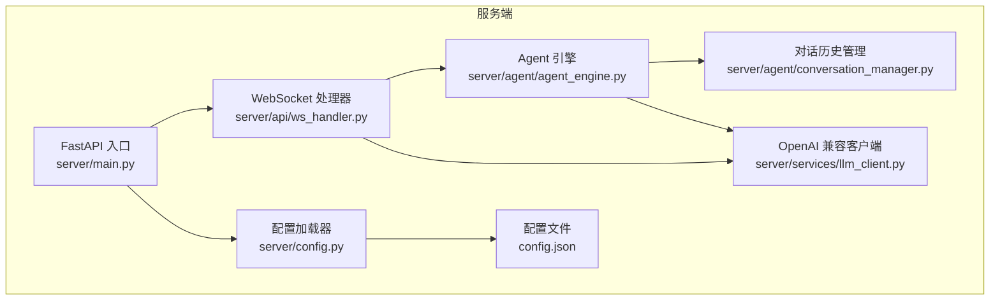
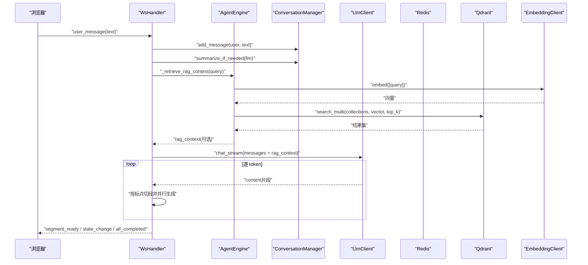
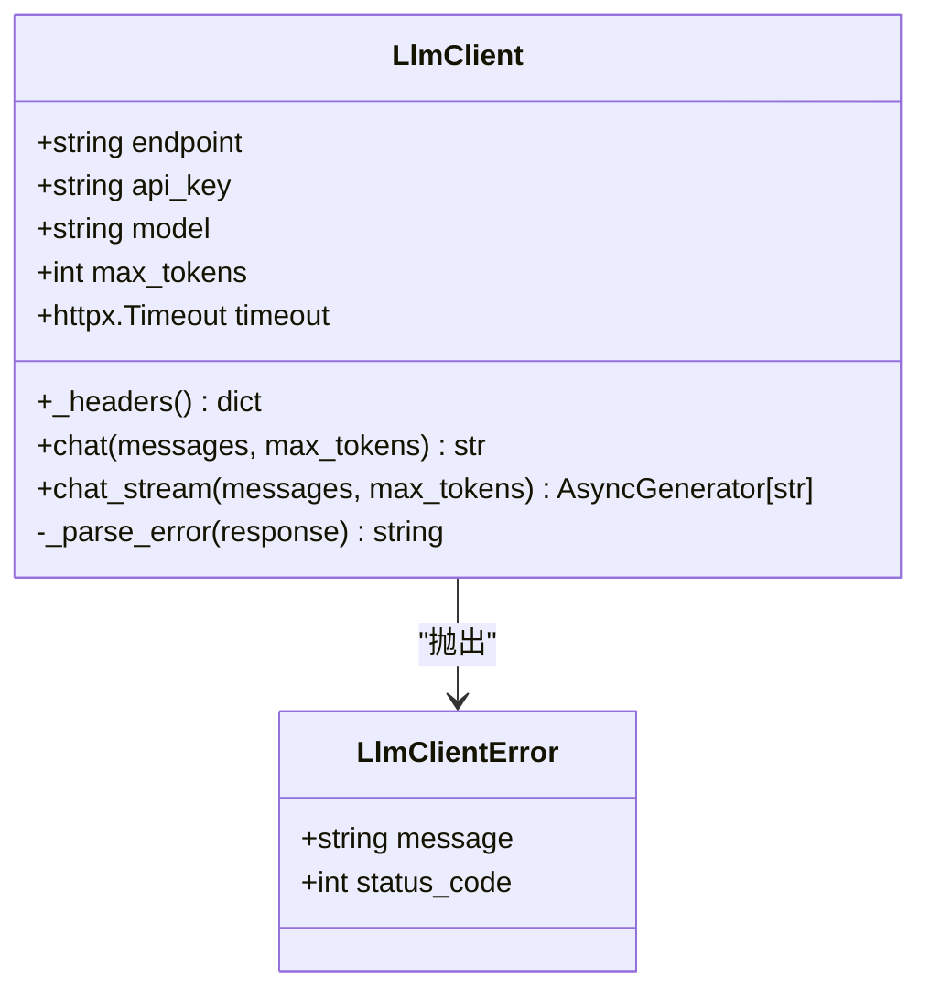
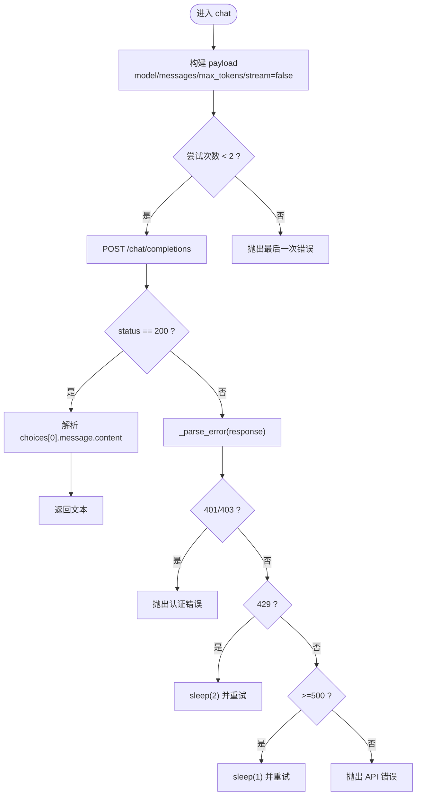
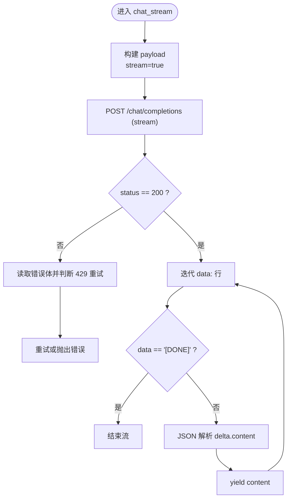
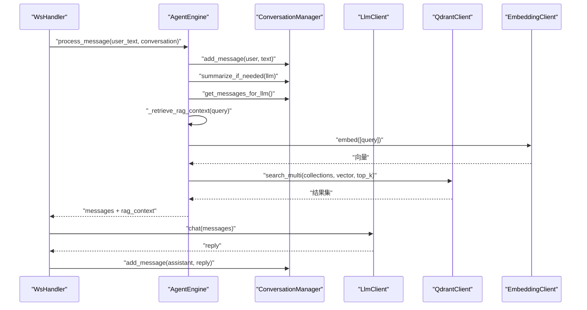
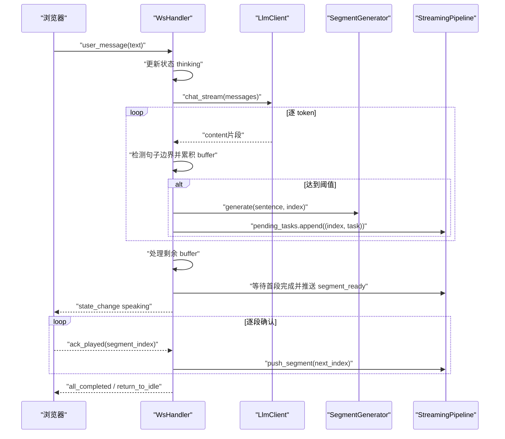
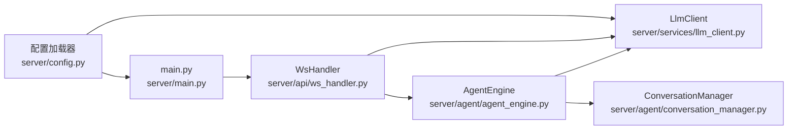

# LLM 服务集成

<cite>
**本文引用的文件**   
- [server/services/llm_client.py](file://server/services/llm_client.py)
- [server/config.py](file://server/config.py)
- [config.json](file://config.json)
- [server/main.py](file://server/main.py)
- [server/api/ws_handler.py](file://server/api/ws_handler.py)
- [server/agent/agent_engine.py](file://server/agent/agent_engine.py)
- [server/agent/conversation_manager.py](file://server/agent/conversation_manager.py)
</cite>

## 目录
1. [简介](#简介)
2. [项目结构](#项目结构)
3. [核心组件](#核心组件)
4. [架构总览](#架构总览)
5. [详细组件分析](#详细组件分析)
6. [依赖关系分析](#依赖关系分析)
7. [性能与并发](#性能与并发)
8. [故障排查指南](#故障排查指南)
9. [结论](#结论)
10. [附录：配置与使用示例](#附录配置与使用示例)

## 简介
本技术文档聚焦于 LLM 服务集成，围绕 OpenAI 兼容 API 客户端的实现进行深入解析。内容涵盖统一接口设计、流式响应处理、错误重试机制、超时控制、连接池管理、并发请求处理、消息格式规范、上下文管理与性能优化技巧，并给出错误码处理、限流策略与服务降级方案。读者可据此快速理解 chat() 与 chat_stream() 方法的工作原理，并在实际项目中正确集成与扩展。

## 项目结构
本项目采用分层架构，LLM 客户端位于 services 层，被 agent 引擎与 WebSocket 处理器调用；配置模块集中管理环境变量与 JSON 配置合并；主入口负责应用生命周期与依赖注入。

图表来源
- [server/main.py:114-191](file://server/main.py#L114-L191)
- [server/api/ws_handler.py:1-444](file://server/api/ws_handler.py#L1-L444)
- [server/agent/agent_engine.py:1-181](file://server/agent/agent_engine.py#L1-L181)
- [server/agent/conversation_manager.py:1-139](file://server/agent/conversation_manager.py#L1-L139)
- [server/services/llm_client.py:1-204](file://server/services/llm_client.py#L1-L204)
- [server/config.py:1-260](file://server/config.py#L1-L260)
- [config.json:1-39](file://config.json#L1-L39)

章节来源
- [server/main.py:114-191](file://server/main.py#L114-L191)
- [server/config.py:148-260](file://server/config.py#L148-L260)
- [config.json:1-39](file://config.json#L1-L39)

## 核心组件
- LlmClient：封装 OpenAI 兼容 Chat Completions API，提供同步 chat() 与异步流式 chat_stream() 两种调用方式，内置重试、限流与错误解析。
- AgentEngine：纯对话生成逻辑，整合 RAG 检索增强、对话历史管理与 Markdown 清理。
- WsHandler：WebSocket 实时通信处理，驱动流式 LLM 输出与分段生成管道。
- ConversationManager：维护 messages 列表、Redis 持久化与智能摘要（token 溢出时压缩早期对话）。
- Config：统一配置加载，支持 config.json 与 .env 环境变量覆盖，返回扁平化字典供各模块消费。

章节来源
- [server/services/llm_client.py:23-204](file://server/services/llm_client.py#L23-L204)
- [server/agent/agent_engine.py:59-181](file://server/agent/agent_engine.py#L59-L181)
- [server/api/ws_handler.py:31-444](file://server/api/ws_handler.py#L31-L444)
- [server/agent/conversation_manager.py:21-139](file://server/agent/conversation_manager.py#L21-L139)
- [server/config.py:73-260](file://server/config.py#L73-L260)

## 架构总览
下图展示了从前端到 LLM 的端到端数据流，包括会话管理、RAG 检索、流式输出与分段推送。

图表来源
- [server/api/ws_handler.py:189-341](file://server/api/ws_handler.py#L189-L341)
- [server/agent/agent_engine.py:123-181](file://server/agent/agent_engine.py#L123-L181)
- [server/agent/conversation_manager.py:97-139](file://server/agent/conversation_manager.py#L97-L139)
- [server/services/llm_client.py:115-190](file://server/services/llm_client.py#L115-L190)

## 详细组件分析

### LlmClient：OpenAI 兼容 API 客户端
- 统一接口设计
  - chat(): 非流式调用，返回完整文本。
  - chat_stream(): 流式调用，逐 token 产出文本片段。
- 请求构建
  - endpoint 拼接 /chat/completions。
  - payload 包含 model、messages、max_tokens、stream 标志。
  - headers 携带 Authorization 与 Content-Type。
- 响应解析
  - 非流式：读取 choices[0].message.content。
  - 流式：解析 data: JSON 行，提取 delta.content，遇到 "[DONE]" 结束。
- 异常处理与重试
  - 针对 401/403、429、5xx 等状态码进行差异化处理。
  - 网络异常（TimeoutException、ConnectError）与通用异常捕获后重试一次。
  - 限流等待：429 时短暂休眠后重试。
- 超时控制
  - httpx.Timeout(total=60, connect=10)。
- 连接池管理
  - 当前实现为每次请求创建 AsyncClient 实例，未复用连接池。
- 并发请求处理
  - 通过 asyncio 协程与异步 I/O 支持高并发；ws_handler 中并行启动多个段生成任务。

图表来源
- [server/services/llm_client.py:16-204](file://server/services/llm_client.py#L16-L204)

章节来源
- [server/services/llm_client.py:23-204](file://server/services/llm_client.py#L23-L204)

#### chat() 方法流程

图表来源
- [server/services/llm_client.py:40-113](file://server/services/llm_client.py#L40-L113)

#### chat_stream() 方法流程

图表来源
- [server/services/llm_client.py:115-190](file://server/services/llm_client.py#L115-L190)

### AgentEngine：对话引擎与 RAG 增强
- 职责
  - 接收用户输入，组装 messages（system + RAG 上下文 + 历史 + 当前输入）。
  - 调用 LLM 生成回复，剥离 Markdown 格式，保存助手回复到对话历史。
  - 在必要时触发对话摘要以控制 token 用量。
- RAG 检索
  - 根据角色集合映射选择搜索范围，嵌入查询向量，语义检索并构建上下文。
  - 失败时降级为纯 LLM 回复。

图表来源
- [server/agent/agent_engine.py:74-121](file://server/agent/agent_engine.py#L74-L121)
- [server/agent/agent_engine.py:123-181](file://server/agent/agent_engine.py#L123-L181)
- [server/agent/conversation_manager.py:46-95](file://server/agent/conversation_manager.py#L46-L95)

章节来源
- [server/agent/agent_engine.py:59-181](file://server/agent/agent_engine.py#L59-L181)
- [server/agent/conversation_manager.py:21-139](file://server/agent/conversation_manager.py#L21-L139)

### WsHandler：WebSocket 流式处理
- 职责
  - 处理用户消息，更新会话状态，创建流式处理管道。
  - 边接收 LLM token 边识别段落，立即启动 TTS+语义分析+视频拼接任务。
  - 通过 ack 机制逐段推送，确保播放顺序与用户体验。
- 流式 LLM 集成
  - 使用 llm.chat_stream() 获取增量内容，按中文标点切分句子，满足长度阈值即生成一段。
  - 首段完成后立即推送，后续段按确认式推进。

图表来源
- [server/api/ws_handler.py:189-341](file://server/api/ws_handler.py#L189-L341)

章节来源
- [server/api/ws_handler.py:31-444](file://server/api/ws_handler.py#L31-L444)

### ConversationManager：对话历史与智能摘要
- 职责
  - 维护 messages 列表，过滤内部临时消息，组装发送给 LLM 的完整消息序列。
  - 当估算 token 超过阈值时，对早期对话进行摘要，保留最近若干条消息。
- 复杂度
  - 添加消息 O(1)，获取 messages O(n)（n 为历史条数），摘要触发条件基于字符总数估算。

章节来源
- [server/agent/conversation_manager.py:21-139](file://server/agent/conversation_manager.py#L21-L139)

## 依赖关系分析
- LlmClient 依赖配置模块获取 endpoint、api_key、model、max_tokens 与超时设置。
- AgentEngine 依赖 LlmClient 与对话历史管理器，并可注入 Qdrant 与 Embedding 客户端用于 RAG。
- WsHandler 依赖 LlmClient 进行流式调用，并通过 SegmentGenerator 与 StreamingPipeline 组织多阶段生成与推送。
- 配置加载器优先使用环境变量覆盖 config.json，返回扁平化字典供各模块使用。

图表来源
- [server/config.py:148-260](file://server/config.py#L148-L260)
- [server/main.py:114-191](file://server/main.py#L114-L191)
- [server/api/ws_handler.py:1-444](file://server/api/ws_handler.py#L1-L444)
- [server/agent/agent_engine.py:1-181](file://server/agent/agent_engine.py#L1-L181)
- [server/agent/conversation_manager.py:1-139](file://server/agent/conversation_manager.py#L1-L139)
- [server/services/llm_client.py:1-204](file://server/services/llm_client.py#L1-L204)

章节来源
- [server/config.py:148-260](file://server/config.py#L148-L260)
- [server/main.py:114-191](file://server/main.py#L114-L191)
- [server/api/ws_handler.py:1-444](file://server/api/ws_handler.py#L1-L444)
- [server/agent/agent_engine.py:1-181](file://server/agent/agent_engine.py#L1-L181)
- [server/agent/conversation_manager.py:1-139](file://server/agent/conversation_manager.py#L1-L139)
- [server/services/llm_client.py:1-204](file://server/services/llm_client.py#L1-L204)

## 性能与并发
- 超时控制
  - 默认总超时 60 秒，连接超时 10 秒，适用于长文本生成场景。
- 连接池管理
  - 当前实现每次请求新建 AsyncClient，未复用连接池，可能增加连接开销。建议在生产环境引入全局连接池或复用客户端实例以提升吞吐。
- 并发请求处理
  - ws_handler 中并行启动多个段生成任务（TTS、语义分析、FFmpeg、MinIO 上传），通过 asyncio.ensure_future 调度，提升整体延迟表现。
- 流式处理优化
  - 按中文标点切分句子，满足最小长度阈值即生成一段，减少首字延迟。
  - 首段完成后立即推送，后续段按确认式推进，避免前端等待。
- 上下文管理
  - ConversationManager 在 token 接近上限时触发摘要，保留近期对话，降低 LLM 输入成本。
- 限流与重试
  - 429 限流时短暂休眠并重试一次；5xx 服务端错误同样重试一次；其他错误直接抛出，便于上层处理。

[本节为通用性能讨论，不直接分析具体文件]

## 故障排查指南
- 常见错误码与处理
  - 401/403：API Key 无效，检查配置中的 api_key 与 endpoint。
  - 429：请求过于频繁，客户端已自动休眠并重试一次；若仍失败，需调整调用频率或申请更高配额。
  - 5xx：服务端错误，客户端已自动休眠并重试一次；若持续失败，检查上游服务健康状态。
  - 超时：网络连接或远端服务响应慢，适当增大超时时间或优化网络路径。
- 日志定位
  - 关注 LlmClient 抛出的 LlmClientError 信息，结合状态码与错误消息定位问题。
  - 在 ws_handler 与 agent_engine 中记录关键步骤日志，辅助追踪流式处理过程。
- 降级策略
  - RAG 检索失败时降级为纯 LLM 回复，保证基本功能可用。
  - 流式处理异常时重置会话状态并推送错误事件，前端展示友好提示。

章节来源
- [server/services/llm_client.py:78-113](file://server/services/llm_client.py#L78-L113)
- [server/services/llm_client.py:143-190](file://server/services/llm_client.py#L143-L190)
- [server/api/ws_handler.py:335-341](file://server/api/ws_handler.py#L335-L341)
- [server/agent/agent_engine.py:178-181](file://server/agent/agent_engine.py#L178-L181)

## 结论
本集成方案通过统一的 LlmClient 接口屏蔽了底层 HTTP 细节，提供了稳定可靠的非流式与流式调用能力。配合对话历史管理与 RAG 增强，系统能够在复杂交互场景中保持低延迟与高可用性。生产环境中建议引入连接池、完善监控告警与更细粒度的重试策略，以进一步提升稳定性与性能。

[本节为总结性内容，不直接分析具体文件]

## 附录：配置与使用示例

### 配置参数说明
- LLM 配置项
  - endpoint：OpenAI 兼容 API 地址（如 DashScope 兼容模式）。
  - api_key：访问密钥。
  - model：模型名称（如 qwen-turbo）。
  - max_tokens：最大生成长度。
- 优先级
  - 环境变量 > config.json。
- 示例配置
  - 参考根目录配置文件中的 llm 字段。

章节来源
- [server/config.py:16-21](file://server/config.py#L16-L21)
- [server/config.py:82-85](file://server/config.py#L82-L85)
- [server/config.py:188-194](file://server/config.py#L188-L194)
- [config.json:1-7](file://config.json#L1-L7)

### 使用示例与最佳实践
- 非流式调用
  - 构造 messages（role: system/user/assistant），调用 chat() 获取完整回复。
  - 适用于短问答、工具调用等场景。
- 流式调用
  - 构造 messages，调用 chat_stream() 逐 token 产出内容。
  - 适用于实时语音合成与动画拼接，降低首字延迟。
- 消息格式规范
  - role 支持 system/user/assistant。
  - content 为字符串，注意长度与 token 估算。
- 上下文管理
  - 使用 ConversationManager 维护历史，适时触发摘要。
  - 在 system prompt 之后插入 RAG 上下文，提升回答质量。
- 性能优化技巧
  - 合理设置 max_tokens，避免过长输出。
  - 流式切分阈值与缓冲大小平衡，兼顾首字延迟与段落完整性。
  - 生产环境启用连接池与并发任务限制，防止资源耗尽。

章节来源
- [server/services/llm_client.py:40-113](file://server/services/llm_client.py#L40-L113)
- [server/services/llm_client.py:115-190](file://server/services/llm_client.py#L115-L190)
- [server/agent/conversation_manager.py:46-95](file://server/agent/conversation_manager.py#L46-L95)
- [server/agent/agent_engine.py:74-121](file://server/agent/agent_engine.py#L74-L121)