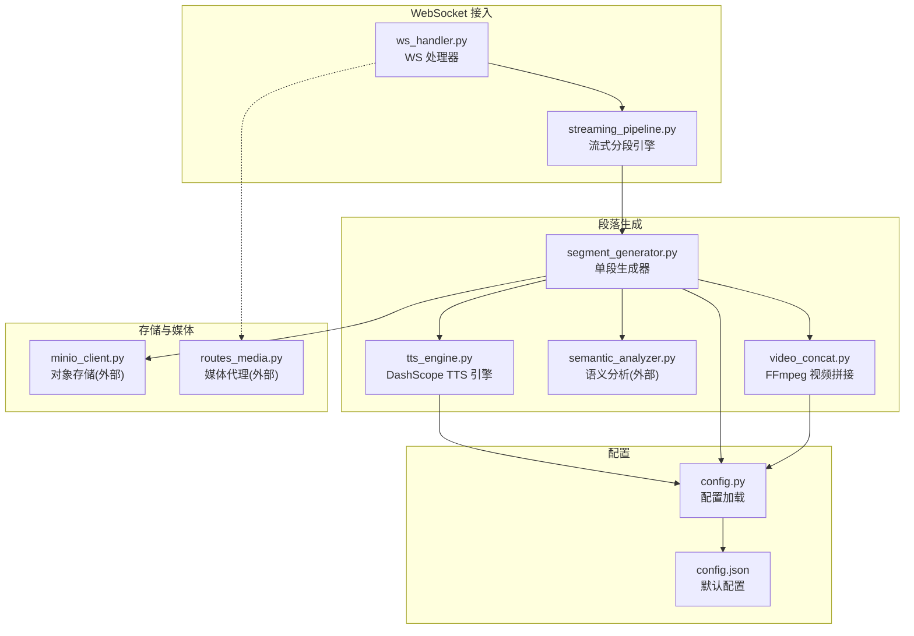
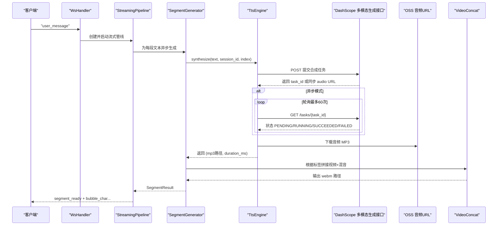
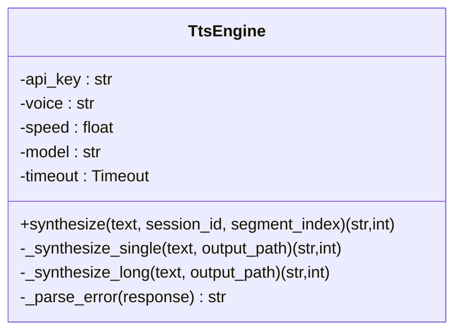
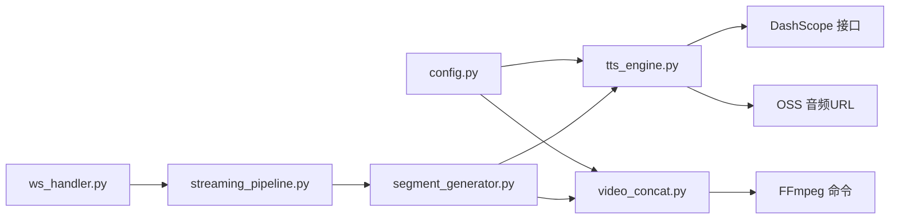

# TTS 语音合成服务

<cite>
**本文引用的文件**
- [server/services/tts_engine.py](file://server/services/tts_engine.py)
- [server/config.py](file://server/config.py)
- [config.json](file://config.json)
- [server/api/ws_handler.py](file://server/api/ws_handler.py)
- [server/pipeline/streaming_pipeline.py](file://server/pipeline/streaming_pipeline.py)
- [server/pipeline/segment_generator.py](file://server/pipeline/segment_generator.py)
- [server/services/video_concat.py](file://server/services/video_concat.py)
- [server/main.py](file://server/main.py)
</cite>

## 目录
1. [简介](#简介)
2. [项目结构](#项目结构)
3. [核心组件](#核心组件)
4. [架构总览](#架构总览)
5. [详细组件分析](#详细组件分析)
6. [依赖关系分析](#依赖关系分析)
7. [性能与并发特性](#性能与并发特性)
8. [配置指南](#配置指南)
9. [错误处理、重试与故障转移](#错误处理重试与故障转移)
10. [音频格式与后处理](#音频格式与后处理)
11. [故障排查](#故障排查)
12. [结论](#结论)

## 简介
本文件面向集成与运维人员，系统化说明本项目中基于阿里云 DashScope 的 TTS（文本转语音）语音合成服务的实现与对接方式。内容涵盖：
- 文本预处理与分段策略
- API 调用流程（任务提交、轮询结果、音频下载）
- 音频格式与采样率参数
- 长文本拼接与 FFmpeg 处理
- 语音类型、语速调节等高级能力
- 配置管理（API Key、环境变量覆盖）、配额与成本控制建议
- 错误处理机制、超时控制与降级方案

## 项目结构
TTS 相关代码主要位于服务端 services 与 pipeline 层，配合 WebSocket 流式处理链路完成“边生成边播放”的体验。

图表来源
- [server/api/ws_handler.py:168-187](file://server/api/ws_handler.py#L168-L187)
- [server/pipeline/streaming_pipeline.py:44-131](file://server/pipeline/streaming_pipeline.py#L44-L131)
- [server/pipeline/segment_generator.py:42-138](file://server/pipeline/segment_generator.py#L42-L138)
- [server/services/tts_engine.py:38-167](file://server/services/tts_engine.py#L38-L167)
- [server/services/video_concat.py:30-72](file://server/services/video_concat.py#L30-L72)
- [server/config.py:148-241](file://server/config.py#L148-L241)
- [config.json:1-39](file://config.json#L1-L39)

章节来源
- [server/api/ws_handler.py:168-187](file://server/api/ws_handler.py#L168-L187)
- [server/pipeline/streaming_pipeline.py:44-131](file://server/pipeline/streaming_pipeline.py#L44-L131)
- [server/pipeline/segment_generator.py:42-138](file://server/pipeline/segment_generator.py#L42-L138)
- [server/services/tts_engine.py:38-167](file://server/services/tts_engine.py#L38-L167)
- [server/services/video_concat.py:30-72](file://server/services/video_concat.py#L30-L72)
- [server/config.py:148-241](file://server/config.py#L148-L241)
- [config.json:1-39](file://config.json#L1-L39)

## 核心组件
- TtsEngine：封装 DashScope 多模态生成接口，负责提交任务、轮询结果、下载音频、时长估算与长文本拆分拼接。
- SegmentGenerator：串联 TTS、语义分析、视频拼接与上传，输出带标签的视频片段。
- StreamingPipeline：按句切分、首段优先推送、逐段确认式推进，保障低延迟体验。
- VideoConcat：根据语义标签选择视频切片，使用 FFmpeg concat 与混音生成最终 webm。
- 配置模块：统一从 config.json 与环境变量合并加载，支持运行时重载。

章节来源
- [server/services/tts_engine.py:38-167](file://server/services/tts_engine.py#L38-L167)
- [server/pipeline/segment_generator.py:27-138](file://server/pipeline/segment_generator.py#L27-L138)
- [server/pipeline/streaming_pipeline.py:16-131](file://server/pipeline/streaming_pipeline.py#L16-L131)
- [server/services/video_concat.py:20-72](file://server/services/video_concat.py#L20-L72)
- [server/config.py:148-241](file://server/config.py#L148-L241)

## 架构总览
下图展示一次用户消息到语音合成的端到端流程，突出 TTS 在其中的位置与关键交互。

图表来源
- [server/api/ws_handler.py:168-187](file://server/api/ws_handler.py#L168-L187)
- [server/pipeline/streaming_pipeline.py:44-131](file://server/pipeline/streaming_pipeline.py#L44-L131)
- [server/pipeline/segment_generator.py:42-138](file://server/pipeline/segment_generator.py#L42-L138)
- [server/services/tts_engine.py:78-167](file://server/services/tts_engine.py#L78-L167)
- [server/services/video_concat.py:30-72](file://server/services/video_concat.py#L30-L72)

## 详细组件分析

### TtsEngine（DashScope TTS 引擎）
- 功能要点
  - 通过全局信号量限制并发，避免触发 429 限流。
  - 短文本直接调用多模态生成接口；长文本按句子边界拆分，分别合成后再用 FFmpeg 拼接。
  - 支持同步返回与异步任务两种响应形态，兼容不同模型行为。
  - 音频下载强制 HTTPS，防止被对象存储拒绝。
  - 时长估算基于文件大小与码率近似计算。
- 关键参数
  - 音色 voice → model 映射，如 Cherry/Stella 对应 qwen3-tts-flash，longanyang/longxiaoxia 对应 cosyvoice-v3-flash。
  - 音频参数：format=mp3，sample_rate=24000，speech_rate 由配置提供。
- 错误与异常
  - 自定义 TtsError，包含任务提交失败、未返回 task_id、下载失败、合成失败、超时等场景。
- 并发与超时
  - httpx 超时：连接 10s，整体 120s。
  - 轮询上限 60 次，每次间隔 1s。

图表来源
- [server/services/tts_engine.py:38-167](file://server/services/tts_engine.py#L38-L167)

章节来源
- [server/services/tts_engine.py:16-167](file://server/services/tts_engine.py#L16-L167)

### SegmentGenerator（单段生成器）
- 职责
  - 顺序执行：TTS → 语义分析 → 视频拼接 → MinIO 上传（失败回退本地）。
  - 将 TtsError、VideoConcatError 等异常包装为 SegmentResult.error，便于上层统一处理。
- 优化点
  - 首段可跳过 LLM 语义分析，采用关键词回退，显著降低首帧延迟。

章节来源
- [server/pipeline/segment_generator.py:27-138](file://server/pipeline/segment_generator.py#L27-L138)

### StreamingPipeline（流式分段引擎）
- 职责
  - 接收完整回复文本，按句切分，并行生成各段。
  - 首段就绪立即推送，后续段等待前端 ack_played 确认后依次推送。
  - 打字机气泡效果按字符推送，时间受视频时长约束。
- 取消与错误
  - 支持 cancel 事件中断流水线，清理未完成的任务。

章节来源
- [server/pipeline/streaming_pipeline.py:16-131](file://server/pipeline/streaming_pipeline.py#L16-L131)

### VideoConcat（视频拼接）
- 职责
  - 根据语义标签选择 .webm 切片，构建 concat 列表，必要时循环填充最后一个切片以对齐目标时长。
  - 使用 FFmpeg concat demuxer 拷贝视频流，并将 TTS 生成的 MP3 混入为 Opus 编码。
- 错误
  - 找不到切片、FFmpeg 不可用或执行失败、超时等抛出 VideoConcatError。

章节来源
- [server/services/video_concat.py:20-149](file://server/services/video_concat.py#L20-L149)

### WsHandler 与主入口
- WsHandler
  - 维护会话上下文，创建 SegmentGenerator 与 StreamingPipeline，驱动流式处理。
  - 对 TTS 失败进行错误上报与状态重置。
- main.py
  - 应用生命周期内初始化 Redis、MinIO、Qdrant、Embedding 等依赖，注册路由与中间件。

章节来源
- [server/api/ws_handler.py:168-187](file://server/api/ws_handler.py#L168-L187)
- [server/main.py:42-110](file://server/main.py#L42-L110)

## 依赖关系分析
- 配置依赖
  - TtsEngine、VideoConcat 均通过 get_config() 读取 tts、ffmpeg、avatar 等配置项。
- 外部服务
  - DashScope 多模态生成接口与任务查询接口。
  - 对象存储（OSS）提供的音频下载链接。
  - FFmpeg 命令行工具用于音视频处理。
  - MinIO 用于持久化视频片段（可选，失败回退本地）。

图表来源
- [server/config.py:148-241](file://server/config.py#L148-L241)
- [server/services/tts_engine.py:38-167](file://server/services/tts_engine.py#L38-L167)
- [server/services/video_concat.py:20-72](file://server/services/video_concat.py#L20-L72)
- [server/pipeline/segment_generator.py:27-138](file://server/pipeline/segment_generator.py#L27-L138)
- [server/pipeline/streaming_pipeline.py:16-131](file://server/pipeline/streaming_pipeline.py#L16-L131)
- [server/api/ws_handler.py:168-187](file://server/api/ws_handler.py#L168-L187)

章节来源
- [server/config.py:148-241](file://server/config.py#L148-L241)
- [server/services/tts_engine.py:38-167](file://server/services/tts_engine.py#L38-L167)
- [server/services/video_concat.py:20-72](file://server/services/video_concat.py#L20-L72)
- [server/pipeline/segment_generator.py:27-138](file://server/pipeline/segment_generator.py#L27-L138)
- [server/pipeline/streaming_pipeline.py:16-131](file://server/pipeline/streaming_pipeline.py#L16-L131)
- [server/api/ws_handler.py:168-187](file://server/api/ws_handler.py#L168-L187)

## 性能与并发特性
- 并发控制
  - 全局信号量限制同时进行的 TTS 请求数，避免触发 429 限流。
- 首段优先
  - 首段跳过 LLM 语义分析，减少首帧延迟。
- 流式推送
  - 首段完成后立即推送，后续段按 ack 推进，提升感知速度。
- 资源占用
  - FFmpeg 操作为子进程，注意系统负载与磁盘 I/O。

[本节为通用性能讨论，不直接分析具体文件]

## 配置指南
- 配置来源与优先级
  - 配置文件：config.json
  - 环境变量：DASHSCOPE_API_KEY、TTS_VOICE、TTS_SPEED 等
  - 合并规则：环境变量非空则覆盖 JSON 配置
- 关键配置项
  - tts.api_key：DashScope API Key
  - tts.voice：音色名称（Cherry/Stella/longanyang/longxiaoxia 等）
  - tts.speed：语速倍率（默认 1.0）
  - ffmpeg.path：FFmpeg 可执行路径
  - avatar.clips_dir：视频切片目录
- 示例配置键路径
  - config.json 中的 tts 节点
  - server/config.py 中的 AppConfig 字段与别名

章节来源
- [config.json:8-12](file://config.json#L8-L12)
- [server/config.py:87-91](file://server/config.py#L87-L91)
- [server/config.py:194-199](file://server/config.py#L194-L199)

## 错误处理、重试与故障转移
- TTS 错误
  - 任务提交失败、未返回 task_id、音频下载失败、合成失败、超时等，均抛出 TtsError。
  - 当前实现未内置指数退避重试，建议在调用方（SegmentGenerator 或上游）增加重试逻辑。
- 视频拼接错误
  - FFmpeg 不可用、执行失败、超时等抛出 VideoConcatError。
- 流式管线错误
  - Pipeline 捕获异常并推送 error 事件，同时将状态置为 idle。
- 故障转移
  - MinIO 上传失败时回退本地路径，保证基本可用性。
  - RAG 检索失败时降级为纯 LLM 回复（与本 TTS 文档无关但影响整体链路）。

章节来源
- [server/services/tts_engine.py:103-167](file://server/services/tts_engine.py#L103-L167)
- [server/services/video_concat.py:141-149](file://server/services/video_concat.py#L141-L149)
- [server/pipeline/streaming_pipeline.py:127-131](file://server/pipeline/streaming_pipeline.py#L127-L131)
- [server/pipeline/segment_generator.py:98-106](file://server/pipeline/segment_generator.py#L98-L106)

## 音频格式与后处理
- 输入/输出
  - TTS 输出 MP3，采样率 24000Hz，码率约 128kbps（用于时长估算）。
  - 最终视频为 WebM，音频编码为 Opus，视频流拷贝无重编码。
- 长文本拼接
  - 超过阈值的文本按句子边界拆分，分别合成后用 FFmpeg concat 拼接为一个 MP3。
- 时长估算
  - 基于文件大小与码率的粗略估算，最小值保底。
- 音量标准化
  - 当前实现未包含音量归一化步骤，可在 FFmpeg 混音阶段添加相应滤镜以实现。

章节来源
- [server/services/tts_engine.py:93-98](file://server/services/tts_engine.py#L93-L98)
- [server/services/tts_engine.py:154-159](file://server/services/tts_engine.py#L154-L159)
- [server/services/tts_engine.py:169-226](file://server/services/tts_engine.py#L169-L226)
- [server/services/video_concat.py:116-149](file://server/services/video_concat.py#L116-L149)

## 故障排查
- 常见问题定位
  - 429 限流：检查并发信号量阈值与业务峰值，适当降低并发或扩容。
  - 音频下载失败：确认 OSS 链接是否 HTTPS，网络可达性与鉴权。
  - FFmpeg 不可用：检查 ffmpeg.path 是否正确，系统 PATH 是否包含可执行文件。
  - 视频拼接失败：查看 FFmpeg 错误日志，确认切片文件存在且路径正确。
- 日志关键字
  - “TTS 任务提交失败”、“TTS 音频下载失败”、“TTS 合成失败”、“TTS 合成超时”
  - “FFmpeg 执行失败”、“找不到 FFmpeg 可执行文件”

章节来源
- [server/services/tts_engine.py:103-167](file://server/services/tts_engine.py#L103-L167)
- [server/services/video_concat.py:141-149](file://server/services/video_concat.py#L141-L149)

## 结论
本项目通过 TtsEngine 对接 DashScope 多模态生成接口，结合流式管线与 FFmpeg 后处理，实现了低延迟、高可用的实时语音合成与播报。通过合理的并发控制、错误处理与降级策略，系统在复杂网络与服务波动下仍具备良好鲁棒性。建议在生产环境补充重试与熔断策略，并根据业务需求扩展情感表达与更精细的音频后处理能力。