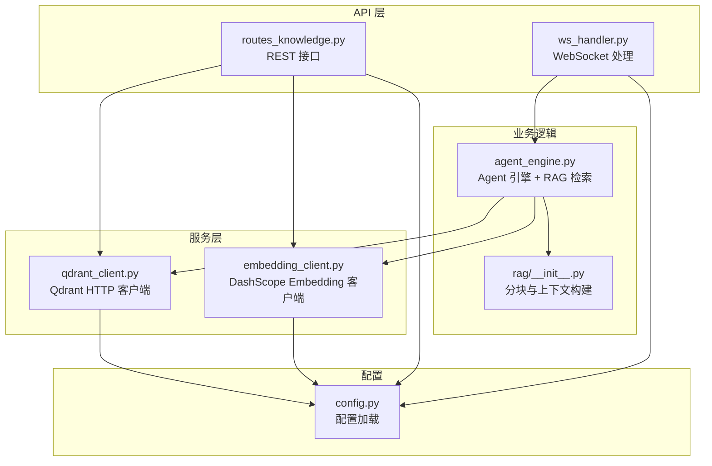
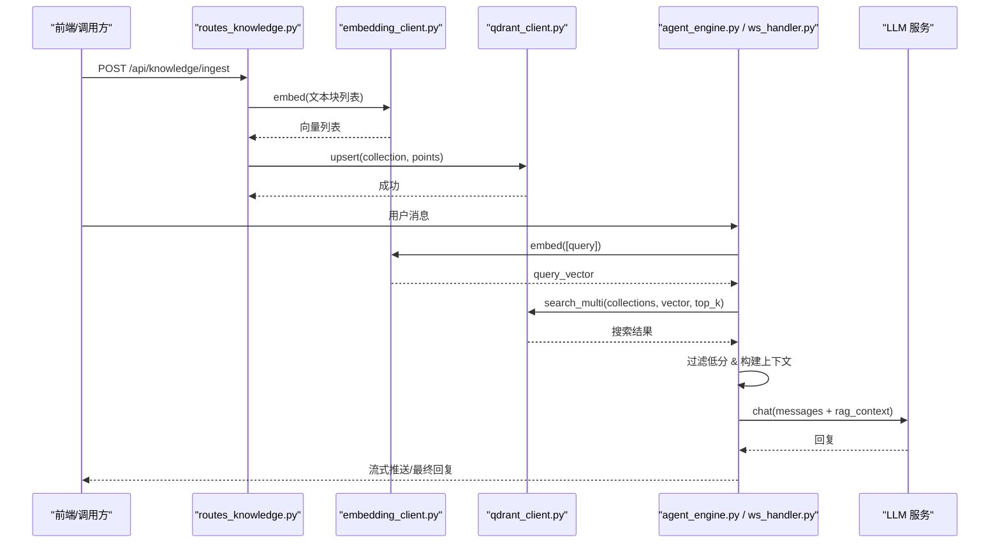
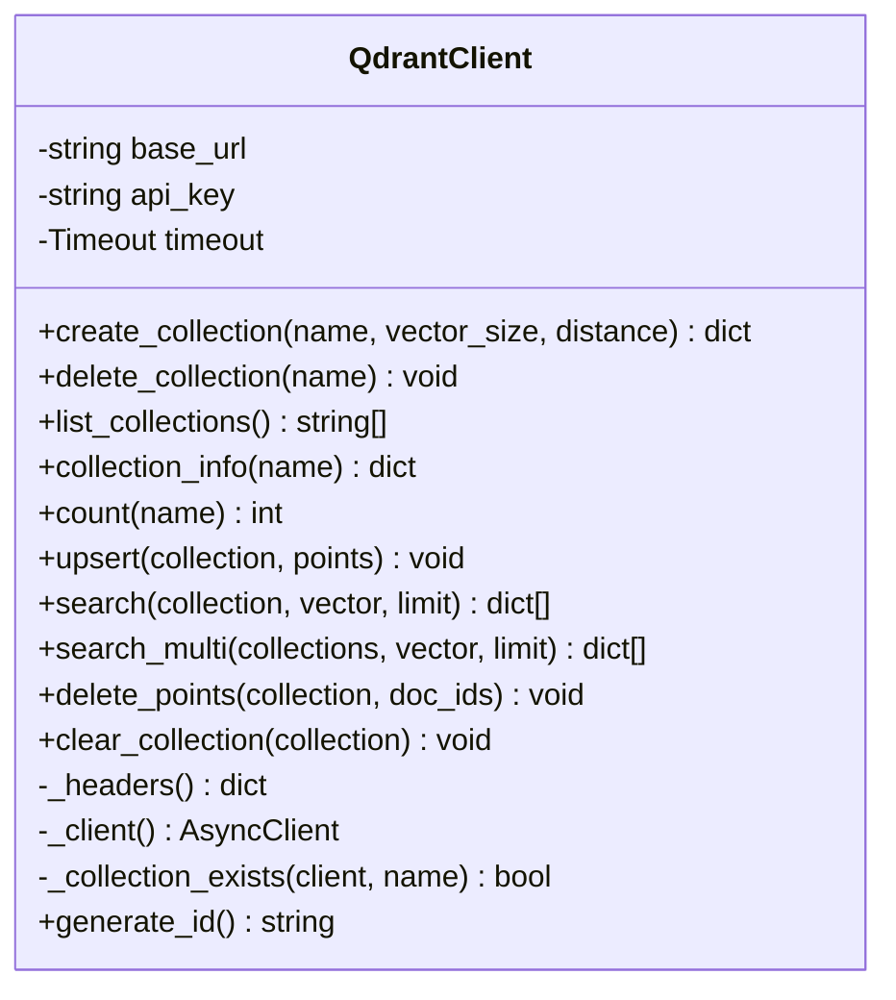
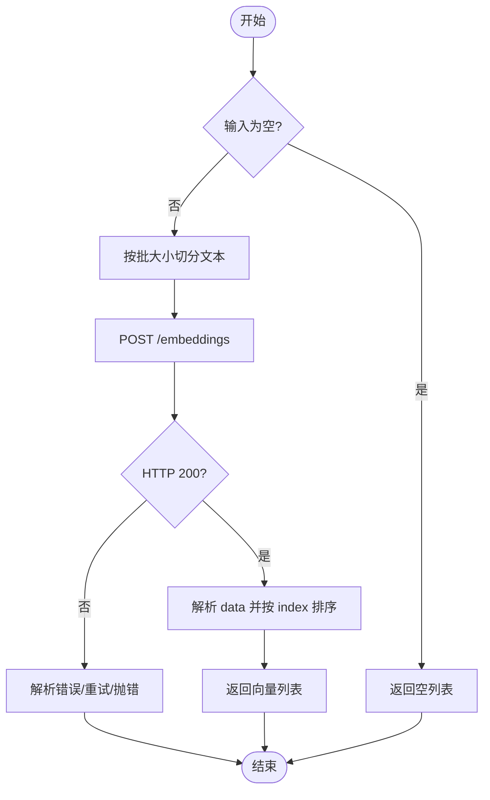
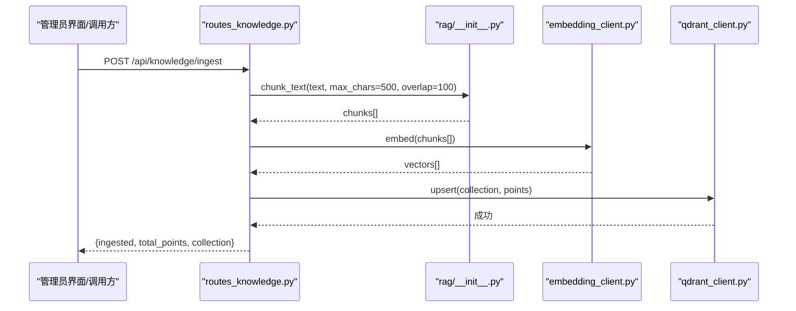
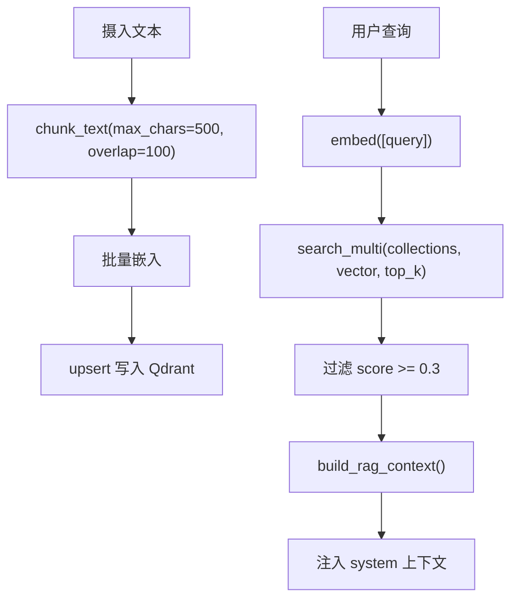
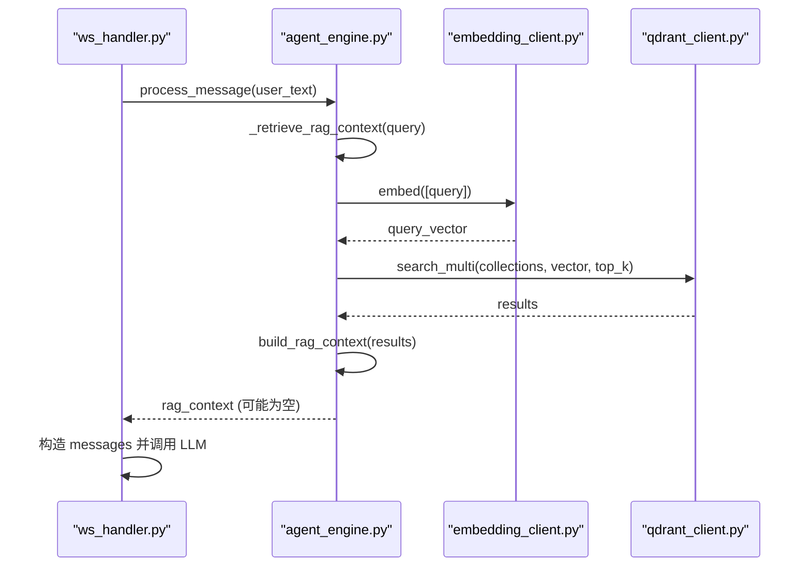
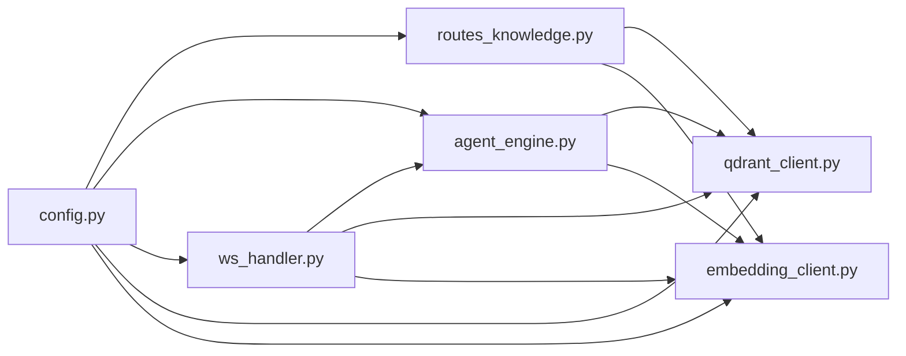

# 向量数据库集成

<cite>
**本文引用的文件**   
- [server/services/qdrant_client.py](file://server/services/qdrant_client.py)
- [server/services/embedding_client.py](file://server/services/embedding_client.py)
- [server/api/routes_knowledge.py](file://server/api/routes_knowledge.py)
- [server/rag/__init__.py](file://server/rag/__init__.py)
- [server/agent/agent_engine.py](file://server/agent/agent_engine.py)
- [server/api/ws_handler.py](file://server/api/ws_handler.py)
- [server/config.py](file://server/config.py)
- [doc/Qdrant知识库操作指南.md](file://doc/Qdrant知识库操作指南.md)
</cite>

## 目录
1. [简介](#简介)
2. [项目结构](#项目结构)
3. [核心组件](#核心组件)
4. [架构总览](#架构总览)
5. [详细组件分析](#详细组件分析)
6. [依赖关系分析](#依赖关系分析)
7. [性能与索引优化](#性能与索引优化)
8. [配置与服务部署](#配置与服务部署)
9. [数据迁移、备份与恢复](#数据迁移备份与恢复)
10. [监控与告警](#监控与告警)
11. [故障排查](#故障排查)
12. [使用示例与最佳实践](#使用示例与最佳实践)
13. [结论](#结论)

## 简介
本技术文档围绕 Qdrant 向量数据库的客户端封装与 RAG（检索增强生成）集成，系统性说明集合管理、向量索引、相似度搜索、向量化流程、检索算法、元数据与批量操作、服务配置、数据迁移与备份恢复、监控告警以及实际使用示例与最佳实践。目标是帮助开发者快速理解并高效运维该向量知识库子系统。

## 项目结构
与向量数据库集成相关的核心代码位于 server 目录下，主要涉及：
- 服务层：Qdrant HTTP 客户端、Embedding 客户端
- API 层：知识管理 REST 接口（集合管理、摄入、统计、清空、调试搜索）
- RAG 模块：文本分块与上下文构建
- Agent 引擎与 WebSocket 处理器：对话中的 RAG 检索与降级策略
- 配置中心：统一加载环境变量与 JSON 配置

图表来源
- [server/api/routes_knowledge.py:1-268](file://server/api/routes_knowledge.py#L1-L268)
- [server/api/ws_handler.py:342-400](file://server/api/ws_handler.py#L342-L400)
- [server/agent/agent_engine.py:123-181](file://server/agent/agent_engine.py#L123-L181)
- [server/rag/__init__.py:1-83](file://server/rag/__init__.py#L1-L83)
- [server/services/qdrant_client.py:1-235](file://server/services/qdrant_client.py#L1-L235)
- [server/services/embedding_client.py:1-149](file://server/services/embedding_client.py#L1-L149)
- [server/config.py:111-138](file://server/config.py#L111-L138)

章节来源
- [server/api/routes_knowledge.py:1-268](file://server/api/routes_knowledge.py#L1-L268)
- [server/api/ws_handler.py:342-400](file://server/api/ws_handler.py#L342-L400)
- [server/agent/agent_engine.py:123-181](file://server/agent/agent_engine.py#L123-L181)
- [server/rag/__init__.py:1-83](file://server/rag/__init__.py#L1-L83)
- [server/services/qdrant_client.py:1-235](file://server/services/qdrant_client.py#L1-L235)
- [server/services/embedding_client.py:1-149](file://server/services/embedding_client.py#L1-L149)
- [server/config.py:111-138](file://server/config.py#L111-L138)

## 核心组件
- Qdrant 客户端：提供集合管理、点写入、单集合搜索、多集合并发搜索、删除与清空等能力，基于 httpx 异步调用 Qdrant REST API。
- Embedding 客户端：对接 DashScope text-embedding-v3，支持批量嵌入与重试退避，返回固定维度向量。
- 知识管理 API：暴露集合 CRUD、知识摄入（自动分块+批量嵌入+upsert）、统计、清空、调试搜索等端点，受 Admin Token 保护。
- RAG 模块：实现文本分块与检索结果到 LLM 上下文的格式化注入。
- Agent 引擎与 WS 处理器：在对话中执行 RAG 检索，按角色-集合映射选择范围，失败时降级为纯 LLM 回复。
- 配置中心：合并 config.json 与环境变量，提供 qdrant、embedding、rag 等配置项。

章节来源
- [server/services/qdrant_client.py:26-235](file://server/services/qdrant_client.py#L26-L235)
- [server/services/embedding_client.py:26-149](file://server/services/embedding_client.py#L26-L149)
- [server/api/routes_knowledge.py:78-268](file://server/api/routes_knowledge.py#L78-L268)
- [server/rag/__init__.py:10-83](file://server/rag/__init__.py#L10-L83)
- [server/agent/agent_engine.py:59-181](file://server/agent/agent_engine.py#L59-L181)
- [server/api/ws_handler.py:342-400](file://server/api/ws_handler.py#L342-L400)
- [server/config.py:111-138](file://server/config.py#L111-L138)

## 架构总览
RAG 整体流程：用户提问 → 向量化 → 多集合并发检索 → 合并排序 → 过滤低分 → 注入上下文 → LLM 生成回答；若检索不可用或分数过低则降级为纯 LLM 回复。

图表来源
- [server/api/routes_knowledge.py:134-186](file://server/api/routes_knowledge.py#L134-L186)
- [server/services/embedding_client.py:47-70](file://server/services/embedding_client.py#L47-L70)
- [server/services/qdrant_client.py:115-186](file://server/services/qdrant_client.py#L115-L186)
- [server/agent/agent_engine.py:123-181](file://server/agent/agent_engine.py#L123-L181)
- [server/api/ws_handler.py:342-400](file://server/api/ws_handler.py#L342-L400)

## 详细组件分析

### Qdrant 客户端封装
- 集合管理：创建（幂等检查）、删除、列出、详情、计数。
- 数据操作：批量 upsert、单集合搜索、多集合并发搜索（合并后按分数降序取 top_k）、按 ID 批量删除、清空重建。
- 鉴权：通过请求头 api-key 传递 Qdrant API Key。
- 错误处理：自定义异常携带状态码，便于上层区分 404/5xx 等。

图表来源
- [server/services/qdrant_client.py:26-235](file://server/services/qdrant_client.py#L26-L235)

章节来源
- [server/services/qdrant_client.py:26-235](file://server/services/qdrant_client.py#L26-L235)

### Embedding 客户端
- 模型与维度：text-embedding-v3，固定 1024 维。
- 批量处理：默认批大小 10，内部循环分批调用。
- 重试与限流：对 429/5xx/超时/连接错误进行有限次重试与退避。
- 错误解析：从响应体提取错误信息，抛出带状态码的异常。

图表来源
- [server/services/embedding_client.py:47-135](file://server/services/embedding_client.py#L47-L135)

章节来源
- [server/services/embedding_client.py:26-149](file://server/services/embedding_client.py#L26-L149)

### 知识管理 API
- 鉴权：X-Knowledge-Admin-Token 头校验，未配置时放行。
- 集合管理：GET/POST/DELETE /collections，含名称规范化与小写下划线转换。
- 知识摄入：POST /ingest，自动分块（段落优先，超长窗口滑动），批量嵌入，upsert 写入，返回 ingested 与 total_points。
- 统计：GET /stats，支持按集合或汇总统计。
- 清空：DELETE /clear，保留集合定义。
- 调试搜索：GET /search，支持指定集合或跨集合搜索，返回 score、text、source、collection。

图表来源
- [server/api/routes_knowledge.py:134-186](file://server/api/routes_knowledge.py#L134-L186)
- [server/rag/__init__.py:10-53](file://server/rag/__init__.py#L10-L53)
- [server/services/embedding_client.py:47-70](file://server/services/embedding_client.py#L47-L70)
- [server/services/qdrant_client.py:115-134](file://server/services/qdrant_client.py#L115-L134)

章节来源
- [server/api/routes_knowledge.py:78-268](file://server/api/routes_knowledge.py#L78-L268)

### RAG 检索与上下文构建
- 分块：优先按段落拼接，超过阈值按字符窗口滑动切分，保证语义连续性。
- 上下文构建：过滤低分结果（score < 0.3），将相关片段编号输出为可注入 LLM 的提示文本。
- 检索范围：根据 role_collections 配置决定“全部集合”或“指定集合”，当前角色固定为“普兰”。

图表来源
- [server/rag/__init__.py:10-83](file://server/rag/__init__.py#L10-L83)
- [server/agent/agent_engine.py:123-181](file://server/agent/agent_engine.py#L123-L181)
- [server/api/ws_handler.py:342-400](file://server/api/ws_handler.py#L342-L400)

章节来源
- [server/rag/__init__.py:10-83](file://server/rag/__init__.py#L10-L83)
- [server/agent/agent_engine.py:123-181](file://server/agent/agent_engine.py#L123-L181)
- [server/api/ws_handler.py:342-400](file://server/api/ws_handler.py#L342-L400)

### 对话中的 RAG 集成与降级
- AgentEngine 与 WsHandler 均实现 _retrieve_rag_context，流程一致：解析角色-集合映射 → 确定集合范围 → 向量化查询 → 并发检索 → 构建上下文 → 注入 messages。
- 降级策略：当客户端未注入、无集合、检索为空或异常时，直接走纯 LLM 回复。

图表来源
- [server/agent/agent_engine.py:123-181](file://server/agent/agent_engine.py#L123-L181)
- [server/api/ws_handler.py:342-400](file://server/api/ws_handler.py#L342-L400)

章节来源
- [server/agent/agent_engine.py:123-181](file://server/agent/agent_engine.py#L123-L181)
- [server/api/ws_handler.py:342-400](file://server/api/ws_handler.py#L342-L400)

## 依赖关系分析
- API 层依赖服务层：routes_knowledge 依赖 qdrant_client 与 embedding_client。
- Agent 层依赖服务层：agent_engine 与 ws_handler 在对话路径中使用 qdrant_client 与 embedding_client。
- 配置集中化：所有服务通过 get_config() 获取 qdrant、embedding、rag 等配置。

图表来源
- [server/api/routes_knowledge.py:1-268](file://server/api/routes_knowledge.py#L1-L268)
- [server/agent/agent_engine.py:1-181](file://server/agent/agent_engine.py#L1-L181)
- [server/api/ws_handler.py:1-444](file://server/api/ws_handler.py#L1-L444)
- [server/services/qdrant_client.py:1-235](file://server/services/qdrant_client.py#L1-L235)
- [server/services/embedding_client.py:1-149](file://server/services/embedding_client.py#L1-L149)
- [server/config.py:111-138](file://server/config.py#L111-L138)

章节来源
- [server/api/routes_knowledge.py:1-268](file://server/api/routes_knowledge.py#L1-L268)
- [server/agent/agent_engine.py:1-181](file://server/agent/agent_engine.py#L1-L181)
- [server/api/ws_handler.py:1-444](file://server/api/ws_handler.py#L1-L444)
- [server/services/qdrant_client.py:1-235](file://server/services/qdrant_client.py#L1-L235)
- [server/services/embedding_client.py:1-149](file://server/services/embedding_client.py#L1-L149)
- [server/config.py:111-138](file://server/config.py#L111-L138)

## 性能与索引优化
- 向量维度与距离度量：集合创建时指定 vector_size=1024，distance=Cosine，与 text-embedding-v3 输出维度一致，确保余弦相似度计算正确。
- 批量写入：upsert 支持批量 points，减少网络往返；建议合理控制批次大小以平衡吞吐与内存占用。
- 并发检索：search_multi 使用 asyncio.gather 并发搜索多个集合，提升召回效率；注意集合数量与网络延迟。
- 检索阈值：RAG 上下文构建过滤 score < 0.3 的结果，避免噪声干扰 LLM 生成。
- 超时与重试：Embedding 客户端对 429/5xx/超时进行有限重试与退避，提高稳定性。

章节来源
- [server/services/qdrant_client.py:37-102](file://server/services/qdrant_client.py#L37-L102)
- [server/services/qdrant_client.py:115-186](file://server/services/qdrant_client.py#L115-L186)
- [server/services/embedding_client.py:84-135](file://server/services/embedding_client.py#L84-L135)
- [server/rag/__init__.py:69-83](file://server/rag/__init__.py#L69-L83)

## 配置与服务部署
- Qdrant 配置：
  - QDRANT_URL：服务地址，默认 http://localhost:6333
  - QDRANT_API_KEY：可选，用于请求头 api-key 鉴权
- Embedding 配置：
  - EMBEDDING_ENDPOINT：DashScope 端点，默认 https://api.openai.com/v1
  - DASHSCOPE_API_KEY：API Key
  - EMBEDDING_MODEL：text-embedding-v3
- RAG 配置：
  - RAG_TOP_K：检索条数，默认 5
  - ROLE_COLLECTIONS：角色-集合映射，JSON 字符串，如 {"普兰": "*"} 表示搜索全部集合
- 知识管理鉴权：
  - KNOWLEDGE_ADMIN_TOKEN：管理接口访问令牌，留空则跳过鉴权

章节来源
- [server/config.py:111-138](file://server/config.py#L111-L138)
- [server/config.py:188-239](file://server/config.py#L188-L239)
- [doc/Qdrant知识库操作指南.md:28-36](file://doc/Qdrant知识库操作指南.md#L28-L36)

## 数据迁移、备份与恢复
- 迁移策略：
  - 导出：通过 list_collections 与 count 统计各集合规模；结合外部工具导出 Qdrant 数据（例如快照或备份）。
  - 导入：在新环境创建集合（保持相同 vector_size 与 distance），再批量 upsert 历史数据。
- 清空与重建：
  - clear_collection 会删除并重建集合，保留集合定义，适合快速重置数据。
- 注意事项：
  - 删除集合不可恢复，需提前备份。
  - 迁移前后验证集合信息与点数一致性。

章节来源
- [server/services/qdrant_client.py:206-212](file://server/services/qdrant_client.py#L206-L212)
- [server/api/routes_knowledge.py:220-230](file://server/api/routes_knowledge.py#L220-L230)
- [doc/Qdrant知识库操作指南.md:210-213](file://doc/Qdrant知识库操作指南.md#L210-L213)

## 监控与告警
- 日志记录：
  - Qdrant 客户端：集合创建/删除、upsert 数量、搜索失败等关键路径均有日志。
  - Embedding 客户端：嵌入完成、错误解析与重试日志。
  - 知识管理 API：摄入、统计、清空、搜索等操作的错误日志。
  - Agent/WS：RAG 检索过程、结果数量、top score 等指标日志。
- 建议告警：
  - 集合不存在或创建失败
  - upsert/search 返回非 200 状态码
  - Embedding 调用频繁限制或服务端错误
  - RAG 检索结果为空或最高分数低于阈值

章节来源
- [server/services/qdrant_client.py:46-111](file://server/services/qdrant_client.py#L46-L111)
- [server/services/qdrant_client.py:128-186](file://server/services/qdrant_client.py#L128-L186)
- [server/services/embedding_client.py:96-135](file://server/services/embedding_client.py#L96-L135)
- [server/api/routes_knowledge.py:114-186](file://server/api/routes_knowledge.py#L114-L186)
- [server/agent/agent_engine.py:166-181](file://server/agent/agent_engine.py#L166-L181)
- [server/api/ws_handler.py:387-400](file://server/api/ws_handler.py#L387-L400)

## 故障排查
- 无法连接到 Qdrant：
  - 检查 QDRANT_URL 是否正确，网络连通性，防火墙规则。
  - 确认集合是否存在，必要时先调用 create_collection。
- 鉴权失败：
  - Qdrant：确认 QDRANT_API_KEY 已设置且有效。
  - 知识管理接口：确认 X-Knowledge-Admin-Token 头与 KNOWLEDGE_ADMIN_TOKEN 一致。
- Embedding 调用失败：
  - 检查 EMBEDDING_ENDPOINT 与 DASHSCOPE_API_KEY。
  - 关注 429 限流与 5xx 服务端错误，客户端已内置重试。
- 检索结果为空或分数过低：
  - 确认集合中存在数据，role_collections 配置是否包含目标集合。
  - 调整 RAG_TOP_K 或优化知识内容以提升相关性。
- 清理集合后仍无法检索：
  - 确认 clear_collection 成功后重新摄入数据。

章节来源
- [server/services/qdrant_client.py:61-102](file://server/services/qdrant_client.py#L61-L102)
- [server/services/qdrant_client.py:115-134](file://server/services/qdrant_client.py#L115-L134)
- [server/services/embedding_client.py:84-135](file://server/services/embedding_client.py#L84-L135)
- [server/api/routes_knowledge.py:43-51](file://server/api/routes_knowledge.py#L43-L51)
- [server/agent/agent_engine.py:131-181](file://server/agent/agent_engine.py#L131-L181)
- [server/api/ws_handler.py:342-400](file://server/api/ws_handler.py#L342-L400)

## 使用示例与最佳实践
- 集合管理：
  - 新建集合：传入名称与 vector_size（默认 1024），系统会自动规范化名称。
  - 删除集合：谨慎操作，数据不可恢复。
- 知识摄入：
  - 长文本自动分块：段落优先，超长段落按 500 字窗口滑动，重叠 100 字。
  - 批量嵌入与 upsert：一次摄入多条文档，返回 ingested 与 total_points。
- 调试搜索：
  - 指定集合或跨集合搜索，返回 Top K 结果，展示 score、text、source、collection。
- 最佳实践：
  - 每条知识聚焦一个主题，使用完整陈述句，长度控制在 300-500 字。
  - 按主题分类组织集合，命名清晰，定期清理无效知识。
  - 先在「搜索知识」验证效果，再在对话中确认引用情况。

章节来源
- [server/api/routes_knowledge.py:105-128](file://server/api/routes_knowledge.py#L105-L128)
- [server/api/routes_knowledge.py:134-186](file://server/api/routes_knowledge.py#L134-L186)
- [server/api/routes_knowledge.py:233-268](file://server/api/routes_knowledge.py#L233-L268)
- [doc/Qdrant知识库操作指南.md:79-108](file://doc/Qdrant知识库操作指南.md#L79-L108)
- [doc/Qdrant知识库操作指南.md:174-192](file://doc/Qdrant知识库操作指南.md#L174-L192)

## 结论
本集成方案通过 Qdrant 客户端与 Embedding 客户端的组合，实现了稳定的向量存储与检索能力；配合 RAG 模块与 Agent/WS 层的检索流程，构建了高可用、可扩展的知识库体系。通过合理的配置、批量操作与并发检索策略，系统在性能与可用性方面具备良好表现。建议在运维中加强监控告警与数据备份，持续优化知识内容与集合组织，以获得更佳的检索与生成效果。