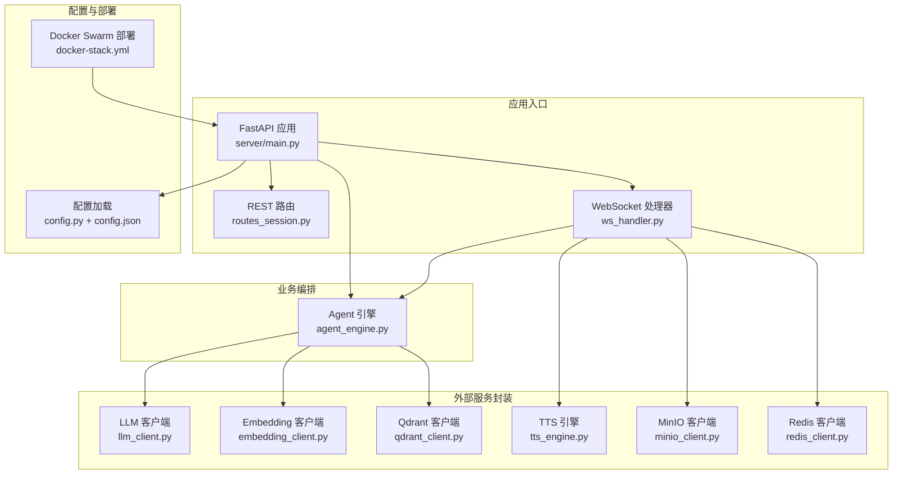
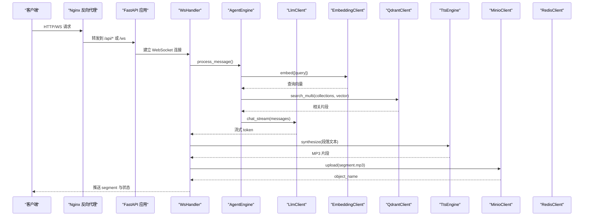
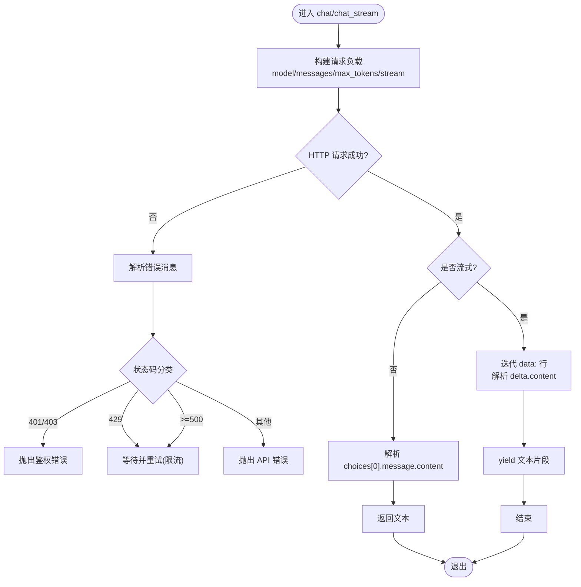
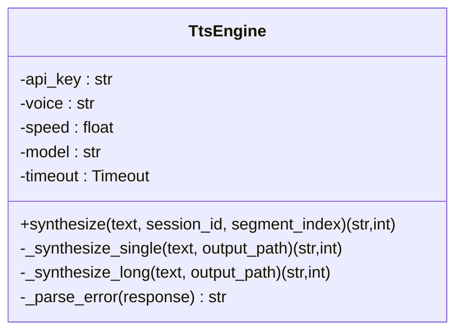
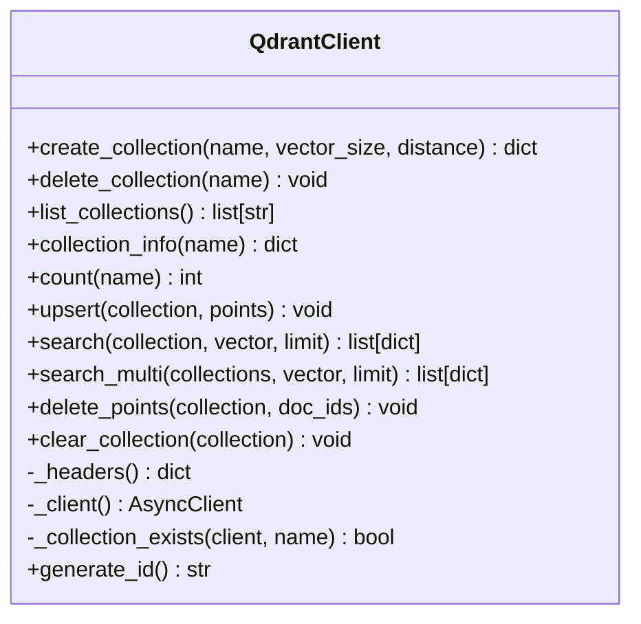
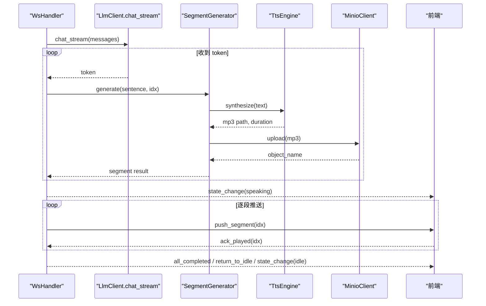
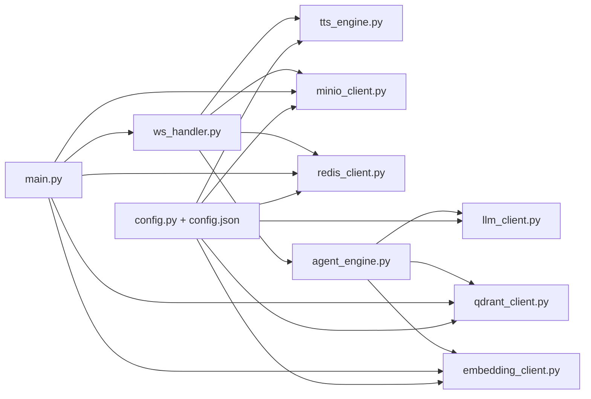

# 外部服务集成

<cite>
**本文引用的文件**   
- [server/main.py](file://server/main.py)
- [server/config.py](file://server/config.py)
- [config.json](file://config.json)
- [server/services/llm_client.py](file://server/services/llm_client.py)
- [server/services/tts_engine.py](file://server/services/tts_engine.py)
- [server/services/qdrant_client.py](file://server/services/qdrant_client.py)
- [server/services/embedding_client.py](file://server/services/embedding_client.py)
- [server/services/minio_client.py](file://server/services/minio_client.py)
- [server/services/redis_client.py](file://server/services/redis_client.py)
- [server/api/ws_handler.py](file://server/api/ws_handler.py)
- [server/api/routes_session.py](file://server/api/routes_session.py)
- [server/agent/agent_engine.py](file://server/agent/agent_engine.py)
- [docker-stack.yml](file://docker-stack.yml)
</cite>

## 目录
1. [简介](#简介)
2. [项目结构](#项目结构)
3. [核心组件](#核心组件)
4. [架构总览](#架构总览)
5. [详细组件分析](#详细组件分析)
6. [依赖关系分析](#依赖关系分析)
7. [性能与可靠性](#性能与可靠性)
8. [故障排查指南](#故障排查指南)
9. [结论](#结论)
10. [附录](#附录)

## 简介
本文件面向“外部服务集成”的架构设计与实现细节，聚焦以下目标：
- 抽象层设计模式：统一接口定义、适配器模式与插件化扩展点
- LLM 客户端：OpenAI 兼容 API 对接、流式响应处理、错误重试机制
- TTS 引擎：阿里云 DashScope 语音合成、音频格式转换与质量优化
- 向量数据库：Qdrant 客户端封装、索引策略与检索优化
- 对象存储：MinIO 上传下载、预签名 URL 生成与存储桶管理
- 服务发现、负载均衡与熔断降级：基于配置与部署拓扑的实现要点
- 监控、日志与性能调优：最佳实践与落地建议

## 项目结构
后端采用 FastAPI 作为入口，按“服务（services）+ 路由（api）+ 代理（agent）+ 流水线（pipeline）”分层组织。外部服务通过 services 层进行封装，上层通过统一的接口调用，便于替换与扩展。

图表来源
- [server/main.py:114-133](file://server/main.py#L114-L133)
- [server/config.py:148-241](file://server/config.py#L148-L241)
- [config.json:1-39](file://config.json#L1-L39)
- [docker-stack.yml:33-56](file://docker-stack.yml#L33-L56)

章节来源
- [server/main.py:1-191](file://server/main.py#L1-L191)
- [server/config.py:1-260](file://server/config.py#L1-L260)
- [config.json:1-39](file://config.json#L1-L39)
- [docker-stack.yml:1-73](file://docker-stack.yml#L1-L73)

## 核心组件
- 配置中心：集中管理各外部服务的连接参数，支持 JSON 与环境变量合并覆盖
- LLM 客户端：OpenAI 兼容 Chat Completions 接口，支持同步与流式两种模式，内置重试与限流处理
- Embedding 客户端：DashScope 文本嵌入，批量提交与顺序恢复
- Qdrant 客户端：集合管理与向量检索，支持多集合并发搜索与结果合并排序
- TTS 引擎：DashScope 多模态生成接口，异步任务轮询、长文本分段合成与 FFmpeg 拼接
- MinIO 客户端：对象存储上传、存在性检查、预签名 URL 生成与前缀删除
- Redis 客户端：会话状态与对话历史持久化，支持 TTL 与清理
- Agent 引擎：编排 LLM、RAG 检索与对话上下文管理，提供 Markdown 清洗等后处理

章节来源
- [server/config.py:16-126](file://server/config.py#L16-L126)
- [server/services/llm_client.py:23-113](file://server/services/llm_client.py#L23-L113)
- [server/services/embedding_client.py:26-70](file://server/services/embedding_client.py#L26-L70)
- [server/services/qdrant_client.py:26-186](file://server/services/qdrant_client.py#L26-L186)
- [server/services/tts_engine.py:38-167](file://server/services/tts_engine.py#L38-L167)
- [server/services/minio_client.py:21-139](file://server/services/minio_client.py#L21-L139)
- [server/services/redis_client.py:22-122](file://server/services/redis_client.py#L22-L122)
- [server/agent/agent_engine.py:59-121](file://server/agent/agent_engine.py#L59-L121)

## 架构总览
系统以 FastAPI 为网关，WS 通道承载实时交互；外部服务通过 services 层解耦，Agent 负责流程编排。配置由 config.py 统一加载，支持运行时覆盖。部署使用 Docker Swarm，服务间通过外部网络互联。

图表来源
- [server/main.py:146-170](file://server/main.py#L146-L170)
- [server/api/ws_handler.py:130-187](file://server/api/ws_handler.py#L130-L187)
- [server/agent/agent_engine.py:74-121](file://server/agent/agent_engine.py#L74-L121)
- [server/services/embedding_client.py:47-70](file://server/services/embedding_client.py#L47-L70)
- [server/services/qdrant_client.py:164-186](file://server/services/qdrant_client.py#L164-L186)
- [server/services/llm_client.py:115-190](file://server/services/llm_client.py#L115-L190)
- [server/services/tts_engine.py:49-167](file://server/services/tts_engine.py#L49-L167)
- [server/services/minio_client.py:69-90](file://server/services/minio_client.py#L69-L90)

## 详细组件分析

### 抽象层与适配器模式
- 统一接口定义：每个外部服务在 services 下提供独立类，暴露一致的异步方法（如 chat/chat_stream、embed、search、synthesize、upload 等），屏蔽底层差异
- 适配器模式：将不同厂商 API（OpenAI 兼容、DashScope、Qdrant REST、MinIO SDK）适配为内部统一接口，上层仅依赖抽象方法
- 插件化扩展点：新增外部服务时，只需在 services 中新增类并在 main.py 生命周期中初始化注入，无需改动上层逻辑

章节来源
- [server/services/llm_client.py:23-113](file://server/services/llm_client.py#L23-L113)
- [server/services/embedding_client.py:26-70](file://server/services/embedding_client.py#L26-L70)
- [server/services/qdrant_client.py:26-186](file://server/services/qdrant_client.py#L26-L186)
- [server/services/tts_engine.py:38-167](file://server/services/tts_engine.py#L38-L167)
- [server/services/minio_client.py:21-139](file://server/services/minio_client.py#L21-L139)
- [server/main.py:42-88](file://server/main.py#L42-L88)

### LLM 客户端（OpenAI 兼容 API）
- 统一端点：endpoint + model + max_tokens 从配置读取，默认 OpenAI 兼容路径
- 同步与流式：chat 返回完整文本；chat_stream 逐 token 产出，适合边生成边 TTS
- 错误与重试：对 429/5xx/超时/连接失败进行指数退避式重试（最多 2 次尝试），并区分鉴权错误直接抛出
- 错误解析：标准化 error.message 提取，便于上层展示与告警

图表来源
- [server/services/llm_client.py:40-113](file://server/services/llm_client.py#L40-L113)
- [server/services/llm_client.py:115-190](file://server/services/llm_client.py#L115-L190)
- [server/services/llm_client.py:192-204](file://server/services/llm_client.py#L192-L204)

章节来源
- [server/services/llm_client.py:23-204](file://server/services/llm_client.py#L23-L204)

### TTS 引擎（阿里云 DashScope）
- 模型映射：根据 voice 选择 qwen3-tts-flash 或 cosyvoice-v3-flash
- 异步任务：提交多模态生成任务，轮询 task_id 直至 SUCCEEDED/FAILED
- 长文本处理：超过阈值按句子拆分，分别合成后用 FFmpeg 拼接
- 并发控制：全局信号量限制并发数，避免触发 429 限流
- 音频质量：固定采样率与码率估算时长，确保播放节奏稳定

图表来源
- [server/services/tts_engine.py:38-167](file://server/services/tts_engine.py#L38-L167)
- [server/services/tts_engine.py:169-226](file://server/services/tts_engine.py#L169-L226)
- [server/services/tts_engine.py:228-234](file://server/services/tts_engine.py#L228-L234)

章节来源
- [server/services/tts_engine.py:1-234](file://server/services/tts_engine.py#L1-L234)

### 向量数据库（Qdrant）
- 集合管理：创建/删除/列表/信息/计数，幂等创建与健壮的错误处理
- 数据操作：upsert 批量写入、按 ID 删除、清空重建
- 检索优化：单集合 search 与多集合 search_multi（并发 gather + 合并排序）
- 鉴权：可选 api-key 头注入

图表来源
- [server/services/qdrant_client.py:26-235](file://server/services/qdrant_client.py#L26-L235)

章节来源
- [server/services/qdrant_client.py:1-235](file://server/services/qdrant_client.py#L1-L235)

### 文本嵌入（Embedding）
- 批量处理：按 batch_size 分批提交，保证顺序正确（按 index 排序）
- 错误重试：同 LLM 客户端的重试策略，区分鉴权/限流/服务端错误
- 维度约定：text-embedding-v3 输出 1024 维向量

章节来源
- [server/services/embedding_client.py:1-149](file://server/services/embedding_client.py#L1-L149)

### 对象存储（MinIO）
- 连接与可用性：构造客户端，自动检测可用性与 bucket 存在性
- 上传与存在性：fput_object 上传，stat_object 检查存在
- 预签名 URL：presigned_get_object 生成 GET 访问链接，带过期时间
- 前缀删除：递归列出并删除指定前缀下的对象，用于会话资源清理

章节来源
- [server/services/minio_client.py:1-139](file://server/services/minio_client.py#L1-L139)

### 会话与持久化（Redis）
- 会话状态：idle/thinking/speaking 等状态键，带 TTL
- 对话历史：rpush/lrange 保存与回放，JSON 序列化/反序列化
- 生命周期：创建/刷新 TTL/删除，配合内存 SessionContext 实现重连恢复

章节来源
- [server/services/redis_client.py:1-122](file://server/services/redis_client.py#L1-L122)
- [server/api/routes_session.py:28-123](file://server/api/routes_session.py#L28-L123)

### 实时流式处理（WebSocket）
- 连接管理：token 校验、会话恢复、connected 事件
- 流式 LLM：chat_stream 边接收边切分句子，立即启动段生成
- 段生成：TTS 合成 → 语义分析 → 视频拼接 → MinIO 上传
- 确认式推送：首段完成后立即推送，后续按 ack 推进，支持用户中断

图表来源
- [server/api/ws_handler.py:130-334](file://server/api/ws_handler.py#L130-L334)
- [server/services/llm_client.py:115-190](file://server/services/llm_client.py#L115-L190)
- [server/services/tts_engine.py:49-167](file://server/services/tts_engine.py#L49-L167)
- [server/services/minio_client.py:69-90](file://server/services/minio_client.py#L69-L90)

章节来源
- [server/api/ws_handler.py:1-444](file://server/api/ws_handler.py#L1-L444)

### RAG 检索增强
- 角色集合映射：role_collections 决定搜索范围（全部或指定集合）
- 检索流程：embed(query) → search_multi → build_rag_context → 注入 messages
- 降级策略：检索失败不影响主流程，回退为纯 LLM 回复

章节来源
- [server/agent/agent_engine.py:123-181](file://server/agent/agent_engine.py#L123-L181)
- [server/api/ws_handler.py:342-400](file://server/api/ws_handler.py#L342-L400)

## 依赖关系分析
- 配置依赖：所有 services 通过 get_config() 获取连接参数，支持环境变量覆盖
- 启动依赖：main.py 在 lifespan 中初始化 Redis、MinIO、Qdrant、Embedding，并注入 Agent
- 运行期依赖：WsHandler 组合 Agent、TTS、MinIO、Redis，形成端到端链路

图表来源
- [server/config.py:148-241](file://server/config.py#L148-L241)
- [server/main.py:42-88](file://server/main.py#L42-L88)
- [server/api/ws_handler.py:1-47](file://server/api/ws_handler.py#L1-L47)
- [server/agent/agent_engine.py:59-73](file://server/agent/agent_engine.py#L59-L73)

章节来源
- [server/main.py:42-88](file://server/main.py#L42-L88)
- [server/config.py:148-241](file://server/config.py#L148-L241)

## 性能与可靠性

### 服务发现与负载均衡
- 服务发现：Docker Swarm 环境下通过外部网络名访问 Redis、Qdrant、MinIO，服务名即发现地址
- 负载均衡：当前部署为单副本；如需水平扩展，可在 Swarm 中增加 server 副本并由网关层做请求分发

章节来源
- [docker-stack.yml:33-56](file://docker-stack.yml#L33-L56)
- [docker-stack.yml:57-73](file://docker-stack.yml#L57-L73)

### 熔断与降级
- 熔断：未实现显式熔断器；可通过外层网关或进程管理器实现快速失败与隔离
- 降级：RAG 检索失败自动降级为纯 LLM 回复；MinIO 不可用时跳过上传并记录警告；Qdrant 不可用则跳过知识库功能

章节来源
- [server/agent/agent_engine.py:178-181](file://server/agent/agent_engine.py#L178-L181)
- [server/services/minio_client.py:76-90](file://server/services/minio_client.py#L76-L90)
- [server/main.py:70-77](file://server/main.py#L70-L77)

### 监控与日志
- 日志：各模块使用标准 logging，包含关键步骤与错误堆栈
- 健康检查：/api/health 返回服务就绪状态与会话数量
- 指标采集：当前未集成 Prometheus/Grafana，建议在网关或服务侧增加指标导出中间件

章节来源
- [server/main.py:136-143](file://server/main.py#L136-L143)
- [server/services/llm_client.py:13-13](file://server/services/llm_client.py#L13-L13)
- [server/services/tts_engine.py:14-14](file://server/services/tts_engine.py#L14-L14)
- [server/services/qdrant_client.py:16-16](file://server/services/qdrant_client.py#L16-L16)
- [server/services/minio_client.py:13-13](file://server/services/minio_client.py#L13-L13)
- [server/services/redis_client.py:14-14](file://server/services/redis_client.py#L14-L14)

### 性能调优建议
- LLM/TTS 并发：合理设置 httpx 连接池大小与超时；TTS 使用信号量限制并发
- 流式处理：保持较短句子边界，减少首段延迟；必要时调整 buffer 阈值
- 向量检索：top_k 与集合数量需平衡，避免过多集合导致合并排序开销
- 对象存储：大文件上传建议使用分片；预签名 URL 过期时间按需调整

## 故障排查指南
- LLM 调用失败：检查 endpoint、api_key、model 配置；关注 429/5xx 重试日志
- TTS 合成失败：查看任务提交与轮询日志；确认 HTTPS 下载与 FFmpeg 环境
- Qdrant 检索异常：验证集合是否存在、向量维度匹配、api-key 是否正确
- MinIO 上传失败：检查 endpoint、bucket 权限、对象命名规范
- Redis 连接问题：核对 URL、密码特殊字符、端口与网络连通性
- WebSocket 断线：确认 Nginx 升级头转发与会话 token 有效性

章节来源
- [server/services/llm_client.py:78-113](file://server/services/llm_client.py#L78-L113)
- [server/services/tts_engine.py:100-167](file://server/services/tts_engine.py#L100-L167)
- [server/services/qdrant_client.py:37-103](file://server/services/qdrant_client.py#L37-L103)
- [server/services/minio_client.py:48-90](file://server/services/minio_client.py#L48-L90)
- [server/services/redis_client.py:31-50](file://server/services/redis_client.py#L31-L50)
- [server/api/ws_handler.py:57-73](file://server/api/ws_handler.py#L57-L73)

## 结论
本方案通过清晰的抽象层与适配器模式，将多个外部服务（LLM、TTS、向量库、对象存储、缓存）解耦为可插拔组件，结合流式处理与降级策略，实现了高可用与可扩展的实时对话系统。在生产环境中，建议补充指标采集、熔断器与更细粒度的限流策略，进一步提升稳定性与可观测性。

## 附录

### 配置项速览（节选）
- LLM：endpoint、api_key、model、max_tokens
- TTS：api_key、voice、speed
- Embedding：endpoint、api_key、model
- Qdrant：url、api_key
- MinIO：endpoint、access_key、secret_key、bucket、presigned_url_ttl_seconds
- Redis：url、session_ttl_hours
- Server：host、port
- FFmpeg：path、gpu_encoder

章节来源
- [server/config.py:16-126](file://server/config.py#L16-L126)
- [config.json:1-39](file://config.json#L1-L39)