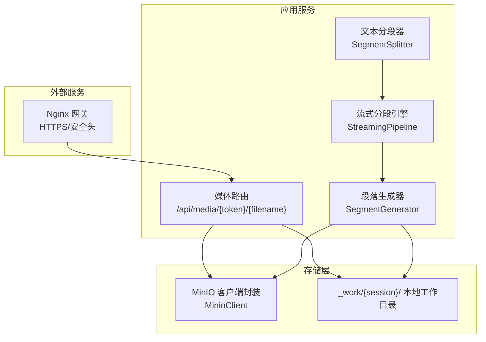
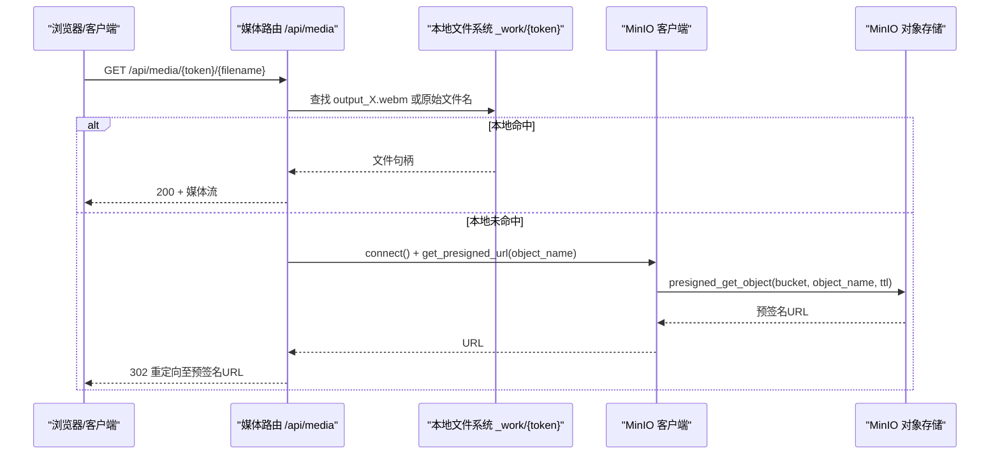
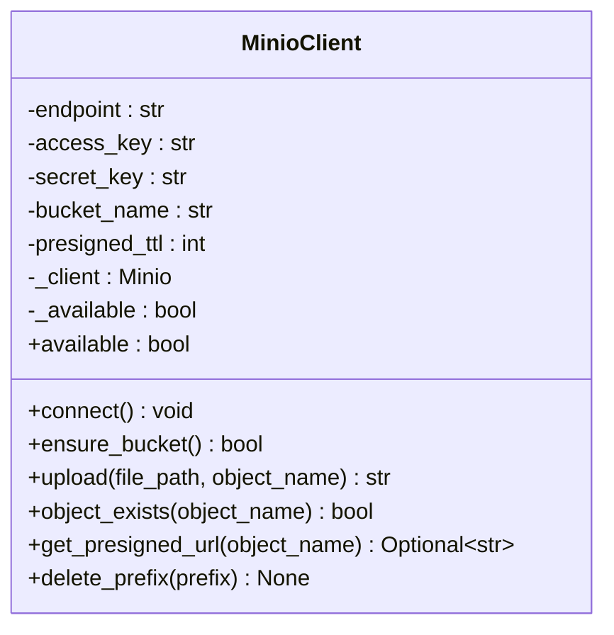
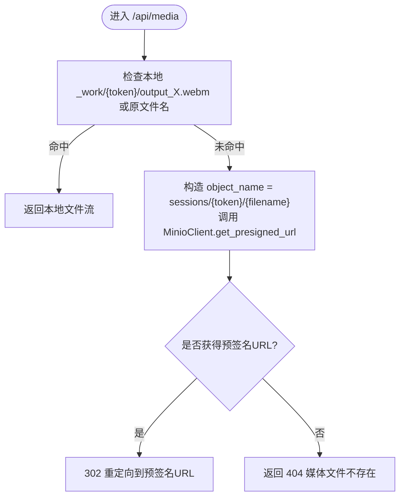
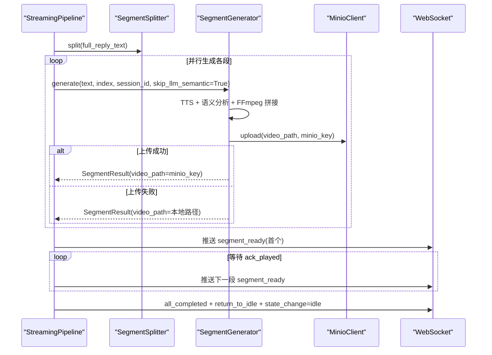
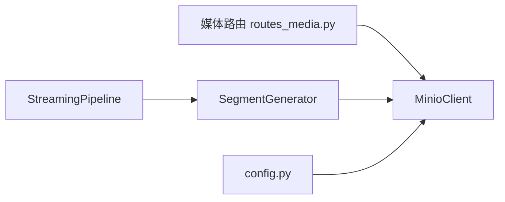

# 对象存储服务

<cite>
**本文引用的文件**   
- [server/services/minio_client.py](file://server/services/minio_client.py)
- [server/config.py](file://server/config.py)
- [config.json](file://config.json)
- [server/api/routes_media.py](file://server/api/routes_media.py)
- [server/pipeline/streaming_pipeline.py](file://server/pipeline/streaming_pipeline.py)
- [server/pipeline/segment_generator.py](file://server/pipeline/segment_generator.py)
- [server/pipeline/segment_splitter.py](file://server/pipeline/segment_splitter.py)
- [nginx-pulan.conf](file://nginx-pulan.conf)
- [doc/test-spec.md](file://doc/test-spec.md)
</cite>

## 目录
1. [简介](#简介)
2. [项目结构](#项目结构)
3. [核心组件](#核心组件)
4. [架构总览](#架构总览)
5. [详细组件分析](#详细组件分析)
6. [依赖关系分析](#依赖关系分析)
7. [性能与并发优化](#性能与并发优化)
8. [故障排查指南](#故障排查指南)
9. [结论](#结论)
10. [附录：配置与服务清单](#附录配置与服务清单)

## 简介
本文件面向对象存储（MinIO）的集成与使用，围绕以下目标展开：
- 客户端实现：上传、下载、预签名 URL 生成、存储桶管理
- 多媒体处理流程：视频片段存储、音频文件管理与缓存策略
- 命名规范、目录结构与版本控制建议
- 访问权限控制、安全策略与防盗链机制
- 服务配置：连接参数、存储桶策略与生命周期管理
- 大文件分片上传、断点续传与并发优化方案
- 错误处理、重试机制与监控日志

## 项目结构
与对象存储相关的代码主要分布在服务端 services、api、pipeline 以及配置文件中。下图展示了关键模块与数据流向。

图表来源
- [server/api/routes_media.py:18-64](file://server/api/routes_media.py#L18-L64)
- [server/pipeline/streaming_pipeline.py:44-131](file://server/pipeline/streaming_pipeline.py#L44-L131)
- [server/pipeline/segment_generator.py:42-137](file://server/pipeline/segment_generator.py#L42-L137)
- [server/services/minio_client.py:21-138](file://server/services/minio_client.py#L21-L138)

章节来源
- [server/api/routes_media.py:1-65](file://server/api/routes_media.py#L1-L65)
- [server/pipeline/streaming_pipeline.py:1-214](file://server/pipeline/streaming_pipeline.py#L1-L214)
- [server/pipeline/segment_generator.py:1-138](file://server/pipeline/segment_generator.py#L1-L138)
- [server/services/minio_client.py:1-139](file://server/services/minio_client.py#L1-L139)

## 核心组件
- MinIO 客户端封装：提供连接、存储桶管理、上传、存在性检查、预签名 URL 生成与前缀批量删除能力。
- 媒体路由：优先从本地工作目录返回文件；不存在时回退到 MinIO 预签名 URL 重定向。
- 流式分段引擎：并行生成多段视频，首段就绪即推送，后续按前端确认推进。
- 段落生成器：TTS → 语义分析 → FFmpeg 拼接 → MinIO 上传（失败回退本地）。
- 配置加载：支持 config.json 与环境变量合并，MinIO 相关字段集中管理。

章节来源
- [server/services/minio_client.py:21-138](file://server/services/minio_client.py#L21-L138)
- [server/api/routes_media.py:18-64](file://server/api/routes_media.py#L18-L64)
- [server/pipeline/streaming_pipeline.py:44-131](file://server/pipeline/streaming_pipeline.py#L44-L131)
- [server/pipeline/segment_generator.py:42-137](file://server/pipeline/segment_generator.py#L42-L137)
- [server/config.py:148-241](file://server/config.py#L148-L241)

## 架构总览
下面的时序图展示“获取媒体文件”的完整调用路径，包括本地优先与 MinIO 预签名 URL 回退逻辑。

图表来源
- [server/api/routes_media.py:18-64](file://server/api/routes_media.py#L18-L64)
- [server/services/minio_client.py:102-124](file://server/services/minio_client.py#L102-L124)

## 详细组件分析

### MinIO 客户端封装
职责与能力
- 连接初始化：读取配置并创建 MinIO 客户端实例，设置内网非 TLS 模式。
- 存储桶管理：确保 bucket 存在，不存在则自动创建。
- 上传：将本地文件上传为对象，异常抛出自定义错误以便上层回退。
- 存在性检查：stat 对象是否存在。
- 预签名 URL：生成 GET 预签名链接，带过期时间。
- 前缀删除：递归列出并删除指定前缀下的所有对象。

关键设计要点
- 可用性标记：连接失败或操作异常时置不可用，避免后续请求继续失败。
- 错误分类：S3Error 被捕获并记录日志，上传失败抛出自定义异常供上层回退。
- 异步接口：对外暴露 async 方法，便于在异步管线中调用。

图表来源
- [server/services/minio_client.py:21-138](file://server/services/minio_client.py#L21-L138)

章节来源
- [server/services/minio_client.py:21-138](file://server/services/minio_client.py#L21-L138)

### 媒体路由（下载与代理）
功能说明
- 路径：GET /api/media/{session_token}/{filename}
- 优先级：
  1) 本地 _work/{session}/output_X.webm 或原始文件名直接返回
  2) 若本地不存在，尝试通过 MinIO 生成预签名 URL 并重定向
  3) 均失败返回 404

行为细节
- 根据文件名后缀推断媒体类型（video/webm 或 audio/mpeg）
- 对 MinIO 调用进行异常保护，失败仅记录警告

图表来源
- [server/api/routes_media.py:18-64](file://server/api/routes_media.py#L18-L64)

章节来源
- [server/api/routes_media.py:18-64](file://server/api/routes_media.py#L18-L64)

### 流式分段与生成管线
整体流程
- 文本分段：按中文标点切分为段落，阈值默认 50 字
- 并行生成：每个段落独立执行 TTS → 语义分析 → FFmpeg 拼接 → MinIO 上传
- 首段优先：首段完成后立即推送 segment_ready，后续按前端 ack_played 推进
- 回退策略：MinIO 上传失败时回退本地路径，仍可通过 /api/media 访问

图表来源
- [server/pipeline/streaming_pipeline.py:44-131](file://server/pipeline/streaming_pipeline.py#L44-L131)
- [server/pipeline/segment_generator.py:42-137](file://server/pipeline/segment_generator.py#L42-L137)
- [server/pipeline/segment_splitter.py:31-76](file://server/pipeline/segment_splitter.py#L31-L76)

章节来源
- [server/pipeline/streaming_pipeline.py:44-131](file://server/pipeline/streaming_pipeline.py#L44-L131)
- [server/pipeline/segment_generator.py:42-137](file://server/pipeline/segment_generator.py#L42-L137)
- [server/pipeline/segment_splitter.py:31-76](file://server/pipeline/segment_splitter.py#L31-L76)

### 配置与连接参数
MinIO 相关配置项
- endpoint：MinIO 服务地址
- access_key / secret_key：访问密钥
- bucket：对象存储桶名
- presigned_url_ttl_seconds：预签名 URL 有效期（秒）

配置来源
- JSON 配置文件中的 minio 节点
- 环境变量覆盖（如 MINIO_ENDPOINT、MINIO_ACCESS_KEY 等）

章节来源
- [config.json:23-29](file://config.json#L23-L29)
- [server/config.py:96-101](file://server/config.py#L96-L101)
- [server/config.py:210-216](file://server/config.py#L210-L216)

## 依赖关系分析
- 媒体路由依赖 MinIO 客户端用于预签名 URL 生成
- 段落生成器依赖 MinIO 客户端进行上传
- 流式分段引擎协调分段生成与推送
- 配置模块统一提供 MinIO 连接参数

图表来源
- [server/api/routes_media.py:18-64](file://server/api/routes_media.py#L18-L64)
- [server/pipeline/segment_generator.py:42-137](file://server/pipeline/segment_generator.py#L42-L137)
- [server/pipeline/streaming_pipeline.py:44-131](file://server/pipeline/streaming_pipeline.py#L44-L131)
- [server/config.py:210-216](file://server/config.py#L210-L216)

章节来源
- [server/api/routes_media.py:18-64](file://server/api/routes_media.py#L18-L64)
- [server/pipeline/segment_generator.py:42-137](file://server/pipeline/segment_generator.py#L42-L137)
- [server/pipeline/streaming_pipeline.py:44-131](file://server/pipeline/streaming_pipeline.py#L44-L131)
- [server/config.py:210-216](file://server/config.py#L210-L216)

## 性能与并发优化
- 并行生成：使用 asyncio.gather 启动所有段的生成任务，首段完成即推送，降低端到端延迟
- 首段优化：首段跳过 LLM 语义分析，采用关键词回退，减少额外耗时
- 本地优先：媒体下载优先走本地文件，避免跨网络访问 MinIO 带来的延迟
- 预签名 URL：浏览器直连 MinIO，减轻后端转发压力
- 并发限制：当前实现未显式限制并发度，可根据资源情况引入信号量或队列限流

章节来源
- [server/pipeline/streaming_pipeline.py:66-95](file://server/pipeline/streaming_pipeline.py#L66-L95)
- [server/api/routes_media.py:32-51](file://server/api/routes_media.py#L32-L51)

## 故障排查指南
常见问题与定位
- MinIO 不可用：客户端 available 标志为 False，上传会跳过并记录警告；需检查 endpoint、access_key、secret_key 及网络连通性
- 预签名 URL 生成失败：对象不存在或服务异常，路由会记录警告并返回 404
- 本地文件缺失：当 MinIO 不可用时，媒体下载回退到本地，需确认 _work/{session}/ 下是否有对应输出文件
- 测试用例参考：TC-API-015 描述了获取已生成的分段视频的预期行为（302 重定向或 200 代理）

建议的日志关键字
- “MinIO 客户端创建失败”
- “MinIO Bucket 操作失败”
- “MinIO 上传失败”
- “MinIO Presigned URL 生成失败”
- “MinIO 对象不存在”

章节来源
- [server/services/minio_client.py:34-63](file://server/services/minio_client.py#L34-L63)
- [server/services/minio_client.py:88-90](file://server/services/minio_client.py#L88-L90)
- [server/services/minio_client.py:102-124](file://server/services/minio_client.py#L102-L124)
- [server/api/routes_media.py:54-64](file://server/api/routes_media.py#L54-L64)
- [doc/test-spec.md:197-207](file://doc/test-spec.md#L197-L207)

## 结论
本对象存储集成以 MinIO 为核心，结合本地工作目录与预签名 URL 机制，实现了高可用、低延迟的媒体文件存取。通过流式分段与并行生成，系统能在保证用户体验的同时充分利用存储与计算资源。建议在后续迭代中完善大文件分片上传、断点续传与更细粒度的生命周期策略，进一步提升稳定性与可运维性。

## 附录：配置与服务清单

### MinIO 配置项
- endpoint：MinIO 服务地址（例如 minio:9000）
- access_key / secret_key：访问凭据
- bucket：对象存储桶名称
- presigned_url_ttl_seconds：预签名 URL 有效期（秒）

章节来源
- [config.json:23-29](file://config.json#L23-L29)
- [server/config.py:96-101](file://server/config.py#L96-L101)
- [server/config.py:210-216](file://server/config.py#L210-L216)

### 命名规范与目录结构
- 对象命名：sessions/{session_token}/segment_{index}.webm
- 本地工作目录：_work/{session_token}/output_{index}.webm 或原文件名
- 静态切片与待机动画：clips/{speaker}/...（由路由与配置共同决定）

章节来源
- [server/pipeline/segment_generator.py:87-106](file://server/pipeline/segment_generator.py#L87-L106)
- [server/api/routes_media.py:30-51](file://server/api/routes_media.py#L30-L51)
- [server/config.py:200-204](file://server/config.py#L200-L204)

### 访问控制与安全策略
- 预签名 URL：基于服务端签名，具备过期时间，适合浏览器直读
- 网关安全头：X-Content-Type-Options、X-Frame-Options、X-XSS-Protection 等
- HTTPS 强制跳转：HTTP→HTTPS 重定向

章节来源
- [server/services/minio_client.py:102-124](file://server/services/minio_client.py#L102-L124)
- [nginx-pulan.conf:18-34](file://nginx-pulan.conf#L18-L34)

### 生命周期管理建议
- 按会话清理：使用 delete_prefix(sessions/{session_token}) 定期清理旧会话对象
- 本地临时文件：_work 目录应纳入定时清理策略，避免磁盘膨胀

章节来源
- [server/services/minio_client.py:126-138](file://server/services/minio_client.py#L126-L138)

### 大文件分片上传与断点续传（扩展建议）
- 分片上传：利用 MinIO SDK 的分片上传接口，将大文件拆分为多个 Part 并发上传
- 断点续传：记录已上传分片元数据（PartNumber、ETag），失败后恢复未完成的分片
- 并发优化：控制并发度与内存占用，结合进度回调与重试策略
- 注意：当前仓库未实现该能力，可按上述思路在 MinioClient 中扩展

[本节为概念性扩展建议，不直接分析具体源码]