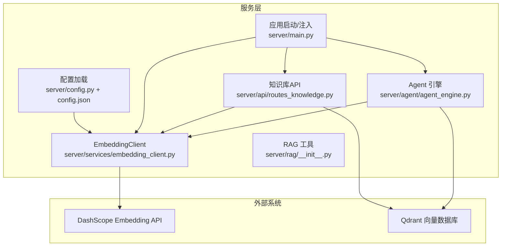
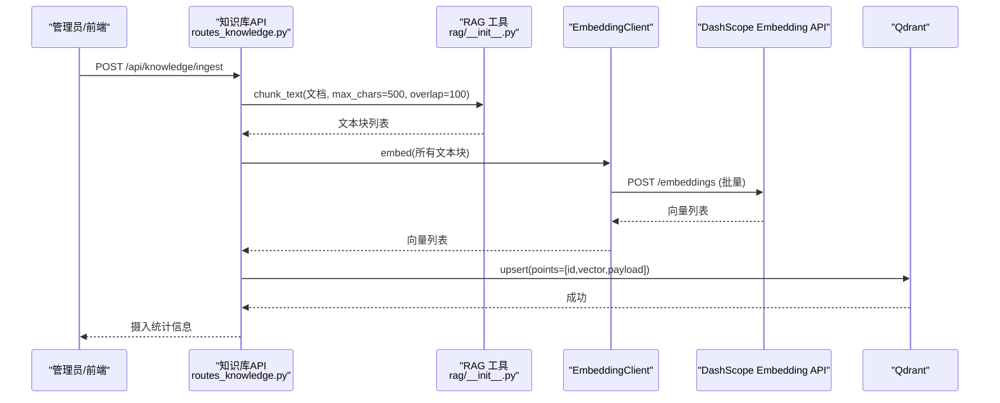
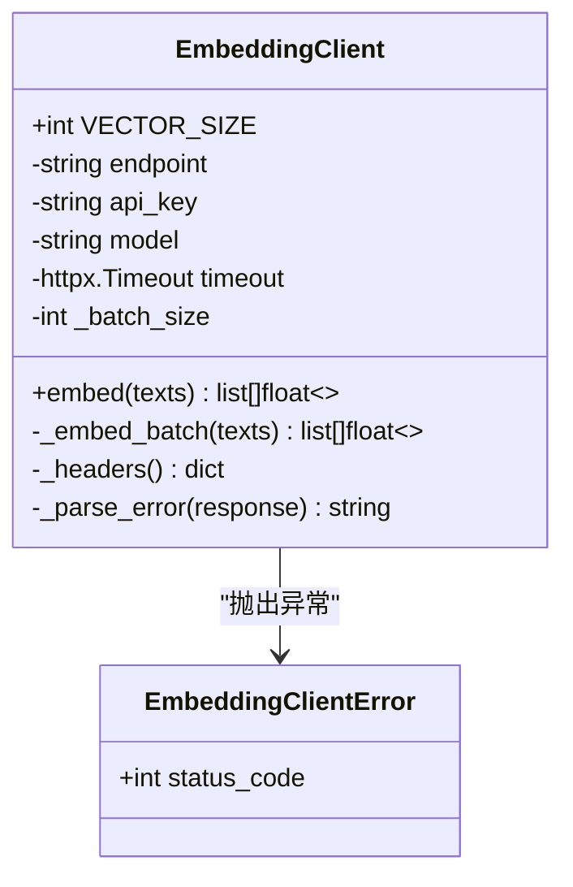
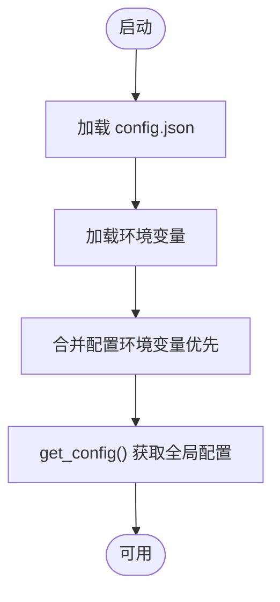
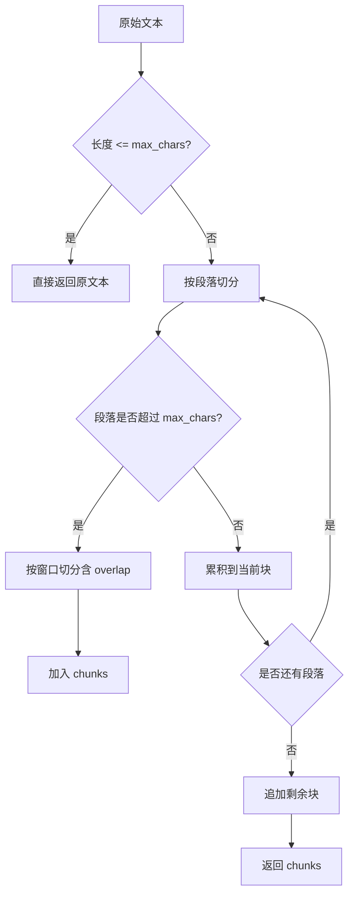
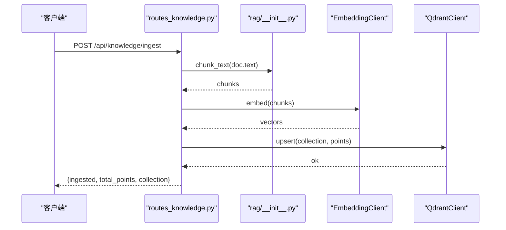
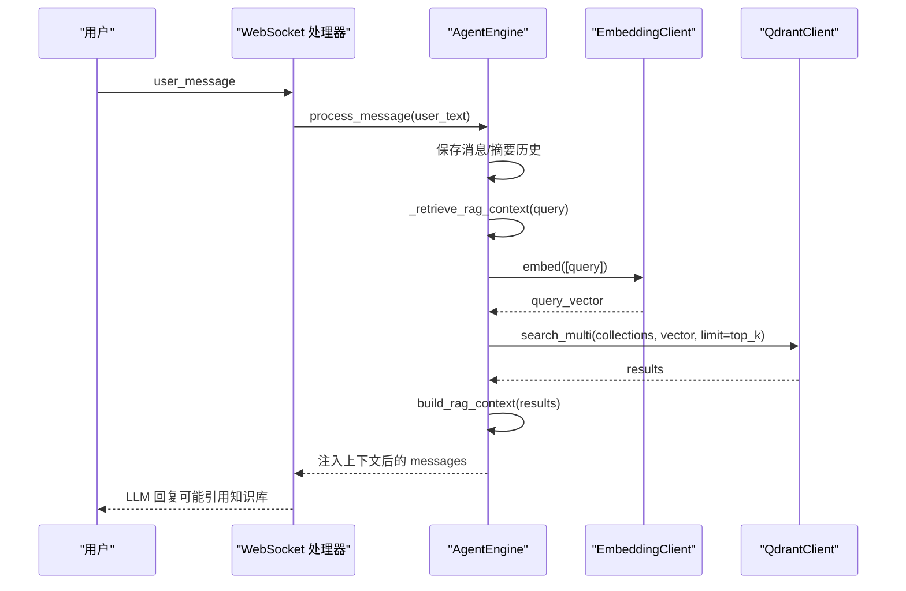
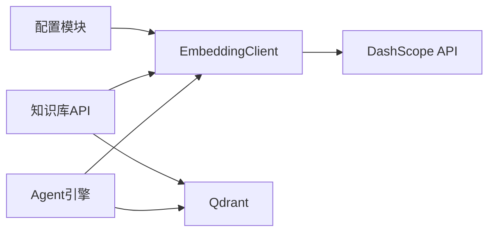

# 文本嵌入服务

<cite>
**本文引用的文件**
- [server/services/embedding_client.py](file://server/services/embedding_client.py)
- [server/config.py](file://server/config.py)
- [config.json](file://config.json)
- [server/rag/__init__.py](file://server/rag/__init__.py)
- [server/api/routes_knowledge.py](file://server/api/routes_knowledge.py)
- [server/agent/agent_engine.py](file://server/agent/agent_engine.py)
- [server/main.py](file://server/main.py)
- [doc/Qdrant知识库操作指南.md](file://doc/Qdrant知识库操作指南.md)
</cite>

## 目录
1. [简介](#简介)
2. [项目结构](#项目结构)
3. [核心组件](#核心组件)
4. [架构总览](#架构总览)
5. [详细组件分析](#详细组件分析)
6. [依赖关系分析](#依赖关系分析)
7. [性能与优化](#性能与优化)
8. [配置指南](#配置指南)
9. [错误处理、重试与降级](#错误处理重试与降级)
10. [使用示例与最佳实践](#使用示例与最佳实践)
11. [故障排查](#故障排查)
12. [结论](#结论)

## 简介
本技术文档围绕“文本嵌入服务”展开，聚焦于文本向量化客户端的实现、统一接口设计、嵌入生成流程（预处理—模型调用—后处理）、支持的模型类型与维度配置、质量评估指标、批量处理与缓存策略、性能优化、配置管理、错误处理与重试机制、降级策略，以及实际使用示例与最佳实践。该服务在系统中作为 RAG（检索增强生成）的关键基础设施，负责将用户查询或知识片段转换为高维向量，供 Qdrant 进行语义检索。

## 项目结构
与文本嵌入相关的代码主要分布在以下位置：
- 嵌入客户端实现：server/services/embedding_client.py
- 配置加载与合并：server/config.py、config.json
- RAG 分块与上下文构建：server/rag/__init__.py
- 知识库摄入 API（批量嵌入+写入向量库）：server/api/routes_knowledge.py
- Agent 引擎中的 RAG 检索流程（调用嵌入客户端）：server/agent/agent_engine.py
- 应用启动与依赖注入（初始化 EmbeddingClient）：server/main.py
- 知识库操作指南（含 RAG 流程说明）：doc/Qdrant知识库操作指南.md

图表来源
- [server/services/embedding_client.py:1-149](file://server/services/embedding_client.py#L1-L149)
- [server/config.py:128-260](file://server/config.py#L128-L260)
- [config.json:1-39](file://config.json#L1-L39)
- [server/rag/__init__.py:1-83](file://server/rag/__init__.py#L1-L83)
- [server/api/routes_knowledge.py:1-200](file://server/api/routes_knowledge.py#L1-L200)
- [server/agent/agent_engine.py:1-181](file://server/agent/agent_engine.py#L1-L181)
- [server/main.py:18-86](file://server/main.py#L18-L86)

章节来源
- [server/services/embedding_client.py:1-149](file://server/services/embedding_client.py#L1-L149)
- [server/config.py:128-260](file://server/config.py#L128-L260)
- [config.json:1-39](file://config.json#L1-L39)
- [server/rag/__init__.py:1-83](file://server/rag/__init__.py#L1-L83)
- [server/api/routes_knowledge.py:1-200](file://server/api/routes_knowledge.py#L1-L200)
- [server/agent/agent_engine.py:1-181](file://server/agent/agent_engine.py#L1-L181)
- [server/main.py:18-86](file://server/main.py#L18-L86)

## 核心组件
- 嵌入客户端（EmbeddingClient）
  - 提供统一的异步 embed(texts) 接口，内部按批调用 DashScope Embedding API，返回与输入一一对应的向量列表。
  - 内置批量切分、请求头构造、超时控制、错误解析与重试逻辑。
- 配置模块（config.py + config.json）
  - 支持从 JSON 配置文件与环境变量合并加载，环境变量优先级更高；embedding 相关字段包括 endpoint、api_key、model。
- RAG 工具（rag/__init__.py）
  - 提供文本分块（chunk_text）与检索结果上下文构建（build_rag_context），用于知识摄入与对话检索。
- 知识库 API（routes_knowledge.py）
  - 暴露集合管理与知识摄入接口，摄入流程包含分块→批量嵌入→写入 Qdrant。
- Agent 引擎（agent_engine.py）
  - 在对话流程中执行 RAG 检索：先对查询进行嵌入，再并发搜索多个集合，最后构建上下文注入 LLM。
- 应用启动（main.py）
  - 初始化并注入 EmbeddingClient 到路由与 Agent 引擎。

章节来源
- [server/services/embedding_client.py:26-149](file://server/services/embedding_client.py#L26-L149)
- [server/config.py:62-123](file://server/config.py#L62-L123)
- [server/rag/__init__.py:10-83](file://server/rag/__init__.py#L10-L83)
- [server/api/routes_knowledge.py:134-186](file://server/api/routes_knowledge.py#L134-L186)
- [server/agent/agent_engine.py:123-181](file://server/agent/agent_engine.py#L123-L181)
- [server/main.py:79-86](file://server/main.py#L79-L86)

## 架构总览
文本嵌入服务的整体数据流如下：
- 知识摄入：前端/管理员通过 /api/knowledge/ingest 提交文档 → 服务端分块 → 批量调用 EmbeddingClient → 写入 Qdrant。
- 对话检索：用户提问 → AgentEngine 调用 EmbeddingClient 得到查询向量 → 并发搜索多个集合 → 构建上下文 → 注入 LLM。

图表来源
- [server/api/routes_knowledge.py:134-186](file://server/api/routes_knowledge.py#L134-L186)
- [server/rag/__init__.py:10-53](file://server/rag/__init__.py#L10-L53)
- [server/services/embedding_client.py:47-97](file://server/services/embedding_client.py#L47-L97)
- [server/services/qdrant_client.py:115-134](file://server/services/qdrant_client.py#L115-L134)

## 详细组件分析

### 嵌入客户端（EmbeddingClient）
- 统一接口
  - embed(texts): 接收字符串列表，返回二维浮点数组（每个子数组为向量）。
  - 内部自动分批（默认 batch_size=10），确保单次请求不超过官方建议上限。
- 模型与维度
  - 当前默认模型为 text-embedding-v3，向量维度固定为 1024（VECTOR_SIZE）。
- 请求与响应
  - 请求体包含 model 与 input（文本列表）。
  - 响应体 data 列表包含 embedding 与 index，按 index 排序保证顺序一致。
- 错误处理与重试
  - 针对 401/403、429、5xx、超时、连接失败等场景进行分类处理，最多重试一次，带短暂等待。
- 日志与调试
  - 记录嵌入完成条数与向量数量，便于监控与排障。

图表来源
- [server/services/embedding_client.py:19-149](file://server/services/embedding_client.py#L19-L149)

章节来源
- [server/services/embedding_client.py:26-149](file://server/services/embedding_client.py#L26-L149)

### 配置模块（config.py + config.json）
- 配置来源与优先级
  - 首先加载 config.json，然后加载环境变量（pydantic-settings），环境变量覆盖 JSON 值。
- Embedding 配置项
  - embedding.endpoint、embedding.api_key、embedding.model。
  - 默认值指向 OpenAI 兼容端点与 text-embedding-v3 模型，可通过环境变量或 JSON 覆盖。
- 全局访问
  - get_config() 懒加载，避免重复解析；reload_config() 支持热重载。

图表来源
- [server/config.py:128-260](file://server/config.py#L128-L260)
- [config.json:1-39](file://config.json#L1-L39)

章节来源
- [server/config.py:62-123](file://server/config.py#L62-L123)
- [server/config.py:128-260](file://server/config.py#L128-L260)
- [config.json:1-39](file://config.json#L1-L39)

### RAG 工具（rag/__init__.py）
- 文本分块（chunk_text）
  - 优先按段落切分，若单段过长则按字符窗口滑动切分，支持重叠（overlap）以保持上下文连贯。
- 上下文构建（build_rag_context）
  - 过滤低分结果（score < 0.3），拼接参考内容，形成可注入 LLM 的上下文字符串。

图表来源
- [server/rag/__init__.py:10-53](file://server/rag/__init__.py#L10-L53)

章节来源
- [server/rag/__init__.py:10-83](file://server/rag/__init__.py#L10-L83)

### 知识库 API（routes_knowledge.py）
- 知识摄入流程
  - 校验请求参数 → 调用 RAG 分块 → 批量嵌入 → 组装 points（id、vector、payload）→ upsert 到 Qdrant → 返回统计信息。
- 集合管理
  - 创建、删除、列出集合，支持指定向量维度（默认 1024）。
- 鉴权
  - 通过 X-Knowledge-Admin-Token 头进行简单鉴权，未配置时放行。

图表来源
- [server/api/routes_knowledge.py:134-186](file://server/api/routes_knowledge.py#L134-L186)
- [server/rag/__init__.py:10-53](file://server/rag/__init__.py#L10-L53)
- [server/services/qdrant_client.py:115-134](file://server/services/qdrant_client.py#L115-L134)

章节来源
- [server/api/routes_knowledge.py:1-200](file://server/api/routes_knowledge.py#L1-L200)

### Agent 引擎（agent_engine.py）
- RAG 检索流程
  - 根据角色-集合映射决定搜索范围（全部或指定集合）。
  - 调用 EmbeddingClient 对查询进行嵌入，得到 query_vector。
  - 并发搜索多个集合，合并并按分数降序取 top_k。
  - 构建上下文注入 LLM；若检索失败或无结果，则降级为纯 LLM 回复。

图表来源
- [server/agent/agent_engine.py:123-181](file://server/agent/agent_engine.py#L123-L181)
- [server/services/embedding_client.py:47-97](file://server/services/embedding_client.py#L47-L97)
- [server/services/qdrant_client.py:164-186](file://server/services/qdrant_client.py#L164-L186)

章节来源
- [server/agent/agent_engine.py:1-181](file://server/agent/agent_engine.py#L1-L181)

## 依赖关系分析
- 组件耦合
  - EmbeddingClient 仅依赖配置模块与 HTTP 客户端，职责单一，内聚性良好。
  - routes_knowledge.py 与 agent_engine.py 均依赖 EmbeddingClient，体现其作为共享基础设施的定位。
- 外部依赖
  - DashScope Embedding API：提供文本到向量的转换能力。
  - Qdrant：存储与检索高维向量。
- 潜在循环依赖
  - 当前未发现循环依赖；EmbeddingClient 不反向依赖上层业务模块。

图表来源
- [server/services/embedding_client.py:1-149](file://server/services/embedding_client.py#L1-L149)
- [server/api/routes_knowledge.py:1-200](file://server/api/routes_knowledge.py#L1-L200)
- [server/agent/agent_engine.py:1-181](file://server/agent/agent_engine.py#L1-L181)

章节来源
- [server/services/embedding_client.py:1-149](file://server/services/embedding_client.py#L1-L149)
- [server/api/routes_knowledge.py:1-200](file://server/api/routes_knowledge.py#L1-L200)
- [server/agent/agent_engine.py:1-181](file://server/agent/agent_engine.py#L1-L181)

## 性能与优化
- 批量处理
  - EmbeddingClient 默认 batch_size=10，减少网络往返次数，提升吞吐。
- 并发检索
  - QdrantClient.search_multi 使用 asyncio.gather 并发搜索多个集合，缩短端到端延迟。
- 超时与限流
  - httpx.Timeout 设置合理超时时间；429 限流场景下短暂等待并重试一次。
- 文本分块与重叠
  - chunk_text 支持段落优先与窗口切分，配合 overlap 保持语义连续性，有助于提高检索精度。
- 上下文过滤
  - build_rag_context 过滤低分结果（score < 0.3），减少无关信息对 LLM 的干扰。

[本节为通用性能讨论，无需特定文件分析]

## 配置指南
- 模型选择
  - embedding.model：当前默认 text-embedding-v3，向量维度 1024。如需切换模型，请确保目标模型输出维度一致或调整下游集合维度。
- API 端点管理
  - embedding.endpoint：默认指向 OpenAI 兼容端点，可按需替换为 DashScope 或其他兼容服务。
  - embedding.api_key：鉴权密钥，支持通过环境变量覆盖。
- 成本优化
  - 合理设置 batch_size，尽量接近官方建议上限以减少请求次数。
  - 对长文本进行有效分块，避免过大块导致嵌入质量下降与资源浪费。
  - 结合 role_collections 限定检索范围，减少不必要的集合搜索。

章节来源
- [server/config.py:62-123](file://server/config.py#L62-L123)
- [server/config.py:128-260](file://server/config.py#L128-L260)
- [config.json:1-39](file://config.json#L1-L39)
- [doc/Qdrant知识库操作指南.md:140-172](file://doc/Qdrant知识库操作指南.md#L140-L172)

## 错误处理、重试与降级
- 错误分类
  - 鉴权失败（401/403）：立即抛出异常，提示 API Key 无效。
  - 限流（429）：等待后重试一次，仍失败则抛出异常。
  - 服务端错误（5xx）：等待后重试一次，仍失败则抛出异常。
  - 网络异常（超时/连接失败）：等待后重试一次，仍失败则抛出异常。
- 降级策略
  - Agent 引擎在 RAG 检索失败或无结果时，自动降级为纯 LLM 回复，保障用户体验。
- 日志与可观测性
  - 关键路径记录日志（如嵌入完成条数、检索结果数量与最高分数），便于定位问题。

章节来源
- [server/services/embedding_client.py:84-135](file://server/services/embedding_client.py#L84-L135)
- [server/agent/agent_engine.py:178-181](file://server/agent/agent_engine.py#L178-L181)

## 使用示例与最佳实践
- 知识摄入示例
  - 通过 /api/knowledge/ingest 提交文档，服务端自动分块、批量嵌入并写入 Qdrant。
  - 建议每条知识聚焦一个主题，控制在 300-500 字，使用完整陈述句以提升检索精度。
- 对话检索示例
  - 用户在对话框提问，系统自动进行 RAG 检索并注入上下文，最终由 LLM 生成回答。
  - 若检索结果为空或分数过低，系统将回退到纯 LLM 回复。
- 最佳实践
  - 集合按主题分类命名清晰，定期清理过时知识。
  - 先在「搜索知识」界面验证检索效果，再在对话中确认 AI 引用情况。
  - 合理配置 role_collections，限定检索范围，降低开销。

章节来源
- [server/api/routes_knowledge.py:134-186](file://server/api/routes_knowledge.py#L134-L186)
- [doc/Qdrant知识库操作指南.md:174-192](file://doc/Qdrant知识库操作指南.md#L174-L192)

## 故障排查
- 常见问题
  - API Key 无效：检查 embedding.api_key 是否正确配置，确认权限与配额。
  - 请求过于频繁：降低批量大小或增加间隔，观察 429 错误频率。
  - 服务端错误：查看上游服务状态，必要时重试或切换端点。
  - 检索无结果：确认集合是否存在、知识是否已摄入、role_collections 配置是否正确。
- 诊断步骤
  - 查看服务日志中的嵌入完成与检索结果信息。
  - 使用「搜索知识」功能验证检索效果。
  - 检查 Qdrant 集合信息与点数统计。

章节来源
- [server/services/embedding_client.py:137-149](file://server/services/embedding_client.py#L137-L149)
- [server/agent/agent_engine.py:166-181](file://server/agent/agent_engine.py#L166-L181)
- [doc/Qdrant知识库操作指南.md:111-172](file://doc/Qdrant知识库操作指南.md#L111-L172)

## 结论
文本嵌入服务在本项目中承担关键的向量化能力，具备统一接口、批量处理、错误重试与降级策略，并与 RAG 流程紧密集成。通过合理的配置与最佳实践，可在保证检索质量的同时优化性能与成本。建议在上线前充分验证检索效果与稳定性，持续监控关键指标并根据业务需求调优。