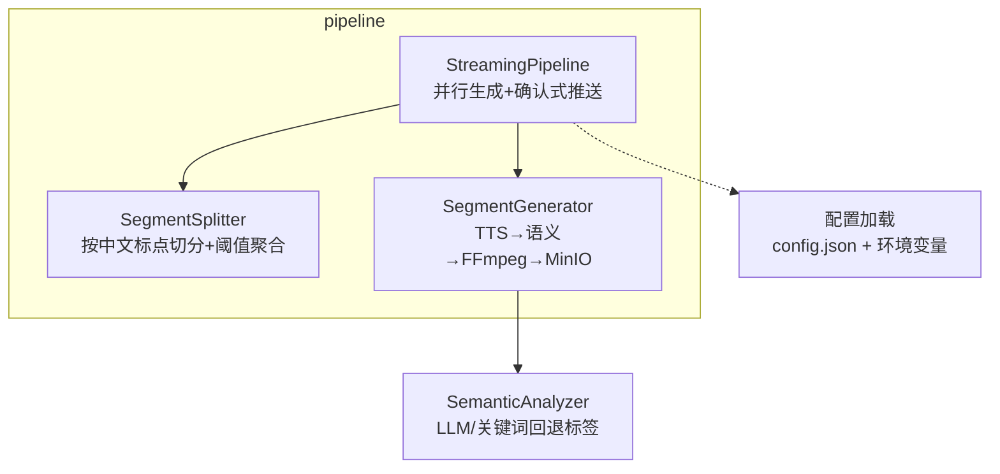
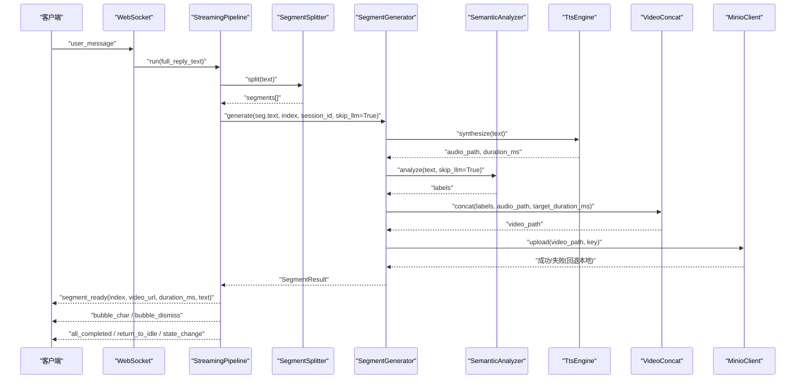
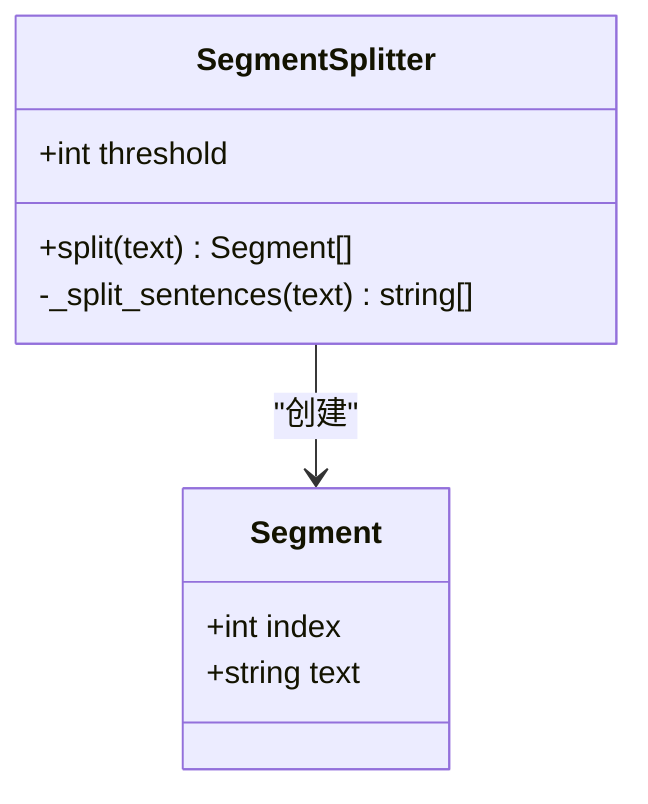
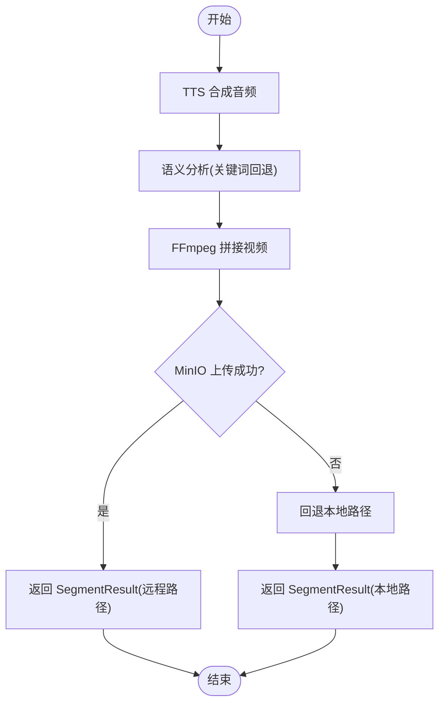
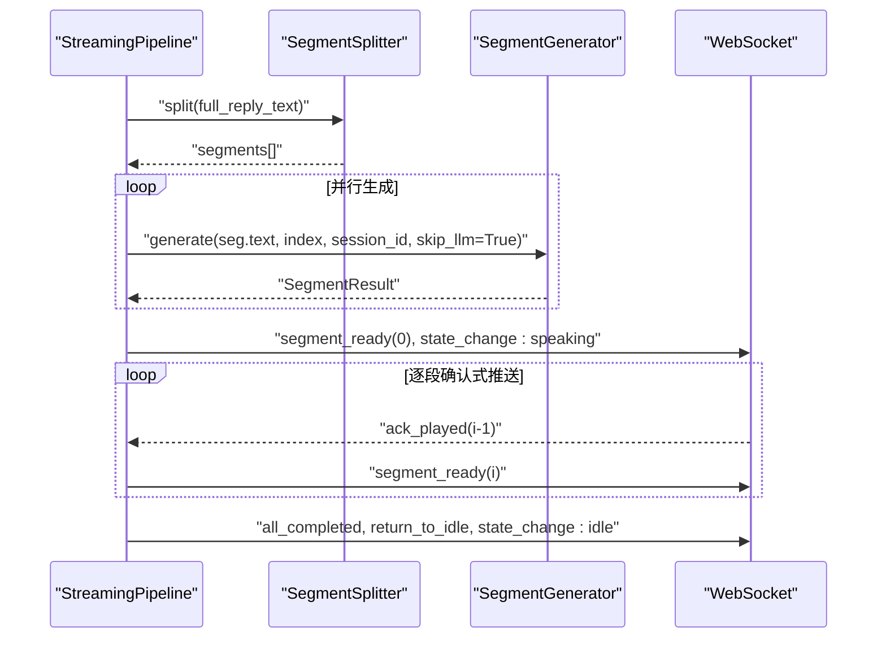
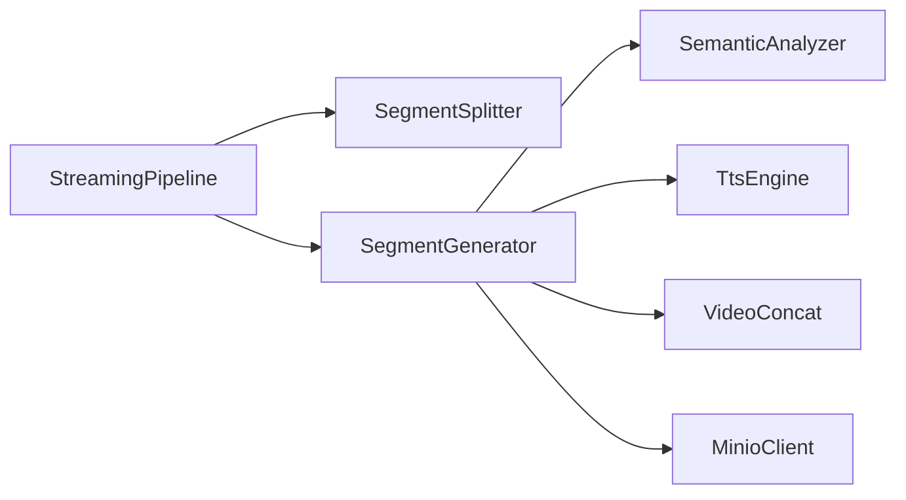

# 文本分段器

<cite>
**本文引用的文件列表**
- [segment_splitter.py](file://server/pipeline/segment_splitter.py)
- [segment_generator.py](file://server/pipeline/segment_generator.py)
- [streaming_pipeline.py](file://server/pipeline/streaming_pipeline.py)
- [semantic_analyzer.py](file://server/services/semantic_analyzer.py)
- [config.json](file://config.json)
- [config.py](file://server/config.py)
- [test-spec.md](file://doc/test-spec.md)
- [tech-spec.md](file://doc/tech-spec.md)
</cite>

## 目录
1. [简介](#简介)
2. [项目结构](#项目结构)
3. [核心组件](#核心组件)
4. [架构总览](#架构总览)
5. [详细组件分析](#详细组件分析)
6. [依赖关系分析](#依赖关系分析)
7. [性能考量](#性能考量)
8. [故障排查指南](#故障排查指南)
9. [结论](#结论)
10. [附录](#附录)

## 简介
本技术文档聚焦于“文本分段器”的设计与实现，围绕智能文本分割算法、SegmentSplitter 类机制、配置参数、特殊字符与数字序列处理策略、分段效果示例、性能优化建议以及错误处理与边界情况展开。该模块位于服务端 pipeline 层，负责将 LLM 输出的完整回复文本按中文语义边界切分为多个段落，并配合流式生成引擎进行并行处理与推送。

## 项目结构
与文本分段相关的核心代码集中在 server/pipeline 目录下，包含：
- 分段器：按中文标点拆分句子并按阈值聚合为段落
- 单段生成器：TTS → 语义分析 → FFmpeg 拼接 → MinIO 上传
- 流式分段引擎：接收完整文本，分句切段，并行生成，逐段确认式推送

图表来源
- [segment_splitter.py:1-95](file://server/pipeline/segment_splitter.py#L1-L95)
- [segment_generator.py:1-138](file://server/pipeline/segment_generator.py#L1-L138)
- [streaming_pipeline.py:1-214](file://server/pipeline/streaming_pipeline.py#L1-L214)
- [semantic_analyzer.py:1-126](file://server/services/semantic_analyzer.py#L1-L126)
- [config.py:1-260](file://server/config.py#L1-L260)

章节来源
- [segment_splitter.py:1-95](file://server/pipeline/segment_splitter.py#L1-L95)
- [segment_generator.py:1-138](file://server/pipeline/segment_generator.py#L1-L138)
- [streaming_pipeline.py:1-214](file://server/pipeline/streaming_pipeline.py#L1-L214)
- [semantic_analyzer.py:1-126](file://server/services/semantic_analyzer.py#L1-L126)
- [config.py:1-260](file://server/config.py#L1-L260)

## 核心组件
- SegmentSplitter：基于中文标点（句号、感叹号、问号、分号）进行句子切分，并以阈值（默认 50 字）聚合形成段落；保证每段以完整句子结尾。
- SegmentGenerator：对单个段落执行 TTS 合成、语义分析、视频拼接与存储上传，返回结构化结果。
- StreamingPipeline：编排分段与生成流程，首段就绪即推，后续段在 ack 确认后依次推送，支持取消与异常处理。
- SemanticAnalyzer：提供 LLM 驱动的语义标签分析，并在失败或首段优化场景下使用关键词回退。

章节来源
- [segment_splitter.py:1-95](file://server/pipeline/segment_splitter.py#L1-L95)
- [segment_generator.py:1-138](file://server/pipeline/segment_generator.py#L1-L138)
- [streaming_pipeline.py:1-214](file://server/pipeline/streaming_pipeline.py#L1-L214)
- [semantic_analyzer.py:1-126](file://server/services/semantic_analyzer.py#L1-L126)

## 架构总览
从输入到输出，文本分段器的整体数据流如下：

图表来源
- [streaming_pipeline.py:44-131](file://server/pipeline/streaming_pipeline.py#L44-L131)
- [segment_splitter.py:31-76](file://server/pipeline/segment_splitter.py#L31-L76)
- [segment_generator.py:42-138](file://server/pipeline/segment_generator.py#L42-L138)
- [semantic_analyzer.py:41-86](file://server/services/semantic_analyzer.py#L41-L86)

## 详细组件分析

### SegmentSplitter 设计与实现
- 设计目标
  - 语义边界识别：仅以中文句子级标点作为切分点，避免在逗号、顿号等弱边界处断开，确保每段语义相对完整。
  - 句子切分策略：逐字符扫描，遇到句号、感叹号、问号、分号时截断，保留标点于句末。
  - 段落长度优化：累计句子长度达到阈值（默认 50 字）后成段；尾部不足阈值的单独成段；极端情况下整段作为一段。
- 关键数据结构
  - Segment：包含 index 与 text，用于标识段落序号与内容。
- 正则表达式与标点处理
  - 定义了中文句子分隔符集合，实际切分采用显式判断字符是否在“。！？；”中，保证精确控制。
- 上下文分析
  - 当前实现未引入跨句的上下文模型，属于规则驱动的分段；通过阈值聚合缓解短句导致的碎片化问题。
- 特殊字符、数字序列与英文单词
  - 当前实现按字符计数，不区分中英文、数字或符号；因此数字序列与英文单词均计入长度，不影响切分逻辑。
- 配置参数
  - threshold：每段最少字符数，默认 50。可通过构造参数覆盖。
  - should_trigger_multisegment：当文本长度大于阈值时触发多段生成。
- 复杂度分析
  - 时间复杂度 O(n)，n 为文本长度；空间复杂度 O(n)，用于保存句子与段落列表。
- 错误处理与边界情况
  - 空文本：返回一个空段落，避免下游崩溃。
  - 无有效标点：整段作为一段返回。
  - 日志记录：记录原始字数与分段数量，便于监控。

图表来源
- [segment_splitter.py:18-23](file://server/pipeline/segment_splitter.py#L18-L23)
- [segment_splitter.py:25-76](file://server/pipeline/segment_splitter.py#L25-L76)

章节来源
- [segment_splitter.py:1-95](file://server/pipeline/segment_splitter.py#L1-L95)

### SegmentGenerator 单段生成流程
- 职责
  - 对单个段落执行 TTS 语音合成、语义分析、FFmpeg 视频拼接与 MinIO 上传，返回 SegmentResult。
- 流程要点
  - TTS：根据文本生成音频与时长。
  - 语义分析：优先使用关键词回退（skip_llm=True），降低延迟。
  - 视频拼接：依据标签序列与音频时长进行切片合并。
  - 存储上传：尝试上传至 MinIO，失败则回退本地路径。
- 异常处理
  - 捕获 TTS 错误、视频拼接错误与通用异常，返回带 error 字段的结果，供上层统一处理。

图表来源
- [segment_generator.py:42-138](file://server/pipeline/segment_generator.py#L42-L138)

章节来源
- [segment_generator.py:1-138](file://server/pipeline/segment_generator.py#L1-L138)

### StreamingPipeline 流式分段与推送
- 工作流程
  - 接收完整回复文本，调用 SegmentSplitter 切段。
  - 并行启动所有段的生成任务（全部使用关键词回退语义分析）。
  - 首段完成后立即推送 segment_ready，并进入 speaking 状态。
  - 后续段等待前端 ack_played 确认后推送，避免打断说话形象。
  - 全部完成推送 all_completed 与 return_to_idle，回到 idle。
- 打字机气泡
  - 按字符逐字推送 bubble_char，间隔受视频时长限制（不超过 60% 时长，单字最大 50ms，最小 15ms）。
- 取消与错误
  - 支持 cancel 事件，中断后续推送与生成任务。
  - 统一错误事件推送，保障前端可感知异常。

图表来源
- [streaming_pipeline.py:44-131](file://server/pipeline/streaming_pipeline.py#L44-L131)
- [segment_splitter.py:31-76](file://server/pipeline/segment_splitter.py#L31-L76)
- [segment_generator.py:42-138](file://server/pipeline/segment_generator.py#L42-L138)

章节来源
- [streaming_pipeline.py:1-214](file://server/pipeline/streaming_pipeline.py#L1-L214)

### 语义分析器（关键词回退）
- 功能
  - 在 skip_llm=True 时使用关键词匹配快速生成标签序列，提升首段响应速度。
  - 若 LLM 调用失败或解析失败，自动回退到关键词方案。
- 标签体系
  - opening/introduction/body/closing 四类结构，涵盖 greeting、explaining、listing、emphasis、example、analysis、comparison、transition、conclusion、thanks 等标签。
- 验证与重排
  - 对标签序列进行校验与顺序约束，确保符合 opening → body → closing 的规则。

章节来源
- [semantic_analyzer.py:1-126](file://server/services/semantic_analyzer.py#L1-L126)

## 依赖关系分析
- 模块耦合
  - StreamingPipeline 依赖 SegmentSplitter 与 SegmentGenerator。
  - SegmentGenerator 依赖 TtsEngine、SemanticAnalyzer、VideoConcat、MinioClient。
  - SemanticAnalyzer 依赖 LlmClient（可选，回退模式可不使用）。
- 外部集成点
  - WebSocket：实时事件推送。
  - MinIO：对象存储（失败回退本地）。
  - FFmpeg：视频拼接。
  - TTS 服务：语音合成。
- 潜在循环依赖
  - 当前实现无循环依赖，分层清晰。

图表来源
- [streaming_pipeline.py:1-214](file://server/pipeline/streaming_pipeline.py#L1-L214)
- [segment_generator.py:1-138](file://server/pipeline/segment_generator.py#L1-L138)
- [segment_splitter.py:1-95](file://server/pipeline/segment_splitter.py#L1-L95)
- [semantic_analyzer.py:1-126](file://server/services/semantic_analyzer.py#L1-L126)

章节来源
- [streaming_pipeline.py:1-214](file://server/pipeline/streaming_pipeline.py#L1-L214)
- [segment_generator.py:1-138](file://server/pipeline/segment_generator.py#L1-L138)
- [segment_splitter.py:1-95](file://server/pipeline/segment_splitter.py#L1-L95)
- [semantic_analyzer.py:1-126](file://server/services/semantic_analyzer.py#L1-L126)

## 性能考量
- 内存使用
  - 分段器按字符遍历，内存占用与文本长度线性相关；建议对超长文本进行预处理或分块读取以降低峰值内存。
- CPU 消耗
  - 分段逻辑为轻量规则计算，CPU 开销低；主要瓶颈在 TTS、语义分析与 FFmpeg 拼接。
- 并行度控制
  - 当前实现并行生成所有段，可根据服务器资源调整并发上限，避免 I/O 竞争导致抖动。
- 网络与存储
  - MinIO 上传失败回退本地，减少网络抖动影响；生产环境建议稳定 MinIO 连接与合理超时。
- 首段优化
  - 首段跳过 LLM 语义分析，显著降低首帧延迟；后续段也统一使用关键词回退，进一步节省时间。

[本节为通用性能指导，无需特定文件引用]

## 故障排查指南
- 常见问题
  - 分段数为 0：检查输入是否为空字符串或仅空白字符；空文本会返回一个空段落。
  - 段落未按预期切分：确认文本是否包含中文句子级标点；若无，整段作为一段返回。
  - 首段推送延迟：检查 TTS 与语义分析耗时；首段已启用关键词回退，若仍慢需排查上游服务。
  - 后续段未推送：确认前端是否正确发送 ack_played；服务端会在收到 ack 后才推送下一段。
  - MinIO 上传失败：查看日志中的回退信息；必要时检查 MinIO 权限与网络连通性。
- 日志定位
  - 分段阶段：记录原始字数与分段数量。
  - 生成阶段：记录各步骤耗时与错误信息。
  - 推送阶段：记录事件类型与异常。

章节来源
- [segment_splitter.py:75-76](file://server/pipeline/segment_splitter.py#L75-L76)
- [segment_generator.py:108-138](file://server/pipeline/segment_generator.py#L108-L138)
- [streaming_pipeline.py:127-131](file://server/pipeline/streaming_pipeline.py#L127-L131)

## 结论
文本分段器以规则驱动的方式实现了稳定的中文语义边界识别与段落聚合，结合流式分段引擎的并行生成与确认式推送，显著提升了端到端响应速度与用户体验。通过关键词回退的语义分析、MinIO 失败回退与完善的异常处理，系统在稳定性与性能之间取得良好平衡。未来可在保持轻量性的前提下，引入更精细的语义模型与动态阈值策略，进一步优化长文本分段质量与资源利用。

[本节为总结性内容，无需特定文件引用]

## 附录

### 分段配置参数说明
- threshold：每段最少字符数，默认 50。可通过 SegmentSplitter 构造参数覆盖。
- should_trigger_multisegment：当文本长度大于 threshold 时触发多段生成。
- 分隔符规则：仅以“。”、“！”、“？”、“；”作为句子切分点，不在逗号、顿号等处断开。
- 特殊字符与数字序列：按字符计数，不区分语言与类型，直接参与长度统计。
- 英文单词：同样按字符计数，不影响切分逻辑。

章节来源
- [segment_splitter.py:11-15](file://server/pipeline/segment_splitter.py#L11-L15)
- [segment_splitter.py:28-29](file://server/pipeline/segment_splitter.py#L28-L29)
- [segment_splitter.py:92-94](file://server/pipeline/segment_splitter.py#L92-L94)

### 分段效果示例（来自测试规范）
- 短回复（≤ 50 字）：不触发多段，仅生成 1 个片段。
- 长回复（> 50 字）：按中文标点切分并聚合，产生 2-3 段。
- 标点规则：每段以“。”、“！”、“？”、“；”结尾；不以逗号或顿号处断开。
- 并行生成：段 1 与段 0 的推送时间接近，体现并行生成特性。
- 衔接动画：段 0 播完且段 1 尚未就绪时，推送 play_analysis 事件，形象播放 analysis 循环。

章节来源
- [test-spec.md:682-738](file://doc/test-spec.md#L682-L738)
- [tech-spec.md:259-266](file://doc/tech-spec.md#L259-L266)

### 配置与环境
- config.json 与服务端配置加载
  - 支持 JSON 配置文件与环境变量覆盖，优先级：环境变量 > config.json。
  - 包含 LLM、TTS、MinIO、FFmpeg、Redis 等配置项。
- 分段器配置
  - 当前分段阈值硬编码为 50，可通过 SegmentSplitter 构造参数覆盖；未在 config.json 中暴露独立开关。

章节来源
- [config.json:1-39](file://config.json#L1-L39)
- [config.py:148-241](file://server/config.py#L148-L241)
- [segment_splitter.py:11-12](file://server/pipeline/segment_splitter.py#L11-L12)