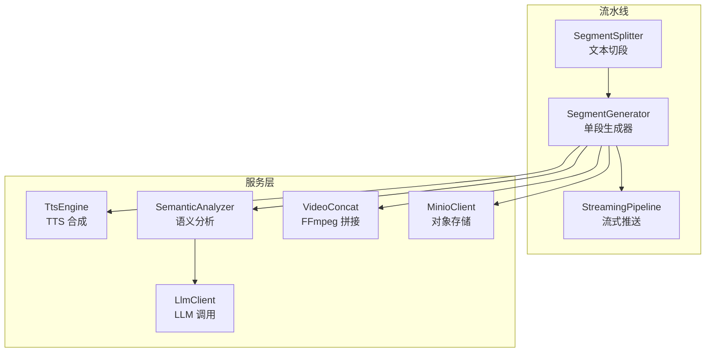
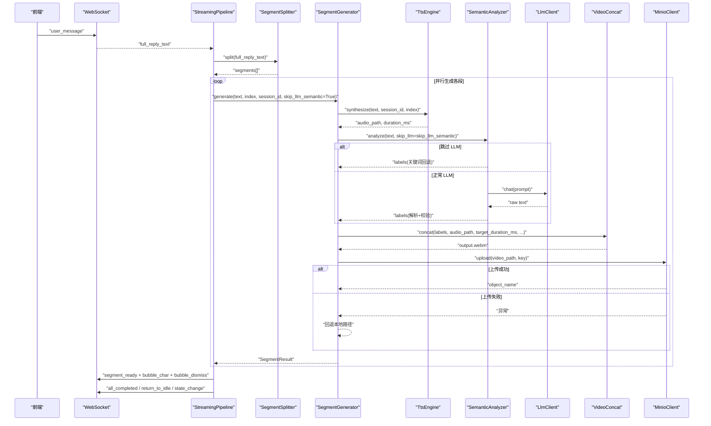
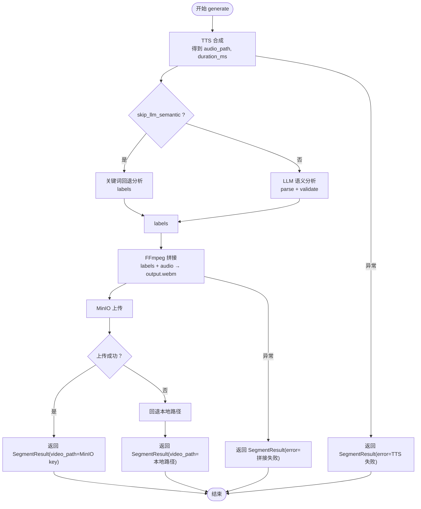
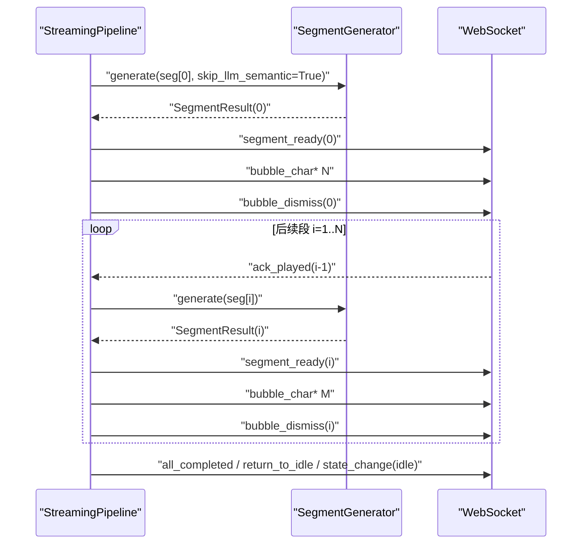
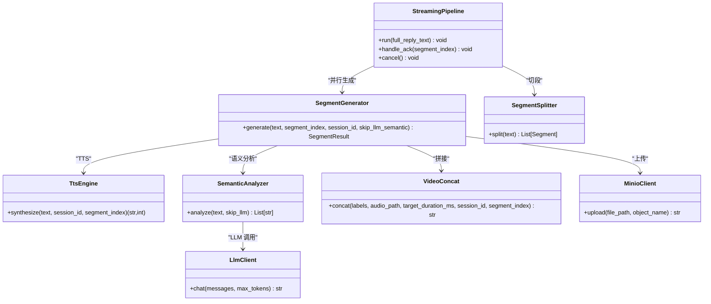

# 段落生成器

<cite>
**本文引用的文件**   
- [segment_generator.py](file://server/pipeline/segment_generator.py)
- [streaming_pipeline.py](file://server/pipeline/streaming_pipeline.py)
- [segment_splitter.py](file://server/pipeline/segment_splitter.py)
- [tts_engine.py](file://server/services/tts_engine.py)
- [semantic_analyzer.py](file://server/services/semantic_analyzer.py)
- [video_concat.py](file://server/services/video_concat.py)
- [minio_client.py](file://server/services/minio_client.py)
- [llm_client.py](file://server/services/llm_client.py)
- [semantic_label.py](file://server/models/semantic_label.py)
- [config.py](file://server/config.py)
</cite>

## 目录
1. [简介](#简介)
2. [项目结构](#项目结构)
3. [核心组件](#核心组件)
4. [架构总览](#架构总览)
5. [详细组件分析](#详细组件分析)
6. [依赖关系分析](#依赖关系分析)
7. [性能与资源管理](#性能与资源管理)
8. [故障排查指南](#故障排查指南)
9. [结论](#结论)
10. [附录：数据结构与指标](#附录数据结构与指标)

## 简介
本技术文档聚焦“段落生成器”，面向单段多媒体内容生成的完整流程，涵盖 TTS 语音合成、语义分析与视频片段拼接。重点解析 SegmentGenerator 类的工作机制（异步任务执行、资源管理与错误恢复），说明 skip_llm_semantic 参数的作用与关键字回退机制如何节省 LLM 调用时间，并详细说明多媒体文件生成过程（音频编码、视频帧合成与 WebM 输出）。同时提供生成结果数据结构说明（时长计算、文件大小估算与质量控制）、性能监控指标与调试信息定位方法。

## 项目结构
段落生成相关代码位于 server/pipeline 与 server/services 下，核心由以下模块组成：
- 流式分段引擎：负责接收完整回复文本、切段、并行生成与按确认推送
- 单段生成器：串联 TTS、语义分析、视频拼接与对象存储上传
- 服务层：TTS 引擎、语义分析器、FFmpeg 视频拼接、MinIO 客户端、LLM 客户端
- 模型与配置：语义标签定义与校验、全局配置加载

图表来源
- [segment_generator.py:27-138](file://server/pipeline/segment_generator.py#L27-L138)
- [streaming_pipeline.py:16-214](file://server/pipeline/streaming_pipeline.py#L16-L214)
- [segment_splitter.py:25-95](file://server/pipeline/segment_splitter.py#L25-L95)
- [tts_engine.py:38-234](file://server/services/tts_engine.py#L38-L234)
- [semantic_analyzer.py:35-126](file://server/services/semantic_analyzer.py#L35-L126)
- [video_concat.py:20-174](file://server/services/video_concat.py#L20-L174)
- [minio_client.py:21-139](file://server/services/minio_client.py#L21-L139)
- [llm_client.py:23-204](file://server/services/llm_client.py#L23-L204)

章节来源
- [segment_generator.py:1-138](file://server/pipeline/segment_generator.py#L1-L138)
- [streaming_pipeline.py:1-214](file://server/pipeline/streaming_pipeline.py#L1-L214)
- [segment_splitter.py:1-95](file://server/pipeline/segment_splitter.py#L1-L95)
- [tts_engine.py:1-234](file://server/services/tts_engine.py#L1-L234)
- [semantic_analyzer.py:1-126](file://server/services/semantic_analyzer.py#L1-L126)
- [video_concat.py:1-174](file://server/services/video_concat.py#L1-L174)
- [minio_client.py:1-139](file://server/services/minio_client.py#L1-L139)
- [llm_client.py:1-204](file://server/services/llm_client.py#L1-L204)

## 核心组件
- SegmentGenerator：编排单段生成全流程（TTS → 语义分析 → FFmpeg 拼接 → MinIO 上传），统一异常处理与回退策略
- StreamingPipeline：将完整文本切分为多段，并行生成并通过 WebSocket 逐段推送；首段优先返回，后续段按前端 ack 推进
- TtsEngine：对接 DashScope 多模态生成接口，支持长文本拆分与 MP3 拼接，并发限流保护
- SemanticAnalyzer：基于 LLM 的语义标签序列推断，并提供关键词回退方案以跳过 LLM 调用
- VideoConcat：根据标签选择预置切片，构建 concat 列表，使用 FFmpeg 合并视频并混入 Opus 音频
- MinioClient：封装对象存储上传、存在性检查与 presigned URL 生成，不可用时自动回退本地路径
- LlmClient：OpenAI 兼容 Chat Completions 客户端，内置重试与限流等待
- SegmentSplitter：按中文标点切分句子，累积至阈值形成段落
- SemanticLabel：标签枚举与过渡规则校验

章节来源
- [segment_generator.py:16-138](file://server/pipeline/segment_generator.py#L16-L138)
- [streaming_pipeline.py:16-214](file://server/pipeline/streaming_pipeline.py#L16-L214)
- [tts_engine.py:38-234](file://server/services/tts_engine.py#L38-L234)
- [semantic_analyzer.py:35-126](file://server/services/semantic_analyzer.py#L35-L126)
- [video_concat.py:20-174](file://server/services/video_concat.py#L20-L174)
- [minio_client.py:21-139](file://server/services/minio_client.py#L21-L139)
- [llm_client.py:23-204](file://server/services/llm_client.py#L23-L204)
- [segment_splitter.py:25-95](file://server/pipeline/segment_splitter.py#L25-L95)
- [semantic_label.py:8-80](file://server/models/semantic_label.py#L8-L80)

## 架构总览
下图展示了从完整回复到最终 WebM 输出的端到端数据流与控制流。

图表来源
- [streaming_pipeline.py:44-131](file://server/pipeline/streaming_pipeline.py#L44-L131)
- [segment_generator.py:42-138](file://server/pipeline/segment_generator.py#L42-L138)
- [tts_engine.py:49-226](file://server/services/tts_engine.py#L49-L226)
- [semantic_analyzer.py:41-126](file://server/services/semantic_analyzer.py#L41-L126)
- [llm_client.py:40-113](file://server/services/llm_client.py#L40-L113)
- [video_concat.py:30-149](file://server/services/video_concat.py#L30-L149)
- [minio_client.py:69-124](file://server/services/minio_client.py#L69-L124)

## 详细组件分析

### SegmentGenerator 工作机制
- 职责：协调 TTS、语义分析、视频拼接与对象存储上传，统一异常捕获与回退策略
- 关键流程：
  - TTS 合成：获取音频路径与时长估计
  - 语义分析：根据 skip_llm_semantic 决定是否走 LLM 或关键词回退
  - 视频拼接：依据标签选择切片，构建 concat 列表，调用 FFmpeg 合并并混音
  - 上传与回退：尝试上传至 MinIO，失败则保留本地路径
- 错误恢复：
  - TTS 失败：返回 SegmentResult 带 error 字段
  - 视频拼接失败：同上
  - 上传失败：记录警告并回退本地路径，不中断整体流程

图表来源
- [segment_generator.py:42-138](file://server/pipeline/segment_generator.py#L42-L138)

章节来源
- [segment_generator.py:16-138](file://server/pipeline/segment_generator.py#L16-L138)

### StreamingPipeline 异步任务与确认式推送
- 并行生成：为每个段落创建异步任务，首段完成后立即推送，后续段在后台继续生成
- 确认式推进：等待前端 ack_played 后再推送下一段，避免播放卡顿
- 打字机效果：按字符推送气泡，控制单字间隔与总时长比例
- 取消与错误：支持取消当前 Pipeline，遇到错误推送 error 事件并回到 idle

图表来源
- [streaming_pipeline.py:44-131](file://server/pipeline/streaming_pipeline.py#L44-L131)
- [streaming_pipeline.py:132-197](file://server/pipeline/streaming_pipeline.py#L132-L197)

章节来源
- [streaming_pipeline.py:16-214](file://server/pipeline/streaming_pipeline.py#L16-L214)

### TtsEngine 并发限制与长文本处理
- 并发控制：使用全局信号量限制并发 TTS 请求，避免 API 限流
- 长文本策略：超过阈值的文本按句子边界拆分为 ≤ 阈值的小段，分别合成后通过 FFmpeg 拼接为单个 MP3
- 时长估算：基于文件大小与码率粗略估算时长，保证最小时长下限
- 错误处理：对提交失败、轮询超时、下载失败等场景抛出 TtsError

章节来源
- [tts_engine.py:38-234](file://server/services/tts_engine.py#L38-L234)

### SemanticAnalyzer 语义分析与关键字回退
- 正常模式：构造 Prompt 调用 LLM，解析返回文本为标签序列，并进行合法性校验与重排
- 回退模式：当 skip_llm 为真或 LLM 调用失败时，基于关键词匹配快速生成标签序列
- 标签分类：opening/body/closing 三类标签，validate_labels 确保顺序合理

章节来源
- [semantic_analyzer.py:35-126](file://server/services/semantic_analyzer.py#L35-L126)
- [semantic_label.py:8-80](file://server/models/semantic_label.py#L8-L80)

### VideoConcat FFmpeg 拼接与混音
- 切片选择：根据 labels 从 .webm 目录选取对应切片文件
- 时长对齐：若自然总时长不足目标时长，循环填充最后一个切片
- 混音输出：使用 concat demuxer 合并视频流，并将 MP3 音频编码为 Opus 混入，输出 WebM
- 错误处理：FFmpeg 执行失败、超时、找不到可执行文件均抛出 VideoConcatError

章节来源
- [video_concat.py:20-174](file://server/services/video_concat.py#L20-L174)

### MinioClient 上传与回退
- 可用性检测：连接失败或 bucket 操作异常时标记不可用
- 上传逻辑：成功返回 object name；失败抛出 MinioClientError
- 回退策略：SegmentGenerator 捕获上传异常后回退本地路径，保障流程稳定

章节来源
- [minio_client.py:21-139](file://server/services/minio_client.py#L21-L139)

### LlmClient 重试与限流
- 重试策略：针对 429 限流与 5xx 服务端错误进行短暂等待后重试一次
- 超时与连接错误：捕获并包装为 LlmClientError
- 流式与非流式：语义分析使用非流式 chat，max_tokens 较小以减少开销

章节来源
- [llm_client.py:23-204](file://server/services/llm_client.py#L23-L204)

### SegmentSplitter 文本切段
- 切分规则：按中文句号、叹号、问号、分号拆分句子，累积至阈值形成段落
- 尾部处理：不足阈值的剩余部分单独成段
- 空文本处理：返回空段落占位

章节来源
- [segment_splitter.py:25-95](file://server/pipeline/segment_splitter.py#L25-L95)

## 依赖关系分析
- SegmentGenerator 依赖 TtsEngine、SemanticAnalyzer、VideoConcat、MinioClient
- SemanticAnalyzer 依赖 LlmClient 与语义标签模型
- StreamingPipeline 依赖 SegmentSplitter 与 SegmentGenerator
- 所有服务层组件通过 config.py 读取配置项

图表来源
- [segment_generator.py:27-138](file://server/pipeline/segment_generator.py#L27-L138)
- [streaming_pipeline.py:16-214](file://server/pipeline/streaming_pipeline.py#L16-L214)
- [tts_engine.py:38-234](file://server/services/tts_engine.py#L38-L234)
- [semantic_analyzer.py:35-126](file://server/services/semantic_analyzer.py#L35-L126)
- [video_concat.py:20-174](file://server/services/video_concat.py#L20-L174)
- [minio_client.py:21-139](file://server/services/minio_client.py#L21-L139)
- [llm_client.py:23-204](file://server/services/llm_client.py#L23-L204)
- [segment_splitter.py:25-95](file://server/pipeline/segment_splitter.py#L25-L95)

章节来源
- [segment_generator.py:1-138](file://server/pipeline/segment_generator.py#L1-L138)
- [streaming_pipeline.py:1-214](file://server/pipeline/streaming_pipeline.py#L1-L214)
- [tts_engine.py:1-234](file://server/services/tts_engine.py#L1-L234)
- [semantic_analyzer.py:1-126](file://server/services/semantic_analyzer.py#L1-L126)
- [video_concat.py:1-174](file://server/services/video_concat.py#L1-L174)
- [minio_client.py:1-139](file://server/services/minio_client.py#L1-L139)
- [llm_client.py:1-204](file://server/services/llm_client.py#L1-L204)
- [segment_splitter.py:1-95](file://server/pipeline/segment_splitter.py#L1-L95)

## 性能与资源管理
- 并发控制
  - TTS 并发上限：通过全局信号量限制并发请求，避免触发 API 限流
  - 段落并行生成：使用 asyncio.ensure_future 并行启动各段生成任务，首段就绪即推送
- 资源清理
  - 临时文件：TTS 长文本拼接后清理临时 MP3 与 concat 列表
  - 拼接列表：VideoConcat 在完成拼接后删除 concat 列表文件
- 时长与大小估算
  - 时长估算：TTS 基于文件大小与码率估算时长，设置最小时长下限
  - 文件大小估算：WebM 输出大小取决于视频切片数量与音频时长，可通过日志中的 duration_ms 与输出路径统计
- 质量控制
  - 标签校验：validate_labels 确保 opening/body/closing 顺序合理
  - 时长对齐：VideoConcat 循环填充最后切片以满足目标时长
  - 错误回退：MinIO 上传失败回退本地路径，保证流程不中断

章节来源
- [tts_engine.py:169-226](file://server/services/tts_engine.py#L169-L226)
- [video_concat.py:85-114](file://server/services/video_concat.py#L85-L114)
- [semantic_label.py:32-58](file://server/models/semantic_label.py#L32-L58)
- [segment_generator.py:86-106](file://server/pipeline/segment_generator.py#L86-L106)

## 故障排查指南
- TTS 失败
  - 现象：SegmentResult.error 包含 “TTS 失败”
  - 排查点：API Key、网络连通、任务提交与轮询状态、音频下载 URL 是否 HTTPS
  - 参考位置：TtsError 抛出与日志输出
- 语义分析失败
  - 现象：LLM 调用异常或返回无法解析
  - 行为：自动回退关键词分析，不影响后续流程
  - 参考位置：SemanticAnalyzer.analyze 异常分支
- 视频拼接失败
  - 现象：SegmentResult.error 包含 “视频拼接失败”
  - 排查点：FFmpeg 可执行文件路径、切片文件是否存在、concat 列表格式、Opus 编码支持
  - 参考位置：VideoConcat._run_ffmpeg_concat 异常处理
- MinIO 上传失败
  - 现象：上传异常，回退本地路径
  - 排查点：endpoint、access_key/secret_key、bucket 权限、对象名冲突
  - 参考位置：MinioClient.upload 异常与 SegmentGenerator 回退逻辑
- 首段延迟过高
  - 优化建议：启用 skip_llm_semantic 使用关键词回退，减少 LLM 调用耗时
  - 参考位置：StreamingPipeline 首段 skip_llm 参数传递

章节来源
- [segment_generator.py:108-137](file://server/pipeline/segment_generator.py#L108-L137)
- [semantic_analyzer.py:81-86](file://server/services/semantic_analyzer.py#L81-L86)
- [video_concat.py:133-149](file://server/services/video_concat.py#L133-L149)
- [minio_client.py:88-90](file://server/services/minio_client.py#L88-L90)
- [streaming_pipeline.py:66-76](file://server/pipeline/streaming_pipeline.py#L66-L76)

## 结论
段落生成器通过模块化设计与完善的错误回退机制，实现了高可用的单段多媒体内容生成。SegmentGenerator 作为核心编排者，结合 StreamingPipeline 的并行与确认式推送策略，显著降低首段延迟并提升用户体验。skip_llm_semantic 与关键词回退有效节省 LLM 调用时间，配合并发控制与资源清理，系统具备良好的性能与稳定性。

## 附录：数据结构与指标

### SegmentResult 数据结构
- 字段说明
  - index：段落序号
  - text：段落文本
  - video_path：MinIO object name 或本地路径（上传失败回退）
  - duration_ms：音频时长（毫秒），用于前端播放与打字机节奏控制
  - labels：语义标签序列（如 ["introduction", "explaining", "emphasis"]）
  - error：错误信息（TTS 失败、拼接失败等）

章节来源
- [segment_generator.py:16-25](file://server/pipeline/segment_generator.py#L16-L25)

### 时长计算与文件大小估算
- 时长计算
  - TTS 合成：基于文件大小与码率估算时长，设置最小时长下限
  - 视频拼接：concat 列表自然时长 = 切片数 × 每片时长；不足时循环填充最后切片
- 文件大小估算
  - WebM 输出大小受视频切片数量与音频时长影响，可通过日志中 duration_ms 与输出路径统计
  - 音频编码为 Opus，视频流拷贝无重编码，有助于减小体积与提升速度

章节来源
- [tts_engine.py:154-159](file://server/services/tts_engine.py#L154-L159)
- [video_concat.py:95-114](file://server/services/video_concat.py#L95-L114)

### 性能监控指标与调试信息
- 关键日志
  - TTS 合成完成日志：包含输出路径与估算时长
  - 语义分析原始返回与结果：便于验证标签序列
  - FFmpeg 命令与执行结果：便于定位拼接问题
  - MinIO 上传成功/失败日志：便于追踪对象存储状态
- 监控建议
  - 首段延迟：从 user_message 到 segment_ready(0) 的时间差
  - 分段衔接流畅性：观察段间切换是否有黑屏或画面断裂
  - 并发与限流：关注 TTS 并发信号量与 API 限流响应
  - 资源占用：监控 _work 目录下临时文件数量与磁盘增长

章节来源
- [tts_engine.py:124-159](file://server/services/tts_engine.py#L124-L159)
- [semantic_analyzer.py:66-77](file://server/services/semantic_analyzer.py#L66-L77)
- [video_concat.py:131-143](file://server/services/video_concat.py#L131-L143)
- [minio_client.py:86-90](file://server/services/minio_client.py#L86-L90)