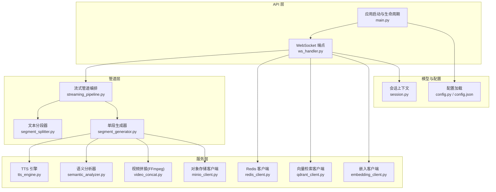
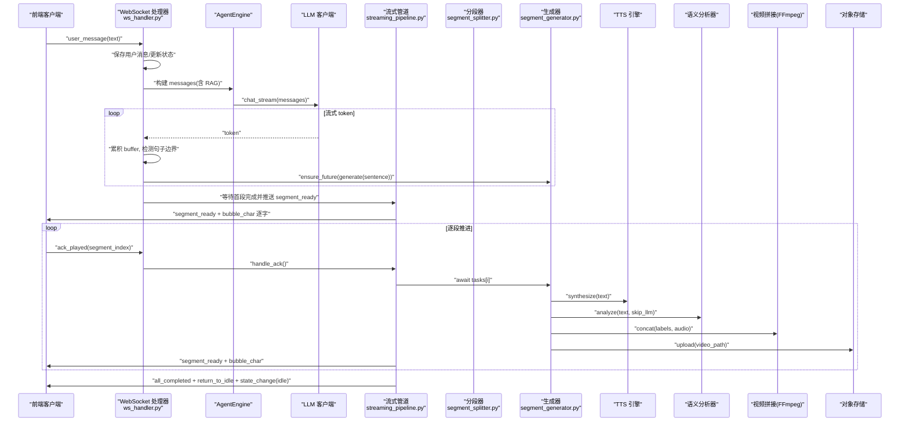
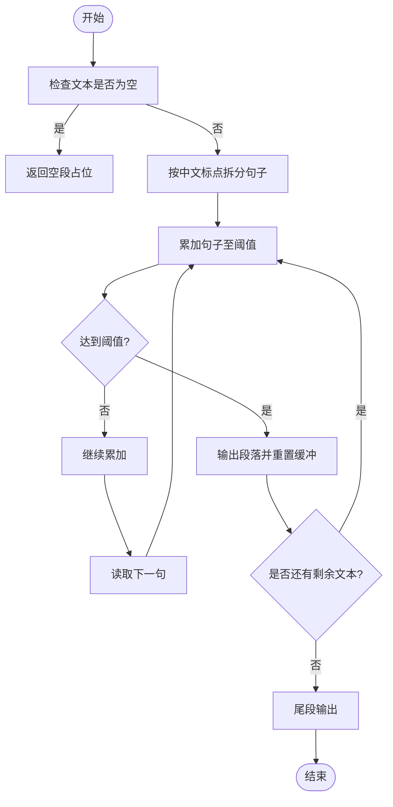
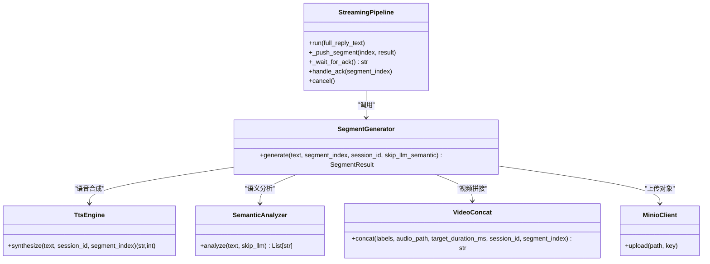
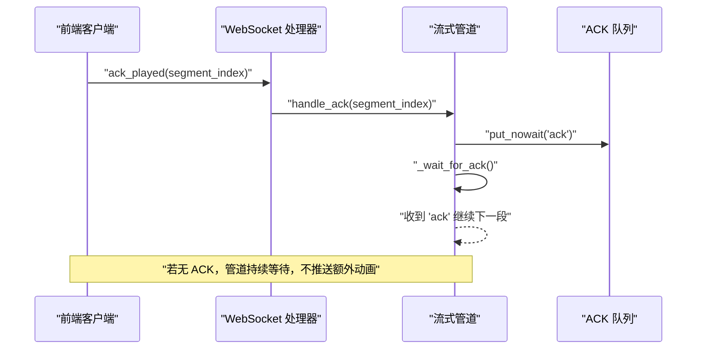
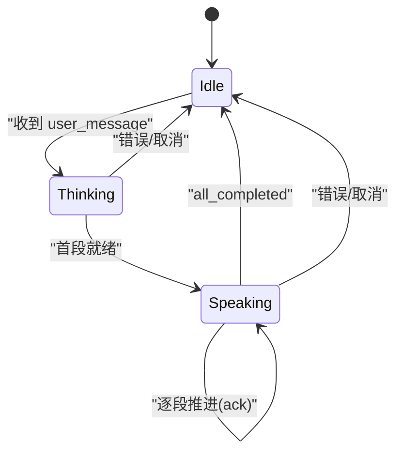
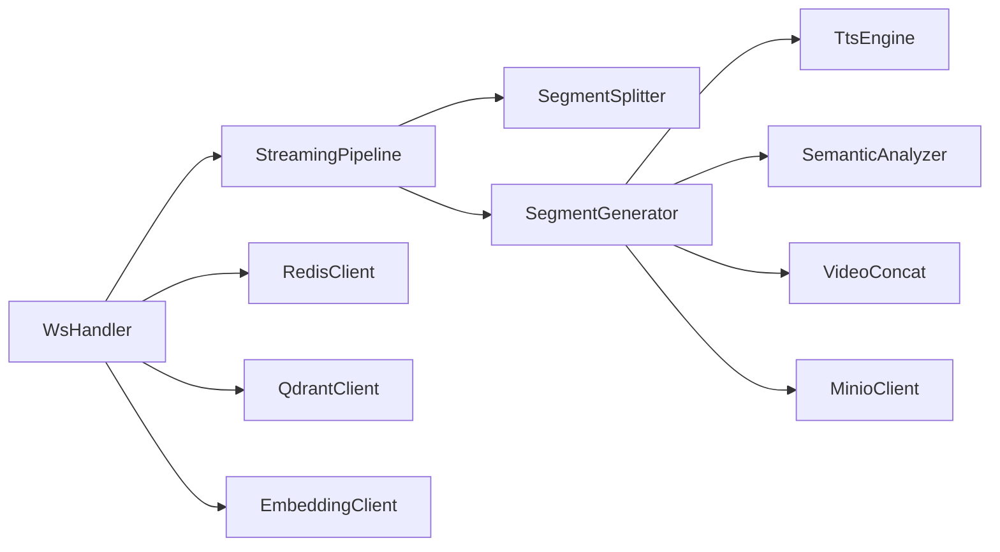

# 流式处理管道

<cite>
**本文引用的文件**   
- [server/main.py](file://server/main.py)
- [server/api/ws_handler.py](file://server/api/ws_handler.py)
- [server/pipeline/streaming_pipeline.py](file://server/pipeline/streaming_pipeline.py)
- [server/pipeline/segment_splitter.py](file://server/pipeline/segment_splitter.py)
- [server/pipeline/segment_generator.py](file://server/pipeline/segment_generator.py)
- [server/services/tts_engine.py](file://server/services/tts_engine.py)
- [server/services/semantic_analyzer.py](file://server/services/semantic_analyzer.py)
- [server/services/video_concat.py](file://server/services/video_concat.py)
- [server/models/session.py](file://server/models/session.py)
- [server/config.py](file://server/config.py)
- [config.json](file://config.json)
</cite>

## 目录
1. [简介](#简介)
2. [项目结构](#项目结构)
3. [核心组件](#核心组件)
4. [架构总览](#架构总览)
5. [详细组件分析](#详细组件分析)
6. [依赖关系分析](#依赖关系分析)
7. [性能考量](#性能考量)
8. [故障排查指南](#故障排查指南)
9. [结论](#结论)
10. [附录](#附录)

## 简介
本技术文档围绕“流式处理管道”展开，聚焦以下目标：
- 分段生成算法：智能文本分割、语义边界识别与段落长度优化
- 并行任务调度：协程池管理、资源竞争处理与负载均衡策略
- 确认式推送机制：消息 ACK 确认、进度跟踪与断点续传
- 管道状态管理：任务队列、执行状态与错误恢复
- 性能优化：内存管理、缓存机制与批量处理
- 架构图与数据流转图：从文本输入到多媒体输出的完整流水线
- 错误处理、重试机制与监控指标说明

该管道以 FastAPI + WebSocket 为入口，结合 LLM 流式输出、TTS 语音合成、语义分析、FFmpeg 视频拼接与 MinIO 对象存储，实现“边生成、边合成、边播放”的实时体验。

## 项目结构
本项目采用分层组织方式：
- API 层：FastAPI 路由与 WebSocket 处理器
- 管道层：分段器、生成器与流式编排
- 服务层：TTS、语义分析、视频拼接、MinIO、Redis、Qdrant、Embedding 等外部能力封装
- 模型与配置：会话上下文、配置加载与默认系统提示

图表来源
- [server/main.py:114-170](file://server/main.py#L114-L170)
- [server/api/ws_handler.py:31-120](file://server/api/ws_handler.py#L31-L120)
- [server/pipeline/streaming_pipeline.py:16-43](file://server/pipeline/streaming_pipeline.py#L16-L43)
- [server/pipeline/segment_splitter.py:25-76](file://server/pipeline/segment_splitter.py#L25-L76)
- [server/pipeline/segment_generator.py:27-41](file://server/pipeline/segment_generator.py#L27-L41)
- [server/services/tts_engine.py:38-47](file://server/services/tts_engine.py#L38-L47)
- [server/services/semantic_analyzer.py:35-40](file://server/services/semantic_analyzer.py#L35-L40)
- [server/services/video_concat.py:20-29](file://server/services/video_concat.py#L20-L29)
- [server/models/session.py:22-41](file://server/models/session.py#L22-L41)
- [server/config.py:148-241](file://server/config.py#L148-L241)
- [config.json:1-39](file://config.json#L1-L39)

章节来源
- [server/main.py:114-170](file://server/main.py#L114-L170)
- [server/api/ws_handler.py:31-120](file://server/api/ws_handler.py#L31-L120)
- [server/pipeline/streaming_pipeline.py:16-43](file://server/pipeline/streaming_pipeline.py#L16-L43)
- [server/pipeline/segment_splitter.py:25-76](file://server/pipeline/segment_splitter.py#L25-L76)
- [server/pipeline/segment_generator.py:27-41](file://server/pipeline/segment_generator.py#L27-L41)
- [server/services/tts_engine.py:38-47](file://server/services/tts_engine.py#L38-L47)
- [server/services/semantic_analyzer.py:35-40](file://server/services/semantic_analyzer.py#L35-L40)
- [server/services/video_concat.py:20-29](file://server/services/video_concat.py#L20-L29)
- [server/models/session.py:22-41](file://server/models/session.py#L22-L41)
- [server/config.py:148-241](file://server/config.py#L148-L241)
- [config.json:1-39](file://config.json#L1-L39)

## 核心组件
- 文本分段器（SegmentSplitter）：按中文标点切分句子，并按阈值合并成段落，保证每段以完整句子结尾，避免跨句切割导致语义断裂。
- 单段生成器（SegmentGenerator）：串联 TTS → 语义分析 → FFmpeg 拼接 → MinIO 上传，支持首段跳过 LLM 语义分析的快速回退。
- 流式管道（StreamingPipeline）：负责整体编排，包括首段立即推送、后续段基于 ACK 的逐段推进、打字机气泡动画与错误处理。
- WebSocket 处理器（WsHandler）：连接生命周期管理、用户消息路由、RAG 检索、LLM 流式接收与段任务创建、ACK 转发与取消控制。
- 服务层：TTS（DashScope）、语义分析（LLM 或关键词回退）、视频拼接（FFmpeg）、对象存储（MinIO）、Redis（会话持久化）、Qdrant（向量检索）、Embedding（向量化）。

章节来源
- [server/pipeline/segment_splitter.py:25-76](file://server/pipeline/segment_splitter.py#L25-L76)
- [server/pipeline/segment_generator.py:27-138](file://server/pipeline/segment_generator.py#L27-L138)
- [server/pipeline/streaming_pipeline.py:16-214](file://server/pipeline/streaming_pipeline.py#L16-L214)
- [server/api/ws_handler.py:31-444](file://server/api/ws_handler.py#L31-L444)
- [server/services/tts_engine.py:38-234](file://server/services/tts_engine.py#L38-L234)
- [server/services/semantic_analyzer.py:35-126](file://server/services/semantic_analyzer.py#L35-L126)
- [server/services/video_concat.py:20-174](file://server/services/video_concat.py#L20-L174)

## 架构总览
下图展示从用户输入到多媒体输出的端到端流程，包含 RAG 检索、LLM 流式响应、分段生成与确认式推送。

图表来源
- [server/api/ws_handler.py:189-334](file://server/api/ws_handler.py#L189-L334)
- [server/pipeline/streaming_pipeline.py:44-131](file://server/pipeline/streaming_pipeline.py#L44-L131)
- [server/pipeline/segment_generator.py:42-138](file://server/pipeline/segment_generator.py#L42-L138)
- [server/services/tts_engine.py:49-167](file://server/services/tts_engine.py#L49-L167)
- [server/services/semantic_analyzer.py:41-86](file://server/services/semantic_analyzer.py#L41-L86)
- [server/services/video_concat.py:30-72](file://server/services/video_concat.py#L30-L72)

## 详细组件分析

### 分段生成算法：智能文本分割、语义边界识别与段落长度优化
- 智能文本分割
  - 使用中文标点作为句子分隔符，保留标点于句末，确保语义完整性。
  - 按阈值（默认 50 字符）累加句子形成段落，不足阈值的尾部单独成段。
  - 提供 should_trigger_multisegment 判断是否触发多段生成。
- 语义边界识别
  - 在流式阶段，WS 处理器根据 LLM 流式 token 累积 buffer，优先匹配句号、问号、感叹号、分号；当 buffer 过大时强制按逗号、换行、顿号进行分割，防止长串无标点导致的延迟。
- 段落长度优化
  - 首段优化：跳过 LLM 语义分析，使用关键词回退，减少首段延迟。
  - 打字机动画时长限制为视频时长的 60%，单字间隔控制在 15ms~50ms，提升观感与流畅度。

图表来源
- [server/pipeline/segment_splitter.py:31-76](file://server/pipeline/segment_splitter.py#L31-L76)

章节来源
- [server/pipeline/segment_splitter.py:25-95](file://server/pipeline/segment_splitter.py#L25-L95)
- [server/api/ws_handler.py:214-274](file://server/api/ws_handler.py#L214-L274)
- [server/pipeline/streaming_pipeline.py:132-171](file://server/pipeline/streaming_pipeline.py#L132-L171)

### 并行任务调度机制：协程池管理、资源竞争处理与负载均衡
- 协程池管理
  - 通过 asyncio.ensure_future 并发创建各段的生成任务，首段完成后立即推送，后续段在后台继续生成。
  - 使用 asyncio.Queue 维护 ACK 队列，实现逐段推进。
- 资源竞争处理
  - TTS 全局信号量限制并发请求，避免 DashScope 限流（Semaphore=3）。
  - FFmpeg 子进程异步执行，超时保护（120s），失败抛出明确错误。
- 负载均衡策略
  - 首段跳过 LLM 语义分析，降低首段耗时。
  - 长文本 TTS 自动拆分为 ≤450 字的片段，分别合成后拼接，避免单次请求过长。

图表来源
- [server/pipeline/streaming_pipeline.py:16-214](file://server/pipeline/streaming_pipeline.py#L16-L214)
- [server/pipeline/segment_generator.py:27-138](file://server/pipeline/segment_generator.py#L27-L138)
- [server/services/tts_engine.py:38-234](file://server/services/tts_engine.py#L38-L234)
- [server/services/semantic_analyzer.py:35-126](file://server/services/semantic_analyzer.py#L35-L126)
- [server/services/video_concat.py:20-174](file://server/services/video_concat.py#L20-L174)

章节来源
- [server/pipeline/streaming_pipeline.py:44-131](file://server/pipeline/streaming_pipeline.py#L44-L131)
- [server/services/tts_engine.py:16-17](file://server/services/tts_engine.py#L16-L17)
- [server/services/video_concat.py:116-149](file://server/services/video_concat.py#L116-L149)

### 确认式推送机制：消息 ACK 确认、进度跟踪与断点续传
- 消息 ACK 确认
  - 前端在播放完一段后发送 ack_played，服务端通过 handle_ack 将确认放入队列，管道在 _wait_for_ack 中阻塞等待，确保顺序播放。
- 进度跟踪
  - 首段完成后推送 segment_ready 与 state_change(speaking)，随后逐段推送，最终推送 all_completed 与 return_to_idle。
- 断点续传
  - 当前实现未显式记录已播放段索引；若需断点续传，可在 Redis 中持久化 segment_index 与 last_pushed_index，重连时从上次位置继续。

图表来源
- [server/api/ws_handler.py:415-425](file://server/api/ws_handler.py#L415-L425)
- [server/pipeline/streaming_pipeline.py:172-184](file://server/pipeline/streaming_pipeline.py#L172-L184)
- [server/pipeline/streaming_pipeline.py:199-212](file://server/pipeline/streaming_pipeline.py#L199-L212)

章节来源
- [server/api/ws_handler.py:415-425](file://server/api/ws_handler.py#L415-L425)
- [server/pipeline/streaming_pipeline.py:172-184](file://server/pipeline/streaming_pipeline.py#L172-L184)

### 管道状态管理：任务队列、执行状态与错误恢复
- 任务队列
  - pending_tasks 列表保存待完成的段任务，首段完成后进入逐段推进循环。
- 执行状态
  - 会话状态枚举：idle、thinking、speaking、bridging；WS 处理器在关键节点更新状态并持久化到 Redis。
- 错误恢复
  - 异常捕获与回退：TTS/拼接/LLM 调用失败时返回 SegmentResult.error，管道推送 error 事件并回到 idle。
  - 取消机制：用户中断或连接断开时设置 cancel 事件，终止后续任务并清理资源。

图表来源
- [server/models/session.py:14-20](file://server/models/session.py#L14-L20)
- [server/api/ws_handler.py:147-159](file://server/api/ws_handler.py#L147-L159)
- [server/api/ws_handler.py:329-334](file://server/api/ws_handler.py#L329-L334)

章节来源
- [server/models/session.py:14-41](file://server/models/session.py#L14-L41)
- [server/api/ws_handler.py:147-159](file://server/api/ws_handler.py#L147-L159)
- [server/api/ws_handler.py:329-334](file://server/api/ws_handler.py#L329-L334)

### 语义分析与标签序列
- 语义分析器
  - 优先使用 LLM 解析文本语义结构，输出标签序列（如 introduction、explaining、emphasis 等）。
  - 若 LLM 调用失败或解析失败，回退到关键词匹配方案，确保可用性。
- 首段优化
  - 首段跳过 LLM 语义分析，直接关键词回退，显著降低首段延迟。

章节来源
- [server/services/semantic_analyzer.py:35-126](file://server/services/semantic_analyzer.py#L35-L126)
- [server/pipeline/segment_generator.py:70-73](file://server/pipeline/segment_generator.py#L70-L73)

### 视频拼接与音频混音
- 切片选择
  - 根据标签序列选择对应 .webm 切片文件，缺失则警告并跳过。
- 时长对齐
  - 每个切片固定 5 秒，不足目标时长时循环填充最后一个切片。
- FFmpeg 命令
  - 使用 concat demuxer 与 libopus 编码音频，最短流为准，输出 .webm。

章节来源
- [server/services/video_concat.py:74-114](file://server/services/video_concat.py#L74-L114)
- [server/services/video_concat.py:116-149](file://server/services/video_concat.py#L116-L149)

### 配置与环境
- 配置加载
  - 支持环境变量覆盖 JSON 配置，统一通过 get_config 获取。
- 关键配置项
  - LLM/TTS/Redis/MinIO/FFmpeg/Qdrant/Embedding/RAG 等模块的配置键值。

章节来源
- [server/config.py:148-241](file://server/config.py#L148-L241)
- [config.json:1-39](file://config.json#L1-L39)

## 依赖关系分析
- 组件耦合与内聚
  - WsHandler 聚合了 Agent、Redis、MinIO、LLM 等依赖，承担消息路由与状态管理职责。
  - StreamingPipeline 仅关注分段编排与推送，内聚度高。
  - SegmentGenerator 组合 TTS/Semantic/Concat/MinIO，职责清晰。
- 直接/间接依赖
  - 管道层依赖服务层接口，服务层依赖外部系统（DashScope、FFmpeg、MinIO、Redis、Qdrant）。
- 潜在循环依赖
  - 当前代码未发现循环导入；SessionContext 对 Pipeline 和 ConversationManager 使用 TYPE_CHECKING 避免运行时循环。
- 外部依赖与集成点
  - DashScope TTS/LLM、FFmpeg 可执行文件、MinIO 对象存储、Redis 会话持久化、Qdrant 向量检索、OpenAI Embedding。

图表来源
- [server/api/ws_handler.py:31-120](file://server/api/ws_handler.py#L31-L120)
- [server/pipeline/streaming_pipeline.py:16-43](file://server/pipeline/streaming_pipeline.py#L16-L43)
- [server/pipeline/segment_generator.py:27-41](file://server/pipeline/segment_generator.py#L27-L41)

章节来源
- [server/api/ws_handler.py:31-120](file://server/api/ws_handler.py#L31-L120)
- [server/pipeline/streaming_pipeline.py:16-43](file://server/pipeline/streaming_pipeline.py#L16-L43)
- [server/pipeline/segment_generator.py:27-41](file://server/pipeline/segment_generator.py#L27-L41)

## 性能考量
- 内存管理
  - 工作目录 _work/{session_id} 用于存放中间文件（MP3、concat 列表、输出视频），建议定期清理临时文件，避免磁盘膨胀。
- 缓存机制
  - 当前未实现结果缓存；可考虑对短文本的 TTS 结果与标签序列进行本地缓存，减少重复计算。
- 批量处理
  - 长文本 TTS 自动拆分合成再拼接，避免单次请求过长；未来可引入批处理合并多个短文本以提升吞吐。
- 并发与限流
  - TTS 全局信号量限制并发，避免 API 限流；FFmpeg 子进程超时保护，避免长时间阻塞。
- 网络与 I/O
  - 使用 httpx 异步客户端与 asyncio.create_subprocess_exec 提高 I/O 效率；MinIO 上传失败回退本地路径，增强鲁棒性。

[本节为通用性能指导，无需特定文件引用]

## 故障排查指南
- 常见问题
  - TTS 失败：检查 API Key、网络连通性与速率限制；查看 TtsError 日志信息。
  - FFmpeg 不可用：确认 ffmpeg 路径配置正确且可执行；查看 VideoConcatError 中的错误码与 stderr。
  - MinIO 上传失败：检查 endpoint、access_key、secret_key、bucket 权限；回退本地路径后可通过代理路径访问。
  - Redis 不可用：服务启动时会拒绝启动；检查 REDIS_URL 与服务可用性。
  - Qdrant/Embedding 不可用：RAG 功能降级为纯 LLM 回复；检查 URL 与 API Key。
- 错误处理与重试
  - 当前实现未内置重试逻辑；建议在 TTS/MinIO/FFmpeg 调用处增加指数退避重试与熔断策略。
- 监控指标
  - 建议采集：首段延迟、段间延迟、TTS 耗时、语义分析耗时、FFmpeg 耗时、上传成功率、错误率、并发数、队列长度。
  - 可通过结构化日志与外部监控系统（Prometheus/Grafana）接入。

章节来源
- [server/services/tts_engine.py:228-234](file://server/services/tts_engine.py#L228-L234)
- [server/services/video_concat.py:141-149](file://server/services/video_concat.py#L141-L149)
- [server/main.py:53-60](file://server/main.py#L53-L60)
- [server/api/ws_handler.py:335-341](file://server/api/ws_handler.py#L335-L341)

## 结论
该流式处理管道通过“边生成、边合成、边播放”的设计，实现了低延迟的多媒体输出体验。其核心优势在于：
- 智能分段与语义边界识别，保证内容连贯与用户体验
- 并行任务调度与资源限流，提升吞吐与稳定性
- 确认式推送机制，确保播放顺序与可控性
- 完善的错误处理与回退策略，增强鲁棒性

建议在未来版本中补充：
- 断点续传与会话状态持久化
- 结果缓存与批量处理优化
- 更丰富的监控指标与告警机制
- 重试与熔断策略，进一步提升容错能力

[本节为总结性内容，无需特定文件引用]

## 附录
- 关键数据结构
  - Segment：段落（index、text）
  - SegmentResult：生成结果（index、text、video_path、duration_ms、labels、error）
  - SessionContext：会话上下文（token、state、conversation、pipeline、ws）
- 关键事件类型
  - connected、play_analysis、state_change、segment_ready、bubble_char、bubble_dismiss、all_completed、return_to_idle、error、ack_played、cancel

章节来源
- [server/pipeline/segment_splitter.py:18-23](file://server/pipeline/segment_splitter.py#L18-L23)
- [server/pipeline/segment_generator.py:16-25](file://server/pipeline/segment_generator.py#L16-L25)
- [server/models/session.py:22-41](file://server/models/session.py#L22-L41)
- [server/api/ws_handler.py:90-120](file://server/api/ws_handler.py#L90-L120)