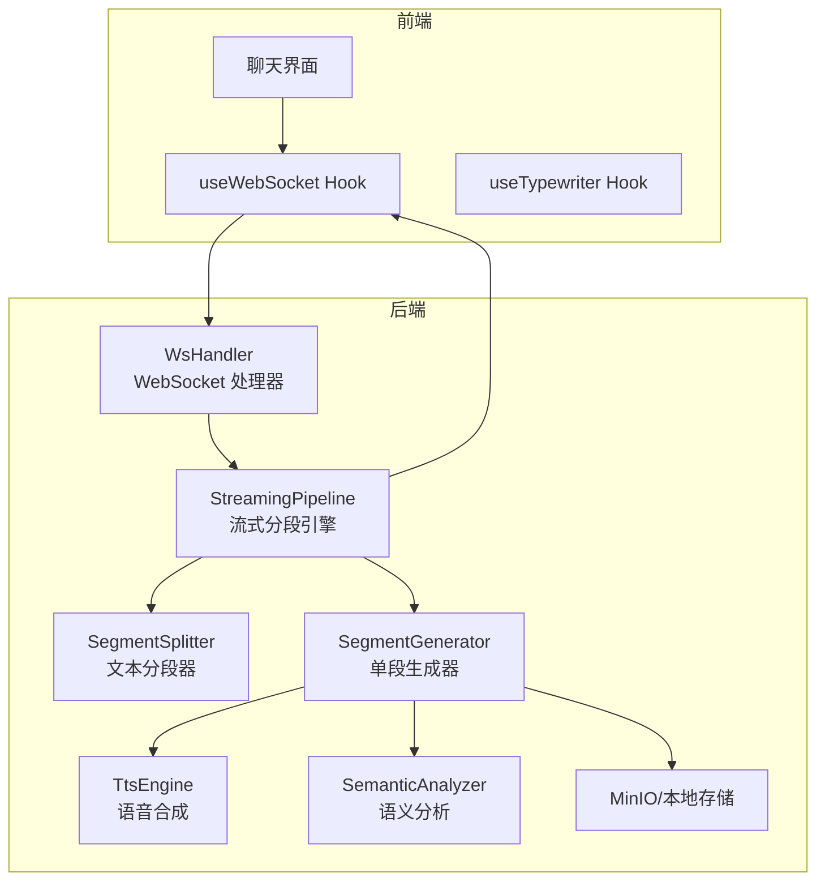
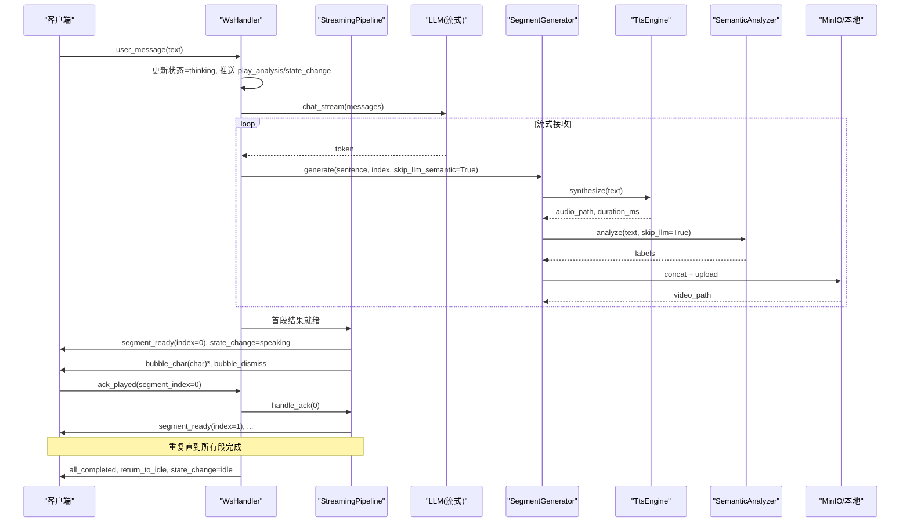
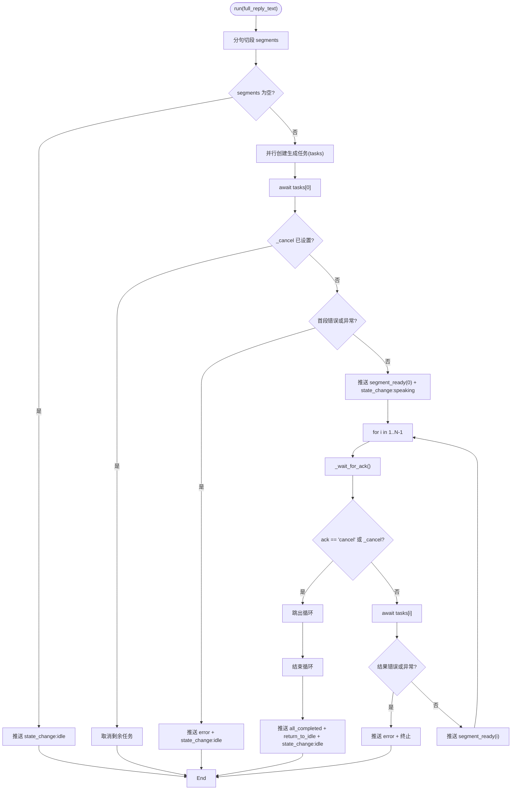
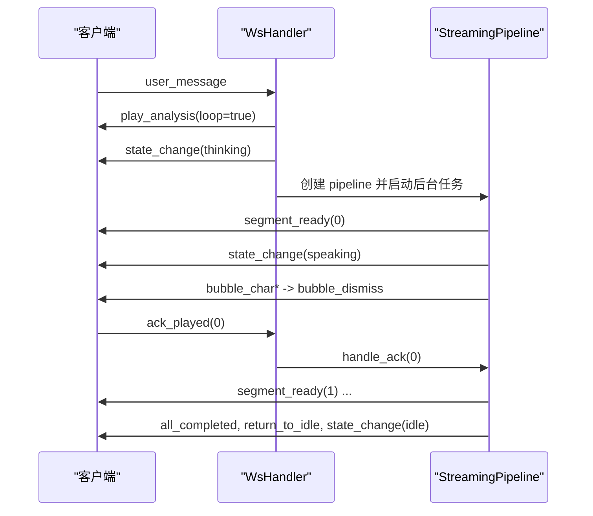
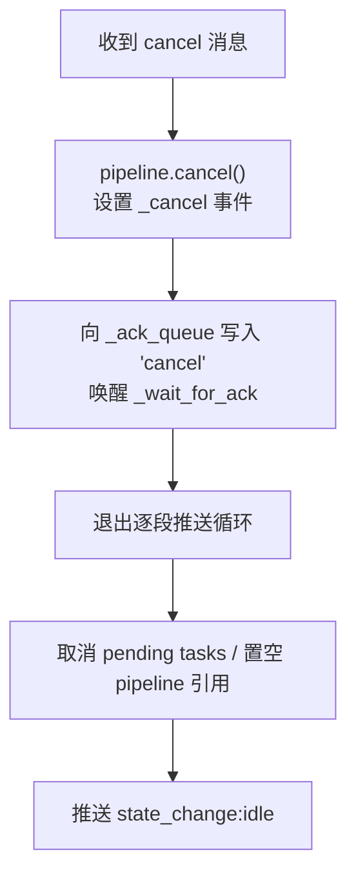
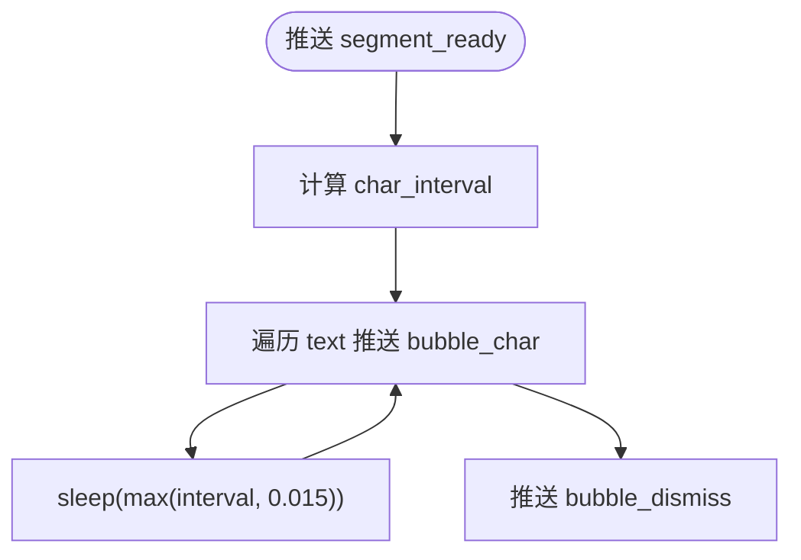
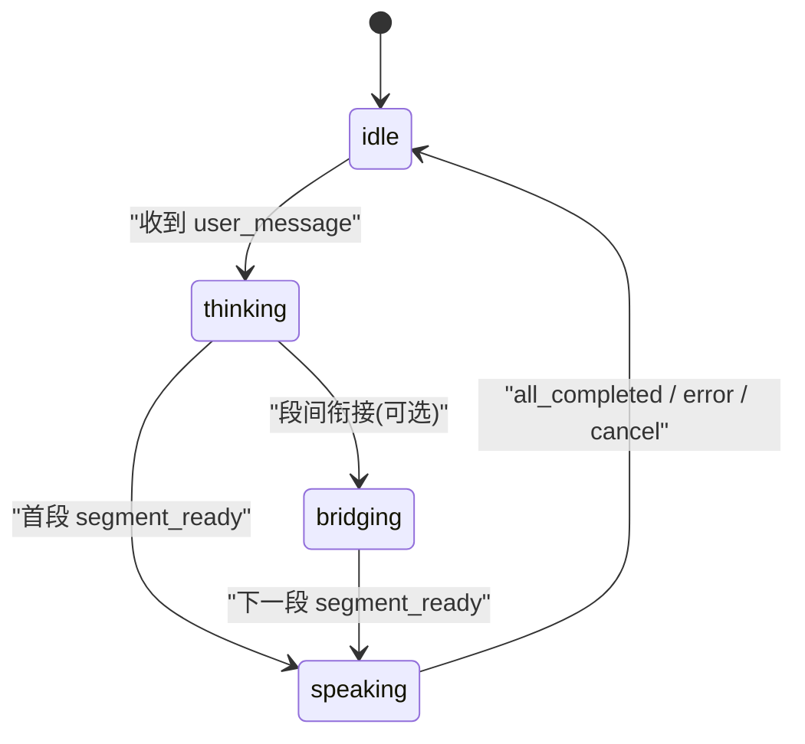
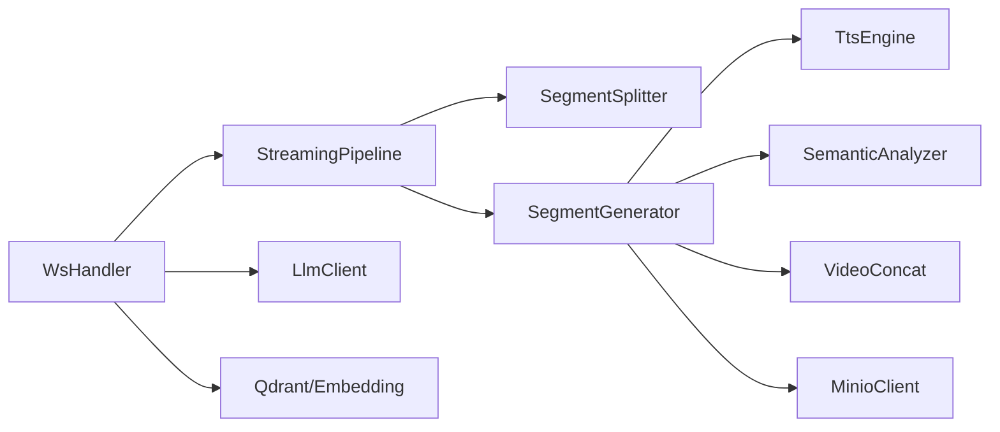

# 管道协调机制

<cite>
**本文引用的文件**   
- [streaming_pipeline.py](file://server/pipeline/streaming_pipeline.py)
- [ws_handler.py](file://server/api/ws_handler.py)
- [segment_splitter.py](file://server/pipeline/segment_splitter.py)
- [segment_generator.py](file://server/pipeline/segment_generator.py)
- [tts_engine.py](file://server/services/tts_engine.py)
- [semantic_analyzer.py](file://server/services/semantic_analyzer.py)
- [session.py](file://server/models/session.py)
- [events.ts](file://client/src/types/events.ts)
- [useWebSocket.ts](file://client/src/hooks/useWebSocket.ts)
- [useTypewriter.ts](file://client/src/hooks/useTypewriter.ts)
</cite>

## 目录
1. [简介](#简介)
2. [项目结构](#项目结构)
3. [核心组件](#核心组件)
4. [架构总览](#架构总览)
5. [详细组件分析](#详细组件分析)
6. [依赖关系分析](#依赖关系分析)
7. [性能与并发特性](#性能与并发特性)
8. [故障排查指南](#故障排查指南)
9. [结论](#结论)
10. [附录：事件时序与状态机](#附录事件时序与状态机)

## 简介
本技术文档聚焦于“管道协调机制”，围绕 StreamingPipeline 的核心协调逻辑展开，涵盖首段优先推送、并行任务调度、确认式推进机制；详细说明 WebSocket 事件流管理（segment_ready、bubble_char、ack_played 等）的时序控制与状态同步；文档化取消机制的实现（协程取消、队列清理、资源释放）；解释打字机效果的实现原理（字符间隔计算、动画同步、用户体验优化）；并提供管道状态机设计说明（idle、speaking、thinking 等状态的转换逻辑），以及并发安全、内存泄漏防护和异常恢复的详细方案。

## 项目结构
本项目采用前后端分离架构：
- 服务端：FastAPI + WebSocket，负责会话管理、LLM 流式生成、TTS 合成、语义分析、视频拼接与存储、分段推送与 ack 驱动。
- 客户端：React + TypeScript，负责 WebSocket 连接、事件分发、UI 状态与动画、打字机效果。

图表来源
- [ws_handler.py:31-129](file://server/api/ws_handler.py#L31-L129)
- [streaming_pipeline.py:16-131](file://server/pipeline/streaming_pipeline.py#L16-L131)
- [segment_splitter.py:25-76](file://server/pipeline/segment_splitter.py#L25-L76)
- [segment_generator.py:27-138](file://server/pipeline/segment_generator.py#L27-L138)
- [tts_engine.py:38-77](file://server/services/tts_engine.py#L38-L77)
- [semantic_analyzer.py:35-86](file://server/services/semantic_analyzer.py#L35-L86)

章节来源
- [ws_handler.py:31-129](file://server/api/ws_handler.py#L31-L129)
- [streaming_pipeline.py:16-131](file://server/pipeline/streaming_pipeline.py#L16-L131)

## 核心组件
- StreamingPipeline：流式分段生成与推送引擎，负责首段优先推送、并行任务调度、确认式推进、打字机气泡推送、错误处理与取消。
- SegmentSplitter：按中文标点将完整回复切分为段落，保证每段以完整句子结尾。
- SegmentGenerator：单段生成器，串联 TTS → 语义分析 → FFmpeg 拼接 → MinIO 上传，返回 SegmentResult。
- TtsEngine：调用 DashScope 多模态接口进行语音合成，支持长文本拆分与并发限流。
- SemanticAnalyzer：基于 LLM 或关键词回退的语义标签序列生成。
- WsHandler：WebSocket 连接生命周期管理、消息路由、RAG 检索、流式 LLM 集成、Pipeline 创建与 ack/cancel 处理。
- 前端 Hooks：useWebSocket 负责连接、重连、发送 ack/cancel；useTypewriter 负责逐字追加与自动消失。

章节来源
- [streaming_pipeline.py:16-131](file://server/pipeline/streaming_pipeline.py#L16-L131)
- [segment_splitter.py:25-76](file://server/pipeline/segment_splitter.py#L25-L76)
- [segment_generator.py:27-138](file://server/pipeline/segment_generator.py#L27-L138)
- [tts_engine.py:38-77](file://server/services/tts_engine.py#L38-L77)
- [semantic_analyzer.py:35-86](file://server/services/semantic_analyzer.py#L35-L86)
- [ws_handler.py:31-129](file://server/api/ws_handler.py#L31-L129)
- [useWebSocket.ts:34-190](file://client/src/hooks/useWebSocket.ts#L34-L190)
- [useTypewriter.ts:29-76](file://client/src/hooks/useTypewriter.ts#L29-L76)

## 架构总览
整体数据与控制流如下：
- 用户输入触发 WsHandler._handle_user_message，进入 thinking 状态并启动后台流式 LLM。
- 流式 LLM 边接收边识别句子边界，立即为每个片段创建 SegmentGenerator.generate 任务。
- 首段完成后，Pipeline 立即推送 segment_ready 与 state_change:speaking，并开始打字机气泡。
- 后续段采用确认式推进：等待前端 ack_played 后再推送下一段 segment_ready。
- 全部完成时推送 all_completed、return_to_idle 与 state_change:idle。
- 任意阶段可收到 cancel，触发 Pipeline.cancel，中断协程与队列等待，清理资源。

图表来源
- [ws_handler.py:130-341](file://server/api/ws_handler.py#L130-L341)
- [streaming_pipeline.py:44-131](file://server/pipeline/streaming_pipeline.py#L44-L131)
- [segment_generator.py:42-138](file://server/pipeline/segment_generator.py#L42-L138)
- [tts_engine.py:49-77](file://server/services/tts_engine.py#L49-L77)
- [semantic_analyzer.py:41-86](file://server/services/semantic_analyzer.py#L41-L86)

## 详细组件分析

### StreamingPipeline 协调逻辑
- 首段优先推送：在 run 中先 await tasks[0]，成功后立即推送 segment_ready 与 speaking 状态，不等其他段。
- 并行任务调度：使用 asyncio.ensure_future 为每个段创建生成任务，首段跳过 LLM 语义分析（skip_llm_semantic=True）以减少延迟。
- 确认式推进：对 i=1..N-1，循环内 await _wait_for_ack()，收到 ack 后才获取对应 task 的结果并推送 segment_ready。
- 打字机效果：在 _push_segment 中根据 result.duration_ms 计算最大打字时间（不超过视频时长 60%），按字符推送 bubble_char，间隔限制在 15ms~50ms，最后推送 bubble_dismiss。
- 取消机制：内部使用 asyncio.Event(_cancel) 标记取消；_wait_for_ack 超时后继续等待；cancel() 设置事件并向 _ack_queue 写入 "cancel"，使等待提前返回。
- 错误处理：若首段或后续段结果为 Exception 或 error 字段非空，推送 error 事件并回到 idle；外层 try/except 捕获异常并兜底。

图表来源
- [streaming_pipeline.py:44-131](file://server/pipeline/streaming_pipeline.py#L44-L131)
- [streaming_pipeline.py:132-171](file://server/pipeline/streaming_pipeline.py#L132-L171)
- [streaming_pipeline.py:172-214](file://server/pipeline/streaming_pipeline.py#L172-L214)

章节来源
- [streaming_pipeline.py:44-131](file://server/pipeline/streaming_pipeline.py#L44-L131)
- [streaming_pipeline.py:132-171](file://server/pipeline/streaming_pipeline.py#L132-L171)
- [streaming_pipeline.py:172-214](file://server/pipeline/streaming_pipeline.py#L172-L214)

### WebSocket 事件流管理与时序控制
- 客户端消息类型：user_message、ack_played、cancel。
- 服务端事件类型：connected、state_change、segment_ready、bubble_char、bubble_dismiss、play_analysis、all_completed、return_to_idle、error。
- 时序要点：
  - 收到 user_message 后立即推送 play_analysis 与 state_change:thinking。
  - 首段就绪推送 segment_ready 与 state_change:speaking，随后开始 bubble_char 序列。
  - 前端播放完毕后发送 ack_played，服务端通过 handle_ack 入队，唤醒 _wait_for_ack。
  - 段间衔接：当前段播放完毕但下一段尚未就绪时，可在等待 ack 期间推送 play_analysis(loop=true) 作为过渡（具体由上层流程决定）。
  - 全部完成推送 all_completed、return_to_idle、state_change:idle。

图表来源
- [ws_handler.py:130-341](file://server/api/ws_handler.py#L130-L341)
- [streaming_pipeline.py:132-171](file://server/pipeline/streaming_pipeline.py#L132-L171)
- [events.ts:33-92](file://client/src/types/events.ts#L33-L92)

章节来源
- [ws_handler.py:130-341](file://server/api/ws_handler.py#L130-L341)
- [events.ts:33-92](file://client/src/types/events.ts#L33-L92)

### 取消机制实现
- 协程取消：Pipeline.run 中检查 _cancel.is_set()，并在必要时调用 task.cancel() 取消未完成的生成任务。
- 队列清理：cancel() 向 _ack_queue 写入 "cancel"，使 _wait_for_ack 提前返回，避免阻塞。
- 资源释放：WsHandler 在 _handle_cancel 中将 session_ctx.pipeline 置空，并重置状态到 idle；同时推送 state_change:idle。
- 健壮性：_push_event 捕获异常并记录日志，防止因断连导致崩溃。

图表来源
- [streaming_pipeline.py:206-214](file://server/pipeline/streaming_pipeline.py#L206-L214)
- [ws_handler.py:426-444](file://server/api/ws_handler.py#L426-L444)

章节来源
- [streaming_pipeline.py:206-214](file://server/pipeline/streaming_pipeline.py#L206-L214)
- [ws_handler.py:426-444](file://server/api/ws_handler.py#L426-L444)

### 打字机效果实现原理
- 字符间隔计算：max_typing_sec = duration_ms * 0.6 / 1000；raw_interval = max_typing_sec / len(text)；char_interval = min(raw_interval, 0.05)。
- 最小间隔保护：sleep(max(char_interval, 0.015))，确保至少 15ms 间隔，避免过快渲染。
- 动画同步：bubble_char 逐字推送，bubble_dismiss 在全部字符推送完成后触发，前端 useTypewriter 在 2s 后标记 isComplete，再延迟 0.5s 真正消失。
- 用户体验优化：打字时间不超过视频时长 60%，单字间隔上限 50ms，下限 15ms，兼顾流畅性与可读性。

图表来源
- [streaming_pipeline.py:147-168](file://server/pipeline/streaming_pipeline.py#L147-L168)
- [useTypewriter.ts:35-57](file://client/src/hooks/useTypewriter.ts#L35-L57)

章节来源
- [streaming_pipeline.py:147-168](file://server/pipeline/streaming_pipeline.py#L147-L168)
- [useTypewriter.ts:35-57](file://client/src/hooks/useTypewriter.ts#L35-L57)

### 管道状态机设计
- 状态定义：idle、thinking、speaking、bridging。
- 转换逻辑：
  - idle → thinking：收到 user_message，WsHandler 推送 play_analysis 与 state_change:thinking。
  - thinking → speaking：首段 segment_ready 推送后，WsHandler 推送 state_change:speaking。
  - speaking → idle：全部完成推送 all_completed、return_to_idle 与 state_change:idle；或发生错误/取消时直接回到 idle。
  - bridging：用于段间衔接（如 play_analysis.loop=true），可由上层流程根据需要切换。

图表来源
- [session.py:14-20](file://server/models/session.py#L14-L20)
- [ws_handler.py:148-159](file://server/api/ws_handler.py#L148-L159)
- [ws_handler.py:302-334](file://server/api/ws_handler.py#L302-L334)

章节来源
- [session.py:14-20](file://server/models/session.py#L14-L20)
- [ws_handler.py:148-159](file://server/api/ws_handler.py#L148-L159)
- [ws_handler.py:302-334](file://server/api/ws_handler.py#L302-L334)

### 并发安全、内存泄漏防护与异常恢复
- 并发安全：
  - TTS 全局信号量限制并发请求，避免外部 API 限流。
  - Pipeline 使用 asyncio.Queue 作为 ack 通道，线程安全的 put_nowait/get。
  - 首段优先与并行任务调度通过 ensure_future 与 await 组合，避免阻塞主循环。
- 内存泄漏防护：
  - 取消时将 pending tasks 显式 cancel，避免悬挂协程。
  - WsHandler 在断开或取消后将 session_ctx.pipeline 置空，减少强引用。
  - 前端 useWebSocket 在卸载时关闭连接并清除定时器。
- 异常恢复：
  - Pipeline.run 外层 try/except 捕获异常，推送 error 并回到 idle。
  - SegmentGenerator 对 TTS、VideoConcat、MinIO 异常分别捕获，返回带 error 的 SegmentResult，上层统一处理。
  - WsHandler 对 LlmClientError 与普通异常分别处理，重置状态并提示重试。

章节来源
- [tts_engine.py:16-17](file://server/services/tts_engine.py#L16-L17)
- [streaming_pipeline.py:127-131](file://server/pipeline/streaming_pipeline.py#L127-L131)
- [segment_generator.py:108-138](file://server/pipeline/segment_generator.py#L108-L138)
- [ws_handler.py:335-341](file://server/api/ws_handler.py#L335-L341)
- [useWebSocket.ts:168-180](file://client/src/hooks/useWebSocket.ts#L168-L180)

## 依赖关系分析
- 模块耦合：
  - WsHandler 依赖 AgentEngine、ConversationManager、Redis、MinIO、LLM、Pipeline、SegmentSplitter、SegmentGenerator、TTS、SemanticAnalyzer、VideoConcat。
  - StreamingPipeline 依赖 SegmentSplitter、SegmentGenerator、WebSocket。
  - SegmentGenerator 依赖 TTS、SemanticAnalyzer、VideoConcat、MinIO。
- 外部依赖：
  - DashScope TTS 多模态接口（异步任务轮询）。
  - Qdrant 向量检索（RAG 上下文构建）。
  - MinIO 对象存储（失败回退本地路径）。

图表来源
- [ws_handler.py:1-27](file://server/api/ws_handler.py#L1-L27)
- [streaming_pipeline.py:1-13](file://server/pipeline/streaming_pipeline.py#L1-L13)
- [segment_generator.py:1-13](file://server/pipeline/segment_generator.py#L1-L13)

章节来源
- [ws_handler.py:1-27](file://server/api/ws_handler.py#L1-L27)
- [streaming_pipeline.py:1-13](file://server/pipeline/streaming_pipeline.py#L1-L13)
- [segment_generator.py:1-13](file://server/pipeline/segment_generator.py#L1-L13)

## 性能与并发特性
- 首段优先：首段跳过 LLM 语义分析，显著降低首帧延迟（节省数秒）。
- 并行生成：所有段的任务并行启动，充分利用 I/O 并发能力。
- 确认式推进：避免前端缓冲区堆积，保持稳定的播放节奏。
- TTS 并发限流：全局信号量限制并发请求，避免 429 限流。
- 打字机速率自适应：依据视频时长动态调整字符间隔，提升观感一致性。

[本节为通用性能讨论，不直接分析具体文件]

## 故障排查指南
- WebSocket 推送失败：检查 _push_event 的异常捕获与日志，确认连接是否断开。
- 首段生成失败：查看 SegmentGenerator 的错误信息（TTS/拼接/上传），确认 MinIO 可用性。
- ack 未到达：确认前端是否正确发送 ack_played，服务端 handle_ack 是否正常入队。
- 取消无效：检查 _cancel 事件是否被设置，_ack_queue 是否写入 "cancel"，pending tasks 是否被 cancel。
- 状态不一致：核对 state_change 事件推送顺序与前端状态机处理逻辑。

章节来源
- [streaming_pipeline.py:185-197](file://server/pipeline/streaming_pipeline.py#L185-L197)
- [segment_generator.py:108-138](file://server/pipeline/segment_generator.py#L108-L138)
- [ws_handler.py:415-425](file://server/api/ws_handler.py#L415-L425)
- [ws_handler.py:426-444](file://server/api/ws_handler.py#L426-L444)

## 结论
本管道协调机制通过首段优先推送、并行任务调度与确认式推进，实现了低延迟、高吞吐、稳定可控的多媒体流式输出。WebSocket 事件流管理确保了前后端状态同步与良好的用户体验；取消机制保证了资源的及时释放与系统的健壮性；打字机效果在时间与视觉层面进行了细致优化。整体架构具备良好的扩展性与容错能力，适合实时对话与多媒体展示场景。

[本节为总结，不直接分析具体文件]

## 附录：事件时序与状态机
- 事件清单与用途：
  - connected：连接建立，携带 session_token 与初始 state。
  - state_change：状态变更（thinking/speaking/bridging/idle）。
  - segment_ready：某段视频就绪，包含 index、video_url、duration_ms、text。
  - bubble_char/bubble_dismiss：打字机气泡逐字与消失。
  - play_analysis：段间衔接动画（loop=true）。
  - all_completed/return_to_idle：全部完成与回到待机。
  - error：错误消息。
- 客户端发送：
  - user_message：用户输入。
  - ack_played：段播放确认。
  - cancel：中断当前流程。

章节来源
- [events.ts:33-92](file://client/src/types/events.ts#L33-L92)
- [useWebSocket.ts:147-157](file://client/src/hooks/useWebSocket.ts#L147-L157)