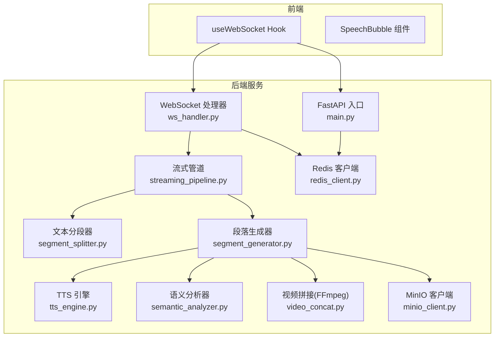
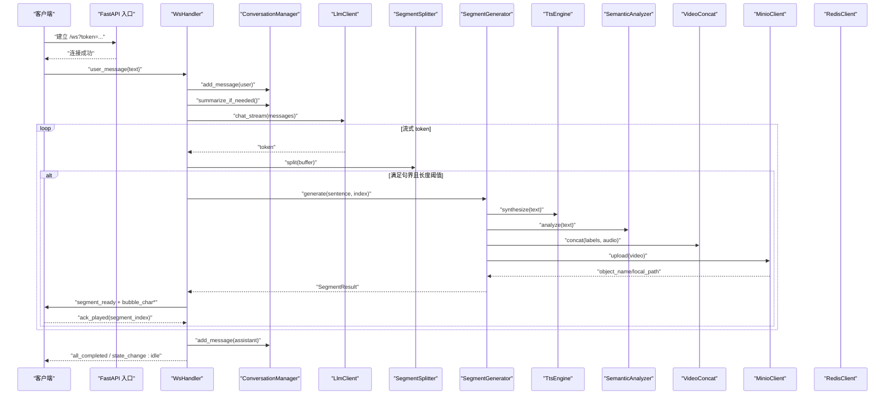
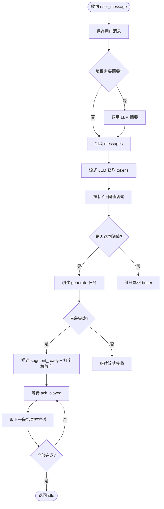
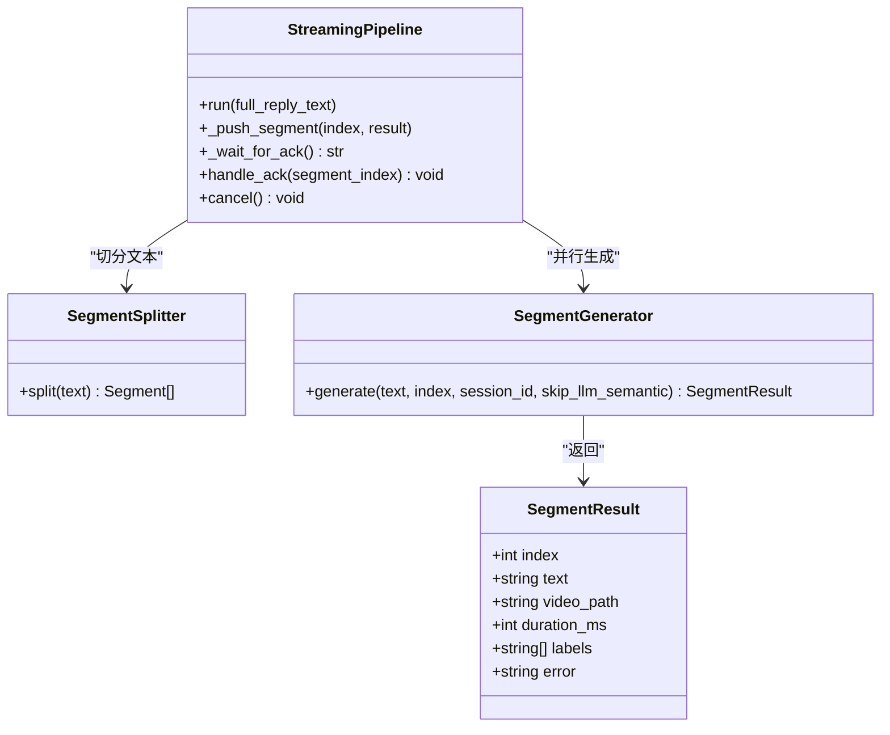
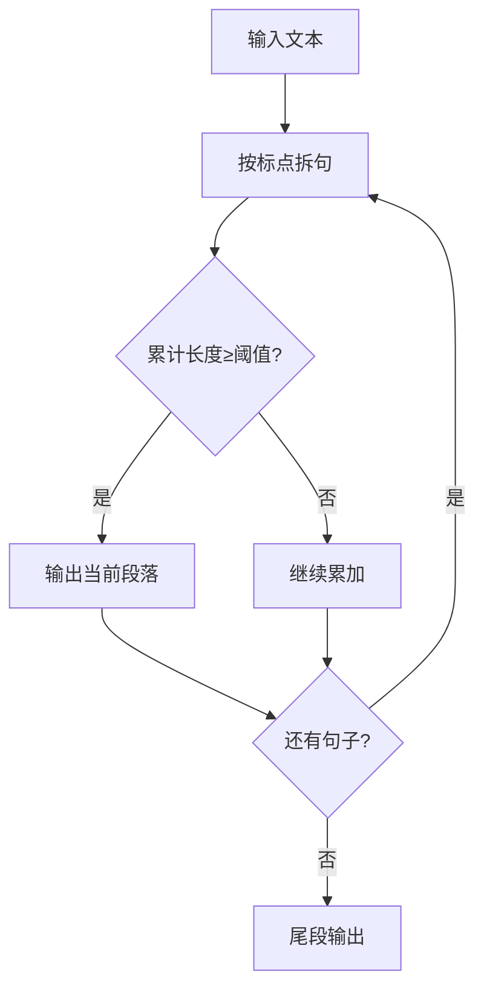
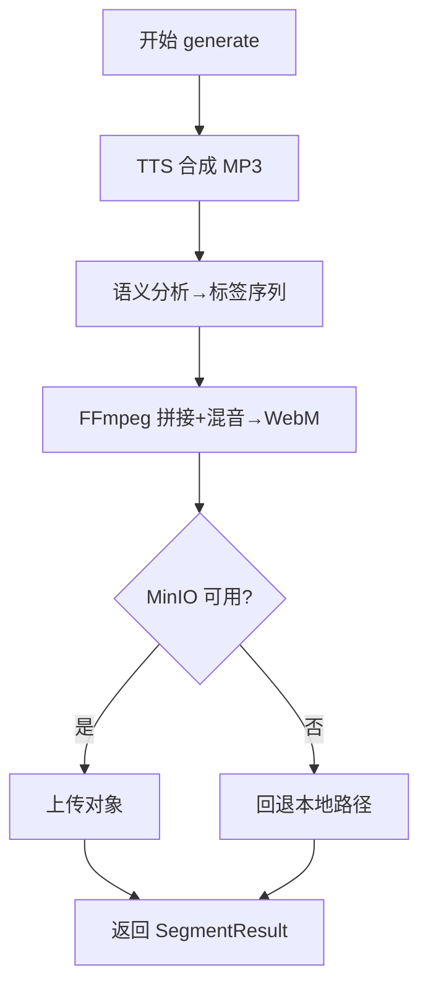
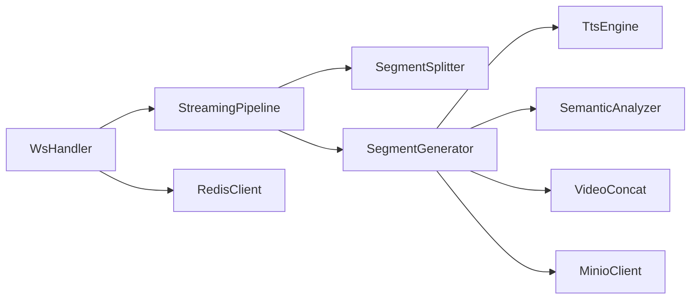

# 数据流设计

<cite>
**本文引用的文件**   
- [server/main.py](file://server/main.py)
- [server/api/ws_handler.py](file://server/api/ws_handler.py)
- [server/pipeline/streaming_pipeline.py](file://server/pipeline/streaming_pipeline.py)
- [server/pipeline/segment_splitter.py](file://server/pipeline/segment_splitter.py)
- [server/pipeline/segment_generator.py](file://server/pipeline/segment_generator.py)
- [server/services/tts_engine.py](file://server/services/tts_engine.py)
- [server/services/semantic_analyzer.py](file://server/services/semantic_analyzer.py)
- [server/services/video_concat.py](file://server/services/video_concat.py)
- [server/services/minio_client.py](file://server/services/minio_client.py)
- [server/services/redis_client.py](file://server/services/redis_client.py)
- [server/models/session.py](file://server/models/session.py)
- [client/src/hooks/useWebSocket.ts](file://client/src/hooks/useWebSocket.ts)
- [client/src/components/SpeechBubble.tsx](file://client/src/components/SpeechBubble.tsx)
</cite>

## 目录
1. [引言](#引言)
2. [项目结构](#项目结构)
3. [核心组件](#核心组件)
4. [架构总览](#架构总览)
5. [详细组件分析](#详细组件分析)
6. [依赖关系分析](#依赖关系分析)
7. [性能考量](#性能考量)
8. [故障排查指南](#故障排查指南)
9. [结论](#结论)

## 引言
本文件面向 RealTimeTalk 系统的数据流设计，覆盖从用户输入到多媒体输出的完整流转路径。重点包括：
- 实时对话流程与流式响应处理
- 文本分段算法、语义分析流程与视频片段拼接逻辑
- 异步数据处理模式（协程调度、任务队列、并发控制）
- 多媒体编码格式、传输协议与缓存策略
- 错误处理与重试机制（网络异常恢复、服务降级、故障转移）
- 关键业务场景的数据流图与时序图

## 项目结构
RealTimeTalk 采用前后端分离架构：
- 前端通过 WebSocket 与服务端交互，接收事件并驱动 UI 播放
- 服务端基于 FastAPI 提供 REST 与 WebSocket 接口，编排 LLM、TTS、语义分析、FFmpeg 拼接与 MinIO 存储
- 会话状态与历史持久化至 Redis；知识库检索可选接入 Qdrant/Embedding

图表来源
- [server/main.py:114-170](file://server/main.py#L114-L170)
- [server/api/ws_handler.py:31-170](file://server/api/ws_handler.py#L31-L170)
- [server/pipeline/streaming_pipeline.py:16-131](file://server/pipeline/streaming_pipeline.py#L16-L131)
- [server/pipeline/segment_splitter.py:25-76](file://server/pipeline/segment_splitter.py#L25-L76)
- [server/pipeline/segment_generator.py:27-138](file://server/pipeline/segment_generator.py#L27-L138)
- [server/services/tts_engine.py:38-234](file://server/services/tts_engine.py#L38-L234)
- [server/services/semantic_analyzer.py:35-126](file://server/services/semantic_analyzer.py#L35-L126)
- [server/services/video_concat.py:20-174](file://server/services/video_concat.py#L20-L174)
- [server/services/minio_client.py:21-139](file://server/services/minio_client.py#L21-L139)
- [server/services/redis_client.py:22-122](file://server/services/redis_client.py#L22-L122)

章节来源
- [server/main.py:114-170](file://server/main.py#L114-L170)
- [server/api/ws_handler.py:31-170](file://server/api/ws_handler.py#L31-L170)

## 核心组件
- WebSocket 处理器：负责连接生命周期、消息路由、会话上下文管理、错误与取消处理
- 流式管道：将完整回复文本切分为多段，首段就绪即推送，后续按 ack 推进
- 段落生成器：串联 TTS → 语义分析 → FFmpeg 拼接 → MinIO 上传的端到端流水线
- TTS 引擎：调用 DashScope 多模态生成接口，支持长文本拆分与合并
- 语义分析器：LLM 驱动的标签序列推断，含关键词回退策略
- 视频拼接器：根据标签选择切片，构建 concat 列表，混音输出 WebM
- MinIO 客户端：对象存储上传与可用性检测，失败回退本地
- Redis 客户端：会话状态与对话历史持久化
- 前端 Hook：自动重连、事件分发、ack/cancel 发送

章节来源
- [server/api/ws_handler.py:31-170](file://server/api/ws_handler.py#L31-L170)
- [server/pipeline/streaming_pipeline.py:16-131](file://server/pipeline/streaming_pipeline.py#L16-L131)
- [server/pipeline/segment_generator.py:27-138](file://server/pipeline/segment_generator.py#L27-L138)
- [server/services/tts_engine.py:38-234](file://server/services/tts_engine.py#L38-L234)
- [server/services/semantic_analyzer.py:35-126](file://server/services/semantic_analyzer.py#L35-L126)
- [server/services/video_concat.py:20-174](file://server/services/video_concat.py#L20-L174)
- [server/services/minio_client.py:21-139](file://server/services/minio_client.py#L21-L139)
- [server/services/redis_client.py:22-122](file://server/services/redis_client.py#L22-L122)
- [client/src/hooks/useWebSocket.ts:34-190](file://client/src/hooks/useWebSocket.ts#L34-L190)

## 架构总览
下图展示一次“用户发言 → 流式 LLM → 边生边合成 → 逐段推送”的关键路径。

图表来源
- [server/main.py:146-170](file://server/main.py#L146-L170)
- [server/api/ws_handler.py:130-341](file://server/api/ws_handler.py#L130-L341)
- [server/pipeline/streaming_pipeline.py:44-131](file://server/pipeline/streaming_pipeline.py#L44-L131)
- [server/pipeline/segment_splitter.py:31-76](file://server/pipeline/segment_splitter.py#L31-L76)
- [server/pipeline/segment_generator.py:42-138](file://server/pipeline/segment_generator.py#L42-L138)
- [server/services/tts_engine.py:49-234](file://server/services/tts_engine.py#L49-L234)
- [server/services/semantic_analyzer.py:41-126](file://server/services/semantic_analyzer.py#L41-L126)
- [server/services/video_concat.py:30-174](file://server/services/video_concat.py#L30-L174)
- [server/services/minio_client.py:69-139](file://server/services/minio_client.py#L69-L139)
- [server/services/redis_client.py:82-122](file://server/services/redis_client.py#L82-L122)

## 详细组件分析

### WebSocket 处理器（WsHandler）
- 职责
  - 校验 token、恢复会话、维护 SessionContext
  - 解析消息类型（user_message、ack_played、cancel）
  - 启动后台流式处理任务，管理 Pipeline 生命周期
  - 错误与中断处理，状态同步至 Redis
- 关键流程
  - 收到 user_message：保存用户消息、必要时摘要历史、拉取 RAG 上下文、流式 LLM、边收边分句、并行生成段落、首段就绪立即推送、逐段等待 ack 推进
  - 收到 ack_played：通知 Pipeline 继续下一段
  - 收到 cancel：取消 Pipeline、重置状态
- 并发与取消
  - 使用 asyncio.ensure_future 创建段落生成任务
  - 通过 Event 与 Queue 实现取消与 ack 协调

图表来源
- [server/api/ws_handler.py:130-341](file://server/api/ws_handler.py#L130-L341)
- [server/pipeline/streaming_pipeline.py:44-131](file://server/pipeline/streaming_pipeline.py#L44-L131)

章节来源
- [server/api/ws_handler.py:31-170](file://server/api/ws_handler.py#L31-L170)
- [server/api/ws_handler.py:130-341](file://server/api/ws_handler.py#L130-L341)
- [server/models/session.py:14-41](file://server/models/session.py#L14-L41)

### 流式管道（StreamingPipeline）
- 职责
  - 接收完整回复文本，切分为段落
  - 并行生成所有段，首段完成后立即推送
  - 后续段按 ack 顺序推送，避免打断说话形象
  - 统一推送事件（segment_ready、bubble_char、bubble_dismiss、state_change、all_completed）
- 数据结构
  - SegmentResult：包含 index、text、video_path、duration_ms、labels、error
- 关键优化
  - 首段跳过 LLM 语义分析，使用关键词回退，显著降低首帧延迟
  - 打字机速率与视频时长联动，单字间隔上限 50ms

图表来源
- [server/pipeline/streaming_pipeline.py:16-131](file://server/pipeline/streaming_pipeline.py#L16-L131)
- [server/pipeline/segment_splitter.py:25-76](file://server/pipeline/segment_splitter.py#L25-L76)
- [server/pipeline/segment_generator.py:27-138](file://server/pipeline/segment_generator.py#L27-L138)

章节来源
- [server/pipeline/streaming_pipeline.py:16-131](file://server/pipeline/streaming_pipeline.py#L16-L131)
- [server/pipeline/segment_generator.py:16-138](file://server/pipeline/segment_generator.py#L16-L138)

### 文本分段器（SegmentSplitter）
- 算法要点
  - 以中文句号、叹号、问号、分号作为句子边界
  - 累计至阈值（默认 50 字符）形成一段，尾部不足单独成段
  - 保证每段以完整句子结尾
- 复杂度
  - 时间 O(n)，空间 O(n)

图表来源
- [server/pipeline/segment_splitter.py:31-76](file://server/pipeline/segment_splitter.py#L31-L76)

章节来源
- [server/pipeline/segment_splitter.py:25-76](file://server/pipeline/segment_splitter.py#L25-L76)

### 段落生成器（SegmentGenerator）
- 流程
  - TTS 合成音频（MP3），估算时长
  - 语义分析得到标签序列
  - FFmpeg 拼接视频切片并混入音频（WebM）
  - 上传 MinIO，失败回退本地路径
- 错误处理
  - 捕获 TTS/拼接异常，返回带 error 的 SegmentResult
  - MinIO 不可用时回退本地，保障首帧可用

图表来源
- [server/pipeline/segment_generator.py:42-138](file://server/pipeline/segment_generator.py#L42-L138)
- [server/services/tts_engine.py:49-234](file://server/services/tts_engine.py#L49-L234)
- [server/services/semantic_analyzer.py:41-126](file://server/services/semantic_analyzer.py#L41-L126)
- [server/services/video_concat.py:30-174](file://server/services/video_concat.py#L30-L174)
- [server/services/minio_client.py:69-139](file://server/services/minio_client.py#L69-L139)

章节来源
- [server/pipeline/segment_generator.py:27-138](file://server/pipeline/segment_generator.py#L27-L138)

### TTS 引擎（TtsEngine）
- 能力
  - 调用 DashScope 多模态生成接口，支持同步/异步两种返回形态
  - 长文本按句子拆分后分别合成，再使用 FFmpeg 拼接为单个 MP3
  - 全局信号量限制并发，避免触发 429 限流
- 时长估算
  - 基于文件大小与码率粗略估算，确保视频时长对齐

章节来源
- [server/services/tts_engine.py:38-234](file://server/services/tts_engine.py#L38-L234)

### 语义分析器（SemanticAnalyzer）
- 能力
  - 优先使用 LLM 输出标签序列，失败或超时时回退关键词匹配
  - 对标签进行验证与重排，保证 opening→body→closing 的顺序
- 首段优化
  - 首段直接走关键词回退，减少 LLM 调用开销

章节来源
- [server/services/semantic_analyzer.py:35-126](file://server/services/semantic_analyzer.py#L35-L126)

### 视频拼接器（VideoConcat）
- 能力
  - 根据标签选择对应 .webm 切片
  - 构建 concat 列表，不足时长循环填充最后一个切片
  - 使用 FFmpeg concat demuxer 拷贝视频流，Opus 编码音频，最短流输出
- 健壮性
  - 找不到可执行文件或超时抛出明确错误

章节来源
- [server/services/video_concat.py:20-174](file://server/services/video_concat.py#L20-L174)

### MinIO 客户端（MinioClient）
- 能力
  - 连接、桶存在性检查与创建、上传、对象存在性检查、预签名 URL 生成
  - 不可用时标记 available=false，上层回退本地
- 缓存策略
  - 预签名 URL 设置 TTL，浏览器可直接访问

章节来源
- [server/services/minio_client.py:21-139](file://server/services/minio_client.py#L21-L139)

### Redis 客户端（RedisClient）
- 能力
  - 会话状态读写、对话历史持久化（rpush/lrange）、TTL 管理
  - 会话存在性判断用于重连恢复

章节来源
- [server/services/redis_client.py:22-122](file://server/services/redis_client.py#L22-L122)

### 前端交互（useWebSocket 与 SpeechBubble）
- useWebSocket
  - 自动重连（指数退避）、Token 管理、事件分发、ack/cancel 发送
- SpeechBubble
  - 打字机效果、延迟消失动画、错误样式

章节来源
- [client/src/hooks/useWebSocket.ts:34-190](file://client/src/hooks/useWebSocket.ts#L34-L190)
- [client/src/components/SpeechBubble.tsx:23-119](file://client/src/components/SpeechBubble.tsx#L23-L119)

## 依赖关系分析
- 模块耦合
  - WsHandler 聚合 Agent、Redis、MinIO、LLM，并编排 Pipeline
  - Pipeline 依赖 Splitter 与 Generator，Generator 依赖 TTS、SemanticAnalyzer、VideoConcat、MinIO
  - 前端仅依赖 WebSocket 事件契约，低耦合
- 外部依赖
  - LLM/TTS 通过 HTTP 调用外部服务
  - FFmpeg 为本地工具链
  - Redis/MinIO 为基础设施

图表来源
- [server/api/ws_handler.py:31-170](file://server/api/ws_handler.py#L31-L170)
- [server/pipeline/streaming_pipeline.py:16-131](file://server/pipeline/streaming_pipeline.py#L16-L131)
- [server/pipeline/segment_generator.py:27-138](file://server/pipeline/segment_generator.py#L27-L138)

章节来源
- [server/api/ws_handler.py:31-170](file://server/api/ws_handler.py#L31-L170)
- [server/pipeline/streaming_pipeline.py:16-131](file://server/pipeline/streaming_pipeline.py#L16-L131)

## 性能考量
- 首帧延迟优化
  - 首段跳过 LLM 语义分析，使用关键词回退
  - 首段就绪立即推送，不等后续段
- 并发控制
  - TTS 全局信号量限制并发，避免 429
  - 段落生成任务并行启动，利用 I/O 并发
- 网络与 I/O
  - MinIO 上传失败回退本地，避免阻塞首帧
  - FFmpeg 使用 stream copy，避免重编码耗时
- 前端体验
  - 打字机速率与视频时长联动，单字间隔上限 50ms
  - 自动重连与断线恢复

[本节为通用指导，不直接分析具体文件]

## 故障排查指南
- WebSocket 连接问题
  - 检查健康端点与会话状态键是否存在
  - 确认 CORS 与静态资源挂载顺序
- LLM/TTS 异常
  - 关注 429 限流与超时，检查信号量与重试策略
  - 长文本合成失败时查看拆分与拼接日志
- FFmpeg 不可用
  - 确认 ffmpeg 路径与环境变量
  - 检查 concat 列表与切片文件是否存在
- MinIO 不可用
  - 检查 endpoint、access_key、secret_key、bucket
  - 确认对象是否存在与预签名 URL 是否过期
- Redis 不可用
  - 检查连接参数与密码特殊字符处理
  - 确认 key 前缀与 TTL 配置

章节来源
- [server/main.py:136-143](file://server/main.py#L136-L143)
- [server/services/tts_engine.py:228-234](file://server/services/tts_engine.py#L228-L234)
- [server/services/video_concat.py:145-149](file://server/services/video_concat.py#L145-L149)
- [server/services/minio_client.py:44-63](file://server/services/minio_client.py#L44-L63)
- [server/services/redis_client.py:31-50](file://server/services/redis_client.py#L31-L50)

## 结论
RealTimeTalk 的数据流围绕“流式 LLM → 边生边合成 → 逐段推送”的核心路径构建，通过首段优化、并发控制与多级回退策略，在保证低延迟的同时提升鲁棒性。前端以事件驱动的方式呈现打字机与视频播放，配合自动重连与 ack 机制，形成稳定的人机交互闭环。