# 状态机设计

<cite>
**本文引用的文件列表**
- [server/models/session.py](file://server/models/session.py)
- [server/api/ws_handler.py](file://server/api/ws_handler.py)
- [server/pipeline/streaming_pipeline.py](file://server/pipeline/streaming_pipeline.py)
- [server/agent/conversation_manager.py](file://server/agent/conversation_manager.py)
- [server/services/redis_client.py](file://server/services/redis_client.py)
- [server/api/routes_session.py](file://server/api/routes_session.py)
- [client/src/types/events.ts](file://client/src/types/events.ts)
- [client/src/hooks/useWebSocket.ts](file://client/src/hooks/useWebSocket.ts)
- [client/src/App.tsx](file://client/src/App.tsx)
- [doc/tech-spec.md](file://doc/tech-spec.md)
</cite>

## 目录
1. [引言](#引言)
2. [项目结构](#项目结构)
3. [核心组件](#核心组件)
4. [架构总览](#架构总览)
5. [详细组件分析](#详细组件分析)
6. [依赖关系分析](#依赖关系分析)
7. [性能与一致性](#性能与一致性)
8. [故障排查指南](#故障排查指南)
9. [结论](#结论)
10. [附录：状态转换图与模型](#附录状态转换图与模型)

## 引言
本文件为 RealTimeTalk 系统的“状态机设计”文档，聚焦于前后端一致的状态管理机制，覆盖会话状态、对话状态与用户界面状态的同步策略；详述连接建立、消息处理、错误恢复与会话清理的生命周期管理；说明 Redis 持久化机制（存储策略、序列化与恢复）；解释分布式状态一致性保证（最终一致性、冲突解决思路）；并提供监控与调试手段（快照、变更日志、可视化追踪）。文末给出状态转换图与状态机模型，帮助理解复杂业务场景下的流转逻辑与边界条件。

## 项目结构
RealTimeTalk 采用前后端分离架构：
- 前端 React 应用通过 WebSocket 与服务端交互，维护本地 UI 状态并驱动形象动画与聊天气泡。
- 服务端基于 FastAPI + 异步 I/O，使用 Redis 持久化会话状态与对话历史，结合 LLM/TTS/视频拼接等管线完成流式回复生成与推送。

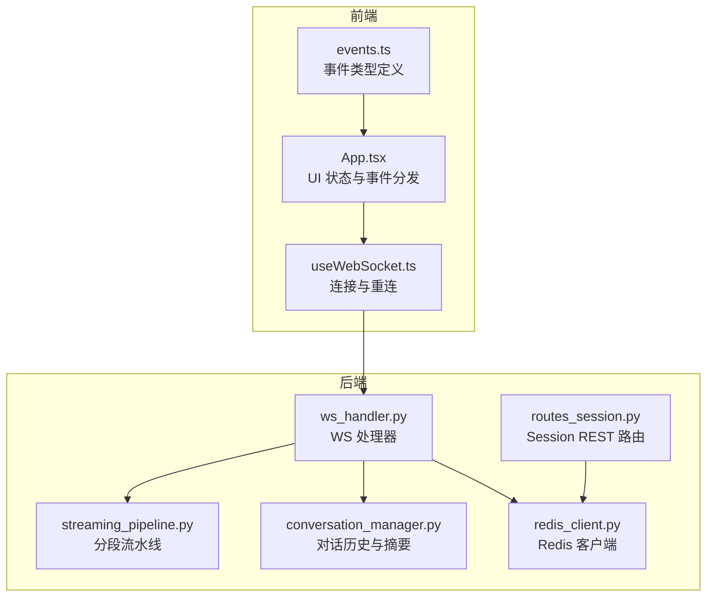

图表来源
- [client/src/App.tsx:1-326](file://client/src/App.tsx#L1-L326)
- [client/src/hooks/useWebSocket.ts:1-131](file://client/src/hooks/useWebSocket.ts#L1-L131)
- [client/src/types/events.ts:1-66](file://client/src/types/events.ts#L1-L66)
- [server/api/ws_handler.py:1-444](file://server/api/ws_handler.py#L1-L444)
- [server/pipeline/streaming_pipeline.py:1-214](file://server/pipeline/streaming_pipeline.py#L1-L214)
- [server/agent/conversation_manager.py:1-139](file://server/agent/conversation_manager.py#L1-L139)
- [server/services/redis_client.py:1-121](file://server/services/redis_client.py#L1-L121)
- [server/api/routes_session.py:1-123](file://server/api/routes_session.py#L1-L123)

章节来源
- [client/src/App.tsx:1-326](file://client/src/App.tsx#L1-L326)
- [client/src/hooks/useWebSocket.ts:1-131](file://client/src/hooks/useWebSocket.ts#L1-L131)
- [client/src/types/events.ts:1-66](file://client/src/types/events.ts#L1-L66)
- [server/api/ws_handler.py:1-444](file://server/api/ws_handler.py#L1-L444)
- [server/pipeline/streaming_pipeline.py:1-214](file://server/pipeline/streaming_pipeline.py#L1-L214)
- [server/agent/conversation_manager.py:1-139](file://server/agent/conversation_manager.py#L1-L139)
- [server/services/redis_client.py:1-121](file://server/services/redis_client.py#L1-L121)
- [server/api/routes_session.py:1-123](file://server/api/routes_session.py#L1-L123)

## 核心组件
- 会话上下文与会话状态
  - 会话上下文包含 token、当前状态、创建时间、对话管理器、活跃 Pipeline 与 WS 引用。
  - 会话状态枚举包括 idle、thinking、speaking、bridging。
- WebSocket 处理器
  - 负责连接生命周期、消息路由、状态更新、错误处理与清理。
- 流式分段流水线
  - 将完整文本切段并行生成，首段就绪即推送，后续按 ack 推进，支持取消与错误传播。
- 对话历史管理器
  - 维护消息列表、Redis 持久化、Token 溢出智能摘要。
- Redis 客户端
  - 提供会话状态与对话历史的存取、TTL 管理与删除。
- Session REST 路由
  - 创建/销毁会话、获取历史，作为前端初始化与清理入口。
- 前端状态与事件
  - 定义前端状态枚举与事件类型，Hook 封装连接与重连，App 组件驱动 UI 状态与媒体播放。

章节来源
- [server/models/session.py:1-41](file://server/models/session.py#L1-L41)
- [server/api/ws_handler.py:1-444](file://server/api/ws_handler.py#L1-L444)
- [server/pipeline/streaming_pipeline.py:1-214](file://server/pipeline/streaming_pipeline.py#L1-L214)
- [server/agent/conversation_manager.py:1-139](file://server/agent/conversation_manager.py#L1-L139)
- [server/services/redis_client.py:1-121](file://server/services/redis_client.py#L1-L121)
- [server/api/routes_session.py:1-123](file://server/api/routes_session.py#L1-L123)
- [client/src/types/events.ts:1-66](file://client/src/types/events.ts#L1-L66)
- [client/src/hooks/useWebSocket.ts:1-131](file://client/src/hooks/useWebSocket.ts#L1-L131)
- [client/src/App.tsx:1-326](file://client/src/App.tsx#L1-L326)

## 架构总览
下图展示端到端状态流转的关键路径：前端发送 user_message → 服务端进入 thinking → 流式 LLM 输出 → 分段生成 → 首段就绪切换 speaking → 逐段确认推进 → 全部完成回到 idle。

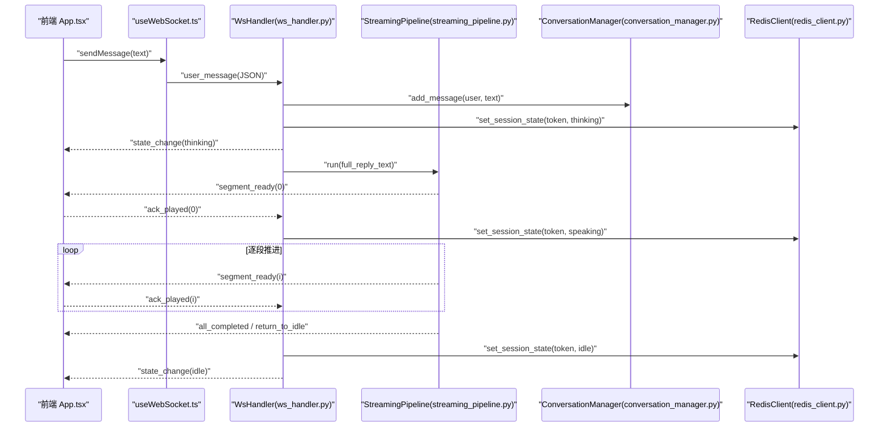

图表来源
- [server/api/ws_handler.py:130-341](file://server/api/ws_handler.py#L130-L341)
- [server/pipeline/streaming_pipeline.py:44-131](file://server/pipeline/streaming_pipeline.py#L44-L131)
- [server/agent/conversation_manager.py:39-45](file://server/agent/conversation_manager.py#L39-L45)
- [server/services/redis_client.py:72-78](file://server/services/redis_client.py#L72-L78)
- [client/src/App.tsx:78-183](file://client/src/App.tsx#L78-L183)
- [client/src/hooks/useWebSocket.ts:68-131](file://client/src/hooks/useWebSocket.ts#L68-L131)

## 详细组件分析

### 会话上下文与会话状态模型
- 会话状态枚举定义了四种状态：idle、thinking、speaking、bridging。
- 会话上下文承载 token、状态、创建时间、对话管理器、活跃 Pipeline 与 WS 引用，并提供 is_active 判断。

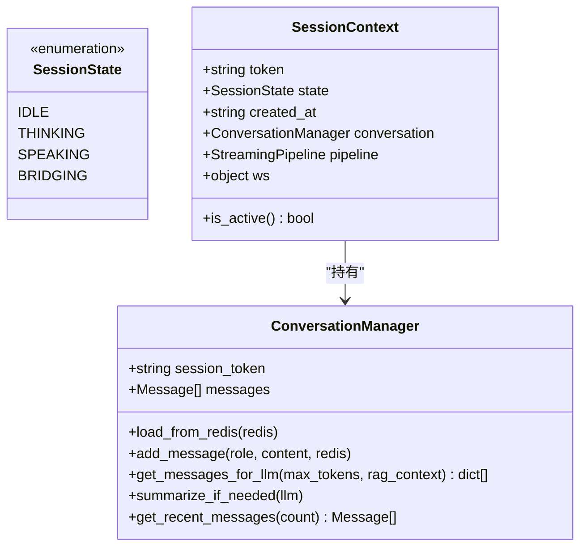

图表来源
- [server/models/session.py:14-41](file://server/models/session.py#L14-L41)
- [server/agent/conversation_manager.py:21-139](file://server/agent/conversation_manager.py#L21-L139)

章节来源
- [server/models/session.py:1-41](file://server/models/session.py#L1-L41)
- [server/agent/conversation_manager.py:1-139](file://server/agent/conversation_manager.py#L1-L139)

### WebSocket 处理器（连接、消息、错误、清理）
- 连接建立：校验 token，若为新连接则从 Redis 恢复会话上下文与对话历史，发送 connected 事件并携带当前状态。
- 消息路由：user_message 触发思考与流式处理；ack_played 推进流水线；cancel 中断并回 idle。
- 错误处理：统一推送 error 与 state_change(idle)，重置状态并清理 Pipeline。
- 清理：断开时保留内存上下文供重连，不立即删除。

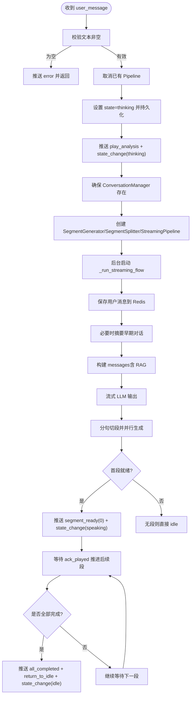

图表来源
- [server/api/ws_handler.py:130-341](file://server/api/ws_handler.py#L130-L341)
- [server/pipeline/streaming_pipeline.py:44-131](file://server/pipeline/streaming_pipeline.py#L44-L131)

章节来源
- [server/api/ws_handler.py:1-444](file://server/api/ws_handler.py#L1-L444)

### 流式分段流水线（首段优先、确认式推进、取消与错误）
- 首段优先：首段完成后立即推送 segment_ready 与 state_change(speaking)。
- 确认式推进：等待前端 ack_played 后再推送下一段，避免拥塞。
- 取消与错误：支持 cancel 信号，异常时推送 error 并回 idle。
- 打字机效果：按字符推送 bubble_char，并在段落结束时推送 bubble_dismiss。

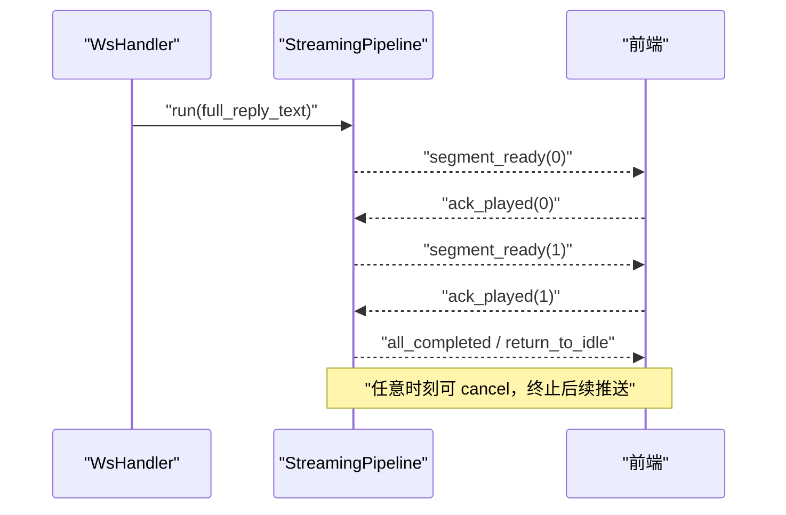

图表来源
- [server/pipeline/streaming_pipeline.py:44-131](file://server/pipeline/streaming_pipeline.py#L44-L214)

章节来源
- [server/pipeline/streaming_pipeline.py:1-214](file://server/pipeline/streaming_pipeline.py#L1-L214)

### 对话历史与摘要（持久化与 Token 溢出处理）
- 持久化：每条消息写入 Redis 列表，带 TTL。
- 恢复：连接时从 Redis 加载历史到内存。
- 摘要：当估算 token 超过阈值且消息数足够时，对早期对话进行摘要，仅保留近期消息，降低 LLM 输入成本。

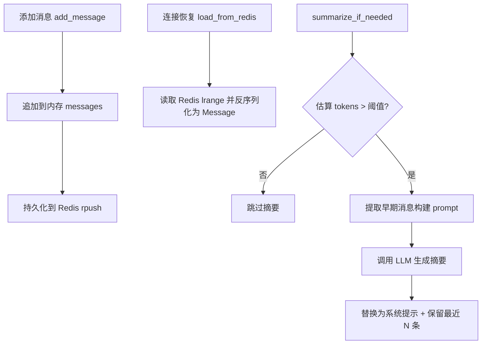

图表来源
- [server/agent/conversation_manager.py:39-139](file://server/agent/conversation_manager.py#L39-L139)
- [server/services/redis_client.py:82-100](file://server/services/redis_client.py#L82-L100)

章节来源
- [server/agent/conversation_manager.py:1-139](file://server/agent/conversation_manager.py#L1-L139)
- [server/services/redis_client.py:1-121](file://server/services/redis_client.py#L1-L121)

### Redis 持久化机制（存储策略、序列化与恢复）
- 键空间设计：
  - 会话状态：session:{token}:state，值字符串，带 TTL。
  - 对话历史：session:{token}:history，值为 JSON 数组元素，带 TTL。
- 序列化：Message 对象提供 to_redis_dict/from_redis_dict 方法，字段包含 role、content、timestamp。
- 恢复算法：连接时先检查 Redis 是否存在该 token 的 state key，存在则重建 ConversationManager 并加载历史。

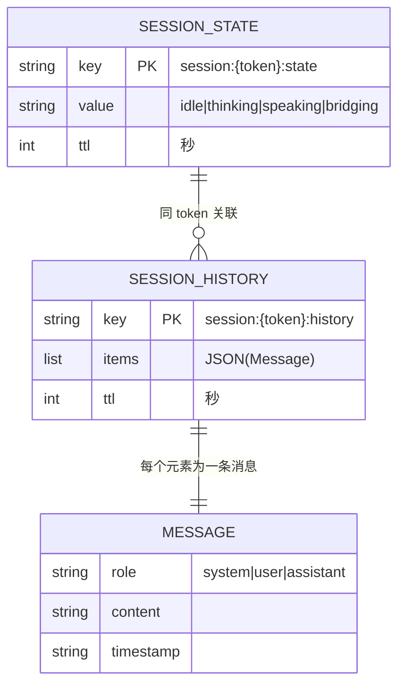

图表来源
- [server/services/redis_client.py:64-121](file://server/services/redis_client.py#L64-L121)
- [server/models/message.py:1-32](file://server/models/message.py#L1-L32)

章节来源
- [server/services/redis_client.py:1-121](file://server/services/redis_client.py#L1-L121)
- [server/models/message.py:1-32](file://server/models/message.py#L1-L32)

### Session REST 路由（创建/销毁/历史）
- 创建会话：生成 UUID token，在 Redis 中初始化状态为 idle。
- 销毁会话：取消活跃 Pipeline、关闭 WS、清理 Redis、移除内存上下文、异步清理 MinIO。
- 获取历史：校验存在性后返回消息列表。

章节来源
- [server/api/routes_session.py:1-123](file://server/api/routes_session.py#L1-L123)

### 前端状态与事件（UI 状态同步）
- 前端状态枚举：Idle、Input、Thinking、Speaking、Bridging。
- 事件类型：connected、state_change、segment_ready、bubble_char、bubble_dismiss、play_analysis、all_completed、return_to_idle、error。
- useWebSocket Hook：自动重连（指数退避）、Token 持久化、消息收发与回调注册。
- App 组件：根据事件驱动 UI 状态变化与媒体播放，实现首段就绪后平滑切换、末段结束回到 Idle。

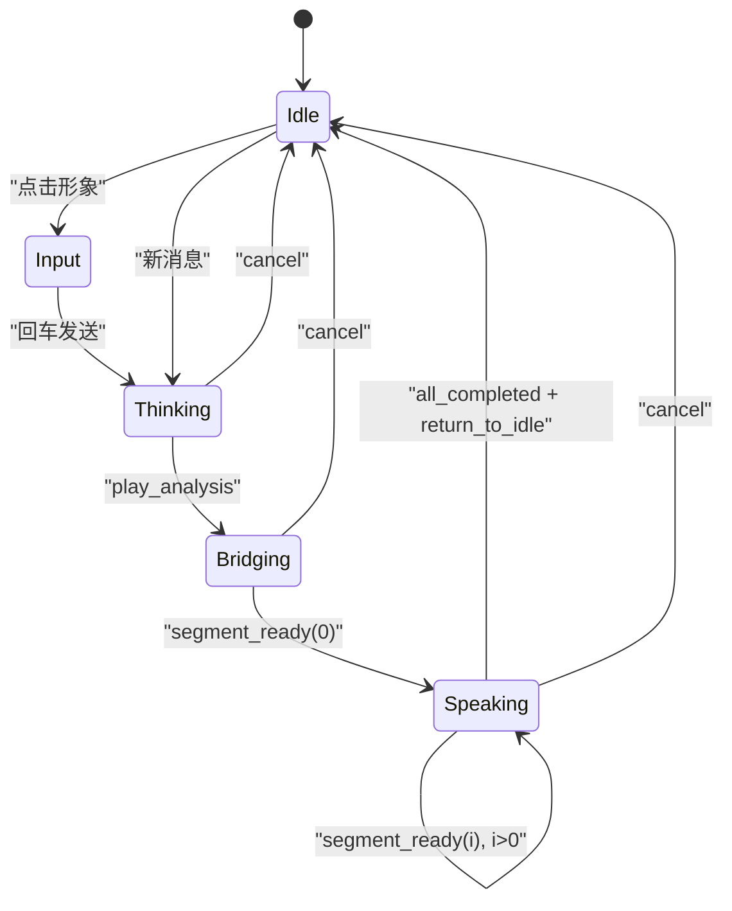

图表来源
- [client/src/types/events.ts:7-13](file://client/src/types/events.ts#L7-L13)
- [client/src/types/events.ts:35-66](file://client/src/types/events.ts#L35-L66)
- [client/src/App.tsx:78-183](file://client/src/App.tsx#L78-L183)
- [client/src/hooks/useWebSocket.ts:119-131](file://client/src/hooks/useWebSocket.ts#L119-L131)

章节来源
- [client/src/types/events.ts:1-66](file://client/src/types/events.ts#L1-L66)
- [client/src/hooks/useWebSocket.ts:1-131](file://client/src/hooks/useWebSocket.ts#L1-L131)
- [client/src/App.tsx:1-326](file://client/src/App.tsx#L1-L326)

## 依赖关系分析
- 模块耦合
  - WsHandler 依赖 StreamingPipeline、ConversationManager、RedisClient、MinioClient、LlmClient 等。
  - StreamingPipeline 依赖 SegmentGenerator、SegmentSplitter。
  - ConversationManager 依赖 RedisClient 与 LlmClient（用于摘要）。
  - RedisClient 提供会话状态与历史存取。
- 外部依赖
  - LLM/TTS/Embedding/Qdrant/MinIO/FFmpeg 等外部服务。
- 潜在循环依赖
  - 当前代码通过 TYPE_CHECKING 与可选引用规避循环导入风险。

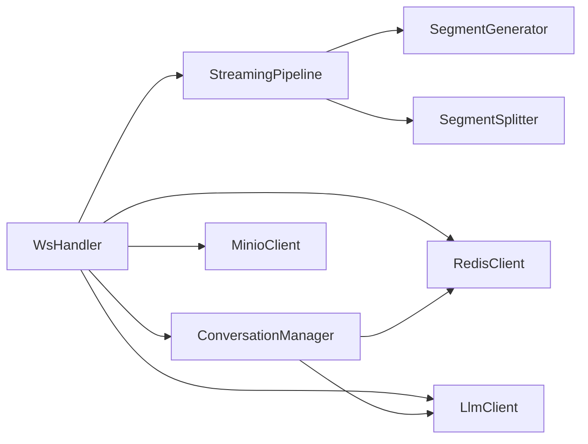

图表来源
- [server/api/ws_handler.py:1-444](file://server/api/ws_handler.py#L1-L444)
- [server/pipeline/streaming_pipeline.py:1-214](file://server/pipeline/streaming_pipeline.py#L1-L214)
- [server/agent/conversation_manager.py:1-139](file://server/agent/conversation_manager.py#L1-L139)
- [server/services/redis_client.py:1-121](file://server/services/redis_client.py#L1-L121)

章节来源
- [server/api/ws_handler.py:1-444](file://server/api/ws_handler.py#L1-L444)
- [server/pipeline/streaming_pipeline.py:1-214](file://server/pipeline/streaming_pipeline.py#L1-L214)
- [server/agent/conversation_manager.py:1-139](file://server/agent/conversation_manager.py#L1-L139)
- [server/services/redis_client.py:1-121](file://server/services/redis_client.py#L1-L121)

## 性能与一致性
- 性能优化
  - 首段优先推送：减少首帧延迟，提升用户体验。
  - 并行生成：所有段任务并发执行，缩短整体生成时间。
  - 确认式推进：避免前端拥塞，保障稳定播放。
  - 摘要压缩：降低长对话的 LLM 输入成本。
- 一致性保证
  - 最终一致性：服务端状态以 Redis 为准，前端通过 state_change 事件同步；断线重连后从 Redis 恢复会话与历史。
  - 冲突解决：单会话串行处理，同一 token 只允许一个活跃 Pipeline；cancel 信号确保中断幂等。
  - 容错与降级：RAG 不可用时降级为纯 LLM 回复；TTS/FFmpeg 失败时回退文字气泡或错误提示。

[本节为通用指导，无需具体文件分析]

## 故障排查指南
- 常见问题定位
  - 连接失败：检查 Redis 连接与可用性；查看服务启动日志。
  - 重连风暴：确认前端指数退避配置与 intentionalClose 标志。
  - 状态不同步：核对 state_change 事件顺序与前端分支逻辑。
  - 首段未就绪：检查 SegmentGenerator 与 MinIO 上传流程。
  - 错误恢复：关注 error 事件与 state_change(idle) 的成对出现。
- 日志与调试
  - 关键日志点：连接建立、会话恢复、流式 LLM 调用、分段生成、ack 推进、错误与清理。
  - 建议增加：状态快照（定时 dump 会话状态）、变更日志（记录 state_change 序列）、可视化追踪（前端状态指示器已内置）。

章节来源
- [server/api/ws_handler.py:121-129](file://server/api/ws_handler.py#L121-L129)
- [client/src/hooks/useWebSocket.ts:119-131](file://client/src/hooks/useWebSocket.ts#L119-L131)
- [client/src/App.tsx:301-315](file://client/src/App.tsx#L301-L315)
- [doc/tech-spec.md:890-903](file://doc/tech-spec.md#L890-L903)

## 结论
RealTimeTalk 的状态机设计围绕“会话状态 + 对话状态 + UI 状态”的一致性展开，通过 Redis 持久化与事件驱动的前端同步，实现了高可用与良好体验。首段优先与确认式推进显著降低了首帧延迟与拥塞风险；摘要机制保障了长对话的可扩展性。未来可在现有基础上增强状态快照与可视化追踪能力，进一步提升可观测性与排障效率。

[本节为总结，无需具体文件分析]

## 附录：状态转换图与模型

### 服务端状态转换（WsHandler + Pipeline）
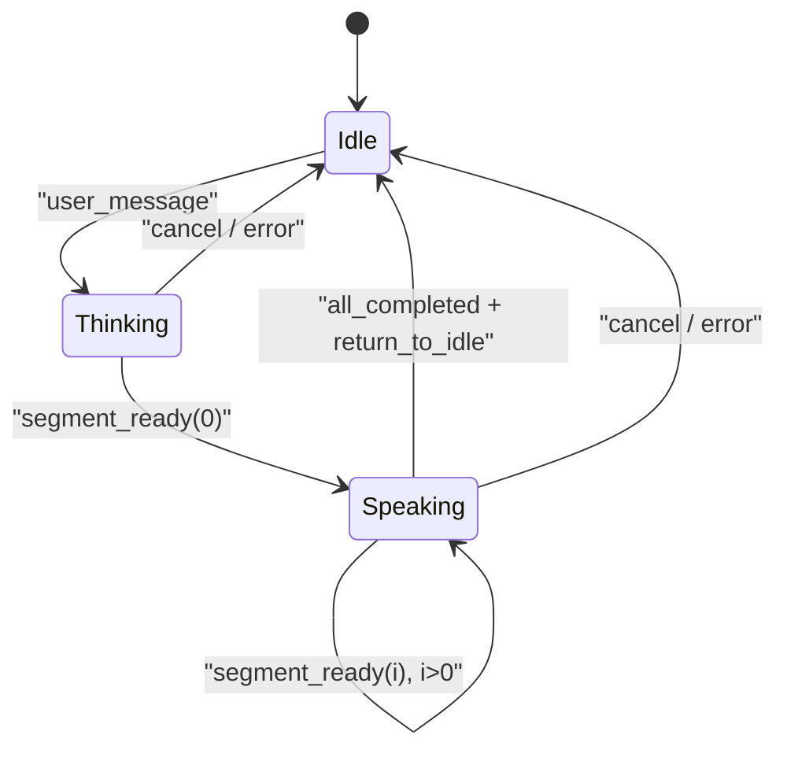

图表来源
- [server/api/ws_handler.py:130-341](file://server/api/ws_handler.py#L130-L341)
- [server/pipeline/streaming_pipeline.py:44-131](file://server/pipeline/streaming_pipeline.py#L44-L131)

### 前端状态转换（App.tsx + events.ts）
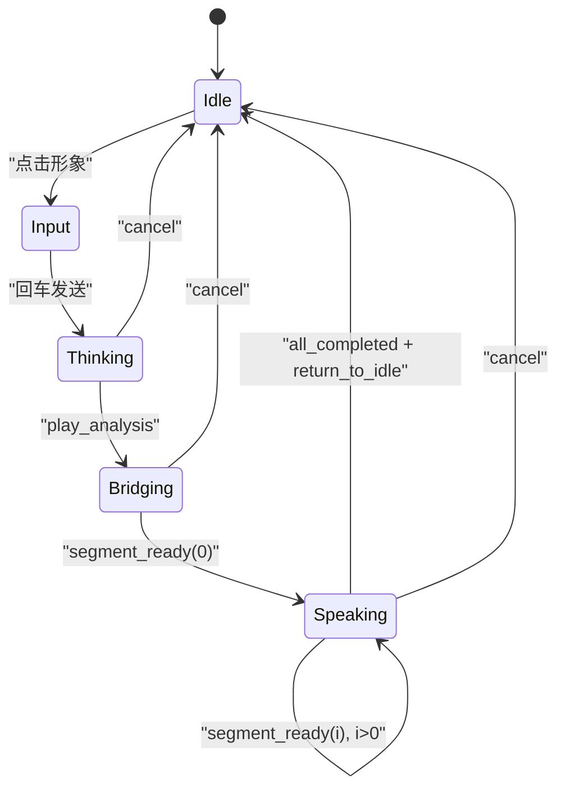

图表来源
- [client/src/types/events.ts:7-13](file://client/src/types/events.ts#L7-L13)
- [client/src/App.tsx:78-183](file://client/src/App.tsx#L78-L183)

### 状态持久化与恢复算法
- 新建会话：REST 创建 token，Redis 写入 state=idle。
- 连接恢复：WS 连接时检查 Redis 是否存在 state key，存在则重建 ConversationManager 并加载历史。
- 运行期更新：每次状态变更写 Redis；消息写入 history 列表；TTL 刷新保持活跃。
- 销毁清理：REST 删除 state/history，移除内存上下文，关闭 WS，清理 MinIO。

章节来源
- [server/api/routes_session.py:28-47](file://server/api/routes_session.py#L28-L47)
- [server/api/ws_handler.py:57-94](file://server/api/ws_handler.py#L57-L94)
- [server/services/redis_client.py:72-121](file://server/services/redis_client.py#L72-L121)