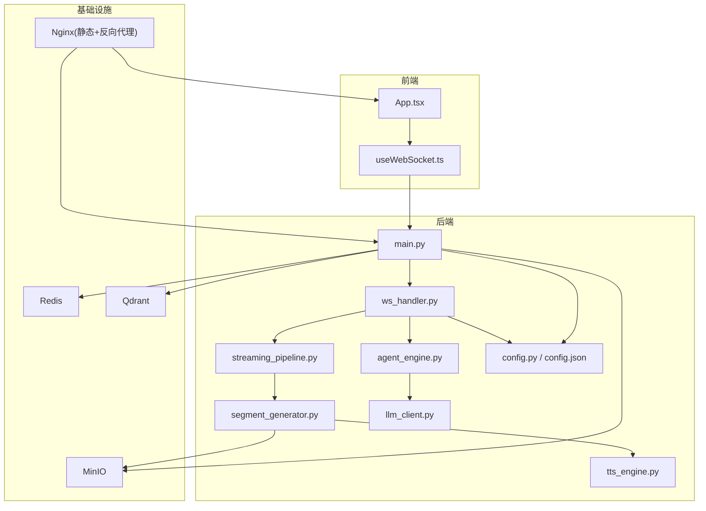
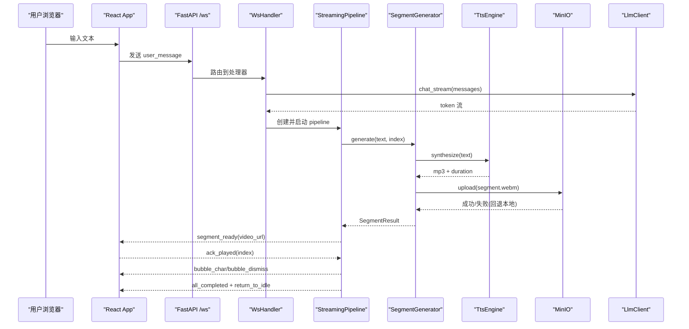
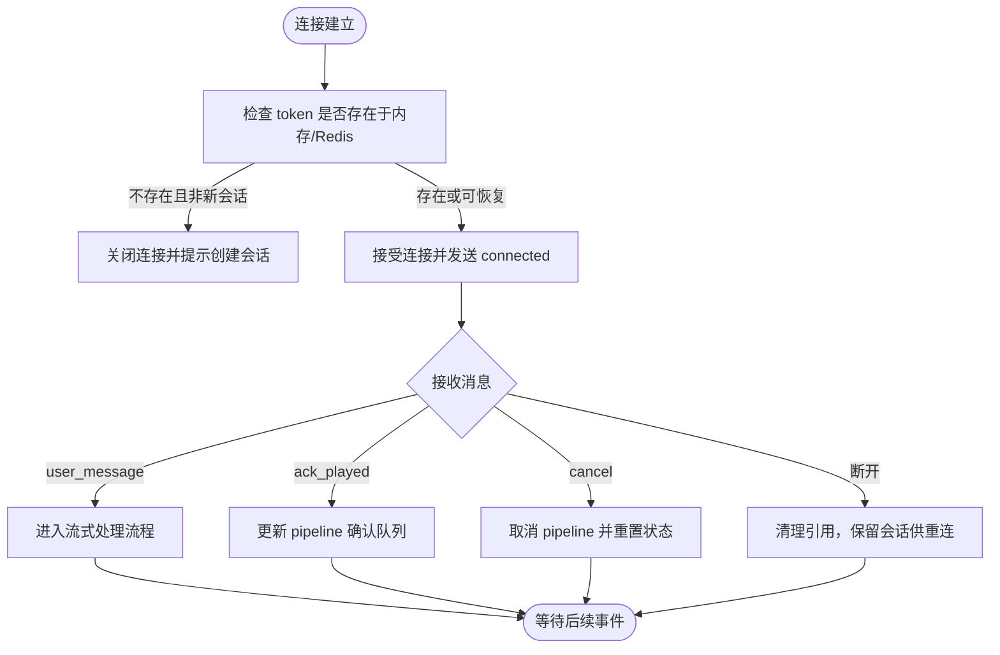
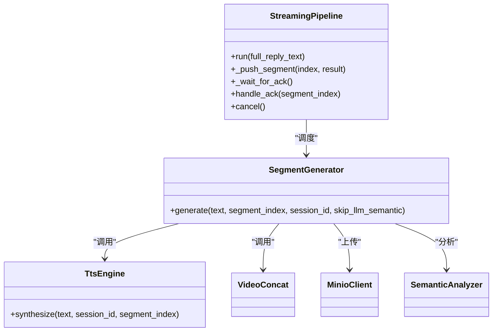
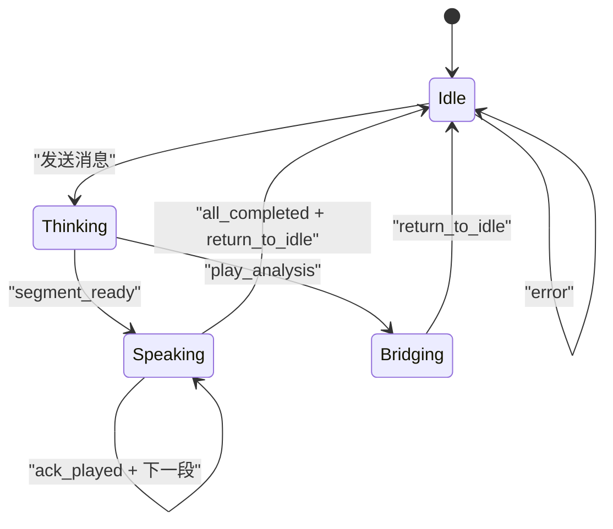
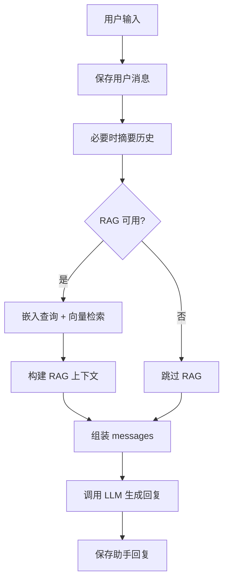
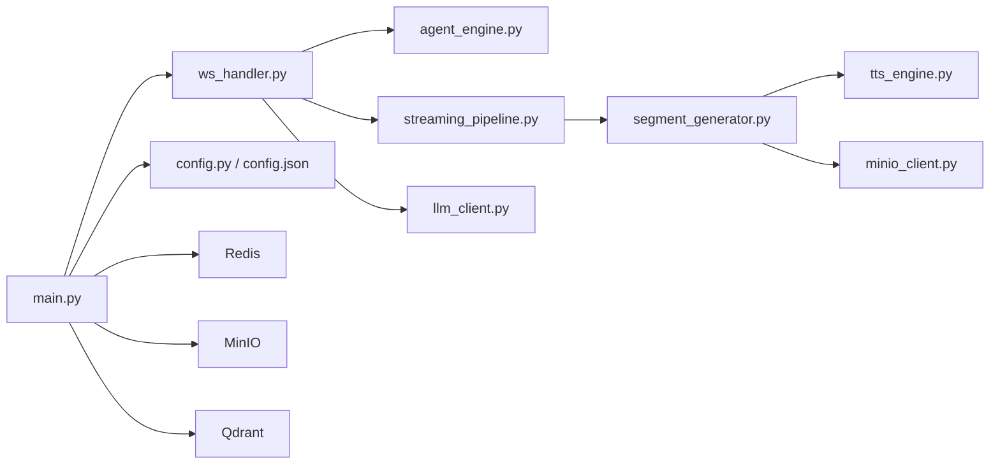
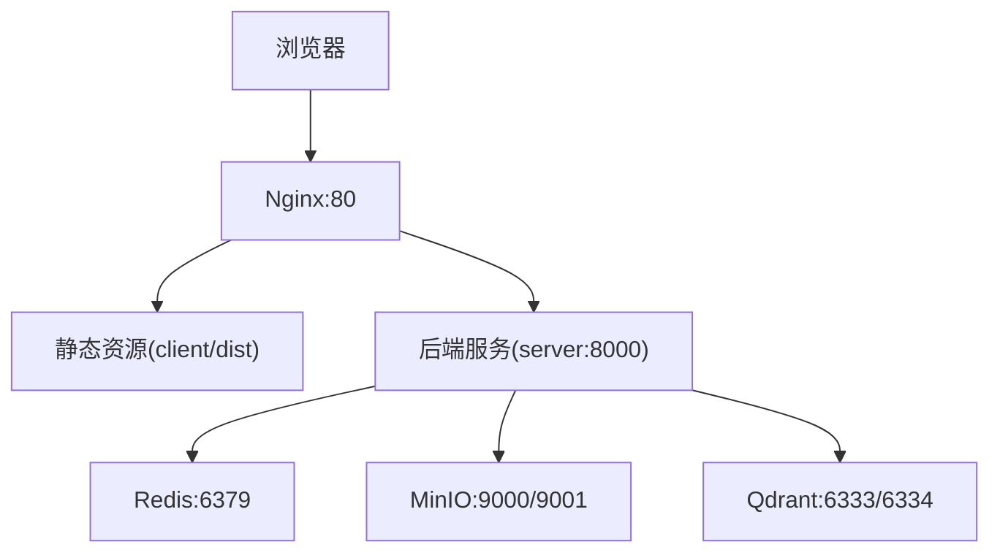

# 系统架构

<cite>
**本文引用的文件**
- [server/main.py](file://server/main.py)
- [server/api/ws_handler.py](file://server/api/ws_handler.py)
- [server/config.py](file://server/config.py)
- [config.json](file://config.json)
- [client/src/App.tsx](file://client/src/App.tsx)
- [client/src/hooks/useWebSocket.ts](file://client/src/hooks/useWebSocket.ts)
- [server/agent/agent_engine.py](file://server/agent/agent_engine.py)
- [server/pipeline/streaming_pipeline.py](file://server/pipeline/streaming_pipeline.py)
- [server/pipeline/segment_generator.py](file://server/pipeline/segment_generator.py)
- [server/services/llm_client.py](file://server/services/llm_client.py)
- [server/services/tts_engine.py](file://server/services/tts_engine.py)
- [docker-compose.yml](file://docker-compose.yml)
- [Dockerfile](file://Dockerfile)
- [server/requirements.txt](file://server/requirements.txt)
</cite>

## 目录
1. [简介](#简介)
2. [项目结构](#项目结构)
3. [核心组件](#核心组件)
4. [架构总览](#架构总览)
5. [详细组件分析](#详细组件分析)
6. [依赖关系分析](#依赖关系分析)
7. [性能与可扩展性](#性能与可扩展性)
8. [安全、监控与灾难恢复](#安全监控与灾难恢复)
9. [部署拓扑与基础设施](#部署拓扑与基础设施)
10. [故障排查指南](#故障排查指南)
11. [结论](#结论)

## 简介
RealTimeTalk 是一个前后端分离的实时对话系统，前端基于 React + Vite，后端基于 FastAPI。系统通过 WebSocket 实现低延迟双向通信，结合流式 LLM 生成、TTS 语音合成、语义驱动的动画片段选择与 FFmpeg 视频拼接，形成“边生成边播放”的多媒体流水线。RAG（检索增强）可选接入 Qdrant 向量库与 Embedding 服务，提升回答相关性。MinIO 用于持久化生成的多媒体片段，Redis 用于会话状态与历史消息持久化。

## 项目结构
- 前端 client：React 应用，包含页面、组件、WebSocket Hook、类型与服务调用封装。
- 后端 server：FastAPI 应用，包含路由、WebSocket 处理器、Agent 引擎、流式分段管道、外部服务客户端（LLM/TTS/Qdrant/Embedding/MinIO/Redis）。
- 配置与运行：config.json 与环境变量合并加载；Dockerfile 构建镜像；docker-compose 编排 Redis、MinIO、Qdrant、Nginx 与后端服务。

图示来源
- [server/main.py:114-177](file://server/main.py#L114-L177)
- [server/api/ws_handler.py:31-129](file://server/api/ws_handler.py#L31-L129)
- [server/pipeline/streaming_pipeline.py:16-131](file://server/pipeline/streaming_pipeline.py#L16-L131)
- [server/pipeline/segment_generator.py:27-138](file://server/pipeline/segment_generator.py#L27-L138)
- [server/services/llm_client.py:23-114](file://server/services/llm_client.py#L23-L114)
- [server/services/tts_engine.py:38-167](file://server/services/tts_engine.py#L38-L167)
- [client/src/App.tsx:60-183](file://client/src/App.tsx#L60-L183)
- [client/src/hooks/useWebSocket.ts:34-117](file://client/src/hooks/useWebSocket.ts#L34-L117)
- [docker-compose.yml:32-63](file://docker-compose.yml#L32-L63)

章节来源
- [server/main.py:114-177](file://server/main.py#L114-L177)
- [client/src/App.tsx:60-183](file://client/src/App.tsx#L60-L183)
- [client/src/hooks/useWebSocket.ts:34-117](file://client/src/hooks/useWebSocket.ts#L34-L117)
- [docker-compose.yml:32-63](file://docker-compose.yml#L32-L63)

## 核心组件
- 会话与生命周期管理：FastAPI lifespan 初始化配置、Redis、MinIO、Qdrant、Embedding，注册路由与静态资源。
- WebSocket 处理器：连接鉴权与会话恢复、消息分发、错误处理、取消与重连支持。
- 流式分段管道：按句切段、首段优先推送、逐段确认式推进、打字机气泡效果。
- 段落生成器：TTS → 语义分析 → FFmpeg 拼接 → MinIO 上传（失败回退本地）。
- LLM 客户端：OpenAI 兼容接口，支持同步与非流式返回，内置重试与限流处理。
- TTS 引擎：DashScope 多模态生成接口，异步任务轮询，长文本拆分与 FFmpeg 拼接。
- 配置系统：环境变量覆盖 JSON 配置，集中提供 LLM/TTS/Redis/MinIO/Qdrant/Embedding/RAG 等设置。

章节来源
- [server/main.py:42-111](file://server/main.py#L42-L111)
- [server/api/ws_handler.py:31-129](file://server/api/ws_handler.py#L31-L129)
- [server/pipeline/streaming_pipeline.py:16-131](file://server/pipeline/streaming_pipeline.py#L16-L131)
- [server/pipeline/segment_generator.py:27-138](file://server/pipeline/segment_generator.py#L27-L138)
- [server/services/llm_client.py:23-114](file://server/services/llm_client.py#L23-L114)
- [server/services/tts_engine.py:38-167](file://server/services/tts_engine.py#L38-L167)
- [server/config.py:148-241](file://server/config.py#L148-L241)

## 架构总览
系统采用前后端分离与事件驱动架构：
- 前端负责 UI 渲染、用户交互、WebSocket 连接管理与自动重连。
- 后端以 FastAPI 暴露 REST 与 WebSocket 接口，内部通过异步协程与队列协调各子流程。
- 数据流：用户输入 → LLM 流式输出 → 句子边界检测 → 并行生成段落（TTS+语义+拼接）→ 首段立即推送 → 逐段确认式推进 → 完成回调。
- 存储与检索：Redis 保存会话上下文与状态；MinIO 持久化多媒体片段；Qdrant 与 Embedding 提供 RAG 能力。

图示来源
- [server/api/ws_handler.py:130-341](file://server/api/ws_handler.py#L130-L341)
- [server/pipeline/streaming_pipeline.py:44-131](file://server/pipeline/streaming_pipeline.py#L44-L131)
- [server/pipeline/segment_generator.py:42-138](file://server/pipeline/segment_generator.py#L42-L138)
- [server/services/tts_engine.py:49-167](file://server/services/tts_engine.py#L49-L167)
- [server/services/llm_client.py:115-190](file://server/services/llm_client.py#L115-L190)
- [client/src/App.tsx:79-183](file://client/src/App.tsx#L79-L183)
- [client/src/hooks/useWebSocket.ts:137-157](file://client/src/hooks/useWebSocket.ts#L137-L157)

## 详细组件分析

### WebSocket 实时通信机制
- 连接建立：前端 useWebSocket Hook 自动获取或创建 session token，构造 ws://host/ws?token=... 连接；后端 main.py 挂载 /ws 端点，校验服务就绪后接受连接。
- 会话恢复：WsHandler.handle 根据 token 在内存 sessions 中查找，若不存在则尝试从 Redis 恢复 ConversationManager 上下文。
- 消息协议：
  - 客户端 → 服务端：user_message、ack_played、cancel
  - 服务端 → 客户端：connected、state_change、play_analysis、segment_ready、bubble_char、bubble_dismiss、all_completed、return_to_idle、error
- 断线重连：前端指数退避重连；服务端保留会话上下文供重连使用。

图示来源
- [server/main.py:146-170](file://server/main.py#L146-L170)
- [server/api/ws_handler.py:49-129](file://server/api/ws_handler.py#L49-L129)
- [client/src/hooks/useWebSocket.ts:67-117](file://client/src/hooks/useWebSocket.ts#L67-L117)

章节来源
- [server/main.py:146-170](file://server/main.py#L146-L170)
- [server/api/ws_handler.py:49-129](file://server/api/ws_handler.py#L49-L129)
- [client/src/hooks/useWebSocket.ts:67-117](file://client/src/hooks/useWebSocket.ts#L67-L117)

### 流式处理管道与多媒体流水线
- 流式 LLM：WsHandler._run_streaming_flow 使用 LlmClient.chat_stream 逐 token 累积文本，按标点与长度阈值切分句子，触发段生成。
- 并行生成：每个句子作为一段，SegmentGenerator.generate 并行执行 TTS、语义分析、FFmpeg 拼接与 MinIO 上传。
- 首段优先：StreamingPipeline 等待首个结果完成后立即推送 segment_ready，随后逐段等待 ack_played 再推送下一段。
- 打字机效果：按字符间隔推送 bubble_char，并在段末推送 bubble_dismiss。
- 结束流程：全部完成后推送 all_completed 与 return_to_idle，前端切换至 idle 循环动画。

图示来源
- [server/pipeline/streaming_pipeline.py:16-131](file://server/pipeline/streaming_pipeline.py#L16-L131)
- [server/pipeline/segment_generator.py:27-138](file://server/pipeline/segment_generator.py#L27-L138)
- [server/services/tts_engine.py:38-167](file://server/services/tts_engine.py#L38-L167)

章节来源
- [server/api/ws_handler.py:189-341](file://server/api/ws_handler.py#L189-L341)
- [server/pipeline/streaming_pipeline.py:44-131](file://server/pipeline/streaming_pipeline.py#L44-L131)
- [server/pipeline/segment_generator.py:42-138](file://server/pipeline/segment_generator.py#L42-L138)

### 前端状态机与交互
- 状态流转：Idle → Thinking → Speaking → Bridging → Idle。Thinking 时播放分析动画；Speaking 时播放对应段视频；Bridging 为段间过渡。
- 事件处理：
  - segment_ready：切换到 Speaking，播放视频并记录当前段索引。
  - bubble_char/bubble_dismiss：追加字符与换行，模拟打字机效果。
  - play_analysis：切换到 Bridging，播放分析循环动画。
  - all_completed/return_to_idle：清除 typing 标记，回到 Idle。
  - error：显示错误信息，重置状态与动画。
- 音频解锁：首次交互时初始化 AudioContext 并触发最小声音以解除浏览器自动播放策略。

图示来源
- [client/src/App.tsx:60-183](file://client/src/App.tsx#L60-L183)

章节来源
- [client/src/App.tsx:79-183](file://client/src/App.tsx#L79-L183)

### Agent 引擎与 RAG
- AgentEngine.process_message 封装对话流程：保存用户消息、智能摘要、组装 messages、可选 RAG 注入、调用 LLM、保存助手回复。
- RAG 检索：根据角色集合映射决定搜索范围，使用 Embedding 将查询转为向量，Qdrant 进行相似度检索，构建上下文注入 prompt。
- 降级策略：当 Qdrant/Embedding 不可用时，跳过 RAG 直接调用 LLM。

图示来源
- [server/agent/agent_engine.py:74-121](file://server/agent/agent_engine.py#L74-L121)
- [server/agent/agent_engine.py:123-181](file://server/agent/agent_engine.py#L123-L181)

章节来源
- [server/agent/agent_engine.py:74-121](file://server/agent/agent_engine.py#L74-L121)
- [server/agent/agent_engine.py:123-181](file://server/agent/agent_engine.py#L123-L181)

### 配置系统与版本兼容性
- 配置优先级：环境变量 > config.json > 默认值。
- 关键配置项：LLM/TTS/Redis/MinIO/Qdrant/Embedding/RAG/Server/FFmpeg。
- 技术栈与依赖：FastAPI、Uvicorn、httpx、redis[hiredis]、minio、pydantic/pydantic-settings、aiofiles、qdrant-client。

章节来源
- [server/config.py:148-241](file://server/config.py#L148-L241)
- [config.json:1-39](file://config.json#L1-39)
- [server/requirements.txt:1-14](file://server/requirements.txt#L1-L14)

## 依赖关系分析
- 模块耦合：
  - main.py 聚合所有客户端与路由，承担生命周期与中间件职责。
  - ws_handler.py 依赖 agent、pipeline、services，是实时流程的核心编排者。
  - streaming_pipeline.py 与 segment_generator.py 解耦了“推送控制”和“内容生成”。
  - services 层各自独立对接外部系统，便于替换与扩展。
- 外部依赖：
  - LLM：OpenAI 兼容接口（示例配置为 DashScope 兼容模式）。
  - TTS：DashScope 多模态生成接口。
  - 存储：Redis（会话与历史）、MinIO（对象存储）。
  - 检索：Qdrant（向量数据库）+ Embedding 服务。

图示来源
- [server/main.py:114-177](file://server/main.py#L114-L177)
- [server/api/ws_handler.py:31-129](file://server/api/ws_handler.py#L31-L129)
- [server/pipeline/streaming_pipeline.py:16-131](file://server/pipeline/streaming_pipeline.py#L16-L131)
- [server/pipeline/segment_generator.py:27-138](file://server/pipeline/segment_generator.py#L27-L138)
- [server/services/llm_client.py:23-114](file://server/services/llm_client.py#L23-L114)
- [server/services/tts_engine.py:38-167](file://server/services/tts_engine.py#L38-L167)
- [server/config.py:148-241](file://server/config.py#L148-L241)

章节来源
- [server/main.py:114-177](file://server/main.py#L114-L177)
- [server/api/ws_handler.py:31-129](file://server/api/ws_handler.py#L31-L129)
- [server/pipeline/streaming_pipeline.py:16-131](file://server/pipeline/streaming_pipeline.py#L16-L131)
- [server/pipeline/segment_generator.py:27-138](file://server/pipeline/segment_generator.py#L27-L138)
- [server/services/llm_client.py:23-114](file://server/services/llm_client.py#L23-L114)
- [server/services/tts_engine.py:38-167](file://server/services/tts_engine.py#L38-L167)
- [server/config.py:148-241](file://server/config.py#L148-L241)

## 性能与可扩展性
- 并发控制：
  - TTS 全局信号量限制并发请求，避免第三方限流。
  - 段落生成并行启动，首段优先推送降低端到端延迟。
- 网络优化：
  - 使用 API 代理路径访问媒体片段，避免浏览器直连 MinIO 跨域问题。
  - LLM/TTS 客户端具备超时与重试逻辑，提高稳定性。
- 可扩展性：
  - 服务层抽象清晰，可替换 LLM/TTS/Embedding 提供商。
  - 管道与生成器解耦，便于引入更多媒体源或处理阶段。
  - 容器化编排，水平扩展可通过增加后端实例与负载均衡实现。

[本节为通用指导，不直接分析具体文件]

## 安全、监控与灾难恢复
- 安全性：
  - CORS 中间件允许开发环境跨域，生产建议收紧 allow_origins。
  - 会话 token 由后端创建并通过 Redis 验证，防止伪造。
  - 知识库 Admin Token 可启用鉴权（配置项 knowledge_admin_token）。
- 监控与健康检查：
  - /api/health 返回服务状态、Redis 可用性与会话数量。
  - 日志级别 INFO，关键异常与错误路径均有记录。
- 灾难恢复：
  - 会话上下文持久化到 Redis，支持断线重连恢复。
  - MinIO 上传失败回退本地路径，保证播放连续性。
  - Docker 卷持久化 Redis、MinIO、Qdrant 数据，重启后可恢复。

章节来源
- [server/main.py:136-143](file://server/main.py#L136-L143)
- [server/config.py:124-126](file://server/config.py#L124-L126)
- [docker-compose.yml:65-69](file://docker-compose.yml#L65-L69)

## 部署拓扑与基础设施
- 容器编排：
  - qdrant：向量数据库，端口 6333/6334。
  - redis：会话与历史，端口 6379。
  - minio：对象存储，控制台 9001，API 9000。
  - server：后端服务，端口 8000，依赖上述三个服务。
  - nginx：静态资源与反向代理，端口 80，挂载 client/dist。
- 镜像构建：
  - Python 3.11 slim 基础镜像，安装 ffmpeg，复制依赖与代码，暴露 8000。

图示来源
- [docker-compose.yml:1-63](file://docker-compose.yml#L1-L63)
- [Dockerfile:1-22](file://Dockerfile#L1-L22)

章节来源
- [docker-compose.yml:1-63](file://docker-compose.yml#L1-L63)
- [Dockerfile:1-22](file://Dockerfile#L1-L22)

## 故障排查指南
- WebSocket 无法连接：
  - 检查 /api/health 是否返回 ok，确认 Redis 与 MinIO 已就绪。
  - 确认 token 是否有效，未创建会话会收到错误提示。
- 流式处理中断：
  - 查看服务端日志中的 LLM/TTS/视频拼接错误。
  - 确认 MinIO 上传权限与网络连通性。
- 前端无响应或状态卡住：
  - 检查浏览器控制台是否有 WebSocket 错误。
  - 确认前端是否正确发送 ack_played 与 cancel。
- 配置问题：
  - 核对 config.json 与 .env 环境变量是否一致。
  - 确认 LLM/TTS API Key 与 endpoint 正确。

章节来源
- [server/main.py:136-143](file://server/main.py#L136-L143)
- [server/api/ws_handler.py:101-129](file://server/api/ws_handler.py#L101-L129)
- [server/services/llm_client.py:62-114](file://server/services/llm_client.py#L62-L114)
- [server/services/tts_engine.py:100-167](file://server/services/tts_engine.py#L100-L167)

## 结论
RealTimeTalk 通过前后端分离与事件驱动设计，实现了低延迟的实时对话体验。流式 LLM 与并行多媒体流水线显著降低了首帧延迟，配合 RAG 提升了回答质量。系统具备良好的可扩展性与容错能力，适合在生产环境中以容器化方式部署与水平扩展。建议在安全与监控方面进一步完善，如收紧 CORS、引入结构化日志与指标采集，以提升运维可见性与安全性。