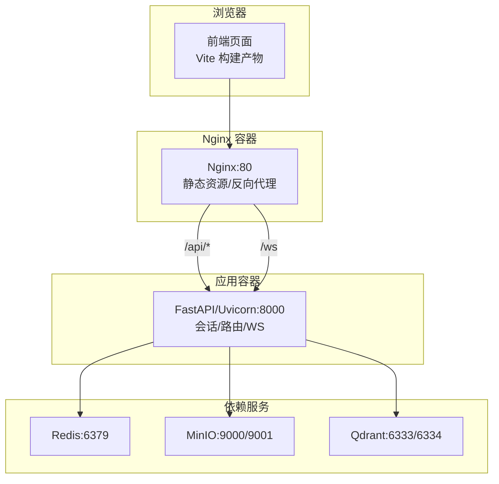
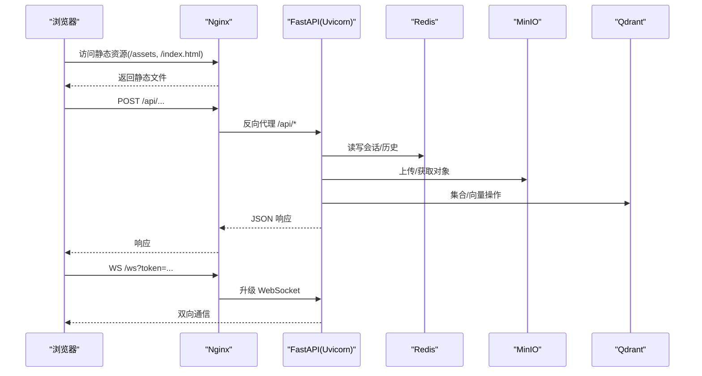
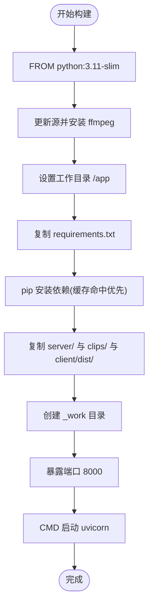
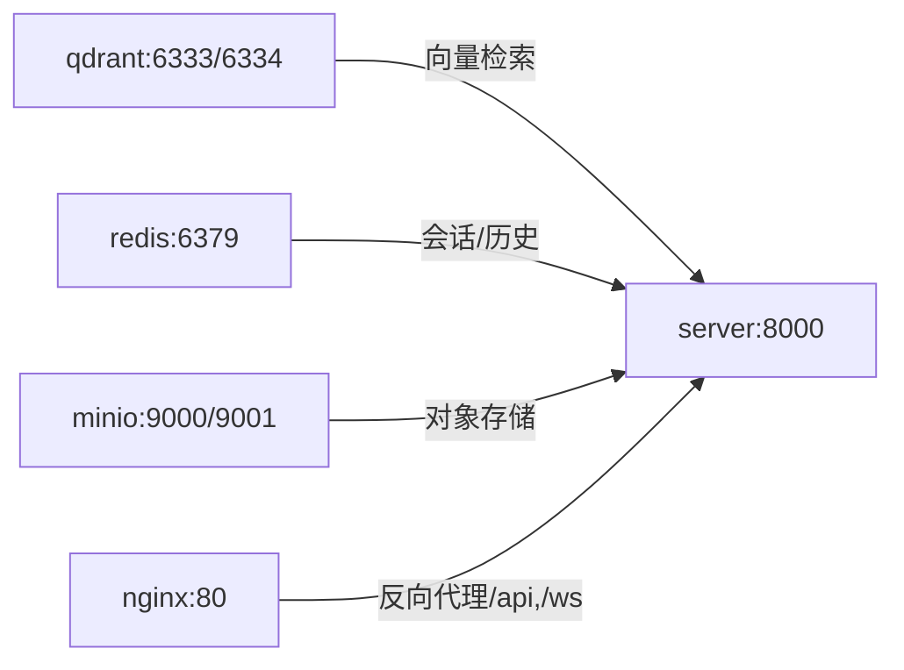
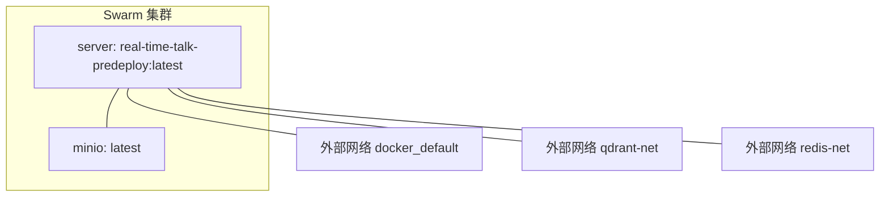
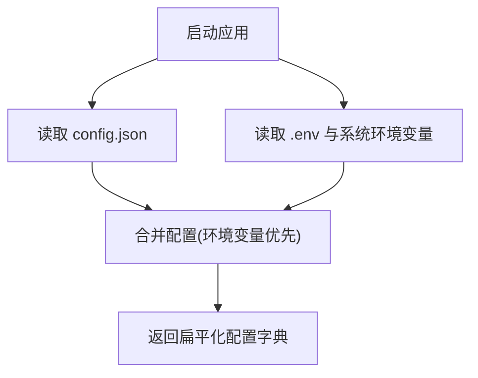
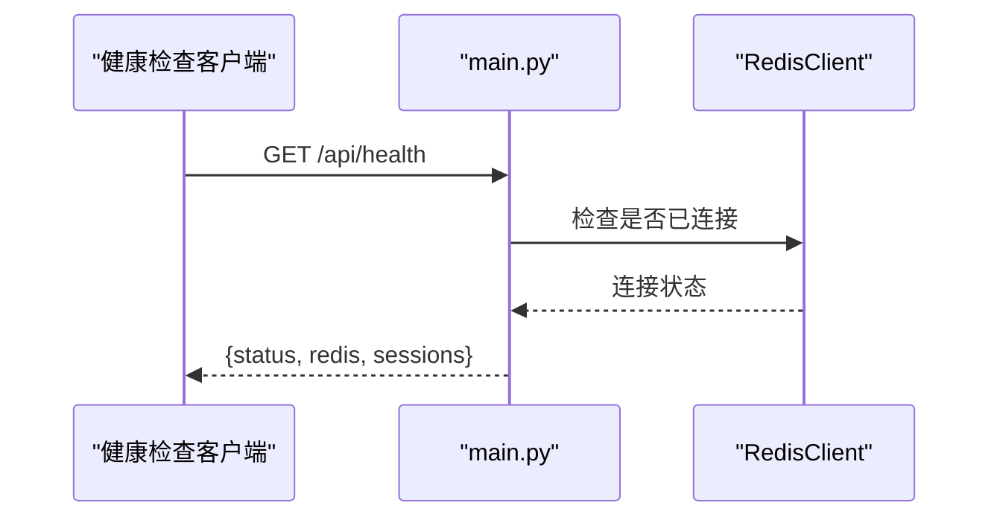
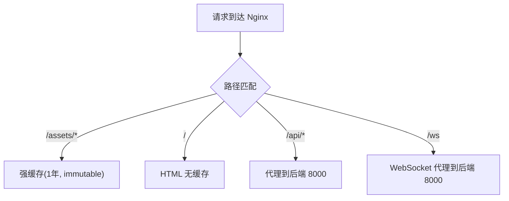
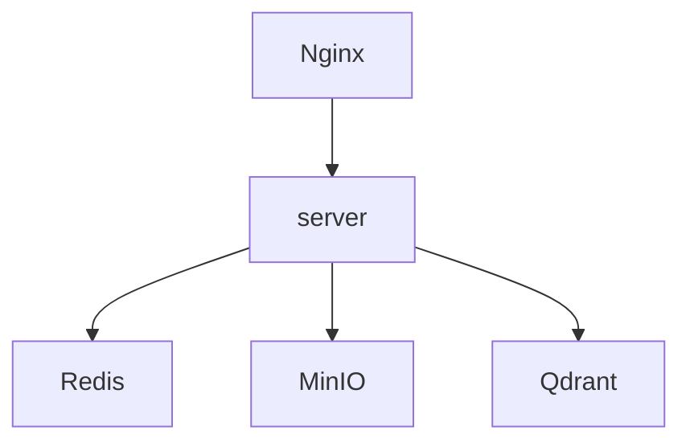

# Docker 容器化部署

<cite>
**本文引用的文件**
- [Dockerfile](file://Dockerfile)
- [docker-compose.yml](file://docker-compose.yml)
- [docker-stack.yml](file://docker-stack.yml)
- [server/requirements.txt](file://server/requirements.txt)
- [client/package.json](file://client/package.json)
- [nginx.conf](file://nginx.conf)
- [config.json](file://config.json)
- [server/config.py](file://server/config.py)
- [server/main.py](file://server/main.py)
- [server/services/redis_client.py](file://server/services/redis_client.py)
- [server/services/minio_client.py](file://server/services/minio_client.py)
- [server/services/qdrant_client.py](file://server/services/qdrant_client.py)
</cite>

## 目录
1. [简介](#简介)
2. [项目结构](#项目结构)
3. [核心组件](#核心组件)
4. [架构总览](#架构总览)
5. [详细组件分析](#详细组件分析)
6. [依赖关系分析](#依赖关系分析)
7. [性能与资源优化](#性能与资源优化)
8. [故障排查指南](#故障排查指南)
9. [结论](#结论)
10. [附录：环境配置清单](#附录环境配置清单)

## 简介
本文件面向 RealTimeTalk 系统的容器化部署，覆盖镜像构建、服务编排、网络与数据卷、环境变量与配置合并策略、生产最佳实践（健康检查、日志、监控）、多环境示例以及排障与调优建议。文档严格基于仓库现有实现进行说明，并提供可追溯的源码定位。

## 项目结构
RealTimeTalk 采用前后端分离与多服务编排：
- 前端：React + Vite 构建产物位于 client/dist，由 Nginx 提供静态资源并反向代理 API 与 WebSocket。
- 后端：FastAPI + Uvicorn，负责会话管理、RAG、TTS、媒体处理等。
- 外部依赖：Redis（会话与历史）、MinIO（对象存储）、Qdrant（向量检索）。

图表来源
- [docker-compose.yml:1-69](file://docker-compose.yml#L1-L69)
- [nginx.conf:1-58](file://nginx.conf#L1-L58)
- [server/main.py:114-178](file://server/main.py#L114-L178)

章节来源
- [docker-compose.yml:1-69](file://docker-compose.yml#L1-L69)
- [nginx.conf:1-58](file://nginx.conf#L1-L58)
- [server/main.py:114-178](file://server/main.py#L114-L178)

## 核心组件
- 镜像构建（Dockerfile）
  - 基础镜像：Python 3.11 slim，安装系统依赖 ffmpeg。
  - 依赖层缓存：先复制 requirements.txt 单独安装，再复制业务代码，最大化利用镜像层缓存。
  - 运行入口：Uvicorn 启动 FastAPI 应用，监听 0.0.0.0:8000。
- 服务编排（docker-compose.yml）
  - 定义 qdrant、redis、minio、server、nginx 五个服务，使用命名卷持久化数据。
  - server 通过环境变量与挂载配置文件连接外部依赖。
- 编排栈（docker-stack.yml）
  - 面向 Swarm 的 stack 文件，声明 overlay 网络与外部网络接入，支持副本与重启策略。
- 配置加载（server/config.py）
  - 优先级：环境变量 > config.json；支持 .env 文件；返回扁平化配置字典供各模块使用。
- 健康检查（server/main.py）
  - /api/health 返回 Redis 可用性与活跃会话数。

章节来源
- [Dockerfile:1-22](file://Dockerfile#L1-L22)
- [docker-compose.yml:1-69](file://docker-compose.yml#L1-L69)
- [docker-stack.yml:1-74](file://docker-stack.yml#L1-L74)
- [server/config.py:1-260](file://server/config.py#L1-L260)
- [server/main.py:136-144](file://server/main.py#L136-L144)

## 架构总览
下图展示了从浏览器到后端及依赖服务的请求路径，包括静态资源、REST API 与 WebSocket 的转发规则。

图表来源
- [nginx.conf:15-56](file://nginx.conf#L15-L56)
- [server/main.py:146-171](file://server/main.py#L146-L171)
- [server/services/redis_client.py:22-62](file://server/services/redis_client.py#L22-L62)
- [server/services/minio_client.py:21-68](file://server/services/minio_client.py#L21-L68)
- [server/services/qdrant_client.py:26-84](file://server/services/qdrant_client.py#L26-L84)

## 详细组件分析

### 镜像构建与缓存策略（Dockerfile）
- 基础镜像与系统依赖
  - 使用 Python 3.11 slim，替换国内源并安装 ffmpeg，清理 apt 列表以减小镜像体积。
- 依赖层隔离
  - 先复制 server/requirements.txt 并执行 pip install，随后才复制业务代码，确保依赖变更时复用缓存层。
- 静态资源集成
  - 将 client/dist 复制到镜像内 static 目录，便于 FastAPI 直接提供 SPA 静态文件（也可选择由 Nginx 提供）。
- 运行时
  - EXPOSE 8000，CMD 使用 uvicorn 启动 FastAPI 应用。

图表来源
- [Dockerfile:1-22](file://Dockerfile#L1-L22)
- [server/requirements.txt:1-14](file://server/requirements.txt#L1-L14)
- [client/package.json:1-24](file://client/package.json#L1-L24)

章节来源
- [Dockerfile:1-22](file://Dockerfile#L1-L22)
- [server/requirements.txt:1-14](file://server/requirements.txt#L1-L14)
- [client/package.json:1-24](file://client/package.json#L1-L24)

### 本地开发编排（docker-compose.yml）
- 服务定义
  - qdrant：向量数据库，映射 6333/6334，数据卷 qdrant_data。
  - redis：键值存储，映射 6379，数据卷 redis_data。
  - minio：对象存储，映射 9000/9001，数据卷 minio_data，控制台地址 :9001。
  - server：构建当前目录镜像，映射 8000，注入 REDIS_URL、MINIO_ENDPOINT，挂载 config.json、clips、resources 为只读。
  - nginx：Alpine 镜像，映射 80，挂载 nginx.conf 与 client/dist。
- 依赖顺序
  - server 依赖 redis、minio、qdrant 启动后再启动。
- 数据持久化
  - 使用命名卷保存各服务数据。

图表来源
- [docker-compose.yml:1-69](file://docker-compose.yml#L1-L69)

章节来源
- [docker-compose.yml:1-69](file://docker-compose.yml#L1-L69)

### 集群编排（docker-stack.yml）
- 版本与网络
  - version 3.8，默认 overlay 网络，同时接入外部网络 docker_default、qdrant-net、redis-net。
- 服务与副本
  - minio 与 server 均设置 replicas: 1 与 on-failure 重启策略。
- 环境变量与挂载
  - server 通过环境变量覆盖 REDIS_URL、QDRANT_URL、MINIO_ENDPOINT。
  - 挂载宿主机 /root/real-time-talk/config.json 与 .env 到容器内只读路径。
- 部署命令
  - 参考文件注释中的部署命令与前置条件。

图表来源
- [docker-stack.yml:1-74](file://docker-stack.yml#L1-L74)

章节来源
- [docker-stack.yml:1-74](file://docker-stack.yml#L1-L74)

### 配置加载与环境变量覆盖（server/config.py）
- 加载顺序
  - 读取 config.json（若存在），再通过 pydantic-settings 读取 .env 与系统环境变量。
  - 环境变量优先于 config.json 同名项。
- 关键字段
  - LLM/TTS/Qdrant/Embedding/RAG/Server/FFmpeg/MinIO/Redis 等配置项均有对应环境变量别名。
- 全局实例
  - get_config() 懒加载，reload_config() 支持热重载。

图表来源
- [server/config.py:128-241](file://server/config.py#L128-L241)

章节来源
- [server/config.py:1-260](file://server/config.py#L1-L260)
- [config.json:1-39](file://config.json#L1-L39)

### 健康检查与生命周期（server/main.py）
- 生命周期
  - lifespan 中初始化 Redis、MinIO、Qdrant、Embedding、知识库路由，失败时按策略退出或降级。
- 健康检查
  - GET /api/health 返回状态、Redis 可用性与会话数量。
- 静态文件
  - 若存在 static 目录则挂载为根路径，否则记录警告。

图表来源
- [server/main.py:42-111](file://server/main.py#L42-L111)
- [server/main.py:136-144](file://server/main.py#L136-L144)
- [server/services/redis_client.py:22-62](file://server/services/redis_client.py#L22-L62)

章节来源
- [server/main.py:1-191](file://server/main.py#L1-L191)
- [server/services/redis_client.py:1-122](file://server/services/redis_client.py#L1-L122)

### Nginx 反向代理与缓存策略（nginx.conf）
- 静态资源
  - /assets 长期缓存且不可变；/ 根路径 HTML 禁用缓存以确保新版本及时生效。
- API 与 WebSocket
  - /api/* 反向代理至后端 8000；/ws 启用 HTTP 升级与长超时。
- 上传大小
  - 调整 client_max_body_size 以支持较大媒体文件。

图表来源
- [nginx.conf:1-58](file://nginx.conf#L1-L58)

章节来源
- [nginx.conf:1-58](file://nginx.conf#L1-L58)

## 依赖关系分析
- 服务间耦合
  - server 强依赖 Redis（会话/历史）、MinIO（对象存储）、Qdrant（向量检索）。
  - Nginx 仅作为反向代理，不持有业务状态。
- 外部网络
  - docker-stack.yml 显式接入外部网络，便于与宿主或其他集群服务互通。
- 配置依赖
  - server 通过环境变量与 config.json 共同决定对外部服务的连接参数。

图表来源
- [docker-compose.yml:1-69](file://docker-compose.yml#L1-L69)
- [docker-stack.yml:1-74](file://docker-stack.yml#L1-L74)
- [server/config.py:128-241](file://server/config.py#L128-L241)

章节来源
- [docker-compose.yml:1-69](file://docker-compose.yml#L1-L69)
- [docker-stack.yml:1-74](file://docker-stack.yml#L1-L74)
- [server/config.py:1-260](file://server/config.py#L1-L260)

## 性能与资源优化
- 镜像层缓存
  - 将依赖安装与代码复制分层，减少重建时间。
- 静态资源缓存
  - Nginx 对带 hash 的资源启用长期缓存，HTML 禁用缓存保证更新。
- 超时与并发
  - Nginx 对 API 与 WS 分别设置合理超时；Uvicorn 在容器内可通过环境变量控制 workers/gunicorn（如需）。
- 资源限制（建议在编排层配置）
  - 为每个服务设置 CPU/内存上限与最小值，避免争用。
- 健康检查与自愈
  - 结合 /api/health 与健康探针，配合编排平台的重启策略提升可用性。
- 日志与监控
  - 将容器标准输出收集到集中日志系统；暴露 Prometheus 指标（如需要）并通过 ServiceMonitor 抓取。

[本节为通用指导，无需特定文件引用]

## 故障排查指南
- 启动失败：Redis 不可用
  - 现象：服务启动阶段抛出异常并退出。
  - 排查：确认 REDIS_URL 可达、端口与密码正确；查看 Redis 容器日志。
  - 参考：[server/main.py:53-61](file://server/main.py#L53-L61)、[server/services/redis_client.py:31-50](file://server/services/redis_client.py#L31-L50)
- 启动失败：MinIO 不可用
  - 现象：Bucket 创建失败或服务标记不可用。
  - 排查：确认 MINIO_ENDPOINT、access_key/secret_key、bucket 名称；检查 MinIO 控制台与日志。
  - 参考：[server/services/minio_client.py:34-63](file://server/services/minio_client.py#L34-L63)
- 启动失败：Qdrant 不可用
  - 现象：集合列表获取失败，RAG 功能降级。
  - 排查：确认 QDRANT_URL 可达；检查集合是否存在。
  - 参考：[server/main.py:70-78](file://server/main.py#L70-L78)、[server/services/qdrant_client.py:74-84](file://server/services/qdrant_client.py#L74-L84)
- 静态资源 404
  - 现象：前端页面无法加载。
  - 排查：确认 client/dist 已构建并挂载到 Nginx；检查 Nginx 日志与 try_files 规则。
  - 参考：[nginx.conf:26-33](file://nginx.conf#L26-L33)
- 健康检查异常
  - 现象：/api/health 返回非 ok 或 redis=false。
  - 排查：检查 Redis 连接与会话计数逻辑。
  - 参考：[server/main.py:136-144](file://server/main.py#L136-L144)

章节来源
- [server/main.py:42-111](file://server/main.py#L42-L111)
- [server/services/redis_client.py:31-62](file://server/services/redis_client.py#L31-L62)
- [server/services/minio_client.py:34-63](file://server/services/minio_client.py#L34-L63)
- [server/services/qdrant_client.py:74-84](file://server/services/qdrant_client.py#L74-L84)
- [nginx.conf:26-33](file://nginx.conf#L26-L33)

## 结论
RealTimeTalk 的容器化方案以“镜像分层缓存 + 多服务编排 + 配置覆盖”为核心，结合 Nginx 的反向代理与缓存策略，满足开发与生产环境的快速交付与稳定运行。通过健康检查、资源限制与日志监控，可在不同规模下获得良好的可观测性与弹性能力。

[本节为总结性内容，无需特定文件引用]

## 附录：环境配置清单
- 必需环境变量（示例）
  - REDIS_URL：Redis 连接字符串
  - MINIO_ENDPOINT：MinIO 服务地址
  - QDRANT_URL：Qdrant 服务地址
  - LLM_*、TTS_*、EMBEDDING_*、RAG_*、KNOWLEDGE_ADMIN_TOKEN 等（按需）
- 配置文件挂载
  - config.json：应用配置（JSON）
  - .env：敏感信息与覆盖项
  - resources/default_system_prompt.txt：系统提示词（可选）
- 数据卷
  - redis_data、minio_data、qdrant_data（本地开发）
  - Swarm 场景可使用外部卷或云存储后端

章节来源
- [docker-compose.yml:32-52](file://docker-compose.yml#L32-L52)
- [docker-stack.yml:33-55](file://docker-stack.yml#L33-L55)
- [server/config.py:128-241](file://server/config.py#L128-L241)
- [config.json:1-39](file://config.json#L1-L39)