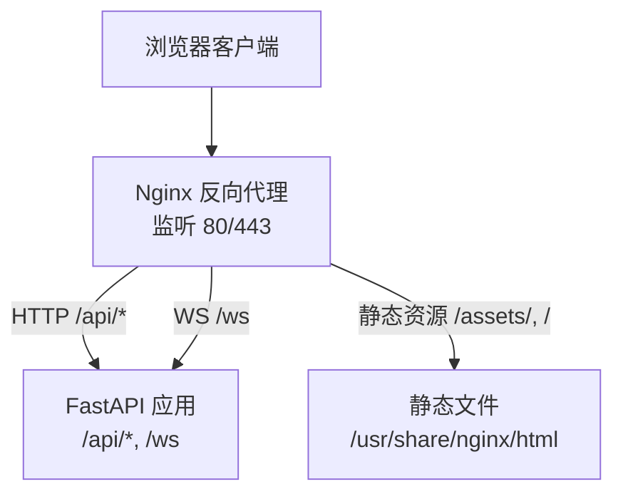
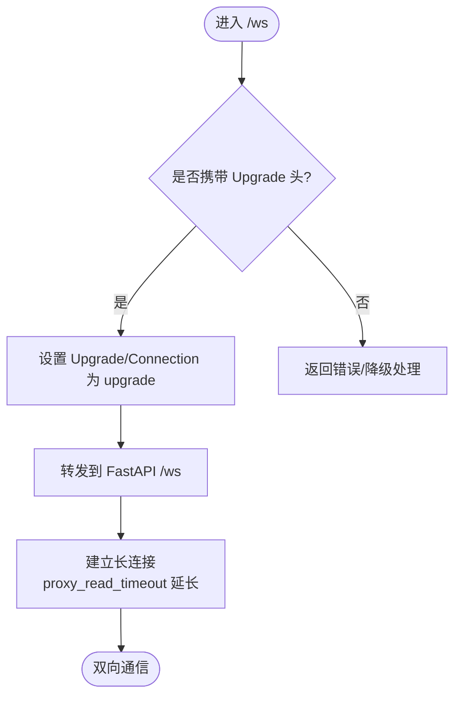
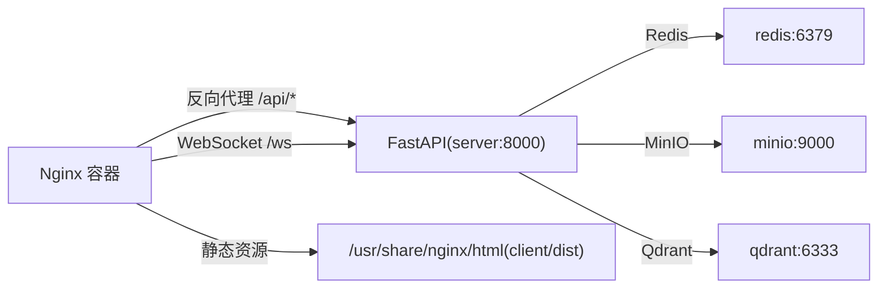

# Nginx 反向代理配置

<cite>
**本文引用的文件**
- [nginx.conf](file://nginx.conf)
- [nginx-pulan.conf](file://nginx-pulan.conf)
- [docker-compose.yml](file://docker-compose.yml)
- [server/main.py](file://server/main.py)
- [client/src/hooks/useWebSocket.ts](file://client/src/hooks/useWebSocket.ts)
- [client/src/services/api.ts](file://client/src/services/api.ts)
- [doc/tech-spec.md](file://doc/tech-spec.md)
</cite>

## 目录
1. [简介](#简介)
2. [项目结构](#项目结构)
3. [核心组件](#核心组件)
4. [架构总览](#架构总览)
5. [详细组件分析](#详细组件分析)
6. [依赖关系分析](#依赖关系分析)
7. [性能考虑](#性能考虑)
8. [故障排查指南](#故障排查指南)
9. [结论](#结论)
10. [附录：生产环境模板与安全最佳实践](#附录生产环境模板与安全最佳实践)

## 简介
本文件面向 RealTimeTalk 系统的 Nginx 反向代理配置，围绕以下目标展开：
- 说明 nginx.conf 的核心配置：静态资源服务、API 反向代理、WebSocket 代理、SSL/TLS 加密与多域名虚拟主机。
- 详解 WebSocket 连接代理的关键点：协议升级、超时设置与连接保持。
- 提供多域名与多租户的虚拟主机配置思路与示例。
- 给出安全加固建议：请求限制、访问控制、内容安全策略等。
- 提供性能优化建议：缓存策略、压缩传输、连接池管理。
- 包含故障排查方法与监控指标配置建议。
- 提供生产环境的完整配置模板与安全最佳实践。

## 项目结构
RealTimeTalk 在开发环境中通过 Docker Compose 编排 Nginx 与 FastAPI 服务：
- Nginx 容器对外暴露 80 端口，负责静态资源托管、API 反向代理与 WebSocket 代理。
- FastAPI 服务（uvicorn）运行在 8000 端口，提供 REST API 与 WebSocket 端点。
- 前端构建产物挂载到 Nginx 容器的 /usr/share/nginx/html。



图表来源
- [docker-compose.yml:54-63](file://docker-compose.yml#L54-L63)
- [nginx.conf:15-56](file://nginx.conf#L15-L56)
- [server/main.py:136-171](file://server/main.py#L136-L171)

章节来源
- [docker-compose.yml:32-63](file://docker-compose.yml#L32-L63)
- [nginx.conf:1-58](file://nginx.conf#L1-L58)

## 核心组件
- 事件与 HTTP 层
  - events.worker_connections：控制每个 worker 的最大并发连接数。
  - http.sendfile、keepalive_timeout：提升静态资源传输效率与连接复用。
- 服务器块 server
  - listen/server_name：定义监听端口与域名。
  - location /assets/：带 hash 的静态资源长期缓存。
  - location /：SPA 回退至 index.html，HTML 禁用缓存。
  - location /api/：反向代理到后端 FastAPI。
  - location /ws：WebSocket 长连接代理，启用协议升级与超长读超时。
- SSL/TLS 与多域名
  - 参考 nginx-pulan.conf 中的 HTTPS 与 HTTP→HTTPS 重定向示例，支持多域名与证书路径配置。

章节来源
- [nginx.conf:1-58](file://nginx.conf#L1-L58)
- [nginx-pulan.conf:1-66](file://nginx-pulan.conf#L1-L66)

## 架构总览
下图展示了从浏览器到 Nginx 再到 FastAPI 的请求路径，以及 WebSocket 的连接建立流程。

```mermaid
sequenceDiagram
participant B as "浏览器"
participant N as "Nginx"
participant F as "FastAPI(8000)"
Note over B,N : 首次访问
B->>N : GET / (HTML)
N-->>B : 200 HTML (no-cache)
B->>N : GET /assets/*.js (带hash)
N-->>B : 200 JS (长期缓存)
Note over B,F : REST API
B->>N : POST /api/session/create
N->>F : 转发请求
F-->>N : JSON 响应
N-->>B : 返回 session_token
Note over B,F : WebSocket 握手
B->>N : ws : //host/ws?token=...
N->>F : Upgrade : websocket
F-->>N : 101 Switching Protocols
N-->>B : 101 切换成功
B<->N : 双向数据流
N<->F : 透传消息
```

图表来源
- [nginx.conf:35-55](file://nginx.conf#L35-L55)
- [server/main.py:136-171](file://server/main.py#L136-L171)
- [client/src/services/api.ts:10-51](file://client/src/services/api.ts#L10-L51)
- [client/src/hooks/useWebSocket.ts:67-117](file://client/src/hooks/useWebSocket.ts#L67-L117)

## 详细组件分析

### 静态资源与 SPA 路由
- /assets/ 使用长期缓存与 immutable 策略，适合带 hash 的 JS/CSS。
- / 采用 try_files 回退到 index.html，并强制禁用缓存以确保版本更新即时生效。
- 该模式与 FastAPI 中静态文件挂载顺序一致，避免拦截 API 与 WS 路由。

章节来源
- [nginx.conf:19-33](file://nginx.conf#L19-L33)
- [server/main.py:173-180](file://server/main.py#L173-L180)

### API 反向代理
- 将 /api/* 请求转发到后端 FastAPI 服务。
- 传递 Host、X-Real-IP、X-Forwarded-For、X-Forwarded-Proto 等头部，便于后端识别真实客户端信息。
- 设置合理的 proxy_read_timeout，避免长耗时接口被提前断开。

章节来源
- [nginx.conf:35-43](file://nginx.conf#L35-L43)
- [server/main.py:129-143](file://server/main.py#L129-L143)

### WebSocket 代理
- 关键配置：
  - proxy_http_version 1.1：启用 HTTP/1.1 以支持升级。
  - Upgrade 与 Connection 头：完成协议升级。
  - proxy_read_timeout 86400s：满足长时间空闲场景下的连接保持。
- 客户端侧：
  - 根据页面协议选择 ws/wss，并通过查询参数 token 进行会话标识。
  - 具备自动重连机制，保障弱网或临时断线后的恢复。



图表来源
- [nginx.conf:45-55](file://nginx.conf#L45-L55)
- [client/src/hooks/useWebSocket.ts:67-117](file://client/src/hooks/useWebSocket.ts#L67-L117)

章节来源
- [nginx.conf:45-55](file://nginx.conf#L45-L55)
- [client/src/hooks/useWebSocket.ts:67-117](file://client/src/hooks/useWebSocket.ts#L67-L117)
- [server/main.py:146-171](file://server/main.py#L146-L171)

### SSL/TLS 与多域名虚拟主机
- 参考 nginx-pulan.conf：
  - 独立的 server 块用于 80 端口，执行 HTTP→HTTPS 301 重定向。
  - 443 端口启用 ssl 与 http2，配置证书路径。
  - 可复制该 server 块并修改 server_name 与证书路径，实现多域名部署。
- 注意：
  - 若使用 Let’s Encrypt，需保留 /.well-known/acme-challenge 的根目录映射以便验证。
  - 生产环境建议开启 HSTS、OCSP Stapling 等增强项（见附录）。

章节来源
- [nginx-pulan.conf:9-34](file://nginx-pulan.conf#L9-L34)
- [nginx-pulan.conf:35-65](file://nginx-pulan.conf#L35-L65)

### 负载均衡与多实例
- 当前仓库未内置 upstream 与多实例负载均衡配置。
- 扩展建议：
  - 在 http 块中定义 upstream 组，包含多个 FastAPI 实例地址。
  - 将 /api 与 /ws 的 proxy_pass 指向 upstream 组。
  - 结合 keepalive 与合理超时，提升并发能力。
- 注意：
  - WebSocket 在多实例下需确保会话状态共享（如 Redis），以避免粘性问题导致的状态不一致。

[本节为概念性指导，不直接分析具体文件]

## 依赖关系分析
- Nginx 依赖：
  - 静态文件目录 /usr/share/nginx/html（由 docker-compose 挂载 client/dist）。
  - 后端 FastAPI 服务（Docker 网络内名为 server，端口 8000）。
- FastAPI 依赖：
  - Redis、MinIO、Qdrant 等外部服务（由 docker-compose 启动）。
  - 提供 /api/* 与 /ws 两个关键路径。



图表来源
- [docker-compose.yml:32-63](file://docker-compose.yml#L32-L63)
- [docker-compose.yml:1-31](file://docker-compose.yml#L1-L31)
- [nginx.conf:35-55](file://nginx.conf#L35-L55)

章节来源
- [docker-compose.yml:32-63](file://docker-compose.yml#L32-L63)
- [nginx.conf:35-55](file://nginx.conf#L35-L55)

## 性能考虑
- 静态资源缓存
  - /assets/ 使用 expires 与 Cache-Control immutable，减少重复下载。
  - HTML 禁用缓存，保证发布后立刻生效。
- 传输与连接
  - sendfile on 提升静态文件传输效率。
  - keepalive_timeout 合理设置，平衡连接复用与资源占用。
- 上传大小与超时
  - client_max_body_size 增大以支持视频等大文件上传。
  - API 与 WS 分别设置合适的 proxy_read_timeout，避免长任务中断。
- 压缩与 HTTP/2
  - 建议在 http 块启用 gzip 压缩（视业务需求与 CPU 权衡）。
  - 在 HTTPS server 块启用 http2，提升多路复用能力。
- 连接池与上游
  - 针对多实例时，配置 upstream 与 keepalive，降低握手开销。
  - 调整 worker_connections 与系统级 ulimit，匹配高并发场景。

章节来源
- [nginx.conf:9-13](file://nginx.conf#L9-L13)
- [nginx.conf:19-33](file://nginx.conf#L19-L33)
- [nginx.conf:35-55](file://nginx.conf#L35-L55)
- [nginx-pulan.conf:17-34](file://nginx-pulan.conf#L17-L34)

## 故障排查指南
- 常见问题定位
  - 404 或无法加载静态资源：检查 Nginx 静态目录挂载是否正确，确认 client/dist 已构建并挂载。
  - API 502/504：检查后端 FastAPI 是否启动、端口是否可达；查看 proxy_read_timeout 是否过短。
  - WebSocket 频繁断开：确认 Upgrade 与 Connection 头是否正确；检查 proxy_read_timeout 是否足够大；观察客户端重连逻辑。
  - 跨域问题：开发阶段 FastAPI 允许了宽泛的 CORS；生产环境应严格限定 allow_origins。
- 日志与监控
  - 查看 Nginx access/error 日志，定位请求失败原因。
  - 关注 FastAPI 健康检查 /api/health 返回状态。
  - 监控指标建议：Nginx 活跃连接数、请求延迟分布、5xx 比例；WebSocket 连接建立成功率与平均时长。
- 快速自检步骤
  - curl 测试 API：curl -i http://localhost/api/health
  - 浏览器控制台查看 Network，确认 /ws 握手是否 101。
  - 检查 Nginx 配置语法：nginx -t（或在容器中执行相应命令）。

章节来源
- [server/main.py:136-143](file://server/main.py#L136-L143)
- [client/src/hooks/useWebSocket.ts:95-117](file://client/src/hooks/useWebSocket.ts#L95-L117)
- [doc/tech-spec.md:829-866](file://doc/tech-spec.md#L829-L866)

## 结论
本仓库提供了面向开发与轻量生产的 Nginx 反向代理基础配置，涵盖静态资源、API 与 WebSocket 代理。通过参考 nginx-pulan.conf 的 HTTPS 与多域名示例，可平滑扩展到生产环境。结合附录中的安全与性能建议，可在保障稳定性的同时获得更好的用户体验与运维可观测性。

## 附录：生产环境模板与安全最佳实践

- 多域名与多租户
  - 为每个域名创建独立 server 块，配置不同的 server_name 与证书路径。
  - 如需按租户隔离，可通过 URL 前缀或子域名区分，并在后端进行鉴权与路由分发。
- 安全加固
  - 强制 HTTPS：所有 80 请求 301 到 https。
  - 安全响应头：X-Content-Type-Options、X-Frame-Options、X-XSS-Protection、Referrer-Policy、Permissions-Policy、Content-Security-Policy（按需放宽）。
  - 访问控制：对管理端点增加 IP 白名单或 Basic Auth。
  - 限流与防刷：使用 limit_req_zone/limit_conn_zone 限制单 IP 请求频率与连接数。
- 性能优化
  - 启用 gzip 与 brotli（视平台支持）。
  - 合理设置 proxy_cache_path 与 cache_key，对静态与只读 API 做缓存。
  - 开启 http2，配合 keepalive 与 upstream keepalive。
  - 调整 worker_processes auto 与 worker_connections，匹配内核参数（ulimit、net.core.somaxconn 等）。
- 监控与告警
  - 暴露 Nginx stub_status 或接入 Prometheus exporter。
  - 收集关键指标：连接数、请求速率、错误率、延迟分位、WebSocket 握手成功率。
  - 结合日志采集（ELK/Loki）与链路追踪，形成闭环。
- 完整模板要点（基于现有配置扩展）
  - 在 http 块中定义全局缓存与压缩策略。
  - 在每个 server 块中启用 http2、HSTS、安全头与限流。
  - 将 /api 与 /ws 统一指向 upstream 组，实现多实例与负载均衡。
  - 为不同域名维护独立证书与日志目录，便于审计与排障。

[本节为通用实践建议，不直接引用具体代码行]