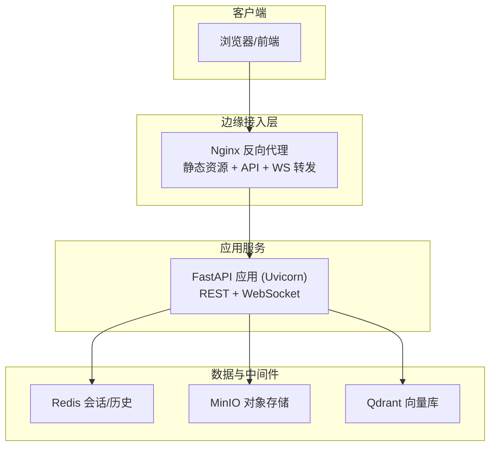
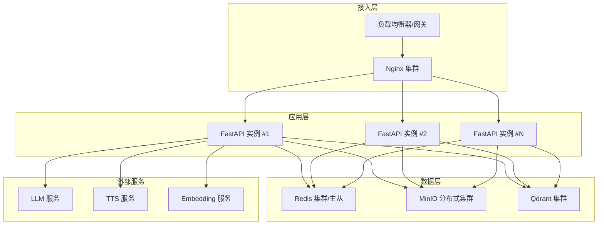
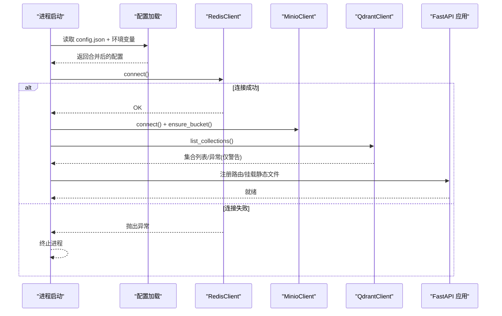
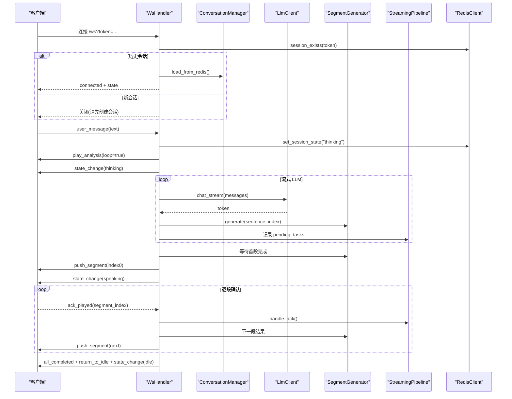
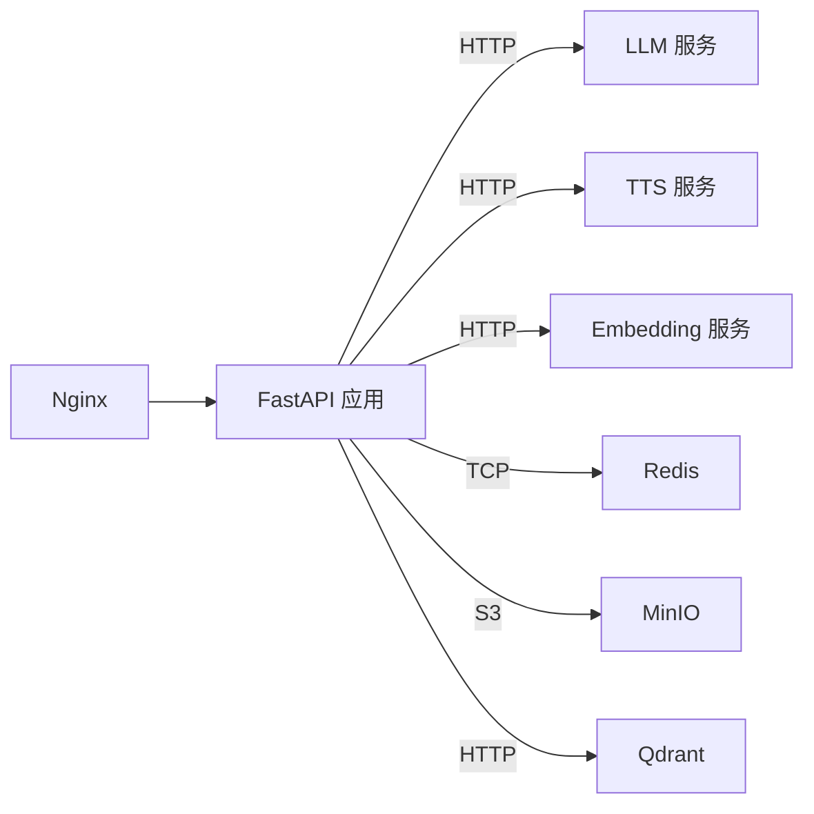

# 生产环境部署

<cite>
**本文引用的文件**   
- [server/main.py](file://server/main.py)
- [server/config.py](file://server/config.py)
- [docker-compose.yml](file://docker-compose.yml)
- [Dockerfile](file://Dockerfile)
- [nginx.conf](file://nginx.conf)
- [config.json](file://config.json)
- [server/requirements.txt](file://server/requirements.txt)
- [server/api/routes_session.py](file://server/api/routes_session.py)
- [server/api/routes_knowledge.py](file://server/api/routes_knowledge.py)
- [server/api/routes_clips.py](file://server/api/routes_clips.py)
- [server/api/routes_media.py](file://server/api/routes_media.py)
- [server/api/ws_handler.py](file://server/api/ws_handler.py)
- [server/services/redis_client.py](file://server/services/redis_client.py)
- [server/services/minio_client.py](file://server/services/minio_client.py)
- [server/services/qdrant_client.py](file://server/services/qdrant_client.py)
</cite>

## 目录
1. [简介](#简介)
2. [项目结构](#项目结构)
3. [核心组件](#核心组件)
4. [架构总览](#架构总览)
5. [详细组件分析](#详细组件分析)
6. [依赖关系分析](#依赖关系分析)
7. [性能与容量规划](#性能与容量规划)
8. [高可用与容灾](#高可用与容灾)
9. [安全加固](#安全加固)
10. [监控与告警](#监控与告警)
11. [部署清单与步骤](#部署清单与步骤)
12. [故障排查指南](#故障排查指南)
13. [结论](#结论)

## 简介
本指南面向生产环境，提供 RealTimeTalk 系统的整体架构设计、服务拆分、数据库与对象存储集群策略、负载均衡方案、完整部署清单（硬件/软件/安全）、高可用与容灾方案、性能调优、监控告警、安全加固、灾难恢复与运维自动化建议，以及成本优化与容量规划指导。内容严格基于仓库现有实现进行说明，确保可落地与可追溯。

## 项目结构
RealTimeTalk 采用前后端分离与容器化部署：
- 后端 FastAPI 应用通过 Uvicorn 运行，提供 REST API 与 WebSocket 实时通信。
- 前端静态资源由 Nginx 托管并反向代理至后端。
- 外部依赖包括 Redis（会话与历史）、MinIO（对象存储）、Qdrant（向量检索）。
- 配置支持 JSON 与环境变量合并，环境变量优先。

图表来源
- [docker-compose.yml:1-69](file://docker-compose.yml#L1-L69)
- [nginx.conf:1-58](file://nginx.conf#L1-L58)
- [server/main.py:114-178](file://server/main.py#L114-L178)

章节来源
- [docker-compose.yml:1-69](file://docker-compose.yml#L1-L69)
- [nginx.conf:1-58](file://nginx.conf#L1-L58)
- [server/main.py:114-178](file://server/main.py#L114-L178)

## 核心组件
- 应用入口与生命周期管理：负责加载配置、初始化外部依赖、注册路由与健康检查。
- 配置系统：JSON 配置与环境变量合并，支持运行时重载。
- 会话与会话状态：创建/查询/销毁会话，持久化对话历史到 Redis。
- 知识库管理：集合 CRUD、知识摄入（分块+嵌入+写入）、统计与搜索。
- 媒体与切片：本地文件直出或 MinIO presigned URL 重定向；切片文件安全访问。
- WebSocket 流式处理：LLM 流式生成 → 段落切分 → TTS 合成 → 视频拼接 → 逐段推送。
- 外部服务封装：Redis、MinIO、Qdrant 的异步客户端封装与错误处理。

章节来源
- [server/main.py:42-111](file://server/main.py#L42-L111)
- [server/config.py:148-260](file://server/config.py#L148-L260)
- [server/api/routes_session.py:28-123](file://server/api/routes_session.py#L28-L123)
- [server/api/routes_knowledge.py:81-268](file://server/api/routes_knowledge.py#L81-L268)
- [server/api/routes_clips.py:23-75](file://server/api/routes_clips.py#L23-L75)
- [server/api/routes_media.py:18-65](file://server/api/routes_media.py#L18-L65)
- [server/api/ws_handler.py:31-444](file://server/api/ws_handler.py#L31-L444)
- [server/services/redis_client.py:22-122](file://server/services/redis_client.py#L22-L122)
- [server/services/minio_client.py:21-139](file://server/services/minio_client.py#L21-L139)
- [server/services/qdrant_client.py:26-235](file://server/services/qdrant_client.py#L26-L235)

## 架构总览
生产环境推荐分层架构：
- 接入层：Nginx 作为统一入口，提供静态资源缓存、API 反向代理、WebSocket 升级转发。
- 应用层：多实例 FastAPI 进程，无状态设计，会话状态外置 Redis。
- 数据层：Redis（会话/历史）、MinIO（对象存储）、Qdrant（向量检索）。
- 外部服务：LLM/TTS/Embedding 等通过 HTTP 调用，需配置超时与重试策略。

[此图为概念性架构图，不直接映射具体源码文件]

## 详细组件分析

### 应用启动与生命周期
- 启动流程：加载配置 → 连接 Redis（失败则拒绝启动）→ 初始化 MinIO（确保 bucket）→ 初始化 Qdrant（失败仅警告，RAG 降级）→ 注入 RAG 依赖 → 注册路由 → 暴露健康检查与 WebSocket 端点。
- 关闭流程：取消活跃 Pipeline、关闭 WebSocket、清理内存会话、断开 Redis。

图表来源
- [server/main.py:42-111](file://server/main.py#L42-L111)
- [server/config.py:148-260](file://server/config.py#L148-L260)

章节来源
- [server/main.py:42-111](file://server/main.py#L42-L111)

### 配置系统
- 优先级：环境变量 > config.json。
- 支持字段覆盖：LLM、TTS、Avatar、Redis、MinIO、Server、FFmpeg、Qdrant、Embedding、RAG、知识库 Admin Token。
- 默认值与路径解析：system prompt 可从 resources 文件加载。

章节来源
- [server/config.py:16-126](file://server/config.py#L16-L126)
- [server/config.py:128-146](file://server/config.py#L128-L146)
- [server/config.py:148-260](file://server/config.py#L148-L260)
- [config.json:1-39](file://config.json#L1-L39)

### 会话管理（REST）
- 创建会话：生成 token，在 Redis 中写入初始状态 idle。
- 获取历史：校验存在性后从 Redis 拉取消息列表。
- 销毁会话：取消 Pipeline、关闭 WS、清理 Redis、清理内存、异步清理 MinIO 前缀。

章节来源
- [server/api/routes_session.py:28-123](file://server/api/routes_session.py#L28-L123)
- [server/services/redis_client.py:64-122](file://server/services/redis_client.py#L64-L122)

### 知识库管理（REST）
- 鉴权：可选 X-Knowledge-Admin-Token 头，未配置时放行。
- Collection 管理：列出/创建/删除集合。
- 知识摄入：文本分块 → 批量嵌入 → upsert 到 Qdrant。
- 统计与清空：按集合统计点数、清空集合数据。
- 调试搜索：单集合或多集合语义检索。

章节来源
- [server/api/routes_knowledge.py:40-51](file://server/api/routes_knowledge.py#L40-L51)
- [server/api/routes_knowledge.py:81-128](file://server/api/routes_knowledge.py#L81-L128)
- [server/api/routes_knowledge.py:134-186](file://server/api/routes_knowledge.py#L134-L186)
- [server/api/routes_knowledge.py:192-230](file://server/api/routes_knowledge.py#L192-L230)
- [server/api/routes_knowledge.py:233-268](file://server/api/routes_knowledge.py#L233-L268)
- [server/services/qdrant_client.py:37-235](file://server/services/qdrant_client.py#L37-L235)

### 媒体与切片（REST）
- 切片文件：安全校验路径，返回 webm 文件，禁用缓存。
- 媒体文件：优先本地 _work 输出，不存在则回退到 MinIO presigned URL 重定向。

章节来源
- [server/api/routes_clips.py:23-75](file://server/api/routes_clips.py#L23-L75)
- [server/api/routes_media.py:18-65](file://server/api/routes_media.py#L18-L65)
- [server/services/minio_client.py:102-139](file://server/services/minio_client.py#L102-L139)

### WebSocket 流式处理
- 连接建立：校验 token，若为历史会话则从 Redis 恢复上下文。
- 用户消息：更新状态为 thinking，立即推送待机动画与思考态。
- 流式 LLM：边接收边按句子边界切分，触发并行段生成任务（TTS + 语义分析 + 视频拼接 + MinIO）。
- 首段快速播放：等待首个段完成即推送，随后按 ack 机制逐段推进。
- 错误与中断：统一错误推送、重置状态、取消 pipeline。

图表来源
- [server/api/ws_handler.py:49-444](file://server/api/ws_handler.py#L49-L444)
- [server/services/redis_client.py:72-122](file://server/services/redis_client.py#L72-L122)

章节来源
- [server/api/ws_handler.py:49-444](file://server/api/ws_handler.py#L49-L444)

### 外部服务封装
- Redis：异步连接、会话状态与历史存取、TTL 管理、删除会话。
- MinIO：连接与 bucket 自检、上传、对象存在性检查、presigned URL、前缀删除。
- Qdrant：集合管理、upsert、搜索（单/多集合并发）、计数、清空重建。

章节来源
- [server/services/redis_client.py:22-122](file://server/services/redis_client.py#L22-L122)
- [server/services/minio_client.py:21-139](file://server/services/minio_client.py#L21-L139)
- [server/services/qdrant_client.py:26-235](file://server/services/qdrant_client.py#L26-L235)

## 依赖关系分析
- 应用依赖：FastAPI、Uvicorn、websockets、httpx、redis[hiredis]、minio、pydantic/pydantic-settings、aiofiles、qdrant-client。
- 运行时依赖：ffmpeg（用于视频处理），由 Dockerfile 安装。
- 容器编排：docker-compose 定义 qdrant、redis、minio、server、nginx 五类服务及卷挂载。

图表来源
- [server/requirements.txt:1-14](file://server/requirements.txt#L1-L14)
- [Dockerfile:1-22](file://Dockerfile#L1-L22)
- [docker-compose.yml:1-69](file://docker-compose.yml#L1-L69)

章节来源
- [server/requirements.txt:1-14](file://server/requirements.txt#L1-L14)
- [Dockerfile:1-22](file://Dockerfile#L1-L22)
- [docker-compose.yml:1-69](file://docker-compose.yml#L1-L69)

## 性能与容量规划
- 并发模型：Uvicorn 多 worker 模式，结合 asyncio 协程处理长连接与 I/O 密集任务。
- 流式处理：LLM 流式响应驱动分段生成，首段尽快播放降低端到端延迟。
- 资源限制：
  - Nginx：worker_connections、keepalive_timeout、client_max_body_size、WS 超时。
  - 应用：根据 CPU/内存调整 Uvicorn workers 数量；合理设置 LLM/TTS/Embedding 请求超时与重试。
- 存储与缓存：
  - Redis：会话 TTL 控制，避免历史无限增长；必要时使用 Redis 集群提升吞吐。
  - MinIO：对象分片与预签名 URL 直连，减轻应用带宽压力。
  - Qdrant：向量维度与 top_k 影响检索性能，按需扩容节点。
- FFmpeg：启用 GPU 编码（如可用）以降低 CPU 占用。

章节来源
- [nginx.conf:1-58](file://nginx.conf#L1-L58)
- [server/api/ws_handler.py:189-334](file://server/api/ws_handler.py#L189-L334)
- [server/services/redis_client.py:25-29](file://server/services/redis_client.py#L25-L29)
- [server/services/minio_client.py:102-124](file://server/services/minio_client.py#L102-L124)
- [server/services/qdrant_client.py:164-186](file://server/services/qdrant_client.py#L164-L186)
- [Dockerfile:3-6](file://Dockerfile#L3-L6)

## 高可用与容灾
- 服务拆分与扩展：
  - 应用层：多实例 FastAPI 进程，配合 Nginx 轮询或加权均衡。
  - 数据层：Redis 主从/哨兵或集群；MinIO 分布式集群；Qdrant 集群模式。
- 故障转移：
  - Redis：主从复制 + 自动故障转移（哨兵/集群），应用侧捕获连接异常并重试。
  - MinIO：多节点纠删码，保证数据可靠性；应用侧对 presigned URL 失败做回退。
  - Qdrant：副本集保障可用性；应用侧对集合不存在/检索失败做降级处理。
- 数据备份策略：
  - Redis：定期 RDB/AOF 快照导出；关键会话历史可落盘归档。
  - MinIO：跨站点复制（SCC）或定时快照；对象级版本控制。
  - Qdrant：集合快照与增量备份；定期导出元数据与索引。
- 健康检查与自愈：
  - 暴露 /api/health 端点，供负载均衡探针探测。
  - 容器编排重启策略：restart unless-stopped。

章节来源
- [server/main.py:136-143](file://server/main.py#L136-L143)
- [docker-compose.yml:1-69](file://docker-compose.yml#L1-L69)

## 安全加固
- 网络安全：
  - 仅暴露必要端口（80/443），内网服务端口不对外。
  - 使用 HTTPS 终结于 Nginx，配置证书与强加密套件。
- 访问控制：
  - 知识库管理接口受 X-Knowledge-Admin-Token 保护，生产务必配置非空 token。
  - 会话 token 校验：新建会话必须通过 POST /api/session/create。
- 数据安全：
  - MinIO 内网访问，生产建议启用 TLS 与最小权限访问密钥。
  - Redis 启用密码认证与网络隔离。
  - Qdrant 启用 api-key 鉴权。
- 输入校验与路径安全：
  - 切片文件访问进行路径白名单与相对路径校验，防止越权访问。
  - 媒体文件优先本地直出，MinIO 回退时使用 presigned URL 限时效。

章节来源
- [server/api/routes_knowledge.py:40-51](file://server/api/routes_knowledge.py#L40-L51)
- [server/api/routes_clips.py:48-61](file://server/api/routes_clips.py#L48-L61)
- [server/api/routes_media.py:30-65](file://server/api/routes_media.py#L30-L65)
- [server/services/minio_client.py:34-46](file://server/services/minio_client.py#L34-L46)
- [server/services/qdrant_client.py:216-225](file://server/services/qdrant_client.py#L216-L225)

## 监控与告警
- 应用指标：
  - 健康检查：/api/health 返回服务状态、Redis 连通性与活跃会话数。
  - 日志：结构化日志包含模块名、级别与消息，便于集中采集。
- 系统监控：
  - 容器资源：CPU/内存/磁盘/网络 IO。
  - 中间件：Redis 命中率、内存使用、连接数；MinIO 对象数量与吞吐；Qdrant 集合大小与检索耗时。
- 业务监控：
  - 会话创建/销毁速率、平均时长、错误率。
  - 流式处理分段成功率、首段延迟、端到端延迟。
- 告警策略：
  - 健康检查失败、Redis 不可用、MinIO 上传失败、Qdrant 集合操作异常、LLM/TTS 调用超时。

章节来源
- [server/main.py:136-143](file://server/main.py#L136-L143)
- [server/api/routes_session.py:28-123](file://server/api/routes_session.py#L28-L123)
- [server/api/ws_handler.py:335-341](file://server/api/ws_handler.py#L335-L341)

## 部署清单与步骤

### 硬件要求（参考）
- 应用服务器：
  - CPU：4-8 核（含 LLM/TTS/Embedding 调用与视频处理）
  - 内存：8-16 GB（视并发与流式任务而定）
  - 磁盘：SSD 50-100 GB（_work 临时文件与静态资源）
- 数据服务器：
  - Redis：2-4 核，4-8 GB，持久化开启
  - MinIO：多节点，每节点 4-8 核，16-32 GB，大容量 HDD/SSD
  - Qdrant：4-8 核，16-32 GB，NVMe SSD 更佳

### 软件依赖
- 操作系统：Linux（推荐 Ubuntu/CentOS）
- 运行时：Python 3.11（容器镜像已内置）
- 工具链：ffmpeg（容器镜像已安装）
- 容器：Docker + docker-compose（或 Kubernetes）

章节来源
- [Dockerfile:1-22](file://Dockerfile#L1-L22)
- [server/requirements.txt:1-14](file://server/requirements.txt#L1-L14)

### 安全配置
- 配置项：
  - 知识库 Admin Token：KNOWLEDGE_ADMIN_TOKEN 非空
  - MinIO：MINIO_ACCESS_KEY/MINIO_SECRET_KEY 使用强口令
  - Redis：REDIS_URL 包含用户名/密码
  - Qdrant：QDRANT_API_KEY 启用
- 网络：
  - 仅开放 80/443，内网服务端口不暴露
  - 启用 HTTPS 与 HSTS

章节来源
- [server/config.py:120-126](file://server/config.py#L120-L126)
- [server/services/minio_client.py:24-31](file://server/services/minio_client.py#L24-L31)
- [server/services/redis_client.py:25-29](file://server/services/redis_client.py#L25-L29)
- [server/services/qdrant_client.py:29-33](file://server/services/qdrant_client.py#L29-L33)

### 部署步骤（容器编排）
- 准备配置文件：
  - 编辑 config.json 或 .env 环境变量，覆盖敏感信息与外部服务地址。
- 构建镜像：
  - 使用 Dockerfile 构建应用镜像，确保 ffmpeg 安装与依赖安装成功。
- 启动服务：
  - 使用 docker-compose 拉起 qdrant、redis、minio、server、nginx。
- 验证：
  - 访问 /api/health 检查服务状态。
  - 调用 /api/session/create 创建会话，连接 /ws 测试实时通信。
  - 上传知识文档并执行 ingest，验证检索。

章节来源
- [docker-compose.yml:1-69](file://docker-compose.yml#L1-L69)
- [Dockerfile:1-22](file://Dockerfile#L1-L22)
- [server/main.py:136-143](file://server/main.py#L136-L143)
- [server/api/routes_session.py:28-47](file://server/api/routes_session.py#L28-L47)
- [server/api/routes_knowledge.py:134-186](file://server/api/routes_knowledge.py#L134-L186)

## 故障排查指南
- 健康检查失败：
  - 检查 Redis 连接与端口可达性。
  - 查看应用日志中“服务启动中/连接成功/不可用”相关条目。
- WebSocket 无法连接：
  - 确认 Nginx 的 /ws 转发配置与 Upgrade/Connection 头。
  - 检查是否先调用 /api/session/create 创建会话。
- 媒体文件 404：
  - 确认 _work 目录下是否存在输出文件。
  - 检查 MinIO 对象是否存在与 presigned URL 是否过期。
- 知识库操作失败：
  - 检查 Qdrant 集合是否存在与 API Key。
  - 确认 Embedding 服务可用与向量维度匹配。

章节来源
- [server/main.py:136-143](file://server/main.py#L136-L143)
- [nginx.conf:45-55](file://nginx.conf#L45-L55)
- [server/api/routes_media.py:30-65](file://server/api/routes_media.py#L30-L65)
- [server/api/routes_knowledge.py:81-128](file://server/api/routes_knowledge.py#L81-L128)

## 结论
RealTimeTalk 在生产环境可通过分层架构与容器化实现高可用与可扩展部署。借助 Redis、MinIO、Qdrant 的数据与检索能力，结合 Nginx 的反向代理与负载均衡，能够满足实时音视频交互的业务需求。通过完善的安全加固、监控告警、备份容灾与性能调优，可在保障稳定性的同时优化成本与容量利用率。