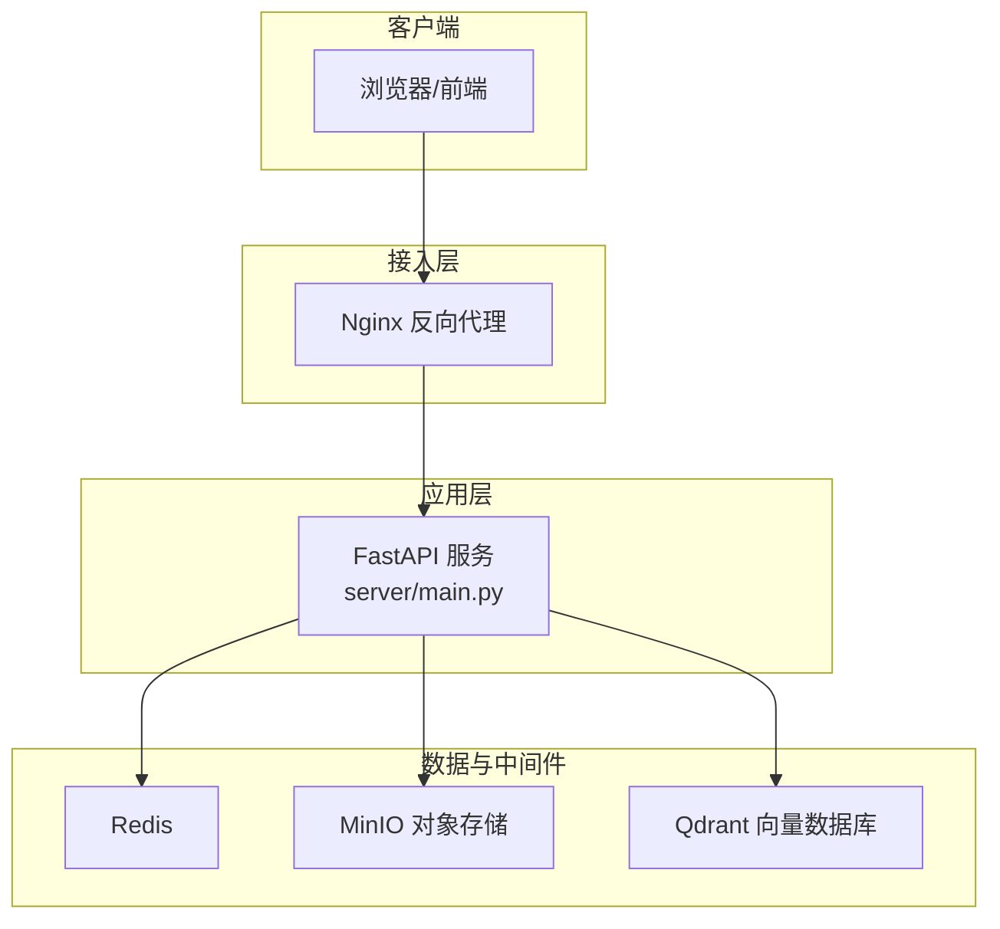
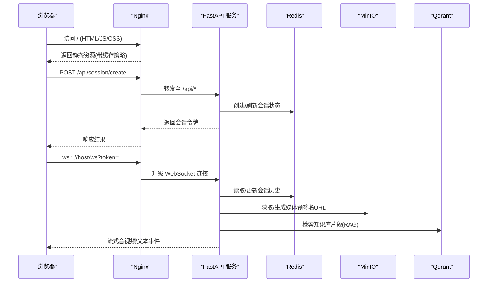
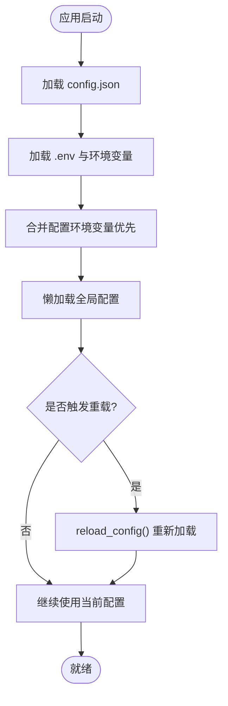
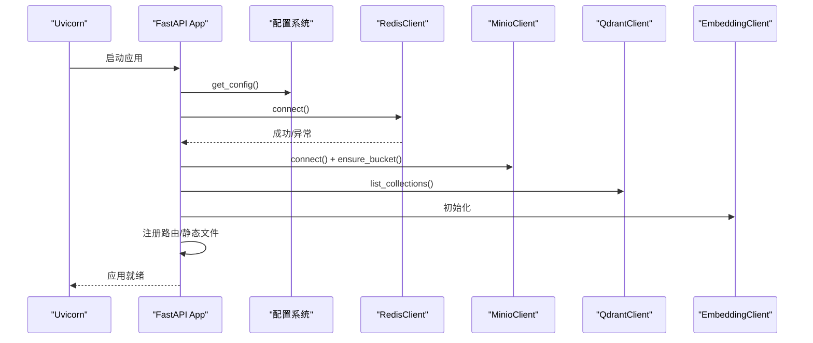
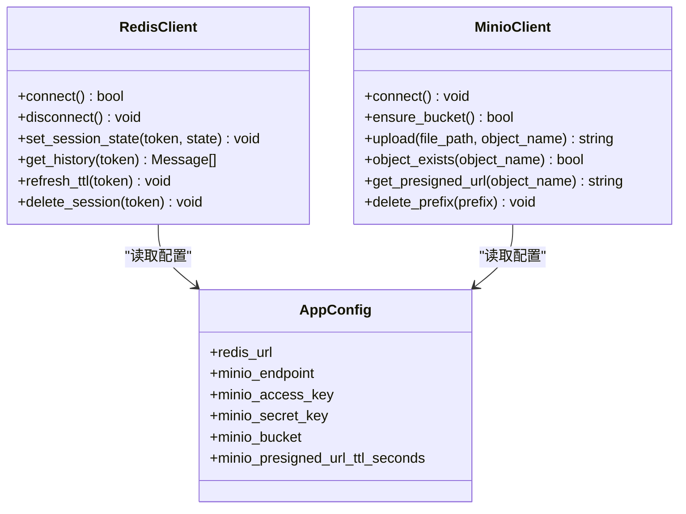
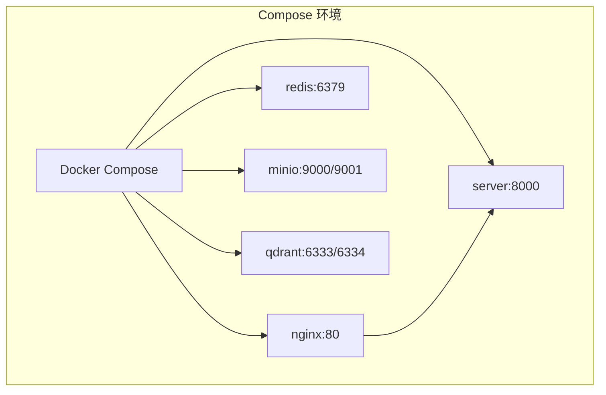
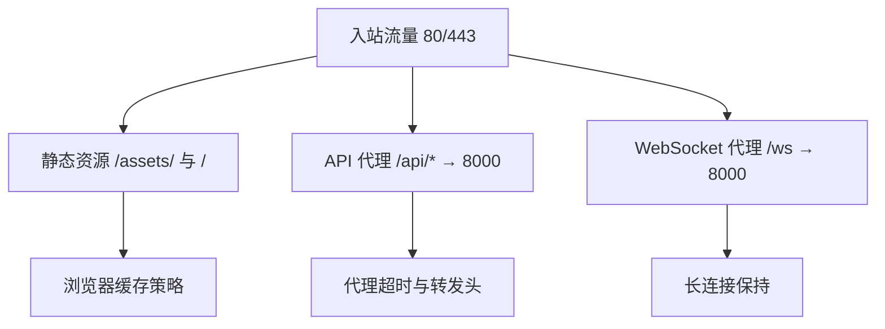
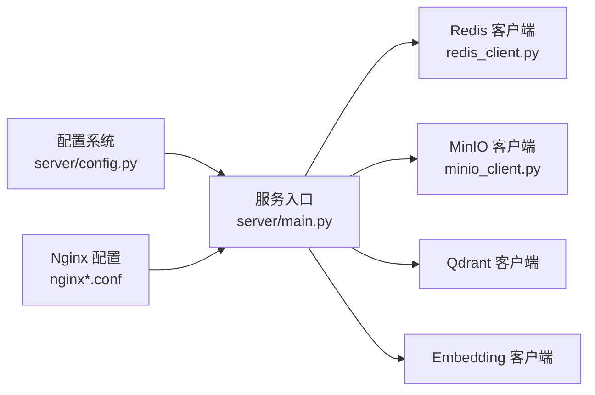

# 配置与部署

<cite>
**本文引用的文件**   
- [config.json](file://config.json)
- [server/config.py](file://server/config.py)
- [server/main.py](file://server/main.py)
- [Dockerfile](file://Dockerfile)
- [docker-compose.yml](file://docker-compose.yml)
- [docker-stack.yml](file://docker-stack.yml)
- [nginx.conf](file://nginx.conf)
- [nginx-pulan.conf](file://nginx-pulan.conf)
- [server/services/redis_client.py](file://server/services/redis_client.py)
- [server/services/minio_client.py](file://server/services/minio_client.py)
- [clips/short-hair-teacher-girl/clips.toml](file://clips/short-hair-teacher-girl/clips.toml)
</cite>

## 目录
1. [简介](#简介)
2. [项目结构](#项目结构)
3. [核心组件](#核心组件)
4. [架构总览](#架构总览)
5. [详细组件分析](#详细组件分析)
6. [依赖关系分析](#依赖关系分析)
7. [性能考虑](#性能考虑)
8. [故障排查指南](#故障排查指南)
9. [结论](#结论)
10. [附录](#附录)

## 简介
本文件面向 RealTimeTalk 系统的运维与部署人员，系统性说明配置管理、容器化部署、Nginx 反向代理、生产环境最佳实践、监控日志与故障排查方法。文档覆盖单机、集群与云原生（Swarm）三种典型部署场景，并提供可操作的步骤与参考路径。

## 项目结构
RealTimeTalk 采用前后端分离与多服务编排的架构：
- 后端 FastAPI 服务负责会话管理、WebSocket 实时通信、RAG 检索增强生成、TTS 合成与媒体处理。
- 前端静态资源由 Nginx 提供或挂载到后端静态目录。
- 外部依赖包括 Redis（会话与历史）、MinIO（对象存储）、Qdrant（向量检索）。
- 配置来源支持 JSON 配置文件与环境变量覆盖，并支持运行时重载。

图表来源
- [nginx.conf:1-58](file://nginx.conf#L1-L58)
- [server/main.py:114-178](file://server/main.py#L114-L178)
- [docker-compose.yml:32-63](file://docker-compose.yml#L32-L63)

章节来源
- [server/main.py:114-178](file://server/main.py#L114-L178)
- [docker-compose.yml:1-69](file://docker-compose.yml#L1-L69)

## 核心组件
- 配置管理系统
  - 优先级：环境变量 > config.json > 默认值
  - 支持 .env 文件加载；提供全局懒加载与运行时重载接口
  - 关键模块：[server/config.py](file://server/config.py)
- 服务入口与生命周期
  - 启动时初始化 Redis、MinIO、Qdrant、Embedding 等客户端
  - 注册 REST 路由与 WebSocket 端点
  - 关键模块：[server/main.py](file://server/main.py)
- 外部依赖客户端
  - Redis：会话状态与对话历史持久化
  - MinIO：上传/下载媒体与预签名 URL
  - 关键模块：[server/services/redis_client.py](file://server/services/redis_client.py)、[server/services/minio_client.py](file://server/services/minio_client.py)
- 容器化与编排
  - Dockerfile 构建镜像
  - docker-compose.yml 本地开发编排
  - docker-stack.yml Swarm 集群编排
  - 关键文件：[Dockerfile](file://Dockerfile)、[docker-compose.yml](file://docker-compose.yml)、[docker-stack.yml](file://docker-stack.yml)
- 反向代理与静态资源
  - nginx.conf 用于本地/内网部署
  - nginx-pulan.conf 用于生产域名与 HTTPS 网关
  - 关键文件：[nginx.conf](file://nginx.conf)、[nginx-pulan.conf](file://nginx-pulan.conf)

章节来源
- [server/config.py:148-241](file://server/config.py#L148-L241)
- [server/main.py:42-111](file://server/main.py#L42-L111)
- [server/services/redis_client.py:22-62](file://server/services/redis_client.py#L22-L62)
- [server/services/minio_client.py:21-67](file://server/services/minio_client.py#L21-L67)
- [Dockerfile:1-22](file://Dockerfile#L1-L22)
- [docker-compose.yml:32-63](file://docker-compose.yml#L32-L63)
- [docker-stack.yml:32-56](file://docker-stack.yml#L32-L56)
- [nginx.conf:15-56](file://nginx.conf#L15-L56)
- [nginx-pulan.conf:17-65](file://nginx-pulan.conf#L17-L65)

## 架构总览
下图展示了从浏览器到后端服务及外部依赖的完整请求链路，包含静态资源、REST API 与 WebSocket 的代理策略。

图表来源
- [nginx.conf:35-55](file://nginx.conf#L35-L55)
- [server/main.py:146-170](file://server/main.py#L146-L170)
- [server/services/redis_client.py:64-122](file://server/services/redis_client.py#L64-L122)
- [server/services/minio_client.py:69-124](file://server/services/minio_client.py#L69-L124)

## 详细组件分析

### 配置管理系统
- 设计要点
  - 优先级：环境变量 > config.json > 默认值
  - 支持 .env 文件加载（pydantic-settings）
  - 全局懒加载 get_config()，运行时 reload_config() 可热重载
  - system_prompt 优先使用 config.json 中的值，否则回退到 resources/default_system_prompt.txt
- 关键字段映射（节选）
  - LLM：endpoint、api_key、model、max_tokens
  - TTS：api_key、voice、speed
  - Redis：url、session_ttl_hours
  - MinIO：endpoint、access_key、secret_key、bucket、presigned_url_ttl_seconds
  - Server：host、port
  - FFmpeg：path、gpu_encoder
  - Qdrant：url、api_key
  - Embedding：endpoint、api_key、model
  - RAG：top_k、role_collections
  - 知识管理：knowledge_admin_token
- 动态重载机制
  - 调用 reload_config() 后，后续 get_config() 将返回新配置
  - 注意：已持有的客户端实例不会自动重建，需结合进程重启或显式重建逻辑

图表来源
- [server/config.py:128-146](file://server/config.py#L128-L146)
- [server/config.py:148-241](file://server/config.py#L148-L241)
- [server/config.py:248-260](file://server/config.py#L248-L260)

章节来源
- [server/config.py:148-241](file://server/config.py#L148-L241)
- [server/config.py:248-260](file://server/config.py#L248-L260)
- [config.json:1-39](file://config.json#L1-L39)

### 服务入口与生命周期
- 启动流程
  - 加载配置并记录关键信息
  - 建立 Redis 连接（失败则拒绝启动）
  - 初始化 MinIO 并确保 bucket 存在
  - 初始化 Qdrant（失败仅告警，不影响主流程）
  - 初始化 Embedding 客户端
  - 注入 RAG 依赖到 AgentEngine
  - 注册路由与静态文件挂载
- 健康检查
  - GET /api/health 返回服务状态、Redis 可用性与活跃会话数
- WebSocket
  - /ws?token=... 建立长连接，内部构造 WsHandler 处理消息流

图表来源
- [server/main.py:42-111](file://server/main.py#L42-L111)
- [server/main.py:136-143](file://server/main.py#L136-L143)
- [server/main.py:146-170](file://server/main.py#L146-L170)

章节来源
- [server/main.py:42-111](file://server/main.py#L42-L111)
- [server/main.py:136-143](file://server/main.py#L136-L143)
- [server/main.py:146-170](file://server/main.py#L146-L170)

### 外部依赖客户端
- Redis 客户端
  - 解析 redis:// URL，支持用户名/密码/db
  - 会话状态与历史读写、TTL 管理、清理
- MinIO 客户端
  - 连接、Bucket 自检与创建
  - 上传、对象存在性检查、预签名 URL 生成、前缀批量删除

图表来源
- [server/services/redis_client.py:22-62](file://server/services/redis_client.py#L22-L62)
- [server/services/minio_client.py:21-67](file://server/services/minio_client.py#L21-L67)
- [server/config.py:73-126](file://server/config.py#L73-L126)

章节来源
- [server/services/redis_client.py:22-122](file://server/services/redis_client.py#L22-L122)
- [server/services/minio_client.py:21-139](file://server/services/minio_client.py#L21-L139)

### 容器化与编排
- 镜像构建（Dockerfile）
  - 基础镜像：python:3.11-slim
  - 安装 ffmpeg
  - 安装 Python 依赖
  - 拷贝 server、clips、client/dist 到镜像
  - 暴露 8000 端口，默认以 uvicorn 运行
- 本地编排（docker-compose.yml）
  - 服务：qdrant、redis、minio、server、nginx
  - 卷：redis_data、minio_data、qdrant_data
  - 环境变量与挂载：config.json、clips、resources
- 集群编排（docker-stack.yml）
  - 指定外部网络与数据卷
  - 通过环境变量覆盖服务发现地址
  - 挂载外部 .env 与 config.json

图表来源
- [Dockerfile:1-22](file://Dockerfile#L1-L22)
- [docker-compose.yml:1-69](file://docker-compose.yml#L1-L69)
- [docker-stack.yml:1-74](file://docker-stack.yml#L1-L74)

章节来源
- [Dockerfile:1-22](file://Dockerfile#L1-L22)
- [docker-compose.yml:1-69](file://docker-compose.yml#L1-L69)
- [docker-stack.yml:1-74](file://docker-stack.yml#L1-L74)

### Nginx 反向代理配置
- 静态资源
  - /assets/ 长期缓存（immutable）
  - / 根路径 HTML 禁用缓存，确保版本更新
- API 代理
  - /api/ 转发到 FastAPI 8000 端口，设置超时与转发头
- WebSocket 代理
  - /ws 启用 Upgrade 与 Connection 头，设置较长读超时
- 生产网关（HTTPS）
  - HTTP→HTTPS 重定向
  - 安全头：X-Content-Type-Options、X-Frame-Options、X-XSS-Protection
  - 统一代理到后端服务，WebSocket 长连接保持

图表来源
- [nginx.conf:15-56](file://nginx.conf#L15-L56)
- [nginx-pulan.conf:9-65](file://nginx-pulan.conf#L9-L65)

章节来源
- [nginx.conf:15-56](file://nginx.conf#L15-L56)
- [nginx-pulan.conf:9-65](file://nginx-pulan.conf#L9-L65)

### 不同部署场景示例
- 单机部署（开发/测试）
  - 使用 docker-compose.yml 一键拉起全部依赖与服务
  - 通过 http://localhost:80 访问前端与 API
  - 参考：[docker-compose.yml](file://docker-compose.yml)
- 集群部署（Docker Swarm）
  - 使用 docker-stack.yml 定义服务、网络与卷
  - 通过外部网络与 .env/config.json 挂载实现配置外置
  - 参考：[docker-stack.yml](file://docker-stack.yml)
- 云原生部署（Kubernetes 思路）
  - 将 compose/stack 中的服务抽象为 Deployment/Service/ConfigMap/Secret/PersistentVolumeClaim
  - 使用 Ingress 替代 Nginx 容器，保留相同 location 规则
  - 使用 Secret 管理敏感配置（API Key、DB 密码），使用 ConfigMap 管理非敏感配置
  - 使用 HPA 进行水平扩展，配合 Readiness/Liveness Probe 提升可用性

[本节为概念性指导，不直接分析具体代码文件]

## 依赖关系分析
- 组件耦合
  - main.py 作为入口，聚合各客户端与路由，低耦合高内聚
  - 配置中心集中管理，所有客户端通过 get_config() 获取
- 外部依赖
  - Redis：会话与历史，强依赖（不可用则拒绝启动）
  - MinIO：对象存储，弱依赖（不可用时跳过上传并记录警告）
  - Qdrant：RAG 检索，弱依赖（不可用时仅告警）
- 网络拓扑
  - Nginx 作为唯一入口，统一处理静态、API 与 WebSocket
  - 服务间通过 Docker 网络或服务名解析通信

图表来源
- [server/config.py:148-241](file://server/config.py#L148-L241)
- [server/main.py:42-111](file://server/main.py#L42-L111)
- [server/services/redis_client.py:22-62](file://server/services/redis_client.py#L22-L62)
- [server/services/minio_client.py:21-67](file://server/services/minio_client.py#L21-L67)
- [nginx.conf:15-56](file://nginx.conf#L15-L56)

章节来源
- [server/config.py:148-241](file://server/config.py#L148-L241)
- [server/main.py:42-111](file://server/main.py#L42-L111)
- [server/services/redis_client.py:22-62](file://server/services/redis_client.py#L22-L62)
- [server/services/minio_client.py:21-67](file://server/services/minio_client.py#L21-L67)
- [nginx.conf:15-56](file://nginx.conf#L15-L56)

## 性能考虑
- 静态资源缓存
  - /assets/ 使用长期缓存与 immutable 策略，减少带宽与服务器压力
  - HTML 禁用缓存，保证发布版本即时生效
- 代理超时
  - API 代理设置合理 read_timeout，避免长时间阻塞
  - WebSocket 代理设置超长 read_timeout，保障长连接稳定
- 上传限制
  - client_max_body_size 增大以支持大视频上传
- 资源隔离
  - 使用独立容器与卷，避免互相影响
- 可扩展性
  - 在 Swarm/K8s 中增加副本数，配合负载均衡器分发请求
  - 对无状态服务进行水平扩展，有状态服务（Redis/MinIO/Qdrant）使用专用实例或托管服务

[本节为通用建议，不直接分析具体代码文件]

## 故障排查指南
- 常见问题定位
  - 启动失败：检查 Redis 连接与端口、认证信息
  - 媒体上传失败：检查 MinIO endpoint、密钥、bucket 权限
  - WebSocket 断连：检查 Nginx 代理头与超时设置
  - 静态资源 404：确认 client/dist 挂载路径与 Nginx root 配置
- 健康检查
  - 调用 /api/health 查看服务状态、Redis 可用性与会话数
- 日志与监控
  - 后端日志：查看容器标准输出或日志收集系统
  - Nginx 访问/错误日志：通过挂载卷或日志采集工具收集
  - 指标：可在 FastAPI 中集成 Prometheus 导出器，或使用平台自带监控

章节来源
- [server/main.py:136-143](file://server/main.py#L136-L143)
- [nginx.conf:15-56](file://nginx.conf#L15-L56)

## 结论
RealTimeTalk 提供了完善的配置管理与容器化部署方案，支持灵活的环境变量覆盖与运行时重载。通过 Nginx 统一接入，实现了静态资源、REST API 与 WebSocket 的高效代理。在生产环境中，建议遵循最小权限、安全加固与可观测性原则，并结合平台能力进行弹性伸缩与高可用部署。

[本节为总结性内容，不直接分析具体代码文件]

## 附录
- 配置项清单（节选）
  - LLM：endpoint、api_key、model、max_tokens
  - TTS：api_key、voice、speed
  - Redis：url、session_ttl_hours
  - MinIO：endpoint、access_key、secret_key、bucket、presigned_url_ttl_seconds
  - Server：host、port
  - FFmpeg：path、gpu_encoder
  - Qdrant：url、api_key
  - Embedding：endpoint、api_key、model
  - RAG：top_k、role_collections
  - 知识管理：knowledge_admin_token
- 角色切片库
  - clips/short-hair-teacher-girl/clips.toml 定义了语义化切片、标签与过渡规则，供 Avatar 渲染与提示词匹配使用

章节来源
- [config.json:1-39](file://config.json#L1-L39)
- [server/config.py:73-126](file://server/config.py#L73-L126)
- [clips/short-hair-teacher-girl/clips.toml:1-148](file://clips/short-hair-teacher-girl/clips.toml#L1-L148)