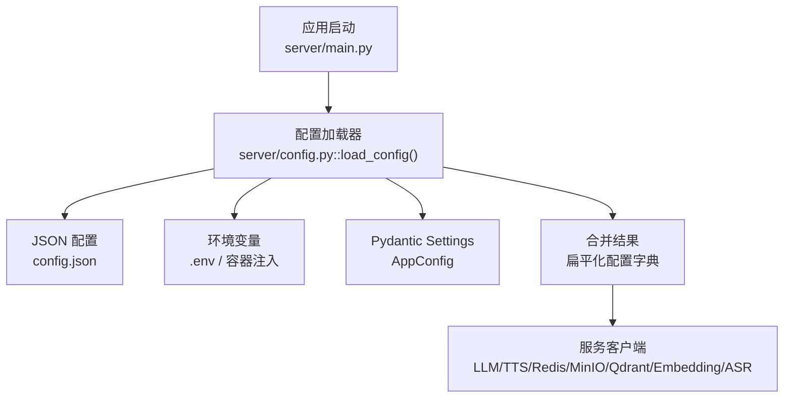
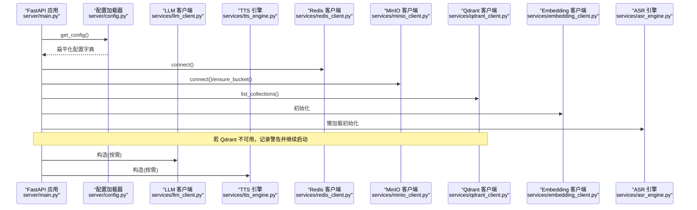
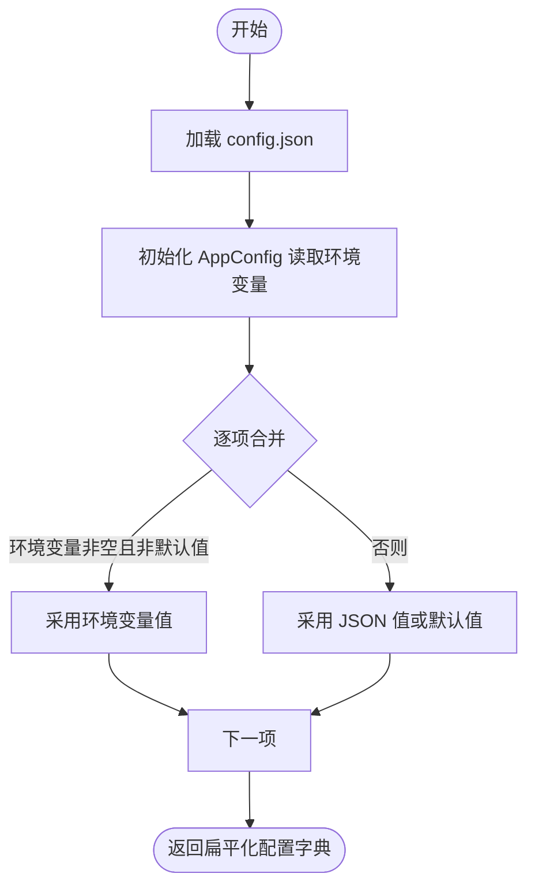
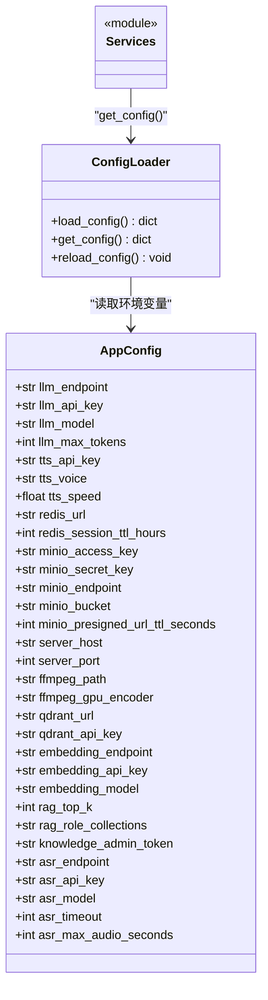

# 配置管理系统

<cite>
**本文引用的文件**   
- [server/config.py](file://server/config.py)
- [config.json](file://config.json)
- [server/main.py](file://server/main.py)
- [server/services/llm_client.py](file://server/services/llm_client.py)
- [server/services/tts_engine.py](file://server/services/tts_engine.py)
- [server/services/redis_client.py](file://server/services/redis_client.py)
- [server/services/minio_client.py](file://server/services/minio_client.py)
- [server/services/qdrant_client.py](file://server/services/qdrant_client.py)
- [server/services/embedding_client.py](file://server/services/embedding_client.py)
- [server/services/asr_engine.py](file://server/services/asr_engine.py)
- [server/api/routes_asr.py](file://server/api/routes_asr.py)
- [docker-compose.yml](file://docker-compose.yml)
</cite>

## 更新摘要
**所做更改**   
- 新增 ASR（语音识别）配置模块和相关环境变量支持
- 扩展了配置项清单，包含 ASR 端点、API 密钥、超时和音频时长限制等配置
- 更新了 Pydantic Settings 使用方式，展示新的 ASR 字段定义和环境变量映射
- 增强了配置验证与错误处理机制说明
- 提供了完整的 ASR 配置示例和最佳实践

## 目录
1. [简介](#简介)
2. [项目结构](#项目结构)
3. [核心组件](#核心组件)
4. [架构总览](#架构总览)
5. [详细组件分析](#详细组件分析)
6. [依赖关系分析](#依赖关系分析)
7. [性能与可用性考虑](#性能与可用性考虑)
8. [故障排查指南](#故障排查指南)
9. [结论](#结论)
10. [附录：配置项清单与环境变量映射](#附录配置项清单与环境变量映射)

## 简介
本文件面向 RealTimeTalk 系统的配置管理子系统，系统性说明配置加载机制、Pydantic Settings 的使用方式、环境变量覆盖优先级、完整配置项说明（LLM、TTS、Redis、MinIO、FFmpeg、Qdrant、Embedding、ASR、RAG 等），并提供最佳实践、验证与错误处理策略、常见问题解决方案及示例。

## 项目结构
RealTimeTalk 的配置由以下部分构成：
- JSON 配置文件：config.json，提供默认或本地开发环境下的结构化配置
- 环境变量：通过 .env 文件或容器运行时注入，用于覆盖 JSON 配置
- Pydantic Settings：AppConfig 类定义字段、别名映射与类型校验
- 配置加载器：load_config() 合并 JSON 与环境变量，返回扁平化字典供各服务使用
- 全局访问：get_config() 懒加载并缓存配置；reload_config() 支持热重载



图表来源
- [server/main.py:42-90](file://server/main.py#L42-L90)
- [server/config.py:167-268](file://server/config.py#L167-L268)
- [config.json:1-47](file://config.json#L1-L47)

章节来源
- [server/config.py:1-287](file://server/config.py#L1-L287)
- [config.json:1-47](file://config.json#L1-L47)
- [server/main.py:1-191](file://server/main.py#L1-L191)

## 核心组件
- AppConfig（Pydantic BaseSettings）
  - 负责字段定义、类型校验、别名映射与环境变量读取
  - 支持从 .env 文件加载（UTF-8 编码）
  - 新增 ASR 配置字段，支持语音识别服务的完整配置
- load_config()
  - 读取 config.json
  - 初始化 AppConfig 以读取环境变量
  - 按"环境变量优先"的策略合并为扁平化配置字典
  - 新增 ASR 配置项的合并逻辑
- get_config() / reload_config()
  - 懒加载全局配置实例，避免重复 IO
  - 支持运行期重新加载配置

章节来源
- [server/config.py:85-145](file://server/config.py#L85-L145)
- [server/config.py:167-268](file://server/config.py#L167-L268)
- [server/config.py:275-287](file://server/config.py#L275-L287)

## 架构总览
配置在应用生命周期中于 FastAPI lifespan 阶段被加载，随后各服务客户端在构造时按需读取配置。



图表来源
- [server/main.py:42-90](file://server/main.py#L42-L90)
- [server/services/redis_client.py:25-50](file://server/services/redis_client.py#L25-L50)
- [server/services/minio_client.py:24-63](file://server/services/minio_client.py#L24-L63)
- [server/services/qdrant_client.py:29-34](file://server/services/qdrant_client.py#L29-L34)
- [server/services/embedding_client.py:32-40](file://server/services/embedding_client.py#L32-L40)
- [server/services/llm_client.py:26-33](file://server/services/llm_client.py#L26-L33)
- [server/services/tts_engine.py:41-47](file://server/services/tts_engine.py#L41-L47)
- [server/services/asr_engine.py:47-57](file://server/services/asr_engine.py#L47-L57)

## 详细组件分析

### 配置加载机制与优先级
- 数据源
  - JSON 配置：config.json
  - 环境变量：.env 文件与容器注入的环境变量
- 合并策略
  - 先加载 JSON 配置
  - 再加载环境变量（通过 Pydantic Settings）
  - 对每个配置项执行"环境变量非空则覆盖 JSON"的规则
  - 新增 ASR 配置的完整支持
- 输出形态
  - 返回扁平化的嵌套字典，键路径如 llm.endpoint、tts.voice、minio.bucket、asr.endpoint 等



图表来源
- [server/config.py:167-268](file://server/config.py#L167-L268)

章节来源
- [server/config.py:167-268](file://server/config.py#L167-L268)

### Pydantic Settings 使用方式
- 字段定义与类型验证
  - 所有字段均声明了 Python 类型，例如 str、int、float、Optional[str]
  - 未提供的字段将使用默认值
  - 新增 ASR 配置字段：endpoint、api_key、model、timeout、max_audio_seconds
- 别名映射
  - 通过 Field(alias="...") 将环境变量名映射到属性名
  - 例如：LLM_ENDPOINT → llm_endpoint，MINIO_ENDPOINT → minio_endpoint
  - 新增 ASR 环境变量映射：ASR_ENDPOINT、ASR_API_KEY、ASR_MODEL、ASR_TIMEOUT、ASR_MAX_AUDIO_SECONDS
- 环境变量文件
  - 通过 SettingsConfigDict(env_file=".env", env_file_encoding="utf-8") 指定 .env 文件路径与编码
- 忽略多余环境变量
  - extra="ignore" 允许存在未在 AppConfig 中定义的变量，避免启动失败

章节来源
- [server/config.py:85-145](file://server/config.py#L85-L145)

### 配置项说明与服务集成点
以下为各服务如何消费配置的关键位置（仅列出路径，不展示代码内容）：
- LLM
  - 读取端点、密钥、模型、最大 token 数
  - 参考：[server/services/llm_client.py:26-33](file://server/services/llm_client.py#L26-L33)
- TTS
  - 读取 API Key、音色、语速，并根据音色选择模型
  - 参考：[server/services/tts_engine.py:41-47](file://server/services/tts_engine.py#L41-L47)
- Redis
  - 解析 URL、设置会话 TTL（小时转秒）
  - 参考：[server/services/redis_client.py:25-29](file://server/services/redis_client.py#L25-L29)
- MinIO
  - 读取 endpoint、access_key、secret_key、bucket、预签名 URL 过期时间
  - 参考：[server/services/minio_client.py:24-31](file://server/services/minio_client.py#L24-L31)
- Qdrant
  - 读取 base_url 与可选 api-key
  - 参考：[server/services/qdrant_client.py:29-33](file://server/services/qdrant_client.py#L29-L33)
- Embedding
  - 读取 endpoint、api_key、model
  - 参考：[server/services/embedding_client.py:32-37](file://server/services/embedding_client.py#L32-L37)
- **ASR（新增）**
  - 读取端点、API 密钥、模型、超时时间、最大音频时长限制
  - 复用 DASHSCOPE_API_KEY，支持独立的 ASR 配置
  - 参考：[server/services/asr_engine.py:47-57](file://server/services/asr_engine.py#L47-L57)
- FFmpeg
  - 读取可执行路径与 GPU 编码器选项（TTS 长文本拼接时使用）
  - 参考：[server/config.py:56-58](file://server/config.py#L56-L58)

章节来源
- [server/services/llm_client.py:26-33](file://server/services/llm_client.py#L26-L33)
- [server/services/tts_engine.py:41-47](file://server/services/tts_engine.py#L41-L47)
- [server/services/redis_client.py:25-29](file://server/services/redis_client.py#L25-L29)
- [server/services/minio_client.py:24-31](file://server/services/minio_client.py#L24-L31)
- [server/services/qdrant_client.py:29-33](file://server/services/qdrant_client.py#L29-L33)
- [server/services/embedding_client.py:32-37](file://server/services/embedding_client.py#L32-L37)
- [server/services/asr_engine.py:47-57](file://server/services/asr_engine.py#L47-L57)
- [server/config.py:56-58](file://server/config.py#L56-L58)

### 配置验证与错误处理
- 类型验证
  - Pydantic 会在初始化 AppConfig 时对字段进行类型校验，非法值会抛出异常
  - ASR 配置项包括整数类型的 timeout 和 max_audio_seconds，确保数值有效性
- 连接健康检查
  - Redis：connect() 内 ping 验证连通性，失败抛出自定义异常
  - Qdrant：list_collections() 失败时记录警告，不影响主服务启动
  - MinIO：ensure_bucket() 失败时标记不可用，后续上传/下载操作降级处理
  - **ASR：提供健康检查端点 /api/asr/health，返回当前配置信息和服务状态**
- 外部 API 错误
  - LLM/Embedding/TTS 客户端统一封装错误解析与重试逻辑，区分鉴权失败、限流、服务端错误等
  - **ASR：内置重试机制（最多2次尝试），支持超时、连接错误、HTTP 状态码的错误处理**

章节来源
- [server/services/redis_client.py:31-50](file://server/services/redis_client.py#L31-L50)
- [server/main.py:70-78](file://server/main.py#L70-L78)
- [server/services/minio_client.py:48-63](file://server/services/minio_client.py#L48-L63)
- [server/services/llm_client.py:62-113](file://server/services/llm_client.py#L62-L113)
- [server/services/embedding_client.py:82-135](file://server/services/embedding_client.py#L82-L135)
- [server/services/tts_engine.py:100-167](file://server/services/tts_engine.py#L100-L167)
- [server/services/asr_engine.py:135-197](file://server/services/asr_engine.py#L135-L197)
- [server/api/routes_asr.py:94-103](file://server/api/routes_asr.py#L94-L103)

### 实际配置示例与常见配置问题
- 最小可用配置
  - 确保 REDIS_URL、MINIO_ENDPOINT 已设置（容器编排示例见下）
  - 其他服务（LLM/TTS/Qdrant/Embedding/ASR）可通过 config.json 或环境变量补充
- **ASR 配置示例**
  ```json
  {
    "asr": {
      "endpoint": "https://dashscope.aliyuncs.com/compatible-mode/v1",
      "api_key": "",
      "model": "qwen3-asr-flash",
      "timeout": 30,
      "max_audio_seconds": 60
    }
  }
  ```
- 常见环境问题
  - Redis 无法连接：检查 REDIS_URL 格式与网络可达性
  - MinIO 认证失败：核对 MINIO_ACCESS_KEY/MINIO_SECRET_KEY 与 MINIO_ENDPOINT
  - Qdrant 不可用：服务仍可启动，但 RAG 功能不可用；检查 QDRANT_URL 与网络
  - LLM/TTS/Embedding 鉴权失败：确认对应 API Key 正确且未被禁用
  - **ASR 鉴权失败：确认 DASHSCOPE_API_KEY 或 ASR_API_KEY 正确配置**
  - **ASR 超时：调整 ASR_TIMEOUT 参数，根据网络状况设置合适的超时时间**
  - **ASR 音频过大：调整 ASR_MAX_AUDIO_SECONDS 限制，防止过长的音频请求**
- 版本与隔离
  - 不同环境（开发/测试/生产）建议使用不同的 .env 文件并通过容器注入
  - 敏感信息（API Key、密码）不要提交到版本库，使用环境变量或密钥管理服务

章节来源
- [docker-compose.yml:32-52](file://docker-compose.yml#L32-L52)
- [server/main.py:70-78](file://server/main.py#L70-L78)
- [config.json:39-45](file://config.json#L39-L45)

## 依赖关系分析
配置模块对外暴露的接口与内部依赖如下：



图表来源
- [server/config.py:85-145](file://server/config.py#L85-L145)
- [server/config.py:167-287](file://server/config.py#L167-L287)

章节来源
- [server/config.py:85-145](file://server/config.py#L85-L145)
- [server/config.py:167-287](file://server/config.py#L167-L287)

## 性能与可用性考虑
- 懒加载与缓存
  - get_config() 首次调用后缓存结果，避免重复 IO
- 并发控制
  - TTS 合成使用信号量限制并发，降低限流风险
- 超时与重试
  - LLM/Embedding/TTS 客户端内置超时与有限次重试，提升鲁棒性
  - **ASR 客户端内置 httpx 超时配置和重试机制，支持连接错误和 HTTP 错误的自动重试**
- 资源清理
  - 应用关闭时释放 WebSocket、取消 Pipeline、断开 Redis 连接
  - **ASR 引擎提供 close() 方法用于清理 httpx 客户端连接**

章节来源
- [server/config.py:275-287](file://server/config.py#L275-L287)
- [server/services/tts_engine.py:16-18](file://server/services/tts_engine.py#L16-L18)
- [server/services/llm_client.py:62-113](file://server/services/llm_client.py#L62-L113)
- [server/services/embedding_client.py:82-135](file://server/services/embedding_client.py#L82-L135)
- [server/services/tts_engine.py:100-167](file://server/services/tts_engine.py#L100-L167)
- [server/main.py:92-110](file://server/main.py#L92-L110)
- [server/services/asr_engine.py:199-204](file://server/services/asr_engine.py#L199-L204)

## 故障排查指南
- 启动阶段
  - 查看日志中"配置已加载"的输出，确认 model、voice 等关键项是否正确
  - Redis 不可用时服务拒绝启动；Qdrant 不可用时记录警告并继续
- 运行时
  - LLM/Embedding/TTS 报错时，关注状态码与错误消息，区分鉴权失败、限流、服务端错误
  - MinIO 对象不存在或上传失败时，检查 bucket 是否存在与权限
  - **ASR 服务检查：使用 /api/asr/health 端点验证 ASR 服务状态和配置**
- 配置相关
  - 环境变量未生效：确认 .env 文件路径与容器注入的环境变量是否一致
  - 类型错误：检查数值型字段是否为合法数字，布尔/枚举字段是否符合预期
  - **ASR 配置问题：确认 ASR_ENDPOINT、ASR_API_KEY、ASR_MODEL 等环境变量正确设置**
  - **ASR 超时问题：检查 ASR_TIMEOUT 设置和网络延迟情况**
  - **ASR 音频大小限制：根据实际需求调整 ASR_MAX_AUDIO_SECONDS 参数**

章节来源
- [server/main.py:47-52](file://server/main.py#L47-L52)
- [server/main.py:70-78](file://server/main.py#L70-L78)
- [server/services/llm_client.py:78-113](file://server/services/llm_client.py#L78-L113)
- [server/services/embedding_client.py:99-135](file://server/services/embedding_client.py#L99-L135)
- [server/services/tts_engine.py:100-167](file://server/services/tts_engine.py#L100-L167)
- [server/services/minio_client.py:48-63](file://server/services/minio_client.py#L48-L63)
- [server/api/routes_asr.py:94-103](file://server/api/routes_asr.py#L94-L103)

## 结论
RealTimeTalk 的配置系统以 Pydantic Settings 为核心，结合 JSON 配置文件与环境变量，实现了强类型校验、灵活的覆盖策略与良好的可维护性。通过统一的加载入口与全局缓存，各服务客户端能够稳定地获取所需配置。新增的 ASR 配置模块进一步扩展了系统的语音识别能力，提供了完整的超时控制和音频长度限制。配合完善的错误处理与健康检查，系统在多种部署环境下具备较高的可用性与可观测性。

## 附录：配置项清单与环境变量映射
以下为常用配置项及其对应的环境变量别名（来自 AppConfig 的 Field(alias=...)）。注意：并非所有 JSON 键都提供环境变量覆盖，具体以 AppConfig 定义为准。

- LLM
  - llm.endpoint → LLM_ENDPOINT
  - llm.api_key → LLM_API_KEY
  - llm.model → LLM_MODEL
  - llm.max_tokens → LLM_MAX_TOKENS
- TTS
  - tts.api_key → DASHSCOPE_API_KEY
  - tts.voice → TTS_VOICE
  - tts.speed → TTS_SPEED
- Redis
  - redis.url → REDIS_URL
  - redis.session_ttl_hours → REDIS_SESSION_TTL_HOURS
- MinIO
  - minio.access_key → MINIO_ACCESS_KEY
  - minio.secret_key → MINIO_SECRET_KEY
  - minio.endpoint → MINIO_ENDPOINT
  - minio.bucket → MINIO_BUCKET
  - minio.presigned_url_ttl_seconds → MINIO_PRESIGNED_URL_TTL_SECONDS
- Server
  - server.host → SERVER_HOST
  - server.port → SERVER_PORT
- FFmpeg
  - ffmpeg.path → FFMPEG_PATH
  - ffmpeg.gpu_encoder → FFMPEG_GPU_ENCODER
- Qdrant
  - qdrant.url → QDRANT_URL
  - qdrant.api_key → QDRANT_API_KEY
- Embedding
  - embedding.endpoint → EMBEDDING_ENDPOINT
  - embedding.api_key → DASHSCOPE_API_KEY
  - embedding.model → EMBEDDING_MODEL
- **ASR（新增）**
  - asr.endpoint → ASR_ENDPOINT
  - asr.api_key → DASHSCOPE_API_KEY
  - asr.model → ASR_MODEL
  - asr.timeout → ASR_TIMEOUT
  - asr.max_audio_seconds → ASR_MAX_AUDIO_SECONDS
- RAG
  - rag.top_k → RAG_TOP_K
  - rag.role_collections → ROLE_COLLECTIONS
- 知识管理
  - knowledge_admin_token → KNOWLEDGE_ADMIN_TOKEN

章节来源
- [server/config.py:94-145](file://server/config.py#L94-L145)