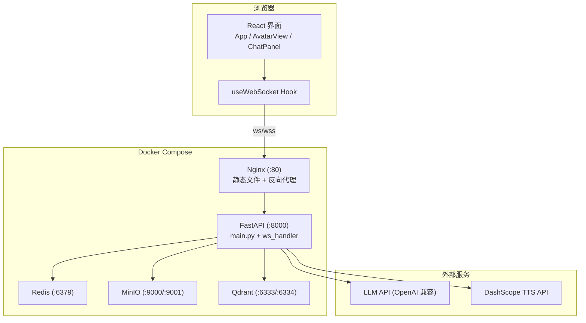
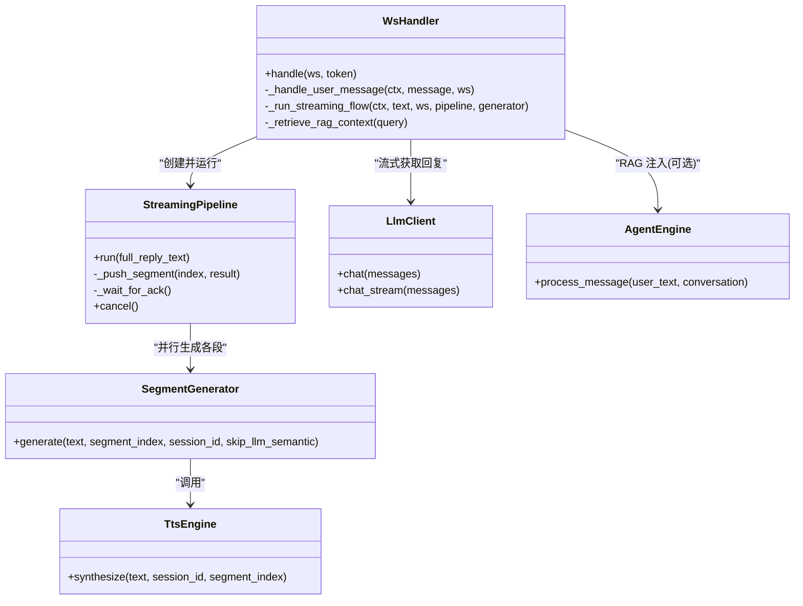
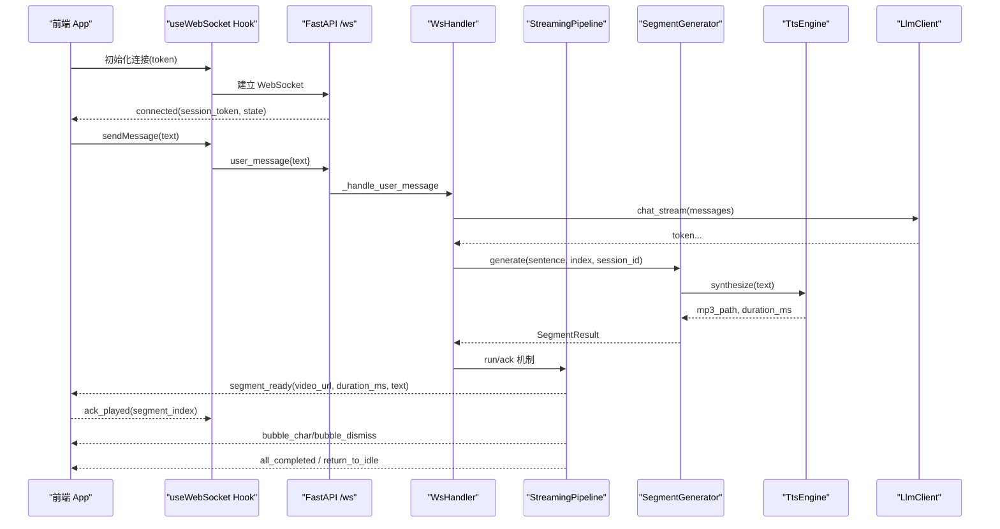
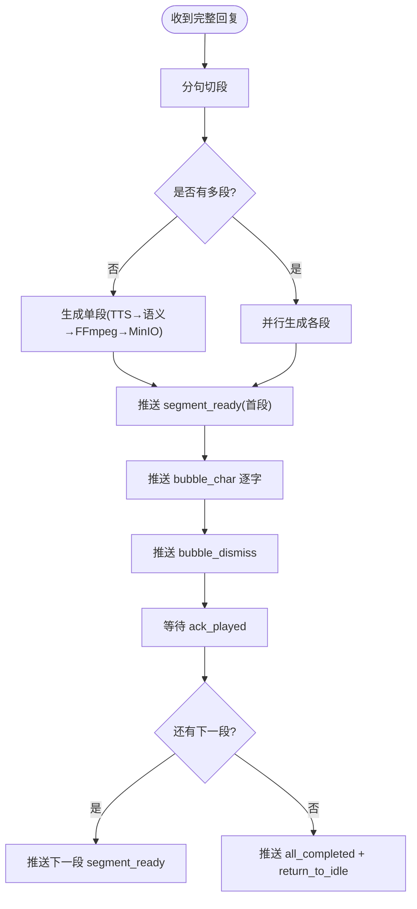
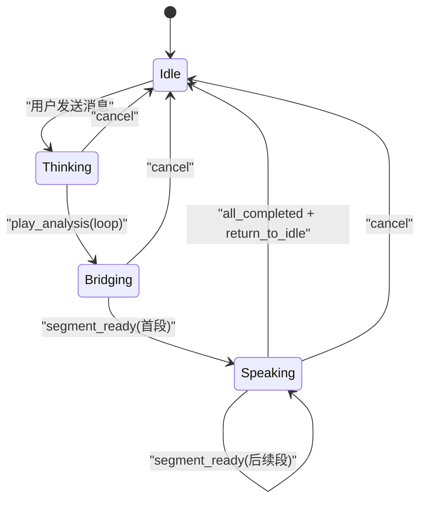
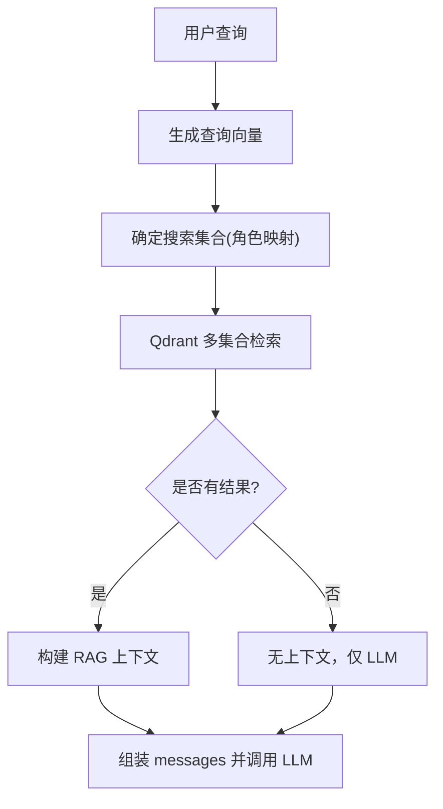
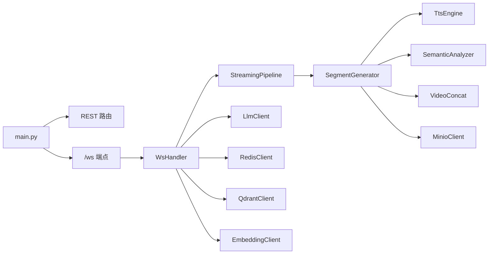

# 项目概述

<cite>
**本文引用的文件**   
- [server/main.py](file://server/main.py)
- [server/api/ws_handler.py](file://server/api/ws_handler.py)
- [server/agent/agent_engine.py](file://server/agent/agent_engine.py)
- [server/pipeline/streaming_pipeline.py](file://server/pipeline/streaming_pipeline.py)
- [server/pipeline/segment_generator.py](file://server/pipeline/segment_generator.py)
- [server/services/tts_engine.py](file://server/services/tts_engine.py)
- [server/services/llm_client.py](file://server/services/llm_client.py)
- [client/src/App.tsx](file://client/src/App.tsx)
- [client/src/hooks/useWebSocket.ts](file://client/src/hooks/useWebSocket.ts)
- [client/src/components/AvatarView.tsx](file://client/src/components/AvatarView.tsx)
- [client/src/types/events.ts](file://client/src/types/events.ts)
- [config.json](file://config.json)
- [docker-compose.yml](file://docker-compose.yml)
- [doc/tech-spec.md](file://doc/tech-spec.md)
</cite>

## 目录
1. [简介](#简介)
2. [项目结构](#项目结构)
3. [核心组件](#核心组件)
4. [架构总览](#架构总览)
5. [详细组件分析](#详细组件分析)
6. [依赖关系分析](#依赖关系分析)
7. [性能与体验优化](#性能与体验优化)
8. [快速开始](#快速开始)
9. [故障排查指南](#故障排查指南)
10. [结论](#结论)

## 简介
RealTimeTalk 是一个基于 AI 的实时数字人对话系统。用户通过浏览器与虚拟形象进行文字对话，服务端以流式 LLM 响应为基础，边生成边完成 TTS、语义分析、视频拼接与上传，并通过 WebSocket 将“分段就绪”事件推送给前端，实现“边生成边播放”的多模态输出（语音 + 动画视频 + 打字机气泡）。系统采用前后端分离：前端为 React SPA，后端为 FastAPI 服务；同时集成 Redis（会话与历史）、MinIO（媒体存储）、Qdrant（向量检索）以及外部 LLM/TTS API。

## 项目结构
- 前端 client：React + Vite，包含状态管理、WebSocket 客户端、形象视频渲染与聊天面板等模块。
- 后端 server：FastAPI 应用，提供 REST API 与 WebSocket 端点，封装 Agent、StreamingPipeline、TTS、语义分析、视频拼接、MinIO/Redis/Qdrant 等能力。
- 资源 clips：预转换的 WebM VP9 Alpha 切片与待机动画，供运行时拼接使用。
- 配置与部署：config.json 统一配置，docker-compose.yml 编排 Redis、MinIO、Qdrant、Nginx、FastAPI 等服务。

图表来源
- [server/main.py:114-177](file://server/main.py#L114-L177)
- [docker-compose.yml:1-69](file://docker-compose.yml#L1-L69)

章节来源
- [doc/tech-spec.md:644-745](file://doc/tech-spec.md#L644-L745)

## 核心组件
- 会话与路由层：FastAPI 入口注册 REST 路由与 WebSocket 端点，生命周期内初始化 Redis、MinIO、Qdrant、Embedding、Agent 等依赖。
- WebSocket 处理器：负责会话校验、消息分发、错误处理、中断与重连恢复。
- Agent 引擎：纯文本对话生成，支持 RAG 上下文注入与 Markdown 清理。
- 流式管道：接收完整回复文本，分句切段，并行生成各段（TTS → 语义分析 → FFmpeg 拼接 → MinIO），首段就绪立即推送，后续逐段确认式推送。
- 单段生成器：串联 TTS、语义分析、视频拼接与上传，返回段落结果。
- 前端交互：状态机驱动形象视频切换、打字机气泡、输入框与错误提示；自动重连与断线恢复。

章节来源
- [server/main.py:42-111](file://server/main.py#L42-L111)
- [server/api/ws_handler.py:31-129](file://server/api/ws_handler.py#L31-L129)
- [server/agent/agent_engine.py:59-121](file://server/agent/agent_engine.py#L59-L121)
- [server/pipeline/streaming_pipeline.py:16-131](file://server/pipeline/streaming_pipeline.py#L16-L131)
- [server/pipeline/segment_generator.py:27-138](file://server/pipeline/segment_generator.py#L27-L138)
- [client/src/App.tsx:60-183](file://client/src/App.tsx#L60-L183)

## 架构总览
系统分层清晰：前端 UI 层通过 WebSocket 与服务端通信；服务端由会话管理、Agent 引擎、流式管道、服务模块（TTS/语义/视频/存储）组成；底层依赖 Redis、MinIO、Qdrant 与外部 LLM/TTS API。

图表来源
- [server/api/ws_handler.py:31-129](file://server/api/ws_handler.py#L31-L129)
- [server/pipeline/streaming_pipeline.py:16-131](file://server/pipeline/streaming_pipeline.py#L16-L131)
- [server/pipeline/segment_generator.py:27-138](file://server/pipeline/segment_generator.py#L27-L138)
- [server/services/tts_engine.py:38-77](file://server/services/tts_engine.py#L38-L77)
- [server/services/llm_client.py:23-113](file://server/services/llm_client.py#L23-L113)
- [server/agent/agent_engine.py:59-121](file://server/agent/agent_engine.py#L59-L121)

## 详细组件分析

### WebSocket 实时通信与会话管理
- 连接建立：前端通过 useWebSocket Hook 建立 ws/wss 连接，携带 session_token；服务端在 lifespan 中初始化依赖并在 /ws 端点接受连接。
- 消息协议：客户端发送 user_message/ack_played/cancel；服务端推送 state_change/segment_ready/bubble_char/bubble_dismiss/play_analysis/all_completed/return_to_idle/error。
- 会话恢复：断开后自动重连，使用同一 token 恢复会话上下文；若 token 过期则重新创建会话。

图表来源
- [client/src/hooks/useWebSocket.ts:67-117](file://client/src/hooks/useWebSocket.ts#L67-L117)
- [server/main.py:146-170](file://server/main.py#L146-L170)
- [server/api/ws_handler.py:130-188](file://server/api/ws_handler.py#L130-L188)
- [server/pipeline/streaming_pipeline.py:44-131](file://server/pipeline/streaming_pipeline.py#L44-L131)
- [server/pipeline/segment_generator.py:42-106](file://server/pipeline/segment_generator.py#L42-L106)
- [server/services/tts_engine.py:49-77](file://server/services/tts_engine.py#L49-L77)
- [server/services/llm_client.py:115-190](file://server/services/llm_client.py#L115-L190)

章节来源
- [client/src/types/events.ts:1-113](file://client/src/types/events.ts#L1-L113)
- [server/main.py:146-170](file://server/main.py#L146-L170)
- [server/api/ws_handler.py:49-129](file://server/api/ws_handler.py#L49-L129)

### 流式分段与多模态输出
- 分段策略：按中文标点与长度阈值识别句子边界，满足条件即启动一段生成，避免长等待。
- 并行生成：所有段并行执行（TTS → 语义分析 → FFmpeg 拼接 → MinIO），首段完成后立即推送，后续段按 ack 推进。
- 多模态输出：segment_ready 触发视频播放；bubble_char/bubble_dismiss 驱动打字机气泡；all_completed/return_to_idle 回到待机。

图表来源
- [server/pipeline/streaming_pipeline.py:44-131](file://server/pipeline/streaming_pipeline.py#L44-L131)
- [server/pipeline/segment_generator.py:42-106](file://server/pipeline/segment_generator.py#L42-L106)

章节来源
- [server/pipeline/streaming_pipeline.py:16-131](file://server/pipeline/streaming_pipeline.py#L16-L131)
- [server/pipeline/segment_generator.py:27-138](file://server/pipeline/segment_generator.py#L27-L138)

### 虚拟形象与视频播放
- 双视频叠加架构：主视频用于播放 segment（带声音），循环视频用于 idle/analysis（静音），通过 opacity 过渡消除黑闪。
- 无缝切换：pre-load 目标元素，canplay 后立即切换；idle 模式 JS 接管 seek 回开头实现无缝循环。
- 状态联动：收到 play_analysis 进入 Bridging，segment_ready 切换到 Speaking，全部完成回到 Idle。

图表来源
- [client/src/components/AvatarView.tsx:27-150](file://client/src/components/AvatarView.tsx#L27-L150)
- [client/src/App.tsx:79-183](file://client/src/App.tsx#L79-L183)

章节来源
- [client/src/components/AvatarView.tsx:27-594](file://client/src/components/AvatarView.tsx#L27-L594)
- [client/src/App.tsx:60-183](file://client/src/App.tsx#L60-L183)

### 智能知识库（RAG）
- 检索流程：根据角色集合映射选择 Qdrant 集合，对查询进行嵌入，检索 top_k 结果，构建上下文注入到 LLM 请求。
- 降级策略：当 Qdrant/Embedding 不可用时，跳过检索，直接走纯 LLM 回复。

图表来源
- [server/api/ws_handler.py:342-400](file://server/api/ws_handler.py#L342-L400)
- [server/agent/agent_engine.py:123-180](file://server/agent/agent_engine.py#L123-L180)

章节来源
- [server/api/ws_handler.py:342-400](file://server/api/ws_handler.py#L342-L400)
- [server/agent/agent_engine.py:123-180](file://server/agent/agent_engine.py#L123-L180)

### 语音合成（TTS）
- 接口适配：兼容 DashScope 多模态生成接口，支持同步返回与异步任务轮询。
- 并发控制：全局信号量限制并发，避免 429 限流。
- 长文本处理：超过阈值时按句子拆分，分别合成后使用 FFmpeg 拼接。

章节来源
- [server/services/tts_engine.py:38-234](file://server/services/tts_engine.py#L38-L234)

### 大模型客户端（LLM）
- OpenAI 兼容：支持非流式与流式两种调用方式，内置重试与超时处理。
- 错误处理：针对 401/403/429/5xx 等状态码进行差异化处理与重试。

章节来源
- [server/services/llm_client.py:23-204](file://server/services/llm_client.py#L23-L204)

## 依赖关系分析
- 耦合与内聚：WsHandler 作为协调者，聚合 Pipeline、Generator、TTS、LLM、存储客户端；Pipeline 与 Generator 职责清晰，内聚度高。
- 外部依赖：Redis（会话/历史）、MinIO（媒体）、Qdrant（向量检索）、LLM/TTS API（HTTP）。
- 潜在风险：Qdrant/Embedding 不可用时的降级路径已覆盖；TTS 并发受限避免限流；LLM 调用具备重试与超时保护。

图表来源
- [server/main.py:114-177](file://server/main.py#L114-L177)
- [server/api/ws_handler.py:31-129](file://server/api/ws_handler.py#L31-L129)
- [server/pipeline/streaming_pipeline.py:16-131](file://server/pipeline/streaming_pipeline.py#L16-L131)
- [server/pipeline/segment_generator.py:27-138](file://server/pipeline/segment_generator.py#L27-L138)

章节来源
- [server/main.py:114-177](file://server/main.py#L114-L177)
- [server/api/ws_handler.py:31-129](file://server/api/ws_handler.py#L31-L129)

## 性能与体验优化
- 首段优先：首段完成后立即推送，显著降低首帧延迟。
- 并行生成：多段并行执行，减少端到端时延。
- 确认式推送：按 ack 推进，避免前端卡顿或丢帧。
- 打字机节奏：按视频时长动态计算字符间隔，提升观感一致性。
- 视频无缝切换：双 video 叠加与 pre-load，消除黑闪与跳变。
- 并发限流：TTS 并发上限避免 429；LLM 调用具备重试与超时保护。

[本节为通用指导，不直接分析具体文件]

## 快速开始
- 环境准备
  - 安装 Docker 与 Docker Compose。
  - 准备 config.json 中的 LLM/TTS API Key、Redis/MinIO/Qdrant 地址等。
- 一键启动
  - 在项目根目录执行 docker compose up，将拉起 Redis、MinIO、Qdrant、FastAPI、Nginx。
  - 访问 http://localhost 打开前端页面。
- 本地开发
  - 前端：进入 client 目录，安装依赖并启动 Vite 开发服务器。
  - 后端：进入 server 目录，安装 Python 依赖，运行 uvicorn 或直接使用容器镜像。
- 关键配置项
  - llm.endpoint、llm.api_key、llm.model、llm.max_tokens
  - tts.api_key、tts.voice、tts.speed
  - redis.url、minio.endpoint、minio.access_key、minio.secret_key、minio.bucket
  - server.host、server.port、ffmpeg.path

章节来源
- [docker-compose.yml:1-69](file://docker-compose.yml#L1-L69)
- [config.json:1-39](file://config.json#L1-L39)
- [doc/tech-spec.md:502-567](file://doc/tech-spec.md#L502-L567)

## 故障排查指南
- WebSocket 无法连接
  - 检查 Nginx 反向代理与端口映射；确认前端 ws/wss 协议与 host 正确。
  - 查看服务端日志，确认 /ws 端点可用。
- 会话丢失或重连失败
  - 确认 sessionStorage 中 token 存在且未过期；检查 Redis 连接与 TTL。
- 视频无法播放
  - 检查 /api/media 代理是否正确转发至 MinIO；确认浏览器 CORS 与 HTTPS 策略。
- TTS 失败或限流
  - 检查 DashScope API Key 与配额；观察并发信号量与重试逻辑。
- LLM 调用异常
  - 检查 endpoint 可达性与鉴权；关注 429/5xx 重试与超时设置。

章节来源
- [server/main.py:136-143](file://server/main.py#L136-L143)
- [server/api/ws_handler.py:402-444](file://server/api/ws_handler.py#L402-L444)
- [server/services/tts_engine.py:228-234](file://server/services/tts_engine.py#L228-L234)
- [server/services/llm_client.py:192-204](file://server/services/llm_client.py#L192-L204)

## 结论
RealTimeTalk 通过“流式 LLM + 并行分段生成 + 确认式推送”的架构，实现了低延迟、高流畅的数字人多模态对话体验。前端以状态机驱动形象与气泡，后端以 Pipeline 为核心编排多服务协作，结合 RAG 增强回答质量，整体设计兼顾可维护性与可扩展性。借助 Docker Compose 的一键部署方案，新用户可快速搭建并运行系统，开发者也可在此基础上扩展更多音色、技能与业务场景。