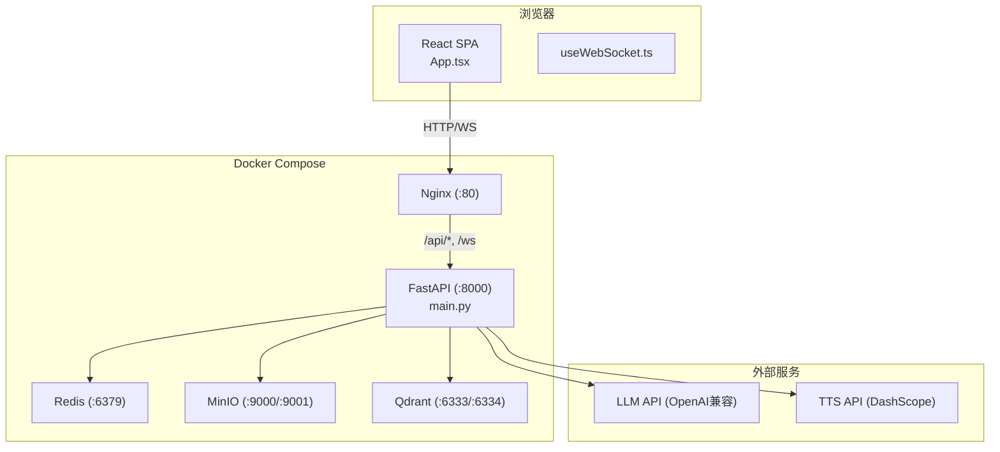
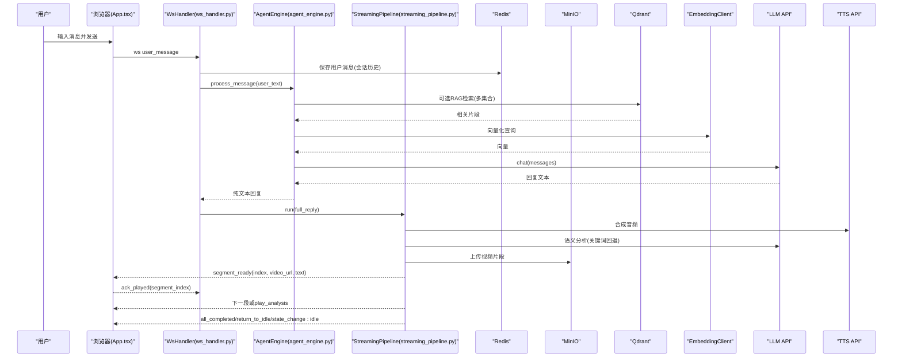
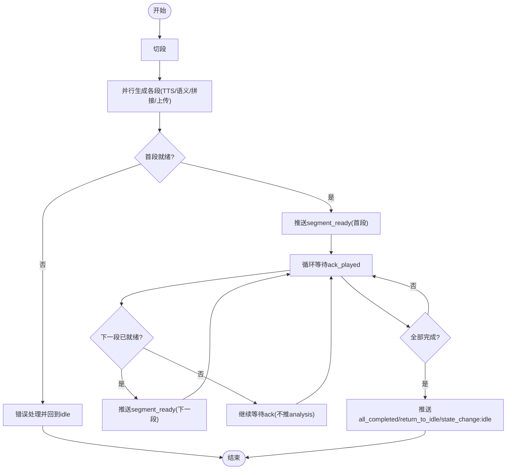
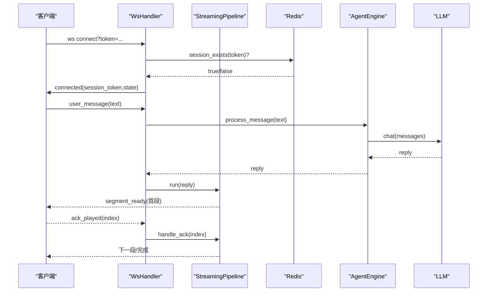
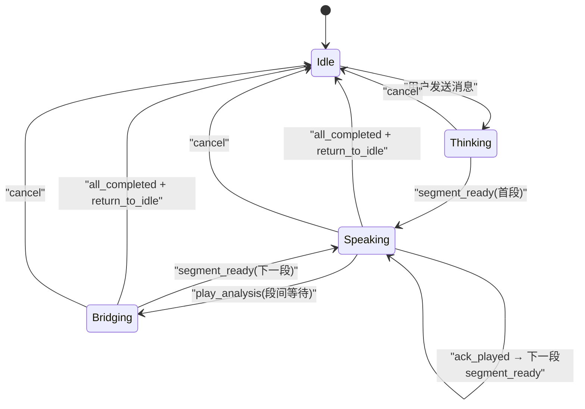
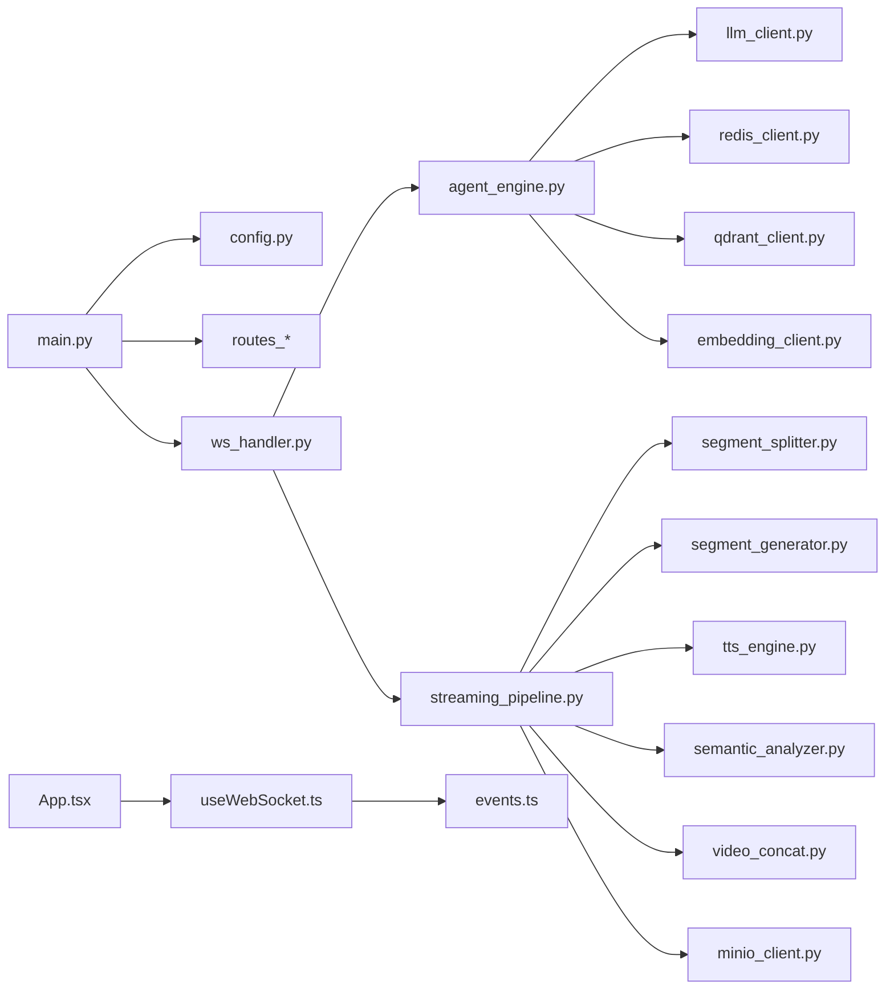

# 知识工作文档

<cite>
**本文引用的文件**   
- [server/main.py](file://server/main.py)
- [server/config.py](file://server/config.py)
- [config.json](file://config.json)
- [server/agent/agent_engine.py](file://server/agent/agent_engine.py)
- [server/pipeline/streaming_pipeline.py](file://server/pipeline/streaming_pipeline.py)
- [server/api/ws_handler.py](file://server/api/ws_handler.py)
- [server/models/session.py](file://server/models/session.py)
- [client/src/App.tsx](file://client/src/App.tsx)
- [client/src/hooks/useWebSocket.ts](file://client/src/hooks/useWebSocket.ts)
- [client/src/types/events.ts](file://client/src/types/events.ts)
- [doc/tech-spec.md](file://doc/tech-spec.md)
- [doc/Qdrant知识库操作指南.md](file://doc/Qdrant知识库操作指南.md)
- [docker-compose.yml](file://docker-compose.yml)
</cite>

## 目录
1. [引言](#引言)
2. [项目结构](#项目结构)
3. [核心组件](#核心组件)
4. [架构总览](#架构总览)
5. [详细组件分析](#详细组件分析)
6. [依赖关系分析](#依赖关系分析)
7. [性能与优化](#性能与优化)
8. [故障排查指南](#故障排查指南)
9. [结论](#结论)
10. [附录](#附录)

## 引言
本仓库实现了一个“实时对话 AI 助手”系统：用户通过浏览器与卡通形象进行文字对话，形象以语音、动画视频和打字机气泡三种形式同步输出回复。服务端采用 FastAPI + WebSocket，结合 Redis（会话与历史）、MinIO（媒体存储）、Qdrant（向量检索）与 LLM/TTS 外部服务，提供流式分段生成与确认式播放控制。前端基于 React + Vite，使用 HTML video 渲染透明 WebM VP9 Alpha 视频，配合状态机管理交互流程。

## 项目结构
整体工程分为前后端与基础设施编排：
- 后端 server：FastAPI 应用、Agent 引擎、流式分段管道、REST/WebSocket 接口、配置加载、模型与会话数据类、外部服务客户端封装等。
- 前端 client：React SPA，包含根组件、WebSocket Hook、事件类型定义、UI 组件等。
- 资源 clips：语义切片库与待机动画。
- 部署 docker-compose：Redis、MinIO、Qdrant、Nginx、FastAPI 服务编排。
- 文档 doc：技术规格、需求说明、Qdrant 知识库操作指南。

图表来源
- [server/main.py:114-133](file://server/main.py#L114-L133)
- [docker-compose.yml:1-69](file://docker-compose.yml#L1-L69)

章节来源
- [doc/tech-spec.md:37-113](file://doc/tech-spec.md#L37-L113)
- [docker-compose.yml:1-69](file://docker-compose.yml#L1-L69)

## 核心组件
- 应用入口与生命周期管理：负责加载配置、初始化外部服务连接、注册路由、挂载静态资源、健康检查与优雅关闭。
- 配置模块：支持 config.json 与环境变量合并，提供全局懒加载配置访问。
- Agent 引擎：纯文本对话生成，集成 RAG 检索增强，Markdown 清理与消息持久化。
- 流式分段管道：接收完整回复文本，切段并行生成（TTS+语义分析+FFmpeg拼接+上传），首段就绪即推送，后续按 ack 逐段推进。
- WebSocket 处理器：会话校验与恢复、消息分发、错误处理、中断与重连支持。
- 前端 App 与状态机：Idle/Thinking/Speaking/Bridging 状态流转，视频与气泡联动，ack 驱动下一段播放。
- 会话模型：SessionContext 承载 token、状态、对话上下文、当前 Pipeline 与 WS 引用。

章节来源
- [server/main.py:42-111](file://server/main.py#L42-L111)
- [server/config.py:148-260](file://server/config.py#L148-L260)
- [server/agent/agent_engine.py:59-121](file://server/agent/agent_engine.py#L59-L121)
- [server/pipeline/streaming_pipeline.py:16-131](file://server/pipeline/streaming_pipeline.py#L16-L131)
- [server/api/ws_handler.py:31-129](file://server/api/ws_handler.py#L31-L129)
- [client/src/App.tsx:60-183](file://client/src/App.tsx#L60-L183)
- [server/models/session.py:14-41](file://server/models/session.py#L14-L41)

## 架构总览
系统分层清晰：前端 UI 层 → WebSocket 层 → Agent 引擎层 → 流式管道层 → 会话管理层 → 存储层（Redis/MinIO/Qdrant）→ 外部服务层（LLM/TTS）。

图表来源
- [server/api/ws_handler.py:130-341](file://server/api/ws_handler.py#L130-L341)
- [server/agent/agent_engine.py:74-121](file://server/agent/agent_engine.py#L74-L121)
- [server/pipeline/streaming_pipeline.py:44-131](file://server/pipeline/streaming_pipeline.py#L44-L131)
- [client/src/App.tsx:79-183](file://client/src/App.tsx#L79-L183)

## 详细组件分析

### 应用入口与生命周期（FastAPI）
- 启动时加载配置、连接 Redis、MinIO、Qdrant、Embedding，注入 RAG 客户端到 AgentEngine，注册 REST 路由与 WebSocket 端点，挂载静态资源。
- 健康检查返回服务状态与活跃会话数。
- 优雅关闭：取消所有活跃 Pipeline、关闭 WS、断开 Redis。

章节来源
- [server/main.py:42-111](file://server/main.py#L42-L111)
- [server/main.py:136-143](file://server/main.py#L136-L143)
- [server/main.py:146-170](file://server/main.py#L146-L170)
- [server/main.py:173-180](file://server/main.py#L173-L180)

### 配置加载（config.json + 环境变量）
- 优先级：环境变量 > config.json；支持 .env 覆盖。
- 提供扁平化配置字典，供各模块读取（LLM/TTS/Redis/MinIO/FFmpeg/Qdrant/Embedding/RAG/Admin Token 等）。
- 默认 system prompt 可从 resources 文件加载。

章节来源
- [server/config.py:148-260](file://server/config.py#L148-L260)
- [config.json:1-39](file://config.json#L1-39)

### Agent 引擎（含 RAG）
- 接收用户输入，维护对话历史（Redis 持久化），必要时触发摘要压缩。
- 组装 messages（system + 摘要 + 历史 + 当前输入），调用 LLM 生成纯文本回复。
- RAG 检索：根据角色-集合映射，在 Qdrant 中并发检索 Top-K，构建上下文注入提示词。
- Markdown 清理：确保输出为纯文本，利于后续 TTS 与字幕展示。

章节来源
- [server/agent/agent_engine.py:59-121](file://server/agent/agent_engine.py#L59-L121)
- [server/agent/agent_engine.py:123-181](file://server/agent/agent_engine.py#L123-L181)

### 流式分段管道（StreamingPipeline）
- 分句切段：按中文标点分割，阈值控制段落长度。
- 并行生成：所有段同时启动（TTS + 语义分析 + FFmpeg 拼接 + MinIO 上传）。
- 首段优先：首段完成后立即推送，后续段等待前端 ack 后逐段推进。
- 衔接策略：若下一段未就绪，可推送 play_analysis 过渡（当前实现改为静默等待，避免打断说话形象）。
- 打字机气泡：按字符间隔推送 bubble_char，最后推送 bubble_dismiss。
- 完成收尾：all_completed + return_to_idle + state_change:idle。

图表来源
- [server/pipeline/streaming_pipeline.py:44-131](file://server/pipeline/streaming_pipeline.py#L44-L131)
- [server/pipeline/streaming_pipeline.py:132-197](file://server/pipeline/streaming_pipeline.py#L132-L197)

章节来源
- [server/pipeline/streaming_pipeline.py:16-131](file://server/pipeline/streaming_pipeline.py#L16-L131)
- [server/pipeline/streaming_pipeline.py:132-214](file://server/pipeline/streaming_pipeline.py#L132-L214)

### WebSocket 处理器（会话与消息）
- 连接建立：校验 token，从 Redis 恢复会话上下文，发送 connected 事件。
- 消息分发：user_message → 后台流式处理；ack_played → 通知 Pipeline；cancel → 中断并回到 idle。
- 流式处理：边接收 LLM 流式 token 边识别句子边界，满阈值立即启动段生成任务；首段就绪即推送，后续按 ack 推进。
- 错误处理：统一 error 事件与状态重置。

图表来源
- [server/api/ws_handler.py:49-129](file://server/api/ws_handler.py#L49-L129)
- [server/api/ws_handler.py:130-341](file://server/api/ws_handler.py#L130-L341)

章节来源
- [server/api/ws_handler.py:31-129](file://server/api/ws_handler.py#L31-L129)
- [server/api/ws_handler.py:130-341](file://server/api/ws_handler.py#L130-L341)

### 前端 App 与状态机
- 状态：Idle → Thinking → Speaking → Bridging → Idle。
- 交互：点击形象弹出输入框；回车发送后立即播放 analysis 循环；收到 segment_ready 切换至首段视频；每段播完发送 ack；全部完成后回到 Idle。
- 气泡：bubble_char 追加到最后一条 assistant 消息；bubble_dismiss 在聊天模式下加换行分隔。
- 错误：error 事件显示错误气泡并回到 Idle。

图表来源
- [client/src/App.tsx:60-183](file://client/src/App.tsx#L60-L183)
- [client/src/types/events.ts:7-13](file://client/src/types/events.ts#L7-L13)

章节来源
- [client/src/App.tsx:60-183](file://client/src/App.tsx#L60-L183)
- [client/src/types/events.ts:7-13](file://client/src/types/events.ts#L7-L13)

### 会话模型（SessionContext）
- 字段：token、state、created_at、conversation、pipeline、ws。
- 方法：is_active() 判断是否处于非 idle 状态。

章节来源
- [server/models/session.py:14-41](file://server/models/session.py#L14-L41)

### 知识库（Qdrant）操作指南要点
- 概念：集合(Collection)、向量(Vector)、嵌入(Embedding)、分数(Score)。
- 界面：admin.html 独立管理页面，Token 鉴权。
- 集合管理：查看/新建/删除集合。
- 知识摄入：自动分块（500字窗口，段落重叠100字）。
- 搜索调试：Top 5 结果，跨集合或指定集合。
- 工作原理：角色-集合映射、对话中 RAG 流程、纯 LLM 降级条件。
- 最佳实践：知识编写建议、集合组织建议、验证生效步骤。
- 常见问题：生效失败排查、低分结果解释、多集合使用、删除不可恢复。

章节来源
- [doc/Qdrant知识库操作指南.md:1-213](file://doc/Qdrant知识库操作指南.md#L1-L213)

## 依赖关系分析
- 模块耦合：
  - main.py 聚合配置、服务客户端、路由与生命周期。
  - agent_engine.py 依赖 llm_client、redis_client、qdrant_client、embedding_client。
  - streaming_pipeline.py 依赖 segment_splitter、segment_generator（内部组合 tts/semantic/video_concat/minio）。
  - ws_handler.py 协调 agent、pipeline、session、外部服务。
  - 前端 App.tsx 依赖 useWebSocket Hook 与事件类型定义。
- 外部依赖：
  - Redis：会话状态与对话历史。
  - MinIO：生成的视频/音频临时产物与最终片段。
  - Qdrant：向量检索（可选，RAG）。
  - LLM/TTS：外部 API 调用。

图表来源
- [server/main.py:114-133](file://server/main.py#L114-L133)
- [server/api/ws_handler.py:1-27](file://server/api/ws_handler.py#L1-L27)
- [server/agent/agent_engine.py:1-28](file://server/agent/agent_engine.py#L1-L28)
- [server/pipeline/streaming_pipeline.py:1-13](file://server/pipeline/streaming_pipeline.py#L1-L13)
- [client/src/App.tsx:1-20](file://client/src/App.tsx#L1-L20)
- [client/src/hooks/useWebSocket.ts:1-13](file://client/src/hooks/useWebSocket.ts#L1-L13)
- [client/src/types/events.ts:1-13](file://client/src/types/events.ts#L1-L13)

章节来源
- [server/main.py:114-133](file://server/main.py#L114-L133)
- [server/api/ws_handler.py:1-27](file://server/api/ws_handler.py#L1-L27)
- [server/agent/agent_engine.py:1-28](file://server/agent/agent_engine.py#L1-L28)
- [server/pipeline/streaming_pipeline.py:1-13](file://server/pipeline/streaming_pipeline.py#L1-L13)
- [client/src/App.tsx:1-20](file://client/src/App.tsx#L1-L20)
- [client/src/hooks/useWebSocket.ts:1-13](file://client/src/hooks/useWebSocket.ts#L1-L13)
- [client/src/types/events.ts:1-13](file://client/src/types/events.ts#L1-L13)

## 性能与优化
- 首段优先：首段完成后立即推送，降低首帧延迟。
- 并行生成：所有段同时启动，充分利用 I/O 与 CPU/GPU 资源。
- 跳过 LLM 语义分析：当前实现统一使用关键词回退语义分析，避免额外 LLM 调用开销。
- 打字机节奏：按视频时长比例计算单字间隔，上限 50ms，下限 15ms，提升观感与流畅度。
- 断线重连：指数退避（1s→2s→4s→8s，最大 30s），保持同一 Session Token。
- 资源清理：优雅关闭时取消 Pipeline、关闭 WS、断开 Redis，避免资源泄漏。

[本节为通用指导，无需具体文件引用]

## 故障排查指南
- 连接问题：
  - 健康检查 /api/health 返回 status、redis 可用性、sessions 数量。
  - WebSocket 连接失败时，前端会记录错误并重连。
- 会话异常：
  - 新连接但 token 不存在于 Redis：服务端关闭连接并提示先创建会话。
  - 重连恢复：从 Redis 加载对话历史并恢复上下文。
- 生成失败：
  - LLM/TTS/语义分析/FFmpeg/MinIO 任一环节失败，推送 error 事件并回到 idle。
- RAG 不可用：
  - Qdrant 或 Embedding 不可用时，自动降级为纯 LLM 回复。

章节来源
- [server/main.py:136-143](file://server/main.py#L136-L143)
- [server/api/ws_handler.py:57-84](file://server/api/ws_handler.py#L57-L84)
- [server/api/ws_handler.py:335-341](file://server/api/ws_handler.py#L335-L341)
- [server/api/ws_handler.py:342-400](file://server/api/ws_handler.py#L342-L400)

## 结论
RealTimeTalk 将大模型对话能力与多媒体输出深度融合，通过流式分段与确认式播放机制，实现了低延迟、高流畅的用户体验。系统具备完善的会话隔离、断线重连与错误处理，并通过 RAG 增强回答的准确性与相关性。整体架构清晰、模块化良好，便于扩展与维护。

[本节为总结性内容，无需具体文件引用]

## 附录

### Docker Compose 服务清单
- qdrant：向量数据库
- redis：会话与历史存储
- minio：对象存储（控制台 9001）
- server：FastAPI 服务（8000）
- nginx：反向代理与静态资源（80）

章节来源
- [docker-compose.yml:1-69](file://docker-compose.yml#L1-L69)

### 配置项速览（部分）
- LLM：endpoint、api_key、model、max_tokens
- TTS：api_key、voice、speed
- Redis：url、session_ttl_hours
- MinIO：endpoint、access_key、secret_key、bucket、presigned_url_ttl_seconds
- FFmpeg：path、gpu_encoder
- Qdrant：url、api_key
- Embedding：endpoint、api_key、model
- RAG：top_k、role_collections
- Admin Token：knowledge_admin_token

章节来源
- [server/config.py:16-126](file://server/config.py#L16-L126)
- [config.json:1-39](file://config.json#L1-39)